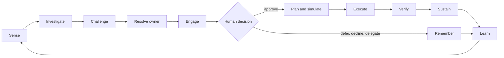

# Azure Cost in Action

> **AI-infused, agent-driven, human-in-the-loop Azure cost optimisation — from insight to outcome.**
> *Working title.* Status: **ideation v2** — review round 1 applied ([disposition](docs/reviews/round-1/disposition.md)), round 2 in progress · private repository · not yet licensed (decisions pending: name D1, licence D2, employer approval D13 in [plan/01](docs/plan/01-assumptions-risks-decisions.md)). What changed: [CHANGELOG](CHANGELOG.md).

Azure already tells you **what you spend** (Cost Management) and **what you could save** (Advisor). Almost nobody closes the loop: recommendations are addressed to nobody, owners are busy, trust is low, execution is manual, savings are never verified, and waste drifts back.

**Azure Cost in Action** explores a **crew of AI agents (Microsoft Foundry)** that studies how Azure is *actually used*, builds an evidence-backed **case** for every opportunity, finds the **owner** (and asks when it can't tell), meets them in **Teams or email** with a safe one-tap action, **executes** the approved change, **verifies** the saving, and keeps it from drifting back — with **humans in control** by construction.

> **Every euro spent on Azure has an owner and a reason. Every euro that doesn't becomes a decision — put to the right human, in the place they already work, with evidence and a safe one-tap fix — and then it is executed, proven, and kept from drifting back.**

---

## Release 1 at a glance (the first thing we would build — after a four-week kill-or-confirm sprint)

| # | Item | First mode |
|---|---|---|
| 1 | **Owner Graph** — know who owns what, and ask when unsure | Advise |
| 2 | **Log usefulness** (seed example 1) — which ingested data is never used, and how to filter it | **Advise only** (collection-reducing, so no writes) |
| 3 | **P2S gateway right-sizing** (seed example 2) — hidden scale units nobody uses | Assist (human-approved, in a window) |
| 4 | **Orphans** — the loop-proving vehicle: owner → decision → action → verified saving | Advise → Assist via a named custodian |
| 5 | **Provisioned-throughput utilisation** — a demand-pull candidate for AI workloads | Advise |

Everything else is a *research-queue* hypothesis, *parked* with a re-open trigger, or *retired* with a reason ([catalog](docs/ideation/02-opportunity-catalog.md#selection-and-status-v2)). We would stop early if the [kill criteria K1–K7](docs/plan/01-assumptions-risks-decisions.md) say so.

---

## Founding constraints

Runs on **Microsoft platforms** (Azure / Power Platform / M365) · **Microsoft technology only** · compliant with the **Cloud Adoption Framework** and **Well-Architected Framework** · **open source** · **FULL AI** · **HITL** · **guardrails before code**.

---

## Start here

| # | Document | What it is |
|---|---|---|
| 1 | [North-star vision](docs/ideation/01-north-star-vision.md) | **The entire idea**: problem, loop, Case, autonomy ladder, "FULL AI", principles, bets |
| 2 | [Opportunity catalog](docs/ideation/02-opportunity-catalog.md) | 305 ideas in 17 families, each with a *usage-truth* signal, decision gates and a status (selected / queue / parked / retired) |
| 3 | [Deep dives: the seed examples](docs/ideation/03-deep-dives-seed-examples.md) | Log Analytics ingestion usefulness and vWAN P2S capacity (banded), end-to-end; dark-spend archaeology |
| 4 | [The Crew](docs/ideation/04-agent-crew.md) | 20 agent roles, separation of duties, the independence profile, governed releases |
| 5 | [Human interaction concepts](docs/ideation/05-human-interaction-concepts.md) | Teams cards, email, SMS, voice, avatars, the private-first escalation ladder, conversation design, storyboards |
| 6 | [Closed loop, actions & autonomy](docs/ideation/06-closed-loop-actions-and-autonomy.md) | The 14-step loop, one reversibility class per action (R0–R3, R3-Data), safe-change toolkit, policy envelopes, verification |
| 7 | [Ownership & organisation](docs/ideation/07-ownership-and-organization.md) | Owner Graph, "follow the directory", the orphan custodian, control-plane tags, incentives, people-data ethics |
| 8 | [Trust, safety & the guardrail territory](docs/ideation/08-trust-safety-and-guardrail-topics.md) | 14 guardrail domains, 109 questions, 38 threats, 16 candidate invariants |
| 9 | [The outer rim](docs/ideation/09-outer-rims-moonshots.md) | 40 moonshots with their hard parts, smallest experiments and a decision status |
| 10 | [Value, metrics & economics](docs/ideation/10-value-metrics-and-economics.md) | Scoreboard, net realised value, savings-ledger rules, a pre-registered pilot design |
| 11 | [Press release from the future + tough FAQ](docs/ideation/11-working-backwards-pr-faq.md) | The idea stress-tested as a launch, with kill criteria K1–K7 |

### The plan
| Document | What it is |
|---|---|
| [Follow-up plan](docs/plan/00-follow-up-plan.md) | Phases 0.5–8, risk-based gates, Release 1, where every idea stands |
| [Assumptions, risks, decisions](docs/plan/01-assumptions-risks-decisions.md) | 24 assumptions, 25 risks, 16 decisions for the operator, kill criteria K1–K7, the first-party overlap map |
| [Guardrails workplan](docs/plan/02-guardrails-workplan.md) | How the guardrail territory becomes enforceable, tested rules — control matrix and write-safety harness |
| [Capability radar & spikes](docs/plan/03-capability-radar.md) | Non-binding: what to evaluate and the 19 active feasibility spikes |

### The research (primary-source, dated)
| Document | Topic |
|---|---|
| [01 Azure-native landscape](docs/research/01-azure-native-landscape.md) | Cost Management, Advisor, FinOps toolkit, Azure Copilot/agents — and where they stop |
| 02 Third-party & OSS landscape | Commercial/OSS FinOps products and AI entrants — **pending** (a bounded re-run is in progress) |
| [03 FinOps framework & evidence](docs/research/03-finops-framework-and-evidence.md) | FinOps Framework, FOCUS, State of FinOps, last-mile evidence, regulatory anchors |
| [04 Seed-example facts](docs/research/04-seed-example-facts.md) | Log Analytics and vWAN P2S mechanics (banded capacity); the capacity-unit pattern |
| [05 Cost traps & dark spend](docs/research/05-cost-traps-and-dark-spend.md) | A sourced catalog of 145 Azure cost traps |
| [06 First-party tear-down](docs/research/06-first-party-teardown.md) | Advisor, FinOps toolkit v15, Defender governance, SRE Agent, Sentinel SOC optimization — what exists, what we ride, copy, build or contribute |

### The reviews
| Document | Topic |
|---|---|
| [Round 1 — disposition of all 41 findings](docs/reviews/round-1/disposition.md) | Three independent reviewers (product, safety, strategy); raw reports preserved verbatim next to it |
| [Round 2](docs/reviews/round-2/README.md) | Review of the v2 package — **in progress** |
| [Archive of v1](docs/_archive/round-1-v1/) | The frozen pre-review package (git tag `ideation-v1`) |

---

## Scope guard

This repository is currently **ideation only**. Technology, feasibility and the *content* of guardrails are deliberately deferred to the [plan](docs/plan/00-follow-up-plan.md). Numbers in examples are illustrative unless a source is cited. Nothing here has touched a customer environment.
