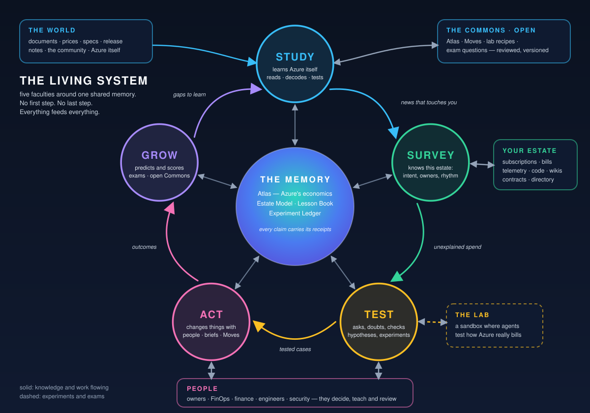

# Meternaut

> **Open source (MIT) and public since 2026-11-10.** How to report a vulnerability: [SECURITY.md](SECURITY.md). What was checked before the repository went public, and how it is guarded: [the record](docs/proposals/18-making-the-repository-public.md). The documents and the changelog quote commits by the short ids of the earlier, private history: [the table of commit ids](docs/history/commit-ids-before-2026-11-10.md) gives the new ones.

> **Every euro spent on Azure has a reason. This AI learns the reasons — and finds, tests and fixes the euros that have none.**
>
> *Status: an idea, a design and a plan; a first environment (a network, a base for the cases app and a budget, deployed through a workflow; it first held a private model account and a usage recording too, which the owner ordered removed on 2026-11-07; Meternaut first built on the owner's API Management instance as a central AI gateway, and since 2026-11-07, on the owner's order, it no longer touches that instance at all); the first cases, a read-only Watch that has run on a real estate and found its first leads; and the loop, deployed on top of them: a console, the approval of a plan by a person, a change that is made as that person, with that person's own rights (Meternaut holds no right to change Azure), and the letters. A real Watch has made plans for planted disks and the owner has approved three on the page: the first two were deleted by a separate identity, since retired and removed; the third, on 2026-11-05, was deleted as the approver, and the Activity Log names the owner as the caller. The check two days later is next. The Watch's search for waste is rebuilt around two agents in Microsoft Foundry, deployed and run on the real estate — see [Status](#status).*

## Read this first

**What this is.** A plan for an AI system that finds money that Azure customers spend for no reason, explains it in plain words to the person who owns it and, only after that person says yes, fixes it. It would run on Microsoft Foundry.

**What exists today.** The documents below (the idea, the design, the experience design and the build plan), the first environment, which is deployed: a network, a base for the cases app and a budget, set up only through a workflow. It first held a private model account and a usage recording too; on 2026-11-07 the owner ordered them removed ("Old crap needs to be removed. Why ask? Of course."), because nothing called the account or fed the recording any more and a tool that saves cost does not carry idle resources of its own, and the Hub action `retire-old` deletes them. It first used the owner's existing API Management instance as a central AI gateway (Citadel's rules). On 2026-11-07 the owner ordered, in capitals, the undo of everything that Meternaut had added there, and **Meternaut no longer touches his API Management instance at all**: the workflow and the repository have no action, template or tool that can create, change or read an object on it, and a person removes what was added, by hand ([the changelog](CHANGELOG.md)). The usage recording had nothing left to record after that undo, and it is removed too (see above). The AI Gateway of Azure (a separate service) has been deployed since 2026-11-07, because the owner asked for it in writing: its front door is public (Microsoft Entra ID and a role protect it) and its way to the Foundry resource is private. It is the governance hub of the Citadel design now: every model call of Meternaut goes through it, with no direct path ([rule 15 (c)](AGENTS.md)). The Detective and the Skeptic of the cases app call it with the app's own identity (they ran through it on 2026-11-08). The agents go through it too: the switch of its step 2 is on in code, and it ran in Azure on 2026-11-08. The first three runs stopped at the Investigator's first call, and the fourth, with a third model (gpt-5.5) for the Investigator, ran an investigation to its end ([the record](docs/proposals/08-ai-gateway.md#what-the-first-real-run-showed)). Nothing public is made unless the owner asks for it in writing ([the decision record](docs/proposals/08-ai-gateway.md), which also says how the gateway meets what the Citadel documents state). The first cases are deployed too: a read-only Watch that lists waste leads in the pilot estate (and, since 2026-11-07, in every subscription that its identity can read: it read 10 on its first run there, once a person had given it the two read roles at the tenant root management group; [the Watch's estate](docs/proposals/03-access-and-onboarding.md#the-watch-reads-every-subscription-that-its-identity-can-read)), lets two models judge the dearest three and writes a History of every step. It has run on the real estate and found four disconnected private endpoints that belong to another project, which it only reads. On top of that [the loop](docs/proposals/04-the-loop.md) is deployed: a web console behind a Microsoft Entra sign-in, a plan that code writes for a case, a letter to the person who may approve it, the person's answer on a page and a check afterwards. Since 2026-11-05 a change is made [as the approver](docs/proposals/05-run-as-the-approver.md): the person presses "Approve and sign in to Azure", and Meternaut deletes a disk or a public IP address that it planted itself in its own resource group with that person's own rights. Meternaut holds no right of its own to change anything in Azure. It is proved once on the real estate: on 2026-11-05 the owner approved a plan for a planted disk and signed in to Azure, and the Activity Log names him as the caller of the delete. Two earlier approvals the same day were made with a separate identity of Meternaut's own that held a write role; that identity and its role are retired and removed. The next check is the one two days later (the case becomes `verified`; [the changelog](CHANGELOG.md) says what was deployed, what was checked and what was found). The two older model roles of that Watch, the Detective and the Skeptic, are prompts and not hosted agents: they went through the owner's API Management instance until 2026-11-07, when the owner ordered the undo of what Meternaut added to it, then called the model deployments of the agents' own Foundry project directly for a few hours (tried in a `cases-run` the same day: both models answered), and now call the AI Gateway with the app's identity and no key (they ran through it on 2026-11-08). On 2026-11-06 the search for waste was rebuilt around two agents in Microsoft Foundry with generic read-only tools, so that nobody tells the Watch what to look for ([the decision record](docs/proposals/06-foundry-agents.md)). That is deployed, and on 2026-11-06 the agents found waste in the pilot estate by themselves ([the changelog](CHANGELOG.md) says what they found and what they missed). A first set of tools and a small gateway built earlier were removed on 2026-11-03, so that the design comes first; they stay in the history at the git tag `implementation-v0`.

**What comes next.** [The first environment](docs/proposals/01-first-environment.md) and [the first cases](docs/proposals/02-first-cases.md) are deployed and checked. [Access and onboarding](docs/proposals/03-access-and-onboarding.md) writes down what Meternaut needs granted outside its own resource group, who must grant it and what an installer or a pipeline must do; the installer that checks and grants it is built, and so are the tools for the sign-in app and the shared mailbox. [The loop](docs/proposals/04-the-loop.md) says what a person does once, how the console, the approval and the change as the approver work, and what is not built: a Teams card, a second approver, quiet hours, a separate app for the console and the change, the way back (a remove action) and more kinds of change. [Run as the approver](docs/proposals/05-run-as-the-approver.md) records why Meternaut holds no right to change Azure and what follows from that. After that come the build plan's next slices.

## The idea

Cost optimisation has a bottleneck: **somebody has to work out *why* each euro is spent and what it would take to spend less.** That knowledge is produced by hand, one service and one estate at a time — so advice is thin, late, and ignored.

This project, **Meternaut** (an explorer of billing meters), imagines an AI that **does the knowledge work itself — like a scientist for Azure's economics**. It starts from what Azure already tells you — Cost Management, budgets, Advisor — and closes the loop on it (the owner who never opens a recommendations blade gets a short, explained question), then goes where those tools cannot. In this idea it does five kinds of work:

- **STUDY** — it learns how every Azure service *really* charges. It reads the documentation, price lists and specifications and writes a Service Cost Profile with receipts (a source, a date and a quote) into the **Atlas**, an open map of how Azure charges; it has a provisional profile for a brand-new service within hours; and it checks every profile against the one fact that cannot argue back: the bills people already pay. It reasons from a *Cost Grammar* — fourteen ways money arises, such as capacity, consumption, stock, flow and commitment — not from a list of rules.
- **SURVEY** — it understands each estate: what things are *for*, who owns them, when they are busy, what must not be touched, which agreement the estate sits under and what the system may see and do there.
- **TEST** — it investigates, argues with itself (a Skeptic whose job is to break every case), asks *"what happens to the bill if…?"*, and finds things out without deploying anything just to measure it: it asks, reads the bill, replays history, follows changes people were making anyway and pools what other estates have seen — and, rarely, runs one small guarded trial on something an owner already runs.
- **ACT** — it works *with* people: short, specific questions and decisions in Teams and email, an AI in the meeting, changes carried out only with a human's OK or inside a rule a human wrote. Autonomy is **earned** per domain, and shrinks when trust shrinks.
- **GROW** — it scores every prediction against reality, is evaluated on test cases it cannot see, learns from every answer, and shares what it learns about *Azure* in an open **Commons**: what it reads in public sources, after review, and from customer estates only a privacy-reviewed scope and aggregate, and only when several organisations contribute the same observation.

**It is meant to fit the agreement you actually have:** Enterprise Agreement (EA), Microsoft Customer Agreement (MCA) bought directly, sold through a partner (CSP), or pay-as-you-go; billing-level access or one lonely subscription. It finds out what it may see and do, labels every number with the rates it rests on, and hands each purchase to the person who can make it.

It is a research programme with hands: agents on Microsoft Foundry that study, test and act, with a person in the loop at five places.

> **How to tell whether it learns:** sealed test cases it cannot see — rediscovering waste nobody wrote a rule for, staying quiet on decoys, carrying what it learned on one service over to the next ([getting smarter](docs/07-getting-smarter.md)).

### What it looks like from the outside (an invented example)

> **Retail QA environment — switch it off at night and weekends?** · for its owner · *about €710 a month, priced at the rates on your bill* · fully reversible
> **Why I think so:** six people use it, 07:45–18:30 on weekdays only (11 weeks of access records). **The catch I checked:** two nights show activity — last Tuesday of the month, 02:10–02:50. *Is that a job you need?*
> **A.** Switch off nights and weekends · **B.** …with a wake-up window on the last Tuesday · **C.** Create it per test run instead (I can open the change) · **D.** Do nothing — about €23 a day.
> **[A] [B] [C] [D] · Explain · Challenge · Teach** — and the owner's answer teaches it: *"that's the month-end regression."*

## Where to start

| Read | What it is |
|---|---|
| **[01 · The north star](docs/01-north-star.md)** | **The entire idea.** Start here. |
| [02 · Studying Azure](docs/02-learning-azure.md) | How the AI learns Azure's economics — the Atlas, the Cost Grammar, claims with receipts, day zero for a new service |
| [03 · The estate and the investigation](docs/03-estate-and-investigation.md) | How it understands a customer, follows the directory, learns what it may see and do, hunts and challenges hypotheses, and answers "what happens to the bill if…" |
| [04 · Finding out without spending](docs/04-finding-out-without-spending.md) | How it learns what it cannot read: ask, look, replay, follow, pool — and, rarely, a small guarded trial |
| [05 · Recommend, act, verify](docs/05-recommend-act-verify.md) | The Recommendation, Actions, earned autonomy, purchases under every agreement, and verifying it worked |
| [06 · People and conversation](docs/06-people-and-conversation.md) | Teams cards, email, text, voice, an AI in the meeting — and how every conversation teaches it something |
| [07 · Getting smarter](docs/07-getting-smarter.md) | Predictions, evaluation on sealed cases, the report card and the Commons |
| [08 · The outer rims](docs/08-outer-rims.md) | "What if?" ideas — default-drift radar, polite scream tests, the renewal radar, the cost weather map… |
| [09 · The learning contract](docs/09-the-learning-contract.md) | **What exactly changes when it learns** — six things, how each updates, when it is relied on, how it is tested |
| [10 · The press release from the future](docs/10-press-release-from-the-future.md) | A fictional announcement and the tough questions |
| **[The design](docs/design/README.md)** | How it is built: architecture, agents and workflows, security, safeguards, testing, cost, decisions and the roadmap |
| **[The experience design](docs/experience/README.md)** | What people see, receive and decide: personas and journeys, Teams cards, letters, web pages, dashboards, attention and trust, accessibility, testing |
| **[The build plan](docs/build-plan/README.md)** | What is built first: the slices of phases 0 and 1a, what the adopting organisation provides and decides, the first checks, cost and effort. A plan only |
| **[The first environment](docs/proposals/01-first-environment.md)** | The approved plan for what is set up first (a central AI gateway, Citadel, on the owner's API Management instance, a private model account and a usage recording), in what order, and what is checked at each step. Since 2026-11-07 Meternaut no longer touches the owner's API Management instance: the plan's gateway part is undone, and the page says what stays. The plan's private model account and usage recording are removed too, on the same day. Deployed only through a workflow; the changelog says how far it is |
| **[The first cases](docs/proposals/02-first-cases.md)** | The approved plan for the first piece of Meternaut's own work: leads from the pilot estate, a Detective and a Skeptic that call the models through the AI Gateway (through the owner's API Management instance until 2026-11-07, then direct for a few hours), guards in code, and a History of every step. Read only; the changelog says how far it is |
| **[Access and onboarding](docs/proposals/03-access-and-onboarding.md)** | What Meternaut needs granted outside its own resource group, who must grant it, why a pipeline cannot make the first grant alone, and what an installer or a pipeline must do. The installer that checks and grants it is built; the pipeline is not |
| **[The loop](docs/proposals/04-the-loop.md)** | How a case becomes a person's answer and, for waste that Meternaut planted itself, a checked change: the console and its sign-in, the plan, the letters, the approval, the change that the approver makes and its re-check, the verification, what a person does once, and what is not built. The changelog says how far it is deployed |
| **[Run as the approver](docs/proposals/05-run-as-the-approver.md)** | The decision that Meternaut holds no right to change Azure: why a standing writer was rejected, the other options, how the approver signs in to Azure and the change runs with that person's own rights, the security analysis, what a customer grants, and what is not proved yet |
| **[Foundry agents](docs/proposals/06-foundry-agents.md)** | The decision that the Watch finds waste itself, with two agents in Microsoft Foundry and generic read-only tools: why the first model account cannot hold agents, what the agents and tools are, what code checks in their answers, the one exception to the gateway rule, which the owner's undo of the gateway on 2026-11-07 ended, and what is not shown yet |
| **[Private by default](docs/proposals/07-private-by-default.md)** | The decision that no resource of Meternaut has a public endpoint and no key exists: what that breaks for the deployment workflow (publishing code, starting a run, reading telemetry, checking the console), the options that were weighed, and the Operator, a short-lived container group inside the network with an identity of its own that does those things. The Operator and its probe are built and ran on the real estate, the Event Hubs namespace and the usage app were private-only there from 2026-11-06 (deployed and proven; the usage app was removed on 2026-11-07), and the code of the function apps is published from inside the network; the cases app, Application Insights and the workspace are still public (the cases app is to be closed, its web page reached on the private network and its front door checked from inside the network, which is built and not deployed; the gateway route that was built before is unused). The Event Hubs namespace is to be deleted: the control message moves to a Storage queue (built, not deployed: [the record](environment/BOOTSTRAP.md#changed-on-2026-11-08-the-control-message-goes-through-a-storage-queue-built-not-deployed)) |
| **[An AI Gateway for the agents](docs/proposals/08-ai-gateway.md)** | The decision that every model call of Meternaut goes through our own AI Gateway, Azure's separate service for that, with no key: what the service is, what is verified and what is not, why its frontend is public only and what protects it (Microsoft Entra ID, a role, limits and no key), what the gateway adds to AI security and what it does not, how it meets the principles that the Citadel documents state, the cost and the way back. Step 1 of 2 (the gateway, its models, its limits, its roles and a check) is deployed and checked since 2026-11-07, at the owner's written request; the Detective and the Skeptic of the cases app call it (they ran through it on 2026-11-08); step 2, the Foundry connection and a switch for the agents' model names, is on in code (the switch is True) and ran in Azure on 2026-11-08, four times at `cases-run`: the first three stopped at the Investigator's first call, because neither GPT-6 model takes function tools together with a reasoning effort or the effort none on Chat Completions, and the fourth, with the Investigator on gpt-5.5 (a third model of the gateway, with no effort sent; the Skeptic stays gpt-6.1-sol), ran an investigation to its end. The action `aigateway` still stops at its first step unless the owner has asked in writing for a public AI Gateway |
| **[The decision brief](docs/proposals/09-the-decision-brief.md)** | The decision that every page, letter and card is a render of one object, the decision brief, that lets a stranger decide in a minute: the eight questions it answers, what a person sees on the start page, on a decision, in the history and in the four letters, the new plan family `advise` that gives a finding that Meternaut may not change an answer that is recorded and changes nothing in Azure, what was taken out and why, and what is not done. Deployed from the owner's machine and read on the live page on 2026-11-09. The first version let one finding open 49 near-identical requests, so a finding that gives nothing to decide with is held back, a finding about many resources is one decision, and a finding about data that a workspace stores and nothing reads says what the data is, who reads and writes it and what it costs ([the changelog](CHANGELOG.md)). The Teams cards are rebuilt from it (built, not deployed) |
| **[The investigation toolbox](docs/proposals/12-investigation-toolbox.md)** | What the Investigator's read-only tools gained on 2026-11-08, after its first run found seven things and could analyse none: why its reads were slow and what was measured, seven new tools (what a workspace for logs takes in and who reads and writes it, the deployments of an AI services account, a metric by dimension, commitments, cost by day), the owner hints (who is behind a resource), what each tool does not tell, what each needs at each level of access, and what is not verified. Deployed with the app; the Investigator used its tools in four real runs on 2026-11-09 (24 to 28 tool calls each) |
| **[AI security and governance](docs/proposals/10-ai-security-and-governance.md)** | The controls of layers 1 and 4 of the Citadel blueprint for the agents and the gateway: policy at the project's group, the gateway's telemetry, alert rules and the workbook *Meternaut AI security*, the access list of the gateway, the independent drift check and its heartbeat, the release that runs, and the gaps with who can close them. Deployed from the owner's machine and read back on 2026-11-09: the policy assignments, 8 alert rules and the workbook, the gateway's telemetry and the guardrail with all 16 of its filters, which the audit initiative reports as compliant (12 of 12); the drift check of the control plane read 17 of its 24 controls as PASS on its last run, one control failed (a false alarm of the app's own check, fixed) and six are UNKNOWN with the reason (a portal setting, the directory, and two baselines that the owner has not accepted) |
| **[The agent harness, the drift check and the evaluations](docs/proposals/11-agent-harness-and-evaluation.md)** | What surrounds an agent (layers 2 and 3 of the Citadel blueprint): the lock of the agents' definitions and tools, the harness that holds every run to it (switches, budgets, a guard on every tool call, a brake that pulls the switch for the investigation and tells the owner), the daily drift check in the app and its second reader inside the network, the evaluations and the red team against a synthetic copy of the Investigator, the Agent 365 check, what a person sees, and what is not proved. Deployed: the lock, the harness and the in-app drift check run in the cases app (seven investigations of 2026-11-09 ended well, one of them went dark in a drain of the platform, and one failed on a timeout of the gateway's backend), the second reader in the Operator read the project (`agents-drift`: 4 pass, 0 fail, 4 unknown), both evaluation routes answer (the probe), and the replay of the evaluations ran once (28 fixtures, 983,350 tokens: valid, grounded, no hostile order followed, 71% of the idle resources found, and one decoy proposed for deletion, which fails the threshold of none); the red team stopped on the gateway's cost limit for the day on 2026-11-09 (its first attacks were blocked by the guardrail's Prompt Shields, and Defender for Cloud mailed the owner) and ran to the end on 2026-11-10 (the dataset route: 0 of 20 attacks got the copy to do what it must not; the cloud route of Foundry ended failed with no attack), and the drift check of the control plane shows 18 PASS, 0 FAIL and 6 UNKNOWN |
| **[The Hub on the owner's machine](docs/proposals/16-the-hub-on-the-owners-machine.md)** | The decision of 2026-11-08 that every deploy ran from the owner's machine, with his own Azure sign-in, by a local tool, and why (the quota of GitHub Actions ran out); superseded on 2026-11-11, when the owner ordered the tool deleted and the Hub became a GitHub workflow again |
| **[Teams and Outlook](docs/proposals/13-teams-and-outlook.md)** | The decision that a person who chose Teams gets a card in Teams and not only a letter: what the card shows (the page of the request is its one link; an approval that changes Azure is never taken from Teams), the one public endpoint that this needs, how it is kept narrow (a check of every call's token before anything else, two functions only, answers that change nothing in Azure), the managed-identity bot with no secret, the hand-written token check and what replaces it, the costs, the hand steps for the owner and a Teams administrator, and what is not built (Outlook actionable messages, proof that a card arrives). Built, not deployed |
| **[Families of change](docs/proposals/14-families-of-change.md)** | The decision that an approval can do more than delete: six families (stop a machine, resize it, move a disk one tier down, delete one of a closed list of idle resources, and the first two deletes), each with its own re-check, its call and api-version and its tests; the two gates that every change passes (the resource groups of `CHANGE_SCOPES`, and the planted tag with the planted list, a line that only the owner may change); the digest that binds what a person approves to what runs; how a change that Azure takes minutes to make is followed and settled later; what each family costs an hour on planted waste (the Hub flag `--plant-vm` plants a machine); how a family is added, what is not built and what none of this stops. Built and tested with fakes of Azure and deployed with the app; what ran in Azure is the planting of a machine and a disk, the plans that Meternaut made for them, and the owner's first two approvals (2026-11-09): the deletion of the planted disk ran, and the stop of the machine was refused by its own re-check, which read no power state (a fault that only Azure showed; fixed); the new request that followed was approved by the owner at 15:07 UTC the same day and ran: the machine is stopped and released, which the later check confirmed |
| **[Learning](docs/proposals/15-learning.md)** | What Meternaut learns and what it does not: lessons from the outcomes of closed requests (counted, with one line in the decision brief), the Study of Microsoft's documentation by a third agent whose claims pass a guard of code, a profile of what the identity can see of an estate's agreement and commitments, and tools that let the Investigator recall all of it and the open questions of earlier findings. The learning check ran on 2026-11-09 against thresholds that were written first, on invented requests, and missed two of them: **the claim that learning improves proposals is withdrawn**, and its hold is off. Built with fakes; its code is deployed with the app, the recall tools are in the Investigator's toolbox, and no lesson exists yet (no request has been decided since); the Study is off |
| **[Reservations: instructions only](docs/proposals/17-reservations-instructions-only.md)** | The decision that Meternaut does not buy reservations: it can show a platform recommendation as advice that changes nothing, and the page says, in order, how a person buys one (clean up first, read the recommendation, the role, the portal and API steps, what to check afterwards, and the refund and exchange limits). A purchase tool is not built, because the owner has no means to test one; a sketch of what a customer's tool would need is at the end |
| **[Making the repository public](docs/proposals/18-making-the-repository-public.md)** | The decision that the repository is public, and what that took: every revision of the history read for credentials, identifiers of the owner's estate, names of other projects, addresses and local paths, and rewritten once into a new history (the old one is a private archive); an independent review and what was done about each of its findings; the settings that guard the new repository (rulesets, Actions, secret scanning, Dependabot, code scanning); what is left to the owner and what is not proved |
| Research | [the landscape through the lens of learning](docs/research/landscape.md) · [inspirations: how agents learn](docs/research/inspirations.md) · [the cost-trap bank: 145 sourced cost traps](docs/research/cost-trap-bank.md) |

**Short on time?** The picture above, then [the first minute of the north star](docs/01-north-star.md#in-one-minute).

## The design

The [design](docs/design/README.md) is an index and fourteen short documents in plain language. In outline: seven workflows (plain code) call five hosted agents (ten roles) on Microsoft Foundry and Microsoft Agent Framework, and every model and tool call goes through the adopting organisation's governance hub (Citadel, an API Management gateway). That is the design's target; the first environment's build stopped using it on 2026-11-07, on the owner's order, and uses the AI Gateway of Azure, a separate service, as its governance hub: every model call goes through it, with no direct path ([rule 15 (c)](AGENTS.md)). Agents read and propose; Meternaut holds no right to change Azure, and a change runs as the person who approves it, with that person's own rights. [Agreements and access](docs/design/14-agreements-and-access.md) says what the system does under each Azure agreement and with each level of access. The cost model puts a pilot at a few hundred euros a month at list prices (a calculation, not a measurement); the model and its sources are in [cost and FinOps](docs/design/10-cost-and-finops.md).

## The experience

The [experience design](docs/experience/README.md) is an index and fifteen short documents on what each person sees, receives and decides: personas and journeys, seventeen Teams card templates with renderings, e-mail letters, the approval and notes pages, dashboards, the attention budget and the trust mechanics, reviewers' surfaces, optional voice and meetings, accessibility and language, and how the experience is tested. At its centre is a message that carries one decision for one person, with its evidence one tap away, and asks for nothing that person has not seen in full. [What the experience needs of the technical design](docs/experience/15-asks-of-the-technical-design.md) lists what the system must do for it, and where the design says so.

## The build plan

The [build plan](docs/build-plan/README.md) is an index and four documents on what to build first and how to know that each step works: seventeen slices across phase 0 (foundations, with a week-0 check of the pilot's bill and a small demonstration that new evidence improves answers) and phase 1a (first value on one estate, first for one workload, ending with a Monday digest and findings that the FinOps lead confirms), what the adopting organisation provides and decides before starting, fourteen first checks with their pass conditions and fallbacks, and what it costs and where it can go wrong. The plan itself builds nothing: see Status for what has been built.

## Status

- **Ideation (v5)** — the north star, a deep-dive per faculty and the learning contract. It is the idea the design answers to.
- **Design (v5)** — the architecture, security and governance, testing, cost model, decisions and roadmap, with what the experience needs of the system placed in it. The system itself is not built; the end of the [design index](docs/design/README.md) lists what is unproven.
- **Experience design (v1)** — personas, journeys, cards, letters, pages, dashboards, attention and trust, accessibility and testing. Nothing is built; the cards are templates that tools check and render.
- **Build plan (v2)** — the first two phases as slices, with the first checks, a week-0 check of the pilot's bill and an early demonstration of learning. A first set of tools, a test harness and a small development gateway were built from it and removed on 2026-11-03, because the design comes first; they stay in the history at the git tag `implementation-v0`, and the [changelog](CHANGELOG.md) says what they were. The repository held no code and no pipelines for a day; the first environment's workflow, templates and tools came back on 2026-11-03 (see the next item). What was deployed from the first ones has been deleted from Azure.
- **First environment (deployed and checked; not complete)** — what is set up first and in what order: [the proposal](docs/proposals/01-first-environment.md). The workflow ([`deploy-hub.yml`](.github/workflows/deploy-hub.yml)), the templates ([`environment/`](environment/)) and the tools ([`tools/`](tools/)) are in the repository. The gateway on the owner's API Management instance and its first model were deployed and passed their first checks (a call with the right key was answered; a missing key, a wrong key, an unlisted model and a call over the token limit were each refused). On 2026-11-07 the owner ordered the undo of what Meternaut added to that instance: the workflow actions, the templates and the tools that made objects there are gone, Meternaut no longer touches the instance, and a person removes what was added ([the changelog](CHANGELOG.md)). Not built: the way back (a remove action). The usage recording (ordered on 2026-11-04, rebuilt without any key) and the first model account were removed on 2026-11-07, on the owner's order, because nothing sent the recording usage and nothing called the account any more: the Hub action `retire-old` deletes them, and the shared base stays (the storage account, the workspace, Application Insights and every subnet). On 2026-11-08 the control message of the cases app moved from an Event Hubs namespace (29.2 US dollars a month, with its private endpoint, for one small message now and then) to a Storage queue in the base's storage account; this is built and not deployed, and the Hub action `retire-event-hubs` deletes the namespace after a run of `cases-run` has proved the queue ([the record](environment/BOOTSTRAP.md#changed-on-2026-11-08-the-control-message-goes-through-a-storage-queue-built-not-deployed)). The changelog says what is deployed and checked. The [changelog](CHANGELOG.md) says what has been deployed and checked.
- **First cases (deployed; has run on the real estate; read only)** — a Watch that lists waste leads, two model roles that judge the dearest three (through the AI Gateway since 2026-11-07, and run through it on 2026-11-08; through the owner's API Management instance before, and direct for a few hours), guards in code and a History in a workbook: [the proposal](docs/proposals/02-first-cases.md). What it needs granted outside its own resource group, who grants it and what an installer or a pipeline must do: [access and onboarding](docs/proposals/03-access-and-onboarding.md). The [changelog](CHANGELOG.md) says what has been checked. On 2026-11-06 the search for waste moved to two agents in Microsoft Foundry with generic read-only tools ([the decision record](docs/proposals/06-foundry-agents.md)); that is deployed and has run on the real estate, and the changelog says what it found. Since the fourth real run on 2026-11-08 the agents go through the AI Gateway too.
- **The loop (deployed; three real approvals on 2026-11-05: two before the change, deleted by a separate identity, and the first as the approver, deleted with the owner's own rights)** — the console behind a Microsoft Entra sign-in with no secret, the plan that code writes, the letters from one shared mailbox, the approval on a page, the change that the approver makes with their own rights after a second sign-in to Azure, and the check afterwards, all on resources that Meternaut plants itself: [the proposal](docs/proposals/04-the-loop.md) and [the decision](docs/proposals/05-run-as-the-approver.md). The first two approvals deleted the disks with an identity of Meternaut's own that held a write role in the project's resource group. That identity and its role are retired and removed. The third approval ran as the approver, and the Activity Log names the owner as the caller; the check two days later is next. Tools that a person runs once make the sign-in app ([`tools/entra-setup.py`](tools/entra-setup.py)), with its one delegated permission to use Azure as the signed-in person, and the mailbox ([`tools/exchange-setup.py`](tools/exchange-setup.py)); the access requirements hold reads only. Not built: a second approver, quiet hours, a separate app for the console and the change, and more kinds of change (the Teams card is [built and not deployed](docs/proposals/13-teams-and-outlook.md)). The web page is to run on Flex Consumption, which scales to zero and bills per execution: the owner ordered it on 2026-11-07 (any web app scales to zero) and again on 2026-11-08 at 09:39. Two measurements on 2026-11-08 found that the platform holds its requests there for 50 to 60 seconds, as it had on 2026-11-05 (the changelog has the measurements), and the page was on a Basic plan (13.14 US dollars a month) for part of that day. The constant `CASES_APP_PLAN` says Flex again. The numbers of every new measurement are reported to the owner, who decides, and Basic is the way back only on his word. The move ran on 2026-11-08, and the page answers: after a setting removed the hold, which the platform's default of one HTTP request at a time had caused, the median is 0.08 seconds from inside the network; the changelog has the numbers ([the web page on Flex Consumption](docs/proposals/07-private-by-default.md#the-web-page-on-flex-consumption)).
- **Private by default (decided; the Operator is built and its probe passed twice on the real estate on 2026-11-06; the checks of the usage recording and the first cases run in it and passed there, before and after the Event Hubs namespace was made private; the namespace has been private-only since 2026-11-06, deployed and proven; the code of both function apps is published from inside the network, and the usage app takes no public traffic, deployed and proven; the cases app, Application Insights and the workspace are still public)** — no resource of the project has a public endpoint and no key exists. The cases app, Application Insights and the workspace still have public network access; switching it off stops the deployment workflow from publishing code, starting a run, reading the telemetry and knocking at the console from outside. The answer is the Operator: a short-lived container group in a subnet of the project's network, with a managed identity of its own, that the workflow makes, reads the log of and deletes ([the decision record](docs/proposals/07-private-by-default.md); the template is [`environment/operator/main.bicep`](environment/operator/main.bicep), the tool [`tools/operator-run.py`](tools/operator-run.py), the probe [`operator/probe.sh`](operator/probe.sh) and the generic script that runs a check tool in it [`operator/run-tool.sh`](operator/run-tool.sh)). The first service to go private is Event Hubs, and it is private: the template sets public network access to Disabled, the deploy identity no longer holds a role on the control hubs and the two deploy actions retired the one that it held ([the section](docs/proposals/07-private-by-default.md#event-hubs-private-only-deployed-and-proven-on-2026-11-06) has the runs in order and what they showed: the usage app woke from zero on the private namespace, and the public address refuses an anonymous request; what is not known is whether the gateway's loggers reach a private namespace; they are not made any more since 2026-11-07). Still open: the cases app's phase 3 (it serves the console; the owner decided on 2026-11-06 that the people who approve reach it through the platform's Application Gateway, and on 2026-11-07 that there is no gateway for it and that he reaches the private network instead: the code, the tests and the documents for both are built and nothing is deployed, [the gateway route](docs/proposals/07-private-by-default.md#publishing-code-to-the-private-apps-phase-3-for-the-cases-app-the-console-behind-the-platforms-application-gateway-built-not-deployed) and [the web page on the private network](docs/proposals/07-private-by-default.md#the-web-page-on-the-private-network-built-not-deployed)), the telemetry read once Application Insights is private, and the console check; two decisions are the owner's (a public repository, and the traces of Foundry's agents). The code of both apps is published from the Operator, as the deploy identity, since 2026-11-06 ([phase 2](docs/proposals/07-private-by-default.md#publishing-code-to-the-private-apps-phase-2)), and the usage app was closed after that: anonymous requests to its public address get HTTP 403 ([phase 3 for the usage app](docs/proposals/07-private-by-default.md#publishing-code-to-the-private-apps-phase-3-for-the-usage-app-deployed-and-proven-on-2026-11-06)). The usage app was removed on 2026-11-07 (the first environment, above), so what this entry says about it is a record of what was proved. The Event Hubs namespace that this entry says was made private is to be deleted: since the change of 2026-11-08 (built, not deployed) the control message goes through a Storage queue, and the Operator's role is on that queue ([the record](environment/BOOTSTRAP.md#changed-on-2026-11-08-the-control-message-goes-through-a-storage-queue-built-not-deployed)).
- **An AI Gateway for every model call (deployed on 2026-11-07; the Detective and the Skeptic call it and ran through it on 2026-11-08; the agents go through it too, since the fourth `cases-run` of step 2 on 2026-11-08)** — every model call of Meternaut goes through our own AI Gateway, Azure's separate service for that (a preview, not API Management), and not straight to the model deployments, with no key and with the controls for AI security at the gateway ([the decision record](docs/proposals/08-ai-gateway.md), which also says how the gateway meets the Citadel documents). The owner believed that the gateway can be private. It cannot: the frontend of the service is public only today, and only the way from the gateway to the Foundry resource is private ([the section](docs/proposals/08-ai-gateway.md#the-frontend-is-public-only-and-what-protects-it) says what protects the public endpoint). He accepted that in writing on 2026-11-07 ("Create the AI Gateway with public network access and private routing."), and the gateway was made. Built: the templates [`environment/aigateway/subnet.bicep`](environment/aigateway/subnet.bicep) (its subnet, made first) and [`environment/aigateway/main.bicep`](environment/aigateway/main.bicep) (the gateway, made after the landing zone's route table is on the subnet), the limits [`environment/aigateway/policies.json`](environment/aigateway/policies.json), the actions `aigateway` and `aigateway-check` of [`deploy-hub.yml`](.github/workflows/deploy-hub.yml), and the tools [`tools/aigateway-prep.py`](tools/aigateway-prep.py) and [`tools/aigateway-check.py`](tools/aigateway-check.py). Built too, step 2: the connection of the Foundry project to the gateway ([`environment/foundry/main.bicep`](environment/foundry/main.bicep)) and one switch, `AGENTS_VIA_AI_GATEWAY` in [`tools/environment-params.py`](tools/environment-params.py), that is True since the owner's order of 2026-11-07. The connection works without a key: the fourth real run (2026-11-08) ran an investigation to its end through it, which the answers show (the gateway's own log is off). The order of the real run is `aigateway`, about ten minutes, `foundry`, `cases`, `cases-run`; it was made on 2026-11-08 and repeated after each of three fixes. The first three runs stopped at the Investigator's first call, because neither GPT-6 model takes function tools together with a reasoning effort or the effort none on Chat Completions. The fourth, made with `foundry`, `aigateway`, `cases` and `cases-run` in that order, worked: the Investigator is gpt-5.5, a third model of the gateway, with no effort sent, and the Skeptic stays gpt-6.1-sol (5 tool calls and 45,495 tokens through Foundry; [the record](docs/proposals/08-ai-gateway.md#what-the-first-real-run-showed)). The GPT-6 pair cannot run the tool loop on Chat Completions, so they serve the judges and the Skeptic agent only, and the Responses route is "coming soon" for the AI Gateway tier. **Step 1 was deployed on 2026-11-07:** the action `aigateway` made the subnet and the gateway, and `aigateway-check`, from inside the network, passed 4 of 4 (both aliases answered with the Operator's own token, a request with no token got 401, a wrong alias got 404; [the changelog](CHANGELOG.md) has the runs and what was found). **The Detective and the Skeptic call the gateway:** the cases app calls it with its own identity (the role AI Gateway Models User, given by the action `aigateway`; the app setting `AIGATEWAY_HOST`), and it ran through the gateway on 2026-11-08 (3 cases, every step ok). The agents are made with the model names of the gateway, and the way back is the one line set to False ([rule 15 (c)](AGENTS.md)).
- **The decision brief, the investigation toolbox, the AI security, the agent harness, the families of change, learning and the Hub on the owner's machine (built; the Hub on his machine was deployed from there from 2026-11-08 to 2026-11-10, read back in part, and is deleted since 2026-11-11; pushed with the history when the repository was made public on 2026-11-10)** — ordered on 2026-11-08 ("build the entire thing", the Citadel design and AI security, every page, letter and card redesigned). Since the quota of GitHub Actions ran out, deploys ran from the owner's machine with his own sign-in from 2026-11-08 to 2026-11-11, when he ordered that tool deleted ([the decision](docs/proposals/16-the-hub-on-the-owners-machine.md), superseded). In short: pages, letters and cards are renders of one decision brief, and a finding about many resources is one decision; the Investigator has seven more read-only tools; policy, telemetry, alerts, the guardrail with all its filters and the drift check are deployed and read back (17 of 24 controls PASS on the last read, one false alarm fixed, six UNKNOWN with their reasons); the agent harness and the lock of the agents run in the app; an approval can do more than delete, but no approval of a new family has been made yet; learning is deployed and shows no lesson yet. What ran, what the real estate showed and what is not proved is in [the changelog](CHANGELOG.md) (the entry of 2026-11-09). Not built: a tool of its own for the owner's second example, and purchases of reservations (by the owner's decision of 2026-11-09 Meternaut gives [instructions](docs/proposals/17-reservations-instructions-only.md) and does not buy).
- **The UI style guide (the Decisions page and the request page are built from it; the Decisions page is deployed and was read live)** — ordered on 2026-11-09, after the owner read the Decisions page: three rows that read the same, "No figure" on all nine, no decision in focus, no order, no money per month or per year, no chart, and "Talk to a person" naming himself. [The style guide](docs/ui/style-guide.html) (Fluent 2 tokens, one stylesheet, no script) says how a page looks and reads, [rule 36](AGENTS.md) makes it binding, and the Decisions page of the app is built from it: a summary of what is ready to save, what is under review and what was measured; the decision with the most at stake in focus; ranked rows with their figure a year and a month, their level and basis, their risk and a chart of their cost; findings of one kind in one row that opens; and a footer with "About this page" in place of "Talk to a person". [The preview](docs/ui/decisions-preview.html) draws the same page with sample data. The page behind "Review" (one request) is drawn from the guide too: a card with the figure a year and a month, the chart and what happens on a yes, what was measured and why the AIs think so on the left, and the answer in a panel on the right (deployed with local run 319 and read live); the pages that say what came of an answer are a title, a box of the kind of news it is and one button back (deployed with local run 320). Every page of the app carries the stylesheet, and `tests/test_web_style.py` keeps the two copies equal. Seen live (local runs 316 and 317): five decisions, the figures a year and a month, real daily-cost charts on four of the five. Not done: the one group request that was made before the ids were kept has no chart until the AIs judge it again; "Review all" for several separate requests is not built (a finding that stands for many resources is one request already); the chart of use has been seen live with a real answer of Azure Monitor for an AI services account and a storage account, and not yet for the other kinds of resource (see the CHANGELOG). Deployed with local run 321 on the night of 2026-11-09 (commit `a540d30`) and read live on 2026-11-10, as the owner and read only (the Decisions page, a request with its charts, What happened, Operations and Settings render as designed; the page that asks before a delete was not opened live, because opening it is the first press of an approval, which only the owner makes): History, Operations, Settings and Notes drawn from the guide (tiles of counts, feed lines with chips, panels; counts that say when they are incomplete), every short page (a refusal, a page not found, an error) as a title, a box and a button, a second page before a change that cannot be undone ("Confirm: …", with "No, go back" as the main button), so that a delete never runs after one press, the words of the guide on every page with a test that keeps them there, and the letters and the Teams cards drawn from the guide (one figure language, "Review and decide", "Responsible for Meternaut"; never sent, so never seen in a real mail client or Teams), and, deployed with local run 322 (commit `b5a4df7`), the chart of the daily use of a resource under its daily cost on the request page (CPU, traffic, transactions, calls or connections, read by the Watch from Azure Monitor). Deployed with local run 327 (commit `154510b`, 2026-11-10): the weekly letter counts and groups the decisions as this page does (the real letter of that morning said 8 where the page said 5), and the Watch's two reads of a daily series write only their own fields, on the case as it is stored (not yet proved against the real Table service).
- **Teams and Outlook (built, not deployed; not run in Teams or in Azure)** — a person who chose Teams gets a card in the personal chat with the app "Meternaut (AI)": the headline, the saving with its level, three facts, one line each for the change, the undo and the risk, one box "Ask or tell" and one link, the page of the request, where a change is approved after a sign-in to Azure ([the decision record](docs/proposals/13-teams-and-outlook.md)). The bot is a separate small function app with two functions, the one public endpoint, behind a switch and a Hub action that stops unless the owner has asked in writing for a public endpoint; it holds no secret, and checks every call's token before anything else with a hand-written check of the signature that a vetted library is to replace. Not proven: that a card reaches a person. Not built: Outlook actionable messages.
- **Version numbers** are release tags in this repository; the [changelog](CHANGELOG.md) says what each one changed.
- **Licence:** MIT ([LICENSE](LICENSE)) covers everything in this repository, the documents included.
- **Principles:** Microsoft technology for the product (open standards and repository tooling are the exceptions) · aligned with the Cloud Adoption Framework and the Well-Architected Framework · open source · fully AI-infused · human-in-the-loop.
- **Trademarks:** Azure, Microsoft Foundry, Microsoft Agent Framework, Microsoft Teams and Microsoft 365 are trademarks of the Microsoft group of companies, named here only to say what Meternaut is built on and works with.
- **How the decisions were challenged:** [`docs/reviews/`](docs/reviews/README.md). **What changed and when:** the [changelog](CHANGELOG.md). **Rules for anyone — human or agent — working here:** [AGENTS.md](AGENTS.md).

Check the documents with `python tools/check-docs.py --strict` (standard library only).
