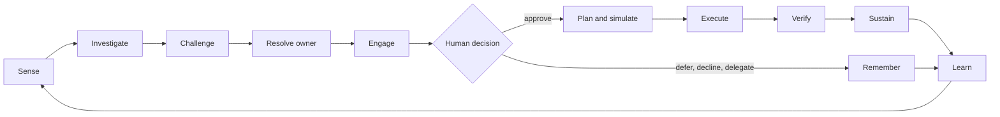

# Azure Cost in Action

> **AI-infused, agent-driven, human-in-the-loop Azure cost optimisation — from insight to outcome.**
> *Working title.* Status: **ideation (v1)** · private repository · not yet licensed (decision pending: [D2](docs/plan/01-assumptions-risks-decisions.md)).

Azure already tells you **what you spend** (Cost Management) and **what you could save** (Advisor). Almost nobody closes the loop: recommendations are addressed to nobody, owners are busy, trust is low, execution is manual, savings are never verified, and waste drifts back.

**Azure Cost in Action** explores a **crew of AI agents (Microsoft Foundry)** that studies how Azure is *actually used*, builds an evidence-backed **case** for every opportunity, finds the **owner** (and asks when it can't tell), meets them in **Teams or email** with a safe one-tap action, **executes** the approved change, **verifies** the saving, and keeps it from drifting back — with **humans in control** by construction.

> **Every euro spent on Azure has an owner and a reason. Every euro that doesn't becomes a decision — put to the right human, in the place they already work, with evidence and a safe one-tap fix — and then it is executed, proven, and kept from drifting back.**

---

## Founding constraints

Runs on **Microsoft platforms** (Azure / Power Platform / M365) · **Microsoft technology only** · compliant with the **Cloud Adoption Framework** and **Well-Architected Framework** · **open source** · **FULL AI** · **HITL** · **guardrails before code**.

---

## Start here

| # | Document | What it is |
|---|---|---|
| 1 | [North-star vision](docs/ideation/01-north-star-vision.md) | **The entire idea**: problem, loop, Case, autonomy ladder, "FULL AI", principles, bets |
| 2 | [Opportunity catalog](docs/ideation/02-opportunity-catalog.md) | Hundreds of ideas in 17 families, with the *usage-truth* signal for each |
| 3 | [Deep dives: the seed examples](docs/ideation/03-deep-dives-seed-examples.md) | Log Analytics ingestion usefulness and vWAN P2S capacity, end-to-end; dark-spend archaeology |
| 4 | [The Crew](docs/ideation/04-agent-crew.md) | 20 agent roles, separation of duties, rules of engagement |
| 5 | [Human interaction concepts](docs/ideation/05-human-interaction-concepts.md) | Teams cards, email, SMS, voice, avatars, escalation, conversation design, storyboards |
| 6 | [Closed loop, actions & autonomy](docs/ideation/06-closed-loop-actions-and-autonomy.md) | The 14-step loop, reversibility classes, safe-change toolkit, policy envelopes, verification |
| 7 | [Ownership & organisation](docs/ideation/07-ownership-and-organization.md) | Owner Graph, "follow the directory", orphans, incentives, people-data ethics |
| 8 | [Trust, safety & the guardrail territory](docs/ideation/08-trust-safety-and-guardrail-topics.md) | 14 guardrail domains, ~100 questions, 30 threats, 13 candidate invariants |
| 9 | [The outer rim](docs/ideation/09-outer-rims-moonshots.md) | 40 moonshots with their hard parts and smallest experiments |
| 10 | [Value, metrics & economics](docs/ideation/10-value-metrics-and-economics.md) | Scoreboard, savings-ledger rules, platform economics |
| 11 | [Press release from the future + tough FAQ](docs/ideation/11-working-backwards-pr-faq.md) | The idea stress-tested as a launch |

### The plan
| Document | What it is |
|---|---|
| [Follow-up plan](docs/plan/00-follow-up-plan.md) | Phases 1–8, gates, cross-cutting tracks, where every idea lives |
| [Assumptions, risks, decisions](docs/plan/01-assumptions-risks-decisions.md) | 20 assumptions, 20 risks, 12 decisions needed from the operator |
| [Guardrails workplan](docs/plan/02-guardrails-workplan.md) | How the guardrail territory becomes enforceable, tested rules |
| [Capability radar & spikes](docs/plan/03-capability-radar.md) | Non-binding: what to evaluate and the 22 feasibility spikes |

### The research (primary-source, dated)
| Document | Topic |
|---|---|
| [01 Azure-native landscape](docs/research/01-azure-native-landscape.md) | Cost Management, Advisor, FinOps toolkit, Azure Copilot/agents — and where they stop |
| [02 Third-party & OSS landscape](docs/research/02-third-party-and-oss-landscape.md) | Commercial/OSS FinOps products, AI entrants, log-volume tools |
| [03 FinOps framework & evidence](docs/research/03-finops-framework-and-evidence.md) | FinOps Framework, FOCUS, State of FinOps, last-mile evidence, regulatory anchors |
| [04 Seed-example facts](docs/research/04-seed-example-facts.md) | Log Analytics and vWAN P2S mechanics; the capacity-unit pattern |
| [05 Cost traps & dark spend](docs/research/05-cost-traps-and-dark-spend.md) | A sourced catalog of Azure cost traps |

### The reviews
| Document | Topic |
|---|---|
| [Rubber-duck reviews](docs/reviews/) | Two rounds of independent critique, with a disposition for every finding |

---

## Scope guard

This repository is currently **ideation only**. Technology, feasibility and the *content* of guardrails are deliberately deferred to the [plan](docs/plan/00-follow-up-plan.md). Numbers in examples are illustrative unless a source is cited. Nothing here has touched a customer environment.
