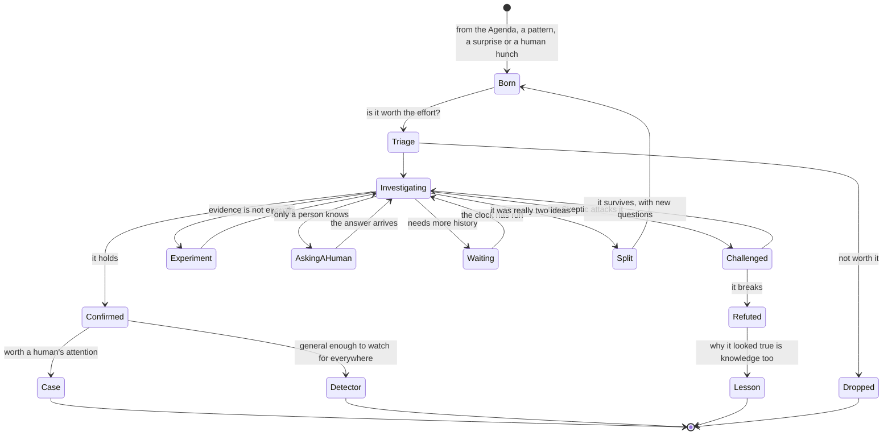

# Azure Cost in Action — the north star

> **Status:** ideation **v4** · 2026-10-31 · This is the whole idea in one place. Each part has its own deeper document: [studying Azure](02-learning-azure.md) · [the estate and the investigation](03-estate-and-investigation.md) · [experiments and the Lab](04-experiments-and-the-lab.md) · [recommend, act, verify](05-recommend-act-verify.md) · [people and conversation](06-people-and-conversation.md) · [getting smarter](07-getting-smarter.md) · [the outer rims](08-outer-rims.md).
> Nothing here is a technical design. It is what we want to exist.


## The sentence on the wall

> **Every euro spent on Azure has a reason. This AI learns the reasons — and finds, proves and fixes the euros that have none.**
>
> *A scientist for Azure's economics. Not a rulebook.*

## In one minute

1. **Azure outruns every rulebook.** Hundreds of services, thousands of ways to be charged, changes every week. Cost advice written by people covers the well-known head, misses the long tail, and goes stale the day it is written.
2. **So we do not write the advice. We build an AI that learns Azure's economics for itself.** It reads everything Microsoft publishes, decodes how every meter works and — because documents can be wrong or silent — **tests how things really bill, in a lab of its own.**
3. **It studies each estate like a scientist.** It explains where every euro goes, forms hypotheses about waste, tries hard to disprove them, runs experiments, and only then recommends a change — with the evidence, the alternatives and the consequences on the table.
4. **It works with the people who own things.** In Teams, in email, by voice, in meetings. It asks the cheapest question that settles a doubt, learns from every answer, and changes something only when a human says OK — or inside rules humans wrote.
5. **Everything it learns compounds.** What is true about Azure becomes an open, versioned, *tested* body of knowledge that anyone can use and improve. What is true about your estate stays yours. The longer it runs, the less it has to ask and the more it finds.

**What it is not:** a dashboard; a rulebook with a Teams webhook; a chatbot bolted onto the bill; a list of recommendations somebody typed. It is a long-running research programme with a memory, a lab and colleagues.

---

## 1. The problem behind the problem

**Advice is written by people, and people do not scale.** Every rule in every cost tool exists because someone understood one service well enough to write it down. Azure has hundreds of services and thousands of ways to be charged, and it changes weekly. So the rules cover the services everyone uses — and miss the long tail, where most surprises hide. And each rule is frozen the day it is written.

**Context decides.** The same setting is waste in one estate and the reason the quarter-close works in another. A rulebook cannot know which. Understanding can.

**People act on what they trust.** Owners ignore advice they cannot explain, check or argue with. Trust comes from reasoning you can inspect, proof you can re-run and a track record you can see.

**Knowledge rots.** Prices move, SKUs appear and vanish, behaviours shift, documents are revised. A static catalogue is a little more wrong every day.

**So the scarce thing is not detection. It is knowledge** — knowing how each service really charges, what really drives each bill, what a change really does, and what is really needed here. Producing and maintaining that knowledge is exactly what an AI with tools, patience, a lab and good colleagues can do at a scale no team of people can.

---

## 2. The big idea: science, industrialised

We build an AI that **does science on Azure's economics**. The scientific method is not a metaphor here; it is the operating system.

| Science | What the system does |
|---|---|
| **Observe** | Reads the bill, the estate, telemetry — and everything the world has written about Azure |
| **Ask** | Keeps an **Agenda** of open questions: what is unexplained? what is surprising? what just changed? |
| **Hypothesise** | "This capacity is idle." "This data is never read." "Turning on that feature switched on a meter." |
| **Predict** | Writes down what should be true *if the hypothesis is right* — before looking |
| **Test** | Analyses data, replays history, runs experiments in its Lab, asks the cheapest decisive question |
| **Peer review** | A sceptical agent tries to break it; humans review what becomes "known" |
| **Publish** | Findings become Atlas entries, detectors and Moves — and, when general, go to the open **Commons** |
| **Replicate** | Knowledge is re-tested on a schedule; claims that stop reproducing are retired |
| **Apply** | A tested **Move** changes something, with the owner's OK |
| **Measure** | Predictions are scored against what happened; the system keeps a **report card** |

### What it knows: three kinds of knowledge, one memory

| | Is true for… | Lives in | Learned from |
|---|---|---|---|
| **World knowledge** | everyone on Azure | the **Atlas** | documents, price lists, schemas, the Lab, the community |
| **Estate knowledge** | this one customer | the **Estate Model** and the **Lesson Book** | the bill, telemetry, configuration, code, conversations |
| **Experience** | "what happened when we did X" | the **Experiment Ledger** and the outcome record | experiments, trials, results of real changes |

And a fourth, quieter kind: **knowing how sure it is**, and **what is worth learning next**. Every claim carries its receipts and a confidence; the Agenda ranks questions by what finding the answer is worth.

### How it works: five faculties, not five stages

The picture at the top is not a pipeline. Five faculties run **at the same time**, around one shared memory, and each feeds the others:

| Faculty | In one line | Agents |
|---|---|---|
| **STUDY** | Learns Azure — every service, meter, price, change | Scholar, Cartographer |
| **SURVEY** | Understands this estate — what exists, what it is *for*, who owns it, what is sacred | Surveyor |
| **TEST** | Investigates and experiments — hypotheses, evidence, refutation, the Lab | Detective, Skeptic, Experimenter, Economist |
| **ACT** | Changes things with people — conversation, Moves, verification | Diplomat, Engineer |
| **GROW** | Gets smarter — scores itself, sits exams, curates knowledge, shares it | Auditor, Examiner, Librarian |

A few ways they feed each other — there is no "first":

- A **new service profile** (STUDY) immediately sends the Agenda hunting for which resources in which estates it concerns (SURVEY → TEST).
- A **human's answer** (ACT) corrects the Estate Model (SURVEY) and may refute a belief in the Atlas (STUDY).
- An **experiment** (TEST) settles a contradiction between two documents (STUDY) and sharpens a prediction (GROW).
- An **exam score** (GROW) tells STUDY where its knowledge is thin, so it learns that next.

### Four clocks

The same system runs on four clocks at once:

| Clock | Tempo | What happens |
|---|---|---|
| **Watch** | minutes to hours | spend that suddenly runs away; a meter that should not be moving |
| **Cases** | days to weeks | investigate → decide with an owner → change → verify |
| **Strategy** | months | architecture, commitments, platform shifts, price changes |
| **Learning** | always | reading, experiments, exams, re-checking what it thinks it knows |


---

## 3. STUDY — how it learns Azure

Studying Azure means building and tending the **Atlas**: a living, open, versioned map of *how Azure charges and what drives the charge*. For every service the Atlas holds a **Service Cost Profile** — a dossier in plain language, every line backed by receipts (sources, experiments, dates, confidence). [Full detail →](02-learning-azure.md)

Four moves, repeated forever:

1. **Read.** Everything Microsoft publishes — documentation, price lists, release notes, limits and quotas, architecture guidance — and the machine-readable surfaces: price meters, resource schemas, metric catalogues, export formats. Plus the community. The output is not summaries but **claims with receipts**: *"this meter bills per started hour — source, date, quote."*
2. **Decode.** Every meter is explained with the **Cost Grammar**: *how does the money arise* (capacity? consumption? stock? flow?), *what shows it is really needed* (the demand signal), *what can be changed* (the levers) and *what changing it trades away*. The grammar is what lets the AI reason about **a service it has never seen** — it recognises the shape of the meter, not the name of the product.
3. **Test.** Documents are evidence, not truth. Anything load-bearing, contradictory or silent goes to **the Lab**: deploy it, drive load, watch the meters appear in the usage data, write down what really happened — including the delays, minimums, rounding and hidden meters no document mentions.
4. **Keep fresh.** Every claim carries a re-check recipe — **knowledge CI**, unit tests for facts. When Microsoft changes a price, retires a SKU or alters behaviour, claims fail their re-check, profiles are marked stale, and every affected estate is told — in *both* directions: *"this just got more expensive for you"* and *"this just got cheaper — move?"*

### The Cost Grammar in one table

| Mechanism — how the money arises | The question it makes you ask | Typical signal of real need | Typical levers |
|---|---|---|---|
| **Capacity** — you pay for what you provision | How much of it is actually used? | utilisation, throughput, connections | size, count, schedule, model change |
| **Consumption** — you pay for what you use | Is each unit of use worth it? | requests, executions, volume | batching, caching, tier |
| **Stock** — you pay for what you keep, per month | Is anyone ever going to read it again? | last access, growth, retrieval | tier, lifecycle, delete |
| **Flow** — you pay for what moves | Does anyone consume what is produced? | consumers, destinations, volume | filter, sample, re-route, co-locate |
| **Feature** — a switch turns on a meter | Does anyone benefit from the switch? | feature usage | switch off, re-scope |
| **Multiplier** — dimensions multiply | Which dimension exceeds its need? | per-dimension load | shrink the cheapest-to-shrink dimension |
| **Tier / step** — price jumps at thresholds | Are we just above, or far below, a threshold? | position vs threshold | re-tier |
| **Commitment** — pay ahead for a discount | Is the coverage used, in the right scope and term? | coverage, utilisation | right-size, re-scope, re-term |
| **Time quantum** — billing granularity | Do short-lived things pay for time they didn't use? | duration distribution | batch, consolidate, reuse |
| **Coupling** — a thing drags in other meters | Is there a side-effect nobody intended? | dependency graph | decouple, relocate |
| **Leftover** — billing continues after the parent is gone | Does the parent still exist? | parent state | clean up |

The table is the **seed of a living taxonomy**, not its end: when the AI meets a meter that fits none of these, it proposes a new mechanism and the humans who review knowledge decide whether it earns a place.

### A day-zero story (the service is invented)

*Tuesday 09:00.* Microsoft announces **Azure Prism**, a managed retrieval service. The change radar fires.
*09:05.* Four readers start in parallel: the announcement and documentation; the price list and the meters it exposes; the resource schema and the metric catalogue; early community write-ups.
*10:30.* The Cartographer decodes six meters. A *Prism Unit* is **capacity**. A *Query Unit* is **consumption**. *Snapshot GB-month* is **stock**. *Replicas* are a **multiplier** on Prism Units. The private-link add-on is **coupling**. Preview pricing carries an expiry date — a **time cliff**. Two documents disagree about whether scaling down refunds a started hour.
*11:00.* The Experimenter takes the disagreement to the Lab and writes its prediction down first: *"scale-down does not refund the started hour."* It deploys the smallest instance, runs a synthetic load, scales down at minute 20, and waits for the usage data to catch up.
*Wednesday 08:00.* Prediction confirmed; a second finding — *snapshots keep billing after the index is deleted unless purged* — is flagged as a trap. The **Profile v0.1** is published as *provisional*, flagged for human review, with every line linked to its receipts.
*08:30.* The Agenda asks: *which resources in which estates are Prism?* Two preview deployments, one team. The Diplomat prepares a question for that team: **"This will go from free to paid on 1 March. Do you want a heads-up plan?"**

Nobody wrote a Prism rule. The system learned Prism — and the *next* new service, and the one after.

---

## 4. SURVEY — how it understands an estate

The **Estate Model** is the AI's understanding of one customer. Not an inventory — a *story*: what exists, how it connects, **what it is for**, who needs it, when it is busy, what must never be touched. [Full detail →](03-estate-and-investigation.md)

- **Reads widely** (with permission): the bill, the resource inventory, configuration and change history, telemetry, infrastructure-as-code and the repositories behind it, wikis, architecture diagrams (it can read pictures), tickets and post-mortems, the commercial agreement and price sheet, the organisation chart.
- **Infers intent.** A workload's *purpose* is rarely written anywhere; the AI assembles it from names, tags, deployment history, traffic shape, code and conversation — and confirms the important guesses with a human.
- **Learns rhythms.** Daily, weekly, seasonal, and the *business calendar*: the quarter-close, the launch, the audit week. A quiet resource in March can be the star of November.
- **Follows the directory.** Owners from tags, directory, commit and deployment history, role assignments and ticket traffic; managers, delegates, presence, time zones, languages; and a **named custodian** for things that have no owner at all.
- **Remembers what people taught it** in a **Lesson Book** — human-readable, scoped, expiring, editable. Memory you can read.

---

## 5. TEST — how it investigates

It starts from the money. Every euro on the bill should become **explained**: the AI can say *what it is for, who needs it, how much of it is needed, and what it would take to need less*. What it cannot yet say is the **Unexplained Spend Ledger** — and that ledger is the engine of the **Agenda**. [Full detail →](03-estate-and-investigation.md)

The Agenda is the AI's curiosity, ranked by *what finding the answer is worth*:

- spend nobody can explain, and spend that is growing;
- a gap between **bill and blueprint** — a cost model built from the architecture, compared with the bill; the residual is a lead;
- a Profile that was just published or a price that just moved: *which of our things does this touch?*;
- a belief it relies on that is old, high-impact and weakly verified;
- a **hunch** from a human: *"I bet the test clusters sit idle at weekends — look into it."*

Each question becomes a **hypothesis** with a life of its own — not a line on a conveyor belt:



**The Skeptic** is an agent whose only job is to break the case: *who else reads this? what happens at the peak? what did the last incident say? what does compliance require? is the metric lying — sampled, delayed, missing a consumer?* A refuted hypothesis is not waste: **"why it looked true"** is some of the most valuable knowledge the system keeps.

**The Consequence Engine** works in both directions. *Backwards:* why is the bill what it is? *Forwards:* **what happens to the bill — and to reliability, performance and security — if we do X?** For a design review, a pull request, a migration, a retention policy, a growth spike, a price change. It knows the hidden consequences — *flipping this switch adds that meter; that replica count multiplies this one* — because the Atlas does.

### A worked investigation

> *A search service tagged "prototype" costs about €3,100 a month.* The Atlas says its price is **capacity × multiplier** (replicas × partitions). The demand signal — query volume — shows a handful of queries an hour. Hypothesis: *sized for a launch that is over.*
> The Skeptic asks: *was there a peak?* — Yes: a November event, with a spike. *Would a smaller configuration have survived it?* — The **Time Machine** replays the November queries against a 1×1 layout in the Lab: latency stays inside the target the team once wrote in the wiki.
> The directory says the owner left in July. The Surveyor finds the team lead through commit history and role assignments. The Diplomat asks **one** question: *"Is this needed for the March relaunch?"* — "Yes."
> The Brief offers three options: stay; shrink now and scale up in February (the Atlas knows scaling this service takes hours); or shrink and let the March team decide. The system also writes a **Lesson**: *this team launches in March and November* — so next time it will not ask.

---

## 6. TEST — how it experiments

Reading and analysing is not enough. Sometimes the only way to know is to try. [Full detail →](04-experiments-and-the-lab.md)

| Experiment | It learns | Where |
|---|---|---|
| **Billing experiment** | how a service *really* bills: granularity, minimums, rounding, delays, hidden meters | **the Lab** |
| **Signal experiment** | which telemetry actually reflects demand — and where there is a blind spot | the Lab |
| **Prediction (shadow)** | whether its beliefs hold: it predicts, then compares | anywhere |
| **Replay and counterfactual** | what *would have* happened with another configuration | **the Time Machine** |
| **Trial** | what a small, reversible change does in practice | on one real resource, with consent |
| **Question** | the one thing only a person knows | **the cheapest experiment of all** |

**The Lab** is a dedicated, budget-capped sandbox subscription where the agents are allowed to create, break and delete things, drive synthetic load and watch the bill form. It is how Azure's economics become *measured* rather than *quoted*. It also runs a **wind tunnel**: benchmark rigs that map the *cost / performance frontier* of a service, so a recommendation says "this configuration costs 40% less and, in our tests, stays inside your latency target" instead of "the spec sheet says so".

Experiments are designed like experiments: a hypothesis, a **prediction written down first**, a budget, a stop condition, an analysis plan. They are chosen by **value of information** — cheapest decisive test first: *a question, then data already collected, then replay, then the Lab, then a live trial.* **Surprises** — the gap between prediction and result — are logged as first-class knowledge. The Lab pays its own way: if learning costs more than it is worth, it stops.

---

## 7. ACT — how it works with people

This is where the AI meets owners, FinOps leads, finance partners, engineers. [Full detail →](05-recommend-act-verify.md) · [People and conversation →](06-people-and-conversation.md)

**A Brief, not a recommendation.** What it proposes, why it thinks so (and how to check), the alternatives including *do nothing*, the consequences with ranges, what it has already tested, what would change its mind, the effort, how reversible it is, exactly what it will do on *yes*, and how everyone will know it worked.

**A conversation, not a notification.** Teams cards for decisions and teaching, email for digests and formal approvals, a call or a text only when it is truly urgent, a participant in the monthly cost review — an AI in the room (voice, even an avatar) that can pull up its reasoning and answer "why?" live. Every message carries **Explain** (show the reasoning and the receipts), **Challenge** (red-team this) and **Teach** (here is something you should know).

**Teachable.** Every answer is a lesson. *"Not now — this runs the quarter-close"* becomes a calendar. *"That's our DR environment"* becomes a scope — and the AI proposes the generalisation and asks whether to remember it for this resource, this team or everywhere.

**Moves.** Actions are **Moves**: tested, versioned, reviewable recipes — resize, schedule, tier, clean up, open a pull request against the infrastructure code, propose a policy, prepare a commitment purchase. The AI can **write new Moves**, prove them in the Lab, and offer them for human review — the way a good engineer contributes a tool to the team.

**Autonomy is earned.** The ladder is short: *observe → advise → assist (one tap) → autopilot inside a rule a human wrote*. Autopilot is granted as a **credential per domain** — "storage tiering in non-production, up to this value" — on the strength of the report card, by people, and revoked when regret appears.

**Purchases get the most care.** Reservations and savings plans are prepared by the AI and executed only after named humans say OK.

**Verification.** Every change is checked against the prediction made before it: the saving is measured against a counterfactual, regret and "boomerangs" (the change reversed within weeks) are recorded, and drift is guarded — preferably by **fixing the source** (a pull request on the infrastructure code), so the next deployment does not quietly undo it.

---

## 8. GROW — how it gets better

[Full detail →](07-getting-smarter.md)

- **Everything is a prediction.** Every recommendation says what will happen and by when. The outcome scores it. Over time the AI keeps a *calibration record*: when it says 80%, how often is it right?
- **The Lesson Book** keeps what people taught it — with scope, expiry and the evidence — so it can be read, corrected and retired.
- **The Exam.** An independent agent sets exams the system cannot see in advance: *rediscovery* (hide known waste in synthetic and real-but-labelled estates — does it find it with no rule for it?), *new-service races*, *transfer* (learn on service A, test on service B), *teachability*, *explanation quality*, *communication*. Results go on a public **report card** — including what it is bad at.
- **It learns how to learn.** Which sources yielded true claims? Which investigation tactics paid off for which kind of service? Which phrasing gets a useful answer? The system tunes its own *method*.
- **The Commons.** The world-knowledge half — Atlas, Moves, lab recipes, detectors, exam questions — is **open source** and versioned, maintained by the AI *proposing changes for human review* and by the community. Estate knowledge never leaves the customer. Even the *outcome statistics* ("how often does this advice pay off?") can be shared without sharing a byte of data. The knowledge is the open-source asset, not just the code.

---

## 9. The cast

A small society of specialists — more like a research group than a pipeline.

| Agent | Faculty | What it does | What it learns from |
|---|---|---|---|
| **Scholar** | STUDY | Reads the world; extracts claims with receipts; watches for change | sources, diffs, announcements |
| **Cartographer** | STUDY | Decodes meters; keeps the Atlas coherent; evolves the taxonomy | claims, Lab results |
| **Surveyor** | SURVEY | Builds the Estate Model; resolves owners; infers intent and rhythms | the estate, people |
| **Detective** | TEST | Forms and tests hypotheses; writes case notebooks | evidence, outcomes |
| **Skeptic** | TEST | Tries to refute everything, including the Atlas | counter-examples |
| **Experimenter** | TEST | Designs and runs experiments; runs the Lab; keeps the Ledger | its own predictions |
| **Economist** | TEST | Quantifies options, consequences and trade-offs; searches the design space | outcomes |
| **Diplomat** | ACT | Talks to people; asks, explains, negotiates, *teaches and is taught* | answers, reactions |
| **Engineer** | ACT | Writes, tests and runs Moves; opens pull requests; guards against drift | results of changes |
| **Auditor** | GROW | Verifies outcomes against predictions; measures regret and cost-to-run | the ledger |
| **Examiner** | GROW | Sets independent exams; publishes the report card | exam results |
| **Librarian** | GROW | Curates the Lesson Book and the Commons; guards provenance | review outcomes |
| **Conductor** | all | Runs the research programme: Agenda, budgets, priorities | everything |

---

## 10. What the learning looks like from the outside

The system is only trustworthy if its learning is *visible*. Three small windows:

**The Monday email — "What I learned this week"**

```
This week I learned
  · A new service profile: Azure Prism (provisional — review?)        [3 claims verified in the Lab]
  · A belief I held was wrong: "scaling down refunds the hour" — Refuted (2 experiments)
  · 4 lessons from your team, 1 I'd like to generalise: "Weekend idleness is expected
    in dev subscriptions" — remember for all dev subscriptions?        [Yes] [Only this team] [No]
Today I'm wondering about
  · Why storage in the payments subscription grows 9% a month with no matching architecture
  · Which of your 31 database servers are sized for the 2024 migration
My report card: predictions 81% right (I said 79%) · explained spend 72% (+3) · I asked you
11 questions this month (was 19)
```

**A teaching card in Teams**

```
Quick question from the cost agent (AI)
The search service "support-search" costs about €3,100/month and answers a few queries an hour.
Is it needed for something that has not happened yet?
  [Yes — March relaunch]  [No — retire it]  [Not mine]  [Show me why you're asking]
Your answer also teaches me: I'll remember this team's launch months.
```

**An Atlas change, as a reviewer sees it**

```
Profile: Azure Prism · v0.1 → v0.2 · 3 claims changed
  ± "Scale-down refunds the started hour"  → REFUTED by lab experiment #214 (predicted yes, observed no)
  + "Deleting an index leaves snapshots billing until purged"  → VERIFIED #217, 2 regions
  ? "Private-link add-on bills per endpoint-hour"  → UNVERIFIED (doc only) — experiment queued
[Approve] [Request changes]
```

---

## 11. A first day, a first quarter, a first year

**The first 24 hours in a new estate.** The Surveyor inventories and reads the bill. The Atlas — already knowing Azure — decodes every meter on it at once. The Conductor builds the first Unexplained Spend Ledger; the Detective starts with the biggest unexplained blocks. No customer-specific training is needed: the *world* is already known. By the end of the day the owners of the five largest unexplained blocks have each received **one** question.

**The first quarter.** The Estate Model fills in: intent for the main workloads, a calendar, an owner for almost everything. The first Briefs go out; a few are accepted, several declined *with reasons* — each reason becomes a lesson. Explained spend climbs. The first Moves are tried in non-production; the first verified savings are measured against counterfactuals. The system asks fewer questions each week.

**The first year.** The Atlas has hundreds of verified profiles and a refuted-beliefs shelf. The report card shows calibration improving. Some domains have earned autopilot credentials; others have not, and the card says why. When Microsoft ships something, the Atlas profiles it the same day and the estate is told what it means *for it*. A part of the Commons has been used by other organisations. The system now finds things no one has a name for — and **names them**, as new Atlas mechanisms and detectors, for human review.

---

## 12. The outer rims

A taste of what the north star opens up. Detail and many more in [the outer rims](08-outer-rims.md).

- **Dreaming.** Overnight the system explores alternative architectures for your biggest spend in the Lab and wakes up with a map of options: *"I tried 40 configurations; here is the frontier."*
- **Law-finding.** From hundreds of experiments it infers the *laws of Azure billing* — "short-lived resources almost always pay for a minimum" — and predicts services it has never touched.
- **Self-writing detectors.** For every confirmed "tell" the AI writes the cheap, deterministic detector, back-tests it, and proposes it for review. **Expensive reasoning once; cheap detection forever.**
- **Bill versus blueprint.** A cost model derived from your architecture, compared continuously with your actual bill. The residual is the investigation list.
- **Azure moves; you benefit.** A new SKU is cheaper for a workload shaped like yours — lab-verified — and the AI tells you the day it is announced.
- **The Hunch Box.** Anyone can submit a hunch; the system investigates and reports back with evidence — and the good ones become detectors.
- **The cost scientist in the room.** In architecture reviews and cost reviews, an AI participant presents lab results, shows its notebook, and takes "why?" from the floor.
- **Cost autopsy.** After any surprise, a blameless write-up of what happened, what the system believed, and what it has now learned.

---

## 13. Why this is an agent idea, not a chatbot idea

A chatbot answers. This system **runs research programmes**: long-lived, multi-step, partly parallel, resumable; it **remembers**; it uses **tools** (price lists, queries, the Lab, change recipes); it **delegates** among specialists; it is **evaluated** on exams it cannot see; its work is **traced** so it can be replayed and reviewed; and it works alongside humans who teach, decide and review. Those are the ingredients agent platforms such as Microsoft Foundry are for — which is why Foundry is the natural home we imagine. The *workflows* are research programmes and campaigns, not scripts. Chat is one way to ask the system a question; it is not the product.

The product will run on Microsoft's platforms and technology. The *ideas* may come from anywhere — [the research that inspired this](research/inspirations.md) ranges from agents that write and keep their own skill libraries, to agents that keep memory and reflect on it, to automated scientific discovery.

---

## 14. Where humans stay in charge

Human-in-the-loop is not a button on the end. It is five places in the design. Detailed guardrails come in a later phase — [what we will design then](09-guardrails-later.md) — but these five are the spine.

1. **What counts as known.** Knowledge becomes *trusted* only after peer review — by the Skeptic and by people — and carries its receipts forever.
2. **What it spends to learn.** The Lab and every experiment have budgets people set.
3. **What it changes.** Every change has a human's OK, or a rule a human wrote — and purchases always have named humans.
4. **How much autonomy it earns.** Credentials per domain, granted and revoked by people, based on the report card.
5. **How it speaks.** Tone, timing and attention limits are set with the people it talks to. Silence is never consent.

---

## 15. The hard parts, honestly

| Hard part | The idea for handling it |
|---|---|
| **Learning the wrong lesson** — a coincidence, a one-off exception | Predictions are scored; lessons are scoped and expire; replication before trust; the Skeptic; people confirm generalisations |
| **Documents and reality disagree** | A hierarchy of evidence; the Lab settles disputes; every claim says how it is known |
| **The Lab cannot reproduce everything** — scale, negotiated prices, quotas | Claims say whether they were *tested* or *inferred*; outcomes in real estates feed back; confidence travels with the claim |
| **Spending to learn** | Value of information decides; budgets; the Lab must earn its keep |
| **Goodhart** — chasing "savings" at the cost of reliability or people's time | Success is *net* value, with regret and attention cost; every recommendation shows its non-cost consequences |
| **Human teachers are busy, wrong or biased** | Lessons are scoped, dated and reviewable; high-stakes lessons ask for evidence |
| **A shared commons can be sloppy or poisoned** | Provenance on every claim; executable re-checks; human review; reproducible experiments |
| **Over-trust in a fluent machine** | The report card; calibrated uncertainty; "I don't know" is an allowed answer |

---

## 16. How we will know it is learning

| Measure | It should… |
|---|---|
| **Explained spend** — the share of spend whose purpose, need and cost-to-reduce the system can state with confidence | rise |
| **Time to profile** a new service, feature or price change | fall — to hours |
| **Rediscovery rate** on the Exam — known waste found with no rule for it | rise |
| **Calibration** — "80% sure" means right 80% of the time | tighten |
| **Atlas coverage and freshness** — meters on real bills with a verified profile; median age of claims | broaden and stay young |
| **Questions asked per decision** | fall: it learns, so it asks less |
| **Surprises per month** | stay above zero: it is still discovering |
| **Verified net savings** — after what the system itself costs to run | rise |

### The founding exam

Two findings started this project. One is **data that is produced and paid for but that nobody ever reads**. The other is **capacity inside a managed networking service that was scaled up long ago, is invisible to its owners, and shows almost no use in its metrics**. They are not in the Atlas. They are not in any rule. They are not in this design. They are the **first two exam questions** — and the tips that go with them (what to stop paying for, how to shrink it safely) must come out of the system's own reasoning. If it cannot find them — and the hundred others nobody has thought of — it is not learning, and we have built a rulebook after all.

---

## Glossary

| Term | Meaning |
|---|---|
| **Atlas** | The living, open, versioned map of how Azure charges and what drives the charge |
| **Service Cost Profile** | The Atlas's dossier on one service: how it bills, its levers, tells, traps, evidence |
| **Cost Grammar** | The mechanisms by which money arises (capacity, consumption, stock, flow …) × the signal of real need × the levers |
| **Estate Model** | The AI's understanding of one customer's estate, including intent, rhythms and people |
| **Lesson Book** | What people taught the system — scoped, dated, expiring, editable |
| **Agenda** | The ranked list of questions the system is working on |
| **Explained spend** | Spend whose purpose, need and cost-to-reduce the system can state with confidence |
| **Hypothesis / Case** | A testable claim about cost or waste / one that survived and deserves a human |
| **Skeptic** | The agent whose job is to break the case |
| **Consequence Engine** | Answers "what happens to the bill — and to risk — if we do X?" |
| **Lab** | The sandbox where agents run billing and signal experiments |
| **Time Machine** | Replay of history under alternative configurations |
| **Wind tunnel** | Benchmark rigs that map a service's cost/performance frontier |
| **Experiment Ledger** | The register of predictions and results |
| **Brief** | The decision document a human receives |
| **Move** | A tested, versioned, reviewable change recipe |
| **Credential** | Earned, revocable permission for autopilot in one domain |
| **Exam / report card** | Independent evaluation of the system / its public record |
| **Knowledge CI** | Re-check recipes that keep every claim honest |
| **Commons** | The open, shared half of the knowledge |
