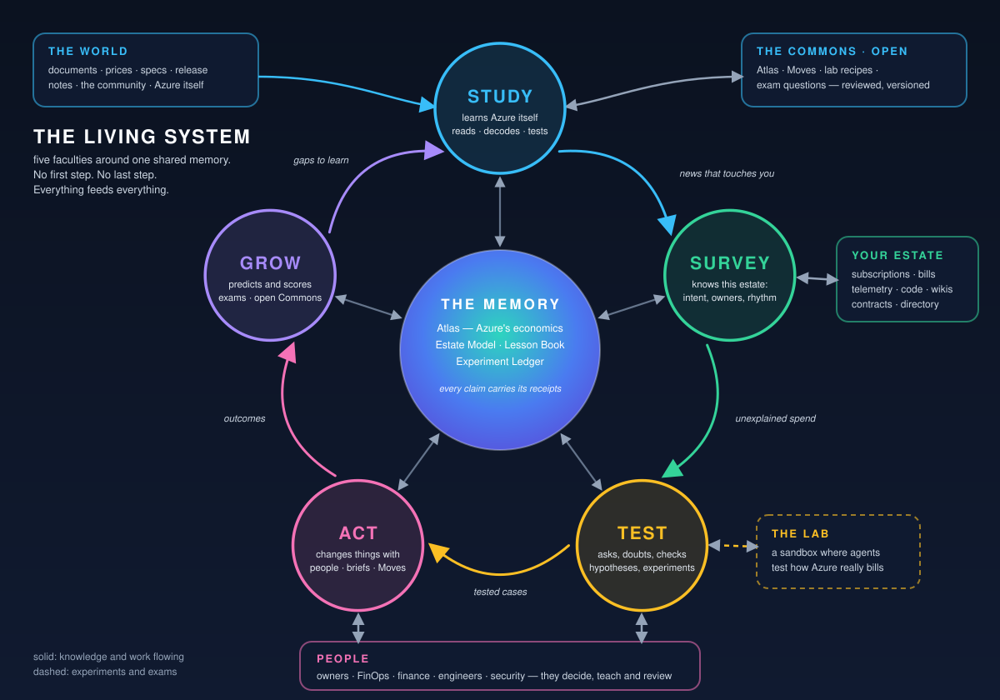
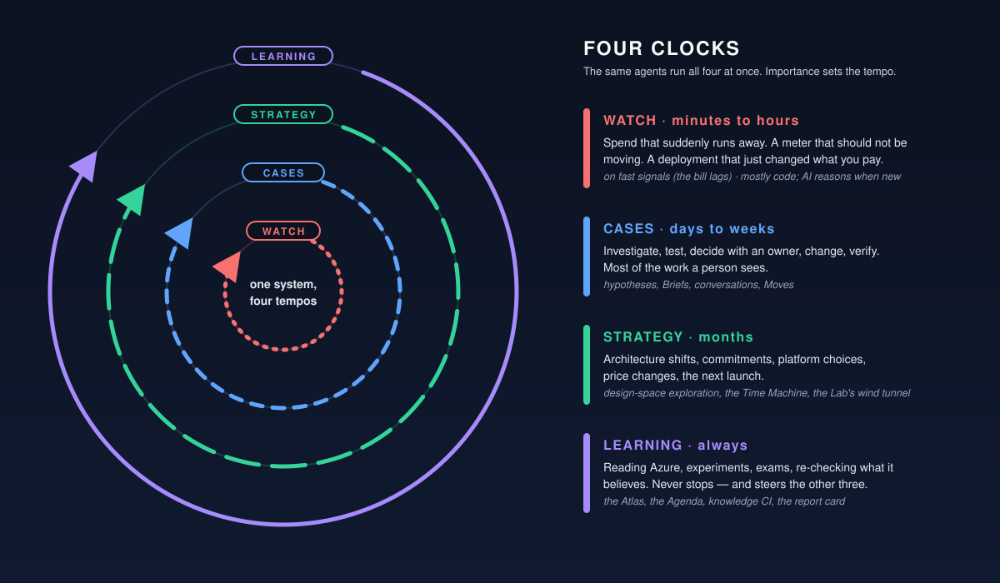
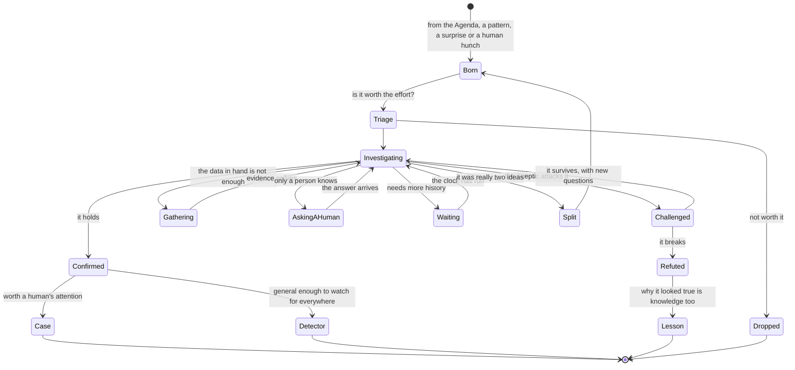

# Azure Cost in Action — the north star

> **Status:** ideation **v5** · 2026-11-01 · The whole idea in one place. Each part has a deeper document: [studying Azure](02-learning-azure.md) · [the estate and the investigation](03-estate-and-investigation.md) · [finding out without spending](04-finding-out-without-spending.md) · [recommend, act, verify](05-recommend-act-verify.md) · [people and conversation](06-people-and-conversation.md) · [getting smarter](07-getting-smarter.md) · [the outer rims](08-outer-rims.md) · [the learning contract](09-the-learning-contract.md) · [a press release from the future](10-press-release-from-the-future.md). The technical design that answers this idea is in [docs/design](design/README.md). Nothing is built yet.
> Nothing here is a technical design: it describes what the system should do, and why.
> **How to read it.** *Two minutes:* the sentence on the wall, *In one minute*, and the [day-zero story](#a-day-zero-story-the-service-is-invented). *Ten minutes:* add §2 (the big idea), §5 (every agreement, every level of access) and §8 (how it works with people). Everything else is reference, one section per deeper document.



## The sentence on the wall

> **Every euro spent on Azure has a reason. This AI learns the reasons — and finds, tests and fixes the euros that have none.**
>
> *A scientist for Azure's economics.*

## In one minute

1. **Azure outruns written advice.** Hundreds of services, thousands of ways to be charged, changes every week. Advice written by people covers the well-known services, misses the long tail and needs revisiting whenever prices or services change.
2. **So the AI learns Azure's economics for itself, from evidence that already exists.** It reads what Microsoft publishes, decodes how every meter works, and then checks the documents against the one fact that cannot argue back: **the bills people already pay.** Every estate changes all the time — a database resized, a disk forgotten, a default that switched a meter on — and most changes show up in the bill or in usage data. The AI reads those results. It builds nothing to find out what things cost.
3. **It studies each estate like a scientist.** It explains where every euro goes, forms hypotheses about waste, tries hard to disprove them and only then recommends a change — with the evidence, the alternatives and the consequences on the table.
4. **It fits the agreement you actually have.** Enterprise Agreement, Microsoft Customer Agreement bought directly, sold through a partner (CSP), or pay-as-you-go; billing-level access or one lonely subscription. It finds out what it may see and do, prices savings at the rates you really pay when it can see them, says so when it cannot, and hands each purchase to the person who can really make it.
5. **It works with the people who own things.** In Teams, in email, by voice, in meetings. It asks the cheapest question that settles a doubt, learns from every answer, and changes something only when a human says OK — or inside rules humans wrote.
6. **What it learns accumulates.** What is true about Azure becomes an open, versioned, *tested* body of knowledge that anyone can use and improve. What is true about your estate stays yours. The longer it runs, the less it needs to ask and the more it can find.

**What it is:** a long-running research programme with a memory and colleagues.

---

## 1. The problem behind the problem

**Advice is written by people, and people do not scale.** Every rule in every cost tool exists because someone understood one service well enough to write it down. Azure has hundreds of services, thousands of ways to be charged and a new feature most weeks. The rules cover what everyone uses and miss the long tail, where most surprises hide. And each rule needs revisiting whenever the service or its price changes.

**Context decides.** The same setting is waste in one estate and the reason the quarter-close works in another. Telling them apart takes an understanding of the estate.

**The agreement decides too.** The same resource costs different amounts under different agreements, and the same saving is a click for one organisation and a request to a partner for another. Advice that ignores the agreement is advice for nobody in particular.

**People act on what they trust.** Owners ignore advice they cannot explain, check or argue with. Trust comes from reasoning you can inspect, evidence you can re-run and a track record you can see.

**Knowledge rots.** Prices move, SKUs appear and vanish, documents are revised. A static catalogue is a little more wrong every day.

**So the scarce thing is not detection. It is knowledge** — how each service really charges, what really drives this bill, what a change really does, what is really needed here and what this agreement allows. Producing and maintaining that knowledge is exactly what an AI with tools, patience and good colleagues can do at a scale no team of people can.

---

## 2. The big idea: science, industrialised

We build an AI that **does science on Azure's economics**. It writes down predictions before it tests them, looks for the evidence that would contradict them, and revises a claim when outcomes disagree.

| Science | What the system does |
|---|---|
| **Observe** | Reads the bill, the estate, the telemetry — and everything the world has written about Azure |
| **Ask** | Keeps an **Agenda** of open questions: what is unexplained? what is surprising? what just changed? |
| **Hypothesise** | "Spend grew 9% a month with no change in the design." "That default flipped a meter on." "This commitment no longer covers what we run." |
| **Predict** | Writes down what should be true *if the hypothesis is right* — before looking |
| **Test** | Analyses data, replays history, follows changes people were making anyway, asks the cheapest decisive question |
| **Peer review** | A skeptical agent tries to break it; humans review what becomes "known" |
| **Publish** | Findings become claims in the **Atlas** (its open map of how Azure charges), **Detectors** (cheap checks that nominate leads) and **Actions** (tested change recipes) — and, when general, go to the open **Commons** |
| **Replicate** | Knowledge is re-tested on a schedule; claims that stop reproducing are retired |
| **Apply** | A tested **Action** changes something, with the owner's OK |
| **Measure** | Predictions are scored against what happened; the system keeps a **report card** |

### What it knows: three kinds of knowledge, one memory

| | Is true for… | Lives in | Learned from |
|---|---|---|---|
| **World knowledge** | everyone on Azure | the **Atlas** | documents, price lists, schemas, and observations pooled from many estates |
| **Estate knowledge** | this one customer | the **Estate Model** and the **Lesson Book** | the bill, telemetry, configuration, code, the agreement, conversations |
| **Experience** | "what happened when we did X" | the **Ledger**: its record of predictions, decisions and measured outcomes | predictions and the outcomes of real changes |

And a quieter thing runs through all three: **knowing how sure it is**, and **what is worth learning next**. Every claim carries its receipts, its *scope* and a confidence; the Agenda ranks questions by what the answer is worth.

### What "learning" means here

Storing a lesson is not learning. A system has learned only if something that governs its future behaviour has *changed*, in a way that improves its results on a test it could not game. Six things change, each by a defined process and each checked by the evaluation: **its beliefs about Azure** (claims whose evidence accumulates, and which are relied on only once reviewed and matched against a real bill); **what it chooses to do next** (a policy that learns which questions and sources pay off); **compiled knowledge** (Detectors that are written, back-tested, run in shadow and expire); **its predictions of consequence** (a model refitted from changes that really happened); **its understanding of one estate** (people's testimony, widened only with corroboration); and **its own method**. It is measured against *retrieval only* and against *expert-written rules* — so we can tell what it added. [The learning contract →](09-the-learning-contract.md)

### How it works: five faculties, not five stages

The picture at the top is not a pipeline. Five faculties run **at the same time**, around one shared memory, and each feeds the others:

| Faculty | In one line | Agents |
|---|---|---|
| **STUDY** | Learns Azure — every service, meter, price, change | Scholar, Librarian |
| **SURVEY** | Understands this estate — what exists, what it is *for*, who owns it, what is sacred, what agreement it sits under | Surveyor |
| **TEST** | Investigates — hypotheses, evidence, refutation, "what if" | Detective, Skeptic, Economist |
| **ACT** | Changes things with people — conversation, Actions, verification | Diplomat, Engineer |
| **GROW** | Gets smarter — scores itself, is evaluated, curates knowledge, shares it | Auditor, Librarian |

The **Conductor** runs the whole programme: the Agenda, the budgets, the priorities. A few ways the faculties feed each other:

- A **new service profile** (STUDY) immediately sends the Agenda hunting for which resources in which estates it concerns (SURVEY → TEST).
- A **human's answer** (ACT) corrects the Estate Model (SURVEY) and may refute a belief in the Atlas (STUDY).
- A **bill line** (SURVEY) settles a contradiction between two documents (STUDY) and sharpens the next prediction (GROW).
- An **evaluation score** (GROW) tells STUDY where its knowledge is thin, so it learns that next.

### Four clocks

The same system runs on four clocks at once:

| Clock | Tempo | What happens |
|---|---|---|
| **Watch** | minutes to hours — on fast signals (metrics, activity, deployments); the bill itself lags by hours to days | spend that suddenly runs away; a meter that should not be moving |
| **Cases** | days to weeks | investigate → decide with an owner → change → verify |
| **Strategy** | months | architecture, commitments, platform shifts, price changes, agreement renewals |
| **Learning** | always | reading, reading bills, evaluation, re-checking what it thinks it knows |



---

## 3. STUDY — how it learns Azure

Studying Azure means building and tending the **Atlas**: a living, open, versioned map of *how Azure charges and what drives the charge*. For every service the Atlas holds a **Service Cost Profile** — a dossier in plain language, every line backed by receipts (sources, dates, price lists, pooled observations, confidence). [Full detail →](02-learning-azure.md)

Four moves, repeated forever:

1. **Read.** Everything Microsoft publishes — documentation, price lists, release notes, limits and quotas, architecture guidance — and the machine-readable surfaces: price meters, resource schemas, metric catalogues, export formats. Plus the community. The output is not summaries but **claims with receipts**: *"this meter bills per started hour — source, date, quote."*
2. **Decode.** Every meter is explained with the **Cost Grammar**: *how does the money arise* (capacity? consumption? stock? flow?), *what shows it is really needed* (the demand signal), *what can be changed* (the levers) and *what changing it trades away*. The grammar is what lets the AI reason about **a service it has never seen** — it recognises the shape of the meter, not the name of the product.
3. **Check against the money.** Documents are evidence, not truth. Anything load-bearing, contradictory or silent stays *documented* — a lead, never a promise — until a real bill line confirms it. A closed bill line that contains the meter, matched to the usage and changes behind it, supports the claim for that estate; where competing explanations remain, or the charge is unmatched, it stays disputed. The surprises no page mentions (the delay, the minimum, the rounding, the hidden meter) arrive as charges nobody predicted and become knowledge.
4. **Keep fresh.** Every claim carries a re-check recipe — **knowledge CI**, unit tests for facts. When Microsoft changes a price, retires a SKU or alters behaviour, claims fail their re-check, profiles are marked stale, and every affected estate is told — in *both* directions: *"this just got more expensive for you"* and *"this just got cheaper — move?"*

### The Cost Grammar — fourteen ways money arises

Most meters are one or a few of **fourteen mechanisms**: *capacity* (you pay for what you provision), *consumption* (what you use), *stock* (what you keep), *flow* (what moves), *feature* (a switch turns on a meter), *multiplier* (dimensions multiply), *tier / step* (price jumps at thresholds), *commitment* (pay ahead for a discount), *time quantum* (billing granularity), *coupling* (a thing drags in other meters), *leftover* (billing continues after the parent is gone), *rate and benefit* (the price per unit is negotiable), *allowance* (an included amount, then paid) and *time cliff* (a price changes on a date). Each comes with a question to ask, a **signal of real need** and typical levers — [the full grammar is in 02](02-learning-azure.md). It is a working taxonomy, not a closed list: when the AI meets a meter that fits none of these, it proposes a new mechanism, and the humans who review knowledge decide whether it earns a place.

### A day-zero story (the service is invented)

Tuesday 09:00: Microsoft announces **Azure Prism**, a managed retrieval service. By 10:30 four parallel readers have decoded six meters with the grammar — a *Prism Unit* is **capacity**, a *Query Unit* **consumption**, *snapshot GB-months* **stock**, *replicas* a **multiplier**, the private-link add-on **coupling**, the preview price a **time cliff** — and found two pages that disagree about whether scaling down refunds a started hour. Nobody builds anything to find out. The claim is marked *disputed*, and a **provisional Profile v0.1** is published, every line tied to its source and none of it yet allowed to back a savings promise. The Agenda asks *which resources in which estates are Prism?* — two preview deployments, one team — and the Diplomat asks that team one question: **"The preview price ends on 1 March. Do you want a heads-up plan?"** Nobody wrote a Prism rule.

A week later the team's first Prism bill lines land. They settle the dispute — a started hour *is* billed after a scale-down — and show a second trap nobody predicted: snapshots keep billing after the index is deleted. The claims stay in that estate as bill-observed; once several organisations have contributed the same observation, a privacy-reviewed aggregate goes to the Atlas, and the next estate to meet Prism starts ahead.

---

## 4. SURVEY — how it understands an estate

The **Estate Model** is the AI's understanding of one customer: a *story* rather than an inventory — what exists, how it connects, **what it is for**, who needs it, when it is busy, what must never be touched, and what agreement it sits under. [Full detail →](03-estate-and-investigation.md)

- **Reads widely** (with permission): the bill, the resource inventory, configuration and change history, telemetry, the native recommendations, budgets and anomaly alerts (Advisor and Cost Management), infrastructure-as-code and the repositories behind it, wikis, architecture diagrams (it can read pictures), tickets and post-mortems, the price sheet and commitments where it may see them, the organisation chart.
- **Infers intent.** A workload's *purpose* is rarely written anywhere; the AI assembles it from names, tags, deployment history, traffic shape, code and conversation — and confirms the important guesses with a human.
- **Learns rhythms.** Daily, weekly, seasonal, and the *business calendar*: the quarter-close, the launch, the audit week. A quiet resource in March can be the star of November.
- **Follows the directory.** Owners from tags, directory, commit and deployment history, role assignments and ticket traffic; managers, delegates, presence, time zones and languages, using only what the person or the organisation has provided or authorised, with delegates confirmed rather than inferred; and a **named custodian** for things that have no owner at all.
- **Knows the agreement and its own reach** — which agreement, which rates, which commitments, and what it may see and do here ([§5](#5-every-agreement-every-level-of-access)).
- **Remembers what people taught it** in a **Lesson Book** — human-readable, scoped, expiring, editable. Memory you can read.

**Where Cost Management and Advisor fit.** They are *inputs* and *a baseline to beat* — never ignored, never trusted blindly. Their findings enter the Agenda as leads and are checked like any other claim (Advisor's own documentation says it prices shutdown savings at retail rates). Part of the value is simply **closing the loop** on what Azure already recommends — the owner who never opens a recommendations blade gets a short, specific, explained question — and the rest is everything those tools cannot see. [What happens to an Advisor card →](05-recommend-act-verify.md)

---

## 5. Every agreement, every level of access

Azure is sold in several ways, and the way decides a surprising amount. The same virtual machine has a different price, shows up in different reports, can be committed to by different people and is visible to different roles. A cost system that assumes one agreement and full access works for nobody. This one starts from two questions about every estate:

1. **Which agreement is this?** Enterprise Agreement (EA) · Microsoft Customer Agreement (MCA) bought directly · sold through a partner (CSP) · pay-as-you-go — and the offers around them: dev/test, credits, sponsorship. Some estates sit under several at once.
2. **What may the system see and do here?** Not what the organisation could reach — what the identity it was given can reach.

The second question has three common answers:

| Reach | What the system can do | What it says about its numbers |
|---|---|---|
| **Billing reach** — a role on the billing account, the billing profile or the enrollment | Reads the price sheet and the commitment portfolio, sees the subscriptions its role covers, can prepare purchases for approval | "Priced at your contracted rates" |
| **Subscription reach with costs** — cost access on one or more subscriptions | Reads bill lines at the rate the subscription is charged (under a partner agreement, the retail rate), finds waste and recommends per subscription; purchases become requests to someone with billing reach | "Priced at the rates on your bill" |
| **Subscription reach without costs** — resources, metrics and Advisor only | Finds idle, oversized and orphaned things from usage; prices them as scenarios at list prices | "Scenario at list prices — your rates are invisible to me" |

Under a partner agreement the billing view belongs to the partner, so the customer's own system works with subscription reach, at retail rates, and the partner can give it more.

**How it adapts**

- It **asks Azure, not the customer.** At onboarding, every week after, and at once after Azure refuses a request, it tries what it needs — read the bill, read the price sheet, list the commitments — and records which calls work for which scope: the **capability profile**. A role granted later is noticed at the next probe.
- It **labels every number** with what it rests on, and **calls a figure an expected saving only when a bill backs it.** Where the system cannot read the bill, a figure is a scenario priced at list prices: owners can still act on it, and the Recommendation says what it rests on. It never pretends to know your discount.
- It **hands every purchase to whoever can make it.** Where the agreement lets the system buy, it prepares the purchase for two approvers and carries it out. Where a partner sells commitments, or a central team holds the billing role, it prepares the *request* — the evidence, the scope, the quote and the expected value (a labelled list-price scenario where the bill cannot be read) — for that person, and checks that it happened: from the bill where it can read it, otherwise by asking the purchasing party to confirm.
- It **copes with an organisation made of organisations.** A platform team may hold billing reach while application teams hold one subscription each. Each scope is treated with the access it was given, and what one team may see never leaks to another.
- It **says what more access would buy** — for example *"with the price sheet I could replace list prices with yours on the 14 open recommendations"* — and leaves the choice to people. It never asks for more than a question needs.
- It **learns the agreement** — rates, commitments, renewal dates, which purchases count toward a spending commitment — the way a good analyst would: from the price sheet, the invoices, the commitment portfolio and the people who negotiated them.

The technical side — which data each agreement exposes, how each can be reached and who may buy what — is in [the design](design/14-agreements-and-access.md).

---

## 6. TEST — how it investigates

It starts from the money. Every euro on the bill should become **explained**: the AI can say *what it is for, who needs it, how much of it is needed, and what it would take to need less*. What it cannot yet say is the **Unexplained Spend list** — and that list is the engine of the **Agenda**. [Full detail →](03-estate-and-investigation.md)

The Agenda is the AI's curiosity, ranked by *what finding the answer is worth*:

- spend nobody can explain, and spend that is growing;
- a gap between **bill and blueprint** — a cost model built from the architecture, compared with the bill; the residual is a lead;
- a Profile that was just published or a price that just moved: *which of our things does this touch?*;
- a belief it relies on that is old, high-impact and weakly confirmed;
- a **hunch** from a human: *"I bet the test clusters sit idle at weekends — look into it."*

Each question becomes a **hypothesis** with a life of its own — not a line on a conveyor belt:



**The Skeptic** is an agent whose only job is to break the case: *who else reads this? what happens at the peak? what did the last incident say? what does compliance require? is the metric lying — sampled, delayed, missing a consumer?* A refuted hypothesis is not waste: **"why it looked true"** is some of the most valuable knowledge the system keeps.

**The Consequence Engine** works in both directions. *Backwards:* why is the bill what it is? *Forwards:* **what happens to the bill — and to reliability, performance and security — if we do X?** For a design review, a pull request, a migration, a retention policy, a growth spike, a price change. The cost side comes from the Atlas, which knows the hidden consequences — *flipping this switch adds that meter; that replica count multiplies this one*. The other sides come from the estate's telemetry, its dependencies and what owners say; where those are missing, the answer is "unknown", not a guess.

### A worked investigation (an invented example)

> *The bill for a customer-facing app has been about 40% higher since early October, with no growth in traffic and no change in the design anyone remembers.* The Agenda ranks it high: **unexplained, and large.** The blueprint model — built from the infrastructure code — expects a modest bill; the **residual** is a data-transfer meter it has no line for. The Atlas knows that meter: **flow, priced by path** — traffic that leaves a region is billed per gigabyte, traffic between availability zones is not, and traffic inside a region can still be billed where it crosses a peering or a private endpoint.
> The Detective finds the change: on 9 October a deployment moved the web tier to a second region "for latency"; the database stayed behind, so every request now crosses regions. The hypothesis — *an unintended coupling, not growth* — predicts that the transfer meter was flat before 9 October and has tracked request volume since. It does.
> The Skeptic asks: *was this planned — a half-finished migration, a disaster-recovery design?* The pipeline history says the database move is still "queued". *Would moving the database fix it, and at what risk?* The Economist **replays** last month's recorded traffic against a co-located layout: the transfer line disappears. It adds the migration cost and a week of risk — as evidence under stated assumptions, not as proof.
> The directory points to the platform team. The Diplomat asks **one** question: *"Is the database move still planned for this quarter?"* — "Yes, in January."
> The **Recommendation** (the one-minute decision card) offers three options: wait for January and accept about €2,300 a month until then; add a read cache in the second region now (cheap, partial); or move the database now with the migration Action. The system also writes a **Lesson** — *this team stages regional moves: web tier first, data later* — and a Detector idea: *a tier moved without its data.*

---

## 7. TEST — how it finds out without spending

Reading and analysing are not always enough. Sometimes two pages disagree, or a page is silent, and only evidence will settle it. The obvious way to get evidence is to build the thing and watch the meters — which spends money to find out how money is spent. **This system does not do that.** It never provisions anything just to measure it. It finds out in the order below, cheapest first. The first five routes cost model tokens and some attention and change nothing in Azure; the sixth is rare and different, and says so. [Full detail →](04-finding-out-without-spending.md)

| Route | It learns | How |
|---|---|---|
| **Ask** | the one thing only a person knows | One short question to the one person who knows — the cheapest test there is |
| **Look** | what already happened | The bill, metrics, change and deployment history, tags: what the estate already did and what it cost, as far back as that history was kept |
| **Replay** | what *would have* happened | Re-prices recorded usage under another SKU, region, offer or commitment — after proving it can reproduce the real bill of that month |
| **Follow** | what a change really does | Reads the outcome of changes people were making anyway — a resize, a migration, a retirement — against predictions and control meters (usage and cost series that should not move, written down first) |
| **Pool** | what other estates have already seen | Observations — *this meter, this behaviour* — contributed to the open Atlas as reviewed changes: only a scope and an aggregate leave an estate, never a bill line, a name or an identifier, and an observation is published only when several organisations contribute it |
| **Trial** | what only reality can show | Rarely: one small, reversible change to something an owner already runs, with the owner's OK, a cost ceiling shown first, a guard metric and automatic rollback. It can move the bill, which is why it is not free; it is never a resource created just to be measured |

Three principles run through all of it:

1. **Predict first.** A test without a written prediction teaches little: you cannot tell what surprised you. The *gap* between prediction and result is the knowledge, and an unexpected observation outside any prediction starts a hypothesis.
2. **Cheapest decisive test first.** Most questions need nothing more than a conversation or a query.
3. **Every result goes back into memory** — the Atlas, the Lesson Book, a Detector, a better way of choosing the next question — together with *what it does not cover*: the scale, the region, the agreement and the date it was seen at.

The honest limit: **a meter nobody has used cannot be learned this way.** Until a bill line contains it the claim stays *documented only*, advice built on it says so, and the Agenda keeps the question open.

---

## 8. ACT — how it works with people

This is where the AI meets owners, FinOps leads, finance partners, engineers. [Full detail →](05-recommend-act-verify.md) · [People and conversation →](06-people-and-conversation.md)

**A Recommendation, not a verdict.** What it proposes, why it thinks so (and how to check), the alternatives including *do nothing*, the consequences with ranges, what it has already checked, what would change its mind, the effort, how reversible it is, exactly what it will do on *yes*, what its numbers rest on (contracted rates, billed rates or list prices), and how everyone will know it worked.

**More than one owner.** Some of the biggest opportunities belong to several people — a shared platform, a pooled commitment. The system opens one **decision room** instead of sending four cards: each person sees their own stake, the split of a shared cost is proposed and argued over, objections change the plan, and the result is verified for each party.

**A conversation, not a notification.** Teams cards for decisions and teaching, email for digests and formal approvals, a call or a text only when it is truly urgent, a participant in the monthly cost review — an AI in the room (voice, even an avatar) that can pull up its reasoning and answer "why?" live. Every message carries **Explain** (show the reasoning and the receipts), **Challenge** (red-team this) and **Teach** (here is something you should know).

**Teachable.** Every answer is a lesson. *"Not now — this runs the quarter-close"* becomes a calendar. *"That's our DR environment"* becomes a scope — and the AI proposes the generalisation and asks whether to remember it for this resource, this team or everywhere.

**Actions.** Changes are **Actions**: tested, versioned, reviewable recipes — resize, schedule, tier, clean up, open a pull request against the infrastructure code, propose a policy, prepare a commitment purchase. Agents only read and propose; a separate executor carries out exactly what was approved. The AI can **write new Actions**, check them against synthetic data and, where the platform offers one, a change preview, and offer them for human review — the way a good engineer contributes a tool to the team.

**Autonomy is earned.** The autonomy ladder is short: *observe → advise → assist (one tap) → autopilot inside a rule a human wrote*. Autopilot is granted as a **credential per domain** — "storage tiering in non-production, up to this value" — on the strength of the report card, by people, and revoked when regret appears (a regret is an approved change whose measured outcome was worse than doing nothing).

**Purchases get the most care.** Reservations and savings plans are prepared by the AI and approved by two named humans with different hats. Where the agreement lets the system buy, it then carries the purchase out on their say-so — never on its own judgement. Where it cannot — a partner sells the commitment, a central team holds the billing role — the AI prepares the whole request for whoever can, and checks that it happened (from the bill where it can read it, otherwise by asking the purchasing party).

**Verification.** Every change is checked against the prediction made before it: the saving is measured against a counterfactual, regret and "boomerangs" (the change reversed within weeks) are recorded, and drift is guarded — preferably by **fixing the source** (a pull request on the infrastructure code), so the next deployment does not quietly undo it.

---

## 9. GROW — how it gets better

[Full detail →](07-getting-smarter.md)

- **Everything is a prediction.** Every recommendation says what will happen and by when. The outcome scores it. Over time the AI keeps a *calibration record*: when it says 80%, how often is it right?
- **The Lesson Book** keeps what people taught it — with scope, expiry and the evidence — so it can be read, corrected and retired.
- **Evaluation.** A harness the system cannot see into sets sealed test cases: *rediscovery* (waste hidden in synthetic and replayed estates — does it find it with no rule for it?), *new-service races*, *transfer* (learn on service A, test on service B), *teachability*, *explanation quality*, *communication*. Test estates are generated data, not deployed resources. Results go on a **report card** kept inside the organisation — including what it is bad at.
- **It learns how to learn.** Which sources yielded true claims? Which investigation tactics paid off for which kind of service? Which phrasing gets a useful answer? The system tunes its own *method*.
- **The Commons.** The world-knowledge half — Atlas, Actions, Detectors and regression cases — is **open source** and versioned, maintained by the AI *proposing changes for human review* and by the community. The sealed evaluation cases and their answers stay hidden from the system under test while they are sealed; a worn-out set is retired into the development set and replaced by fresh sealed cases. Estate knowledge stays with the customer: only reviewed, aggregated observations (a scope and a statistic, from several organisations) are shared. The knowledge is the open-source asset, not just the code.

---

## 10. The cast

A small society of specialists — more like a research group than a pipeline.

| Agent | Faculty | What it does | What it learns from |
|---|---|---|---|
| **Scholar** | STUDY | Reads the world; extracts claims with receipts; watches for change | sources, diffs, announcements |
| **Librarian** | STUDY, GROW | Keeps the Atlas coherent and the Lesson Book honest; evolves the taxonomy; guards provenance and the Commons | claims, review outcomes |
| **Surveyor** | SURVEY | Builds the Estate Model; resolves owners; infers intent and rhythms; probes what the system may see and do | the estate, people, the agreement |
| **Detective** | TEST | Forms and tests hypotheses; writes case notebooks | evidence, outcomes |
| **Skeptic** | TEST | Tries to refute everything, including the Atlas | counter-examples |
| **Economist** | TEST | Quantifies options, consequences and trade-offs; replays history; searches the design space | outcomes, bills |
| **Diplomat** | ACT | Talks to people; asks, explains, negotiates, *teaches and is taught* | answers, reactions |
| **Engineer** | ACT | Writes and tests Actions; opens pull requests; guards against drift | results of changes |
| **Auditor** | GROW | Verifies outcomes against predictions; measures regret and the cost of running the system | the ledger |
| **Conductor** | all | Runs the research programme: Agenda, budgets, priorities | everything |

---

## 11. What the learning looks like from the outside

The system is only trustworthy if its learning is *visible*. The clearest window is a short letter every Monday; the cards, the AI in the meeting and the way an Atlas change looks to a reviewer are in [people and conversation](06-people-and-conversation.md) and [studying Azure](02-learning-azure.md).

**The Monday email — "What I learned this week"** (an invented example: the figures show what the report card looks like, they are not measurements)

```
This week I learned
  · A new service profile: Azure Quill (provisional — review?)        [documented only, no bill line yet]
  · A belief I held was wrong: "snapshots stop billing when the index is deleted" — Refuted (3 bill lines)
  · 4 lessons from your team, 1 I'd like to generalise: "Weekend idleness is expected
    in dev subscriptions" — remember for all dev subscriptions?        [Yes] [Only this team] [No]
  · Your price sheet is now readable: 14 recommendations moved from list prices to yours
Today I'm wondering about
  · Why storage in the payments subscription grows 9% a month with no matching architecture
  · Which of your 31 database servers are sized for the 2024 migration
My report card: predictions 81% right (last month: 79%) · explained spend 72% (+3) · I asked you
11 questions this month (was 19)
```

---

## 12. A first day, a first quarter, a first year

**The first 24 hours in a new estate.** The Surveyor works out what it may see and do and inventories the estate; where costs are visible it reads the bill, and the Atlas — already knowing Azure — decodes every meter on it at once. Where costs are not visible, the system works from resources, metrics and list prices and says so. The Conductor builds the first Unexplained Spend list; the Detective starts with the biggest unexplained blocks. The first thing the AI learns about a customer is how far it can see: its agreement, and the rates and commitments it can read. Day one maps access and resources; the first owner questions follow when the bill has caught up (hours to days), and then the owners of the five largest unexplained blocks each receive **one** question.

**The first quarter.** The Estate Model fills in: intent for the main workloads, a calendar, an owner for almost everything. The first Recommendations go out; a few are accepted, several declined *with reasons* — each reason becomes a lesson. Explained spend climbs. The first Actions are tried in non-production; the first verified savings are measured against counterfactuals. The system asks fewer questions each week.

**The first year.** The Atlas has hundreds of profiles, each saying how far it is confirmed, and a refuted-beliefs shelf. The report card shows calibration improving. Some domains have earned autopilot credentials; others have not, and the card says why. When Microsoft ships something, the Atlas has a provisional profile within hours and the estate is told what it may mean *for it* — a firm saving follows once a bill confirms it. A part of the Commons has been used by other organisations. The system now finds things no one has a name for — and **names them**, as new Atlas mechanisms and Detectors, for human review.

---

## 13. The outer rims

A taste of what the north star opens up. Detail and many more in [the outer rims](08-outer-rims.md).

- **Overnight consolidation.** While the world is quiet the system re-reads its own cases and asks what they have in common — and wakes up with a short list of patterns worth a Detector.
- **Law-finding.** From hundreds of observed changes it infers regularities across services — *"a thing that is stopped but not released often keeps its most expensive meter"* — and is tested on whether they predict services it has never touched.
- **Self-writing Detectors.** For every confirmed, general finding the AI writes a cheap, scoped, expiring *lead generator*, back-tests it and proposes it for review: expensive reasoning once for the pattern, cheap nominations afterwards — with the ambiguous cases still going to a Detective.
- **The renewal radar.** Where it has billing reach, it knows when your commitments end and your agreement renews, and starts preparing the evidence months before anyone asks.
- **The Hunch Box.** Anyone can submit a hunch; the system investigates and reports back with evidence — and the good ones become Detectors.

---

## 14. Why this is an agent idea

This system **runs research programmes**: long-lived, multi-step, partly parallel, resumable; it **remembers**; it uses **tools** (price lists, queries, change recipes); it **delegates** among specialists; it is **evaluated** on tests it cannot see; its work is **traced** so it can be replayed and reviewed; and it works alongside humans who teach, decide and review. Those are the ingredients agent platforms such as Microsoft Foundry are for. The *workflows* are research programmes and campaigns.

The product is built on Microsoft's platforms. The *ideas* may come from anywhere — [the research that inspired this](research/inspirations.md) ranges from agents that write and keep their own skill libraries, to agents that keep memory and reflect on it, to automated scientific discovery.

**Aligned with established frameworks.** The Well-Architected pillars are the checklist for every consequence the system shows (a saving that costs reliability is a different offer); the Cloud Adoption Framework's Govern and Manage methodologies are the operating context it works inside; and the FinOps Foundation's FinOps Framework — its *Inform → Optimize → Operate* lifecycle — is the capability map for what it does.

---

## 15. Where humans stay in charge

Human-in-the-loop has five places:

1. **What counts as known.** Knowledge is *relied on* only after it has been reviewed — by the Skeptic and by people — and carries its receipts forever; a savings figure for an estate waits for one more gate, a match with that estate's own bill ([the gates](09-the-learning-contract.md)).
2. **What it spends.** Token budgets are set by people. Learning provisions nothing just to measure. The rare trial changes something an owner already runs, and the owner approves it after seeing a cost ceiling.
3. **What it changes.** Every change has a human's OK, or a rule a human wrote — and purchases always have named humans.
4. **How much autonomy it earns.** Credentials per domain, granted and revoked by people, based on the report card.
5. **How it speaks.** Tone, timing and attention limits are set with the people it talks to. Silence is never consent.

---

## 16. The honest limits

The idea does not hide where learning can fail; it builds the answers in. Documents and bills disagree ([studying Azure](02-learning-azure.md)); a meter nobody has used cannot be learned until a bill contains it; a claim confirmed on one customer's bill is not confirmed on another's ([the learning contract](09-the-learning-contract.md)); replays are evidence, not proof; people are witnesses, not oracles; an evaluation can be gamed, so it is independent, rotated and audited, and no single number is optimised alone ([getting smarter](07-getting-smarter.md)); where it has no billing reach its numbers are estimates, and say so ([§5](#5-every-agreement-every-level-of-access)); and the system's own cost is counted against its savings.

---

## 17. How we will know it is learning

| Measure | It should… |
|---|---|
| **Explained spend** — the share of spend whose purpose, need and the effort to reduce it the system can state with confidence | rise |
| **Time to profile** a new service, feature or price change | fall — to a provisional mechanism profile in hours (confirmation waits for the bill) |
| **Rediscovery rate** on sealed test cases — known waste found with no rule for it | rise |
| **Transfer** — right after one correction, on a service it has not seen | rise |
| **Beating the baselines** — against retrieval-only and expert-written rules | widen |
| **Calibration** — "80% sure" means right 80% of the time | tighten |
| **Savings accuracy by price basis** — predicted against verified saving, for contracted, billed and list-price numbers | converge |
| **Atlas coverage and freshness** — meters on real bills with a profile, and how far each is confirmed; median age of claims | broaden and stay young |
| **Decision burden** — a person's minutes per decision, and cases waiting on an answer | fall: it learns, so it asks less, and asks better |
| **Surprises per month** | stay above zero: it is still discovering |
| **Verified net savings** — after what the system itself costs to run | rise |
| **Value per human minute** — verified value for each minute of a person's attention | rise |

---

## Glossary

| Term | Meaning |
|---|---|
| **Atlas** | The living, open, versioned map of how Azure charges and what drives the charge |
| **Service Cost Profile** | The Atlas's dossier on one service: how it bills, its levers, tells, traps, evidence |
| **Cost Grammar** | The mechanisms by which money arises (capacity, consumption, stock, flow …) × the signal of real need × the levers |
| **Estate Model** | The AI's understanding of one customer's estate, including intent, rhythms, people, agreement and reach |
| **Capability profile** | What the system found it may see and do in one scope: which data it can read, which prices it can use, which purchases it may make |
| **Lesson Book** | What people taught the system — scoped, dated, expiring, editable |
| **Ledger** | The system's record of what it predicted, decided and measured: the experience it learns from |
| **Unexplained Spend list** | The bill lines the system cannot yet explain; the engine of the Agenda |
| **Agenda** | The ranked list of questions the system is working on |
| **Skeptic** | The agent whose job is to break the case |
| **Consequence Engine** | Answers "what happens to the bill — and to risk — if we do X?" |
| **Recommendation** | The decision card a human receives |
| **Action** | A tested, versioned, reviewable change recipe |
| **Credential** | An autopilot rule a person wrote: which Actions may run without a fresh approval, where, and up to what value; people grant and revoke it from the report card |
| **Evaluation / report card** | Independent testing of the system on sealed cases / its scored record, kept inside the organisation |
| **Knowledge CI** | Re-check recipes that keep every claim honest |
| **Commons** | The open, shared half of the knowledge |
| **Claim and scope** | One statement about Azure with its receipts — and the region, offer, agreement, load and date it was seen in |
| **Evidence levels** | How far a claim is confirmed: *documented* (a source says so) → *price-confirmed* (a published price list shows the rate; a customer's own price sheet stays in that estate) → *bill-observed* (one estate's bill behaved as predicted) → *outcome-confirmed* (a change had the predicted effect) |
| **Expected saving** | A figure whose meter a bill line confirms in that estate (a *bill-observed* claim); until then a figure is a labelled scenario at list prices |
| **Verified saving** | A saving the Auditor has measured against what would have happened without the change: a claim at the *outcome-confirmed* level |
| **Detector** | A cheap, scoped, expiring lead generator compiled from a confirmed finding; it nominates, investigators decide |

The full crosswalk of terms is in [the learning contract](09-the-learning-contract.md).
