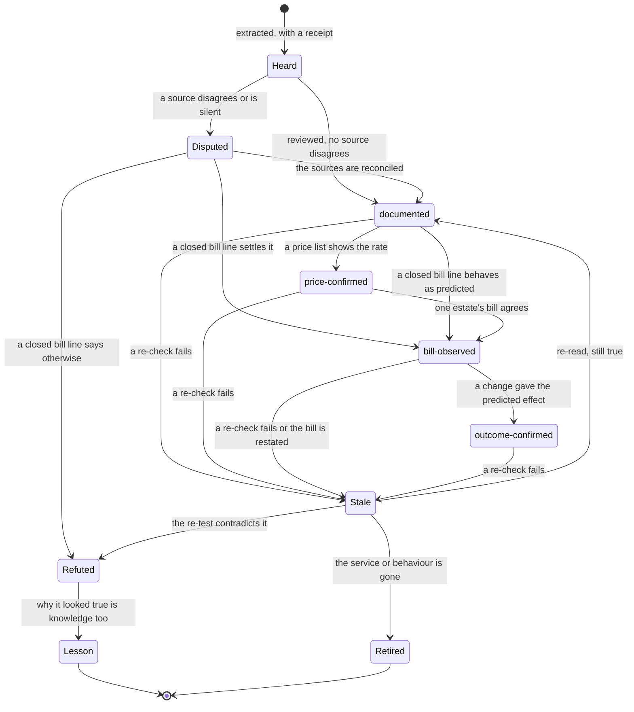

# Studying Azure — how the AI learns Azure's economics

> **What this answers:** *How does the AI learn about Azure services — including new ones? How does it know what drives a charge? How does it stay right while Azure keeps changing?*
> Part of the [north star](01-north-star.md), whose [glossary](01-north-star.md#glossary) defines the capitalised terms and whose [cast](01-north-star.md#10-the-cast) names the agents. Idea-level: what the system must be able to do and why it should work, not how it is built. Nothing is built yet: every example here is invented or worked by hand.

Studying Azure is four steps, repeated forever: **read** what Microsoft publishes (§3), **decode** every meter with the Cost Grammar (§2), **check against the money** (§4) and **keep fresh** (§5 and §7).

---

## 1. What it means to "know" a service

Knowing a service means being able to answer, for any resource of that service, in any estate (one customer's Azure environment):

- **How does this thing charge me — exactly?** Which meters, units, granularity, minimums and delays?
- **What drives each charge?** What makes it go up or down?
- **What can I change — and what does each change trade away?**
- **How can I tell it is actually needed?** Which signal shows real demand — and where is the blind spot with none?
- **What surprises are waiting?** Hidden meters, defaults, multiplicative effects, one-way doors.
- **How sure are we — and for whom?** Where did each answer come from, in which *scope* does it hold (region, offer, load, date), and when was it last checked? A price list is not a bill, and one customer's bill is not another's: [the learning contract](09-the-learning-contract.md) keeps them apart.

The **Atlas** — the open, versioned map of how Azure charges that the system builds and tends — holds that knowledge as a **Service Cost Profile** per service: a dossier written for humans, built for machines, and backed by **receipts** (the source, quote and date behind every line). A profile holds **identity and lifecycle** (SKUs, regions, preview, GA or retiring); **how it bills** (every meter in plain words: mechanism, unit, granularity, minimums, delays); **what drives the bill**; **the knobs** and what each trades; **the tells** (signals of waste) and the **blind spots** where Azure exposes none; **traps and surprises**; **interactions** with other services; **discount interplay**; the **evidence level and scope** of every line; and **open questions**.

---

## 2. The Cost Grammar — how it reasons about services it has never seen

The Atlas can grow only as fast as the AI can *understand* meters. The **Cost Grammar** is what makes understanding general. Most meters, in every service, are one or a few of **fourteen mechanisms** — ways money arises — and each mechanism comes with a built-in question and a built-in kind of evidence.

| Mechanism | How the money arises | What waste looks like | Signal of real need | Levers (and what they trade) | A classic trap |
|---|---|---|---|---|---|
| **Capacity** | you pay for what you provision, used or not | provisioned far above any demand over a representative period | utilisation, throughput, connections, queue depth | resize, scale in, schedule, change model, consolidate (headroom, latency, resilience) | a *floor*: some services bill a minimum even at zero |
| **Consumption** | you pay per unit of use | use that produces no value: retries, polling, chatty callers | value-weighted usage, error and retry rates | batch, cache, rate-limit, fix the caller | an *idle rate* that is not zero |
| **Stock** | you pay per month for what you keep | growing and unread | last access, retrieval, growth vs need | tier, lifecycle, expire (retrieval cost, restore time) | versioning and soft-delete quietly adding to the stock |
| **Flow** | you pay for what moves or is produced | moved further than needed; copied more than needed; produced in a form no consumer wants | consumers and their value; destinations | filter, sample, aggregate, re-route, co-locate (completeness) | the consumer you cannot see: the rare audit job |
| **Feature** | a switch turns on a meter | enabled and unused | feature usage | switch off, re-scope (capability) | defaults that enable it |
| **Multiplier** | dimensions multiply | one dimension beyond its need | per-dimension load | shrink the cheapest-to-shrink dimension | doubling both dimensions quadruples the bill |
| **Tier / step** | price jumps at thresholds | just over a threshold; premium tier whose differences go unused | position vs threshold; feature usage | re-tier | a tier some services will not let you step back down from |
| **Commitment** | you pay ahead for a discount | unused coverage; wrong scope; wrong term | coverage and utilisation over time; a forecast | right-size the next term, re-scope, exchange where allowed | priced as if used 100% |
| **Time quantum** | billing granularity decides the price of short things | many short-lived items paying minimums | duration distribution | batch, pool, reuse | "started hour" billing |
| **Coupling** | a thing you add drags in other meters | a side-effect nobody intended | dependency graph; meters that appear after a change | decouple, relocate, remove | private connectivity, diagnostics and replication traffic |
| **Leftover** | billing continues after the parent is gone | children without a parent; retained backups | parent state; owner existence | clean up with a safety net | deleting the parent does not delete the child |
| **Rate and benefit** | the price per unit is negotiable | paying list where a benefit applies | effective vs list price; eligibility | apply the benefit, negotiate, use a programme | discount structures differ by agreement |
| **Allowance** | an included or free amount, then paid | paying for what a free grant would have covered, or sitting just past its edge | usage against the allowance, per period | spread or consolidate use; pick the plan whose grant fits | allowances are often per subscription and per month; each service defines its own scope |
| **Time cliff** | a price or condition changes on a date | a preview or promotion ending unnoticed; a retiring SKU | the announced date; the resources it touches | plan the move before the date | the free period that quietly stops |

The fourteen are the **starting vocabulary** of a living taxonomy, not a closed list. A meter that fits no row is a finding: the AI proposes a new mechanism with evidence, and the reviewers of knowledge decide whether it earns a place. The grammar learns too.

### When nothing fits — a story (the service is invented)

*An invented example.* A new service bills a "burst balance": a little credit accrues every quiet hour, and use above the baseline spends it. The Scholar's first guess is **allowance** — but that predicts an idle resource never pays extra, and the first bill lines of teams already running the service say otherwise: after a quiet night a burst is free; after a busy afternoon a burst of the same size costs three times the rate. Second guess, **tier / step** — wrong too: the price does not jump at a threshold, it depends on *history*. The Detective finds the cleanest comparison one estate's bills hold — a burst after six quiet hours and one after six busy ones — and the same pattern appears in the observations other organisations have pooled.

Nothing in the grammar says *a price that depends on a balance that builds up and drains*. The Librarian proposes a new mechanism, **accrual**, with those observations as evidence, and tests it by predicting which two other credit-style meters should behave the same way. One does; the other is a **time quantum** effect, so the proposal is narrowed. The reviewers decide whether *accrual* earns a place, and the evaluation gains a sealed case built on it, hidden from the system it tests.

### Decoding a meter

For any meter, the Scholar answers five questions — and records *how it knows*:

1. **What is the unit, and what does it measure?** (hour, GB-month, scale unit, request batch, seat …)
2. **Which mechanism is it?** One or several: many meters are two things at once, and a platform's own units are often *layered* on the compute, storage and network underneath.
3. **What would show it is truly needed?** Which telemetry exists? Is there a blind spot?
4. **What are the levers, and what do they trade away?**
5. **What surprises does it hide?** Minimums, rounding, delays, coupling.

The *fingerprint* of a meter — unit of measure, name, product and SKU, the schema property that sets it, the metrics the service emits — is usually enough for a confident first guess. A closed bill line that contains the meter, matched to the usage and the changes behind it, turns the guess into a claim for that estate; until then the guess stays open.

### The grammar at work on real services (illustrative decodes)

*Worked by hand from Microsoft's published documentation, to show what the grammar should produce. No agent has run them, and no bill has confirmed them.*

| Service and behaviour | Mechanism | The demand question | A lever |
|---|---|---|---|
| A premium serverless plan that always keeps at least one instance warm | **Capacity** (a floor) | does anything need the warmth? | move idle apps to a plan that scales to zero — for Linux apps today that is Flex Consumption (Linux-only), because Linux Consumption retires on 30 September 2028 (a lever the change radar must keep current) |
| A container platform that bills an *idle* rate on its consumption plan when a minimum replica count is above zero (serverless GPU apps excepted) | **Consumption** with an idle rate | can it scale to zero? | set the minimum to zero where latency allows |
| A search service on the *dedicated* model, billed by replicas × partitions (a serverless preview bills consumption instead; it has no SLA and cannot be converted to or from the other tiers) | **Multiplier** | which dimension exceeds its need? | shrink the cheaper-to-shrink dimension |
| A file-transfer option on storage that bills hourly while enabled | **Feature** | does anyone connect? | switch it off until needed |
| Object versioning plus soft delete plus snapshots on the same data (versioning is unsupported on hierarchical-namespace accounts) | **Stock** (overlapping) | will anyone ever restore these? | lifecycle rules to expire old versions |
| A virtual machine that is *stopped* but still allocated: the compute meter keeps running, and so do its disks and addresses | **Capacity** | is it deallocated, not just stopped? | deallocate what is idle (disks and addresses still bill) |
| A managed database instance that can be stopped: compute and licence stop billing, storage does not — and each start is billed from a full started hour | **Capacity** × **time quantum** | is it idle overnight, and does anything cycle it? | stop it outside use hours; do not cycle it often |
| A data-engineering cluster without automatic termination — the platform's own units *layered* on top of the compute underneath | **Capacity × time**, layered | is anything attached overnight? | enforce auto-termination |
| A prepaid reservation | **Commitment** | is the coverage used? | right-size the next term |
| A capacity that can be paused, where pausing stops compute but storage keeps billing | **Capacity** + **Stock** | what is left running after the pause? | manage the stock separately |

The sourced versions are in the [cost-trap bank](research/cost-trap-bank.md), as published regression cases; its status *Verified* means source-verified — found on the cited Microsoft page — not confirmed by a bill.

---

## 3. What it reads — and how far it trusts each source

| Kind of source | Examples | Trust |
|---|---|---|
| **Measured reality** | the estate's own bills and usage data; what happened after changes people made anyway; observations pooled from many organisations (a scope and an aggregate each) | highest, for the scope it was seen in: how things *actually* bill |
| **Machine-readable surfaces** | published price lists (all meters by region and SKU — *list* prices, never what a customer pays); cost and usage exports, including the open FOCUS format where the agreement and scope support it; the resource inventory and a short window of property changes; metric definitions; the published API specifications and the type definitions generated from them | high, but they say *what exists*, not *what it means*: the raw material for the grammar |
| **Official documentation** | service and pricing pages, limits and quotas, SLAs, Well-Architected guidance, release notes — written in public, version-controlled sources, so most changes arrive as a diff the AI can read (section 7 covers the rest) | high, but tested when load-bearing, contradictory or silent |
| **Engineers and the community** | Microsoft engineers' talks, blogs and issue threads; experts' write-ups; FinOps practitioners; open-source policies, detectors and infrastructure code | medium to medium-low until confirmed: they report behaviour that documents omit, and traps seen in the wild |
| **The AI's own memory** | what the language model "remembers" | **lowest: leads only, never a source of a number** |

Two rules follow from the table:

- **Prices and numbers come from tools, never from memory.** The language model may *explain* a price; a deterministic computation over the price list or the customer's own price sheet *produces* it. A number on a Recommendation has lineage and names its price basis.
- **A document is evidence, not truth.** Two documents that disagree, or a silence about something that matters, become a question on the Agenda — settled by a closed bill line, never by a guess.

---

## 4. From reading to knowing: claims, receipts, life cycle

The Scholar extracts **claims**, each a small, checkable statement, and then **checks them against the money**: a claim stays *documented* — or *price-confirmed*, where a published price list shows the rate — until a real bill line confirms it for an estate. A closed bill line that contains the meter, matched to the usage and changes behind it, settles a disagreement between two documents; unmatched charges leave it disputed. The surprises no page mentions — the delay, the minimum, the rounding, the hidden meter — arrive as charges nobody predicted, and become knowledge.

```
CLAIM   "Scaling down does not refund the started hour"      (an invented example: Azure Prism)
SCOPE   service: Prism · SKU: all · API: 2026-10-01 · regions seen: West Europe, Sweden Central · offers seen: EA, pay-as-you-go · as of 2026-10-27
SOURCES doc A (quote, date) ✗ says refund · doc B (quote, date) ✓ says no refund
ATLAS   documented · pooled observation: 5 organisations, closed periods, hour billed · confidence 0.93 · reviewed by the Skeptic and a person
ESTATE  bill-observed only when that estate's own closed bill agrees; until then its figures for this meter are scenarios
RECHECK price and document diff every 90 days · on any change to doc A or B · on every new pooled observation
```

A claim moves between these states:



The **four evidence levels** say what kind of evidence stands behind a claim; they are not grades of truth.

| Level | What stands behind it | Lives in |
|---|---|---|
| **Documented** | a source says so, and the receipt proves it | the open Atlas |
| **Price-confirmed** | a published price list shows the meter, unit and rate | the open Atlas |
| **Bill-observed** | one estate's closed bill lines, matched to the usage and changes behind them, behaved as predicted | that estate only |
| **Outcome-confirmed** | a change made on the strength of the claim had the predicted effect | that estate only |

A claim with no price in it, such as "a stopped VM still bills compute", has no price-confirmed step. A customer's own price sheet confirms its *contracted* rates inside that estate and never enters the Atlas. The last two levels sit in the estate's **Ledger**, the system's record of predictions, decisions and measured outcomes. What an estate can give the Atlas is a **pooled observation** — a scope and an aggregate, privacy-reviewed and published only when several organisations contribute the same one (section 12) — so the next estate starts ahead.

**Peer review of knowledge** is where the human sits. A claim that will be *relied on to change something* must have passed the Skeptic and a person with domain standing. A figure for a particular estate is called an expected *saving* only when the claim is *bill-observed* in that estate (see [the gates](09-the-learning-contract.md)); where the system cannot read the bill, the figure is a labelled **scenario priced at list prices**, and the Recommendation says what it rests on. Claims that are merely informative can stay *documented*, clearly labelled, so the system is useful from day one and honest about its edges. A general claim can also be *compiled* into a Detector or an Action, which have [their own life cycle](04-finding-out-without-spending.md).

---

## 5. Knowledge CI — facts that test themselves

Software teams keep code honest with automated tests. The Atlas does the same for **facts**: every claim ships with a **re-check recipe** — a **price re-fetch** (the price list still says what the claim says), a **document diff** (the page it rests on has not changed, or changed harmlessly), a **schema diff** (the property, SKU enumeration or metric it depends on still exists) or **bill verification** (each contributing estate re-checks its own closed bills against the claim, and only the aggregate result is shared).

Recipes run on a schedule weighted by **impact × volatility**: daily for a claim that would mislead many estates if wrong and rests on a page that changes often (a target, not a promise), quarterly for a stable, low-stakes one. When a recipe fails, the claim goes **stale**, every Recommendation that relied on it is flagged, and the Agenda gets a new question. Knowledge that has not been re-tested lately says so on its face.

---

## 6. Day zero — a new service, feature or price change

Microsoft ships. The aim is a **provisional mechanism profile within hours** — honest about being provisional, and reviewable. That is an aspiration, not a measured result: the profile rests on documents and price lists, and only a bill line confirms it, which exists once somebody has used the service and arrives hours to days later.

### A day-zero story (the service is invented)

*An invented example, not a measurement: the Prism story of the north star, one step at a time.*

1. **Tuesday 09:00.** Microsoft announces **Azure Prism**, a managed retrieval service. The change radar sees six new meters on the price list.
2. **By 10:30.** Four readers work in parallel — documents, price list, schema and metrics, community — and the Scholar decodes each meter with the grammar: a *Prism Unit* is **capacity**, a *Query Unit* **consumption**, *snapshot GB-months* **stock**, *replicas* a **multiplier**, the private-link add-on **coupling**, the preview price a **time cliff**.
3. **A dispute, recorded rather than settled.** Two pages disagree about whether scaling down refunds a started hour. Nobody builds anything to find out: the claim is marked *disputed*, and both quotes stay as receipts.
4. **Profile v0.1.** Provisional, every line tied to its source, none of it allowed to back a savings promise.
5. **The Agenda asks which resources in which estates are Prism.** Two preview deployments, one team. The Diplomat asks that team one question: **"The preview price ends on 1 March. Do you want a heads-up plan?"** Nobody wrote a Prism rule.
6. **About a week later, the first bill lines.** Once their period has closed and they match the usage behind them, they settle the dispute in that team's estate — a started hour *is* billed after a scale-down — and show a second trap nobody predicted: snapshots keep billing after the index is deleted.
7. **What travels.** Both findings become observations: a scope and an aggregate, which reach the open Atlas only once several organisations report the same thing. The next estate to meet Prism starts ahead.

### A real one — a recent service, decoded from its billing page

Prism is invented. **Azure SRE Agent** is not: its billing page ([Learn](https://learn.microsoft.com/en-us/azure/sre-agent/pricing-billing); trial terms on the [evaluation page](https://learn.microsoft.com/en-us/azure/sre-agent/evaluate); both read 2026-11-01) is the kind of day-zero input the Scholar would read. It bills in *Azure Agent Units* (AAUs). The decode below is **worked by hand** to show what the Scholar should produce; no agent has run it.

| What the page documents | Mechanism | Lever or trap |
|---|---|---|
| **Always-on flow** — 4 AAUs per agent-hour, from creation until deletion, whether or not the agent does anything | **Capacity** (an existence floor) | delete agents created for a trial and forgotten; new customers get up to 30 days with it waived — a **time cliff** |
| **Active flow** — AAUs per million tokens, metered separately for input, output, cache read and cache write, at rates set by the model | **Consumption**, with a **multiplier** from model choice | the model moves the price: the page's own example prices the same quick question at about 3.8 AAUs on one model and about 1.3 on another |
| A monthly **AAU allocation limit**, covering active flow only; at the limit the agent becomes unavailable until next month while always-on charges continue | none: an **availability constraint** that caps active work and is not a way money arises | a cost control that causes an outage |

What the page leaves open — how a partial hour of the always-on charge is billed, how the meters round, what an AAU costs in euros — goes to the Agenda; the profile stays *documented* until a published price list and a closed bill line say more.

---

## 7. Staying current — the change radar

Azure changes in five ways that matter to cost, and the radar watches each, running the day-zero routine in smaller form:

| Change | Why it matters | What the system does |
|---|---|---|
| **Price change** | every Recommendation, forecast and commitment depends on it | recomputes; flags estates whose position changed |
| **New SKU, tier or region** | something cheaper may now exist for this workload's shape | decodes the new meters, replays the affected estates' recorded usage under them, and tells those estates: "Azure moved — you benefit" |
| **Behaviour change** | an old claim may now be false | re-runs the claim's re-check and reads the next bill lines; marks claims stale |
| **Retirement** | forced moves are also chances to move *well* | pairs the deadline with the right-sizing opportunity |
| **New limit or quota** | quiet constraints change what is possible | updates the knobs |

Most changes are a **diff to be read**: documents and specifications are written and versioned in public. Two kinds are not: a customer's own price sheet and negotiated terms (private, so read only where the system has access, inside that estate) and a change nobody announced (first seen on a closed bill). The radar watches all three, and the news runs both ways: *"this just got cheaper for you"* as well as *"this just got worse"*.

---

## 8. Knowing what it does not know

A learning system must have a map of its own ignorance.

- **The coverage map.** For every service, meter and region: how far has it got — *unknown*, *documented*, *price-confirmed* and, estate by estate, *bill-observed* and *outcome-confirmed*? A meter nobody has used yet waits at *documented* ([section 11](#11-what-it-cannot-read)). The map is shown on the report card.
- **The frontier.** Real bills sometimes contain meters the Atlas has never seen. Such a meter is the most valuable lead the system can get, and it goes straight to the top of the Agenda.
- **Humility in the Recommendation.** A figure is called an *expected saving* only when a bill line confirms the meter. Otherwise — a provisional or documentation-only profile, or no bill access — it is a labelled scenario, and the Recommendation says what it rests on and what is not yet known (*"no bill line has confirmed this yet"*), and asks, or waits for the bill.

---

## 9. Learning the commercial reality

The same meter costs different amounts for different customers, so a mechanism from the Atlas is not yet a price. The system learns each customer's **effective price book** — agreement type, negotiated discounts and credits, licence benefits, the reservations and savings plans in force, how costs are shared and charged back — from what the customer lets it read: the price sheet, the agreement, the commitment portfolio. It computes every number from *that*, never from list price unless it says so, which is also how it explains *why* two identical estates in two organisations deserve different advice.

**The agreement comes first.** Enterprise Agreement (EA), Microsoft Customer Agreement (MCA) bought directly, sold through a partner (CSP) and pay-as-you-go — with the offers around them: dev/test, credits, sponsorship — price the same meter differently, report it differently and let different people commit to it; some estates sit under several at once. So the first thing learned about an estate is which agreement it sits under. The price is always the customer's.

**Reach comes second.** What the system may see and do is not what the organisation could reach but what the identity it was given can reach: *billing reach* (the price sheet and commitments of the whole agreement), *subscription reach with costs* (bill lines) or *subscription reach without costs* (resources and metrics only). It finds out by trying — at onboarding, every week and at once after a refusal — and records what works where: the **capability profile**. Every number then carries its **price basis**: *contracted* (the customer's price sheet), *billed* (the rate on its bill lines) or *list* (the public price list). Where the bill cannot be read, a figure is a scenario priced at list prices and says so; it becomes an *expected saving* only when a bill line confirms the meter. A purchase goes to whoever can make it, as a request where a partner or a central team holds the right. [Every agreement, every level of access](01-north-star.md#5-every-agreement-every-level-of-access) says more.

| Part of the commercial layer | What the AI must learn | Why it changes the answer |
|---|---|---|
| **Agreement type** | EA · MCA bought directly · sold through a partner (CSP) · pay-as-you-go: who can see the price sheet, how export and data latency differ, who may exchange or refund | the same saving is reported — and sometimes *possible* — differently |
| **Price basis** | list → contracted → billed (the effective rate, after commitments and credits); on some agreements a pricing currency distinct from the billing currency | "what it costs" depends on the basis; every number says which |
| **Commitments — three kinds** | hourly benefits (reservations, savings plans; an unused hour does not roll over), pooled prepurchases, agreement-level consumption commitments (a capacity reservation is different: it guarantees capacity at the normal rate, it is not a discount) | each has its own flexibility, exchange rules and "is it used?" test |
| **Rate levers** | licence benefits, dev/test pricing, spot capacity, credits and free grants — and the order in which they stack | the cheapest change is often a *rate* change, not a usage change |
| **Price mechanics** | graduated tiers, free allowances, billing quantum, currency conversion, tax | small print that moves totals |
| **Charges that are not resources** | marketplace and SaaS purchases, support plans | spend nobody tags |
| **Network paths** | egress, cross-region, peering and private-connectivity processing — priced by *path*, not by resource (traffic between availability zones in a region is not charged) | placement decisions hide here |
| **Views** | actual versus amortised cost; showback and chargeback; shared-cost allocation | one bill, told several ways — Finance decides which counts |

---

## 10. Learning how to learn

Facts are half of expertise; the other half is **method** — where to look first, what to trust, how to test, how to ask. The system records how well each source, tactic, test and question has paid off and uses the record to choose what to do next: the second and sixth of the six things that change in [the learning contract](09-the-learning-contract.md). [Getting smarter](07-getting-smarter.md) covers what is tracked and the safeguards around it.

---

## 11. What it cannot read

Some truths are not written anywhere: how a team *actually* uses a thing, why a configuration is what it is, what the next launch will need, which behaviours Microsoft has never documented. For those the system has six routes, cheapest first, and none provisions anything just to measure it. The first five cost model tokens and some attention, and change nothing in Azure: **ask** the one person who knows; **look** at what bills, metrics and change history already hold; **replay** recorded usage under another SKU, region, offer or commitment, once the replay has reproduced the real bill of that month; **follow** the outcome of changes people were making anyway; **pool** the observations other organisations contributed (only a scope and an aggregate, once several agree). The sixth is rare and different: a **trial** is one small, reversible change to something an owner already runs, approved by the owner after seeing a cost ceiling, with an automatic rollback — it can move the bill. [Finding out without spending](04-finding-out-without-spending.md) has the detail; what the system learns is labelled with the route that taught it.

**The honest limit: a meter nobody has used cannot be learned until a bill contains it.** Some services cannot be observed by anyone until somebody uses them — a limited or private preview, a feature restricted to a few customers. Those profiles are marked **documentation-only**, the Agenda records *why* no bill line can exist yet, advice built on them says so, and the system asks the people who can know — an early-access customer, Microsoft's own channels — rather than pretend.

---

## 12. The Atlas, seen from outside

The Atlas is meant to be *used by people*, not just by the AI: a browsable, searchable, versioned reference of how Azure charges, with a test suite behind it. Anyone can read a profile and follow every line to its receipts; anyone can propose a correction, and the AI itself proposes changes as reviewable submissions. A change, as a reviewer sees it (an invented example):

```
Profile: Azure Prism · v0.1 → v0.2 · 3 claims changed
  ± "Scale-down refunds the started hour"  → REFUTED: pooled observation, 5 organisations, closed bill periods: the hour was billed (predicted: refund · observed: none)
  + "Deleting an index leaves snapshots billing until purged"  → NEW: pooled observation, 4 organisations, 2 regions · no page says so yet
  ? "Private-link add-on bills per endpoint-hour"  → still DOCUMENTED ONLY: no contributing organisation has a bill line for the meter yet
[Approve] [Request changes]
```

The Atlas can live in the open because of what may enter it: public documents, published price lists and pooled observations. Only a scope and an aggregate leave an estate, a privacy review checks them, an observation is published only when several organisations contribute it, and a bill line, a name or an identifier never does. The open, shared half of the knowledge is [the Commons](07-getting-smarter.md) (the sealed evaluation cases are not part of it). The more people use the Atlas, the sharper it gets.
