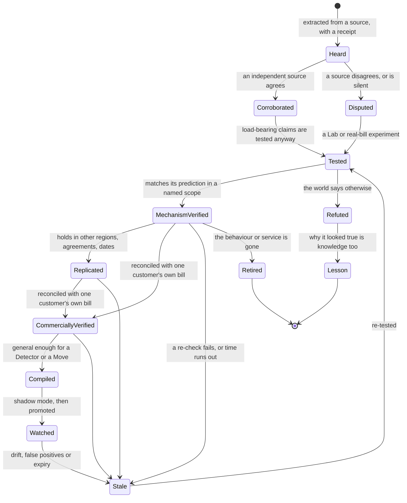
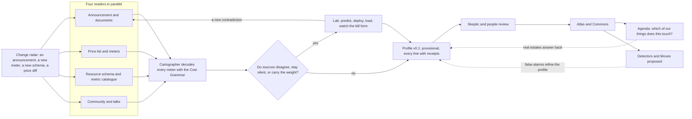

# Studying Azure — how the AI learns Azure's economics

> **What this answers:** *How does the AI learn about Azure services — including new ones? How does it know what drives a charge? How does it stay right while Azure keeps changing?*
> Part of the [north star](01-north-star.md). Everything here is idea-level: we describe what the system must be able to do and why it should work, not how it is built.

---

## 1. What it means to "know" a service

Knowing a service is not remembering its marketing page. It is being able to answer, for any resource of that service, in any estate:

- **How does this thing charge me — exactly?** Which meters, in which units, with what granularity, minimums and delays?
- **What drives each charge?** What would make it go up or down?
- **What can I change — and what does each change trade away?**
- **How can I tell whether what I pay for is actually needed?** Which signal shows real demand — and is there a blind spot where no signal exists?
- **What surprises are waiting?** Hidden meters, defaults, multiplicative effects, one-way doors.
- **How sure are we — and for whom?** Where did each answer come from, in which *scope* was it checked (region, offer, load, date), and when was it last checked? A claim verified in a Lab is not a claim verified on *your* bill: [the learning contract](11-the-learning-contract.md#2-verified-has-a-scope) keeps the two apart.

The Atlas holds that knowledge as a **Service Cost Profile** per service. A profile is a dossier, written for humans, built for machines, and backed by receipts.

| Section of a profile | What it holds |
|---|---|
| **Identity and lifecycle** | the service, its SKUs and features, regions, preview/GA/retiring status, version history |
| **How it bills** | every meter in plain words: the mechanism (see the grammar below), the unit, the granularity, minimums, rounding, delays |
| **What drives the bill** | which meters dominate, and what moves them |
| **The knobs** | each lever and what it trades: latency, resilience, security, effort, reversibility |
| **The tells** | the signals that reveal over-provisioning, dormancy or inefficiency — and the **blind spots** where Azure exposes no signal |
| **Traps and surprises** | meters that appear when a switch is flipped; things that keep billing after the parent is gone; one-way doors |
| **Interactions** | what it drags in from other services (connectivity, diagnostics, replication, egress) |
| **Discount interplay** | how commitments, licence benefits and negotiated terms apply |
| **Evidence** | for every line: sources, quotes, dates, the scope it was tested in (region, offer, load), the experiments that verified it, a confidence |
| **Open questions** | what the system does not yet know — and has queued to find out |

### A profile fragment (the service is invented)

```
SERVICE COST PROFILE — Azure Prism (invented, for illustration)     v0.2 · provisional · mechanism-verified in the Lab scope only
How it bills
  Prism Unit ........... capacity    · per started hour, from provisioning to deletion   VERIFIED  lab #212
  Replica .............. multiplier  · every replica multiplies Prism Units               VERIFIED  lab #215
  Query Unit ........... consumption · per 1,000 queries                                 doc only
  Snapshot storage ..... stock       · GB-month; keeps billing after the index is deleted VERIFIED  lab #217
  Private-link add-on .. coupling    · per endpoint-hour plus data processed             doc only
  Preview price ........ time cliff  · free until the announced date, then billed         doc + price list
The knobs     units · replicas · snapshot retention · region · tier
The tells     capacity → unit utilisation metric   stock → snapshot age and count
Blind spot    no metric separates cached from uncached queries → query cost cannot be attributed to callers
Traps         scaling down does not refund the started hour · purge snapshots when deleting an index
Open          does the private-link add-on bill when the endpoint is disconnected?  → experiment queued
```

---

## 2. The Cost Grammar — how it reasons about services it has never seen

The Atlas can grow only as fast as the AI can *understand* meters. The **Cost Grammar** is what makes understanding general. Every meter, in every service, falls into a small number of **mechanisms** — ways money arises — and each mechanism comes with a built-in question and a built-in kind of evidence.

| Mechanism | How the money arises | What waste looks like | Signal of real need | Levers (and what they trade) | A classic trap |
|---|---|---|---|---|---|
| **Capacity** | you pay for what you provision, used or not | provisioned far above any demand over a representative period | utilisation, throughput, connections, queue depth | resize, scale in, schedule, change model, consolidate (headroom, latency, resilience) | a *floor*: some services bill a minimum even at zero |
| **Consumption** | you pay per unit of use | use that produces no value: retries, polling, chatty callers | value-weighted usage, error and retry rates | batch, cache, rate-limit, fix the caller | an *idle rate* that is not zero |
| **Stock** | you pay per month for what you keep | growing and unread | last access, retrieval, growth vs need | tier, lifecycle, expire (retrieval cost, restore time) | versioning and soft-delete multiplying the stock silently |
| **Flow** | you pay for what moves or is produced | moved further than needed; copied more than needed; produced in a form no consumer wants | consumers and their value; destinations | filter, sample, aggregate, re-route, co-locate (completeness) | the consumer you cannot see: the rare audit job |
| **Feature** | a switch turns on a meter | enabled and unused | feature usage | switch off, re-scope (capability) | defaults that enable it |
| **Multiplier** | dimensions multiply | one dimension beyond its need | per-dimension load | shrink the cheapest-to-shrink dimension | adding one to each of two dimensions quadruples the bill |
| **Tier / step** | price jumps at thresholds | just over a threshold; premium tier whose differences go unused | position vs threshold; feature usage | re-tier | a tier you can never leave |
| **Commitment** | you pay ahead for a discount | unused coverage; wrong scope; wrong term | coverage and utilisation over time; a forecast | right-size the next term, re-scope, exchange where allowed | priced as if used 100% |
| **Time quantum** | billing granularity decides the price of short things | many short-lived items paying minimums | duration distribution | batch, pool, reuse | "started hour" billing |
| **Coupling** | a thing you add drags in other meters | a side-effect nobody intended | dependency graph; meters that appear after a change | decouple, relocate, remove | private connectivity, diagnostics and replication traffic |
| **Leftover** | billing continues after the parent is gone | children without a parent; retained backups | parent state; owner existence | clean up with a safety net | deleting the parent does not delete the child |
| **Rate and benefit** | the price per unit is negotiable | paying list where a benefit applies | effective vs list price; eligibility | apply the benefit, negotiate, use a programme | discount structures differ by agreement |
| **Allowance** | an included or free amount, then paid | paying for what a free grant would have covered, or sitting just past its edge | usage against the allowance, per period | spread or consolidate use; pick the plan whose grant fits | allowances are often per subscription, per month, per region |
| **Time cliff** | a price or condition changes on a date | a preview or promotion ending unnoticed; a retiring SKU | the announced date; the resources it touches | plan the move before the date | the free period that quietly stops |

The table is the **seed of a living taxonomy**. If the AI meets a meter that fits no row, it proposes a new mechanism with evidence; the reviewers of knowledge decide whether it earns a place. The grammar learns too.

### Decoding a meter

For any meter, the Cartographer answers five questions — and records *how it knows*:

1. **What is the unit, and what does it measure?** (hour, GB-month, scale unit, request batch, seat …)
2. **Which mechanism is it?** (one or several — many meters are two things at once, and a platform's own units are often *layered* on top of the compute, storage and network underneath, each layer with its own mechanism)
3. **What would show it is truly needed?** Which telemetry exists? Is there a blind spot?
4. **What are the levers, and what do they trade away?**
5. **What surprises does it hide?** Minimums, rounding, delays, coupling.

The *fingerprint* of a meter — its unit of measure, its name, its product and SKU, the property in the resource schema that sets it, the metrics the service emits — is usually enough for a confident first guess. The Lab turns the guess into knowledge.

### The grammar at work on real services (illustrative decodes)

| Service and behaviour | Mechanism | The demand question | A lever |
|---|---|---|---|
| A premium serverless plan that always keeps at least one instance warm | **Capacity** (a floor) | does anything need the warmth? | move idle apps to a plan that scales to zero — today the documented path is Flex Consumption, because Linux Consumption retires in September 2028 (a lever the change radar must keep current) |
| A container platform that bills an *idle* rate when a minimum replica count is above zero | **Consumption** with an idle rate | can it scale to zero? | set the minimum to zero where latency allows |
| A search service on the *dedicated* model, billed by replicas × partitions (a serverless preview bills consumption instead, and the two cannot be converted) | **Multiplier** | which dimension exceeds its need? | shrink the cheaper-to-shrink dimension |
| A file-transfer option on storage that bills hourly while enabled | **Feature** | does anyone connect? | switch it off until needed |
| Object versioning plus soft delete plus snapshots on the same data | **Stock** (compounded) | will anyone ever restore these? | lifecycle rules to expire old versions |
| A managed firewall: billed while it is allocated — deallocating it stops the billing | **Capacity** | does anything need it outside business hours? | deallocate where it is used only in office hours |
| A NAT gateway: documented hourly and data-processing charges, and no stopped state — only removal stops them | **Capacity** + **Flow** | does any subnet still depend on it? | remove it when nothing needs it |
| A data-engineering cluster without automatic termination — the platform's own units *layered* on top of the compute underneath | **Capacity × time**, layered | is anything attached overnight? | enforce auto-termination |
| A prepaid reservation | **Commitment** | is the coverage used? | right-size the next term |
| A capacity that can be paused, where pausing stops compute but storage keeps billing | **Capacity** + **Stock** | what is left running after the pause? | manage the stock separately |

None of these was typed in as a rule. They are what the grammar produces from the meters and the facts — and the [exam bank](research/exam-bank-cost-traps.md) holds the sourced versions as *test questions*, not as a rulebook.

### Laws the AI may discover

From hundreds of experiments the system can look for **laws of Azure billing** — regularities across services — and use them to predict services it has never touched. They are *hypotheses it tests*, never assumptions; for example:

- *"A per-hour meter usually starts at provisioning, not at first use."*
- *"Billing granularity differs by meter — per second, prorated, or per started hour — so a short-lived resource pays a minimum only where its meter says so."* (every meter's granularity is recorded and tested, never assumed)
- *"A thing that is stopped but not released often keeps its most expensive meter."*
- *"Retention policies compound: each protective feature added to the same data multiplies its stock."*

A law with a good track record makes day-zero learning faster: the first hour of a new service starts with *"which of the laws applies here?"* instead of a blank page.

---

## 3. What it reads — and how far it trusts each source

| Kind of source | Examples | What it teaches | Trust |
|---|---|---|---|
| **Measured reality** | the Lab's experiments; real bills and usage data from estates | how things *actually* bill | highest |
| **Machine-readable authoritative surfaces** | the **Retail Prices** list (unauthenticated, all meters, by region and SKU — *list* prices in a base currency, never what a customer pays); **Cost Management exports** (including the open FOCUS dataset where the agreement and scope support it); **Resource Graph** (resources, and a short window of property changes); **metric definitions** (every metric each resource type emits); the public **resource-provider API specifications** and the **Bicep type definitions** generated from them (every property, every SKU enumeration) | the meters, the knobs, the signals — *the raw material for the grammar* | high — but they say *what exists*, not *what it means* |
| **Official documentation** | service pages, pricing pages, limits and quotas, SLAs, architecture and Well-Architected guidance, release notes and announcements — all written in public, version-controlled sources, so **every change is a diff the AI can read** | intent, behaviour, advice | high, but must be tested when load-bearing, contradictory or silent |
| **Microsoft engineers in public** | talks, blogs, issue discussions | behaviour that documents omit | medium |
| **The community** | experts' write-ups, FinOps practitioners, open-source repositories (policies, detectors, infrastructure code) | traps seen in the wild | medium-low until verified |
| **The AI's own memory** | what the language model "remembers" | leads only | **lowest — never a source of a number** |

Three rules follow from the table:

- **Prices and numbers come from tools, never from memory.** The language model may *explain* a price; a deterministic computation over the price list or the customer's own price sheet *produces* it. A number on a Brief always has lineage.
- **A document is evidence, not truth.** Two documents that disagree, or a silence about something that matters, always becomes an experiment.
- **Machine-readable surfaces beat prose** wherever they overlap, because they can be diffed and re-queried automatically.
- **History is what has been kept.** Native retention is short — property changes are queryable for 14 days, platform metrics are kept for about 93 days — so how far back the AI can look is decided by what a customer exports and retains. Collecting history is part of onboarding, and the first weeks in a new estate are a cold start for replay.

---

## 4. From reading to knowing: claims, receipts, life cycle

The Scholar does not write summaries. It extracts **claims**, each a small, checkable statement:

```
CLAIM   "Scaling down does not refund the started hour"
SCOPE   service: Prism · SKU: all · API: 2026-10-01 · region: Lab region · offer: list price · load: synthetic · as of 2026-11-02
SOURCES doc A (quote, date) ✗ says refund · doc B (quote, date) ✓ says no refund · lab #214 ✓ no refund
STATE   Mechanism-verified (this scope) · confidence 0.93 · reviewed by the Skeptic and a person · NOT yet commercially verified for any estate
RECHECK lab recipe #214 · every 90 days · plus on any change to doc A or B
```

Claims live a life, not a status:



**Peer review of knowledge** is where the human sits. Every claim that will be *relied on to change something* must have passed the Skeptic and a person with domain standing — **and, before it becomes advice for a particular estate, been reconciled with that customer's own bill** (*commercially verified*; see [the learning contract](11-the-learning-contract.md#2-verified-has-a-scope)). Claims that are merely informative can stay *provisional* — clearly labelled — so the system is useful from day one and honest about its edges.

---

## 5. Knowledge CI — facts that test themselves

Software teams keep code honest with automated tests. The Atlas does the same for **facts**: every claim ships with a **re-check recipe**.

| Recipe | Checks |
|---|---|
| **Price re-fetch** | the price list still says what the claim says |
| **Document diff** | the page the claim rests on has not changed (or changed harmlessly) |
| **Schema diff** | the property, SKU enumeration or metric the claim depends on still exists |
| **Lab replication** | the experiment still reproduces, in a fresh run |
| **Bill verification** | across real estates, the bills still behave as the claim predicts |

Recipes run on a schedule weighted by **impact × volatility**: a claim that, if wrong, would mislead many estates and that rests on a page that changes often is *scheduled* for daily re-checking (a target, not a promise); a stable, low-stakes claim, quarterly. When a recipe fails, the claim goes **stale**, every Brief that relied on it is flagged, and the Agenda gets a new question. Knowledge that has not been re-tested lately says so on its face.

---

## 6. Day zero — a new service, feature or price change

Microsoft ships. The aim is a **provisional mechanism profile within hours** of an announcement — honest about being provisional, and reviewable. That is an aspiration, not a measured result: the Lab's findings are verified only *for the Lab*, and a commercially verified answer for a given estate has to wait for a bill (hours to days) and for that customer's own export.



The same routine runs, in smaller form, for a **new feature** of an existing service, a **new SKU or region**, a **price change** and a **retirement notice**. Each ends the same way: a changed Atlas, a list of affected resources in each estate, and — if the change helps — a Brief that says so.

### A real one — read on the day this was written

Prism is invented. **Azure SRE Agent** is not: a recent service whose billing page ([Learn](https://learn.microsoft.com/en-us/azure/sre-agent/billing), read 2026-10-31) shows the grammar working on something nobody wrote a rule for. It bills in *Azure Agent Units* (AAUs). The Cartographer's first-hour decode:

| What the page documents | Mechanism | The demand question | Lever or trap |
|---|---|---|---|
| **Always-on flow** — 4 AAUs per agent-hour, from the moment an agent is created until it is deleted, whether or not it does anything | **Capacity** (an existence floor) | is the agent doing any work? | delete agents created for a trial and forgotten; the page notes new customers can evaluate with the always-on charge waived — a **time cliff** |
| **Active flow** — AAUs per million tokens, metered separately for input, output, cache read and cache write, at rates set by the model | **Consumption**, with a **multiplier** from model choice | tasks completed against tokens spent | the model choice moves the price: the page's own worked example prices the same quick question at about 3.8 AAUs on one model and about 1.3 on another |
| A monthly **AAU allocation limit** that covers active flow only; at the limit the agent becomes unavailable until next month, and always-on charges continue | a **cap that bites** | is the limit sized to the work? | a cost control that causes an outage |

What the page leaves open — how multiple agents share a limit, how a mid-month change prorates, how the meters round — goes to the Agenda as predictions for the Lab. The profile is **provisional**, and says exactly what it rests on.

*A week later, transfer:* a different AI service appears with an hourly floor for provisioned capacity. The Scholar starts from the same questions — *which meter is the existence floor? which is consumption? which cap bites?* — and the profile takes far less time. (The [exam bank](research/exam-bank-cost-traps.md) already records that provisioned model throughput cannot be paused: precisely the kind of fact the Lab verifies and the Exam later tests for transfer.)

---

## 7. Staying current — the change radar

Azure changes in five ways that matter to cost, and the radar watches each:

| Change | Why it matters | What the system does |
|---|---|---|
| **Price change** | every Brief, forecast and commitment depends on it | recomputes; flags estates whose position changed |
| **New SKU, tier or region** | something cheaper (or better) may now exist for this workload's shape | tests it in the Lab; matches against estates; "Azure moved — you benefit" |
| **Behaviour change** | an old claim may now be false | re-runs the Lab recipe; marks claims stale |
| **Retirement** | forced moves are also chances to move *well* | pairs the deadline with the right-sizing opportunity |
| **New limit or quota** | quiet constraints change what is possible | updates the knobs |

Because documents and specifications are written and versioned in public, a change is not an event to be noticed; it is a **diff to be read**. And the opportunity runs in both directions: the radar is as useful for *"this just got cheaper for you"* as for *"this just got worse"*.

---

## 8. Knowing what it does not know

A learning system must have a map of its own ignorance.

- **The coverage map.** For every service, meter and region: how well is it known — *verified, provisional, doc-only, unknown*? The map is public on the report card.
- **The frontier.** Real bills sometimes contain meters the Atlas has never seen. That is not a failure; it is the most valuable lead the system can get. It goes straight to the top of the Agenda: learn this one now.
- **Humility in the brief.** When advice rests on a provisional or doc-only profile, the Brief says so — *"I have not tested this myself"* — and the confidence is lower.
- **Curiosity on purpose.** The Conductor spends a measured part of the learning budget on the frontier: the services most used in estates and least well known come first.

---

## 9. Learning the commercial reality

The same meter costs different amounts for different customers. The system learns each customer's **effective price book**: the agreement type, the negotiated discounts and credits, the licence benefits, the reservations and savings plans in force, the way costs are shared and charged back. It reads what the customer lets it read — the price sheet, the agreement, the commitment portfolio — and computes every number from *that*, never from list price, unless it says so. This is also how it explains *why* two identical estates in two organisations deserve different advice. Until that has been done for an estate, whatever the Atlas says about a service is a **mechanism**, not a price (see [verified has a scope](11-the-learning-contract.md#2-verified-has-a-scope)).

| Part of the commercial layer | What the AI must learn | Why it changes the answer |
|---|---|---|
| **Agreement type** | enterprise agreement, Microsoft Customer Agreement, partner-sold, pay-as-you-go: who can see the price sheet, how export and data latency differ, who may exchange or refund | the same saving is reported — and sometimes *possible* — differently |
| **Price level** | list → contracted → effective (after commitments); the pricing currency and the billing currency | "what it costs" depends on the level; savings are booked per level |
| **Commitments — three kinds** | hourly benefits (reservations, savings plans; an unused hour does not roll over), pooled prepurchases, and agreement-level consumption commitments | each has its own flexibility, exchange rules and "is it used?" test |
| **Rate levers** | licence benefits, dev/test pricing, spot capacity, capacity reservations, credits and free grants — and the order in which they stack | the cheapest change is often a *rate* change, not a usage change |
| **Price mechanics** | graduated tiers, free allowances, billing quantum, currency conversion, tax | small print that moves totals |
| **Charges that are not resources** | marketplace and SaaS purchases, support plans | spend nobody tags |
| **Network paths** | egress, cross-region, inter-zone and private-connectivity processing — priced by *path*, not by resource | placement decisions hide here |
| **Views** | actual versus amortised cost; showback and chargeback; shared-cost allocation | one bill, told several ways — Finance decides which counts |

---

## 10. Learning how to learn

Facts are half of expertise. The other half is **method**: where to look first, what to trust, how to test, how to ask. The system keeps a record of how well each source, tactic, experiment and question has paid off, and uses it to choose its next move — rows 2 and 6 of [the learning contract](11-the-learning-contract.md#1-six-things-that-change). What is tracked, and the safeguards around it, are in [getting smarter](07-getting-smarter.md#6-learning-how-to-learn).

---

## 11. What it cannot read

Some truths are not written anywhere: how a team *actually* uses a thing, why a configuration is what it is, what the next launch will need, which behaviours Microsoft has never documented. For those the system has three routes, in order of cost: **ask a person** (the cheapest experiment there is), **infer from the estate's own history**, and **run it in the Lab**. And it labels what it learned by which route.

Some services cannot be tested by an outsider at all — a limited or private preview, one that needs quota the Lab does not have, one that needs a feature the Lab's subscription lacks. Those profiles are marked **documentation-only**, the Agenda records *why* they cannot be tested, and the system asks the people who can (an early-access customer, Microsoft's own channels) rather than pretend.

---

## 12. The Atlas, seen from outside

The Atlas is meant to be *used by people*, not just by the AI: a browsable, searchable, versioned reference of how Azure charges — closer to a trusted encyclopaedia with a test suite than to a hidden database. Anyone can read a profile and follow every line to its receipts. Anyone can propose a correction; the AI itself proposes changes as reviewable submissions. A change, as a reviewer sees it:

```
Profile: Azure Prism · v0.1 → v0.2 · 3 claims changed
  ± "Scale-down refunds the started hour"  → REFUTED by lab experiment #214 (predicted yes, observed no)
  + "Deleting an index leaves snapshots billing until purged"  → VERIFIED #217, 2 regions
  ? "Private-link add-on bills per endpoint-hour"  → UNVERIFIED (doc only) — experiment queued
[Approve] [Request changes]
```

Because the Atlas holds *no customer data*, it can live in the open, and the more people use it, the sharper it gets. That openness is the open-source heart of the project: [the Commons](07-getting-smarter.md#7-the-commons).
