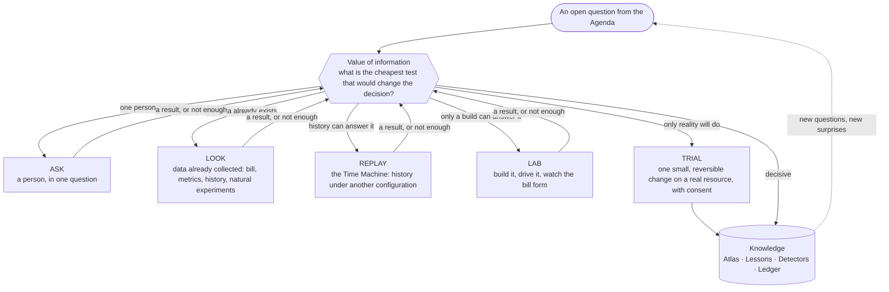
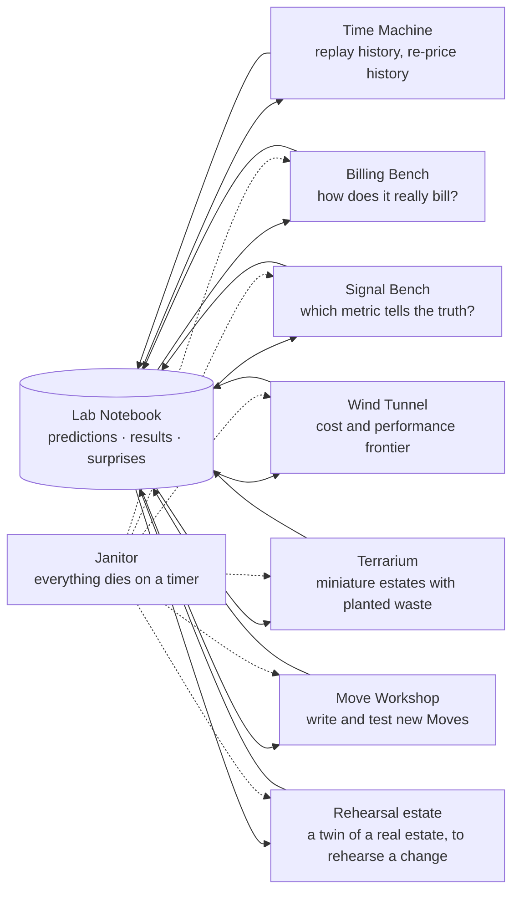

# Experiments and the Lab — how the AI finds out instead of guessing

> **What this answers:** *When reading and analysing are not enough, how does the AI actually find out how Azure behaves and what a change would really do — safely, cheaply, and in a way that makes it smarter next time?*
> Part of the [north star](01-north-star.md). Idea-level: what the system does, not how it is built.

---

## 1. Why experiment at all

Cost documentation is a *claim*; the bill is a *fact*. Between them sits a great deal that nobody writes down: how a meter rounds, whether a stopped thing still bills, how long the bill takes to notice, which metric really moves when a customer shows up, how small a thing can get before it breaks.

Human FinOps people learn this the hard way — by being surprised on a real bill. The system's alternative is to **be surprised on purpose, in a cheap place, and write the surprise down**.

Three principles run through everything below:

1. **Predict first.** An experiment without a written prediction teaches nothing: you cannot be surprised. The *gap* between prediction and result is the knowledge.
2. **Cheapest decisive test first.** Most questions do not need a lab.
3. **Every result goes back into memory** — the Atlas, the Lesson Book, a Detector, a better way of choosing the next experiment.

---

## 2. Five ways of finding out — cheapest decisive test first

For any open question, the Experimenter asks one thing: *what is the cheapest test that would change the decision?* It does not climb a ladder — it **chooses**, and goes back to choose again when a result is not enough. Each way is more convincing, and more expensive, than the one before it:



The hub is not a rule that every question visits every way: if a wrong answer is expensive and the Lab is cheap, go straight to the Lab; if one person can say it in ten seconds, ask them.

---

## 3. The Lab — a walled garden for finding out

The **Lab** is a dedicated, budget-capped sandbox subscription — separate from every customer estate — where agents may create, stress, break and delete things on purpose. It is not a single sandbox but a small campus of **benches**, each built for a kind of question:



The Lab Notebook is the hub: every bench reads *what is worth learning next* from it and writes back what it found. The **rehearsal estate** is a digital twin built from a real estate's Estate Model with synthetic data and recorded load shapes: before the AI proposes a change that matters, it rehearses it there, and shows the owner the rehearsal. The Janitor is not an afterthought — every resource the Lab creates carries an expiry, and the Lab's own bill is on the report card.

---

## 4. The Billing Bench — how does this thing *really* bill?

The most basic question about any service: *what shows up on the bill, and why?* The Billing Bench runs **meter probes**:

1. Create the smallest honest instance of the thing under test.
2. Run a scripted life: idle for an hour, a burst, stop, start, scale up, scale down, delete.
3. Wait for the bill to catch up — hours to days; the Lab sleeps on it and reads the data when it lands.
4. Compare the actual meters with the prediction made from the Atlas.

| What the probe learns | Examples of what it settles |
|---|---|
| **Which meters appear** | names, units, quantities — the exact ones the real bill will show |
| **Granularity and rounding** | per second? per hour, rounded up? per started GB? |
| **Minimums and floors** | does anything bill even at zero use? what is the smallest charge? |
| **State effects** | does stopped, paused or deallocated stop *all* the meters — or only some? |
| **Free grants and tiers** | where do they start, where do they stop, per what? |
| **Delays** | how long until the bill — and the metrics — reflect an action |
| **Scale shape** | linear, stepped, or a cliff |
| **Interactions** | what changes when this is combined with a feature, a network setting, a second region |

### Meter fingerprints

Each probe leaves a **fingerprint**: *this behaviour produces these meters in this pattern*. Later, in a real estate, an unexplained meter can be matched against fingerprints: *"this pattern is what an idle capacity-billed thing looks like."* Fingerprints are how the system explains a bill line that nothing in the documentation names.

### Designed probes and executable laws

Probes are *designed*, not improvised. A small **factorial plan** varies state, size, region and time together, so that interactions show up instead of hiding behind one-at-a-time tests; and **metamorphic checks** ask what must stay true however the numbers come out (*double the size — does the meter exactly double? stop and start — do the same meters return?*). When a regularity holds across many probes, the system writes it down as an **executable law** — a small function from a configuration to its meters — that can predict a service it has not seen, and that the next probe can falsify.

### An entry from the Lab Notebook (illustrative — the service is invented)

> **LAB-0412 · Azure Prism · "does a paused index still bill?"**
> **Prediction (written before):** paused index bills storage only, about 20% of the active rate. Confidence 70%.
> **Result:** storage meter at 20% of the active rate ✓ — **and a second meter**, "index metadata", at a flat hourly rate, absent from the docs ✗.
> **Surprise:** yes. The flat meter is small (about €0.40/day per index) but it is per index, so for an estate with 400 paused indexes it is the whole saving of pausing.
> **Updates:** Profile *Prism* gains a floor-cost claim with this receipt; the Cost Grammar's "paused ≠ free" law gains a data point (3 → 4 services); the Agenda gains *"find paused Prism indexes in estates"* and a Detector is drafted.
> **Learning cost:** €6.10 · **Replicated:** scheduled in a second region next week.

---

## 5. The Signal Bench — which metric tells the truth?

Right-sizing and "unused" calls rest on **demand signals**: the telemetry that says *something is really using this*. Signals lie in many ways: sampled, delayed, aggregated away, measuring a different thing than the name suggests, silent when a rare path is used. The Signal Bench drives **known load** — nothing, a trickle, a burst, a weekly batch, a single odd request — and records which metrics move, by how much, how fast, and which stay silent when they should not.

The result is a **signal map** per service: *"for this service, requests-per-minute is reliable; CPU is meaningless; the one consumer that matters is only visible in the access records."* The Skeptic's question *"is the metric lying?"* now has data behind it. Where no trustworthy signal exists, the map says so — and that becomes a **blind spot** on the Agenda: *"we cannot tell whether this is used; the only way is to ask or to run a trial."*

---

## 6. The Wind Tunnel — the cost and performance frontier

A saving that quietly costs performance is not a saving. The **wind tunnel** is a rig that runs the *same* workload — synthetic, or a replay of the customer's own recorded traffic — across a **ladder of configurations** and measures, for each: latency, throughput, errors, headroom and cost per hour.

```
   cost per hour                         ·  = measured configuration
        │                      ·  ·  ·   ──── "the knee": more money stops helping
        │           ·  ·                      
        │    ·                               
        │  ·                      ← "the cliff": cheaper breaks the target
        └─────────────────────────────────────────  performance
```

Out comes a **frontier**: for this kind of workload on this service, the configurations nobody should pick (more expensive *and* slower than another), the knee, and the cliff. A recommendation can then say **"this configuration costs 40% less and, in our tests, stays inside your latency target — the next step down breaks it"** instead of "the spec sheet says so".

Frontiers are filed in the Atlas with their *test conditions* and a freshness date: a frontier measured on last year's hardware generation is a hypothesis, not a fact.

---

## 7. The Time Machine — replay and re-price history

Customers' estates have a **past**, and the past is the best test set there is.

- **Analytic replay** — from recorded metrics and the Atlas's capacity model: *"if this had been two instances instead of six, would it have survived every peak in the history we hold?"* No Lab needed.
- **Empirical replay** — from recorded traffic or a faithful synthetic version of it, run against another configuration in the Lab: *"here is what would have happened in November."*
- **The price Time Machine** — re-price the last year under different choices: another region, another tier, a different commitment portfolio, a different purchase date. *"If you had bought this commitment in January, you would have saved X — and been over-committed in the August lull by Y."* This is where purchases are tested before they are proposed.

*How far back it can go depends on what has been kept*: Azure retains property changes for 14 days and platform metrics for about 93, and a price sheet for past months has to be exported by the customer. So history is collected from day one, and replay is honest about how deep it is.

The Time Machine produces **counterfactual evidence under stated assumptions**, each result with its **external-validity envelope**: what was held constant, how faithful the traffic was, what scale was tested, and what was *not* tested — rare paths, quota contention, dependencies, commitments, the human side of operating it. It can make a change look *safe enough to try*. Only a guarded trial, or observation after the change, can show it *is* safe in this estate.

---

## 8. Experiments in the real world — carefully

Not everything can be learned in a sandbox. Three experiment kinds happen in customer estates, and every one of them needs the owner's consent and a guard:

| Kind | What it is | Guard |
|---|---|---|
| **Shadow predictions** | the AI quietly *predicts* things it is not acting on — next month's cost by service, which resources will be idle on Friday, whether a Brief will be accepted — and scores itself when reality arrives | changes nothing; the cheapest experiment there is, and it runs all the time |
| **Natural experiments** | when a team changes something for its own reasons, the AI watches *before and after* against a matched comparison group; the estate is full of free experiments | read-only |
| **Trials** | one small, reversible change on one real resource — "shrink this dev resource for a week" — with a **guard metric** that triggers rollback and an owner who said yes | blast radius capped, auto-rollback, owner-consented |

A trial is how a *"probably safe"* becomes a *"measured safe"*: a **canary saving**.

---

## 9. Questions and the way it speaks

The cheapest experiment is **a question** — and it has costs too: a person's attention. So questions are designed like experiments:

- the *smallest* question that settles the matter (a yes/no beats a form);
- asked of the *right* person, at the *right* moment, in the place they already work;
- spaced by an **attention budget**: a person does not get ten questions in a week from a system that has not yet earned it.

With people's agreement, the system also experiments on *how it communicates*: which wording gets a clear answer, which card layout is understood, whether a one-line summary beats a table. Results go into the same ledger. (How this is done respectfully is part of the [people and conversation](06-people-and-conversation.md) design: it is opt-in, bounded, and the AI is transparent about doing it.)

---

## 10. How an experiment is designed

Every experiment is **pre-registered** in the Notebook — written down before it runs, in a form a person can read in half a minute:

```
EXPERIMENT   LAB-0412 · does a paused Prism index still bill?
WHY          Agenda #3 — Prism is new; 400 paused indexes in two estates; saving claim unverified
HYPOTHESIS   a paused index bills storage only, ~20% of the active rate
PREDICTION   storage meter yes, ~20%; no compute meters; bill lag ~12h      CONFIDENCE 70%
BENCH        Billing Bench · 3 indexes × (idle, paused 1h, paused 24h)
BUDGET       ≤ €15            STOP WHEN  bill lines for all three arms are in, or budget hit
ANALYSIS     compare meters, units, quantities with prediction; look for any meter not predicted
EXPIRES      resources deleted at +72h (Janitor)         REPLICATE  second region, +7d
IF WRONG     the Profile's floor-cost claim is revised; Agenda gets "find paused Prism indexes"
```

Three features make this more than bookkeeping: the **prediction** (so surprise is measurable), the **stop condition** (so curiosity has a budget), and **"if wrong"** (so every outcome is wired to a consequence, including the surprising ones).

---

## 11. Surprises, negative results and replication

- **Surprises are first-class.** The gap between prediction and result is stored, searched and surfaced. A pattern of surprises about one *mechanism* means the Grammar is wrong there; a pattern about one *kind of source* means that source is less reliable than its rank says. Both feed [how the system learns to learn](07-getting-smarter.md#6-learning-how-to-learn).
- **Negative results are kept.** *"Tried tiering this kind of data down; no saving, because early-deletion charges and retrieval fees ate it"* is as valuable as a success — it stops every future estate from repeating the mistake. The Atlas has a shelf for **things that do not work, and why**.
- **Important findings are replicated.** A high-impact claim is never resting on one run: it is repeated in another region, another day, another agreement type where relevant. Billing can differ by region, by currency and by contract; the Lab learns *where a finding holds*.

---

## 12. The curiosity budget — and a Lab that pays its way

Two budgets pull in opposite directions, and both are explicit:

- **The Lab's cost** is on the report card, next to what the knowledge it produced was worth — judged as a **portfolio** (learning return over a quarter), not only experiment by experiment. Experiments are funded by **value of information**: what a wrong belief would cost × how likely it is wrong × how cheaply the Lab can settle it. If learning costs more than it is worth, it stops.
- **A curiosity budget** — a protected slice of effort — goes to questions with *no* immediate payoff: new services before anyone uses them, odd corners of the grammar, the "I wonder" list. This is how the system finds the things nobody knew to ask about, and why a new service can get a provisional profile within hours.
- **A research director that learns.** Which source, question, experiment or replay yields the most *verified value per euro and per human minute* is itself learned — a bandit-style allocation with a protected exploration share ([the learning contract, row 2](11-the-learning-contract.md#1-six-things-that-change)).

---

## 13. Dreaming — consolidation while the world is quiet

At night, with no one waiting, the system does what a good analyst does on a train: **re-reads the day and makes it stick.** The *dreaming* pass:

- re-reads the day's cases and turns repeated reasoning into **Lessons** and **Detectors**;
- merges duplicate claims and spots contradictions between Profiles;
- re-runs yesterday's *refuted* hypotheses against fresh knowledge — *"it was refuted because we did not know that meter; now we do"*;
- replays a sample of old, closed cases with today's Atlas to find where yesterday's answer would now be different;
- proposes edits to the Atlas for human review.

### Expensive reasoning once — cheap nominations after

The Detectives' deep investigations are slow and costly, so the system does not want to repeat them. When a hypothesis is confirmed and is *general*, it writes a **Detector**: a small, cheap, inspectable piece of logic that looks for the same pattern in every estate, every night, without reasoning at all.

A Detector is a **lead generator, never a verdict**. It nominates; an investigator decides. Because prices, workloads and meaning change, each Detector declares its **validity domain** (where it applies), its **blind spots** (what it cannot see), a **novelty trigger** (the conditions under which it must hand the case back to a Detective) and an **expiry**. The expensive reasoning is kept not only for the genuinely new, but for the ambiguous and the shifted.

Detectors and Moves earn their place the same way — one life cycle, with a way back at every step:

```mermaid
stateDiagram-v2
    [*] --> Drafted: a confirmed general finding, or a recurring need with no Move
    Drafted --> BackTested: run against labelled history and the Terrarium
    BackTested --> LabProven: tried in the Lab, with failure injection for Moves
    BackTested --> Drafted: a hole is found
    LabProven --> Attacked: the Skeptic asks what it could destroy or miss
    Attacked --> Drafted: it breaks
    Attacked --> Reviewed: a person reads it, as a pull request to the Commons
    Reviewed --> Drafted: changes requested
    Reviewed --> Shadow: a Detector runs and tells nobody; a Move runs at assist level only
    Shadow --> Trusted: precision, harm record and value are good enough
    Shadow --> Retired: not good enough, and the reason becomes a Lesson
    Trusted --> Demoted: a surprise, a false positive or a regret
    Demoted --> Shadow: it has to re-earn trust
    Trusted --> BackTested: a price, API or document change triggers a re-test
    Trusted --> Retired: the world changed
    Retired --> [*]
```



Detectors are the system's way of *compiling* what it learned into something fast. A year in, much of what a customer sees begins as a Detector's nomination; investigation stays for what the Detectors cannot see.

---

## 14. The Terrarium — miniature estates with planted waste

To test whether the system *really* finds things rather than recalling them, it needs estates where the truth is known. The **Terrarium** builds **miniature, realistic estates** in the Lab — a few dozen resources with real usage rhythms running for weeks, mimicking the shape of a retailer, a bank's analytics team, a start-up — and **plants** inefficiencies in them: some famous, some novel, some that depend on the business calendar. The planting is done by the **Examiner**, who writes down the answer key and tells nobody. Then the investigation agents are let loose, and the [Exam](07-getting-smarter.md#3-the-exam) scores what they find against the key.

The Terrarium is also where Detectors are back-tested and where new Moves are tested against realistic neighbours.

### The Forger

The Examiner has an adversarial twin. The **Forger** builds waste designed to *fool* the investigators — disguised idle capacity, plausible decoys that look wasteful but are not, confounded cases (traffic fell while the "saving" happened), and combinations of mechanisms the grammar has never seen — and evolves them as the Detectives improve. Every Forger win becomes an exam question and a Lesson. It keeps the exam hard in ways no human question-writer could, and it tests whether the system recognises *the Examiner's own way of thinking* rather than the world.

To keep the test honest beyond synthetic estates, the Terrarium is mixed with **real, labelled, provenance-separated cases** — post-cutoff and retrospective cases from real estates, with consent — and anything that resembles material the system may have seen is marked *possibly seen* and weighted down.

---

## 15. Experiments on itself

The same method points inward. The Conductor runs **ablations** and **A/Bs on its own method** in the Terrarium and shadow estates:

- *switch the Skeptic off for a week* — how many bad Briefs get through? is it worth what it costs?
- *read the documentation first, or probe first?* — which produces more accurate Profiles for which kind of service?
- *three hypotheses at once, or depth-first?*
- *does a Detector written from two examples beat one written from five?*

The answers change how the system works — and are published on the report card. A system that can run experiments on *itself* can, within the limits people set, **improve its own process** without being rebuilt.

---

## 16. What it looks like from outside — the Lab, weekly

> **The Lab this week** (Monday, 08:00, for the FinOps lead — a short read)
> **14 experiments** · 11 matched their predictions · **3 surprises** (below) · **spent €212** of €260 budget
> **Knowledge moved:** 9 claims strengthened with receipts, 2 downgraded, 1 new Detector entering shadow mode, 4 Atlas entries drafted for review
> **Surprises:** *Prism* paused indexes still carry a metadata meter · a cold-tier read path bills per-GB retrieval even on small reads in one tier · *a metric the system had trusted was silent for the one consumer that mattered*
> **Ablation result:** switching the Skeptic off raised the false-positive rate from 6% to 19% · kept on
> **Next week's curiosity budget:** two services released last week, one price change in a region we have ten estates in

---

## 17. The Lab is a walled garden

Because it *is* allowed to break things, the Lab is walled off from every customer estate and holds no customer data; customer-shaped workloads in it are **synthetic or reconstructed from statistics**, never copies. The rules are [guardrail questions for later](09-guardrails-later.md) — the point here is that **the freedom to experiment is what makes the learning possible, and the wall is what makes the freedom safe.**
