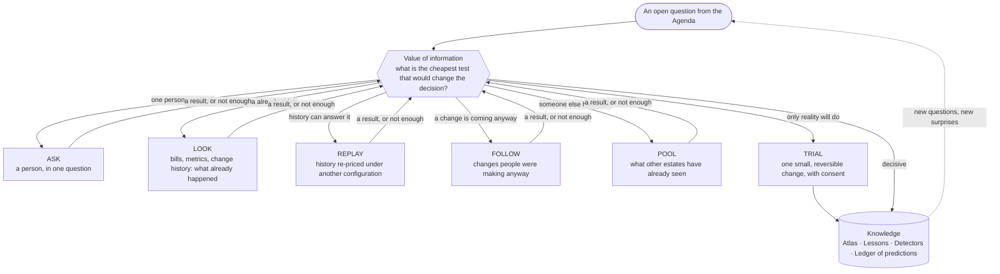
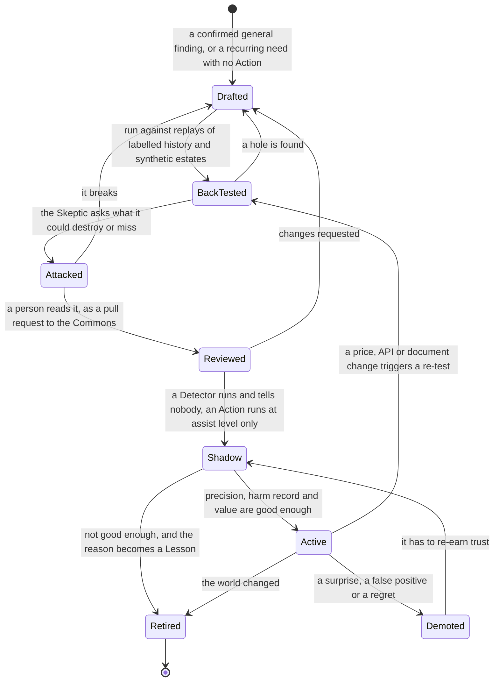

# Finding out without spending — how the AI learns what it cannot read

> **What this answers:** *When reading and analysing are not enough, how does the AI find out how Azure behaves and what a change would really do — safely, within a stated budget, and in a way that makes it smarter next time?*
> Part of the [north star](01-north-star.md), whose glossary defines the capitalised terms (Atlas, Detector, Lesson Book, Ledger and the others). Idea-level: what the system does, not how it is built. Nothing is built yet: the present tense describes the intended behaviour.

---

## 1. Why not just build it and see?

Cost documentation is a *claim*; the bill is a *fact*. Between them sits a great deal that nobody writes down: how a meter rounds, whether a stopped thing still bills, how long the bill takes to notice, which metric really moves when a customer shows up.

The obvious way to find out is to deploy the thing and watch the meters. That spends money to learn how money is spent, needs its own budget and its own governance, and still only tells you about one region on one day. The system does not deploy anything to learn. **Every Azure estate is already running experiments, and the bills are the results.** Somebody resizes a database. A deployment flips a default. A team switches off a test cluster for the holidays. Each of these changed the bill in a way somebody paid for. The AI's job is to read those results carefully, write down what it expected first, and keep the surprises. They are observational cases, not controlled experiments: rates and workload move at the same time, so every result says how sure the attribution is.

Three principles run through everything below:

1. **Predict first.** A test without a written prediction teaches little: you cannot tell what surprised you. The *gap* between prediction and result is the knowledge, and an unexpected observation outside any prediction starts a hypothesis.
2. **Cheapest decisive test first.** Most questions need a conversation or a query, not a build.
3. **Every result goes back into memory** — the Atlas, the Lesson Book, a Detector, a better way of choosing the next question — with *what it does not cover*.

---

## 2. Six ways of finding out — cheapest decisive test first

For any open question the Detective or the Economist asks one thing: *what is the cheapest test that would change the decision?* The six ways are ordered by cost, cheapest first. The system picks the cheapest one that would change the decision, and picks again when a result is not enough. The first five cost model tokens and some attention and change nothing in Azure; the last, **Trial**, changes one resource an owner already runs, so it can move the bill.



---

## 3. Ask — a question is a test too

The cheapest test is **a question**, and it costs a person's attention. The Detective or the Economist decides what is worth asking; the Diplomat asks. Questions are designed like experiments:

- the *smallest* question that settles the matter (a yes/no beats a form);
- asked of the *right* person, at the *right* moment, in the place they already work;
- spaced by an **attention budget**: a person does not get ten questions in a week from a system that has not yet earned it.

With people's agreement the system also tests *how it communicates*: which wording gets a clear answer, which card layout is understood, whether a one-line summary beats a table. This is opt-in, bounded, and the AI says it is doing it ([people and conversation](06-people-and-conversation.md)).

---

## 4. Look — the bill is an instrument

A bill line is a small, honest measurement: *this meter, this quantity, this unit price, this resource, these tags, this hour.* A year of them is a record of how a service behaved under the choices a team really made. The AI reads them three ways and applies one rule about what counts as settled.

**Bill against blueprint.** For each workload it builds a *blueprint*: what the bill should be, from the architecture, the Atlas's meters, measured usage and the prices that apply. Each day's bill is compared with it, meter by meter, and the blueprint is written down *before* the bill lands, so a prediction that a meter will **not** appear is scored too. A bill above the blueprint is a lead (a switch that turned a meter on, a retry loop, a longer data path); a bill below it is a lead too (a missing resource, an unplanned discount). A meter with no claim in the Atlas is a *discovery*, and goes to the top of the Agenda.

**Changes against charges.** Deployment history, resource changes, infrastructure-as-code commits and tags tell the system *when* something changed. Laid beside the bill, they show what each change did to which meter: an estate's own before-and-afters.

**Meter by meter, across estates.** One estate rarely uses a service in every way. Many estates together do. That is what [Pool](#7-pool--what-other-estates-have-already-seen) is for.

**What counts as settled.** Cost data arrives hours to days late, can be rerated, and a period only closes some days after it ends. A claim is promoted to *bill-observed* only from a closed period whose usage and change history match, and whose residual is inside a stated error bound. Until then the claim is a lead, and says so.

*How far back it can go depends on what was kept.* Bills reach back as far as Cost Management retains them (13 months in the portal), but joining a change to a meter only works for history the estate kept: Azure keeps platform metrics for about 93 days and resource changes for 14, so the system keeps its own summaries from the day it is onboarded.

---

## 5. Replay — re-price history

Customers' estates have a **past**, and the past is the best test set there is.

- **Price replay.** Re-price recorded usage under another region, tier, offer or commitment portfolio. *"If you had bought this commitment in January, you would have saved X — and been over-committed in the August lull by Y."* This is where purchases are tested *before* they are proposed.
- **Capacity replay.** From recorded metrics and the Atlas's capacity model: *"if this had been two instances instead of six, would it have survived every peak in the history we hold?"*

A replay is only trusted after it has **reproduced the real bill** of the month it replays, and the gap is published with every result. It produces *counterfactual evidence under stated assumptions*, each result with its **envelope**: what was held constant, how deep the history was, what was *not* covered — rare paths, quota contention, dependencies, the human side of operating it. A replay can make a change look *safe enough to try*. Only observation after the change shows it *is* safe in this estate.

---

## 6. Follow — changes people were making anyway

Estates are full of free experiments. Three kinds teach the system without touching anything:

| Kind | What it is | What it costs |
|---|---|---|
| **Shadow predictions** | The AI quietly *predicts* things it is not acting on — next month's cost by service, which resources will be idle on Friday, whether a Recommendation will be accepted — and scores itself when reality arrives | tokens, within a stated sampling budget |
| **Natural experiments** | When a team resizes, migrates or retires something for its own reasons, the AI registers control meters and likely confounders *beforehand*, then follows the result before and after against a matched comparison group | read-only |
| **Planned changes** | A change that is already on the calendar (a migration, a decommission, a launch) gets a prediction attached to it in advance | read-only |

---

## 7. Pool — what other estates have already seen

The world is a larger experiment than any one estate. When an adopting organisation agrees, the system contributes **observations** to the open Atlas as ordinary, reviewable changes: *"this meter, this behaviour, under this agreement type, in this region, with this evidence."* Only a scope and an aggregate leave an estate; no bill line, name, identifier or negotiated rate travels with it. An observation is published only when several organisations contribute it (a minimum cohort that the maintainers set), after a privacy review by someone other than the contributor, and a reviewer sees the observation, its receipts (the meter, the unit, a band of quantities, the region and the dates) and its scope. When many organisations contribute the same observation, the Atlas claim records how many and where, and a reviewer may promote its review tier (draft, replicated or maintained: [getting smarter](07-getting-smarter.md)); when they disagree, the disagreement is itself a finding (an agreement difference, a regional price, a preview change).

The more organisations use it, the sooner a new service is understood by everyone — without anyone building anything.

---

## 8. Trial — rarely, and only on something that already exists

Some questions can only be settled by changing something: *how small can this dev resource get before it hurts?* A **trial** is one small, reversible change to **one non-production resource an owner already runs**, with the owner's clear consent each time **after seeing a cost ceiling** (a trial can move the bill, and a rollback does not refund what ran), a **guard metric** that triggers automatic rollback, a capped blast radius and a prediction written first. The owner can decline without giving a reason. A trial is how a *"probably safe"* becomes a *"measured safe"*: a **canary saving** (a saving measured on one resource before it is offered more widely), and the way a claim can become *outcome-confirmed*.

The system never creates a resource in order to measure it. If a question can only be answered by creating something, the question stays open and says why.

---

## 9. A test, written down first

Every test is **registered** before it runs, in a form a person can read in half a minute (an invented example, service included):

```
LOOK         T-0412 · does a paused Prism index still bill?
WHY          Agenda #3 — Prism is new; 400 paused indexes in two estates; saving claim unconfirmed
HYPOTHESIS   a paused index bills storage only, about 20 % of the active rate
PREDICTION   storage meter yes, ~20 %; no compute meters; bill lag ~12 h        CONFIDENCE 70 %
EVIDENCE     both estates' own bill lines for those indexes, from the first pause onward
STOP WHEN    a closed billing period holds lines for both estates
ANALYSIS     compare meters, units and quantities with the prediction; look for any meter not predicted
IF WRONG     the profile's floor-cost claim is revised; the Agenda gets "find paused Prism indexes"
```

Three features make this more than bookkeeping: the **prediction** (so surprise is measurable), the **stop condition** (so curiosity has a budget) and **"if wrong"** (so every outcome is wired to a consequence, including the surprising ones).

---

## 10. Surprises, negative results and replication

- **Surprises are first-class.** The gap between prediction and result is stored, searched and surfaced. A pattern of surprises about one *mechanism* means the **Cost Grammar** (the catalogue of ways money arises, defined in the [north star](01-north-star.md)) is wrong there; a pattern about one *kind of source* means that source is less reliable than its rank says. Both feed [how the system learns to learn](07-getting-smarter.md).
- **Negative results are kept.** *"Tiering this kind of data down saved nothing, because early-deletion charges and retrieval fees ate it"* is as valuable as a success: it stops every future estate repeating the mistake. The Atlas has a shelf for **things that do not work, and why**.
- **Important findings are replicated.** A high-impact claim never rests on one estate: it is confirmed in another estate, region or agreement type where relevant. Billing differs by region, by currency and by agreement; the system learns *where a finding holds*.

---

## 11. The curiosity budget

Two budgets pull in opposite directions, and both are explicit; a research director balances them:

- **The cost of learning** — tokens and people's minutes — is on the report card, next to what the knowledge it produced was worth, judged as a portfolio over a quarter rather than test by test. Questions are funded by **value of information**: what a wrong belief would cost × how likely it is wrong × how cheaply it can be settled. If learning costs more than it is worth, it slows down. Learning never provisions anything just to measure it; the one route that changes something, a Trial, needs the owner's consent and shows a cost ceiling first.
- **A protected slice of effort** goes to questions with *no* immediate payoff: new services before anyone uses them, odd corners of the grammar, the "I wonder" list. This is how the system finds what nobody knew to ask, and why a new service is meant to get a provisional profile within hours.
- **A research director that learns.** The Conductor scores each tactic (a source, a kind of question, a replay) by *verified value per euro and per human minute*, spends more on what has paid off, and keeps a fixed share for new questions ([the learning contract](09-the-learning-contract.md)).

---

## 12. Consolidation — while the world is quiet

At night, with no one waiting, the system **re-reads the day and consolidates what it learned.** The pass:

- turns repeated reasoning into **Lessons** and **Detectors**;
- merges duplicate claims and spots contradictions between Profiles;
- re-runs yesterday's *refuted* hypotheses against fresh knowledge — *"it was refuted because we did not know that meter; now we do"*;
- replays a sample of old, closed cases with today's Atlas to find where yesterday's answer would now differ;
- proposes edits to the Atlas for human review.

### Expensive reasoning once — cheap nominations after

The Detectives' deep investigations are slow and costly, so the system does not want to repeat them. When a hypothesis is confirmed and is *general*, it writes a **Detector**: a small, cheap, inspectable piece of logic that looks for the same pattern in every estate, every night, without reasoning at all.

A Detector is a **lead generator, never a verdict**. It nominates; an investigator decides. Because prices, workloads and meaning change, each Detector declares its **validity domain** (where it applies), its **blind spots** (what it cannot see), a **novelty trigger** (when it must hand the case back to a Detective) and an **expiry**. Detectors and **Actions** (tested, reviewable change recipes) earn their place the same way — one life cycle, with a way back at every step. A *synthetic estate* is generated data, never deployed resources; *assist level* means the owner approves each use with one tap:



Detectors are how the system *compiles* what it learned into something fast. A year in, much of what a customer sees is meant to begin as a Detector's nomination; investigation stays for what the Detectors cannot see.

---

## 13. Experiments on itself

The same method points inward. The Conductor runs **ablations** and **A/B comparisons on its own method**, on replays and on synthetic estates:

- *switch the Skeptic off in a replay* — how many bad recommendations get through? is it worth what it costs?
- *read the documentation first, or the bills first?* — which produces more accurate Profiles for which kind of service?
- *three hypotheses at once, or depth-first?*
- *does a Detector written from two examples beat one written from five?*

The answers change how the system works, and are shown on the report card. A system that can test *itself* can, within limits people set and with a person approving each change to its method, **improve its own process** without being rebuilt.

---

## 14. What this cannot find out

- **A meter nobody has used.** Until a bill line contains it, a claim stays *documented* (or *price-confirmed*, where a published price exists) and never becomes *bill-observed*; advice built on it says so, and the Agenda keeps the question open. Previews and restricted features are marked the same way, and the system asks the people who can know — an early-access customer, Microsoft's own channels.
- **Headroom nobody has needed.** The metrics may say there is room; nothing says what happens at three times the peak. The system says so and offers a guarded trial, or stays quiet.
- **Behaviour that differs by agreement or region.** A finding is tagged with where it was seen, and is not assumed to hold elsewhere until another estate agrees.
- **What only people know.** Why something is configured the way it is, what the next launch needs. For these the first test is always a question.

---

## 15. What it looks like from outside — the learning, weekly (an invented example)

> **What I checked this week** (Monday, 08:00, for the FinOps lead — a short read)
> **14 predictions closed** · 11 matched · **3 surprises** (below) · learning cost **€9.40 in tokens** of a €25 budget
> **Knowledge moved:** 9 claims strengthened with bill lines, 2 downgraded, 1 new Detector entering shadow mode, 4 Atlas changes drafted for review
> **Surprises:** *Prism* paused indexes still carry a metadata meter · a cold-tier read path bills per-GB retrieval even on small reads in one tier · *a metric the system had trusted was silent for the one consumer that mattered*
> **Ablation result:** replaying last quarter without the Skeptic raised the false-positive rate from 6% to 19% · kept on
> **Next week's curiosity:** two services released last week, one price change in a region where ten estates run
