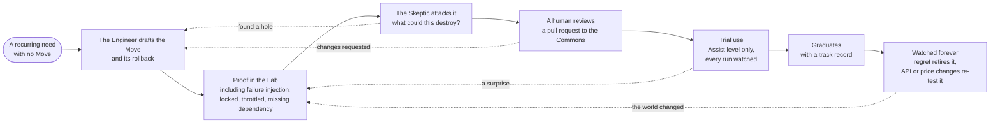
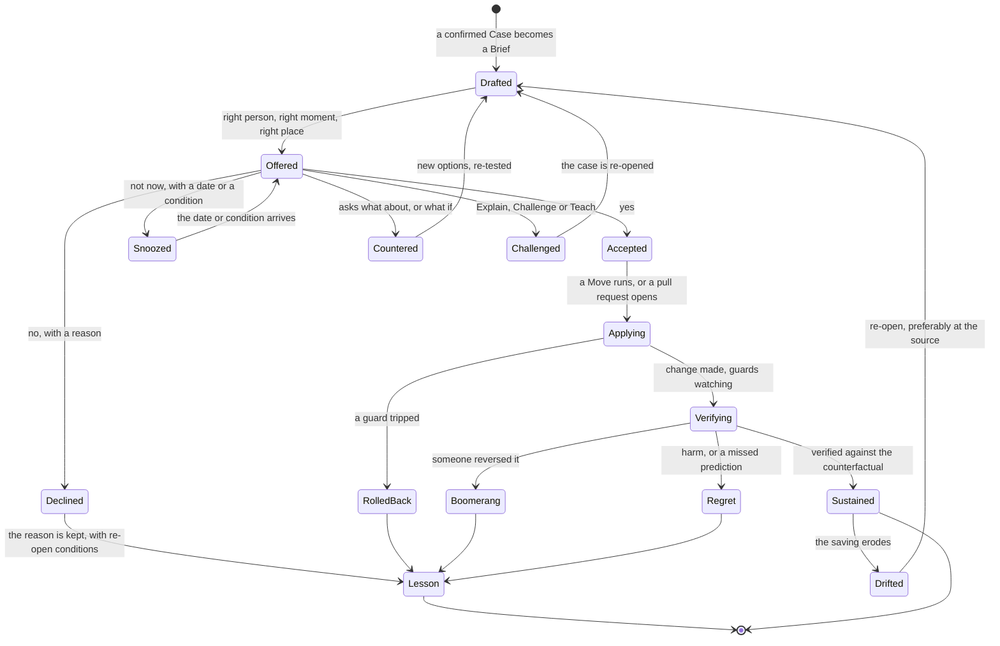

# Recommend, act, verify — how a finding becomes a change that sticks

> **What this answers:** *Once the AI has found something real, how does it turn it into a decision a person can make in a minute, carry out the change safely, prove it worked — and learn from "no"?*
> Part of the [north star](01-north-star.md). Idea-level: what the system does, not how it is built.

---

## 1. The Brief — a decision, not a recommendation

A confirmed [Case](03-estate-and-investigation.md#7-the-investigation-toolkit) becomes a **Brief**: everything a person needs to decide in under a minute, with everything behind it one tap away.

| Part | What it says | Why it is there |
|---|---|---|
| **The suggestion** | one sentence, in the owner's words | a decision starts with a clear ask |
| **The reason** | the evidence in two lines, with a link to the case notebook | trust comes from being able to check |
| **The catch I checked** | what the Skeptic tried to break, and what survived | people ask "but what about…?" first — answer it first |
| **The options** | 2–4 real choices, including **do nothing** and **do something smarter than asked** | a yes/no is a weak decision |
| **The consequences** | cost, reliability, performance, security, effort — each as a *range* | savings that hide a risk are not savings |
| **What I tested** | Lab results, replays, trials, similar past cases | "we tried it" beats "we think" |
| **What would change my mind** | the observation that would reverse this | makes the AI falsifiable |
| **What I will do on yes** | the exact change, a plain-language diff, the guard that rolls it back | no surprises after approval |
| **Reversibility** | how to undo it, how long the undo lasts | a one-way door gets a different conversation |
| **How we will know** | the metric, the date, who sees the result | the Brief commits to being checked |
| **The cost of waiting** | one honest number, shown once | not a nag — a fact |

### A Brief, from the outside

> **Retail QA environment — switch it off at night and weekends?** · for Priya Nair · *about €710 a month* · 10 minutes of effort · fully reversible
> **Why I think so:** six people use it, only 07:45–18:30 on weekdays (11 weeks of access records). CPU averages 3%.
> **The catch I checked:** two nights in those 11 weeks show activity (last Tuesday of the month, 02:10–02:50). *Is that a job you need?*
> **Options:**
> **A.** Switch off 19:30–07:30 and weekends — saves ~€710/month. If the 02:00 job is real, it would fail on the last Tuesday.
> **B.** Same, with a wake-up window on the last Tuesday of the month — saves ~€690/month.
> **C.** Make the pipeline create the environment for each test run and delete it after — saves ~€940/month, needs about two days of engineering. *I can open the change on your infrastructure repository; you decide.*
> **D.** Do nothing — costs about €23 a day while you decide.
> **[A] [B] [C] [D] · Explain · Challenge · Teach · "Not now — ask me in March"**

Priya taps **B** and types: *"that's the month-end regression — it also runs the first Monday after a release."* The AI does three things: it adds a *release* trigger to the wake-up window (it can see releases in the pipeline), writes a **Lesson** ("this environment has month-end and release-driven use"), and thanks her with the number: *€690 a month from today, checked in two weeks.*

---

## 2. Options: the design space

A good advisor does not hand over *the* answer; it maps what is possible. The **Economist** and the **Engineer** build the option space from the [Cost Grammar's levers](02-learning-azure.md#2-the-cost-grammar--how-it-reasons-about-services-it-has-never-seen): stop · shrink · schedule · tier · share · commit · move · redesign · fix the source · change the contract.

For each candidate option the Consequence Engine fills in the same card of ranges, and the system keeps three more disciplines:

- **Always include "do nothing".** With its cost. Sometimes it is the right answer — and sometimes the owner needs to see the number to know.
- **Always include one option that is smarter than the question.** Where the finding says "shrink", the alternative might be "stop using it" or "replace it with the shared one that already exists in the estate".
- **Find the constraint behind a "no".** If the owner declines A because of a peak, the next Brief is not a nag — it is the best option *that respects the peak*. The **counter-Brief**: *"Understood — you cannot shrink. What if we cover only the baseline with a commitment and let the peak run at normal rates?"*

For large, slow decisions (the **Strategy clock**), the same machinery runs as a **design-space search**: several architectures that do the same job, each pushed through the Consequence Engine and the [wind tunnel](04-experiments-and-the-lab.md#6-the-wind-tunnel--the-cost-and-performance-frontier), laid out as a frontier with the trade-offs named. The recommendation is a *position on a map*, with reasons — not a single line.

---

## 3. Attention economics — the scarcest thing is a person's minute

If the system were right about everything but sent too much, it would still fail: people stop reading. So the AI **budgets attention** as carefully as money.

| Practice | What it means |
|---|---|
| **Value per minute** | every Brief is ranked by *expected value × probability of yes ÷ minutes of attention*. A €40,000 decision that takes ten minutes outranks twenty €30 decisions. |
| **Rule over instance** | after the third similar yes, it stops asking one by one and proposes **a standing rule**: *"All development environments are off outside office hours, unless tagged."* The owner authors it (the AI drafts it), with a scope and an expiry. One decision replaces hundreds. |
| **Bundles** | forty-eight related findings become **one decision about a policy**, with the list one tap away. |
| **Attention budget** | each person sets (or accepts) how much they want: *"two things a week, max."* The rest queue by value; the AI says so — *"I have seven for you; here are the best two."* |
| **Existing rituals** | where a team already meets — sprint planning, the monthly cost review — Briefs ride along rather than interrupt. |
| **Delegation and cover** | the person is out? it goes to the delegate the directory names, with a note. |
| **Honest waiting cost** | the cost of delay is stated once (€23 a day). Never as a countdown, never as pressure. |
| **Fatigue as a signal** | if acceptance falls or replies get shorter, the AI infers *it is being noisy* — and sends fewer, better Briefs. It measures itself on **yes-rate per minute of attention**, not on volume. |

The target is a system a busy owner is *glad* to hear from — because it speaks rarely, is usually right, and never wastes a minute.

---

## 4. Moves — tested, reusable ways to change things

An action is never improvised. It is a **Move**: a versioned, reviewable recipe with a track record.

| Part of a Move | What it holds |
|---|---|
| **Preconditions** | what must be true before it may run (backup exists; no lock; owner confirmed) |
| **Dry run** | the exact change, shown as a diff and in plain words |
| **Guard metrics** | what must *not* move — and the limits that trigger an automatic rollback |
| **Rollback** | a tested undo, with how long it stays available |
| **Verification plan** | how success is measured, when, against which baseline |
| **Proof** | where it has been tested: Lab runs, past uses, success and regret counts |
| **Approver hats** | who must say yes (an owner? a change authority? two people?) |

### The families of Moves

| Family | Examples |
|---|---|
| **Stop / start** | switch off idle things, start them on demand |
| **Resize** | down or up, with the frontier as evidence |
| **Schedule** | office-hours patterns, seasonal scaling, planned pauses |
| **Tier / archive** | colder storage with the retrieval cost counted in |
| **Clean up** | delete what nobody needs — *after* a snapshot and a waiting period |
| **Consolidate** | merge many small things into one shared one |
| **Tune configuration** | retention, caching, sampling, replication, redundancy — the quiet knobs |
| **Re-platform** | move to a cheaper way of doing the same job |
| **Source fix** | a pull request on the code that creates the thing ([below](#5-fix-at-the-source)) |
| **Policy** | propose a guard-rail so the problem cannot come back |
| **Commitment** | prepare a purchase ([the Commitment Desk](#7-the-commitment-desk)) |
| **Ownership repair** | find an owner, fix a tag, retire an orphan |
| **Teach** | not a change to Azure — a *change to a person's picture of it* |
| **Ask** | the one question that unlocks a better option |

### The AI writes Moves too

When a recurring need has no Move — *"this kind of cleanup comes up every week"* — the Engineer **authors** one. It does not go live on trust:



Moves are the system's **hands**, and like a person's hands they get better with practice — each use leaves a record of how it went.

---

## 5. Fix at the source

Changing a resource in the portal and hoping is how drift is born: the next deployment puts it back. The best Move changes **the thing that creates the thing**.

The Surveyor already knows the *Origin* of each resource — the repository, the template, the pipeline. When it does, the Engineer's default Move is a **pull request** on that repository:

- it carries the change *and the Brief*, so the code reviewer sees the same reasons as the owner;
- the Consequence Engine comments the **cost delta** on the pull request — the same view the author would have wanted *before* writing it ([shift-left](03-estate-and-investigation.md#11-the-consequence-engine--what-happens-to-the-bill-if));
- after merge, the saving is **verified in the estate**, not assumed from the diff;
- where an Origin is missing — *"this was clicked together in a portal"* — the Move works directly, and the system records an **un-sourced change** and proposes bringing the resource under code.

Fixing at the source also feeds the future: a pattern that is expensive in many repositories becomes a **policy proposal** or a **template improvement** — the cure for a whole family of waste at once.

---

## 6. Autonomy is earned

How much the AI may do on its own is not a setting; it is a record. The ladder is short — and **per domain, per scope**:

| Rung | The AI… | A human… |
|---|---|---|
| **Observe** | watches, predicts, scores itself | sees nothing yet |
| **Advise** | sends Briefs | decides, then acts or asks the AI to |
| **Assist** | prepares everything; one tap runs the Move | taps |
| **Autopilot** | runs the Move *inside a rule a human wrote*, tells afterwards, offers undo | set the rule and can revoke it |

Autopilot is granted as a **credential** — a small, specific, expiring licence:

```
CREDENTIAL   Storage tiering · non-production subscriptions of team Atlas · up to €500/month per change
GRANTED BY   Lena Vos (FinOps lead) + Karim El Idrissi (platform owner)      EXPIRES  2027-04-30 (review)
EARNED ON    41 assisted changes · 0 regrets · 2 boomerangs (explained) · prediction error ±9%
CONDITIONS   only where the owner said yes to a similar change before · never in a freeze · never on data tagged "legal hold"
```

Four ideas keep it honest:

1. **Earned on the report card**, by people, never taken. Acceptance, verified savings, regret, boomerangs and *calibration* (when it says 80%, is it right 80% of the time?) are the evidence.
2. **Self-demotion.** When the system's own calibration slips — a service's Profile was just revised, a surprise appeared, a sequence of declines — it **steps itself down to Assist** for that domain, says so, and re-earns the credential. Trust that can only go up is a bug.
3. **No more power than the person.** The AI acts *on behalf of a named human's decision* and can never do something that human could not do. A decision made by the owner of one team cannot reach another team's resources.
4. **Two keys where it matters.** Purchases and anything irreversible need two named people with different hats — and a snapshot first.

---

## 7. The Commitment Desk

Commitments — reservations, savings plans, agreement-level commitments — are the **biggest single lever** and the one with the *least forgiveness*: money committed for one or three years. So purchases get their own desk, and they are **always prepared by the AI and executed by named humans.**

What the Desk keeps in view:

- **The portfolio** — everything committed, how well it is used, where it is covered and where it is not, and **the cliff chart**: when each commitment expires, so renewals are Briefs three months ahead rather than surprises.
- **The rules** — which commitments can be exchanged, resized or cancelled, and under what conditions. The rules change (Microsoft has announced narrower reservation exchange from February 2027), and the Atlas tracks each change on its [radar](02-learning-azure.md#7-staying-current--the-change-radar) — a rule that used to make a mistake cheap can quietly stop doing so.
- **The effective price** — what *this* customer actually pays, not list price.

How a purchase Brief is built:

1. The **price Time Machine** replays the last year: *"had you bought this in January, you would have saved X, and been over-committed through the August lull by Y."*
2. A **regret table** shows the purchase under usage 30% lower, as forecast, and 30% higher: *"if we are wrong, we lose this much; if we wait, we lose that much."*
3. It proposes a **ladder** rather than a leap — a first, smaller commitment now; a step up after three months of measured use; a renewal date designed to avoid a single expiry cliff.
4. It states **the thing that would make this a mistake**: *"if the platform migration to X goes ahead in Q3, this commitment covers a service you will stop using."* The Surveyor checks the roadmap and asks the owners *before* the Brief goes out.
5. It names the humans who must agree — the budget holder and the platform owner — and the AI does *nothing* until both have.

> **Why not let the AI buy?** Because a commitment turns a bet about the future into a contract. The AI should make that bet as informed as it can be, and as *visible*; the humans take it. This is one of the five [spine points](01-north-star.md#14-where-humans-stay-in-charge) and the one most likely to stay.

---

## 8. Verification — did it work?

A saving that is not measured is a story. Every Brief commits in advance to how it will be checked, and the **Auditor** (independent of the agents that made the case) does the checking:

- **Against a counterfactual.** The saving is the difference between *what the bill is* and *what it would have been* — from a baseline model (trend, seasonality, known events) and, where possible, **untouched similar resources as a comparison group**. A bill that fell because traffic fell is not a saving.
- **At several distances.** Seen at one week (is the Move doing what it said?), one month (a full bill cycle), three months (the seasonal effect), a year (did it last?).
- **Claimed versus verified.** Two numbers, always. *Claimed* is what the Brief predicted; *verified* is what the Auditor measured. The difference is the AI's calibration error — published.
- **Boomerangs.** A change reversed by a person within weeks tells the system something it did not know. The reversal is a signal, never a blame: *"why?"* gets asked, once, kindly.
- **Regret.** Anything that harmed — an incident, a slow-down, a complaint — is recorded in full, and a short, blameless look at *what the system could have known* becomes a Lesson. A single regret can shrink an autonomy credential.
- **Drift.** The saving erodes (a new deployment re-creates the thing; usage grows into it). The Auditor re-opens the Brief — preferably as a source fix.
- **Finance's signature.** The savings ledger can be **co-signed by the finance partner**: a saving counts in a report only when somebody who owns the number agrees that it is real. The AI proposes; Finance accepts.

---

## 9. The life of a Brief — with all the loops

A Brief is not a package that travels down a line. It has a life, and most of the interesting things happen on the **back-edges**:



Two details make this the most important picture in the document:

- **"No" is not an end state.** A declined Brief is filed with its reason and **re-open conditions** — *"ask again if peak usage drops below X, or when the project ends."* The system does not nag; it waits for the condition. And when a *different* team declines the same kind of thing for the same reason, the Lesson Book proposes the generalisation.
- **Everything ends in a Lesson**, not in a report. Success, failure and refusal all leave something behind.

---

## 10. When the answer is "spend more"

Cost optimisation is not cost minimisation. The right measure is **cost per outcome** — per order, per user, per scan, per training run — and some of the best Moves **raise** the bill:

- **Spend a little to save a lot.** A €180-a-month cache that lets the database drop two tiers (−€2,300).
- **Capacity that costs less than the throttling.** A queue that is *under*-provisioned and loses sales in the peak; the lost-sale figure is the cost.
- **Commit up.** A growing workload still at on-demand rates, where a commitment would lower the unit cost even as total spend rises.
- **Replace the cheap, expensive-to-run option.** A self-managed component whose people cost dwarfs the managed service's price.
- **Spend where it buys resilience that the business has said it needs** — and say so.

The AI celebrates when the bill rises *because the business grew and the unit cost fell*, and says so in the monthly letter. A system that only ever says "less" is a spreadsheet with opinions.

---

## 11. Beyond Azure's own bill — the commercial layer

Some of the biggest numbers are not resource settings but **agreements**: a consumption commitment burning down faster or slower than planned, a discount that does not apply to a growing service, a marketplace charge nobody owns. The commercial Moves are mostly **briefings for humans who negotiate**:

- *"Your consumption commitment is on track to fall short by about 11% by the end of the term. These three workloads could move onto it."*
- *"This service's rate is higher in this region than in the neighbouring region you already operate in, with no data-residency reason that we can see."*
- A **negotiation pack** for the person who talks to the account team: effective discount, committed versus actual curve, the usage forecast, and what the estate would look like under each scenario.

The AI never negotiates. It makes the human who does the best-prepared person in the room.

---

## 12. What it looks like from outside — the Moves of a month

> **Your month with the AI** (the monthly letter to the FinOps lead)
> **Savings verified: €41,200** against **€58,000 claimed** — the gap is mostly one commitment that kicked in later than predicted (explained on page 2).
> **Briefs sent: 63 · answered: 51 · accepted: 34 · declined with a reason: 12 · countered: 5.** Median time to decision: 1 day 4 h.
> **Moves run:** 29 by one-tap Assist, 118 by Autopilot credentials. **Rolled back: 2** (both guards worked). **Boomerangs: 1.**
> **Rules proposed and accepted:** *"Dev and test environments sleep outside office hours."* Replaces about 70 individual decisions a quarter.
> **Autonomy changes:** storage tiering in non-production stays at Autopilot (calibration ±8%). **Database scheduling stepped itself down to Assist** after two surprises; two lessons learned, re-earning.
> **Spent more on purpose:** one cache, one queue, one commitment — +€2,900 a month, expected to save €7,600 elsewhere. Checked at 90 days.
> **Asked of you:** one thing — a retired team's resources need a custodian.

---

## 13. Where humans stay in charge in this part

- **Which Moves exist and which are trusted** — people review every Move, including the AI's.
- **Who may say yes** — the approver hats on each Move; two keys for purchases and irreversible changes.
- **How much runs on its own** — autonomy is a credential that people grant, with scope, cap and expiry; it shrinks when trust shrinks.
- **What counts as saved** — the savings ledger is co-signed by Finance.
- **"No" always works** — a decline is respected, remembered and never punished by more noise.

The detailed rules — what, exactly, an approver hat means, how credentials are recorded — are [guardrails for later](09-guardrails-later.md).
