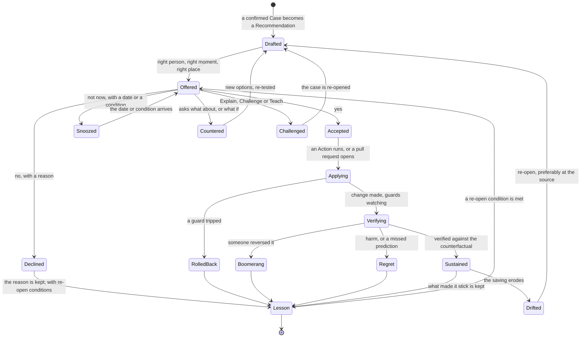

# Recommend, act, verify — how a finding becomes a change that sticks

> **What this answers:** *Once the AI has found something real, how does it turn it into a decision a person can make in a minute, carry out the change safely, show that it worked — and learn from "no"?*
> Part of the [north star](01-north-star.md). Idea-level: what the system does, not how it is built.

---

## 1. The Recommendation — a decision, not a verdict

A confirmed [Case](03-estate-and-investigation.md) becomes a **Recommendation**: everything a person needs to decide in about a minute (a design target, to be measured with real users), with everything behind it one tap away.

| Part | What it says | Why it is there |
|---|---|---|
| **The suggestion** | one sentence, in the owner's words | a decision starts with a clear ask |
| **The reason** | the evidence in two lines, with a link to the case notebook | trust comes from being able to check |
| **The catch I checked** | what the Skeptic tried to break, and what survived | people ask "but what about…?" first — answer it first |
| **The options** | 2–4 real choices, including **do nothing** and **do something smarter than asked** | a yes/no is a weak decision |
| **The consequences** | cost, reliability, performance, security, effort — each as a *range*, or *unknown* where the estate holds no evidence | savings that hide a risk are not savings |
| **What the numbers rest on** | one line on every card: *Priced at your contracted rates*, *Priced at the rates on your bill* or, where no bill can be read, *Scenario at list prices — your rates are invisible to me*. A scenario is not an expected saving | a list-price figure is not the saving you will see |
| **What I tested** | replays of recorded usage, how similar changes turned out, similar past cases | "we checked it" beats "we think" |
| **What would change my mind** | the observation that would reverse this | makes the AI falsifiable |
| **What I will do on yes** | the exact change, a plain-language diff, the guard that rolls it back | no surprises after approval |
| **Reversibility** | how to undo it, how long the undo lasts | a one-way door gets a different conversation |
| **How we will know** | the metric, the date, who sees the result | the Recommendation commits to being checked |
| **The cost of waiting** | one honest number, shown once | not a nag or a countdown — a fact |

### A Recommendation, from the outside

> *(An invented example, abbreviated: a full card shows ranges, and this one rounds them to a figure.)* **Web-shop QA environment — switch it off at night and weekends?** · for its owner · *about €710 a month* · 10 minutes of effort · fully reversible
> **Why I think so:** six people use it, only 07:45–18:30 on weekdays (11 weeks of access records). CPU averages 3%.
> **The catch I checked:** two nights in those 11 weeks show activity (last Tuesday of the month, 02:10–02:50). *Is that a job you need?*
> **What the numbers rest on:** Priced at the rates on your bill — I can read this subscription's costs, not your price sheet.
> **Options:**
> **A.** Switch off 19:30–07:30 and weekends — saves ~€710/month. If the 02:00 job is real, it would fail on the last Tuesday.
> **B.** Same, with a wake-up window on the last Tuesday of the month — saves ~€690/month.
> **C.** Make the pipeline create the environment for each test run and delete it after — saves ~€940/month, needs about two days of engineering. *I can open the change on your infrastructure repository; you decide.*
> **D.** Do nothing — costs about €23 a day while you decide.
> **[A] [B] [C] [D] · Explain · Challenge · Teach · "Not now — ask me in March"**

The owner taps **B** and types: *"that's the month-end regression — it also runs the first Monday after a release."* The AI does three things: it adds a *release* trigger to the wake-up window (it can see releases in the pipeline), writes a **Lesson** ("this environment has month-end and release-driven use"), and thanks the owner with the number: *€690 a month from today, checked in two weeks.*

---

## 1a. What happens to an Advisor card — and to a budget alert

Azure already tells owners what to do: Advisor posts recommendations; Cost Management sends budget and anomaly alerts. The trouble is the *last mile* — nobody opens the blade, the email sits unread, and the card says *what* without saying *why this one, why now, what else moves*. The system treats these as **inputs and a baseline to beat**:

1. **A lead, not a verdict.** The card enters the Agenda as a hypothesis (*"this VM can be shut down"*, *"this reservation would save money"*), recorded as *reported by Advisor*.
2. **Checked like any claim.** The Detective tests the card's assumptions against the estate. For its VM right-size and shutdown recommendations, Advisor's own documentation ([Learn](https://learn.microsoft.com/azure/advisor/advisor-cost-recommendations)) names two limits: the savings are priced at retail rates, ignoring any discount the account has, and they do not account for existing reservations or savings plans. The first means the euro figure is a list-price figure, so the system **re-prices it on the best basis it can see** — contracted rates, then the rates on the bill — and says which; with neither, the figure stays a scenario at list prices. The second means a covered VM's benefit moves to other usage inside its scope, or is lost, when the VM stops, so the real saving can differ from the card's, down to nothing. Is this a quiet-by-design environment? Is there a consumer the metric cannot see? The Skeptic asks what it asks of any case.
3. **Routed with reasoning.** If the card survives, it becomes a Recommendation for the *right* person — found through the human graph (the owners, delegates and managers the directory names) — with options, consequences and an undo. Advisor's "dismiss" or "postpone" becomes a *reason that is remembered*, not a dead end.
4. **Closed with a measurement.** Advisor can take up to a day to notice a change; the system measures the *realised* saving against a counterfactual and says by how much Advisor's estimate was off — which feeds its own calibration.
5. **Taught back.** Cards that owners reject for the same reason become a Lesson (*"this team's development environments are scheduled elsewhere"*).

A **budget or anomaly alert** follows the same path with the Watch clock's urgency: a private question to the owner first — *planned, growth, incident or attack?* — with what changed and when.

---

## 1b. When more than one person owns the answer

Some of the biggest opportunities belong to several people: a shared cluster, a shared network, a pooled commitment, a platform that four teams build on. One card to one owner would be wrong, and four separate cards would start four arguments. So the system opens **one decision room** — a single thread with everyone who holds a piece of the answer — and gives each person a private card with their own numbers.

```
Decision room (an invented example) · the shared build-and-batch cluster
Platform owner · four team leads · Finance (watching)

AI:             Nodes average 38% busy over 11 weeks, but the 22nd–28th reach 91% — the Orion team's month-end run.
                Three changes could save about €5,800 a month at the rates on the bill. Each of you has a private card with your own share.
Orion lead:     Orion needs that peak. Don't cut headroom on the 22nd–28th.
AI:             Already handled: nodes scale up on a schedule for those days. The saving becomes €5,100, not €5,800.
Another lead:   Why do we all pay the same? We use a tenth of it.
AI:             Today the cost is split equally; nobody chose that. Two keys, side by side: equal shares, or requested
                capacity. 12% of the workloads carry no team label — I treated them as shared; tell me if that is wrong.
Platform owner: Requested capacity. Recorded as the platform owner's decision; Finance sees both keys at the quarter-end review.
AI:             Plan: Tuesday, lower the autoscaler floor · a week later, interruptible nodes for batch work ·
                guard: pods waiting more than 5 minutes → roll back. Open objections: none.
```

What differs from a one-owner Recommendation:

- **Everyone sees their own stake** — what changes for *their* share and *their* peak, not a platform-wide summary.
- **An allocation is a question, not a given.** The AI proposes how a shared cost could be split, says how sure it is, hears objections, and keeps both keys visible rather than quietly choosing one.
- **Objections change the plan.** A recorded objection either alters the option (the scheduled scale-up) or is answered with what it costs. Silence from an affected owner is not consent: it is chased, then escalated.
- **One accountable name.** The directory names the change authority; the decision is theirs, with the objections attached.
- **Verified for each party.** The result is measured for the platform *and* for each team's share, so nobody finds out later that a saving moved a cost onto them.

And the room teaches: *"this organisation splits shared platforms by requested capacity"* becomes a Lesson, and *"a shared pool split equally while use is unequal"* becomes a lead for other estates.

---

## 2. Options: the design space

A good advisor does not hand over *the* answer; it maps what is possible. The **Economist** and the **Engineer** build the option space from the [Cost Grammar's levers](02-learning-azure.md): stop · shrink · schedule · tier · share · commit · move · redesign · fix the source · change the agreement.

For each candidate option the Consequence Engine fills in the same card of ranges, and the system keeps three more disciplines:

- **Always include "do nothing".** With its cost. Sometimes it is the right answer — and sometimes the owner needs to see the number to know.
- **Always include one option that is smarter than the question.** Where the finding says "shrink", the alternative might be "stop using it" or "replace it with the shared one that already exists in the estate".
- **Find the constraint behind a "no".** If the owner declines A because of a peak, the next Recommendation is not a nag — it is the best option *that respects the peak*. The **counter-offer**: *"Understood — you cannot shrink. What if we cover only the baseline with a commitment and let the peak run at normal rates?"*

---

## 3. Attention economics — the scarcest thing is a person's minute

If the system were right about everything but sent too much, it would still fail: people stop reading. So the AI **budgets attention** as carefully as money.

| Practice | What it means (invented figures) |
|---|---|
| **Value per minute** | every Recommendation is ranked by *expected value × probability of yes ÷ minutes of attention*. A €40,000 decision that takes ten minutes outranks twenty €30 decisions. |
| **Rule over instance** | after the third similar yes, it stops asking one by one and proposes **a standing rule**: *"All development environments are off outside office hours, unless tagged."* The owner authors it (the AI drafts it), with a scope and an expiry. One decision replaces hundreds. |
| **Bundles** | forty-eight related findings become **one decision about a policy**, with the list one tap away. |
| **Attention budget** | each person sets (or accepts) how much they want: *"two things a week, max."* The rest queue by value; the AI says so — *"I have seven for you; here are the best two."* |
| **Fatigue as a signal** | if acceptance falls or replies get shorter, the AI infers *it is being noisy* — and sends fewer, better Recommendations. It measures itself on **yes-rate per minute of attention**, not on volume. |

---

## 4. Actions — tested, reusable ways to change things

A change is never improvised. It is an **Action**: a versioned, reviewable recipe with a track record. Agents only read and propose; a separate executor carries out exactly what was approved.

| Part of an Action | What it holds |
|---|---|
| **Preconditions** | what must be true before it may run (backup exists; no lock; owner confirmed) |
| **Dry run** | the exact change, shown as a diff and in plain words |
| **Guard metrics** | what must *not* move — and the limits that trigger an automatic rollback |
| **Rollback** | a tested undo, with how long it stays available |
| **Invariants and assurance boundary** | what must stay true after it runs (no data lost, same endpoints, same access) — checked by machine where possible — and exactly where that checking *stops* |
| **Verification plan** | how success is measured, when, against which baseline |
| **Track record** | where it has been checked: synthetic estates, a change preview where the platform offers one, past uses, success and regret counts |
| **Approver hats** | who must say yes (an owner? a change authority? two people?) |

### The families of Actions

| Family | Examples |
|---|---|
| **Stop / start** | switch off idle things, start them on demand |
| **Resize** | down or up, with a capacity replay of recorded load as evidence |
| **Schedule** | office-hours patterns, seasonal scaling, planned pauses |
| **Tier / archive** | colder storage with the retrieval cost counted in |
| **Clean up** | delete what nobody needs — *after* a snapshot and a waiting period |
| **Consolidate** | merge many small things into one shared one |
| **Tune configuration** | retention, caching, sampling, replication, redundancy — the quiet knobs |
| **Re-platform** | move to a cheaper way of doing the same job |
| **Source fix** | a pull request on the code that creates the thing ([below](#5-fix-at-the-source)) |
| **Policy** | propose a guard-rail so the problem cannot come back |
| **Commitment** | prepare a purchase, or the request for whoever can make it ([the Commitment Desk](#7-the-commitment-desk)) |
| **Ownership repair** | find an owner, fix a tag, retire an orphan |
| **Teach** | not a change to Azure — a *change to a person's picture of it* |
| **Ask** | the one question that unlocks a better option |

### The AI writes Actions too

When a recurring need has no Action — *"this kind of cleanup comes up every week"* — the Engineer **authors** one. The new Action fills in every part of the table above before anyone is asked to approve it, and is checked against synthetic data (generated estates with the awkward cases written in: a locked resource, a missing dependency) and, where the platform offers one, a change preview. The Skeptic attacks it, and a person reviews it — as a pull request to the Commons when it is general. It runs at assist level only, with every run watched, and is demoted the moment a surprise or a regret appears — the same life cycle as a Detector ([finding out without spending](04-finding-out-without-spending.md)). Each use adds to its track record.

### An Action, from yes to verified

> *(An invented example.)* **Tuesday 09:12** — the service owner taps **Yes** on a Recommendation: shrink the order-API VM from 8 to 4 vCPUs on Thursday at 22:00. The AI **reads back**: *"I understood: resize vm-orders-api-03 from 8 vCPUs to 4 on Thursday 22:00 CET, then verify for 14 days. Confirm?"* The owner confirms with an authenticated tap.
> **Thursday 21:55 — preconditions:** snapshot exists ✓ · no resource lock ✓ · no deployment in flight ✓ · not month-end week ✓. The **dry-run diff** — one property, size 8 → 4 vCPUs — goes to the owner and the on-call channel.
> **22:00 — run.** The VM restarts at the new size (about four minutes). **Guard metrics** watch p95 CPU (limit 70% sustained for 15 minutes), p95 response time (limit +15%) and error rate (limit +0.2 points).
> **22:40** — all guards green. **Friday 09:00:** the owner gets a one-line card with an **Undo** button, valid for 14 days.
> **Day 3, a surprise:** a Monday batch pushes CPU to 78% for eleven minutes — under the guard's sustained limit, so nothing rolls back, but the AI **flags it**: *"My prediction said a 55% peak. I did not know about the Monday batch. Keeping the change; adding the batch to what I know about this VM."*
> **Day 14 — verified:** **€135 a month** saved, measured against two untouched look-alike VMs (predicted €135). The Lesson is filed: *this team's batch runs Monday at 06:00.*

---

## 5. Fix at the source

Changing a resource in the portal and hoping is how drift is born: the next deployment puts it back. The best Action changes **the thing that creates the thing**.

The Surveyor already knows the *Origin* of each resource — the repository, the template, the pipeline. When it does, the Engineer's default Action is a **pull request** on that repository:

- it carries the change *and the Recommendation*, so the code reviewer sees the same reasons as the owner;
- the Consequence Engine comments the **cost delta** on the pull request — the same view the author would have wanted *before* writing it ([shift-left](03-estate-and-investigation.md));
- after merge, the saving is **verified in the estate**, not assumed from the diff;
- where an Origin is missing — *"this was clicked together in a portal"* — the Action works directly, and the system records an **un-sourced change** and proposes bringing the resource under code.

A pattern that is expensive in many repositories becomes a **policy proposal** or a **template improvement** — one cure for a whole family of waste.

---

## 6. Autonomy is earned

How much the AI may do on its own is not a setting; it is a record. The **autonomy ladder** is short — and **per domain, per scope**:

| Rung | The AI… | A human… |
|---|---|---|
| **Observe** | watches, predicts, scores itself | sees nothing yet |
| **Advise** | sends Recommendations | decides, then acts or asks the AI to |
| **Assist** | prepares everything; one tap runs the Action | taps |
| **Autopilot** | runs the Action *inside a rule a human wrote*, tells afterwards, offers undo | set the rule and can revoke it |

Autopilot is granted as a **credential** — a small, specific, expiring licence (an invented example):

```
CREDENTIAL   Storage tiering · non-production subscriptions of the payments team · up to €500/month per change
GRANTED BY   FinOps lead + platform owner      EXPIRES  2027-04-30 (review)
EARNED ON    41 assisted changes · 0 regrets · 2 boomerangs (explained) · prediction error ±9%
CONDITIONS   only where the owner said yes to a similar change before · never in a freeze · never on data tagged "legal hold"
```

Four ideas keep it honest:

1. **Earned on the report card**, by people, never taken. Acceptance, verified savings, regret, boomerangs and *calibration* (when it says 80%, is it right 80% of the time?) are the evidence. Checks on synthetic data never earn a credential on their own.
2. **Self-demotion.** When the system's own calibration slips — a service's Profile was just revised, a surprise appeared, a sequence of declines — it **steps itself down to Assist** for that domain, says so, and re-earns the credential. Trust that can only go up is a bug.
3. **No more power than the person.** The AI acts *on behalf of a named human's decision* and can never do something that human could not do. A decision made by the owner of one team cannot reach another team's resources.
4. **Two keys where it matters.** Every purchase, whoever carries it out, and anything irreversible needs two named people with different hats ([the Commitment Desk](#7-the-commitment-desk)); a deletion also gets a snapshot first.

---

## 7. The Commitment Desk

A commitment is money committed for a fixed term, so a wrong purchase is costly to undo. Commitments do not share one lifecycle. A reservation or savings plan is an hourly benefit, typically for one or three years: an unused hour expires and does not roll over. A pre-purchase plan is a pool of prepaid units that eligible usage draws down during its term. A consumption commitment is a spending target that an agreement sets for a defined period. Each has its own rules and its own "is it used?" test, so for every offer and agreement the Desk records the term, the benefit's scope, eligibility, how unused benefit is treated, the exit rules, who may buy it and the price evidence — and never infers one product's rules from another's. The AI always does the preparation; **who can make the purchase depends on the agreement and on the reach the system has** — the whole billing account, or one subscription at a time ([every agreement, every level of access](01-north-star.md)).

What the Desk keeps in view:

- **The portfolio** — everything committed, how well it is used, where it is covered and where it is not, and **the cliff chart**: when each commitment expires, so renewals are Recommendations three months ahead rather than surprises. (The [renewal radar](#11-beyond-azures-own-bill--the-commercial-layer) does the same for whole agreements.)
- **The rules** — what can be exchanged, refunded or neither, and under what conditions. Savings plans, unlike reservations, cannot be cancelled or exchanged; and from 1 February 2027, reservations bought after that date cannot be exchanged where a savings plan supports the service (earlier ones keep one final exchange, and trade-in to a savings plan remains). The rules change, and the Atlas tracks each change on its [change radar](02-learning-azure.md) — a rule that used to make a mistake cheap can quietly stop doing so.
- **The price it rests on** — what *this* organisation actually pays, wherever the system can see it: contracted rates with billing reach, the rates on the bill with cost access. Where it cannot, the figure is a **scenario at list prices**, and the Recommendation says what more access would show.

How a purchase Recommendation is built:

1. A **[price replay](04-finding-out-without-spending.md)** re-prices the last year of recorded usage under the proposed commitment, once it has reproduced the real bills of those months: *"had you bought this in January, you would have saved X, and been over-committed through the August lull by Y."*
2. A **regret table** shows the purchase under usage 30% lower, as forecast, and 30% higher: *"if we are wrong, we lose this much; if we wait, we lose that much."*
3. It proposes **stages** rather than a leap — a first, smaller commitment now; a step up after three months of measured use; a renewal date designed to avoid a single expiry cliff. Flexibility has a value: staging, staggered renewals and exchange windows are **options**, and the Recommendation prices them — including what waiting for more information is worth.
4. It states **the thing that would make this a mistake**: *"if the platform migration to X goes ahead in Q3, this commitment covers a service you will stop using."* The Surveyor checks the roadmap and asks the owners *before* the Recommendation goes out.

Either way the AI does the preparation, and two named humans with different hats — the budget holder and the platform owner — approve; nothing is bought until both have. The paths split on who carries the purchase out:

- **The agreement lets the system buy, and it has billing reach.** The system carries it out on their say-so, never on the AI's own judgement, and checks that the portfolio shows what was approved.
- **A partner sells the commitment, a central team holds the billing role, or the system sees one subscription only.** The AI prepares the whole request — evidence, scope, quote, saving, deadline — for the person who can buy, in the channel that person works in, and tells the approvers it has asked. When the quote comes back it re-checks the saving, the two approvers approve the quote, whoever can buy then buys it, and the AI **watches the bill**: the commitment appears, the covered usage changes rate, the saving shows. If the deadline passes unanswered it says so, once.

The first path, as the two approvers see it (an invented example):

```
+------------------------------------------------------------------+
| Cost agent (AI) . Commitment proposal . stage 1 of 3              |
+------------------------------------------------------------------+
| Proposal    1-year savings plan covering 60% of the steady        |
|             compute baseline, AFTER the planned right-sizing      |
|             (the order matters)                                   |
| Expected    EUR 4,300/month saved   (range 3,700 - 4,600)         |
| Priced at   your contracted rates (price sheet read on 14 Oct)    |
| If wrong    usage 30% lower: still net positive                   |
|             usage 40% lower: about EUR 380/month loss             |
| Exit        none - a savings plan cannot be cancelled or exchanged|
| Replay      last 12 months: 94-97% used; over-committed in the    |
|             August lull by about EUR 210                          |
| Mistake if  the Q3 platform migration goes ahead                  |
| Keys        Budget holder: APPROVED                               |
|             Platform owner: pending                               |
| [Approve stage 1] [Approve a smaller first step] [Not yet]        |
| [Ask about the replay] [Talk to a human]                          |
| Nothing is bought until both keys are given. The AI cannot        |
| approve for anyone.                                               |
+------------------------------------------------------------------+
```

> **Why two humans?** Because a commitment turns a bet about the future into an obligation. The AI makes that bet as informed and as *visible* as it can; two named people take it. It is one of the five places [where humans stay in charge](01-north-star.md).

The second path — a system that cannot sign can still make the signer's work a five-minute job:

> **Request (an invented example) · 1-year compute savings plan** · for the partner desk
> **Evidence:** twelve months replayed, 94–97% used. **Scope:** the three production subscriptions of the order platform, about 60% of the steady baseline, after the right-sizing. **Saving:** about €4,300 a month, a scenario at list prices — your quote decides, so please send it and I will re-check. **Approvers:** the budget holder and the platform owner, on your quote. **Deadline:** the current reservation ends on 30 June; a quote by 10 June leaves time to decide.
> *Afterwards I watch the bill and tell you whether scope, term and price are what was asked.*

What each agreement exposes and who may buy what is in [agreements and access](design/14-agreements-and-access.md).

---

## 8. Verification — did it work?

A saving that is not measured is a story. Every Recommendation commits in advance to how it will be checked, and the **Auditor** (independent of the agents that made the case) does the checking:

- **Against a counterfactual.** The saving is the difference between *what the bill is* and *what it would have been* — from a baseline model (trend, seasonality, known events) and, where possible, **untouched similar resources as a comparison group**. A bill that fell because traffic fell is not a saving. A bill-level baseline cannot see an Action worth a few hundred euros a month, so verification works at the **meter level**, on driver-normalised unit cost.
- **A defined unit of account.** Savings are booked in the **Ledger** — the system's record of predictions, decisions and measured outcomes — on separate lines: **usage savings** (using less) and **rate savings** (paying less per unit: negotiated, and from commitments). Each is stated on the price basis of the Recommendation that promised it (contracted, billed or list), with price and currency held constant so that neither leaks into "savings". Actual and amortised views are both kept; Finance decides which counts. Where the bill cannot be read, the system can confirm the change and the usage drop but not the money, and the figure stays a scenario.
- **Actions are not additive.** Commitments make savings overlap. A reservation is use-it-or-lose-it each hour: when a covered VM stops, its discount moves to another matching resource only inside the reservation's selected scope, and if there is none, that reserved hour is lost. So right-sizing, reservations and savings plans must be *sequenced*, and the Ledger books an overlap adjustment instead of adding up per-Action savings, which would double-count.
- **At several distances.** Seen at one week (is the Action doing what it said?), one month (a full bill cycle), three months (the seasonal effect), a year (did it last?) — and as **provisional → reconciled → Finance-accepted**, because billing data settles with a lag.
- **Claimed versus verified; realised versus annualised.** *Claimed* is what the Recommendation predicted; *verified* is what the Auditor measured against the counterfactual in this estate — a measured result, not merely a claim found in a source; *realised* is what has actually been saved so far, *annualised* is the run-rate. The AI's calibration error is published with an interval and a materiality threshold — a handful of Actions is noise, not a score.
- **Net of what the system costs.** Models, telemetry and the humans' time are programme costs, booked on their own line beside the savings; *cost avoidance* is kept apart from *realised saving*.
- **Boomerangs.** A change reversed by a person within weeks tells the system something it did not know. The reversal is a signal, never a blame: *"why?"* gets asked, once, kindly.
- **Regret.** Anything that harmed — an incident, a slow-down, a complaint — is recorded in full, and a short, blameless look at *what the system could have known* becomes a Lesson. A single regret can shrink an autonomy credential.
- **Drift.** The saving erodes (a new deployment re-creates the thing; usage grows into it). The Auditor re-opens the Recommendation — preferably as a source fix.
- **Finance's signature.** The Ledger's savings view can be **co-signed by the finance partner**: a saving counts in a report only when somebody who owns the number agrees that it is real. The AI proposes; Finance accepts. One identifier follows each Recommendation and its Actions through prediction, price basis, overlap adjustment and Finance's acceptance, so every reported euro traces back to the prediction that promised it.

---

## 9. The life of a Recommendation — with all the loops

A Recommendation has a life, and most of the interesting things happen on the **back-edges**:



Two details matter most:

- **"No" is not an end state.** A declined Recommendation is filed with its reason and **re-open conditions** — *"ask again if peak usage drops below X, or when the project ends."* The system does not nag; it waits for the condition. And when a *different* team declines the same kind of thing for the same reason, the Lesson Book proposes the generalisation.
- **Everything ends in a Lesson**, not in a report. Success, failure and refusal all leave something behind.

### A rollback, and what it did to trust

*(An invented example.) On a Sunday, with the database owner's OK, the system moves a managed database one tier down.* At 02:14 on Monday the weekly batch runs; the guard sees query latency up 40% — past its limit — and rolls the change back in four minutes. No query fails; one report finishes late. At 07:30 the owner finds a plain message:

> *I rolled back my change at 02:14. I expected no effect: the database averaged 20% CPU. What happened: the weekly batch is limited by disk throughput, which falls with the tier, and I had not checked it. I was wrong about the signal, not about the saving. I have added throughput to the checks for databases like this one and replayed last night's recorded load against the smaller tier's limits: the batch would not have fit, so I will not offer that tier again. Another option: move the batch off this database. Want to see the numbers first?*

The owner says yes, and three weeks later accepts the new option. The report card keeps one rollback, one wrong signal and the check added after it — and the owner's replies to the next Recommendations get faster, not slower. Trust is not earned by never being wrong; it is earned by being wrong *visibly*, cheaply and once.

---

## 10. When the answer is "spend more"

The right measure is **cost per outcome** — per order, per user, per scan, per training run — and some of the best Actions **raise** the bill (invented figures):

- **Spend a little to save a lot.** A €180-a-month cache that lets the database drop two tiers (−€2,300).
- **Capacity that costs less than the throttling.** A queue that is *under*-provisioned and loses sales in the peak; the lost-sale figure is the cost.
- **Commit up.** A growing workload still at on-demand rates, where a commitment would lower the unit cost even as total spend rises.
- **Replace the cheap, expensive-to-run option.** A self-managed component whose people cost dwarfs the managed service's price.
- **Spend where it buys resilience that the business has said it needs** — and say so.

The AI celebrates when the bill rises *because the business grew and the unit cost fell*, and says so in the monthly letter. A system that can only say "less" cannot tell a bill that grew badly from one that grew well.

**Spending more is an *investment Recommendation*, never a saving.** It is counted as a saving only after the business owner and Finance have named — in advance — the outcome metric that will show whether it paid off (cost per order, lost sales avoided, latency held), and the Auditor then verifies it against that metric like any other claim.

---

## 11. Beyond Azure's own bill — the commercial layer

Some of the biggest numbers are not resource settings but **agreements**: a consumption commitment burning down faster or slower than planned, a discount that does not apply to a growing service, a marketplace charge nobody owns. The commercial Actions are mostly **preparation for the humans who negotiate** (the figures here are invented):

- *"Your consumption commitment is on track to fall short by about 11% by the end of the term. Eligible spend that now sits outside this billing account, or eligible marketplace purchases (marked "Azure benefit eligible" and made in the Azure portal), could count toward it."* (A consumption commitment is not a pool that workloads attach to: it counts eligible Azure consumption on the billing account.)
- *"This service's rate is higher in this region than in the neighbouring region you already operate in, with no data-residency reason that we can see."*
- **The renewal radar.** It knows when each commitment and each agreement ends — from the agreement itself where it has billing reach, from the people who negotiated it where it has not — and starts the evidence *months* before anyone asks. When the renewal conversation begins, the person who talks to the account team or the partner already holds a **negotiation pack**: effective discount, committed versus actual curve, the usage forecast, and the estate under each renewal option.

The AI never negotiates. It makes the human who does the best-prepared person in the room.

---

## 12. What it looks like from outside — the Actions of a month

> **Your month with the AI** (an invented example of the monthly letter to the FinOps lead)
> **Savings verified: €41,200** against **€58,000 claimed** (75% priced at contracted rates, 25% at the rates on the bill) — the gap is mostly one commitment that kicked in later than predicted (explained on page 2). **Scenarios, not counted:** 3 recommendations for a subscription with no cost access, priced at list prices — about €3,000 a month if a bill confirms them.
> **Recommendations sent: 63 · answered: 51 · accepted: 34 · declined with a reason: 12 · countered: 5.** Median time to decision: 1 day 4 h.
> **Actions run:** 29 by one-tap Assist, 118 by Autopilot credentials. **Rolled back: 2** (both guards worked). **Boomerangs: 1.**
> **Rules proposed and accepted:** *"Dev and test environments sleep outside office hours."* Replaces about 70 individual decisions a quarter.
> **Autonomy changes:** storage tiering in non-production stays at Autopilot (calibration ±8%). **Database scheduling stepped itself down to Assist** after two surprises; two lessons learned, re-earning.
> **Spent more on purpose:** one cache, one queue, one commitment — +€2,900 a month, expected to save €7,600 elsewhere. Checked at 90 days.
> **Asked of you:** one thing — a retired team's resources need a custodian.

---

## 13. Where humans stay in charge in this part

- **Which Actions exist and which are active** — people review every Action, including the AI's.
- **Who may say yes** — the approver hats on each Action; two keys for every purchase and for anything irreversible, whoever carries the purchase out.
- **How much runs on its own** — autonomy is a credential that people grant, with scope, cap and expiry; it shrinks when trust shrinks.
- **What counts as saved** — the Ledger's savings view is co-signed by Finance.
- **"No" always works** — a decline is respected, remembered and never punished by more noise.

How approvals and credentials are built is in [security and governance](design/06-security-and-governance.md).
