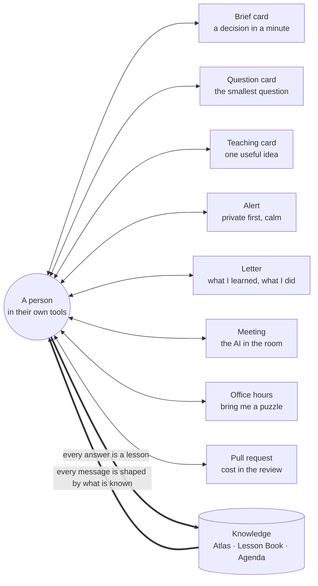
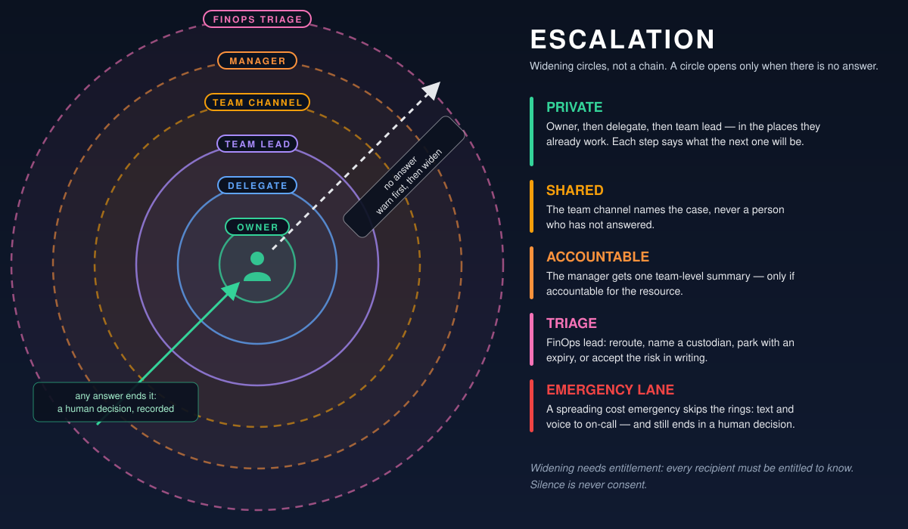

# People and conversation — how the AI talks, listens and learns

> **What this answers:** *How does the AI work with humans — owners, engineers, finance, executives — in the places they already work? Teams cards? Email? Text messages? An avatar in a meeting? And how does every conversation make it smarter?*
> Part of the [north star](01-north-star.md). Idea-level: concepts and moods, not wireframes. Formal personas, journeys and the UI come later.

---

## 1. The conversation is half of the learning

Most of what the AI needs to know is **in people's heads**: what a workload is for, when it is busy, what must not be touched, who really owns it, why a past decision was made. No telemetry will ever say *"this is the month-end regression"*.

So every message the AI sends is two things at once:

- **a service** — something worth the person's minute (a decision, a warning, a fact they wanted), and
- **a question** — a chance to learn something it could not learn any other way.



Everything below — the channels, the tone, the rituals — serves this loop.

---

## 2. Principles of engagement

1. **Every message earns its interruption.** If it would not change what the person does or knows, it is not sent.
2. **One decision per message.** Never a wall of options.
3. **The ask first, the evidence one tap away.** Layer 0 is the headline and the buttons; layer 1 the reasons; layer 2 the whole case notebook; layer 3 a human.
4. **Honest uncertainty** — ranges and plain words, never false precision. *"I think so, about 80%, and here is what would change my mind."*
5. **Say what happens next, and what can and cannot be undone.** Never imply an undo that does not exist.
6. **Speak their language and their level** — technical for engineers, financial for finance, brief for executives; Dutch, English, German and French first.
7. **Always disclose that it is an AI, and always offer a human.** The AI *composes* the message; every number is *computed from tools*, and the card says so.
8. **Two-way by default.** Replies, objections and questions are first-class.
9. **Teach more than you tell.** A message that leaves someone slightly better at their own platform beats a message that merely informs.
10. **Never shame.** Credit teams, not individuals. Never name a person who has not answered. Celebrate wins; show regret honestly.
11. **Be humble out loud.** "I don't know." "I was wrong." "I haven't seen enough — can you help?" An AI that says these things is easier to trust than one that never does.
12. **Silence is never consent.** No answer ends in a human decision, a parked case or an expiry — never in an automatic yes.

---

## 3. Who it talks to — and what each side gets

| Person | What they get | What the AI learns from them |
|---|---|---|
| **Resource owner** | decisions that are worth a minute; explanations; a fair hearing | what a workload is for, when it is busy, what must not change |
| **Engineer / steward** | pull-request comments, cost deltas, the exact diff of a change | how the system really behaves; which signals lie |
| **FinOps lead** | the Agenda's top questions, the report card, autonomy decisions | what counts as a good saving here; where to be bolder or quieter |
| **Finance partner** | a ledger that reconciles; commitment briefs; the claimed-versus-verified gap | what Finance will and will not accept as "saved" |
| **Platform / cloud lead** | patterns across teams; policy proposals; template fixes | standards, roadmaps, planned migrations |
| **Executive** | a 90-second brief; decisions only they can take | priorities, appetite for risk, the strategy that explains a spend |
| **Security / compliance** | early sight of anything the AI proposes that touches their domain | constraints no telemetry shows |
| **Commercial / procurement** | negotiation packs; commitment-versus-actual curves | contract facts, renewal dates |
| **New joiner** | a short intro: who the AI is, what it will and will not do | their role — and who they replace |
| **Anyone curious** | an answer to "why did my bill go up?" | **hunches** — the best leads on the Agenda |

---

## 4. The channel palette

| Channel | Best for | Urgency | Watch out for |
|---|---|---|---|
| **Teams card (direct)** | decisions, questions, teaching, approvals | normal–high | card spam |
| **Teams channel** | team-level asks, celebrations, shared resources | normal | public shaming: a post names the *case*, never a person who has not answered |
| **Teams meeting — the AI participant** | monthly cost review, planning, post-incident reviews | scheduled | consent, accuracy, talking over people |
| **Email digest** | the weekly desk, team brief, the monthly letter, executive brief | low | too long to read |
| **Email approval** | formal approvals and commitments, via a signed link to an authenticated page | normal | spoofing; forwarded links |
| **Pull request / code review** | cost delta and fixes for people writing infrastructure and code | native | review load |
| **Work-tracking item** | tracked work that needs several steps | normal | backlog graveyard |
| **Calendar invite** | change windows, wake-up windows, reviews | scheduled | invite fatigue |
| **Voice call** | a genuine, spreading cost emergency — to the on-call person | critical | voice is not authentication; false alarms at 02:00 |
| **Text message** | the same emergencies; opt-in only; never a link that acts on click | critical | unauthenticated; expensive if abused |
| **Office hours** | an open session where anyone brings a puzzle | scheduled | becomes a lecture |
| **Pull side: ask in chat, in the IDE, in the portal** | "why did my bill go up?", "what would this cost?" | pull | **never the primary channel** — chat is a way *into* a case, not the product |

The heuristic for choosing: **value × urgency × reversibility × the person × their moment.** Low value → the weekly letter, or no message at all because a standing rule handled it. Medium and reversible → a card in working hours. High, or needing a formal record → card plus email. A shared resource → the team channel, plus a private word with each affected owner. An emergency spend rate → text and voice to on-call, plus a card.

---

## 5. Message families

### The Brief card — a decision in a minute

The [Brief](05-recommend-act-verify.md#1-the-brief--a-decision-not-a-recommendation) in card form. Headline and value first; reasons, "the catch I checked", options, undo and the cost of waiting underneath; the buttons **A/B/C**, **Not now ▾**, **Not mine**, and always:

> **Explain · Challenge · Teach**

### The question card — the smallest question

The AI asks to *learn*, not to nag. Four kinds recur:

```
+------------------------------------------------------------------+
| Cost agent (AI)  .  1 question this week                          |
+------------------------------------------------------------------+
| vm-batch-07 (West Europe) costs about EUR 310/month and I cannot  |
| tell who owns it. You created it in March and you are still in    |
| Platform Engineering. I only act on things with a confirmed owner.|
|                                                                   |
| [Yes, mine] [My team's - add them] [Not mine - try someone else]  |
| [No idea] [Why are you asking?]                                   |
+------------------------------------------------------------------+
```

```
+------------------------------------------------------------------+
| Cost agent (AI)  .  1 question this week                          |
+------------------------------------------------------------------+
| The 14 resources in "rg-phoenix-eu" cost about EUR 4,200/month.   |
| I think they are the pre-production copy of the order platform    |
| (names, tags, traffic shape all point there). Is that right?      |
|                                                                   |
| [Yes] [Almost - let me fix it] [No - it is...]                    |
| Why I ask: whether it may sleep outside office hours.             |
+------------------------------------------------------------------+
```

| Question kind | It unlocks |
|---|---|
| **Ownership** — "is this yours?" | who gets Briefs; who is accountable |
| **Intent** — "what is this for?" | whether idle means *waste* or *by design* |
| **Rhythm** — "is this busy at quarter end?" | how long the AI must watch before it may say "unused" |
| **Constraint** — "can this be paused?" | the options the Brief may offer at all |

Every question says **why it is being asked** and **what it will do with the answer** — and the answer is remembered as **testimony**: attributed, scoped to what was asked, and *widened only with corroboration* (telemetry that agrees, a second person, repeated outcomes). It is never treated as a fact beyond its scope, and it can be re-asked cheaply if the evidence changes. The measure of success is **decision burden** — a person's minutes per decision, and cases waiting on an answer — not question count.

### The teaching card — one useful idea at the right moment

Not a notification that informs, but a **micro-lesson** triggered by what the person is doing *now*:

```
+------------------------------------------------------------------+
| Cost agent (AI)  .  A thing worth knowing                         |
+------------------------------------------------------------------+
| You just enabled zone redundancy on the new cache. That is the   |
| right call for production. In this service it also roughly       |
| doubles the hourly rate - and the dev copy of the same template   |
| inherits it. Want the dev environment to keep it?                 |
|                                                                   |
| [Keep in dev] [Turn off in dev - open the change] [Tell me more]  |
| Was this useful?  [Yes] [Not really] [Stop these]                 |
+------------------------------------------------------------------+
```

Three rules keep teaching from becoming noise: **relevance** (only about what someone is touching), **once** (never repeat a lesson to the same person), and **feedback** (each tap — *useful / not really / stop* — trains the AI on what is worth saying). The same idea works in a **pull request** ("this change adds a meter"), in a design document, in the portal's side panel and in the IDE: **cost sense in the flow of work**, not three weeks later on the bill.

### The alert — private first, calm

A spend that suddenly runs away (the WATCH clock) goes **first to one person, in private** — and it is *classified* before anyone is alarmed:

```mermaid
stateDiagram-v2
    [*] --> Noticed: a fast signal, an anomaly alert or a budget alert
    Noticed --> Classified: planned, growth, incident, attack or a mistake?
    Classified --> Dismissed: planned or expected, and the reason is kept
    Classified --> Asked: a private question to the owner, with what changed and when
    Asked --> Dismissed: the owner explains
    Asked --> Acting: a credential allows it, or the owner says yes
    Asked --> Escalating: no answer, so the circle widens; an emergency uses text and voice
    Escalating --> Acting: a human decides
    Acting --> Verifying: a Move runs and its guards watch
    Verifying --> Resolved: the spend is back where it should be
    Verifying --> Asked: it is not, so ask again with what the Move changed
    Resolved --> Lesson: what it was, how it was found, what to watch next
    Dismissed --> Lesson
    Lesson --> [*]
```



If a *credential* exists that lets the AI act on this kind of thing — *"pause training pools that spend more than 20× normal"* — it acts and tells. If none exists, it asks and keeps asking as the circle widens; it never invents authority. A spike that looks like abuse goes to the people who watch for that as well.

### The letters — what I learned, what I did

Three letters, each *short and specific*: **the Monday letter** (what I learned this week — see [the north star](01-north-star.md#10-what-the-learning-looks-like-from-the-outside)), **the weekly desk** (the person's own decisions) and **the monthly letter** to the FinOps lead and Finance ([what the Moves of a month look like](05-recommend-act-verify.md#12-what-it-looks-like-from-outside--the-moves-of-a-month)). Subject lines are specific and calm: *"3 decisions, worth about €1,150 a month"* — never *"URGENT: action required"*.

```
Subject: Your Azure savings desk - 2 decisions, 1 question, 1 win (week 45)

Hi Sanne,

2 decisions and 1 question need you (about 4 minutes); the decisions are worth about EUR 215/month:
  1. Resize vm-orders-api-03 ................ ~EUR 135/mo . reversible . [Decide]
  2. Move dev database backups to a cooler tier ~EUR  80/mo . reversible . [Decide]
  3. Is vm-batch-07 yours? .................. [Answer]

A win: the storage-tiering change you approved in October is verified:
EUR 1,840/month saved (measured against a comparison group, not guessed).

Something I learned from you: "Phoenix is pre-production" - applied 6 times
since last Thursday. Want me to remember it for all of team Atlas?
  [Yes, the whole team] [Only Phoenix] [No]

- Your cost agent (AI-composed; every figure is computed from your billing
  data). I will never ask for passwords or secrets. [Mute] [Settings] [Talk to a human]
```

---

## 6. Explain, Challenge, Teach — three buttons on every message

| Button | What happens |
|---|---|
| **Explain** | the reasoning in plain steps; the evidence with its grade (measured / observed / reported / inferred); a link to the case notebook; a toggle for *simple · technical · finance* level |
| **Challenge** | the AI argues the **other side**: *"here are the three strongest reasons I might be wrong, and what I did about each"*. The person can push: *"what would change your mind?"* — and the AI answers with a specific observation. When it is wrong, it **concedes in the thread** and re-opens the case: *"You're right — I missed the failover job. I've re-opened it. Thank you."* |
| **Teach** | the person writes in their own words, however they like — *"that's our DR environment"*, *"anything tagged legal is off-limits"*, *"like this one, but for the other region"*. The AI **reads back** what it understood in structured form, proposes the scope (*this resource · this team · everywhere*), and writes the lesson. |

### The read-back rule

Free text is understood by the AI — but **no free text ever triggers a change**. The AI reads back what it understood — *"I understood: shrink to the smaller size on Thursday 22:00 CET. Confirm?"* — and the *structured confirmation* (an authenticated tap) is what counts.

### Teachability, measured

How well the AI takes a lesson is itself scored (see [the Exam](07-getting-smarter.md#3-the-exam)): does it apply it correctly next time, scope it sensibly, and avoid over-generalising? An AI that learns from a single conversation in the right proportion is rare — and visible on the report card.

---

## 7. A conversation is not a notification

| What the person does | What the AI does |
|---|---|
| **Accepts** (maybe with a window) | plans, shows the exact change, schedules, verifies |
| **Accepts with changes** — "resize to the other size" | re-plans, **reads back**, asks to confirm |
| **Another time** — "after the launch on the 15th" | schedules; remembers the *why* |
| **Not now** — a reason chip: busy · risk · waiting for X · I disagree | defers with a condition to re-open; learns |
| **Not needed** — "that's the quarter-end batch VM" | stores the context with an expiry; adapts the playbook |
| **Not mine** | updates the human graph (with consent) and re-routes |
| **Why?** | opens the reasoning; may run a deeper analysis |
| **What if I wait?** | computes and shows the cost of delay |
| **What if…?** | the [Consequence Engine](03-estate-and-investigation.md#11-the-consequence-engine--what-happens-to-the-bill-if) answers on the spot |
| **Stop messaging me about this** | honours it; reports the muted volume to the FinOps lead |
| **No answer** | the ladder below; the case stays open, expires or is parked |

**Disagreement.** The AI does not argue to win. It records the objection, offers a lighter option if there is one, and escalates only as far as the ladder allows. *"Agree to disagree, revisit in March"* is a legitimate outcome.

---

## 8. Following the directory — the right person, moment, language

From the [human graph](03-estate-and-investigation.md#4-the-human-graph--following-the-directory) the AI knows *who*: the owner, the delegate, the manager, the person on leave, the person who just changed team. From the directory and the person's own settings it knows *how*:

- **Working hours and time zone**, presence, out-of-office, focus time. *"I won't ask you anything on release day."*
- **Language and level** — Dutch, English, German or French; short or detailed; formal for finance, informal for a team that prefers it.
- **Preferred channel** — card, email, or "digest only".
- **Delegates and cover** — an out-of-office reply is honoured; the delegate is told why.
- **Moves and leavers** — a person who left is an *ownership* problem for the human graph, not a reason to escalate to their manager's manager. A new joiner gets a short, friendly introduction: *who I am (an AI), what I will and will not do, how to mute me, how to reach a human.*

Learned preferences are **shown and editable** — *"I've noticed you answer best on mobile before 09:00; shall I use that?"* — never silently inferred. And the AI works out *who owns things*, **never how well anyone works**: it counts at the level of teams and cases, not individuals.

---

## 9. Escalation — private first, humane, widening

When a question is unanswered, the AI widens the circle — slowly, and never behind anyone's back:

1. **Private before public.** The first steps are private. Nobody is named in a shared space for not answering. Ever.
2. **Escalate the case, not the person.** A shared post says *"a cost decision needs an owner"* — never who has not answered.
3. **Warn before you widen.** Each step announces the next: *"if there is no answer by Thursday I will ask your team lead how to route this."*
4. **Silence is never approval.** The ladder ends in a human decision — reroute, a named custodian, park with an expiry, or a written acceptance of the risk.
5. **Widening needs entitlement.** Before a message reaches a wider audience, the AI checks that every recipient is *entitled to know*. Until then it sends an **opaque routing request** (*"a cost decision needs an owner — can you route it?"*) or an **aggregate** — never a resource name, a cost or a project name. For sensitive cases there is **no shared post at all**.
6. **Managers get one team-level summary** (counts, value, age), only if they are accountable — never a list of who ignored what.



---

## 10. The AI in the room — meetings, voice and avatars

Start with **text in the meeting chat**; add voice only when the written flows are trusted.

| Concept | What it is |
|---|---|
| **The cost-review participant** | a clearly-labelled AI joins the monthly cost review: a three-minute **pre-read** the day before, a 90-second **recap** live, answers to "what if?" with the evidence on screen, decisions captured as Cases, a **post-read** with owners and dates |
| **Office hours** | a weekly open session — *bring me a puzzle*: "why did my bill go up?", "what is this meter?", "I bet this is idle." It is both a teaching channel and an **intake for hunches**, which land on the Agenda |
| **Cost standup** | ninety seconds in a team's own standup channel (opt-in): yesterday's spend change, *one thing I learned*, *one question* |
| **The estate interview** | a five-minute voice call with a busy owner to settle intent and rhythm; a transcript and a confirmation card follow, and the owner can correct either |
| **The executive audio brief** | 60–90 seconds, with a transcript: *"Azure spend was two percent below forecast. Verified savings this month: …"* — and the caveat that projected savings are reported separately |
| **The avatar** | a friendly, **clearly-AI** character — *never* a real person's likeness or a cloned voice |

What makes the avatar more than a gimmick:

- it **shows its evidence** — the chart it is describing appears as it speaks, along with its confidence;
- it **raises a hand** instead of cutting in; it can be interrupted;
- it speaks **live in each person's language**, with captions;
- it keeps a **meeting memory** — it records decisions, writes Lessons ("*Recorded as a lesson by Lars: this team's resizes happen in Q1 and Q3; scope: team Atlas*") and follows up on the dates;
- it **cannot change anything from the meeting** — a decision taken aloud becomes a Brief with a confirmation, not an action.

---

## 11. Rituals — how the humans and the AI work together over time

| Ritual | Cadence | Purpose |
|---|---|---|
| **The teach-in** | monthly | the AI presents what it learned; people correct it. The cheapest way to find what it got wrong |
| **Regret review** | monthly | an open look at what the AI got wrong, blameless — normalises candour |
| **Report-card review** | quarterly | the FinOps lead and platform owners read the [report card](07-getting-smarter.md#4-the-report-card) and raise or lower autonomy credentials |
| **Surprise of the month** | monthly | the most interesting thing the Lab found — a learning moment for everyone |
| **Exception hearings** | quarterly | exceptions expire; owners re-justify with the AI's evidence |
| **The quarterly review in a box** | quarterly | the executive narrative, verified savings, forecast, decisions |
| **Savings dividend** | quarterly (if adopted) | part of verified savings returned to the teams that earned it |

---

## 12. The AI learns how to speak

With people's agreement, the AI treats *how it communicates* as something to learn: which wording gets a clear answer, which card layout is understood, whether a one-line summary beats a table, which hour is best. These are small, **opt-in, transparent** experiments (*"I'm trying two phrasings this month; tell me if either confuses you"*). They optimise for **clarity and quality of answer**, never for clicks or compliance — and the results go on the same [ledger](04-experiments-and-the-lab.md#9-questions-and-the-way-it-speaks) as every other experiment.

---

## 13. Inclusion and accessibility

Screen-reader friendly cards · plain language · no meaning conveyed by colour alone · captions and transcripts for everything spoken · a predictable structure (kind to neurodiverse readers) · multilingual, with locale-aware dates and currency · directness calibrated to the audience — what reads as clear in one culture reads as curt in another.

---

## 14. Things we will not do

Fake urgency · shaming lists · naming people who have not answered, in any shared space · leaderboards of individuals · hidden AI identity · an "approve all" button · giant digests that go unread · notifications that merely inform · asking the same question twice · a *Decline* that is harder than an *Accept* · links that act on click without authentication · treating silence as consent · implying an undo where there is none · tone that suggests the owner was negligent · jargon · scoring how well people work.

---

## 15. Storyboards

> Invented names, resources and numbers. Buttons are shown as `[Label]`.

### A spreading cost emergency — text and voice, 02:07

```
SMS (opt-in, 02:07):
  Cost agent (AI): gpu-train-02 is spending ~40x its normal rate
  (~EUR 900/h). A card is waiting in Teams on your phone. Reply HELP.

Call (02:11, no answer to the card):
  "This is the cost agent, an AI assistant. The GPU pool gpu-train-02 is
   spending about forty times its normal rate. Your team has given me
   a standing permission to pause training pools in exactly this
   situation, and I am pausing it now. It is reversible: a card on your
   phone has an undo button, and the pool restarts in about two minutes.
   Say 'repeat' to hear this again, or 'human' to reach the on-call lead."

  (Had no such permission existed, the call would end: "I need a person to
   decide. I have paged the next on-call engineer and have changed nothing.")
```

### The executive's 90-second brief (text of the audio)

> *"Good morning Jan. Azure spend was two percent below forecast. Verified savings: eleven thousand euro realised this month — a run-rate of about one hundred forty thousand a year, up thirty from last month; projected savings are reported separately. Commitment coverage is eighty-one percent, utilisation ninety-four. Two actions were rolled back; both are explained in the regret report. Three decisions need you this week: a staged commitment purchase, a policy for development environments, and an exception for one regulated workload. This brief was composed by an AI; every figure is computed from the savings ledger."*

### The AI in the monthly cost review (excerpt)

```
Priya (human):  Why did commitment utilisation dip last month?
AI participant: Utilisation fell from 96% to 91% after the platform team
                moved 14 VMs to a newer size. The commitments cover the
                old size. Two options: exchange within the allowed
                terms, or wait - 9 of the 14 return to the old size in
                December. I recommend waiting; waiting costs about EUR 600.
Lars (human):   Challenge that - how do you know they return?
AI participant: From the platform team's migration calendar and the last
                two years' pattern - both in the notebook on your screen.
                The calendar is the stronger evidence; the pattern is
                weaker. If the calendar slips, the cost of waiting rises
                to about EUR 1,900.
Lars (human):   OK. Record: wait, revisit on 12 Dec.
AI participant: Recorded as a decision by Lars. I will remind you on
                12 December. I cannot change commitments from this meeting
                - any purchase goes through the approval flow. Also
                recorded as a lesson: "the platform team's resizes follow
                the migration calendar" - scope: this organisation. Shall
                I keep it?
```

### Answering "why did my bill go up?" (the pull side, in Teams)

```
Maya (human):   why did our October bill go up 14%?
AI:             About EUR 3,900 of the EUR 4,300 rise comes from one change on
                the 9th: the web tier of the booking app moved to a second region
                (deployed by the "booking-v3" pipeline) while its database stayed
                put, so every request now crosses regions. EUR 400 is organic
                growth. That looks like an unfinished move rather than a decision
                - but that is a hypothesis, not a finding yet: want me to open a
                case and ask whoever owns the pipeline?
Maya (human):   yes
AI:             Opened as case 4312. I'll ask Jonas (the pipeline's last
                author) one question and tell you what he says.
```
