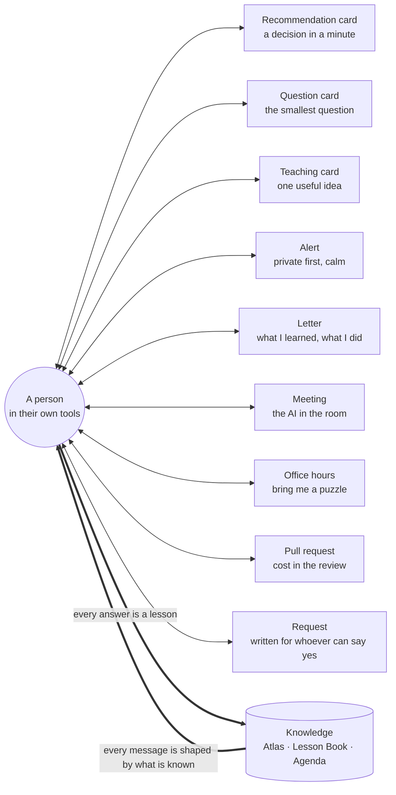
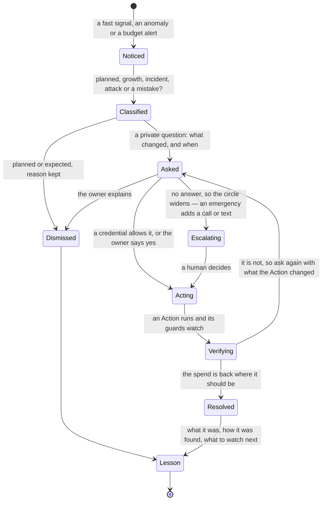

# People and conversation — how the AI talks, listens and learns

> **Every name, resource, date, figure, approval and outcome in the examples below is invented.**
>
> How the AI works with the people who own things — owners, engineers, finance, executives, and the partners or central teams who hold the right to buy — in Teams, email, text, voice and the meeting room. And how every conversation makes it smarter.
> Part of the [north star](01-north-star.md). Concepts and moods, not wireframes; the technical design is in [docs/design](design/README.md).

---

## 1. The conversation is half of the learning

Most of what the AI needs to know is **in people's heads**: what a workload is for, when it is busy, what must not be touched, who really owns it, why a past decision was made. No telemetry will ever say *"this is the month-end regression"*.

So every message the AI sends is two things at once:

- **a service** — something worth the person's minute (a decision, a warning, a fact they wanted), and
- **a question** — a chance to learn something it could not learn any other way. A question is the cheapest test there is: the *Ask* route in [finding out without spending](04-finding-out-without-spending.md).



---

## 2. Principles of engagement

1. **Every message earns its interruption.** If it would not change what the person does or knows, it is not sent.
2. **One decision per message,** for the person who can take it. Never a wall of options.
3. **The ask first, the evidence one tap away.** Layer 0 is the headline and the buttons; layer 1 the reasons; layer 2 the whole case notebook; layer 3 a human.
4. **Honest uncertainty** — ranges and plain words, never false precision — and every number says what it rests on: contracted rates, billed rates or list prices. *"I think so, about 80%, and here is what would change my mind."*
5. **Say what happens next, and what can be undone.**
6. **Speak their language and level** — technical for engineers, financial for finance, short for executives; Dutch, English, German and French first.
7. **Always disclose that it is an AI, and always offer a human.** The AI *composes* the message; every number is *computed from tools*, and the card says so.
8. **Teach more than you tell.** A message that leaves someone better at their own platform beats one that merely informs.
9. **Never shame.** Credit teams, not individuals; never name a person who has not answered. Celebrate wins; show regret honestly.
10. **Be humble out loud.** "I don't know." "I was wrong." "I haven't seen enough — can you help?"
11. **Silence is never consent.** No answer ever becomes an automatic yes.

---

## 3. Who it talks to — and what each side gets

| Person | What they get | What the AI learns from them |
|---|---|---|
| **Resource owner** | decisions worth a minute; explanations; a fair hearing | what a workload is for, when it is busy, what must not change |
| **Engineer, technical or platform lead** | pull-request comments, cost deltas, the exact diff; patterns across teams, policy proposals, template fixes | how the system really behaves, which signals lie; standards, roadmaps, planned migrations |
| **FinOps lead** | the Agenda's top questions, the report card, autonomy decisions | what counts as a good saving here; where to be bolder or quieter |
| **Finance partner** | the savings ledger, reconciled with the close; the commitment portfolio; the claimed-versus-verified gap | what Finance will and will not accept as "saved" |
| **Executive** | a 90-second summary; decisions only they can take | priorities, appetite for risk, the strategy behind a spend |
| **Security / compliance** | early sight of anything that touches their domain | constraints no telemetry shows |
| **Commercial, procurement, partner or central billing team** | negotiation packs; commitment-versus-actual curves; renewal dates; a short, complete request when the right to buy is theirs | agreement facts, what was really negotiated; what they can buy or grant here, and how long it takes |

---

## 4. The channel palette

| Channel | Best for | Urgency | Watch out for |
|---|---|---|---|
| **Teams card (direct)** | decisions, questions, teaching, approvals | normal–high | card spam |
| **Teams channel** | team-level asks, celebrations, shared resources | normal | public shaming: name the *case*, never a person who has not answered |
| **Teams meeting — the AI participant** | monthly cost review, planning, post-incident reviews | scheduled | consent, accuracy, talking over people |
| **Email digest** | the weekly desk, team summary, the monthly letter, executive summary | low | too long to read |
| **Email approval** | formal approvals and commitments, via a signed link to an authenticated page | normal | spoofing; forwarded links |
| **Request to a partner or a central team** | a purchase or access request, complete enough to act on without a call | normal | sending more of the estate than the request needs |
| **Pull request / code review** | cost delta and fixes for people writing infrastructure and code | native | review load |
| **Work-tracking item** | tracked work that needs several steps | normal | backlog graveyard |
| **Calendar invite** | change windows, wake-up windows, reviews | scheduled | invite fatigue |
| **Voice call** | a genuine, spreading cost emergency — to the on-call person | critical | voice is not authentication; false alarms at 02:00 |
| **Text message** | the same emergencies; opt-in only; never a link that acts on click | critical | unauthenticated; expensive if abused |
| **Office hours** | an open session — *bring me a puzzle* — and the intake for **hunches**, which land on the Agenda | scheduled | becomes a lecture |
| **Pull side: ask in chat, in the IDE, in the portal** | "why did my bill go up?", "what would this cost?" | pull | **never the primary channel** — chat is a way *into* a case, not the product |

Choose by **value × urgency × reversibility × the person × their moment.** Low value → the weekly letter, or nothing because a standing rule handled it. Medium and reversible → a card in working hours. High, or needing a record → card plus email. A shared resource → the team channel, plus a private word with each owner. An emergency spend rate → a card, plus a call or text to the on-call person — only on a route that person agreed to, in a country where it is allowed, with a fallback when nobody answers (delivery is a design matter: [design](design/README.md)).

---

## 5. Message families

### The Recommendation card — a decision in a minute

The [Recommendation](05-recommend-act-verify.md) in card form: headline and value first; reasons, "the catch I checked", options, undo and cost of waiting underneath; the buttons **A/B/C**, **Not now ▾**, **Not mine**, and always:

> **Explain · Challenge · Teach**

Next to the value sits one line on **what the number rests on**: *"at your contracted rates"*, *"at the rates on your bill"* or *"a scenario at list prices — your rates are invisible to me"*, depending on the agreement and the access the AI was given ([north star](01-north-star.md)). A figure is called an *expected saving* only when a bill line confirms the meter; until then it is a scenario, shown as a range. When only a partner or a central team can buy, *yes* sends them the request.

### The question card — the smallest question

The AI asks only what it needs to learn:

```
+-------------------------------------------------------------------+
| Cost agent (AI)  .  1 question this week (an invented example)    |
+-------------------------------------------------------------------+
| The 14 resources in "rg-phoenix-eu" cost about EUR 4,200/month.   |
| I think they are the pre-production copy of the order platform    |
| (names, tags, traffic shape all point there). Is that right?      |
|                                                                   |
| [Yes] [Almost - let me fix it] [No - it is...]                    |
| Why I ask: whether it may sleep outside office hours.             |
+-------------------------------------------------------------------+
```

Five kinds of question recur:

| Question kind | It unlocks |
|---|---|
| **Ownership** — "is this yours?" | who gets Recommendations; who is accountable |
| **Intent** — "what is this for?" | whether idle means *waste* or *by design* |
| **Rhythm** — "is this busy at quarter end?" | how long the AI must watch before it may say "unused" |
| **Constraint** — "can this be paused?" | the options a Recommendation may offer at all |
| **Access** — *"With the price sheet I could replace list prices with yours on 14 recommendations. Who could share it?"* | your rates in place of list prices; a purchase prepared for the right person |

Every question says **why it is being asked** and **what it will do with the answer**. The answer is kept as **testimony**: attributed, scoped to what was asked, *widened only with corroboration* (agreeing telemetry, a second person, repeated outcomes). An access question never asks for more than it needs, and *no* is a complete answer: the AI keeps pricing scenarios at list prices and says so; if someone says yes, the Monday letter says what moved. Success is **decision burden** — a person's minutes per decision, and cases waiting on an answer — not question count.

### The teaching card — one useful idea at the right moment

```
+-------------------------------------------------------------------+
| Cost agent (AI)  .  A thing worth knowing (an invented example)   |
+-------------------------------------------------------------------+
| You just enabled zone redundancy on the new cache - right for     |
| production. It also roughly doubles the hourly rate (your         |
| payments cache bill shows it since March), and the dev copy of    |
| the same template inherits it. Keep it in dev?                    |
|                                                                   |
| [Keep in dev] [Turn off in dev - open the change] [Tell me more]  |
| Was this useful?  [Yes] [Not really] [Stop these]                 |
+-------------------------------------------------------------------+
```

Three rules keep teaching from becoming noise: **relevance** (only about what someone is touching), **once** (never repeat a lesson to the same person) and **feedback** (each tap — *useful / not really / stop* — trains the AI on what is worth saying). The same works in a **pull request** ("this change adds a meter"), the IDE and the portal: **cost sense in the flow of work**.

### The alert — private first, calm

A spend that suddenly runs away (the Watch clock) goes **first to one person, in private** — and it is *classified* before anyone is alarmed:



If a *credential* lets the AI act on this kind of thing — *"pause training pools that spend more than 20× normal"* — it acts and tells. If none exists, it asks the owner and, as the circle widens, the next person, announcing each step first; it never invents authority.

### The request — written for whoever can say yes

When a partner sells the commitment, or a central billing team holds the right to buy, the Diplomat does not ask the owner to buy. It writes the request for the person who can — short, complete, readable without a call — tells the owner in one line, and watches the bill.

```
(an invented example)
To: the partner desk
Subject: Purchase request - 1-year compute savings plan, order platform

Buy:       about 60% of the steady baseline, 3 production subscriptions
Evidence:  12 months replayed: 94-97% used, after the right-sizing
Scenario:  about EUR 4,300/month at list prices;
           your quote decides - send it and I will re-check
Approvers: the budget holder and the platform owner, on your quote
Deadline:  quote by 10 June; the current reservation ends 30 June

If you cannot buy this, one line on why is enough: I will ask the next person.
```

### The letters — what I learned, what I did

Three letters, each *short and specific*: **the Monday letter** (what I learned this week — see the [north star](01-north-star.md)), **the weekly desk** (the person's own decisions) and **the monthly letter** to the FinOps lead and Finance (the Actions of a month, in [recommend, act, verify](05-recommend-act-verify.md)). Subject lines are specific and calm and carry no figure, because a subject shows on lock screens: *"2 decisions and 1 question"* — never *"URGENT: action required"*.

```
(an invented example)
Subject: Your Azure savings desk - 2 decisions, 1 question, 1 win

Hi,

2 decisions and 1 question need you (4 minutes). The decisions are worth about
EUR 215/month, at the rates on your bill:
  1. Resize vm-orders-api-03 ................ ~EUR 135/mo . reversible . [Decide]
  2. Put dev database backups on a cooler tier ~EUR  80/mo . reversible . [Decide]
  3. Is vm-batch-07 yours? .................. [Answer]

A win: the storage-tiering change you approved in October is outcome-confirmed:
EUR 1,840/month saved on two bills, against a comparison group.

- Your cost agent (AI-composed; every figure is computed from your billing
  data). I never ask for passwords or secrets. [Mute] [Settings] [Talk to a human]
```

*Talk to a human* reaches the FinOps lead in working hours and, outside them, the on-call person the adopting organisation names; that person sees only what the sender may see.

---

## 6. Explain, Challenge, Teach — three buttons on every message

| Button | What happens |
|---|---|
| **Explain** | the reasoning in plain steps; the receipts, with the evidence level of each Atlas claim it leans on (documented → price-confirmed → bill-observed → outcome-confirmed); what every number rests on; the case notebook; a *simple · technical · finance* toggle |
| **Challenge** | the AI argues the **other side**: *"here are the three strongest reasons I might be wrong, and what I did about each"*. The person can push — *"what would change your mind?"* — and gets a specific observation. When it is wrong, it **concedes in the thread** and re-opens the case: *"You're right — I missed the failover job. Thank you."* |
| **Teach** | the person writes in their own words — *"that's our DR environment"*, *"anything tagged legal is off-limits"*, *"like this one, but for the other region"*. The AI **reads back** what it understood in structured form, proposes the scope (*this resource · this team · everywhere*), and writes the lesson. |

### The read-back rule

Free text is understood — but **no free text ever triggers a change**. The AI reads back what it understood (*"I understood: shrink to the smaller size on Thursday 22:00 CET. Confirm?"*) and only the *structured confirmation*, an authenticated tap, counts.

---

## 7. What the AI does with each reply

| What the person does | What the AI does |
|---|---|
| **Accepts** — maybe with a window, or "after the launch on the 15th" | plans, shows the exact change, schedules, verifies; remembers the *why* |
| **Accepts with changes** — "resize to the other size" | re-plans, **reads back**, asks to confirm |
| **Not now · Not needed** — a reason chip (busy · risk · waiting for X · I disagree) or "that's the quarter-end batch VM" | defers with a condition to re-open, or stores the context with an expiry; learns and adjusts its next question |
| **Not mine** | updates the human graph (with consent) and re-routes |
| **Why? · What if I wait? · What if…?** | opens the reasoning, shows the cost of delay, or lets the [Consequence Engine](03-estate-and-investigation.md) answer on the spot |
| **Stop messaging me about this** | honours it; reports the muted volume to the FinOps lead |
| **No answer** | the escalation path below; the case stays open, expires or is parked |

**Disagreement.** The AI does not argue to win. It records the objection, offers a lighter option if there is one, and widens the circle only as far as the escalation path allows. *"Agree to disagree, revisit in March"* is a legitimate outcome.

---

## 8. Following the directory — the right person, moment, language

From the [human graph](03-estate-and-investigation.md) the AI knows *who*: the owner, the manager, the person who just changed team. From the directory and the person's own settings it knows *how*:

- **Working hours, time zone, presence, out-of-office and focus time** — used only when the person or the organisation has provided or authorised them; otherwise the AI asks for a preferred schedule. *"Tell me your release days and I won't ask you anything on them."*
- **Language, level and channel** — Dutch, English, German or French; short or detailed; card, email or "digest only".
- **Delegates and cover** — confirmed with the person, never inferred; an out-of-office reply is honoured and the delegate is told why.
- **Movers, leavers and joiners** — a person who left is an *ownership* problem for the human graph, not a reason to escalate to their manager's manager; a new joiner gets a short introduction: *who I am (an AI), what I will and will not do, how to mute me, how to reach a human.*

Learned preferences are **shown and editable** (*"I've noticed you answer best on mobile before 09:00; shall I use that?"*), never silently inferred. The AI works out *who owns things*, **never how well anyone works**: it counts teams and cases, not individuals.

---

## 9. Escalation — private first, humane, widening

When a question goes unanswered, the AI widens the circle, never behind anyone's back:

1. **Private before public, and the case before the person.** Nobody is named in a shared space for not answering. A shared post says *"a cost decision needs an owner"* — never who has not answered.
2. **Warn before you widen.** Each step announces the next: *"if there is no answer by Thursday I will ask your team lead how to route this."*
3. **Silence is never approval.** The escalation path ends in a human decision — reroute, a named custodian, park with an expiry, or a written acceptance of the risk.
4. **Widening needs entitlement.** Before a message reaches a wider audience, every recipient must be *entitled to know*. Until then the AI sends an **opaque routing request** (*"a cost decision needs an owner — can you route it?"*) or an **aggregate** — never a resource name, a cost or a project name — and for sensitive cases **no shared post at all**.
5. **Managers get one team-level summary** (counts, value, age), only if they are accountable — never a list of who ignored what.


---

## 10. The AI in the room — meetings, voice and avatars

Start with **text in the meeting chat**; add voice only when the written flows are trusted.

| Concept | What it is |
|---|---|
| **The cost-review participant** | a clearly-labelled AI joins the monthly cost review: a three-minute **pre-read** the day before, a 90-second **recap** live, answers to "what if?" with the evidence on screen, decisions noted as Cases, a **post-read** with owners and dates |
| **The estate interview** | a five-minute voice call with a busy owner to settle intent and rhythm; with the owner's consent a transcript and a confirmation card follow, and the owner can correct either |
| **The executive audio summary** | 60–90 seconds that open with "This is the AI cost assistant", with a transcript and always the caveat that projected savings are reported separately |
| **The avatar** | a friendly, **clearly-AI** character — *never* a real person's likeness or a cloned voice |

**Consent comes before capture.** Before it keeps anything, the AI says what it keeps (decision notes only, or a transcript), for what, who receives it and for how long. Where permission or consent is required — for a late joiner or a guest too — it asks, and a refusal means no capture. Lessons proposed in a meeting are confirmed separately, in writing, with the owner of that knowledge. Any participant can ask for the transcript, and what was derived from it, to be deleted; a person, not the AI, decides.

How the AI behaves in the room:

- it **shows its evidence** — the chart it is describing appears as it speaks, along with its confidence;
- it **raises a hand** instead of cutting in; it can be interrupted;
- the meeting hears **one agreed spoken language**; each person can choose a **translated text view** (captions); disputed wording and any figure are confirmed in writing afterwards;
- it keeps a **meeting memory** only as agreed above — decision notes and follow-up dates;
- it **cannot change anything from the meeting** — a decision taken aloud becomes a Recommendation waiting for a confirmation tap, never a change.

---

## 11. Rituals — how the humans and the AI work together over time

| Ritual | Cadence | Purpose |
|---|---|---|
| **The teach-in** | monthly | the AI presents what it learned; people correct it. The cheapest way to find what it got wrong |
| **Regret review** | monthly | an open look at what the AI got wrong, blameless — normalises candour |
| **Report-card review** | quarterly | the FinOps lead and platform owners read the [report card](07-getting-smarter.md), raise or lower autonomy credentials and see what more access would buy |
| **Surprise of the month** | monthly | the most interesting charge nobody predicted — a learning moment for everyone |
| **Exception hearings** | quarterly | exceptions expire; owners re-justify with the AI's evidence |

---

## 12. The AI learns how to listen and speak

**Listening is scored.** Sealed test cases it cannot see in advance check how well the AI takes a lesson: does it apply it next time, scope it sensibly, avoid over-generalising? The result goes on the report card ([getting smarter](07-getting-smarter.md)).

**Speaking is learned.** With people's agreement, the AI compares two phrasings in the open (*"I'm trying two phrasings this month; tell me if either confuses you"*), predicts first and judges on **clarity and quality of answer** — never clicks or compliance. Prediction and result go into the Ledger like any other test ([finding out without spending](04-finding-out-without-spending.md)).

---

## 13. Inclusion and accessibility

Screen-reader friendly cards · plain language · no meaning conveyed by colour alone · captions for everything spoken, and transcripts wherever capture is agreed · a predictable structure (kind to neurodiverse readers) · multilingual, with locale-aware dates and currency · directness calibrated to the audience — what reads as clear in one culture reads as curt in another.

---

## 14. Things we will not do

Fake urgency · shaming lists · naming people who have not answered, in any shared space · leaderboards of individuals · hidden AI identity · an "approve all" button · giant digests that go unread · notifications that merely inform · repeating a question that already has a valid answer (re-ask only when the facts changed or the answer expired, and say so) · escalating without warning · a *Decline* that is harder than an *Accept* · links that act on click without authentication · treating silence as consent · implying an undo where there is none · tone that suggests the owner was negligent · jargon · scoring how well people work · pretending to know your discount · asking for more access than a question needs.

---

## 15. Storyboards

> Every example here is invented. Buttons are shown as `[Label]`.

### A spreading cost emergency — text and voice, 02:07

```
(an invented example)
SMS (opt-in, 02:07):
  Cost agent (AI): gpu-train-02 is spending ~40x its normal rate
  (~EUR 900/h). A card is waiting in Teams on your phone.

Call (02:11, no answer to the card):
  "This is the cost agent, an AI assistant. The GPU pool gpu-train-02 is
   spending about forty times its normal rate. Your team has given me
   a standing permission to pause training pools in exactly this
   situation, and I am pausing it now. It is reversible: a card on your
   phone has an undo button, and the pool restarts in about two minutes.
   Say 'repeat' to hear this again, or 'human' to reach the on-call lead."

  (Had no such permission existed, the call would end: "I need a person to
   decide. I have paged the next on-call engineer and have changed nothing.")
```

### The executive's 90-second summary (text of the audio; an invented example)

> *"This is the AI cost assistant. Here is your ninety-second summary. Azure spend was two percent below forecast. Verified savings: eleven thousand euro realised this month — a run-rate of about one hundred forty thousand a year; projected savings are reported separately. Two changes were rolled back; both are explained in the regret report. Three decisions need you this week: a staged commitment purchase, a policy for development environments, and an exception for one regulated workload. Every figure is computed from the savings ledger."*

### One target for the quarter — the executive's view (an invented example)

*The CFO writes one sentence into the system:* "Take 8% off the Azure run-rate by the end of the quarter, keep headroom for the growth plan, and spend no more than 40 minutes of the leadership team's time." The AI assembles a **portfolio** of candidate Actions, ranked by verified value per minute of attention and by risk, with the interactions visible: savings are not additive, so right-sizing goes first and the commitment waits for the new floor instead of being sized for a bill about to shrink.

The answer comes back as ranges, not a promise: *"About 7.1% (range 5.4–8.6) by 31 December. Four decisions for leadership, about 32 minutes; eleven for owners, already routed. Two large Actions are not in the plan because they would breach the growth plan's headroom."*

Every month the same page returns as a rhythm, not a report: forecast against budget, what next month's bill will say because of this month's purchases, what has been verified and how much Finance has accepted, and the next decision. At month-end it reconciles with the close, each number labelled provisional, reconciled or accepted.

### The AI in the monthly cost review (excerpt)

```
(an invented example)
AI participant: I am the AI participant. May I keep decision notes only,
                no transcript, to follow up on dates, for the people here,
                for 90 days? If anyone says no, I keep nothing.
Everyone:       Fine.
Finance lead:   Why did commitment utilisation dip last month?
AI participant: Utilisation fell from 96% to 91% after the platform team
                moved 14 VMs to a newer size; the commitments cover the
                old size. Two options: exchange within the allowed
                terms, or wait - 9 of the 14 return to the old size in
                December. I recommend waiting; it costs about EUR 600.
Budget holder:  Challenge that - how do you know they return?
AI participant: The platform team's migration calendar and the last two
                years' pattern - both in the notebook on your screen.
                The calendar is stronger evidence; if it slips, waiting
                costs about EUR 1,900.
Budget holder:  OK. Record: wait, revisit on 12 Dec.
AI participant: Recorded as a decision; I will remind you on 12 December.
                I cannot change commitments from this meeting - a purchase
                goes through the approval flow. Proposed lesson: "the
                platform team's resizes follow the migration calendar".
                I will ask the platform lead to confirm it in writing.
```

### Answering "why did my bill go up?" (the pull side, in Teams)

```
(an invented example)
Owner:          why did our October bill go up 14%?
AI:             About EUR 3,900 of the EUR 4,300 rise comes from one event on
                the 9th: a one-year reservation covering 14 VMs expired, and
                they now bill at pay-as-you-go rates. EUR 400 is organic
                growth. That looks like a renewal nobody owned rather than a
                decision - but that is a hypothesis, not a finding yet: want me
                to open a case and ask whoever bought it?
Owner:          yes
AI:             Opened as case 4312. I'll ask the person who bought it one
                question and tell you what they say.
```
