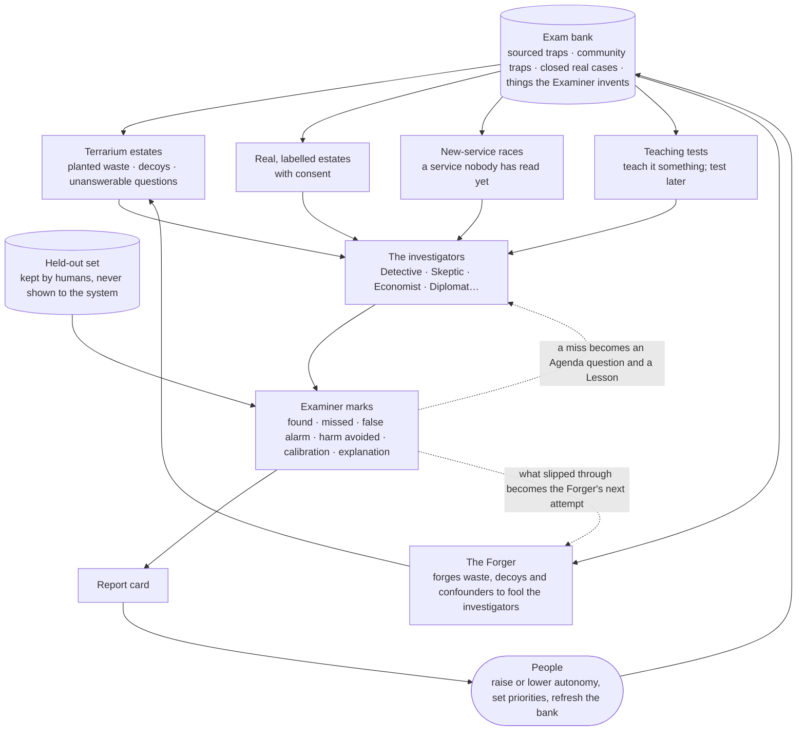

# Getting smarter — predictions, exams and the Commons

> **What this answers:** *How does the system get better over time — and how do we know it is not fooling itself? How does it learn from outcomes, from people, from independent tests, and from a community that is not us?*
> Part of the [north star](01-north-star.md). Idea-level: what the system does, not how it is built.

---

## 1. Everything is a prediction

The simplest honest rule in the whole design: **nothing the AI claims is allowed to go unscored.** Every recommendation, every belief it relies on, every estimate says *what will happen and by when* — and reality gets to grade it.

| It predicts… | …and is scored against |
|---|---|
| **a saving** — "about €710 a month from the 1st" | the verified saving, against a counterfactual |
| **a bill** — next month's cost by service and team | the actual bill |
| **an answer** — "yes, Priya will accept this" | what Priya did |
| **a behaviour** — "this will be idle on Friday" | the metrics on Friday |
| **a consequence** — "latency stays inside the target" | the trial, or the production data afterwards |
| **a billing mechanism** — "a paused thing bills storage only" | the Lab's bill lines |
| **a surprise** — "this meter will not appear" | whether it did |

Shadow predictions — the ones that change nothing — run **all the time**, at almost no cost. They are the system's constant exercise.

### Calibration: when it says 80%, is it right 80% of the time?

From the thousands of scored predictions the system draws its **calibration record**, the single most honest picture of how much to trust it:

```
 actually
 right
 100% |                                              /
  90% |                                      /
  80% |                              /       o   <- says 90%, is right 80%: overconfident
  70% |                      /       o
  60% |              /       o
  50% |      /       o
      +--------------------------------------------------
            50%     60%     70%     80%     90%     100%   what it said
      "/" = perfect calibration      "o" = the AI, this quarter
```

Where the curve sits below the diagonal, the AI is *overconfident* in that area — it gets less autonomy there and says "I think" more. Where it sits above, it is timid and may be *asked to be bolder*. The record is kept **per domain and per kind of claim**: it can be superb at storage tiering and mediocre at predicting database growth, and the report card says so.

Calibration is only meaningful if the predictions are *comparable*, so each one is written to a small **prediction ontology** before it is made:

| Field | What it fixes |
|---|---|
| **Target** | exactly what will be true (a meter, a saving, an answer, a latency) |
| **Window** | by when, and how long reality is watched |
| **Counterfactual method** | for savings and consequences: against what comparison group or baseline, with which assumptions |
| **Loss** | what being wrong costs — money, harm, a person's time |
| **Scoring rule** | a *proper* probabilistic score, so that honest uncertainty is what scores best |

Three cautions are built in. **Model tone is not a probability**: a language model's "I'm fairly sure" is turned into a number only through a calibration layer measured on past outcomes. **Outcomes are not randomly observed** — acceptance depends on how the message was written, and savings are confounded by what else changed — so the record reports its *coverage* (what share of predictions were ever scored) and its selection effects, and uses intervals (including conformal ones) rather than single figures. And **abstaining is allowed**: where the record is thin the system says "I don't know" and is scored for saying so.

### Why predictions beat feedback

A thumbs-up measures whether someone was pleased. A prediction scored against the world measures whether the AI was *right*. The two are kept apart on purpose: an AI optimised for approval learns to flatter.

---

## 2. The Lesson Book matures

A lesson starts small — one person, one resource — and the interesting part is where it can go. Knowledge in the system has a **maturity**:

| Maturity | What it is | Example | Who must agree |
|---|---|---|---|
| **Observation** | something seen once | "this resource had no traffic at weekends" | nobody — it is a note |
| **Lesson (local)** | a person said it, scoped to their thing | "weekend idleness is expected here" | the person who said it |
| **Lesson (team / org)** | widened after being applied and confirmed | "all development subscriptions idle at weekends" | the team lead; the AI proposes |
| **Pattern** | the same lesson found in several teams, estate-independent | "dev environments idle outside office hours" | a reviewer; the AI proposes |
| **Detector** | the pattern compiled into a cheap, scoped, expiring *lead generator* | a back-tested watcher that has run in shadow | a reviewer after shadow mode |
| **Atlas claim** | the general fact about Azure underneath, with receipts | "service X bills while stopped, via meter Y" | review by people and the Knowledge CI |

Things move **up** when they keep being right and **down** when they are not. A lesson contradicted three times is demoted; a lesson that nobody has applied for a year **expires** and asks to be renewed or retired. Two lessons that conflict (two teams teaching opposite things) are put side by side for a human to resolve — **a lesson is never silently overwritten**.

Only the top two rungs ever leave the customer — and only as generic, anonymous facts about Azure, never as facts about a company ([the Commons](#7-the-commons)). The words used here and across the documents are fixed in [one vocabulary](11-the-learning-contract.md#7-one-vocabulary).

---

## 3. The Exam

The score that matters is the one the system **cannot see in advance.** An independent agent — the **Examiner** — sets, runs and marks exams, and an adversarial twin, the **Forger**, builds waste designed to fool the investigators (see [the Terrarium](04-experiments-and-the-lab.md#14-the-terrarium--miniature-estates-with-planted-waste)). The Examiner shares no memory with the investigators, and the investigators never see its questions — but "no shared memory" is not the same as independence, so [independence is designed in](#independence--who-examines-the-examiner).



### The kinds of exam

| Exam | The question it asks | Why it matters |
|---|---|---|
| **Rediscovery** | *Here is an estate with waste hidden in it. Find it — with no rule.* | the whole point: finding things nobody wrote a rule for |
| **Decoys** | *Here are things that look wasteful but are not* (a disaster-recovery replica, a quarterly job, a legal hold) | **restraint**: recommending a harmful change is the worst failure, and it is scored as such |
| **New-service race** | *Here is a service released last week. How long until your profile is right?* | day-zero learning, against the clock and against a human expert panel |
| **Transfer** | *You learned service A. Here is service B with the same billing mechanism — what do you predict?* | does it learn **mechanisms**, or memorise services? |
| **Arithmetic from tools** | *What does this configuration cost in this region under this agreement?* | numbers must come from tools; an answer from memory fails, even if right |
| **Counterfactual honesty** | *The bill fell by 12% — did the change cause it?* (traffic also fell) | does it avoid claiming credit it did not earn? |
| **Teachability** | *Teach it a fact in conversation; test it next week, in a nearby situation* | learns the right amount — not too little, not too much |
| **Explanation** | humans read an explanation blind: *Could you defend this to your manager?* | an unconvincing right answer is not enough |
| **Communication** | humans rate cards and emails for clarity, tone and length | the best finding is wasted if nobody understands it |
| **Humility** | *questions with no answerable answer* | reward "I don't know" and calibrated uncertainty |
| **Regression** | *re-run last year's exams on today's Atlas* | an Atlas edit that quietly broke old knowledge shows up here |

### Marking: value-weighted, harm-weighted

An exam is not a count of hits. Each question is weighted by **value** (finding the big one matters more), by **harm** (a destructive recommendation costs far more than a missed saving), by **time to find**, and by **how it was found**: *from the grammar and the evidence*, or by matching a pattern it had been handed. Calibration and explanation are marked separately, and *the number of false alarms* is reported next to the number of finds.

### Keeping the exam honest

- The **exam bank** is built from sourced cost traps in the public record ([a bank of 145+ is already collected](research/exam-bank-cost-traps.md)), community-submitted traps, closed real cases, and **traps the Examiner invents** — including ones nobody has written about.
- A **held-out set**, curated by humans and never shown to the system, guards against the system learning the exam instead of the subject.
- The exam is **refreshed constantly**; questions that every version of the system now passes are retired to the regression set.
- A **miss is gold**: it is turned into an Agenda question and, once understood, a Lesson — so the exam is also a teacher. (That is why the *credential* exam below is kept apart from the exams the system learns from.)
- The Examiner is itself examined (are its keys right?) by human review and, for contested keys, by the Lab.

When does it run? **Nightly, in miniature.** **Quarterly, in full.** **Before any autonomy credential is granted or renewed**, and **after any large change** to the Atlas, the models or the method.

### Independence — who examines the Examiner?

The worry is fair: the same programme builds the grammar, the Terrarium, the Forger and the investigators, so a hidden question may only test whether the system recognises *its builders' way of thinking*. So independence is designed in, not assumed:

- **Three exams, kept apart.** The **training Terrarium** (the system learns from it; misses become lessons), the **public benchmark** (open to anyone, never used for credentials) and the **credential exam** (time-frozen, held out, used only to decide autonomy). A miss on the credential exam is *not* fed back into training until the exam is retired.
- **Different minds where it matters.** The Examiner and the Forger do not share a base model, templates or generators with the investigators where that can be avoided, and the credential exam is run by people outside the system's day-to-day, with **pre-registered scoring** and **confidence intervals**.
- **A leakage audit** before every credential exam: does any question resemble anything in the system's memory, its sources or the public bank? Anything that might have been seen is marked *possibly seen* and weighted down.
- **Real cases, post-cutoff.** Part of every exam is retrospective and post-cutoff cases from real estates (with consent), which no generator had a hand in.
- **Baselines on every exam.** The system is scored beside a **retrieval-only** baseline, the **expert-written seed**, and an experienced **practitioner** — see [what "better" is measured against](11-the-learning-contract.md#5-what-better-is-measured-against).
- **The keys are audited** too: by people, by the Lab for contested keys, and by an adversarial reviewer whose only job is to find a wrong answer key.

---

## 4. The report card

The result of all this is a **report card** — plain, kept inside the organisation (the open benchmark is separate), and always led by what the system is *worst* at.

```
THE REPORT CARD · Q4                                      (read this part first)

I would NOT trust me on:     database growth predictions (calibration: says 80%, right 62%)
                             anything involving a service released in the last 14 days
Getting better at:           storage tiering (rediscovery 71% -> 86%) · explaining in plain language
Unusually good:              spotting quiet "stopped but still billing" meters (found 38 of 40 planted)
Harm avoided on decoys:      94 of 96 (two near misses: both involved a quarterly job)
Calibration (all domains):   says 80% -> right 77%   (last quarter: 71%)  [interval 71-83%, 412 scored]
Against the baselines:       retrieval-only 54% · expert seed 68% · me 81% · a practitioner 79%  (held-out exam)
New-service race:            median 9 hours to a provisional profile (last quarter: 31); commercially verified: 3 days

Verified savings:            EUR 443,000 (claimed EUR 590,000 -> 75% verified)
All-in cost to serve:        EUR 31,400  (Lab 9,100 · models 10,300 · people's time 12,000)
Net, and cost per euro:      EUR 412,000 net · 7 cents per verified euro · EUR 38 of value per human minute
Regret and boomerangs:       3 and 7 · all reviewed · lessons written
Atlas:                       1,840 meters with verified profiles · median claim age 41 days · 212 claims stale
Autonomy now:                Autopilot in 6 domains · Assist in 11 · Advise in the rest · 2 self-demotions this quarter
```

Three habits make the card trustworthy: **the weak spots come first**; it compares the AI **with its own past and with the baselines** (never team against team, never person against person); and it counts what the AI **costs** — the Lab, the models *and the people's time* — against what it saves. Autonomy credentials are granted, renewed and revoked **from this card**, by people.

---

## 5. Not fooling itself

An AI that can generate hypotheses endlessly will, by chance alone, *confirm* some false ones. The system borrows the hygiene of science:

- **Predictions are written first** (pre-registration), never fitted afterwards.
- **A false-discovery budget.** A finding that survived only after many variants were tried is treated with suspicion; it is **replicated** — on another resource, another time window, another estate, or in the Lab — before it counts.
- **Blind scoring.** The Examiner and the human panels mark answers without knowing which version of the system produced them.
- **Negative results are published**, inside the system and in the Commons — *"this did not work, and why."*
- **The Skeptic is rewarded for breaking things**, not for agreeing.
- **Contamination checks.** If an exam question resembles something the system was shown in training or in a real case, it is marked as *possibly seen* and weighted down.
- **Goodhart watch.** When a measure becomes a target, it stops being a measure — so no single number is optimised alone. Savings are always shown with regret, attention cost and non-cost consequences; the exam is rotated; the held-out set stays hidden.

### Unlearning

Knowing when to **forget** is half of learning. A price changed and an old rule died. A service was redesigned and its profile is wrong. A lesson was taught by someone who has since changed their mind. The system:

- **expires** claims and lessons on a schedule and re-checks them ([Knowledge CI](02-learning-azure.md#5-knowledge-ci--facts-that-test-themselves)), rather than trusting them forever;
- **demotes** on contradiction instead of piling exceptions on top;
- **deletes on request** — a person can ask to remove a lesson about their team, and it goes;
- replays old, closed cases against today's knowledge to find where yesterday's answer would now be *different* — and tells the owners.

A Lesson Book with a delete key is a Lesson Book people trust.

---

## 6. Learning how to learn

The system does not only learn about Azure. It learns **how to learn about Azure** — and the whole method is data.

| It tracks… | …so it can |
|---|---|
| **which sources produced claims that held** | trust an informative source more, a noisy one less — per kind of claim |
| **which investigation tactics paid off, for which mechanism** | open with the likeliest tactic for each kind of service |
| **which experiments were most informative per euro** | spend the Lab's budget where it teaches most |
| **which detectors earn their keep** | retire the weak ones; write more of the strong kind |
| **which phrasing and timing get a clear answer** | speak better, in the ways people agreed to test |
| **which of its own agents and models are best at what** | route each job to the cheapest competent one — including *not using an AI at all* where code suffices |
| **where its method failed on the exam** | propose a change to its own procedures |

Two of these deserve a closer look.

**It does FinOps on itself.** The AI is an Azure workload too — models, agents, the Lab, storage, queries. Its own bill is on the report card, and it applies the same [Cost Grammar](02-learning-azure.md#2-the-cost-grammar--how-it-reasons-about-services-it-has-never-seen) to its own services (tokens are a meter; so is a vector index; so is a long-running agent). It chooses models with the Consequence Engine: *"a smaller model is accurate enough for reading price pages; the large one is reserved for the Skeptic."* A cost-optimisation system that ignores its own cost is not credible.

**It proposes changes to its own method.** From ablations and A/Bs in the Terrarium ([experiments on itself](04-experiments-and-the-lab.md#15-experiments-on-itself)) it learns that, say, probing before reading works better for networking services. It then *proposes* a change to its own playbook — a human reviews and approves it, like any other change. A system that can run experiments on itself can improve its own process without being rebuilt, **within limits people set**.

How the tracking turns into behaviour is the second and sixth rows of [the learning contract](11-the-learning-contract.md#1-six-things-that-change): each source, tactic, experiment and phrasing keeps a running estimate of verified value per euro and per human minute, effort follows the best estimates, and a protected share keeps exploring the rest.

---

## 7. The Commons

Half of what the system knows is about **Azure**, and that half is the same for everybody: how a service bills, what its levers are, what the traps are, how to test a claim, which Moves work. That half should not be locked inside one company, or one vendor — it should belong to everyone who runs Azure, and *it gets better with every one of them*.

**The Commons** is the open, versioned, open-source (MIT) half of the knowledge.

| In the Commons | Never in the Commons |
|---|---|
| **Atlas profiles** and the Cost Grammar, with receipts | any estate data — resources, names, bills, tags |
| **Moves** (tested change recipes), with their track records | the Estate Model |
| **Lab recipes** — the experiments, so anyone can re-run them | the Lesson Book |
| **Detectors** — the cheap checks | anything that identifies a person, team or company |
| **The exam bank** (public part) and an open benchmark | the held-out exam set |
| **Outcome statistics** — "this advice paid off in 71% of cases", counts only | |

### How it grows

- **The AI proposes, humans dispose.** Each customer's AI notices that a Profile is out of date, or learns a new trap in the Lab, and opens a **pull request to the Commons** — with its receipts, its Lab recipe, its test. People review. Nothing becomes trusted on the AI's say-so alone.
- **Replication as a contribution.** Anyone can re-run a claim's recipe in *their own* Lab — a different region, a different agreement, a different date — and attach the result. Claims earn strength through a **reproducibility lattice**: a graph of independent replications across conditions, so the *transfer boundaries* — where a claim holds and where it does not — are themselves first-class knowledge. A claim that holds in five regions and three agreement types is worth more than one that was seen once; a claim that fails somewhere has *learned where it does not hold*.
- **People contribute too.** Add a trap you were bitten by. Write a Move. Translate. Report a wrong claim. **Adopt a service**: be the human **Atlas maintainer** for a service's profile.
- **Outcome statistics without data.** An organisation can opt in to share *counts* — "this kind of Brief was accepted 71% of the time and verified at 88% of its claim" — which tell everyone how much to trust an idea, without a byte of anyone's estate moving. Counts are shared only above a **minimum cohort size**, so a small group cannot be picked out.
- **Provenance on everything.** Every claim carries who and what supports it, its scope, how it can be re-checked, and when it was last verified. Anything that cannot be re-checked is labelled as such.

### How the Commons stays trustworthy

A shared body of knowledge is only as good as the way it is kept. The shape, at idea level:

- **Claim tiers.** *Draft* (proposed, with receipts) → *Reproduced* (re-run independently in a stated scope) → *Trusted* (reviewed by a maintainer and re-tested on a schedule). A Detector or Move is never shown to anyone as more than its tier.
- **Named maintainers.** Each service profile has a human Atlas maintainer, and the project has named reviewers with decision rights; the AI proposes, people merge.
- **Revocation.** Any claim can be withdrawn — and everyone who relied on it is told, with the reason. A materially wrong claim is corrected loudly, not quietly.
- **Provenance and licence.** Everything the project authors is MIT. Documentation and pricing pages are *linked and summarised with receipts*, not copied; third-party terms are respected; nothing derived from a customer's data is ever contributed.
- **Poison and drift.** Executable re-checks, replication by independent parties and human review are the defences against a plausible-looking wrong claim, and stale claims expire rather than coast on earlier trust.

### An open benchmark, as a by-product

The exam bank, once opened, is a **public benchmark for cloud cost reasoning** — the kind of shared test that, as far as the [research](research/landscape.md) found, does not yet exist. Any system — this one, a commercial product, a student project — can be run against it. That is useful to the field, and it keeps *us* honest: an exam that other people can run is an exam that cannot be quietly softened.

### The network effect nobody has to trust anyone for

A new service launches. Within hours, somewhere, one customer's AI reads it, probes it in its Lab, and proposes a **provisional mechanism profile**. Review happens once. Soon after, **every** organisation running the Commons has that scoped, provisional profile — and a Detector, if one was warranted — without a single customer's data having moved; each then reconciles it against its own bill before it becomes advice. The more estates, regions and agreements take part, the better the Atlas — and nobody has to be told what anyone else spends.

> The Commons is the answer to *"why would anyone trust this?"* **Because you can read it, re-run it, and argue with it.**

---

## 8. The founding exam

Two findings started this project. They are not in the Atlas. They are not in any rule. They are not in the design.

- **Q1.** *A paid-for stream of data that is produced all day and that nobody ever reads.* Find it, say why it exists, work out whether anything depends on it, and propose what to stop, what to keep and how to do it safely.
- **Q2.** *Capacity inside a managed networking service that was scaled up long ago, is invisible to the owners, and shows almost no use in its metrics.* Find it, work out what *should* be there, and propose a safe way to bring it down.

They sit in the exam bank beside the other traps and hold **no special place** in the design. They are scored the way every exam is scored — and the point is **how** the system arrives at them:

| A good answer… | A weak answer… |
|---|---|
| comes from the **grammar** — *"this is capacity, billed while it exists; the signal of need is usage; the metric shows none"* | matches a pattern it was handed |
| names the **consumers** it checked — and the ones it could not | assumes nobody uses it |
| shows the **evidence grade** of each claim | states conclusions as facts |
| offers **options**, including a safe path and a rollback | says "delete it" |
| states **what would change its mind** | cannot say |
| asks **one good question** where only a person knows | asks five, or none |
| predicts **consequences** — cost, reliability, security — in ranges | ignores everything but the saving |

If it can find these two — and the hundred others nobody has thought of — with *no rule for any of them*, it is learning. If it cannot, we have built a rulebook after all, and the exam will say so.
