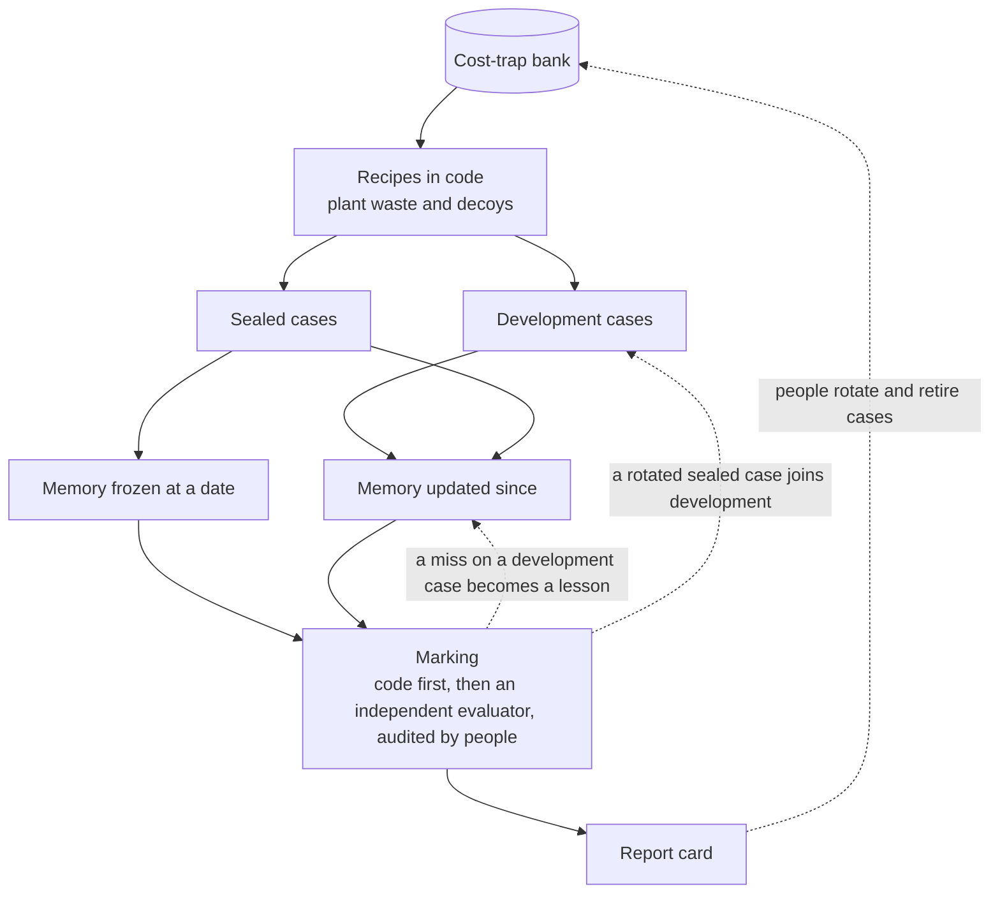

# Getting smarter — predictions, evaluation and the Commons

> **What this answers:** *How does the system get better over time — and how can anyone tell that it is not fooling itself? How does it learn from outcomes, from people, from tests it cannot see in advance, and from the wider community?*
> Part of the [north star](01-north-star.md). Idea-level: what the system should do, and why; nothing is built yet. The technical side is in [testing and evaluation](design/08-testing-and-evaluation.md).

---

## 1. Everything is a prediction

The simplest honest rule: **nothing the AI claims is allowed to go unscored.** Every recommendation, every belief it relies on, every estimate says *what will happen and by when* — and reality gets to grade it.

| It predicts… (invented examples) | …and is scored against |
|---|---|
| **a saving** — "about €710 a month from the 1st, at billed rates" | the verified saving (measured after the change, against a counterfactual) at the same price basis |
| **a bill** — next month's cost by service and team | the actual bill |
| **an answer** — "yes, the platform lead will accept this" | what the platform lead did |
| **a behaviour** — "this will be idle on Friday" | the metrics on Friday |
| **a consequence** — "latency stays inside the target" | the outcome of the change, watched against control meters written down first |
| **a billing mechanism** — "a paused thing bills storage only" | the bill lines of the first closed billing period that contain the meter |
| **a replay** — "re-priced, March lands within 1% of the real bill" | the real March bill |
| **a surprise** — "this meter will not appear" | whether it did |

Shadow predictions — the ones that change nothing — run continuously, within an explicit cost and sampling budget. Predictions scored against the world, not thumbs-up, are the measure: an AI optimised for approval learns to flatter.

### Calibration: when it says 80%, is it right 80% of the time?

From its scored predictions the system draws a **calibration record**, the most direct picture of how much to trust it (the chart is an invented example):

```
 actually
 right
 100% |                                              /
  90% |                                      /
  80% |                              /       o   <- says 90%, is right 80%: overconfident
  70% |                      /       o
  60% |              /       o
  50% |      /       o
      +--------------------------------------------------
            50%     60%     70%     80%     90%     100%   what it said
      "/" = perfect calibration      "o" = the AI, this quarter
```

Where the curve sits below the diagonal, the AI is *overconfident* in that area — it gets less autonomy there and says "I think" more. Where it sits above, it is timid and may be *asked to be bolder*. The record is kept **per domain and per kind of claim**: it can be superb at storage tiering and mediocre at predicting database growth, and the report card says so.

Calibration only means something if the predictions are *comparable*, so each one is written into the **Ledger** — the system's record of predictions, decisions and measured outcomes — before it is made, in a fixed shape: its **target** (exactly what will be true; for a saving, the price basis it is quoted at), its **window**, its **counterfactual method**, its **loss** (what being wrong costs — money, harm, a person's time) and a *proper* **scoring rule**, so that honest uncertainty scores best.

Three cautions are built in. **Model tone is not a probability**: "I'm fairly sure" becomes a number only through a calibration layer measured on past outcomes. **Outcomes are not randomly observed** — acceptance depends on how the message was written, savings on what else changed — so the record reports its *coverage* (the share of predictions ever scored) and uses intervals, not single figures. And **abstaining is allowed**: where the record is thin the system says "I don't know" and is scored for saying so.

---

## 2. The Lesson Book matures

A lesson starts small — one person, one resource. Knowledge in the system has a **maturity**:

| Maturity | What it is | Example (invented) | Who must agree |
|---|---|---|---|
| **Observation** | seen once | "no traffic at weekends" | nobody — it is a note |
| **Lesson (local)** | a person said it, scoped to their thing | "weekend idleness is expected here" | the person who said it |
| **Lesson (team / org)** | widened after being applied and confirmed | "all development subscriptions idle at weekends" | the team lead; the AI proposes |
| **Pattern** | the same lesson in several teams, estate-independent | "dev environments idle outside office hours" | a reviewer; the AI proposes |
| **Beyond the Lesson Book** | a *candidate Atlas claim* (a general fact about Azure, which then follows the [claim life cycle](02-learning-azure.md)) and/or a *Detector* (a cheap, expiring lead generator, with [its own life cycle](04-finding-out-without-spending.md)) | "service X bills while stopped, via meter Y"; a back-tested watcher for it | people and the Knowledge CI; a reviewer after shadow mode |

Things move **up** when they keep being right and **down** when they are not. A lesson contradicted three times is demoted; one that nobody has applied for a year **expires** and asks to be renewed or retired. Two lessons that conflict (two teams teaching opposite things) are put side by side for a human to resolve — **a lesson is never silently overwritten**.

Only what lies beyond the Lesson Book can leave the estate, and then only as a scope and an aggregate after a privacy review ([the Commons](#7-the-commons)).

---

## 3. Evaluation

The score that matters is the one the system **cannot see in advance.** So it is tested by an **evaluation harness** it cannot see into: **sealed test cases** with known answers, fixed by code and by people — never by the model being tested. Test estates are generated files, not deployed resources.



### What the cases are made of

- **Synthetic estates.** Generated inventory, usage, cost records, tags, names, documents and owner replies, with **waste planted** in them and a **decoy** beside each trap. A recipe in code decides what is planted, what it costs and what the right answer is; a generator independent of the system under test writes only the surface text.
- **Gold from the [cost-trap bank](research/cost-trap-bank.md).** Its 145 sourced traps include 83 Verified rows, which means *source-verified*: the claim was found on the cited Microsoft page. That makes it *documented*; no bill has confirmed it. Each of these becomes a **gold** case — a synthetic test oracle whose planted trap and right answer rest on that source — signed off by a person in a pull request. The oracle fixes the answer; it does not upgrade the claim, so a good answer also says the claim is only documented. The other 62 are study material: advice resting on them must say it is not confirmed.
- **Replays of real history.** An organisation's own redacted past, with the system's memory frozen before the period. The key is the waste its people found and fixed, confirmed by its FinOps lead.

### Splits and rotation

**Splits are by service and by time, never by random row.** The rows of one service share a billing mechanism, so a random split would let the system learn from a sibling of the question it is asked. There are four sets: *development* (the system may learn from it), *service-held-out* (whole services withheld, to test transfer), *later-in-time* (periods after the memory snapshot under test) and *sealed* (never seen by any prompt, tool or Atlas change; aggregates only). A sealed set wears out, so it **rotates** (a quarter to start with) and then joins the development set; a failure on it becomes a development case, never a hint. Cases that every version now passes **retire** to a regression set, re-run on each Atlas release so that an edit that quietly broke old knowledge shows up. The Commons shares the regression cases; sealed cases and their answers stay hidden from the system under test for as long as they are sealed.

### The kinds of test case

| Kind | The question it asks | Why it matters |
|---|---|---|
| **Rediscovery** | *Waste is hidden in this estate. Find it — with no Detector for it in the run.* | finding what nobody wrote a rule for: the whole point |
| **Decoys** | *These look wasteful but are not: a standby replica, a quarterly job, a legal hold, a covering commitment.* Every planted trap has such a twin. | **restraint**: a harmful recommendation on a decoy is the worst failure, and blocks a release |
| **New service** | *A service the system never studied. How long to a reviewed profile — and does it say what is only documented?* | day-zero learning |
| **Transfer** | *You learned service A. Service B bills the same way and its profile is withheld.* | mechanisms, or memorised services? |
| **Agreement and reach** | *The same waste under an Enterprise Agreement, a Microsoft Customer Agreement bought directly, Azure sold through a partner (CSP) and pay-as-you-go, each with different access.* | every number carries its price basis (no readable bill: a scenario, not a saving); a purchase goes to whoever can make it |
| **Counterfactual honesty** | *The bill fell — and so did traffic. Did the change cause it?* | no credit claimed that was not earned |
| **Teachability** | *Teach it a fact, then test a case inside the corrected scope and one outside it.* | applies it inside that scope only, with an expiry |
| **Explanation and communication** | *People read an explanation, a card or an email, not knowing which version wrote it. Could you defend this to your manager?* | the best finding is wasted if nobody understands it |

### Marking: value-weighted, harm-weighted

Each case is weighted by **value** (the big find counts more), by **harm** (a destructive recommendation costs far more than a missed saving), by **time to find**, and by **how it was found**: *from the grammar and the evidence*, or by matching a pattern it had been handed. Calibration and explanation are marked separately, and *false alarms* are reported next to finds.

### The learning test

Storing a lesson is not learning; a changed result is. So the harness runs the **same sealed cases twice**: with the system's memory **frozen at a date**, and with the memory **updated since** (Atlas, Estate Model, Lesson Book, Detectors). Models, prompts and tools are identical, and each case runs several times, because models are stochastic. The cases are dated after the learning stopped, so neither memory could have seen them. The result is a paired difference with an interval, counted by service, against a margin and a minimum number of services fixed *before* the run. If the updated memory does not beat the frozen one, learning has not been shown — whatever the memory now holds.

### Who tests the tests?

A hidden case built by the same programme as the system may only check whether the system thinks like its builders. So independence is built in:

- **The model under test never decides the right answer.** Code fixes what is planted; people sign off the gold; case generation runs apart from the system, from seeded recipes, and only the marking job can read the answer keys.
- **Code first, an independent evaluator second, people third.** Code marks what code can: planted items found, every number equal to a tool's result. For judgments code cannot make — an explanation, a tone — an **evaluator independent of the system it grades** gives a provisional score. Independence is a rule, not a product: the evaluator shares no prompts, memory, answer keys or case generator with the system, and [the design](design/08-testing-and-evaluation.md) says which evaluators qualify. People audit a pre-registered, stratified sample of its verdicts and every high-harm or disputed one, and planted bad answers must fail.
- **A leakage audit before every run.** Does a sealed case's own trap — its service, names, numbers — appear in the system's memory, prompts or sources, exactly or by meaning? A hit voids the case. A shared billing mechanism is not leakage: it is the transfer under test.
- **Baselines on every run:** Advisor alone, a retrieval-only call, and an expert-written seed (Detectors a FinOps expert writes by hand for the same source-verified rows, with no model). A system that does not beat simpler ones has not earned its cost ([what "better" is measured against](09-the-learning-contract.md)).
- **Honest limits.** The gold traps are *documented*, not bill-observed, and they are not independent mechanisms: variants of one trap are correlated.

**When does it run?** After any change to the Atlas, a Detector, a prompt, a tool or a model; continuously on a sample of finished real cases, scored by an independent evaluator, with people auditing every high-harm or disputed result; and before any autonomy credential is granted or renewed.

---

## 4. The report card

The result of all this is a **report card** — plain, kept inside the organisation (the open benchmark is separate), and always led by what the system is *worst* at. The card below is an invented example, not a measurement.

```
THE REPORT CARD · Q4                                      (read this part first)

I would NOT trust me on:     database growth predictions (calibration: says 80%, right 62%)
                             anything involving a service released in the last 14 days
                             list-price scenarios (47% of the predicted figure held up in later bills)
Getting better at:           storage tiering (rediscovery 71% -> 86%) · explaining in plain language
Harm avoided on decoys:      94 of 96 (both misses involved a quarterly job)
Calibration (all domains):   says 80% -> right 77%   (last quarter: 71%)  [interval 71-83%, 412 scored]
Against the baselines:       Advisor alone 31% · retrieval-only 54% · expert seed 68% · me 81%  (sealed cases)
Learning test:               updated memory beats memory frozen on 1 July by 9 points [+4 to +14, 23 services]
New services:                provisional profile in 9 hours (was 31) · bill-observed after a closed billing period

Verified savings:            EUR 443,000 (predicted EUR 590,000 -> 75% verified)
Savings accuracy by          contracted rates 85% (EUR 188k verified of 220k predicted)
price basis:                 billed rates 77% (208k of 270k) · list-price scenarios 47% (47k of 100k)
All-in cost to serve:        EUR 31,400  (models 14,600 · Azure runtime 4,800 · people's time 12,000)
Net, and cost per euro:      EUR 412,000 net · 7 cents per verified euro · EUR 38 of value per human minute
Regret and boomerangs:       3 and 7 · all reviewed · lessons written
Atlas, on this bill:         1,840 meters: 520 bill-observed here · 1,310 price-confirmed · 10 documented only
                             median claim age 41 days · 212 claims stale
Autonomy ladder now:         Autopilot in 6 domains · Assist in 11 · Advise in the rest · 2 self-demotions this quarter
```

Three habits keep the card honest: **the weak spots come first**; it compares the AI **with its own past and with the baselines** (never team against team, never person against person); and it counts what the AI **costs** — models, runtime *and people's time* — against what it saves. Every figure carries its **price basis** — contracted rates, billed rates or, when no bill can be read, a list-price scenario — and the card scores each separately, so a list-price scenario that lands at half is seen as that and the next one is quoted more carefully. Autonomy credentials are granted, renewed and revoked **from this card**, by people.

The four **evidence levels**, weakest to strongest: **documented** (a source says so) → **price-confirmed** (a published price list shows the meter, unit and rate) → **bill-observed** (a closed billing period in this estate behaved as predicted) → **outcome-confirmed** (a change based on the claim gave the predicted effect). The first two live in the open Atlas; the last two stay in the estate that observed them. A figure is called an expected saving only when a bill line confirms the meter; without one it is a scenario priced at list prices, and says so.

---

## 5. Not fooling itself

An AI that can generate hypotheses endlessly will, by chance alone, *confirm* some false ones. The system borrows the hygiene of science:

- **Predictions are written first** (pre-registration), never fitted afterwards.
- **A false-discovery budget.** A finding that survived only after many variants were tried is treated with suspicion and **replicated** — on another resource, time window or estate, or by a replay that reproduces the real bill — before it counts.
- **Blind scoring.** Evaluators and human panels mark answers without knowing which version of the system produced them.
- **Negative results are published**, inside the system and in the Commons — *"this did not work, and why."*
- **The Skeptic is rewarded for breaking things**, not for agreeing.
- **Goodhart watch.** When a measure becomes a target, it stops being a measure — so no single number is optimised alone. Savings are always shown with regret, attention cost and non-cost consequences; sealed cases rotate; and a person watches the gap between development and sealed scores, because a widening gap means the system is tuning to the test.

### Unlearning

Knowing when to **forget** is half of learning: a price changed and an old rule died; a service was redesigned and its profile is wrong; a person who taught a lesson has changed their mind. The system:

- **expires** claims and lessons on a schedule and re-checks them ([Knowledge CI](02-learning-azure.md)), rather than trusting them forever;
- **demotes** on contradiction instead of piling exceptions on top;
- **deletes on request** — a person can ask to remove a lesson about their team, and it goes;
- replays old, closed cases against today's knowledge to find where yesterday's answer would now be *different* — and tells the owners.

---

## 6. Learning how to learn

The system learns **how to learn about Azure** too — the whole method is data. Each row keeps a running estimate of verified value per euro and per human minute; effort follows the best estimates, and a protected share keeps exploring the rest ([the six things that change](09-the-learning-contract.md)).

| It tracks… | …so it can |
|---|---|
| **which sources produced claims that held** | trust an informative source more, a noisy one less — per kind of claim |
| **which investigation tactics paid off, for which mechanism** — and which way of finding out (Ask, Look, Replay, Follow, Pool, Trial) was most informative per euro | open with the likeliest tactic for each kind of service; reach for the cheapest decisive test first |
| **which Detectors earn their keep** | retire the weak ones; write more of the strong kind |
| **which phrasing and timing get a clear answer** | speak better, in the ways people agreed to test |
| **which of its own agents and models are best at what** | route each job to the cheapest competent one — including *not using an AI at all* where code suffices |
| **where its method failed on the sealed cases** | propose a change to its own procedures |

**It does FinOps on itself.** The AI is an Azure workload too — models, agents, storage, queries — and its own bill is on the report card. It reads its own meters with the same [Cost Grammar](02-learning-azure.md) (tokens are a meter; so is a vector index; so is a long-running agent) and picks the cheapest model that is accurate enough: *a small one for reading price pages, the large one reserved for the Skeptic.*

**It proposes changes to its own method.** Ablations and A/B comparisons on replays and synthetic estates ([experiments on itself](04-finding-out-without-spending.md)) show, say, that reading the bills before the documentation works better for messaging services; the system *proposes* the change, and a human reviews and approves it like any other, within limits people set.

---

## 7. The Commons

Half of what the system knows is about **Azure**, and that half is the same for everybody: how a service bills, what its levers are, what the traps are, how to re-check a claim, which Actions work. That half should not be locked inside one company, or one vendor — it should belong to everyone who runs Azure, and *it can get better with every one of them*.

**The Commons** is the open, versioned, open-source (MIT) half of the knowledge.

| In the Commons | Never in the Commons |
|---|---|
| **Atlas profiles** and the Cost Grammar, with receipts | any estate data — resources, names, bills, tags |
| **Actions** and **Detectors**, with their track records | the Estate Model and the Lesson Book |
| **Re-check recipes** — read-only checks anyone can run against their own bill | negotiated rates, discounts and commitments |
| **Pool observations** — a scope and an aggregate: *this meter, this behaviour, this agreement type, this region* | a bill line, a name or an identifier; anything that identifies a person, team or company |
| **The cost-trap bank**, **regression cases**, an open benchmark and **outcome statistics** (counts only) | the sealed evaluation cases and their answers; any count from too few organisations to hide in |

### How it grows

- **The AI proposes, humans dispose.** Each customer's AI notices that a Profile is out of date, or finds a new trap in its own bills, and opens a **pull request to the Commons** with its receipts and a re-check recipe. Named reviewers with decision rights review it; nothing reaches the top tier on the AI's say-so alone. People contribute too: a trap they were bitten by, an Action, a translation, a report of a wrong claim — or **adopting a service** as the human **Atlas maintainer** of its profile.
- **The Pool: observations, not bill lines.** When an organisation agrees, its system contributes an **observation** — *this meter, this behaviour, under this agreement type, in this region, with this evidence* — as an ordinary, reviewable change. Only a scope and an aggregate leave the estate, never a bill line, a name or an identifier; a privacy review checks each one, and it is published only when several organisations contribute the same observation. Where those organisations agree, a claim earns a stronger tier and a wider scope; where they disagree, the disagreement is itself a finding (an agreement difference, a regional price, a preview change). A meter that several estates have used becomes understood by every estate, and nobody built anything to find out.
- **Replication as a contribution.** Anyone whose bill contains the meter can re-run a claim's re-check recipe against it — another region, agreement type or date — and contribute the result as a Pool observation. A **reproducibility lattice** of independent replications makes the *transfer boundaries* — where a claim holds and where it does not — first-class knowledge: a claim that fails somewhere has *learned where it does not hold*.
- **Outcome statistics, not data.** An organisation can opt in to share *counts* — how often a kind of Recommendation was accepted, and how often its saving was verified — only above a **minimum number of contributing organisations**, so that none can be picked out.

### How the Commons stays trustworthy

- **Tiers and levels.** A claim carries a **tier**, how far it has been reviewed and re-run — *Draft* (proposed, with receipts) → *Replicated* (re-run independently in a stated scope) → *Maintained* (reviewed by the service's human Atlas maintainer, re-tested on a schedule) — and an **evidence level**, what kind of evidence stands behind it. They are separate questions: a *Maintained* claim can still be only *documented*, because the open Atlas holds only the first two levels. A claim confirmed on one bill is not confirmed on another's. The gates in [the learning contract](09-the-learning-contract.md) say which use needs which.
- **Revocation.** Any claim can be retracted — and everyone who relied on it is told, with the reason.
- **Licence and sources.** Everything the project authors is MIT. Pricing pages and documentation are *linked and summarised with receipts*, not copied. Customer data is never contributed: only the reviewed aggregates of the Pool leave an estate.
- **Poison and drift.** Executable re-checks, replication by independent parties and human review defend against a plausible-looking wrong claim; in the Pool an organisation counts once, however many observations it sends.

### A claim, challenged (an invented example)

*An engineer at a manufacturing company reads a popular claim in the Atlas: "service X bills a minimum of one started hour per start." Her own bill disagrees: in her region the meter is per second. She does not argue. She runs the claim's re-check recipe — a read-only query over a closed billing period — against her own bill export, gets a different result and opens a challenge with the recipe's result (a scope and a number, not her bill lines), the API version and the date.* The service's Atlas maintainer asks two other organisations whose bills contain the meter to run the same recipe; both report the same result. The claim is **split**: *per started hour* in the old scope, *per second* where the new meter applies. Every Detector that rested on the old claim is demoted and re-tested, and the organisations that relied on it are told why. The system keeps a Lesson of its own (*distrust minimum-billing claims older than the last meter change*) and sends the people who write the documentation a reproducible note, recipe attached. Her name is on the correction, if she wants it.

### An open benchmark, as a by-product

The cost-trap bank, the recipes that plant its traps in generated estates and the regression cases are a **public benchmark for cloud cost reasoning**. Any system — this one, a commercial product, a student project — can be run against it. That is useful to the field, and it keeps the project honest: a test that other people can run cannot be quietly softened. A public test can be studied for, so it never decides autonomy, and the system's own sealed cases and their answers stay hidden from it while they are sealed.

### One review, every organisation benefits

A new service launches. Within hours, somewhere, one customer's AI reads the announcement and the price list, decodes the meters with the Cost Grammar and proposes a **provisional mechanism profile** — *documented*, and *price-confirmed* where a published price list shows the rate. Review happens once. Soon after, **every** organisation running the Commons has that scoped, provisional profile, and a Detector if one was warranted, without any customer's data having moved. Each then waits for its own bill: until a closed billing period there contains the meter and behaves as predicted, the profile can back a scenario priced at list prices, not an expected saving. The more estates, regions and agreements take part, the better the Atlas — and nobody has to be told what anyone else spends.

> The Commons is the answer to *"why would anyone trust this?"* **Because you can read it, re-run it, and argue with it.**
