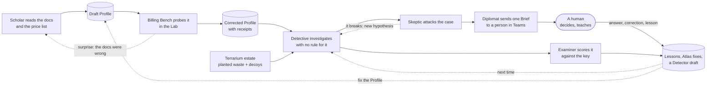

# What next — from the idea to the thinnest thing that proves it

> You said: *"Later, we will design the UIs, the personas, the user flows, systems, etc. and THEN we will design, architect and build it."* This is that order, kept simple: only the next steps and what each one produces — no paperwork.
> Part of the [north star](01-north-star.md).

---

## The steps

| # | Step | What it produces | It builds on |
|---|---|---|---|
| **1** | **Experience design** | personas as stories; journeys; the Brief card, the question card, the teaching card; the letters; the AI in the meeting and its character; how a person teaches it | [06 People and conversation](06-people-and-conversation.md) |
| **2** | **Atlas and Grammar, by hand first** | ten Service Cost Profiles written by experts for services of very different kinds; the Cost Grammar tried against fifty services to see where it breaks | [02 Studying Azure](02-learning-azure.md) |
| **3** | **The Exam, before the learner** | the exam bank assembled from the [collected traps](research/exam-bank-cost-traps.md); the first Terrarium estate with planted waste and decoys; the Examiner's answer keys; the first report card, scoring *nothing* yet | [07 Getting smarter](07-getting-smarter.md) |
| **4** | **The Lab** | which benches first (Billing Bench, Signal Bench); the budget model; the walls; five services probed by hand to find out what an AI would have to do | [04 Experiments and the Lab](04-experiments-and-the-lab.md) |
| **5** | **Agents and workflows** | the cast mapped to research programmes and campaigns; memory, tools, tracing, evaluation; what the Conductor does; a walk through what Microsoft Foundry offers today | [01 §9](01-north-star.md#9-the-cast) |
| **6** | **Guardrails** | the themes answered as small, testable commitments | [09 Guardrails, later](09-guardrails-later.md) |
| **7** | **Architecture, then build** | a design aligned with CAF and WAF on Microsoft platforms; the thinnest slice below | everything above |

Steps 1–4 can overlap; none needs code. Step 3 deliberately comes **before** building the learner: *you cannot know it is learning until you have an exam it cannot see.*

---

## The thinnest slice: learn one service, find its waste, explain it to a person

If this small loop works for three services, it works for three hundred. The slice is a **whole loop in miniature**, not one layer of a stack:

Choose **three services with different mechanisms** — one billed for capacity, one for stock (data that accumulates), one for flow (things that move) — so the slice tests the *grammar*, not one service. For each: the Scholar writes a Profile; the Billing Bench corrects it; the Terrarium plants waste the Examiner keeps secret; the Detective must find it **without a rule for it**; the Skeptic must try to break it; one Brief goes to one human in Teams; the human's answer becomes a Lesson; the Examiner scores everything. The slice is **done when a person, reading only the Brief, says "yes, that's real and I'd act on it"** — for waste that no rule described.

---

## Things we are curious about

The honest unknowns are not risks to manage but **questions to explore** — each one a small experiment:

1. *Can a model read a service's pricing page and billing documentation and produce a Profile an expert agrees with?* — and how often does the Lab then say the documentation was wrong?
2. *How well does the Cost Grammar transfer?* Learn on one capacity-billed service; predict another.
3. *How much of an estate's bill can be explained* from inventory, usage and the directory alone — before any person is asked anything?
4. *What do people actually answer on a card?* How many questions can one owner take in a month before they stop reading?
5. *How cheap can a Detector get* once an expensive investigation has found the pattern?
6. *Where do documents and the bill disagree most* — by mechanism, by service kind, by age of the page?
7. *Does the Lab's behaviour match production* for the claims that matter — and for which does it not?
8. *What does the AI cost to run* per euro of verified saving — and which parts of that are worth it?

---

## How we work from here

- Everything stays in this repository, **private** until you say otherwise, **MIT**-licensed.
- Each step above becomes a design document in `docs/`; this folder's ideation documents stay as the north star the designs answer to.
- The rubber duck stays: each step gets a review before the next begins.
- The two findings that started the project stay where they belong — as [exam questions](07-getting-smarter.md#8-the-founding-exam), not as the foundation.
