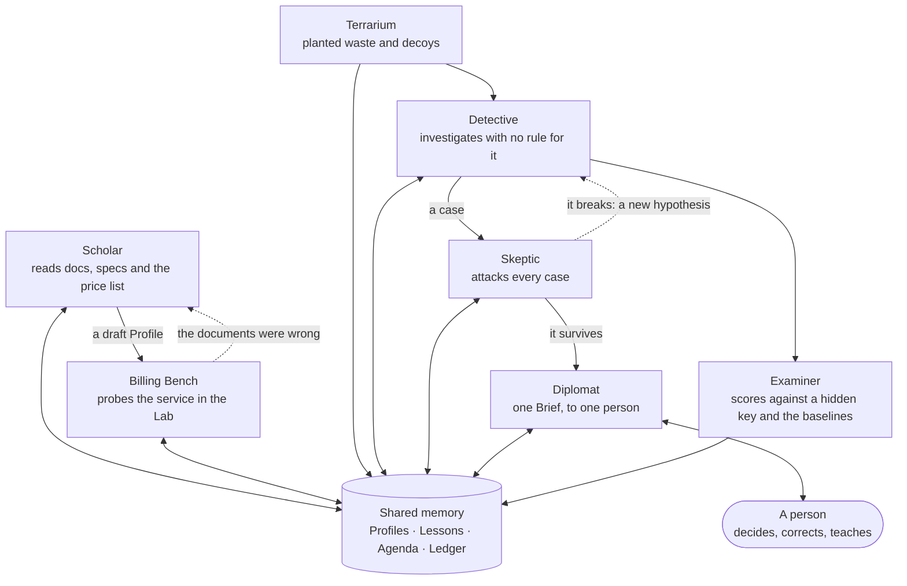

# What next — from the idea to a first experiment

> You said, at the start: *"Later, we will design the UI's, the persona's, the user flows, systems, etc. and THEN we will design, architect and build it."* This is that order, kept simple: only the next steps and what each one produces — no paperwork.
> Part of the [north star](01-north-star.md).

---

## The steps

| # | Step | What it produces | It builds on |
|---|---|---|---|
| **1** | **Experience design** | personas as stories; journeys; the Brief card, the question card, the teaching card; the letters; the AI in the meeting and its character; how a person teaches it | [06 People and conversation](06-people-and-conversation.md) |
| **2** | **Atlas and Grammar, by hand first** | ten Service Cost Profiles written by experts for services of very different kinds; the Cost Grammar tried against fifty services to see where it breaks | [02 Studying Azure](02-learning-azure.md) |
| **3** | **The Exam, before the learner** | the exam bank assembled from the [collected traps](research/exam-bank-cost-traps.md); the first Terrarium estate with planted waste and decoys; the Examiner's answer keys; the first report card, scoring *nothing* yet | [07 Getting smarter](07-getting-smarter.md) |
| **4** | **The Lab** | which benches first (Billing Bench, Signal Bench); the budget model; the walls; five services probed by hand to find out what an AI would have to do | [04 Experiments and the Lab](04-experiments-and-the-lab.md) |
| **5** | **Agents and workflows** | the cast mapped to research programmes and campaigns; memory, tools, tracing, evaluation; what the Conductor does; a walk through what Microsoft Foundry offers today | [01 §9](01-north-star.md#9-the-cast) |
| **6** | **Guardrails** | the themes answered as small, testable commitments | [09 Guardrails, later](09-guardrails-later.md) |
| **7** | **Architecture, then build** | a design aligned with CAF and WAF on Microsoft platforms; the first experiment below | everything above |

Steps 1–4 can overlap; none needs code. Step 3 deliberately comes **before** building the learner: *you cannot know it is learning until you have an exam it cannot see.*

---

## The first experiment: does it learn?

Before building the whole society of agents, ask the one question everything else depends on — **does it learn, or does it only retrieve?** One test, three arms:

| Arm | What it is |
|---|---|
| **Retrieval only** | the same documents and price lists, no experiments, no feedback |
| **The expert seed** | the hand-written Profiles and Grammar, frozen — what *we* wrote |
| **The learner** | the full loop in miniature (below) |

An experienced practitioner takes the explanation test beside them. What the learner adds beyond the seed, and beyond retrieval, is what "learning" means here ([the learning contract](11-the-learning-contract.md#5-what-better-is-measured-against)).

### Step zero — the paper test

The cheapest version needs no Lab, no Teams and no agent society. **Freeze** the documentation, schemas and prices for one service family at a past date; **withhold** two real billing exports and one related service. Each arm writes predictions in advance — the meters, the billing lag, a diagnosis, its uncertainty. One outcome is revealed as a lesson; then transfer is tested on the sibling service. If the learner cannot beat retrieval on the held-out case, with honest calibration, and improve after the correction, the idea needs rethinking before anything else is built. (It is an experiment, not a gate: its results shape everything after.)

### The thinnest slice — the whole loop in miniature

Not one layer of a stack, but every faculty at once, around the shared memory:

Choose **three services with different mechanisms** — one billed for capacity, one for per-operation consumption, one whose price depends on the customer's agreement (a rate or benefit) — so the slice tests the *grammar*, not one service. For each: the Scholar writes a Profile; the Billing Bench corrects it; the Terrarium plants waste (and decoys) the Examiner keeps secret; the Detective must find it **without a rule for it**; the Skeptic tries to break it; one Brief goes to one person in Teams; the answer becomes a Lesson; the Examiner scores everything. It is scored on *withheld* services, on withheld *combinations* of known mechanisms, and on mechanisms constructed to be unknown to every arm.

**What success looks like** — a description, not a gate:

- on withheld services it beats retrieval-only, and improves on the expert seed as corrections arrive;
- after one correction it transfers to a sibling service;
- on decoys it recommends nothing harmful, and says so when unsure;
- a person who reads only the Brief says *"yes, that's real, and I'd act on it"* — for waste that no rule described;
- all-in, it costs less than the value it verified, counting people's time.

**What it does not prove.** Scale to hundreds of services, commercial reality across agreements and regions, and safety in production. Those are built up as a **coverage matrix** — mechanism × commercial variation × region × life cycle × interaction complexity × kind of evidence — and scale is claimed only as far as the matrix is filled.

---

## How we work from here

- Everything stays in this repository, **private** until you say otherwise, **MIT**-licensed.
- Each step above becomes a design document in `docs/`; this folder's ideation documents stay as the north star the designs answer to.
- The rubber duck stays: each step gets a review before the next begins.
- The two findings that started the project stay where they belong — as [exam questions](07-getting-smarter.md#8-the-founding-exam), not as the foundation.
