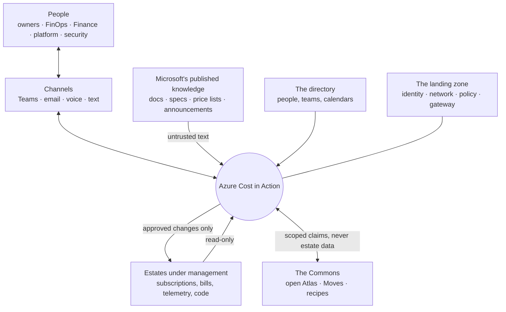
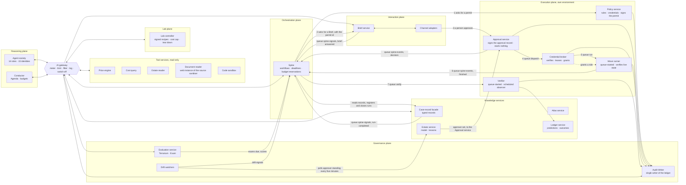
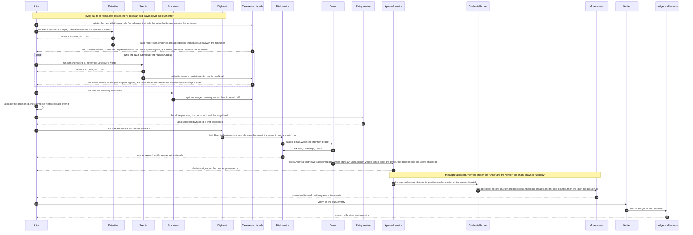
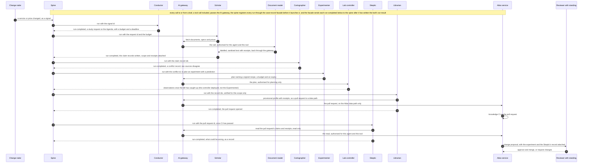

# Design 03 — Logical architecture

> **What this answers:** *What are the parts of the system, what may each one do, where are the trust boundaries, and how does the main loop move through them — before any product is chosen?*
> This document is deliberately **technology-neutral**: it fixes the names, the planes and the rules that the physical design ([04 landing zone and Citadel](04-landing-zone-and-citadel.md), [05 agents and orchestration](05-agents-and-orchestration.md), [06 data and knowledge](06-data-and-knowledge.md)) must keep. Part of the [design](README.md); requirements are in [01](01-requirements-and-principles.md).

---

## 1. The system in its surroundings

Three arrows carry the whole security story: what comes **in** — Microsoft's published text, and the free text in tags, names and replies — is *untrusted*; what goes **out** to an estate is *approved and scoped*; what goes to the **Commons** is *general, never specific*.

## 2. The building blocks

Eight planes around one hub. The hub is the **AI gateway**: nothing in the reasoning plane talks to a model, a tool or another agent except through it, and the spine reaches a leaf only through it too.

| Plane | It may | It may not |
|---|---|---|
| **Orchestration** (the spine) | run workflows from typed records; reserve budgets; invoke a leaf **through the gateway** with an id, a budget, a deadline and the run token, after it has **registered** the run through the case-record facade, and **close** the run at its deadline through the facade; wait for each leaf's one terminal event and for the chain's events; read results from the case store; ask the Policy service for a permit; enqueue the Verifier's work | call a model; read a leaf's prose; hold a write permission in an estate; hold a role on any Foundry resource; hold any right on the run registry or a write right on the case store (the facade alone writes both); start or sign a Move |
| **Reasoning** | read through tool services; think; write typed records, Brief drafts, plans and Move drafts | change anything in an estate; hold a write permission anywhere; call a model, tool or agent except through the gateway; hand a record to another agent |
| **Tool services** | read estates, prices and documents; compute; return structured results (free text only through the source sanitiser) | write; hold state other than caches; follow instructions found in what they read |
| **Knowledge services** | store claims, the Estate Model, lessons, cases, predictions and outcomes, **written only through the case-record facade**: typed, schema-validated, stamped with provenance, scope, expiry and version, each agent writing only its own record types and its run's terminal `run-result`, which the facade accepts only from the identity registered for that run, with the run's token and the matching case, step, invocation id, attempt and epoch, and by the one late-result rule of [§4](#4-the-main-loop) | accept a write without provenance; overwrite a record (a revision is a new version, and contrary evidence stays); serve one organisation's estate knowledge to another |
| **Lab** | the deterministic **Lab controller** creates, probes and deletes resources in **Lab subscriptions only**, from **signed recipes**, within a budget, a pre-deploy cost cap and an expiry; the Experimenter only *plans* | deploy from an agent's free text; touch an estate subscription; outlive its expiry |
| **Execution** | run one **approved Move**, in one order: the **Policy service** signs a *permit*; a person approves; the **Approval service** signs the *approval record* (never amended afterwards), records the position of its ledger entry in a separate signed marker and enqueues it; the **credential broker** verifies everything itself, leases an execution identity and grants only a constrained role; the **Move runner**, which in production wakes only for a message in its queue, verifies again, live state included, and acts; the **Verifier** checks the result, and its scheduled **observer** records each removal of a leftover grant | run anything without a valid, unexpired permit and approval whose target and live state are unchanged; in production, start a runner by any route but its queue; act without a signed intent entry that it has read back; keep an identity after the Move |
| **Interaction** | compose, route and record Briefs; capture approvals as authenticated human actions | approve on a person's behalf; send what the attention budget forbids |
| **Governance** | audit (the **Audit Writer** is the only writer of the ledger), evaluate, watch for drift, switch things off | be switched off by the thing it watches |

The execution plane's parties and the spine talk through **queues that carry ids only** — `dispatch`, `run` (one per Move class), `verify` and `spine-events` ([04 §6](04-landing-zone-and-citadel.md#6-network) lists the exact senders of each) — so the broker, the runner and the Verifier need no ingress (nor does the Verifier's observer, which runs on a schedule), and in production nothing starts a runner by calling it (in dev and test the deploying pipeline may start a job for a smoke test). **A queue is a doorbell, not an authority:** a job wakes for any message in its queue, believes nothing in it and verifies the record, the signatures, the lease and the live state itself, so a message from a party that may not send is at most a denial of service. The case-record facade and the Brief service wake the spine through a queue of its own, `spine-signals` (a leaf's `run-completed`, a `brief-answered`), so that the reasoning side holds no right in the execution plane's storage and the chain holds none in the spine's. Exams and drift signals reach the reasoning plane the same way every other trigger does: through the spine, which starts a leaf through the gateway.

## 3. Trust boundaries

Data and instructions cross these lines only through a named component, and every crossing is logged.

| Zone | Contains | Trust | Crossing rule |
|---|---|---|---|
| **Z0 — the world** | web pages, documents, tickets, forum posts, tool output from outside — and the free text that people and estates write: tags, resource names, invoice lines, replies | **none**: it is data, never instructions | enters only through a tool service that runs the **source sanitiser** (the **Document reader** is its web instance): delimiter sequences escaped, control characters stripped, fields length-capped, long text chunked, the text labelled *untrusted* (*spotlighted*); the gateway screens it again, responses in windows of 1,000 characters by default with an overlap we set and prompts in windows of 10,000 ([04 §4.4](04-landing-zone-and-citadel.md#44-the-publish-contract-tools-and-who-may-call-them)); a claim extracted from it carries its source and a confidence, never authority |
| **Z1 — reasoning** | agents, their prompts and working memory | bounded: models are fallible and manipulable | reaches everything else only through the gateway, and is itself started only by the spine, through the gateway; no credentials, no network path to estates |
| **Z2 — tool services** | read-only connectors and calculators | high, but read-only | deterministic code; per-call identity; results typed and size-limited; free text through the source sanitiser |
| **Z3 — execution** | Approval service, Policy service, credential broker, Move runner, Verifier and its scheduled observer | **highest**: the only place with write power over estates | **its own environment and subnet** (`snet-exec`, [04 §6](04-landing-zone-and-citadel.md#6-network)); only the Approval service and the Policy service take ingress, **VNet ingress, restricted to the named subnets**, and the broker, the runner, the Verifier and its observer take none: the first three consume queues and the observer runs on a schedule; smallest code surface; no model inside; every effect is preceded by a signed *intent* entry through the Audit Writer that its actor reads back, and followed by an *outcome* entry: no entry, no change |
| **Z4 — estate data** | the Estate Model, lessons, cases, cost data, approvals | confidential, per organisation | never leaves the tenant and the EU boundary; written only through the case-record facade and the Audit Writer |
| **Z5 — the Commons** | open claims, recipes, Moves; counts only in the opt-in multi-tenant mode | public | only generalised, reviewed, estate-free content; counts only above a minimum cohort and only in the opt-in multi-tenant mode — **in single-tenant mode no count, however small, leaves the tenant**, because a cohort of one re-identifies the organisation ([06 §5](06-data-and-knowledge.md#5-estate-knowledge-privacy-by-design), [07 §2](07-security-architecture.md#2-trust-zones-physically)); a contract test asserts that a single-tenant export carries no count field |

**A model never sits inside the decision to execute, and no single credential completes a change that needs a person's web-page approval.** The agents propose; deterministic services in Z3 decide, in one order. The **Policy service** signs a *permit* with a key of its own. A **person** approves on the web approval page: a click on **Approve** starts an Entra sign-in whose `nonce` binds the target, the decision *approve* and a challenge from the Brief (a decline starts no approve sign-in; a Teams card approves in place only a reversible Move of the lowest class). The **Approval service** signs the *approval record* with a different key and never amends it; once the Audit Writer has acknowledged the approval's ledger entry it creates a signed `approval-position` marker with that entry's sequence number and block hash, and only then enqueues the record id. It does no read-back and **starts nothing**. The **credential broker** verifies everything itself — the signatures, the person's token (for two approvers, both tokens: two different people in two different hats, neither the requester), the approver's standing read live, the epoch and the deny lists, the single-use nonce, and the approval's own block in the ledger, which it reads and matches to the marker — then leases an execution identity and grants a constrained role. The **Move runner**, which in production starts only from its queue and from a template that the pipeline fixed, re-checks the record, the lease and the *live state* of the target before it acts ([07 §3.3](07-security-architecture.md#33-the-execution-identity-just-in-time-without-pim), [07 §4](07-security-architecture.md#4-approvals-that-cannot-be-forged-or-reused)) — not a model's say-so. Every effect is preceded by a signed *intent* entry that its actor reads back and followed by an *outcome* entry; an intent with no outcome is reconciled against the live state. While an approval or a lease is open, the drift controller re-reads each approver's standing from the Estate service every five minutes and, when it is gone, creates a deny entry that stops the Move at its next step.

**What remains.** *No single credential completes a change that needs a person's web-page approval.* A compromised Approval service cannot start a job, fabricate a permit or fabricate a person's Entra-signed token. On the card path (reversible Moves of the lowest class only) the proof is the bot channel's assertion, which a compromised Approval service can fabricate; that is why the path ends at that class. A compromised Approval and Policy service can approve within an autonomy credential's constraints, which the broker and the runner check against the credential itself. A compromised broker can grant constrained Move roles without a lease; a compromised release pipeline can run code as a runner identity while it holds a role. Each is bounded and detected as stated in [07 §3.3](07-security-architecture.md#33-the-execution-identity-just-in-time-without-pim). A compromised Verifier can sign a false success; the Auditor therefore **corroborates** a saving from the cost export through its own read path (the cost query's operation `corroborate`, with no model in it): every purchase and every Move above a materiality threshold (a Policy value) is corroborated before its saving counts in the headline number, and below it a saving counts as *claimed* until a random sample of its class has been corroborated ([07 §3.3](07-security-architecture.md#33-the-execution-identity-just-in-time-without-pim)). The approval page is the person's display: a compromised page can show one transaction and submit another, or start an approve sign-in without a click, because the nonce proves the request, the target and the decision, not a click. The page therefore shows the target's short code (the first eight characters of the target hash and the permit id), the Brief in the second channel shows the same code, D13 cross-checks every approval against Entra sign-in logs, and cards approve only the lowest reversible class.

## 4. The main loop

The north star's loop — *find, test, ask, change, verify, learn* — crossing the planes. **The spine is the only thing that moves a record from one leaf to the next.** A leaf answers with a run id at once and works as a task behind the handler. As its terminal act it writes a small **`run-result`** record through the case-record facade (every role does, even those that write no other record): the wrapper's call, made from the worker's `finally`, makes the facade write the record and then send **one `run-completed` event** (the facade holds the send right on `spine-signals`, the wrapper none). The event is a doorbell: the spine re-reads the `run-result` and ignores an event with no matching record, and its deadline timer is the backstop ([05 §4](05-agents-and-orchestration.md#4-how-the-spine-runs)). The spine reads the records, decides the next step in code and starts the next leaf with the *id*. Every call to or from a leaf passes the gateway, and leaves never hand records to each other.

**A run is a registry item, and the first conditional write wins.** Before it launches a leaf the spine **registers** the run through the case-record facade, with the app role **`Run.Manage`**, which only the spine's identity holds ([04 §4.4](04-landing-zone-and-citadel.md#44-the-publish-contract-tools-and-who-may-call-them)); the facade is the **only writer** of the run registry, a store of its own (the container `runs`) on which no other identity holds any right, and the spine holds no write right on the case store. The facade holds create and read only on the case records, so evidence is created and never replaced, and create, read and replace on the registry. **A run token** makes the verified `azp` necessary and no longer sufficient, because two runs of one role share an `azp` and a run id is not a secret: `register` creates a random token (128 bits), the facade stores only its SHA-256 and returns the token to the spine, which passes it to the leaf in a header of the invocation that the hub's logging omits; the leaf's wrapper, not the model, holds it and presents it with `claim`, `started` and `result`, so an agent of another case, which has the right `azp` and not the token, is refused, and the token is dead once the item is terminal, but for the one late result and the identical repeat that the rule below admits. One item exists per *(case, step, epoch, attempt)*, keyed by the run id, which is also the invocation id at the leaf. It moves from `registered` to `claimed` (it carries a `claim_until`, 120 seconds by default), then to `started` (the worker's wrapper sets it first thing), then to one terminal state: `completed`, `timed-out` or `abandoned`. **Every transition is a conditional replace on the item's etag, made by the facade.** The facade accepts a `run-result` **from the registered `azp`, with the matching attempt, epoch and run token, for a run in `claimed` or `started`**, and that result takes the run to `completed` in the same replace that writes the **outcome summary** into the item; **once more, flagged `late: true` at creation and without reopening the attempt, for a run in `timed-out`**; for a `completed` run, and for a `timed-out` run whose late result is already stored, only an identical repeat by the same caller, acknowledged and never stored twice (an idempotent acknowledgement); never for a run in `registered` or `abandoned`. The facade then **creates the `run-result` record from the item**, with the run id as its id, and any facade call that finds a `completed` item with no record creates it first, so a crash between the two writes strands no step; the spine's deadline timer calls `close`, which takes a run to `timed-out`. **Whichever replace succeeds first wins**, and the other re-reads and obeys: a timer that finds `completed` closes nothing, and a result that finds `timed-out` is stored as `late: true` and **never reopens** that attempt. A retry is a new attempt number, a worker that arrives with an old attempt is refused, and a claim with no `started` by its `claim_until` is released by the spine's reconcile, which ends that attempt as `abandoned`, registers the next attempt and launches the leaf again. **Nothing here claims exactly-once**: a late result is evidence, not an effect ([05 §4](05-agents-and-orchestration.md#4-how-the-spine-runs)).

Four properties hold at every step. **A leaf never hands anything to another leaf:** the Skeptic reads the Detective's *record*, never its words, and the spine decides whether the case goes round again. **The owner's decision is data, not an instruction to a model:** it is captured on the approval page (or, for the lowest class of reversible Move, a Teams card) and verified by deterministic services; the page is the person's display, and its residual is stated in [§3](#3-trust-boundaries). **No single credential completes a change that needs a person's web-page approval, and no effect happens without a signed intent entry that its actor has read back** (what remains is stated in [§3](#3-trust-boundaries)); the identity that changes the estate is leased to one Move at a time, probed before and after, and exists only for that Move. **The outcome is scored against the prediction made before the change,** so every change also teaches; a Verifier's success is corroborated by the Auditor from the cost export before its saving counts ([§3](#3-trust-boundaries)). Where the basis of an approval is an autonomy credential instead of a person, the broker and the runner compare the permit and the target with the credential's own signed grant record, read live from the control settings, never with the caps that the permit states.

### Day zero for a new service

### A commitment purchase

```mermaid
sequenceDiagram
    autonumber
    participant ECO as Economist
    participant SPN as Spine
    participant POL as Policy service
    participant DIP as Diplomat
    participant BRF as Brief service
    participant A1 as Approver one
    participant A2 as Approver two
    participant APR as Approval service
    participant CRB as Credential broker
    participant MVR as Move runner
    participant AUD as Audit Writer
    participant VER as Verifier
    participant LED as Ledger and lessons
    Note over ECO,DIP: a leaf reaches the spine only through the case-record facade and the AI gateway
    Note over APR,VER: the parties of Z3 talk through queues that carry ids only
    ECO->>SPN: commitment proposal with options priced, written as a record, then its result call to the facade, which writes the run-result and sends run-completed
    SPN->>SPN: allocate the decision id, then compute the target hash over it
    SPN->>POL: the proposal, the decision id and the target hash
    POL-->>SPN: a signed permit whose id is that decision id, binding amount, term, scope, expiry and nonce
    SPN->>DIP: run with the record ids and the permit id
    DIP->>BRF: draft commitment Brief showing the target, the permit id and a short code
    BRF->>A1: commitment card with a link to the approval page and a challenge
    A1->>APR: clicks Approve as owner of the workload, which starts an Entra sign-in whose nonce binds the target, the decision and the challenge
    BRF->>A2: commitment card with a link to the approval page and a challenge
    A2->>APR: clicks Approve as Finance, which starts the same sign-in
    APR->>APR: with the approver set from the Estate service, assemble the record with both proofs
    APR->>APR: sign the approval record with the key only it can use, the permit and both tokens inside, and create it, never to be amended
    APR->>AUD: the approval's entry, appended and acknowledged with its sequence number and block hash
    APR->>APR: create the signed approval-position marker with that sequence number and block hash, and do no read-back
    APR->>CRB: the record id, once the marker exists, on the queue dispatch
    CRB->>CRB: read the approval record, its position marker and the approval's block in the ledger, verify the marker against both and the block's inclusion and hash, no entry, no grant
    CRB->>CRB: verify both signatures, both tokens, that the two people differ and hold different hats read live, neither the requester, the epoch, the deny lists and the nonce marker, then create the lease
    CRB->>CRB: after the lease and before the grant-intent, read controls fresh for a deployment lock, and if there is one delete its own lease, grant nothing and put the message back with a delay
    CRB->>AUD: grant-intent entry, read back
    CRB->>CRB: grant the purchase role, then record grant-outcome
    CRB->>MVR: the id on the queue run
    MVR->>MVR: activation probe, then re-check on its own the record, its position marker and block, two proofs, distinct people, the hats on the broker's grant-intent entry, neither the requester, the epoch and the deny lists read fresh and the lease read before every step, the live state, re-price, confirm within tolerance
    MVR->>AUD: step-intent entry, read back
    MVR->>MVR: buy, then record step-outcome
    MVR->>MVR: write the done marker
    MVR->>SPN: execution finished, on the queue spine-events
    CRB->>AUD: revoke-intent entry, read back
    CRB->>CRB: still running, on the done marker or the lease's end remove the role, then record revoke-outcome
    CRB->>CRB: probe that the role is gone, the assignment list shows none and a call it would have allowed fails after the propagation wait, the identity quarantined until both pass, then delete the lease
    SPN->>VER: verify, on the queue verify
    VER->>LED: receipt and the coverage it created
    LED-->>SPN: utilisation tracked from day one
```

A role assignment can take up to ten minutes to take effect ([Learn](https://learn.microsoft.com/azure/role-based-access-control/troubleshooting#azure-role-assignments)), so the runner's activation probe may wait, and the purchase window and the approval's expiry include that wait. The broker and the runner each verify on their own: the broker reads the approval record, its position marker and the approval's own block in the ledger before it grants (the Approval service does no read-back, because the Audit Writer's acknowledgement is not a proof), and for two approvers it, not the Approval service alone, checks that the two are different people in different hats and that neither is the requester; the runner re-checks the signed record, the marker and the block, and reads the epoch, the deny lists and its credential's grant record fresh before every step, so an epoch raised during a Move stops it at its next step. The broker creates, replaces and deletes the lease; the runner only reads it, and ends a Move with a done marker ([07 §3.3](07-security-architecture.md#33-the-execution-identity-just-in-time-without-pim)). Every effect is preceded by a signed intent entry that its actor reads back and followed by an outcome entry, and an intent with no outcome after its window is reconciled against the live state (D15 for a grant, D19 for a ledger gap). If the Audit Writer cannot record a step, **no approval is dispatched and no grant is made**, and a Move stops at its next safe point; a rollback to the pre-state named in the signed record is the one exemption, run from a signed outbox and flagged D19 ([§6](#6-degraded-modes)). A purchase, an irreversible Move and a credential grant are approved on the web page; a purchase, a credential grant and an irreversible Move that needs two approvers carry two people's proofs; and a Teams card approves in place only a reversible Move of the lowest class.

## 5. Who owns which data

| Data | System of record | Written by | Read by | Notes |
|---|---|---|---|---|
| **Claims and profiles** (the Atlas) | Atlas service, mirrored to the open repository | Librarian (Atlas), as pull requests to the data path, after review | everyone | versioned; each claim has scope, receipts and a re-check recipe |
| **Estate Model, Lesson Book** | Estate service | Surveyor, Diplomat (from answers) | agents of that organisation | scoped, dated, expiring; a lesson is a **draft** until an owner confirms it by an authenticated action; never in the Commons |
| **Cases** (hypotheses, evidence, objections, option cards) | the case-record facade, over the operational store | each leaf, only its own record types, plus its terminal `run-result` record (every role has one); the facade then sends the one `run-completed` event of the run | the spine and later leaves by record id (the Examiner and the Conductor read, and write only their `run-result`); the owner through a Brief | typed and versioned: a revision is a new record, and contrary evidence is kept; the event is a doorbell, and the spine re-reads the `run-result`; the run registry, one item per case, step, epoch and attempt, is a store of its own (`runs`) that only the facade can read or write, and its first conditional write wins ([§4](#4-the-main-loop)) |
| **Method hypotheses and proposals** (W10) | the case-record facade | the Experimenter | engineers, through the *method desk* | a proposal carries the patch text and the exam evidence; it is a record, never a change |
| **Cost and usage data** | the cost data store | ingestion jobs only | Cost query service | agents see aggregates and samples through the tool, not raw files |
| **Predictions, experiments, outcomes** | Ledger service | agents (predictions, through the case-record facade), Verifier (outcomes) | Auditor, Examiner, report card | append-only |
| **Approvals and executions** | the audit ledger, written by the **Audit Writer** alone; the signed permits and approval records, in the operational store | the Policy service (permits), the Approval service (approval records, create-only and never amended, and a signed `approval-position` marker with the ledger sequence number and block hash of their own entry), the broker and the Move runner (intent, grant, step, revoke and outcome entries), each signing its own entries | the broker and the runner, to verify; the Verifier; the Auditor | append-only; tamper-evident; each entry signed by the service that produced it, **read back** by its actor before it goes on, and the approval's own block read by the broker and the runner themselves, through the marker, before they go on |
| **Briefs and conversations** | Brief service | Diplomat, people | the owner, the Diplomat | retention set by policy |
| **Moves** | Move catalogue (source control) | Engineer, reviewed by people | Move runner, Engineer | versioned and signed |
| **Prompts and agent definitions** | source control | engineers, by pull request; a method proposal from the method-learning loop (W10) is turned into one **by a person**, through the *method desk*, never by an agent | the runtime | pinned per release |

## 6. Degraded modes

| If this fails | The system | Because |
|---|---|---|
| the AI gateway | stops all agent activity; read-only dashboards stay up | P3: one place to switch off is also one place to depend on — it is built for availability |
| the execution plane | keeps studying, investigating and asking; starts **no** change | an approval is valid for one target and one window, not indefinitely |
| the Policy service | keeps studying, investigating and asking; **no permit is signed, so no Move or purchase reaches a person for approval**; Briefs wait | the permit comes first, and only this service signs it |
| the Approval service | keeps studying, investigating and asking; **no new approval record is signed, so no change or purchase starts**; Briefs wait; Moves already past the broker finish on their signed approvals | only this service signs the approval record, so nothing can stand in for it |
| signature verification (a key is unavailable or badly rotated, or a permit, an approval or a person's token does not verify) | the broker grants nothing and the runner refuses: **an approval that cannot be verified is no approval**, and nothing falls back to an unsigned path | the broker and the runner each verify on their own |
| the credential broker, or the queues that carry the chain | no grant, so no change; ids wait on their queue and approvals expire unused; studying continues | the broker is the only party that grants a role, and in production the queues are the only way a runner starts |
| the control settings (the stop flag, the epoch, the deny lists) cannot be read: the runner reads them fresh before every step and the broker at grant, and every other chain service from a cache of at most 60 seconds | every chain service **fails closed**: no grant, no run | a stale answer to *is anything switched off?* is not an answer |
| the Audit Writer | **fails closed: no change without a ledger entry** — no approval is dispatched and no role is granted (signed approvals are kept and dispatched when their entry commits and its position marker is created, and an acknowledgement is not proof: the broker reads the approval's block itself), and a Move stops at its next safe point when a step cannot be recorded; **a rollback to the pre-state named in the signed record is exempt**: it runs from a signed outbox, the gap is flagged (D19) and reconciled afterwards; reasoning continues | the ledger is what makes every execution accountable, and an exempt rollback only undoes what an approved Move did |
| a channel | tries the next channel in the owner's preference; never escalates silently to a wider audience | humane, private-first escalation |
| the cost data feed | marks every number *stale* and stops savings claims | a saving is corroborated against the cost export, which needs fresh data |
| a model or a model version | the gateway routes to the pinned alternative; if none is cleared, the agent pauses | models are replaceable behind the gateway; unreviewed models are not |
| the Lab | studies from documents only, and says the profiles are *documentation-only* | no experiment, no mechanism-verified claim |

## 7. The cast, placed

Fourteen roles and **fifteen** identities (the Librarian is deployed twice, for the Atlas and for lessons), in **eleven** groups ([05 §2](05-agents-and-orchestration.md#2-the-roster)). The table has one row per identity.

| Agent | Group | Plane | May read through | May write | Acts on estates? |
|---|---|---|---|---|---|
| Scholar | study | reasoning | Document reader, Microsoft Learn and release-feed tools, Atlas service | draft claims (typed) | no |
| Cartographer | study | reasoning | Atlas service, price engine | claims, taxonomy proposals, conflict records | no |
| Librarian (Atlas) | curate | reasoning | Atlas service, claim records | review records; pull requests to `atlas/**` only | no |
| Surveyor | survey | reasoning | Estate reader, directory reader, cost query | Estate Model (draft), ownership proposals | no |
| Detective | investigate | reasoning | Estate reader, cost query, Atlas, Ledger (read), sandbox | cases, hypotheses, a prediction | no |
| Skeptic | investigate | reasoning | Atlas (claims and receipts, a pull request under review included, read only), price engine, cost query, Estate reader, Consequence engine, Ledger, case records, and Lab observations (read only, for W6) | objections, a verdict | no |
| Economist | investigate | reasoning | price engine, cost query, Consequence engine, Atlas | option cards, proposals | no |
| Experimenter | experiment | reasoning + Lab | Atlas, sandbox, Lab controller (plans and observations), evaluation results (read only: typed scores and ids, for W10) | experiment plans, predictions, method hypotheses and method proposals (W10) | **no — plans only; the Lab controller deploys** |
| Diplomat | converse | reasoning + interaction | Brief service, Estate service (pseudonymised) | Briefs, lesson drafts | no |
| Engineer | engineer | reasoning | Move catalogue, source repositories, sandbox | Move drafts; pull requests to `moves/**` only | **no — proposes; the execution plane executes** |
| Auditor | govern | governance | Ledger, audit ledger, Entra sign-in records, cost query (`corroborate`), the drift cases it triages (case records) | outcome scores, drift cases | no |
| Librarian (lessons) | govern | reasoning | Lesson Book, Atlas | lesson **drafts**, confirmed only by an owner's authenticated action | no |
| Examiner | examine | governance | exam bank, Terrarium (through the scoring service), case records (read: the records of exam runs) | exam scores, its `run-result` | Terrarium only |
| Forger | forge | governance | Terrarium generator only | synthetic estates, sealed keys, its `run-result` | Terrarium only |
| Conductor | conduct | reasoning | Agenda, budgets, ledger, case records (read: parked cases and drift cases) | the Agenda, its `run-result` | no |

Every role, the Conductor, the Examiner and the Forger included, ends its run by writing a small **`run-result`** record through the case-record facade (outcome, error code, ids of the records written, bound to its verified identity, the case, the step, the attempt and the epoch), which the facade accepts only from the identity registered for the run, with the run's token, and by the late-result rule of [§4](#4-the-main-loop), and the wrapper's call makes the facade send one `run-completed` event; the spine re-reads the `run-result` and ignores an event that has none.

No agent in the table holds a write permission in an estate. That is the point of the execution plane.
