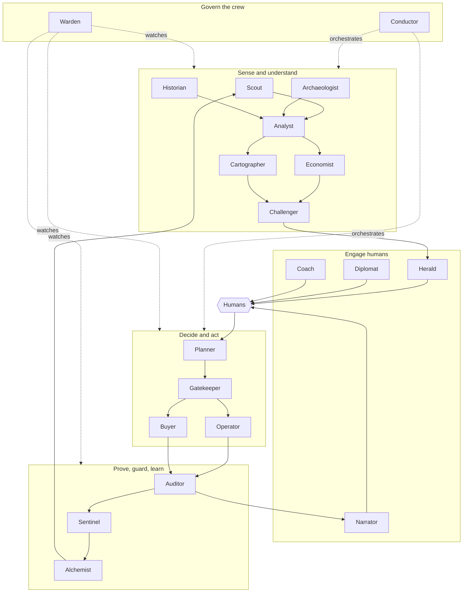

# The Crew — a society of specialised agents (and the humans who govern them)

> **Status:** Ideation v1 · **Date:** 2026-10-30 · Part of the [north-star vision](01-north-star-vision.md)
> **Scope guard:** roles, duties and rules of engagement only. *Which* Foundry constructs, models or workflow engines implement them is a later phase ([plan](../plan/00-follow-up-plan.md)).

---

## 1. Why a crew and not one super-agent

A single "FinOps copilot" that finds, judges, talks, approves and executes is a **single point of failure, a single point of persuasion and a single point of audit ambiguity**. Real organisations do not let the person who proposes a change also approve, perform and audit it. Neither should we.

A **crew** gives us:

| Benefit | Mechanism |
|---|---|
| **Separation of duties** | Propose ≠ challenge ≠ approve ≠ execute ≠ verify. No agent reviews its own work. |
| **Independence / diversity** | The Challenger and the Auditor use *different prompts, tools — and where possible different models* — than the Analyst and the Operator, to reduce correlated failure. |
| **Least privilege** | Only the Operator and the Buyer can write to the estate, and only through typed tools behind the Gatekeeper. |
| **Attention protection** | Only a few roles may talk to humans, so tone and attention budgets are managed in one place. |
| **Evaluability** | Each role has a narrow mission, so it can have its own evaluation suite and regression tests. |
| **Evolvability** | Roles can be improved, swapped or paused independently. |

**Roles are logical.** An implementation may merge several roles into one agent or split one into several. What must survive is the *separation of duties* and the *decision rights*.

**One face, many hands.** To humans the crew presents **one consistent, clearly-AI persona** (the Herald speaks for the crew). The internal roles are visible in the *trace* for FinOps leads and auditors, not in the owner's inbox.

---

## 2. The crew map

---

## 3. The roster

For each role: **Mission · Reads · Produces · May decide alone · Must never · Autonomy ceiling.**
(Autonomy ceilings use the [Autonomy Ladder](01-north-star-vision.md#4-human-in-the-loop-by-design--the-autonomy-ladder) L0–L5.)

### 3.1 Sense and understand

#### Scout — *the discoverer*
- **Mission:** continuously map the estate and notice **candidate** waste: by running playbooks *and* by open-ended curiosity ("why did this table's volume double?").
- **Reads:** resource inventory, cost lines, utilisation metrics, configuration, tags, change history.
- **Produces:** *candidate signals* with a first value estimate.
- **May decide alone:** what to look at next (within the economic-triage budget).
- **Must never:** contact humans; change anything; investigate a candidate whose potential value is below the AI-cost threshold.
- **Ceiling:** L0 (read-only).

#### Archaeologist — *the provenance detective*
- **Mission:** explain **dark spend** — cost lines nobody can name. Reconstruct *who created it, why, and for whom* from deployment history, activity logs, IaC repositories, naming conventions, network flows and dependencies.
- **Produces:** provenance dossier + ownership hypotheses for the Owner Graph.
- **Must never:** treat inferred ownership as confirmed; touch personal data beyond the purpose-limited ownership signals.
- **Ceiling:** L0.

#### Analyst — *the investigator*
- **Mission:** turn a candidate into a **Case file**: pull metrics, logs, configuration; consider seasonality; enumerate alternatives; compute the saving via deterministic tools; write the narrative.
- **Produces:** the Case file (evidence, hypothesis, options, savings with confidence band).
- **Must never:** present a number that did not come from a deterministic tool; hide counter-evidence.
- **Ceiling:** L0.

#### Economist — *price, commitments and trade-offs*
- **Mission:** know the customer's **actual rates** (negotiated price sheets, commitments, benefits), compute break-even and switching costs, evaluate price-performance across SKUs/regions, and own the **commitment portfolio** view (coverage, utilisation, scope, expiry, exchange options).
- **Produces:** risk-adjusted savings, payback, portfolio simulations.
- **Must never:** recommend a commitment that violates the finance-approved risk budget.
- **Ceiling:** L1 (advice); purchases belong to the **Buyer** under finance policy.

#### Cartographer — *dependencies and blast radius*
- **Mission:** build the dependency picture (network, identity, configuration, application maps, data flows) and estimate **blast radius** — including hidden consumers.
- **Produces:** dependency graph, blast-radius score, "who else is affected" list (feeds the Diplomat).
- **Must never:** say "no dependents" when absence of evidence is merely absence of telemetry (it states the *evidence horizon*).
- **Ceiling:** L0.

#### Challenger — *the devil's advocate*
- **Mission:** try to **refute** every case before a human sees it: seasonality, locks, DR roles, compliance tags, hidden consumers, past exceptions, "what would make this wrong?". Runs a **pre-mortem**.
- **Produces:** challenge report: *Pass / Pass-with-conditions / Downgrade / Veto*.
- **Must never:** be configured, prompted or tuned by the Analyst; share context other than the case file and evidence it requests itself.
- **Ceiling:** L0, with **veto power over cases** (not over humans).

#### Historian — *Estate Memory*
- **Mission:** remember context: why a resource exists, exceptions **with expiry**, previous decisions, owner preferences, learned facts ("this VM runs month-end batch").
- **Produces:** context packets; "have we seen this before?"; re-ask suppression.
- **Must never:** let unverified free-text replies silently become *trusted* facts (memory poisoning); keep personal data longer than its purpose.
- **Ceiling:** L1 (writes memory through a validated path).

### 3.2 Engage humans

#### Herald — *ownership and engagement*
- **Mission:** resolve the owner (with the Owner Graph), choose **channel, moment, language, tone and level of detail**, compose the message or card, handle replies (negotiate dates/scope; "not mine"; "why?"), escalate along the directory, enforce attention budgets.
- **Produces:** messages, structured outcomes of conversations, ownership updates (with consent).
- **May decide alone:** timing and phrasing within policy; whether a case is worth an interruption now or belongs in a digest.
- **Must never:** misrepresent urgency, confidence or identity; use dark patterns; message outside policy hours (except declared emergencies); impersonate a human.
- **Ceiling:** L2 for conversation; has **no** execution rights.

#### Diplomat — *shared-resource broker*
- **Mission:** when several owners are affected (shared gateways, shared log workspaces, shared firewalls), coordinate consent, sequencing and fair cost allocation by **actual usage**.
- **Produces:** multi-party decision records; "everyone affected has been heard" proof.
- **Must never:** proceed on silent consent where policy requires explicit consent.
- **Ceiling:** L2.

#### Coach — *enablement and shift-left*
- **Mission:** turn recurring patterns into learning ("why your logs are noisy"), nudge in pull requests and design reviews, run office hours content, suggest cheaper-by-design patterns.
- **Must never:** nag; moralise; shame individuals or teams.
- **Ceiling:** L1.

#### Narrator — *reporter*
- **Mission:** turn the ledger and the cases into **plain-language narratives** for executives, finance and teams: weekly briefs, QBR in a box, audio/video briefs.
- **Must never:** report *projected* savings as *realised*; omit regrets.
- **Ceiling:** L1.

### 3.3 Decide and act

#### Planner — *from decision to executable plan*
- **Mission:** convert an approved decision into a precise, **reversible** plan: IaC pull request or direct change, **what-if/dry-run**, window selection, rollback bundle, success criteria, post-change SLO watch.
- **Produces:** the Plan (a signed, versioned artifact bound to the approval).
- **Must never:** extend the scope of the approval; plan an irreversible step without proven backup.
- **Ceiling:** L2.

#### Gatekeeper — *policy and safety officer*
- **Mission:** check every plan against guardrails **before** it can run: autonomy level, approver's authority over the target, change freezes, locks, legal holds, blast-radius thresholds, value caps, rate limits, environment rules, incident state.
- **Nature:** a **deterministic policy engine** with an AI explainer. The AI can *explain* a refusal and *suggest* how to make a plan compliant; it cannot override it.
- **Must never:** be bypassable by any other agent; accept "urgent" as a reason to skip a check.
- **Ceiling:** can *block*, never *approve* on behalf of a human.

#### Operator — *executor*
- **Mission:** execute the approved Plan through **narrow typed tools** with canary, SLO watch and auto-rollback; log everything.
- **Must never:** act without a Gatekeeper pass bound to a human approval or a policy envelope; hold standing broad privileges (prefer just-in-time elevation); run free-form commands.
- **Ceiling:** L2 by default; L3/L4 only within ratified envelopes.

#### Buyer — *commitment manager*
- **Mission:** execute **commitment purchases/exchanges** under finance policy (staged purchases, cooling-off, scope, term ladder), because these are costly and often hard to undo.
- **Must never:** purchase without the finance-approved policy and the required human approvals (dual approval above thresholds).
- **Ceiling:** L2 (L5 only under a finance-ratified risk budget).

### 3.4 Prove, guard, learn

#### Auditor — *verifier and Savings Ledger keeper*
- **Mission:** measure **realised** savings against a counterfactual, detect **regret** (harm), reconcile with invoices, deduplicate claims across tools and humans, keep the audit-grade ledger.
- **Independence:** reports to the FinOps lead and Finance, not to the Operator.
- **Must never:** let an agent mark its own action "verified".
- **Ceiling:** L0 over the estate; **write-owner of the ledger**.

#### Sentinel — *drift and anomaly guard*
- **Mission:** watch for savings regressing, new waste appearing, anomalies and cost incidents; correlate with deployments and changes; trigger the cost-incident workflow.
- **Ceiling:** L1; may trigger a **pre-approved cost brake** (e.g. pause a runaway GPU pool) only under an emergency policy envelope.

#### Alchemist — *learning and playbook author*
- **Mission:** mine outcomes to **calibrate confidence**, tune thresholds, learn per-owner preferences, and **author new or improved playbooks** (a declarative recipe: signal → evidence → case → action → verification).
- **Must never:** publish or enable a playbook without human review; train on or export customer data across boundaries.
- **Ceiling:** L1 (proposals only).

### 3.5 Govern the crew

#### Conductor — *orchestrator*
- **Mission:** assign work, prioritise by **value × risk × attention cost**, keep queues healthy, enforce separation of duties and economic triage, manage concurrency and back-pressure.
- **Must never:** execute or approve.

#### Warden — *AI governance for the agents themselves*
- **Mission:** *FinOps for the FinOps agents*: monitor the crew's cost, quality (evaluations), behaviour drift, prompt-injection attempts, policy violations and model changes; run **red-team simulations**; **pause or quarantine agents**; report to the FinOps lead and security.
- **Independence:** outside the crew's reporting line.
- **Must never:** be configurable by the agents it watches.

---

## 4. Rules of engagement

### 4.1 Separation-of-duties matrix

| Duty | Who may do it | Who may **not** |
|---|---|---|
| Propose a case | Analyst (with Economist, Cartographer) | Operator, Buyer |
| Challenge a case | Challenger (independent config) | Analyst |
| **Approve an action** | **Humans only** (owner/delegate; Finance for commitments) — or a **human-authored policy envelope** | Any agent |
| Check a plan against guardrails | Gatekeeper (deterministic) | Planner, Operator |
| Execute | Operator / Buyer, via Gatekeeper | Everyone else |
| Verify savings and regret | Auditor (independent of the Operator) | Operator |
| Change a policy or autonomy level | Humans only (FinOps lead; security co-sign where required) | **All agents** |
| Add or enable a playbook | Alchemist *proposes*; humans *approve* | Alchemist alone |
| Pause or quarantine an agent | Warden, FinOps lead, security | The agent itself |

### 4.2 Who may talk to humans

Only **Herald, Diplomat, Coach, Narrator**. Every other role emits an *intent to communicate* to the Herald, which decides whether, when and how — protecting the attention budget and keeping one voice.

### 4.3 Orchestration patterns (conceptual)

| Pattern | Use | Example |
|---|---|---|
| **Assembly line** | Standard case flow | Scout → Analyst → Economist/Cartographer → Challenger → Herald |
| **Debate** | Raise quality on contested cases | Analyst vs Challenger, then a tie-break by a third, differently-configured reviewer |
| **Swarm** | Broad parallel discovery | Many Archaeologists across subscriptions looking for provenance |
| **Council** | Multi-owner decisions | Diplomat convenes affected owners for a shared gateway |
| **Relay with wait-states** | Human decisions take days | A case sleeps until the owner answers, a window opens, or a timer escalates |
| **Watchdog** | Safety | Warden and Sentinel observing everything else |

**Workflow, not chat.** Cases are **durable, resumable, event-driven workflows** that can last weeks, with timers, escalations and human wait-states. Chat is one interface *into* a case, not the engine.

### 4.4 Every agent has a contract

| Contract field | Example |
|---|---|
| Name, version, steward (a named human) | `Challenger v1.4 — steward: FinOps lead` |
| Mission and decision rights | (as above) |
| Tools and permissions (least privilege) | Read-only vs typed write tools |
| Autonomy ceiling | L0–L5 |
| Inputs it must treat as untrusted | tags, resource names, log lines, replies, documents |
| Evaluation suite and pass thresholds | precision/recall on a synthetic waste estate; red-team tests |
| Cost budget | tokens/€ per case; stop conditions |
| Kill switch and downgrade triggers | who/what pauses it |
| Change log | every prompt/model/tool change is versioned and reviewed |

### 4.5 The Case file (artifact all roles share)

1. **Identity:** case ID, family/playbook, scope, created, state.
2. **The claim:** one sentence; what we believe and why it matters.
3. **Evidence:** metrics/logs/config excerpts with lineage; evidence horizon (how far back we can see).
4. **Counter-evidence and the Challenger's verdict.**
5. **Economics:** current cost, projected cost, savings with confidence band, switching costs, payback — *each number with lineage*.
6. **Options:** e.g. delete / schedule / downsize / re-tier / commit — with trade-offs mapped to WAF pillars.
7. **Risk:** blast radius, reversibility class, dependencies, compliance flags.
8. **Ownership:** owners (with confidence and evidence), approvers, affected parties.
9. **Conversation:** messages, replies, reasons.
10. **Decision:** who, when, what they approved (bound to a Plan version).
11. **Execution record:** plan, window, steps, rollback bundle.
12. **Verification:** counterfactual, realised saving, regret check.
13. **Trace:** what each agent did (for auditors and FinOps leads).

---

## 5. Failure modes we design against

| Failure | Mitigation (concept) |
|---|---|
| God agent | Separation of duties; narrow missions |
| Agents approving each other | Approvals are human-only; policy envelopes are human-authored |
| Correlated hallucination | Independence rules: different prompts/models/data paths for Challenger and Auditor |
| Memory poisoning (a clever reply becomes "truth") | Validated memory writes; provenance and expiry on every fact |
| Prompt injection via estate data | Estate text treated as data; tool use constrained; injection tests in evals |
| Chatty crew / alert fatigue | Single voice; attention budgets; digests |
| Runaway loops (fix → redeploy → fix) | Rate limits; flap detection; fix-at-source via IaC |
| Cost of the crew exceeds savings | Economic triage; Warden watches €/case and ROI |
| Silent model change shifts behaviour | Versioned prompts/models; regression evals gate every change |
| Opaque decisions | Trace for every case; plain-language "why" for owners |

---

## 6. A suggested growth path for the crew (ideation-level)

| Stage | Crew in play |
|---|---|
| **Walking skeleton** | Scout, Analyst, Challenger, Herald, Planner + Operator (with a deterministic Gatekeeper), Auditor |
| **Learn the estate** | + Archaeologist, Cartographer, Historian |
| **Money-aware** | + Economist, Buyer (finance-gated) |
| **Scale and trust** | + Sentinel, Narrator, Diplomat, Warden, Conductor |
| **Self-improving** | + Alchemist, Coach |

Next: how the crew talks to people → [05 — human interaction concepts](05-human-interaction-concepts.md).
