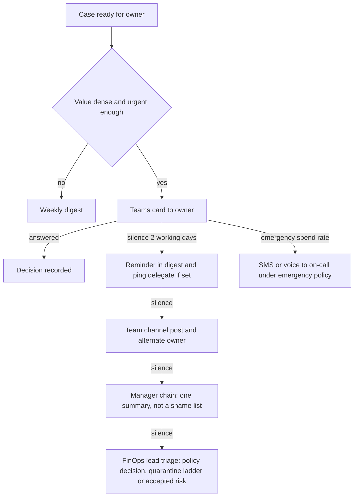

# Human Interaction Concepts — how the crew talks to people

> **Status:** Ideation v1 · **Date:** 2026-10-30 · Part of the [north-star vision](01-north-star-vision.md)
> **Scope guard:** this is *concept exploration*, not UI design. Formal personas, journeys, wireframes and the message design kit are Phase 2 ([plan](../plan/00-follow-up-plan.md)). Every mock-up here is **illustrative**: invented resources, invented numbers.
> **The brief:** *"What is the communication with humans? Teams cards? Emails? Text messages? Avatars talking to you in Teams meetings? IDEATE."* — so we do.

---

## 1. Principles of engagement

1. **Every message must earn its interruption** (value-density threshold; see §10).
2. **One decision per message.** Never a wall of options.
3. **Lead with the ask and the value; evidence one tap away** (progressive disclosure).
4. **Always say what happens next and how to undo it.**
5. **Honest uncertainty:** confidence in plain words and bands, never false precision.
6. **Respect time:** working hours, time zone, presence, out-of-office, quiet hours, focus time.
7. **Speak their language and level** — technical for engineers, financial for finance, brief for executives; Dutch, English, German, French first.
8. **Disclose AI identity every time; always offer a human.**
9. **Two-way by default:** replies, objections and questions are first-class.
10. **Don't nag:** remember reasons; escalate gradually and visibly.
11. **Never shame.** Credit teams, not individuals; celebrate wins; show regret honestly.
12. **Verifiable and safe:** recipients can tell a message is genuine; approvals bind to their identity; the agent never asks for secrets.

---

## 2. The channel palette

| Channel | Best for | Urgency | Friction | Watch out for |
|---|---|---|---|---|
| **Teams card (direct)** | Decisions on a specific case; approvals; ownership questions | Normal–high | Very low | Card spam; authentication of approvals |
| **Teams channel post** | Team-level asks, celebrations, shared-resource coordination | Normal | Low | Public shaming; noise |
| **Teams meeting — AI participant** | Review rituals: recap, what-if, decisions captured | Scheduled | Medium | Consent, accuracy, cross-talk |
| **Email digest** | Weekly desk, team report, executive monthly | Low | Very low | Ignored if too long |
| **Email approval request** | Formal approvals (finance, commitments) via signed deep link | Normal | Medium | Spoofing; forwarded links |
| **Calendar invite** | Change windows, review rituals | Scheduled | Low | Invite fatigue |
| **SMS / text** | Genuine emergencies only (opt-in) | **Critical** | Low | Unauthenticated; costly if abused |
| **Voice call** | Cost incidents to on-call | **Critical** | Medium | Voice ≠ authentication; 02:00 false alarms |
| **Mobile push (via Teams)** | Time-sensitive but non-critical | High | Very low | Over-use |
| **Work-tracking item** (board/issue) | Tracked work with several steps | Normal | Medium | Backlog graveyard |
| **Pull request** | Fix-at-source changes to infrastructure-as-code or code | Normal | Native to developers | Review load |
| **Report/dashboard** | Analysis; drill-down; FinOps lead's *Mission Control* | Pull | Medium | Nobody opens it (the original problem) |
| **Wins feed** (community space) | Recognition and learning | Low | Low | Performative; leaderboards |
| **Assistant chat (pull)** | "Ask about my team's waste" | Pull | Low | **Secondary** — never the primary channel |
| **IDE / command line** | Developer-time hints and previews | Pull/low | Native | Intrusiveness |

> *Chat is an interface into a case, not the product.* The product is the **workflow** that decides who to ask, when, and with what.

---

## 3. Choosing the channel — and the escalation ladder

The Herald chooses from **value × urgency × reversibility × persona × presence**. A first heuristic (to be tuned in Phase 2):

| If… | Then… |
|---|---|
| Low value, low risk | **Weekly digest**, or a **policy envelope** (no message at all) |
| Medium value, reversible | **Teams card** within working hours |
| High value or needs a formal record | Teams card **plus** email with signed link |
| Shared resource | **Team channel** + Diplomat outreach to each affected owner |
| Emergency spend rate | **SMS/voice** under the emergency policy, plus card |

### Escalation: gradual, visible, humane



*Follow the directory:* delegates and out-of-office replies are honoured; the manager chain gets **one summary**, never a list of who ignored what; timing respects each person's time zone and quiet hours.

---

## 4. Anatomy of a Decision Card (the core artefact)

| Part | Content | Purpose |
|---|---|---|
| **Headline** | The ask in one sentence | Understand in 3 seconds |
| **Value** | € per month · confidence · payback | Why it matters |
| **What** | Resource, environment, owner (with confirmation state) | Orientation |
| **Why** | Three evidence bullets and one small chart | Trust |
| **Trade-off** | WAF-pillar badges (cost / reliability / performance / security) · blast radius | Honesty |
| **Challenger** | "Passed — checked X, Y, Z" | Show the case survived scrutiny |
| **Options** | A / B / C — recommended one first | Real choice |
| **Cost of waiting** | € per week of delay (neutral, never pressure) | Informed deferral |
| **Actions** | **Primary:** approve (with window) · **Secondary:** preview, another time, not now ▾, not mine, why?, talk to a human | Two-way |
| **Undo** | "Undo within N days" | Safety |
| **Footer** | Case ID · AI disclosure · trace link · mute this type | Transparency |

**Progressive disclosure:** *Layer 0* headline + primary action → *Layer 1* evidence → *Layer 2* full case and trace → *Layer 3* a human.

---

## 5. Email — the other half of the product

| Email | For | Shape |
|---|---|---|
| **My Savings Desk** (weekly) | Owners | Top 3–5 decisions with one-tap links; a win; "things I handled under policies you chose" |
| **Team brief** (weekly) | Managers | Decisions needed; verified savings; risk; policy suggestions ("you approved this 31 times without regret — adopt as policy?") |
| **Executive brief** (monthly) | CTO/CFO | One page: spend vs forecast, **verified** savings, commitments, top risks, decisions; optional 90-second audio |
| **Formal approval** | Finance, commitments, R3 actions | Signed, recipient-bound deep link to an authenticated approval page; full evidence attached |
| **Ownership attestation** (quarterly) | Owners | "Still yours? [Confirm all] [Review]" |
| **Post-action report** | Approver | "Done. Verified in 7 days. Undo available until…" |
| **Incident summary** | On-call and stakeholders | What spiked, what we did, what's next |
| **Welcome** | New owners | Who I am (AI), what I will and won't do, how to mute, how to reach a human |

Subject lines are **specific and calm**: *"3 decisions, worth ≈ €1,150/month"*, never *"URGENT: action required"*.

---

## 6. Voice, meetings and avatars

| Concept | How it works | Guardrail notes |
|---|---|---|
| **Cost-incident call** | After a card goes unanswered during an emergency spend rate, a call to on-call: short, factual, one ask. Confirmation completes in an **authenticated** channel (or a pre-approved *cost brake* applies after a defined timeout). | Voice is not authentication; tabletop-tested; false-alarm budget |
| **FinOps Review Room** | A **clearly-labelled AI participant** joins the weekly/monthly review (text first, voice optional): 90-second recap, answers "what if?", captures decisions as Cases, follows up | Consent and recording rules; nothing executes without an authorised human's confirmation |
| **Executive audio brief** | 60–90 seconds, generated from the ledger, with a transcript | Same truthfulness rules as the written brief |
| **Estate interview call** (optional) | A short call to a busy owner to resolve ownership by voice, with a transcript and confirmation card | Opt-in; language support |
| **Avatar** | A friendly visual identity for the AI participant | **Never a real person's likeness or cloned voice; always labelled AI** |

Start with **text in the meeting chat**; add voice only after the written flows are trusted.

---

## 7. Conversation design — negotiation, not nagging

### 7.1 Outcomes of a conversation

| Outcome | What the owner does | What the crew does |
|---|---|---|
| **Approve** | Taps approve (maybe with a window) | Plans, simulates, schedules |
| **Approve with changes** | "Resize to D4, not D2" | Re-plans, **reads back**, asks to confirm |
| **Another time** | "After the launch on the 15th" | Schedules; remembers the *why* |
| **Not now** | Chooses a reason chip (*busy*, *risk*, *waiting for X*, *I disagree*) | Defers with expiry; learns |
| **Not needed** | "This is the quarter-end batch VM" | Stores context with expiry; adapts the playbook |
| **Not mine** | Points to someone else | Updates the Owner Graph (with consent); re-routes |
| **Why?** | Wants evidence | Opens layer 1–2; may run deeper analysis |
| **What if I wait?** | Asks the cost of delay | Computes and shows |
| **Stop messaging me about this** | Mutes a type | Honours; reports muted volume to the FinOps lead |

### 7.2 The read-back rule (safety)

Free-text replies are understood by AI, but **no free text triggers an action directly.** The crew **reads back** what it understood in a structured form — *"I understood: resize to D4s_v5 on Thursday 22:00 CET. Confirm?"* — and the **structured confirmation** (an authenticated tap) is what the Gatekeeper accepts.

### 7.3 Disagreement

The crew doesn't argue. It records the objection, offers a lighter option if one exists, and escalates **only** as policy defines. "Agree to disagree" is a legitimate outcome with an expiry.

---

## 8. Personalisation (with consent)

| Preference | Examples |
|---|---|
| **Channel & hours** | Teams at work hours; digest on Monday 08:00; no pings after 18:00 |
| **Language & verbosity** | NL/EN/DE/FR; short vs detailed |
| **Tone** | Neutral; more formal for finance |
| **Delegation** | "Route to my teammate when I'm out" |

Hypothetical owner archetypes to test in Phase 2: **the Skeptic** (wants evidence), **the Busy** (one tap), **the Analyst** (wants data), **the Delegator** (routes to the team), **the Anxious** (needs reassurance about reversibility), **the Champion** (wants more). Adaptation is **explicit, explainable and opt-in**; learned preferences are shown and editable — no creepy inference.

---

## 9. Team and organisational rituals

| Ritual | Cadence | Purpose |
|---|---|---|
| **Waste Wednesday** | Weekly, 15 min | Team looks at its desk together; decisions made in the room |
| **Savings wins feed** | Continuous | Recognition and learning (team-level) |
| **Cost council** | Monthly | FinOps lead, finance, platform: policy proposals, regret review |
| **Regret review** | Monthly | Open review of what the crew got wrong — normalises candour |
| **Exception hearings** | Quarterly | Exceptions expire; owners re-justify with evidence |
| **QBR in a box** | Quarterly | Executive narrative, verified savings, forecast, decisions |
| **Savings dividend moment** | Quarterly | Returning part of verified savings to teams (if adopted) |

---

## 10. Attention budgets — the mechanics

- **Value-density threshold:** ask only if `expected value × P(act)` clearly exceeds the **attention cost** of an interruption (the Conductor estimates both).
- **Per-person weekly cap** on *decision asks*; overflow goes to the digest; emergencies are exempt but reviewed afterwards.
- **Digest-first** for anything not urgent; **batch** related asks about one service into one card.
- **Quiet by default:** a message that would not change what the person does is not sent.
- **Policy envelopes** make the trivial invisible: a *monthly summary* replaces dozens of cards.
- Overall **ask volume** and **usefulness ratings** are reported to the FinOps lead.

---

## 11. Accessibility, inclusion, culture

Screen-reader friendly cards · plain language · no meaning conveyed by colour alone · captions and transcripts for voice · predictable structure (kind to neurodiverse readers) · multilingual with locale-aware dates/currency · directness calibrated to the audience (what reads as clear in one culture reads as curt in another).

---

## 12. Anti-patterns (we will not do these)

Fake urgency · shaming lists · leaderboards of individuals by default · hidden AI identity · "approve all" without evidence · giant digests nobody reads · notifications that merely inform · asking the same question twice · dark patterns that make *Decline* harder than *Approve* · links that act on click without authentication · jargon.

---

## 13. Illustrative storyboards

> Invented names, resources and numbers. Buttons are shown as `[Label]`.

### 13.1 Teams card — VM right-sizing with a window

```
+------------------------------------------------------------------+
| Cost agent (AI)  .  Case C-20417                                  |
| Your VM costs more than it needs to                               |
+------------------------------------------------------------------+
| vm-orders-api-03 . West Europe . prod . owner: you (confirmed)    |
|                                                                   |
| SAVE ~ EUR 135/month   Confidence: high   Payback: immediate      |
| Reversible - undo for 14 days                                     |
|                                                                   |
| WHY   CPU p95 11%, memory p95 38% over 90 days. The busiest week  |
|       (month-end) peaked at 46% CPU. A smaller size keeps 2x      |
|       headroom.                                                   |
| TRADE-OFF  Cost down . Reliability same . Performance OK          |
| CHALLENGER Passed - checked month-end peaks, autoscale, locks,    |
|            3 downstream services                                  |
|                                                                   |
| OPTIONS   (x) Resize D8s_v5 -> D4s_v5  (recommended)              |
|           ( ) Resize and ask Finance about a commitment later     |
|                                                                   |
| [Approve for Thu 22:00] [Preview] [Another time] [Not now v]      |
| [Not mine] [Why?] [Talk to a human]                               |
| Cost of waiting: ~ EUR 30/week . AI-generated . trace . mute type |
+------------------------------------------------------------------+
```

### 13.2 Teams card — "Is this yours?"

```
+------------------------------------------------------------------+
| Cost agent (AI)  .  Ownership question (1 of 2 this week)         |
+------------------------------------------------------------------+
| vm-batch-07 (West Europe) costs about EUR 310/month and I cannot  |
| tell who owns it. You created it in March and you are still in    |
| Platform Engineering. Why I am asking: I never act on resources   |
| without a confirmed owner.                                        |
|                                                                   |
| [Yes, mine] [My team's - add them] [Not mine - try someone else]  |
| [No idea] [Why are you asking?]                                   |
+------------------------------------------------------------------+
```

### 13.3 Email — the weekly desk

```
Subject: Your Azure savings desk - 3 decisions, 1 win (week 45)

Hi Sanne,

3 decisions need you (about 4 minutes), worth about EUR 1,150/month:
  1. Resize vm-orders-api-03 .............. ~EUR 135/mo . reversible . [Decide]
  2. Move dev ContainerLogV2 to Basic ..... ~EUR  80/mo . reversible . [Decide]
  3. Is vm-batch-07 yours? ................ [Answer]

A win: the gateway change you approved in October is verified:
EUR 1,840/month saved. Your team's verified total this quarter:
EUR 11,200 (30% goes to your team's innovation budget).

Things I handled under policies you opted into: 7 dev VMs slept
14 nights; 2 unattached disks deleted (snapshots kept 14 days).

[Mute this type] . [Change my settings] . [Talk to a human]

- Your cost agent (AI). I will never ask for passwords or secrets.
```

### 13.4 Approval request to Finance — a commitment (two keys)

```
+------------------------------------------------------------------+
| Cost agent (AI) . Case C-20533 . Commitment proposal              |
+------------------------------------------------------------------+
| Proposal  Stage 1 of 3: 1-year commitment covering 60% of the     |
|           steady-state compute baseline (after planned right-     |
|           sizing - sequence matters).                             |
| Projected EUR 4,300/month  (risk-adjusted EUR 3,700)  (projected) |
| Risk budget used: 22% of EUR 20k . Min. utilisation target: 92%   |
| Back-test (last 12 months): utilisation 94-97%; regret: none      |
| Workload owner: Sanne - APPROVED          Finance: pending        |
|                                                                   |
| [Approve stage 1] [Approve smaller] [Not yet] [Ask about the      |
| back-test] [Talk to a human]                                      |
| Opens an authenticated approval page - this card cannot approve.  |
+------------------------------------------------------------------+
```

### 13.5 Cost incident — SMS and call (illustrative script)

```
SMS (opt-in, 02:07):
  Cost agent (AI): gpu-train-02 is spending ~40x normal (~EUR 900/h).
  Check the Teams prompt on your phone now. Reply HELP for options.

Call (02:11, no response to the card):
  "This is the cost agent, an AI assistant. The GPU pool gpu-train-02 is
   spending about forty times its normal rate. Pausing it is reversible.
   A confirmation prompt is on your phone now. If nobody confirms within
   ten minutes, the cost-brake policy that FinOps and Security approved
   will pause the pool. Say 'repeat' to hear this again, or 'human'
   to reach the on-call lead."
```

### 13.6 The executive's 90-second brief (script)

> *"Good morning Jan. Azure spend was two percent below forecast. Verified savings this month: one hundred forty thousand euro run-rate, up thirty from last month — projected savings are reported separately. Commitment coverage is eighty-one percent, utilisation ninety-four. Two actions were rolled back; both are explained in the regret report. Three decisions need you this week: a staged commitment purchase, a policy for development environments, and an exception for one regulated workload. Details are in your inbox. This brief was generated by an AI from the savings ledger."*

### 13.7 The AI participant in the monthly cost review (excerpt)

```
Priya (human):  Why did commitment utilisation dip last month?
AI participant: Utilisation fell from 96% to 91% after the platform team
                moved 14 VMs to a newer size. The commitments cover the
                old size. Two options: exchange within the allowed
                terms, or wait - 9 of the 14 return to the old size in
                December. I recommend waiting; waiting costs about EUR
                600. Evidence is in case C-20488.
Lars (human):   Record: wait, revisit on 12 Dec.
AI participant: Recorded as a decision by Lars. I will remind you on
                12 December. I cannot change commitments from this
                meeting; any purchase needs the approval flow.
```

*(Cards for the two seed examples — Virtual WAN point-to-site gateways and Log Analytics ingestion — are in [03 — deep dives](03-deep-dives-seed-examples.md).)*

Next: the closed loop → [06](06-closed-loop-actions-and-autonomy.md).
