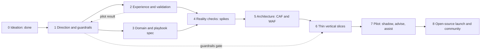

# Follow-up Plan — from ideation to an open-source, guardrailed, agent-driven product

> **Status:** Ideation v1 · **Date:** 2026-10-30 · Part of the [north-star vision](../ideation/01-north-star-vision.md)
> **Principle:** *no building before the guardrails exist; no guardrails without knowing what we are guarding; no assumptions without a cheap test.* Every idea in the ideation set has a **home in a phase** — nothing is dropped and nothing is "on the backlog": see the mapping in §5.

---

## 1. Where we are

| Phase | What | State |
|---|---|---|
| **0 — Ideation** | North-star vision, opportunity catalog, crew, interactions, loop, ownership, guardrail territory, outer rim, metrics, PR/FAQ, research, this plan; **two rounds of rubber-duck review** | ✅ this package |
| **1 — Direction & guardrails** | Scope cut, stop criteria, guardrail charter, threat model, RAI + privacy screening, OSS governance basics | **next** |
| 2 → 8 | see below | planned |

---

## 2. The plan on a page

**Gates.** Each phase ends with a **gate**: exit criteria met, stop/pivot criteria checked, and a **rubber-duck review** (the same two-round discipline used in Phase 0). **Hard rule:** Phase 6 cannot start until Phase 1's *Guardrail Charter v1* and *safety invariants* are ratified.

**Parallelism.** Phases 2 and 3 run side by side. The **Wizard-of-Oz pilot** in Phase 2 involves *humans* sending messages manually — no automation, no write access — so it may start as soon as the *outreach ethics* subset of Phase 1 (consent, attention limits, disclosure) is agreed.

---

## 3. The phases

### Phase 1 — Direction & guardrails
**Goal:** agree what we are building *first*, what would make us stop, and the rules the system must obey before any code exists.

| Item | Detail |
|---|---|
| **Activities** | Vision review and **scope cut** (H1 use-case shortlist) · define **stop/pivot criteria** · run the **guardrail sessions G1–G14** ([workplan](02-guardrails-workplan.md)) · threat model v0 · Responsible-AI impact assessment kickoff · privacy (DPIA) screening incl. people-data · OSS governance basics (licence, name/trademark, internal release process check) · CAF/WAF alignment approach |
| **Deliverables** | Guardrail Charter v1 · Autonomy policy v1 (levels, entry/exit, downgrade triggers) · ratified **safety invariants** · Threat model v0 · RAI impact assessment v0 · DPIA screening result · OSS governance note · MVP thesis and shortlist · decision records |
| **Exit criteria** | Charter reviewed by security, compliance/legal, Finance and a platform owner · invariants ratified · stop criteria agreed · duck gate passed |
| **Stop/pivot** | A veto-level objection (e.g. legal) that cannot be mitigated for the chosen scope |

### Phase 2 — Experience & validation
**Goal:** learn whether **owners act when asked well**, before building anything.

| Item | Detail |
|---|---|
| **Activities** | 6–10 interviews (owners, FinOps, Finance, security, SRE, managers) · personas and jobs-to-be-done · journey maps and service blueprints · channel strategy · **message design kit** (card, email, voice scripts, tone of voice, escalation ladder) · accessibility and multilingual (NL/EN/DE/FR) · clickable prototypes · **Wizard-of-Oz pilot**: for 2–4 weeks *humans* send hand-built cards/emails for 30–50 real cases at a friendly customer and we measure the funnel, reasons and fatigue |
| **Deliverables** | Persona pack · journey maps · service blueprint · message kit · WoZ results and funnel · updated bets **B1, B2, B6** |
| **Exit criteria** | **B1 validated, refuted, or reshaped** with data · message kit stable · attention-budget parameters proposed |
| **Stop/pivot** | Owners do not respond even to excellent asks → the product thesis changes (e.g. towards policy-first automation or shift-left) |

### Phase 3 — Domain & playbook specification
**Goal:** make the ideas precise enough to evaluate and build.

| Item | Detail |
|---|---|
| **Activities** | Case model and lifecycle · Owner Graph schema · Savings Ledger model · event taxonomy · **Playbook spec v0** ("Open Waste Rules") · evaluation rubric · **scoring and selection of the first 8–12 playbooks** (value × signal availability × reversibility × owner clarity × safety) · write each selected playbook as a spec with **test data** · **Waste Lab** design (synthetic estate with injected waste and ground truth) |
| **Deliverables** | Domain model · Playbook spec v0 · 8–12 playbook specs (including the two seed examples) · Waste Lab design · evaluation plan |
| **Exit criteria** | Specs reviewed by FinOps and security; each playbook has *signals, evidence, counter-evidence, options, risks, verification, test data* |

### Phase 4 — Reality checks (feasibility spikes)
**Goal:** replace each load-bearing assumption with evidence, **fast and time-boxed**. This is where "technical limitations" are finally allowed to speak. Candidate spikes are listed in [03](03-capability-radar.md); each ends in **Green / Amber / Red** and an ADR.

| Item | Detail |
|---|---|
| **Activities** | ~20 spikes of 1–3 days (e.g. cost data coverage and latency; advisor data access; metric/log usage signals; DCR transformation dry-run and **shadow** measurement; vWAN P2S metrics and scale operation; Teams actionable approvals and authentication; directory/manager-chain/presence reads; Foundry agent workflows with wait states, evaluation and tracing; agent identities and RBAC; IaC pull-request automation; voice/SMS; meeting participant feasibility; **cost per case**; open-source release process) |
| **Deliverables** | Feasibility register · ADRs · list of scope adjustments · cost-per-case baseline |
| **Exit criteria** | No *Red* on a P1 playbook's critical path, or a documented alternative |

### Phase 5 — Architecture & design (CAF/WAF-aligned)
**Goal:** a reference architecture for the platform *and* its safety envelope.

| Item | Detail |
|---|---|
| **Activities** | Landing zone for the tool · identity and permission design (read vs write, JIT, on-behalf-of vs self) · data and estate model · agent topology and durable workflow design · **safety architecture** (policy engine, approval service, audit log, kill switch, rollback bundles) · observability of agents (traces, evals, cost) · resilience and fail-safe modes · threat model v1 · **WAF review** · Responsible-AI design review · infrastructure-as-code using verified modules |
| **Deliverables** | Architecture pack · ADR set · threat model v1 · WAF review report · RAI design review |
| **Exit criteria** | WAF review passed (or findings accepted with owners) · security design review passed · duck gate passed |

### Phase 6 — Thin vertical slices
**Goal:** prove the loop end-to-end on small, safe, real examples — each slice *includes its evaluations, guardrail tests and red-team scenarios*.

| Slice | What it proves |
|---|---|
| **S0 — Skeleton** | One case: signal → case file → card → (mock) execution → ledger entry |
| **S1 — Orphaned disks** | Full HITL with **real** approval, authority check, snapshot, rollback, verification |
| **S2 — Log usefulness (read-only)** | Table/pattern usage analysis, **shadow measurement**, advisory cards — no changes |
| **S3 — vWAN P2S right-sizing** | Capacity-unit playbook: evidence, window, execution, rollback, verification |
| **S4 — Dev sleep schedule (L3 envelope)** | First **policy envelope**; veto window; regret watch |
| **S5 — Ownership interview** | Owner Graph updates by conversation; attestation |
| **S6 — Commitment advice (advise only)** | Economist portfolio view; finance workflow without purchasing |
| **S7 — Log filter execution** | Only after S2 evidence and security co-sign; includes the "cheap copy" safety net |

### Phase 7 — Pilot (shadow → advise → assist)
**Goal:** real owners, real money, progressive autonomy.

| Item | Detail |
|---|---|
| **Activities** | Shadow (L0) for N weeks, scored · advise (L1) · assist (L2) · selected action classes to L3 only on evidence · weekly **regret report** · monthly Finance reconciliation · attention-cost surveys · red-team exercise · kill-switch drill |
| **Exit criteria** | [Pilot success criteria](../ideation/10-value-metrics-and-economics.md#8-pilot-success-criteria-strawman) met |

### Phase 8 — Open-source launch & community
**Goal:** a public, trustworthy, maintainable project.

| Item | Detail |
|---|---|
| **Activities** | Licence and governance in force · security policy and disclosure · documentation and quick-starts · **Waste Lab** and sample data · playbook library with contribution/review flow · release engineering and supply-chain hygiene · community channels and roadmap · publication through the agreed internal process |
| **Exit criteria** | Public release criteria agreed in Phase 1 are met |

---

## 4. Cross-cutting tracks (run throughout)

| Track | Purpose |
|---|---|
| **A. Evaluation & safety harness** | Offline replays, Waste Lab scoring, red-team suites, calibration — gating every prompt/model/tool change |
| **B. Waste Lab** | Synthetic estate with ground truth; community-safe testing |
| **C. Playbook library** | Specs, test data, review status, provenance |
| **D. Decision log** | Every significant decision recorded with options, rationale and owner |
| **E. Stakeholder engagement** | Security, Finance, legal/compliance, HR/works council, platform owners, resource-owner champions |
| **F. Rubber-duck gates** | Two-round review at each phase end; citations spot-checked against primary sources |
| **G. Platform cost tracking** | Cost per case from the first spike onward |

---

## 5. Where every idea lives (nothing dropped)

| Source | Idea group | Home |
|---|---|---|
| [02 catalog](../ideation/02-opportunity-catalog.md) | H1 families (idle, orphans, schedules, ownership hygiene) | Phase 3 selection → Phase 6 slices S1, S4, S5 |
| 02 catalog | Telemetry & capacity-unit families (the two seed examples) | Phase 3 specs → Phase 4 spikes → slices S2, S3, S7 |
| 02 catalog | Commitments & commercial | Phase 3 → S6 (advise-only) → later purchasing under Finance guardrails |
| 02 catalog | AI-workload, security-tool, network, platform families | Phase 3 backlog ranking → released as playbooks after Phase 7 |
| [09 outer rim](../ideation/09-outer-rims-moonshots.md) | M-14 Time Machine, M-22 Waste Lab, M-35 FinOps-for-agents | **Phase 2–3** (they are *enablers*) |
| 09 | M-08/M-09/M-11/M-12 shift-left, cost SLOs, radar | Phase 3 roadmap → post-pilot slices |
| 09 | M-21/M-23 Open Waste Rules and flywheel | Phase 3 spec → Phase 8 community |
| 09 | M-26/M-27 savings dividend, no-blame rollback | Phase 1–2 (organisational design with Finance/HR) |
| 09 | M-02/M-28/M-05/M-04 higher-risk ideas | Re-evaluated at the Phase 7 gate with pilot evidence and guardrails |
| [07 ownership](../ideation/07-ownership-and-organization.md) | Owner Graph, interviews, attestation | Phase 3 model → slice S5 |
| [08 guardrails](../ideation/08-trust-safety-and-guardrail-topics.md) | G1–G14 | Phase 1 (sessions) → Phase 5 (architecture) → continuous tests |

Items explicitly *not* scheduled for the first release (multi-cloud, adjacent SaaS spend, meeting-intent mining) are recorded as **decisions to revisit at named gates**, not forgotten.

---

## 6. Rubber-duck discipline

At every gate: **Round 1** (independent reviewers with distinct lenses: product/human factors, safety/governance, strategy) → fixes → **Round 2** (red-team and fact-check lenses on the revised package). **Reviewers' own cited facts are spot-checked against primary sources** before anything is accepted — a reviewer can reach the right verdict with a wrong example.

---

## 7. What we need from you (operator decisions)

Listed with options and a recommendation in [01 — assumptions, risks and decisions](01-assumptions-risks-decisions.md): project name, licence, deployment model, scope of the first release, pilot partner, Wizard-of-Oz permission, when (if ever) the repository goes public.

---

## 8. How AI helps run *this* plan (dogfooding)

- Synthesise interview notes and cluster themes — with human verification.
- Draft playbook specs and test data from the catalog; humans review.
- Generate and maintain the Waste Lab scenarios.
- Run the rubber-duck reviews and the citation spot-checks.
- Keep the decision log and the assumption register current.
