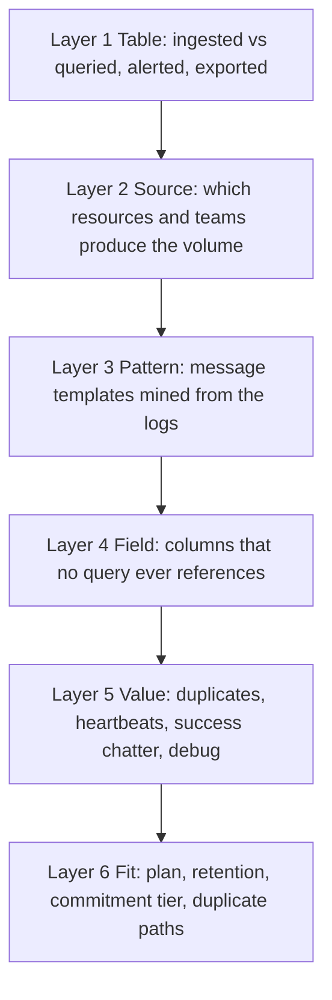

# Deep Dives — the seed examples, end to end

> **Status:** Ideation **v2** (corrected after rubber-duck round 1 — notably the P2S capacity model and the audit-coverage claims; v1 is archived [here](../_archive/round-1-v1/ideation/03-deep-dives-seed-examples.md)) · **Date:** 2026-10-30 · Part of the [north-star vision](01-north-star-vision.md)
> **Grounding:** product mechanics and list prices come from [research/04](../research/04-seed-example-facts.md) (retrieved 2026-10-30; list prices from the public Azure Retail Prices API, West Europe, EUR). **Scenario data (workspace names, volumes, people) is invented.** Every € figure in a real message must come from the customer's own price data at execution time.
> **Purpose:** show what "usage over billing, owners first, human decides, proof afterwards" looks like on the two examples in the brief — plus two more that stress other parts of the loop.

---

## 0. Why these examples teach us so much

| | **Log usefulness** (seed 1) | **vWAN P2S capacity** (seed 2) |
|---|---|---|
| The waste | Data paid for, retained, never needed | Capacity paid for by the hour, never used |
| Why it's invisible | Billing shows GB; nobody sees *use* | The gateway lives inside the virtual hub, set once and forgotten |
| The "usage truth" | Query history, alert/rule references, templates | Connection count and bandwidth metrics |
| Reversibility | **R3** for dropped data (hence a safety net) | **R1** (scale back up), with brief reconnects |
| Owner problem | Workspace owner ≠ the teams producing the logs | The network team ≠ the business units using the VPN |
| Main risk | Dropping something someone needs later (security, forensics) | Disconnecting users during a change |
| Teaches | **Evidence horizon**, replay, protected sources, shared costs | **Deterministic sizing**, windows, consumers, scale-by-calendar |

> **Terminology note.** Customers who "found hundreds of internal gateways" are most likely seeing **scale units** and the instances they imply, not hundreds of separate gateway resources: a point-to-site gateway supports **1–200 scale units**, delivers **0.5 Gbps per unit**, has **banded connection capacity**, and runs on **2 instances up to 20 units, then one more pair per extra 20 units** (100 units = 10 instances; 200 units = 20), and it is a distinct resource type that lives *inside the managed virtual hub*. Across several hubs that can read as "hundreds of gateways". We should confirm the exact shape with the customer who raised it. (Verified facts: [research/04 Part B](../research/04-seed-example-facts.md).)

---

## 1. Seed example 1 — "FOMO logging": log ingestion nobody uses

### 1.1 The story

A platform team runs a central Log Analytics workspace. Over three years every team switched on "all logs", every agent shipped its default collection, and the monthly bill grew faster than anything else in monitoring. When asked, nobody can say which of the logs they would miss. **FOMO logging:** *"what if we need it?"* — paid for every day, used almost never.

### 1.2 What billing can't tell you — and what Azure can

| Question | What exists today (verified) | Gap |
|---|---|---|
| How much does each table/source ingest? | `Usage` table; `_BilledSize`; `_ResourceId` | Fine — a solved measurement problem |
| Who queries what? | **Query auditing** (`LAQueryLogs`) — **off by default**; only records from when you switch it on | **Evidence horizon starts at "enable"** |
| Do alerts/rules depend on a table? | Rule definitions contain the KQL | **No built-in cross-reference** between tables and rules/workbooks |
| Does anything flag a table as never queried? | Advisor's four log-cost recommendations and Azure Copilot do **not**. **Sentinel SOC optimization does** — for *Sentinel workspaces*, billable tables ingested in the last **30 days**, security-scoped (and unused columns in preview) | **A gap outside Sentinel**, for longer horizons and for template-level noise |
| Is "zero queries" safe to act on? | Query audit does **not log scheduled alert/analytic rule executions**; coverage of interactive Sentinel/Defender surfaces is **documented inconsistently** between two Microsoft pages | **Zero logged queries ≠ unused** — and the blind-spot list must be **measured per workspace** (canary test), not assumed |
| What can be filtered, and how? | Ingestion-time transformations (row filters, column drops); table plans (Analytics/Basic/Auxiliary); source-side settings | Not all tables support them (e.g. P2S gateway diagnostics: no Basic plan, no transformation) |
| Is changing the plan safe? | Plan switches are limited to **once per table per week**; **simple log-search alerts work on Basic**, but **alerts stop working on Auxiliary** | **Dependency check before any plan change** |

### 1.3 The Usefulness Model — six layers of judgement



For every pattern the Analyst computes a **usefulness profile** from deterministic tools (the model *interprets*, it does not guess numbers):

| Feature | Meaning |
|---|---|
| Query-reference hits | Do any audited queries mention the template or filter that would match it? |
| Rule/workbook references | Scheduled rules, alert rules, security rules, workbooks, dashboards, exports |
| Severity/level | Is it an error, a warning, or "all fine" chatter? |
| Uniqueness/novelty | Is every line different, or the same line millions of times? |
| Incident correlation | Did past incidents or post-mortems cite this telemetry? ([TELE-29](02-opportunity-catalog.md)) |
| Protected-source flag | Security/compliance-critical sources are **advise-only** ([SEC-10](02-opportunity-catalog.md)) |
| Consumer blind spots | Which consumers are *unobservable* (the list in 1.2)? |

Outcome classes: **Keep · Keep-with-sample · Cheapen (cheaper plan) · Drop · Protected (advise only)**.

### 1.4 The options ladder — least to most invasive

| # | Option | Reversibility | Note |
|---|---|---|---|
| 1 | **Do nothing / advise** | — | The honest answer for protected sources |
| 2 | **Fix at the source:** narrow diagnostic categories, collection level, agent configuration, sampling | **R3-Data** — the configuration can be restored, the *future evidence not collected* cannot | *Preferred* — removes noise before it is paid for; still needs data-owner and security approval, never L3/L4 |
| 3 | **Code pull request:** change a chatty log statement or level | **R3-Data** (reversible by revert; evidence not logged meanwhile is gone) | See [TELE-26](02-opportunity-catalog.md) and [M-15](09-outer-rims-moonshots.md) |
| 4 | **Cheaper table plan** for high-volume, low-query tables | R1 (weekly limit; check dependencies) | Verify alerts/Power BI/dashboards first |
| 5 | **Ingestion-time filter** (rows/columns) | **R3-Data** | Only with the safety plan below; never L3/L4 |
| 6 | **Retention / archive changes** | R3 if shortened | Compliance check first |
| 7 | **Commitment tier / dedicated cluster** | R1 | Do *after* shrinking volume ("fix, filter, then price") |

### 1.5 The safety plan for the irreversible option

1. **Check the evidence horizon and calibrate the signal.** Is query auditing on, and since when? Then **run a canary query through each consumer surface that matters** (portal, workbook, dashboard, Sentinel/Defender hunting, API) and confirm it appears in the audit log — Microsoft's documentation of what is logged is inconsistent, so we measure. **Unknown coverage blocks any destructive recommendation.** If auditing is off, the first case is *"start watching"* — an **R1** action (it *adds* collection; the added cost is an attribute, not a class) that opens an **Observing** state (see §1.8) and delivers value later; the clock starts the day it is enabled, which is why this should happen *early* on pilot workspaces.
2. **Enumerate every consumer** we *can* see (queries, scheduled/alert rules, Sentinel rules, workbooks, dashboards, exports, API consumers) and record the **blind-spot list** we cannot see. Unknown consumers require the owner's confirmation.
3. **Measure savings from data already ingested** — bytes by pattern — so no experiment is needed to size the prize.
4. **Replay test.** Re-run the audited queries and alert logic over the history **with the candidate lines removed**; results must be identical (or the differences explained and accepted).
5. **Watch period.** A defined number of days in which the agent keeps checking that nothing *new* starts using those patterns.
6. **Protected-source check.** Security-relevant sources and compliance-tagged tables are excluded or routed to **security co-sign**.
7. **Cheap copy** (optional, by policy): route the would-be-dropped lines to a low-cost table for a short window — a regret net, not an archive.
8. **Staged rollout:** non-production workspace first; one transformation; known activation delay; rollback = remove the transformation.
9. **Regret watch** after enabling: queries returning fewer rows than before, alert rules going quiet, "I searched and found nothing" messages, incident reviews citing missing logs.
10. **Verify:** forecast of ingestion without the change vs. actual (usage-normalised), reconciled to the bill.

### 1.6 Ownership — who is the owner of a shared workspace's logs?

| Hat ([07](07-ownership-and-organization.md)) | Who |
|---|---|
| Accountable owner of the *workspace* | Platform team |
| **Producers** (their logs, their volume) | The teams behind each source (`_ResourceId` → team) |
| **Technical steward** for a transformation | Platform team (workspace-level) with the *producer's* consent for their sources |
| **Budget holder** | Per team, using **usage-based allocation by ingested GB** |
| **Consumers** | Security operations, SRE, compliance — who may use the data silently |

The **Diplomat** handles it as a *multi-party case*: the producer decides about *their* noise; the platform team decides about the workspace-level transformation; security co-signs anything near protected sources.

### 1.7 The case file (illustrative numbers)

> Workspace `law-prod-weu` ingests ~3,200 GB/month (≈ €8.4k/month at pay-as-you-go **list** price of about €2.63/GB; commitment tiers would change this).

| Finding | Evidence | Challenger | Outcome |
|---|---|---|---|
| **F1** Firewall logs in the shared diagnostics table (520 GB/month) | No interactive queries in 90 days — **but** a Sentinel analytic rule and two alert rules reference the table | **Refuted** as "unused" | Dropped. Optional, low-value suggestion: move to resource-specific tables |
| **F2** `ContainerLogV2` from `aks-orders-prod` (1,350 GB/month) | 214 message templates; **3 templates = 71%** of volume (health probes, readiness "ok", debug "cache hit"); **no query, rule or workbook** mentions them in 90 days (audit enabled for 90 days); all 3 alert rules filter on error/warn | **Passed with conditions:** keep a 1% sample of probe lines | **Proposed:** filter at ingestion; saves ≈ 958 GB/month ≈ **€2.5k/month** (list price) |
| **F3** Windows security events at "Common" level (410 GB/month) | Could drop to a lower collection level (~60% less) | ⚑ **Protected source** | **Advise only**, routed to the security lead, *not* the workspace owner |

### 1.8 The Case gains an **Observing** state

Because the evidence horizon is itself a feature of the case, the lifecycle gets a loop: `Investigating → Observing (need longer evidence) → Investigating`. A case can be *worth doing later*, and the Herald can tell the owner exactly that: *"I need 30 more days of query history to be sure."*

### 1.9 Illustrative Teams card

```
+------------------------------------------------------------------+
| Cost agent (AI)  .  Case C-20702  .  Your logs, your call         |
| 71% of what aks-orders-prod logs has never been looked at         |
+------------------------------------------------------------------+
| ContainerLogV2 . workspace law-prod-weu . owner: Orders team      |
|                                                                   |
| SAVE ~ EUR 2,500/month (list price)    Confidence: high           |
| Dropped lines cannot be recovered - so we test before we filter   |
|                                                                   |
| WHAT   3 of 214 message patterns make up 71% of the volume:       |
|        health-probe 200s . readiness 'ok' . 'DEBUG cache hit'     |
| USED?  In 90 days of query history (audit on): 0 queries, 0       |
|        alert rules, 0 workbook tiles mention these patterns.      |
|        Your 3 alert rules look at ERROR and WARN only.            |
| BLIND SPOTS I checked: scheduled and security rules (none read    |
|        this table), exports (none), other workspaces (none).      |
|                                                                   |
| SAFETY PLAN  1) Replay 90 days of your queries and 3 alerts on    |
|                 the data minus these lines - results identical.   |
|              2) 14-day watch for new users of these patterns.     |
|              3) Dropped lines go to a cheap copy for 14 days.     |
|              4) Dev workspace first; one-step rollback.           |
| CHALLENGER   Passed with conditions: keep a 1% sample.            |
|                                                                   |
| [Start replay + watch] [See the 3 patterns] [Not now v]           |
| [Not mine] [Why?] [Talk to a human]                               |
| I use templates, not log values . AI-composed . figures computed  |
+------------------------------------------------------------------+
```

### 1.10 Verification and learning

- **Counterfactual:** ingestion forecast without the change (per source, usage-normalised) vs. actual; **shadow estimate vs. realised** shows the model's accuracy.
- **Regret:** no new queries returning empty; no alert silence; no incident review citing missing lines.
- **Learning:** the three patterns become a reusable **"container health-probe noise"** playbook with test data; calibration data improves confidence; the Alchemist may propose the playbook upstream.

### 1.11 Prior art and what it teaches

Grafana's **Adaptive Logs** clusters log patterns, checks what was queried in the trailing window, recommends a drop rate, and **requires human review and exemptions** before dropping anything ([research/04 A.6](../research/04-seed-example-facts.md)). Microsoft's own **Sentinel SOC optimization** already flags unused tables and columns for Sentinel workspaces (30-day window, security-scoped, with an explicit warning to check compliance before changing ingestion). Both validate the idea and define our space: **Azure Monitor-only workspaces, longer horizons, template-level noise, replay safety, ownership across teams, action and verification** — while for Sentinel workspaces we **ride** Microsoft's signal rather than rebuild it. We keep the spirit of both — *pattern + usage + human review* — and add what a Microsoft-estate, owner-centred workflow needs: **rule/consumer enumeration with calibrated audit coverage, protected sources, replay, ownership across teams, action and verification**.

### 1.12 Extensions

Log budgets and **log SLOs** per team ([TELE-28](02-opportunity-catalog.md)) · incident-informed usefulness ([TELE-29](02-opportunity-catalog.md)) · code-level pull requests ([M-15](09-outer-rims-moonshots.md)) · pipeline-stage filtering ([TELE-27](02-opportunity-catalog.md)).

---

## 2. Seed example 2 — vWAN point-to-site gateways scaled and forgotten

### 2.1 The story

During a surge in remote work, a network team raised the user-VPN gateway in a virtual hub to **100 scale units** "to be safe". Years later few people connect, but the units run by the hour, in a gateway that sits inside a managed hub and appears in no one's resource-group view. The line item is just *"VPN P2S Scale Unit"*.

### 2.2 The mechanics (verified)

| Fact | Value |
|---|---|
| Resource | A distinct **P2S VPN gateway** resource inside the **virtual hub** |
| Capacity | **1–200 scale units**; throughput is **linear at 0.5 Gbps per unit**, but **connection capacity is banded**: units 1–3 → 500 · 4–6 → 1,000 · 7–10 → 5,000 · 11–20 → 10,000 · then +10,000 per extra pair of instances (40 → 20,000 · 100 → 50,000 · 200 → 100,000). Instances: 2 up to 20 units, then +2 per extra 20. Plan to the table value, **not** to twice it (an instance may be serviced) |
| Billing | Per **scale-unit hour** ("VPN P2S Scale Unit") plus a per-connection meter ("VPN P2S Connection Unit"); West Europe list ≈ **€0.3177 per unit-hour ≈ €232 per unit-month** |
| "Used" signals | `P2SConnectionCount`, `P2SBandwidth` (and `UserVpnRouteCount`) |
| Changing it | Portal / CLI / PowerShell / REST — **may cause TCP reconnects; Microsoft says to plan for downtime** |
| Guidance | Alert when bandwidth nears aggregate throughput, and when connections near the band limit |

### 2.3 The right-sizing model (deterministic lookup — *corrected after review*)

```
connection_capacity(units): 1-3 -> 500 | 4-6 -> 1,000 | 7-10 -> 5,000 | 11-20 -> 10,000
                            above 20 -> documented table value (10,000 per pair of instances)
bandwidth(units)          = 0.5 Gbps x units          (linear)

required_units    = smallest units such that
                      connection_capacity(units) >= peak_connections x headroom
                      AND bandwidth(units)       >= peak_bandwidth   x headroom
recommended_units = required_units, raised on scheduled event days
```

The capacity table is a **versioned lookup of Microsoft's published table** (re-verified at execution time), *not* a linear formula — connection capacity jumps in bands, so a linear estimate can under-size the gateway and disconnect users. The Analyst feeds **real peaks over the evidence horizon** (including event days), applies a **headroom policy** chosen by humans, and the Economist prices the delta with the **customer's own rates**. The model explains; the arithmetic is code. **Because scaling may interrupt connected users, this is a human-approved, disruption-bearing change (Assist level, with the owner's maintenance window) — not a "low-risk automatable fix"** — until the disruption model and the customer's change process are proven.

### 2.4 Options

| # | Option | Reversibility | Note |
|---|---|---|---|
| 1 | Scale down to the recommended size | R1 (configuration), **user-visible interruption possible** | Owner's window; human approval; reconnects likely |
| 2 | **Scale by calendar:** low baseline, scheduled scale-up for known events | R1 | Needs the event calendar ([TIME-06](02-opportunity-catalog.md)) |
| 3 | Consolidate gateways/hubs with the same user populations | R3 | Architecture change |
| 4 | Remove gateways with no connected users for N days | R2 | Scream-test ladder |
| 5 | Add alerting (connection/bandwidth near limit) as *guardrails for the new size* | R0 | Part of the plan |

### 2.5 Ownership and affected parties

| Hat | Who |
|---|---|
| Accountable owner / technical steward | Network Platform team |
| Budget holder | Per business unit if chargeback exists (**allocation by connection-hours**) |
| **Consumers** | IT of the business units whose users connect — the Diplomat informs them, in case a population is about to grow |

### 2.6 Illustrative Teams card

```
+------------------------------------------------------------------+
| Cost agent (AI)  .  Case C-20611  .  Decision needed (shared)     |
| Your user-VPN gateway is sized for ten times what it has used     |
+------------------------------------------------------------------+
| P2S gateway in hub vhub-weu-prod . owner: Network Platform        |
|                                                                   |
| SAVE ~ EUR 20,400/month (list price)   Confidence: high           |
| Reversible - scale back up any time (brief reconnects possible)   |
|                                                                   |
| NOW    100 scale units = up to 50,000 users / 50 Gbps             |
|        (~ EUR 23,200/month)                                       |
| USED   90-day peak: 1,240 connected users, 3.1 Gbps.              |
|        Typical working-day peak: 380 users.                       |
| NEED   7 units cover the peak (1,240 users fall in the 5,000     |
|        connection band; 3.1 Gbps needs 3.5 Gbps). 12 units =     |
|        10,000 connections and 6 Gbps (~2x the peak bandwidth).   |
|                                                                   |
| TRADE-OFF  Cost down . Reliability: headroom kept .               |
|            User impact: possible reconnects during the change     |
| CHALLENGER Passed with conditions: the 12 Dec all-hands (forecast |
|            2,100 users ~ 5.3 Gbps) would leave ~14% headroom ->   |
|            scheduled scale-up to 16 units on event days proposed  |
| AFFECTED   Network Platform (owner); IT of 3 business units       |
|            (informed by me; no objection so far)                  |
|                                                                   |
| [Approve for Thu 22:00] [Preview plan] [Another time]             |
| [Not now v] [Not mine] [Why?] [Talk to a human]                   |
| Cost of waiting ~ EUR 4,700/wk . AI-composed . figures computed   |
+------------------------------------------------------------------+
```

### 2.7 Execution, safety and verification

1. **Window:** choose a low-connection period from the metric history (e.g. a night hour with ~20 connected users); the Diplomat announces to consumers. **Class:** a configuration change that can be rolled back (R1) but that may **interrupt connected users** — approved by the Network Platform owner, never above Assist level until the disruption model and the customer's change process are proven.
2. **Preconditions:** no freeze, no lock, no active incident, current units still equal analysed units (stale-approval check).
3. **Execute** via a typed operation; **watch** `P2SConnectionCount` recovery and bandwidth; a **regret watch** for support tickets and reconnect storms.
4. **Rollback bundle:** scale back to the previous units (the plan records the value).
5. **Verify:** unit-hours drop on the invoice meter; same-metric before/after; no incident in 72 hours; a **Sustained** state after 90 days.
6. **Guardrails for the new size:** alerts on bandwidth and connection count approaching limits (Microsoft's own monitoring best practice) so the *next* surge is seen, not guessed.

### 2.8 What generalises

The same shape — *provisioned-capacity property → utilisation metric → scale action with a disruption profile → deterministic sizing* — fits 25+ Azure resources ([research/04 Part C](../research/04-seed-example-facts.md)): Application Gateway capacity, Event Hubs/Service Bus units, Cosmos DB RU/s, AI Search units, API Management units, provisioned model throughput, Functions always-ready instances, Data Explorer instances, Fabric capacity and more. **One generic "provisioned vs used" comparator**, many playbooks — see **SIZE-12…SIZE-29** in the [catalog](02-opportunity-catalog.md).

---

## 3. A third deep dive — "Cost archaeology": the line nobody can name

### 3.1 The story

Cost Management shows €310/month for a **public IP** and a **load balancer** in a resource group called `MC_rg-orders_aks-orders_westeurope`. Nobody in the platform team recognises either. This is **dark spend**: created *for* the customer by a platform, not *by* a person.

### 3.2 The Archaeologist's toolkit

| Step | Question | Signal |
|---|---|---|
| 1 | What *is* it? | Resource type, SKU, state; is it attached to anything? |
| 2 | Is it **platform-managed**? | Managed/node resource-group naming; creation tags written by the orchestrator (e.g. tags that name the Kubernetes service or volume claim — to verify per resource type) |
| 3 | What **created** it? | Deployment history; activity log (creator, initiating identity) |
| 4 | Whose is the **parent**? | The cluster/service that owns the managed group → its owner in the Owner Graph |
| 5 | What does **code** say? | Search infrastructure-as-code and manifests for the name/ID (a deleted app's `type: LoadBalancer` service) |
| 6 | Is it **used**? | Zero backend traffic; no DNS references; no allow-list references |
| 7 | Who would **notice**? | Alert action groups, dashboards or diagnostic settings pointing at it |
| 8 | What is the **fix at source**? | Remove the orchestrator object (the service/claim) so the platform cleans up — *not* a portal delete that the orchestrator will recreate |

### 3.3 The case

*"This public IP and load balancer were created by a Kubernetes service in namespace `orders-legacy` of `aks-orders`. The namespace has had no pods for 214 days. Owner of the cluster: Orders team. Fix at source: delete the service (the platform removes the IP and load balancer). Releasing the IP address loses it permanently; I checked DNS and known allow-lists: no references."*

Note the **R3 flag** on the IP, the **fix-at-source** principle, and the **Owner Graph** step (parent → owner).

---

## 4. A fourth deep dive — a sequencing play: *right-size, then commit*

14 virtual machines of a family are candidates:

| Case | Why order matters |
|---|---|
| 10 of 14 are oversized | Right-sizing them lowers the steady baseline |
| The Economist's reservation proposal uses the **current** baseline | Buying now would **over-commit** to capacity about to disappear (a classic regret) |
| Nine of the 14 will move to a new generation in December | Instance-flexibility and exchange rules may or may not cover the move — *check before buying* |

**The Conductor sequences:** (1) right-size the ten (owner approvals); (2) apply Hybrid Benefit where eligible (it changes the effective baseline); (3) re-compute the **steady-state baseline**; (4) propose a **staged** commitment covering only the remainder; (5) back-test against twelve months of usage; (6) two-key approval (workload owner + Finance).

The lesson: **cases are not independent.** The Conductor owns a *plan across cases* so savings don't cancel and commitments don't outlive the thing they cover.

---

## 5. The playbook anatomy (seed for the Phase 3 spec)

Every opportunity in the catalog becomes a **playbook** with the same shape. This is the skeleton of the future open-source playbook format ([M-21](09-outer-rims-moonshots.md)):

```markdown
# Playbook: <id> <name>

## Hypothesis
One sentence: what waste do we believe exists, and why does it matter?

## Scope and applicability
Resource types, environments, exclusions, protected classes.

## Signals (with lineage)
- Measured: what metric/log/config proves it (the usage truth)
- Evidence horizon: how far back we can see; what is unobservable

## Counter-evidence checks (for the Challenger)
Seasonality, hidden consumers, locks, DR roles, compliance flags, past exceptions.

## Options and trade-offs
Each option with reversibility class and WAF pillar impact.

## Savings model
Deterministic formula; price source (customer rates); confidence rules.

## Ownership resolution recipe
Which Owner Graph signals; which hats (owner, steward, budget, consumers).

## Communication recipe
Card/email template; escalation; what the owner must decide.

## Action recipe
Typed operations, preconditions, window, canary, rollback bundle.

## Safety
Shadow/replay/watch periods; protected sources; two-key rules; kill criteria.

## Verification recipe
Counterfactual method; regret signals; sustained window.

## Learning hooks
What outcomes calibrate this playbook; what could become a new playbook.

## Test data
Synthetic cases (positives, negatives, adversarial) for the Waste Lab.
```

Next: the plan that turns all of this into an open-source product → [plan/00](../plan/00-follow-up-plan.md).
