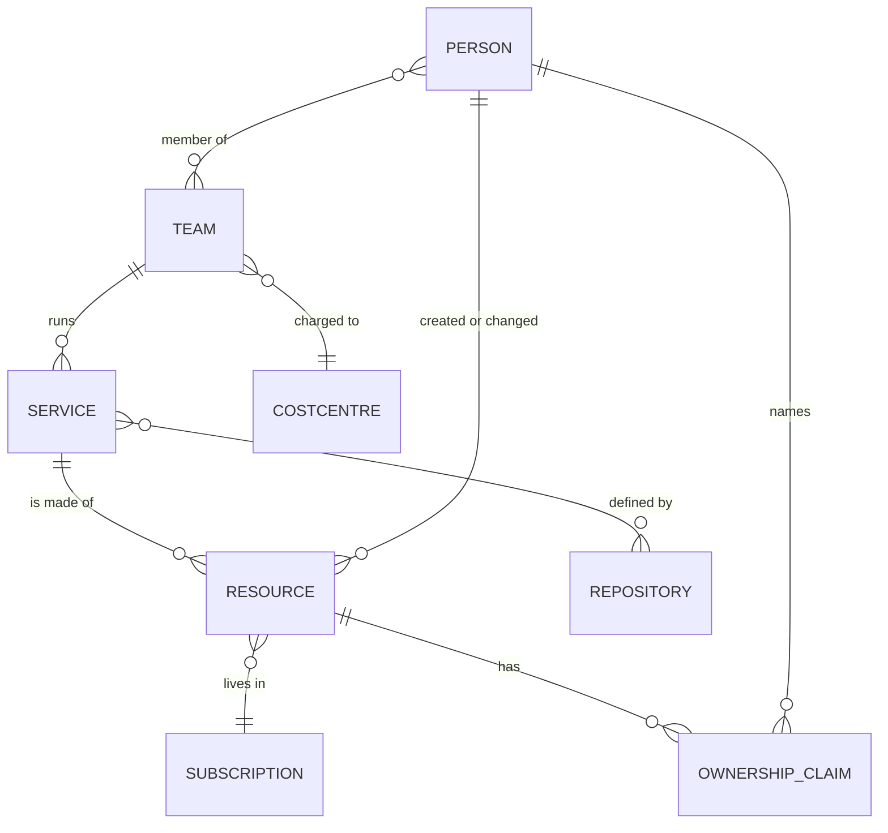
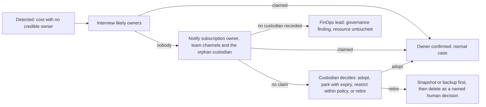

# Ownership & Organisation — "a recommendation without an owner is a rumour"

> **Status:** Ideation **v2** (revised after rubber-duck round 1; v1 archived [here](../_archive/round-1-v1/ideation/07-ownership-and-organization.md)) · **Date:** 2026-10-30 · Part of the [north-star vision](01-north-star-vision.md)
> **Scope guard:** concepts and organisational design only. Data sources and permissions are a Phase 4–5 topic; privacy rules are a guardrail topic ([08](08-trust-safety-and-guardrail-topics.md)).

---

## 1. Why ownership is the crux

Cost tools address recommendations to **scopes** (subscriptions, resource groups). Action happens through **people**. The distance between those two is where most savings die. The brief says it directly: the system must *"follow the directory"* and notify *"resource owners or someone defined in a tag"*. We take that further: **ownership is a product with its own lifecycle, evidence, confidence and conversation** — not a tag you hope is right.

---

## 2. The five hats (ownership is not one thing)

| Hat | Question it answers | Typical holder |
|---|---|---|
| **Accountable owner** | Who answers for this existing and costing this? | Product/service owner, team lead |
| **Technical steward** | Who can safely change it? | Engineer on the team; on-call |
| **Budget holder** | Who pays? | Engineering manager, cost-centre owner |
| **Consumers** | Who depends on it? | Other teams, partners |
| **Approver (authority)** | Who may authorise the change under policy? | Depends on value/risk (see [06](06-closed-loop-actions-and-autonomy.md)) |

A case may need different people for different hats: the **steward** to preview, the **budget holder** to approve a purchase, the **consumers** to be heard before a shared resource shrinks. The Herald and the Diplomat work with this model.

**Four counterparts decide whether a change may happen at all** (they are not "owners", but a plan that ignores them fails in practice):

| Counterpart | What they control | How the crew works with them |
|---|---|---|
| **Change-advisory / ITSM owner** | Change windows, standard-change catalogue, freeze calendar | Policy envelopes are submitted as *standard changes*; every Plan carries the change record |
| **Billing owner** | Agreement, billing scope, who may buy commitments | Source of truth for the Buyer's authorised signers ([06 §6](06-closed-loop-actions-and-autonomy.md)) |
| **Shared-platform owner** | Shared gateways, workspaces, firewalls, clusters | The Diplomat's first call; consent is explicit, never assumed |
| **SOC / incident commander** | Incident state; which data is security-relevant | Freezes all changes in an affected scope; co-signs any R3-Data class touching security data |

---

## 3. The Owner Graph

A living graph of **people, teams, cost centres, services, repositories, subscriptions and resources** where *every edge carries evidence, confidence, freshness and consent state*.

**Ownership claim states:** `Declared` (a tag says so) → `Inferred` (the system believes it) → `Corroborated` (≥2 independent signals agree) → `Confirmed` (a human said "yes, mine") · or `Contested` · `Stale` (older than its freshness window) · `Orphaned` (no credible claim).

Confidence **decays** with time unless refreshed; a *Confirmed* claim that is two years old is worth less than a *Corroborated* one from last week.

---

## 4. The signal waterfall

Ordered roughly from strongest to weakest, each with its failure mode.

| # | Signal | Why it helps | How it fails |
|---|---|---|---|
| 1 | **Explicit owner/contact tag** on the resource | Direct statement | Copy-pasted, stale, a former employee, a shared mailbox nobody reads; **writable by anyone with tag rights, so it is a *claim*, never proof** (it could even name a bystander) |
| 2 | **Tags inherited** from resource group / subscription | Cheap coverage | Wrong granularity (shared resource group) |
| 3 | **IaC repository & pipeline** (CODEOWNERS, repo owners, the team behind the deploying pipeline identity) | The people who actually change it | Platform pipelines deploy for many teams |
| 4 | **Deployment history** (who/what initiated the deployment) | Provenance | Service principals hide the human |
| 5 | **Activity history** (creator, last human modifier) | Who touched it, when | "Last touched" ≠ "owns" |
| 6 | **RBAC** (Owner/Contributor groups; eligible assignments) | Who is *allowed* | Over-broad access; stale groups |
| 7 | **Directory attributes** (group owners, application owners, sponsors, manager chain, department, cost-centre) | Turns a name into an accountable chain | Directory hygiene varies |
| 8 | **Billing hierarchy** (invoice section, cost centre, subscription admin) | Who pays | Pays ≠ operates |
| 9 | **Service catalog / CMDB** (if the customer has one) | Application → owner mapping | Out of date; may be non-Microsoft (optional import only) |
| 10 | **Application telemetry & alerting** (app maps, who is in the alert action group, on-call schedules) | Who gets woken up for it | Action groups outlive teams |
| 11 | **Topology** (connected networks and neighbours of known owners) | Guilt by adjacency | Shared networks |
| 12 | **Naming conventions** | Cheap hint | Conventions drift |
| 13 | **Work tracking & code references** (work-item area paths; repos mentioning the resource ID) | Links resource to a team's backlog | Needs access; privacy-sensitive |
| 14 | **Behavioural history** (who answered earlier cases for neighbouring resources) | Learns *who responds* | Reinforces loud owners; privacy-sensitive |

The Archaeologist fuses these into hypotheses; **no inference becomes "Confirmed" without a human**.

---

## 5. Ownership by conversation — the Estate Interview

When signals are weak or conflicting, the Herald **asks**, with respect for people's time:

> *"Hi Sanne — I'm the cost agent (AI). `vm-batch-07` (West Europe) costs about €310/month and I can't tell who owns it. You created it in March and you're still in Platform Engineering. Is it yours?"*
> **[Yes, mine] [It's my team's — add them] [Not mine — try someone else] [No idea] [Why are you asking?]**

Principles: ask the **most likely** person first; one question, one tap; explain *why you are asking*; every answer updates the Owner Graph (with provenance); "Not mine" asks for a pointer and walks the directory; never ask more than a few ownership questions per person per week.

**Attestation campaigns** (quarterly): *"You're listed as owner of these 14 resources. Still true? [Confirm all] [Review]"* — one tap for the happy path.

---

## 6. Following the directory

| Situation | Behaviour |
|---|---|
| **Owner is a person** | Reach them; respect time zone, language, working hours, presence/out-of-office |
| **Owner left or moved** (joiner-mover-leaver events) | Trigger an ownership review of everything they owned; propose a successor (manager, teammates); never leave resources "owned by a ghost" |
| **Owner unreachable** | Follow the **private-first ladder** ([05 §3](05-human-interaction-concepts.md)): delegates, the alternate owner or team lead, a team-channel post about the *case* (never naming a person), then one team-level summary for the accountable manager. Silence never becomes approval |
| **Owner is a group / DL / shared mailbox** | Resolve to humans; ask the group to nominate a steward |
| **Owner is external** (guest, vendor, contractor) | Route via the sponsor; stricter data-minimisation |
| **Owner is a workload identity** | Resolve the application's owners/sponsors; route to them |
| **Reorganisation** | Bulk attestation; map old team → new team; keep history |

---

## 7. Orphans — *adopt, park or retire (by a named human)*

Truly unowned, costly resources are nobody's problem — which is exactly why they persist. The v1 design started a quarantine ladder after *silence*. Round 1 review showed the flaw: **an orphan has nobody to be silent**, silence from a resource that has no owner is not consent, and a "countdown ends → delete" branch can destroy something business-critical that nobody documented. v2 makes a **named human** accountable instead.

**The orphan custodian.** Every scope (subscription or management group) has a *recorded custodian for orphans* — typically the subscription owner, the platform team or the FinOps lead — named in the policy envelope. The custodian is the **owner of last resort** and receives the orphan queue. For each orphan the custodian decides one of:

| Decision | Meaning | Limits |
|---|---|---|
| **Adopt** | Assign an owner; the owner confirms (never assumed) | Normal case flow follows |
| **Park** | Accept the cost, with a reason and an **expiry date** | Re-asked at expiry |
| **Restrict or pause** | Reduce exposure or cost within the policy's allowed classes | Reversible classes only; the [enrolment and precedence rules](06-closed-loop-actions-and-autonomy.md) still apply |
| **Retire** | Delete — a *named human decision* | Only after snapshot/backup (an R2 path); never for locked, held or protected scopes |

If a scope has **no custodian**, the case goes to the FinOps lead and the system raises *the missing custodian itself* as a governance finding. **The resource is left untouched.**

What the system does by itself: *detect, investigate (Archaeologist), interview likely owners, notify, advise*, and write an **advisory tag** ("suspected orphan; custodian: X"). It never stops or deletes because someone was silent.

Timelines, thresholds by value and risk, and what is exempt are **policy**, set by humans. High-value or high-risk orphans stop at *advise* and go to the FinOps lead. **No step starts because somebody was silent**: each starts because a human — or an *enrolled* policy — decided it.

---

## 8. Tags are a cache, not the truth

- The agents **propose tag values** (from the Owner Graph), ask the owner to confirm, then *write the tag* — for **advisory tags only** (R0, L2→L4 by policy).
- **Two kinds of tag.** *Advisory* tags are descriptive (team, cost centre, a "suspected orphan" label). *Control-plane* tags decide what automation may touch — environment, criticality, data class, exemptions such as `cost-exempt`, and ownership itself. They are **security-relevant**: anyone who can write a tag could otherwise steer the system, or hide a resource from it. Only an **independent authority** changes them (with audit), and a freshly written or inferred value does not qualify a resource for automation until a **cooling-off revalidation** passes ([06 §5](06-closed-loop-actions-and-autonomy.md)).
- **Tag drift** (tag says X; evidence says Y) opens a small case.
- **Tag taxonomy** guidance (owner, team, cost centre, environment, criticality, data class, expiry) is part of the Coach's output, aligned with CAF tagging guidance.
- **Expiry tags** (`expires-on`) make "temporary" real: the Herald asks at expiry; if nobody answers, the case follows the [private-first ladder](05-human-interaction-concepts.md) — expiry never triggers a deletion by itself.

---

## 9. Showback, chargeback and shared costs — by *actual usage*

Owners tolerate cost allocation when it is **fair and explainable**. The system derives **usage-based allocation keys** from telemetry rather than flat splits:

| Shared thing | Allocation key (idea) |
|---|---|
| Log workspace | Ingested GB per source resource / team |
| Virtual WAN user-VPN gateway | Connected users or connection-hours per business unit |
| Shared firewall / NAT | Bytes processed per workload |
| Shared Kubernetes cluster | Namespace requests / usage |
| Shared database server / elastic pool | DTU/vCore usage per database |

Each allocation is explainable in one sentence ("your team produced 41% of the ingestion"), and the Narrator can say so in the monthly brief.

---

## 10. Incentives and organisational design

Most "FinOps problems" are incentive problems wearing a technical costume (Gap #6). Options to explore — all **opt-in** and **designed with Finance and HR**:

| Mechanism | Idea | Watch out for |
|---|---|---|
| **Savings dividend** | A share of *verified, sustained* recurring savings returns to the owning team's budget or innovation fund for N months | Perverse incentives (inflating the baseline), fairness for teams already lean; counting rules ([10](10-value-metrics-and-economics.md)) |
| **Team recognition** | Savings wins feed; "most improved"; champion badges | No individual leaderboards or shaming by default |
| **Cost fitness score** | A usage-aware health score per team (not only spend) | Goodhart's law; keep it explanatory |
| **Budget conversations** | Mid-month forecast dialogue instead of an end-of-month surprise | Over-messaging |
| **Time-boxed "waste weeks"** | A light gamified sprint | Fatigue |
| **Engineering-metric alignment** | Cost-per-unit in the team's own service dashboards | Needs unit definitions |

**The FinOps team's role changes:** from analysts who produce reports to **policy authors, agent stewards and coaches**. Roles we expect: *FinOps lead* (owns policy and the dial), *Cloud CoE* (platform), *FinOps champions* (one per team), **agent stewards** (a named human accountable for each agent's behaviour), *executive sponsor*.

**The default unit of measurement is the team or the role, never the individual.** Individual-level views exist only for the person's own desk and for audit attribution. Savings, regret and response metrics are reported per team, per service and per role ([10](10-value-metrics-and-economics.md)).

---

## 11. Multi-tenant and partner scenarios (to decide later)

A Microsoft partner or MSP may operate for several customers. Ownership then spans **organisations** (the customer's contact, the partner's engineer). Requirements to explore: strict tenant isolation, customer-specific policy, who may see whose cases, how the partner's savings share is accounted for, and delegated administration across tenants.

---

## 12. People-data ethics (flagged now, ruled on later)

The Owner Graph uses data about people. That is useful and sensitive.

- **Purpose limitation:** ownership resolution for cost action — **never** performance management or surveillance.
- **Data minimisation:** the least data that resolves ownership; sensitive attributes excluded.
- **Transparency and disclosure:** people are told — in plain language, before the first message and not in a footnote — which signals about them are read, why, for how long and who can see the output. The honest answer to *"is anyone watching me?"* is precise: the system records **which resources you appear to own and what you decided about them**, to route and verify cost actions. It does not score or rank individuals' performance, and managers do not get individual-level reports by default. Employees can see *how* ownership was inferred and **contest** it (a "this is not mine" path is always available).
- **Accountability is audit attribution plus the customer's own RACI** — a record of *who approved what*, so the organisation can learn and answer for decisions. It is not a mechanism for personal blame.
- **Retention:** claims expire; history is kept at the level auditors need, not more.
- **Works councils (NL/DE) and GDPR** may require consultation and a data-protection impact assessment — to be validated with counsel ([research/03](../research/03-finops-framework-and-evidence.md) lists the anchors).
- **Behavioural-history and collaboration-data signals (#13, #14) are opt-in extras**, off by default.

Next: the guardrail territory → [08](08-trust-safety-and-guardrail-topics.md).
