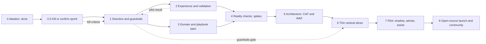

# Follow-up Plan — from ideation to an open-source, guardrailed, agent-driven product

> **Status:** Ideation **v3** (revised after rubber-duck round 2; v2 archived [here](../_archive/round-2-v2/plan/00-follow-up-plan.md), v1 [here](../_archive/round-1-v1/plan/00-follow-up-plan.md)) · **Date:** 2026-10-30 · Part of the [north-star vision](../ideation/01-north-star-vision.md)
> **Principle:** *no building before the guardrails exist; no guardrails without knowing what we are guarding; no assumptions without a cheap test.* Every idea in the ideation set has a **status** — *selected*, *research queue*, *parked with a re-open trigger*, or *retired* — see §5. Nothing is silently dropped, and nothing is silently promised.

---

## 1. Where we are

| Phase | What | State |
|---|---|---|
| **0 — Ideation** | North-star vision, opportunity catalog, crew, interactions, loop, ownership, guardrail territory, outer rim, metrics, PR/FAQ, research, this plan; **two rounds of rubber-duck review** ([reviews](../reviews/)) | ✅ this package (round 1 applied in v2, round 2 in v3 — see [reviews](../reviews/)) |
| **0.5 — Kill-or-confirm sprint** | ~4 weeks, **no remediation writes**: find out cheaply whether to continue, reshape or stop. One narrowly approved instrumentation exception (query audit on pilot workspaces); no change to anything else | **next** |
| **1 — Direction & guardrails** | Scope cut ratified, stop criteria ratified, guardrail charter, control matrix, threat model, RAI + privacy screening, OSS governance basics | after the sprint |
| 2 → 8 | see below | planned |

---

## 2. The plan on a page

**Gates.** Each phase ends with a **gate**: exit criteria met, stop/pivot criteria (K1–K7) checked, and a **rubber-duck review**. Duck gates are **risk-based**: a full *two-round* review at three gates — (1) Guardrail Charter v1, (2) before the first customer-facing write, (3) before public release — and one targeted round elsewhere. **Hard rule:** Phase 6 cannot start until Phase 1's *Guardrail Charter v1* and *safety invariants* are ratified, the **control matrix** exists, and no customer-facing write test runs before the **minimum write-safety harness** passes ([08 §5](../ideation/08-trust-safety-and-guardrail-topics.md)).

**Parallelism.** Phases 2 and 3 run side by side. The **Wizard-of-Oz pilot** in Phase 2 involves *humans* sending messages manually — no automation, no write access — so it may start as soon as the *outreach ethics* subset of Phase 1 (consent, attention limits, disclosure) is agreed. A *small* card test (about ten hand-built cards) happens inside Phase 0.5 **only after** the minimum outreach note — consent, disclosure, attention cap, who may be contacted — is agreed in writing with the sponsor and the customer's security contact (see the entry conditions below).

---

## 3. The phases

### Phase 0.5 — Kill-or-confirm sprint (~4 weeks, no remediation writes)
**Goal:** spend a few weeks, not a few quarters, finding out whether the idea survives contact with reality — and **stop cheaply if it does not**. This replaces the v1 order (a long guardrail marathon first) after the strategy review: the guardrails matter most for the *remediation writes*, and the sprint has none. The sprint is honest about what it *does* touch: **one instrumentation exception and a handful of real messages** — both under the entry conditions below.

| Item | Detail |
|---|---|
| **Entry conditions** | (1) A **one-page outreach note** agreed in writing with the sponsor and the customer's security contact: who may be contacted, the AI-disclosure text, consent, an attention cap, who may see what. (2) For the **query-audit exception**: the **data owner's and security's approval**, a **cost cap** (the audit records are billed as ingested data), a **scope** (named pilot workspaces), an **end date**, a **retention and deletion rule**, and a removal plan ([06 §3 item 13](../ideation/06-closed-loop-actions-and-autonomy.md)). Neither is a substitute for the Phase-1 guardrails; both are deliberately the *minimum* that makes the sprint honest. Who signs them is decision D17. |
| **Activities** | Secure a **sponsor** and **read access** to a friendly customer or internal estate · a one-hour **"top-10 unfixed recommendations — and why"** interview with a cloud CoE · enable **query audit (LAQueryLogs) on the approved pilot workspaces** under the exception above (the *evidence clock*: usefulness analysis needs weeks of query history) and run the **canary query** that measures audit coverage per workspace · a **Time Machine replay in Assess mode** over past recommendations · a **small Wizard-of-Oz card test** (~10 cards, humans send, after the outreach note is agreed) · **stay private under the working title** — the **licence is decided (MIT, D2)**; the name, the employer/OSPO/IP stance and the project home are settled before publication (D6), not for the sprint · **open a channel to the FinOps toolkit maintainers** (ride and contribute, do not duplicate) · record the **weekly time budget** · **pre-register** the stop criteria K1–K7 and the Release-1 cut |
| **Deliverables** | A one-page **kill-or-confirm memo**: evidence for and against, K1–K7 status, Release-1 cut confirmed or changed, decisions recorded |
| **Exit criteria** | Sponsor and read access (or a documented alternative) · CoE interview done · LAQueryLogs running with canary results · Time Machine replay produced · decisions recorded · a plain **go / reshape / stop** |
| **Stop/pivot** | K5 (no sponsor and read access by week 4 → publish the research as a guide) · K6 (no approved publication path by week 6 → internal accelerator) · K7 (under five hours a week for six weeks → freeze) · or the CoE interview shows the unfixed recommendations are *not* ownership or attention problems (reshape) |

### Phase 1 — Direction & guardrails
**Goal:** agree what we are building *first*, what would make us stop, and the rules the system must obey before any write exists.

| Item | Detail |
|---|---|
| **Activities** | Ratify the **Release-1 cut** and the **stop criteria K1–K7** · run the **guardrail sessions G1–G14** ([workplan](02-guardrails-workplan.md)) · build the **control matrix** (threat → invariant → decision record → policy rule → enforcement point → test vector → telemetry → owner) · specify the **minimum write-safety harness** · define the **RACI and liability model**, the **orphan custodian** and the **independence profile** · **decide the trust root (D16)** — a prerequisite for shipping *any* behaviour-affecting artefact in any release — and name the **cost-brake certifier (D18)** · ratify the **derived, linted classification rubric** ([06 §2](../ideation/06-closed-loop-actions-and-autonomy.md)) · threat model v0 (T1–T41) · Responsible-AI impact assessment kickoff · privacy (DPIA) screening incl. people-data and the disclosure statement · OSS governance basics (the licence is decided — MIT; name/trademark and the internal release process check before publication) · CAF/WAF alignment approach |
| **Deliverables** | Guardrail Charter v1 · Autonomy policy v1 (levels, entry/exit, downgrade triggers, enrolment rules) · ratified **safety invariants** (16 candidates) · control matrix v0 · write-safety harness spec · RACI and incident model · Threat model v0 · RAI impact assessment v0 · DPIA screening result · OSS governance note · decision records |
| **Exit criteria** | Charter reviewed by security, compliance/legal, Finance and a platform owner · invariants ratified · stop criteria agreed · control matrix complete for every invariant · duck gate passed (**two rounds**) |
| **Stop/pivot** | A veto-level objection (e.g. legal) that cannot be mitigated for the chosen scope |

### Phase 2 — Experience & validation
**Goal:** learn whether **owners act when asked well**, before building anything.

| Item | Detail |
|---|---|
| **Activities** | 6–10 interviews (owners, FinOps, Finance, security, SRE, managers, **change-advisory/ITSM, billing and shared-platform owners, SOC**) · personas and jobs-to-be-done · journey maps and service blueprints · channel strategy · **message design kit** (card, email, voice scripts, tone of voice, **private-first escalation ladder**) · accessibility and multilingual (NL/EN/DE/FR) · clickable prototypes · **Wizard-of-Oz pilot**: for 2–4 weeks *humans* send hand-built cards/emails for 30–50 real cases at a friendly customer — run to the **pre-registered pilot design** (hypotheses, thresholds, a *comparison condition* such as a matched control or stepped rollout, independent judges; [10 §8](../ideation/10-value-metrics-and-economics.md#8-pilot-design-and-success-criteria-strawman--to-be-pre-registered)) and measure the funnel, reasons and fatigue |
| **Deliverables** | Persona pack · journey maps · service blueprint · message kit · pre-registration document · WoZ results and funnel · updated bets **B1, B2, B6** |
| **Exit criteria** | **B1 validated, refuted, or reshaped** with data against the comparison condition · message kit stable · attention-budget parameters proposed |
| **Stop/pivot** | K1 — owners do not respond even to excellent asks → the product thesis changes (e.g. towards policy-first automation or shift-left) |

### Phase 3 — Domain & playbook specification
**Goal:** make the ideas precise enough to evaluate and build.

| Item | Detail |
|---|---|
| **Activities** | Case model and lifecycle (including **Observing**) · Owner Graph schema · Savings Ledger model (net realised value, provenance) · event taxonomy · **Playbook spec v0** ("Open Waste Rules") — **declarative and read-only**, referencing actions from a small maintainer-owned typed catalog · evaluation rubric · **write the five Release-1 playbooks as specs with test data** ([catalog selection](../ideation/02-opportunity-catalog.md#selection-and-status-v2)); scoring of the next 8–12 is the Release-2 task · **Waste Lab** design (synthetic estate with injected waste and ground truth) |
| **Deliverables** | Domain model · Playbook spec v0 · five Release-1 playbook specs (including the two seed examples) · Waste Lab design · evaluation plan |
| **Exit criteria** | Specs reviewed by FinOps and security; each playbook has *signals, evidence, counter-evidence, options, risks, verification, test data* |

### Phase 4 — Reality checks (feasibility spikes)
**Goal:** replace each load-bearing assumption with evidence, **fast and time-boxed**. This is where "technical limitations" are finally allowed to speak. Candidate spikes are listed in [03](03-capability-radar.md); each ends in **Green / Amber / Red** and an ADR.

| Item | Detail |
|---|---|
| **Activities** | ~19 spikes of 1–3 days in **three waves** — *does the data exist* (wave 0), *who and what runs it* (wave 1), *can it act safely* (wave 2) — each with an owner, a decision date and an ADR slot in the [spike register](03-capability-radar.md#spike-register); e.g. cost data coverage and latency; **Advisor data access including the closed-loop view** (on the Release-1 critical path); metric/log usage signals and **audit-coverage canary**; DCR transformation dry-run and **shadow** measurement; vWAN P2S metrics, **banded capacity lookup** and the scale operation (**disruptive until measured**); Teams actionable approvals and authentication; directory/manager-chain/presence reads; Foundry agent workflows with wait states, evaluation and tracing; agent identities and RBAC; **IaC pull-request path**; **approval binding to commit SHA and plan digest**; **cost per case**; open-source release process |
| **Deliverables** | Feasibility register · ADRs · list of scope adjustments · cost-per-case baseline |
| **Exit criteria** | No *Red* on a Release-1 playbook's critical path, or a documented alternative |

### Phase 5 — Architecture & design (CAF/WAF-aligned)
**Goal:** a reference architecture for the platform *and* its safety envelope.

| Item | Detail |
|---|---|
| **Activities** | Landing zone for the tool · identity and permission design (read vs write, JIT, on-behalf-of vs self; **tenant identity on every artefact, fail closed**) · data and estate model · agent topology and durable workflow design · **safety architecture** (policy engine, approval service, **immutable hash-chained ledger with evidence and personal data stored separately**, kill switch, rollback bundles, **governed-release pipeline**) · observability of agents (traces, evals, cost) · resilience and fail-safe modes · threat model v1 · **WAF review** · Responsible-AI design review · infrastructure-as-code using verified modules |
| **Deliverables** | Architecture pack · ADR set · threat model v1 · WAF review report · RAI design review |
| **Exit criteria** | WAF review passed (or findings accepted with owners) · security design review passed · targeted duck gate passed |

### Phase 6 — Thin vertical slices
**Goal:** prove the loop end-to-end on small, safe, real examples — each slice *includes its evaluations, guardrail tests and red-team scenarios*. **Release 1 is five plays on one pre-release skeleton:** **SL0** is the skeleton (not a play), and the five plays are **SL5** (Owner Graph and the Estate Interview), **SL2** (log usefulness, advisory), **SL3** (P2S right-sizing), **SL1** (orphans and Advisor-recommendation closure) and **SL8** (provisioned-throughput utilisation — conditional). Nothing here writes to a customer estate before the write-safety harness passes. *Slice IDs are SL-numbers so they cannot be confused with the spike IDs (S1–S22) in [03](03-capability-radar.md).*

| Slice | Release | What it proves |
|---|---|---|
| **SL0 — Skeleton** | Skeleton | One case: signal → case file → card → (mock) execution → ledger entry |
| **SL5 — Owner Graph and the Estate Interview** (pulled forward) | R1 | Owner Graph updates by conversation; attestation; the **orphan custodian** |
| **SL1 — Orphans and Advisor closure** (unattached disks, orphan snapshots, empty plans, and the Advisor and FinOps-toolkit findings for orphaned or idle resources) | R1 | Full HITL with **real** approval, authority check, snapshot, rollback, verification — **no deletion on silence**; routes the *existing* recommendations to owners, the brief's own problem |
| **SL2 — Log usefulness (read-only)** | R1 | Table/pattern usage analysis on **non-Sentinel** workspaces, **audit-coverage canary**, **shadow measurement**, advisory cards — no changes |
| **SL3 — vWAN P2S right-sizing** | R1 | **Banded** capacity lookup, Assist-level approval, **consent from every affected business unit**, window (Microsoft says to plan for downtime), rollback, verification |
| **SL8 — Provisioned-throughput utilisation (advise)** | R1, if a pilot customer has deployments | Demand-pull proof for the AI-workload family |
| **SL7 — Log filter execution** (R3-Data) | Later | Only after SL2 evidence, **data-owner and security co-sign**; never L3/L4; the cheap copy is a net, not an undo |
| **SL4 — Dev sleep schedule** | Parked | Re-opens with the TIME family ([catalog](../ideation/02-opportunity-catalog.md#selection-and-status-v2)); it is also the first candidate for the **enrolled-autonomy** hypothesis (Phase 7) |
| **SL6 — Commitment advice** | Parked | Re-opens with the RATE family; every transaction is signed by the authorised buyer |

### Phase 7 — Pilot (shadow → advise → assist)
**Goal:** real owners, real money, progressive autonomy.

| Item | Detail |
|---|---|
| **Activities** | Shadow (L0) for N weeks, scored · advise (L1) · assist (L2) · selected action classes to L3 only on evidence **and only for enrolled owners** · weekly **regret report** · monthly Finance reconciliation · attention-cost surveys · red-team exercise · kill-switch drill · **correlated-failure drill** |
| **Exit criteria** | [Pilot success criteria](../ideation/10-value-metrics-and-economics.md#8-pilot-design-and-success-criteria-strawman--to-be-pre-registered) met against the pre-registered comparison condition; no kill criterion triggered. **Release 1 proves AI-assisted closure only.** *Enrolled autonomy* (L3/L4) is a **separate hypothesis with its own pre-registration** — enrolment rate, approval fatigue, regret per enrolled class — to be run later on a bounded non-destructive class (dev sleep schedules are the natural first candidate) |

### Phase 8 — Open-source launch & community
**Goal:** a public, trustworthy, maintainable project.

| Item | Detail |
|---|---|
| **Activities** | **MIT licence** (D2) and governance in force · security policy and disclosure · documentation and quick-starts · **Waste Lab** and sample data · playbook library with contribution/review flow (**declarative playbooks only**) · release engineering and supply-chain hygiene · community channels and roadmap · publication through the agreed internal process |
| **Exit criteria** | Public release criteria agreed in Phase 1 are met; full two-round duck gate passed |

---

## 4. Cross-cutting tracks (run throughout)

| Track | Purpose |
|---|---|
| **A. Evaluation & safety harness** | Offline replays, Waste Lab scoring, red-team suites, calibration — gating every prompt/model/tool change (each is a **governed release**) |
| **B. Waste Lab** | Synthetic estate with ground truth; community-safe testing |
| **C. Playbook library** | Specs, test data, review status, provenance |
| **D. Decision log** | Every significant decision recorded with options, rationale and owner |
| **E. Stakeholder engagement** | Security, Finance, legal/compliance, HR/works council, platform owners, resource-owner champions, change-advisory and SOC owners |
| **F. Rubber-duck gates** | Risk-based: full two-round review at the three big gates, one targeted round elsewhere; citations spot-checked against primary sources |
| **G. Platform cost tracking** | Cost per case from the first spike onward |
| **H. Kill-criteria watch** | K1–K7 reviewed at every gate and monthly; first-party landscape re-checked quarterly ([research/06](../research/06-first-party-teardown.md)) |

---

## 5. Where every idea stands (status, not promises)

| Source | Idea group | Status |
|---|---|---|
| [02 catalog](../ideation/02-opportunity-catalog.md) | **Release 1:** Owner Graph (GOV-01/02/09) · log usefulness (TELE-01/02/03/06, advise only) · P2S right-sizing (SIZE-12) · orphans and Advisor-recommendation closure (IDLE-01/02/13) · PTU utilisation (AI-02) | **Selected** → Phase 3 specs → Phase 6 slices |
| 02 catalog | TIME, RATE (except the break-even gate), SEC (except the protected-sources registry), ADJ, SUST | **Parked**, each with a re-open trigger |
| 02 catalog | RATE-11, COMM-05 | **Retired**, with reasons |
| 02 catalog | Every other row | **Research queue** — no commitment |
| [09 outer rim](../ideation/09-outer-rims-moonshots.md) | M-14 Time Machine, M-22 Waste Lab, M-35 FinOps-for-agents, M-25 calibration league, M-27 blameless regret | **Enablers** (Phase 0.5–3) |
| 09 | M-01/02/03/04/07/10/13/19/20, M-26, M-28, M-29, M-37 | **Parked**, each with a re-open trigger |
| 09 | M-05 meeting-intent mining, M-38 multi-cloud visibility | **Retired** |
| 09 | The remaining candidates (e.g. M-08/09/11/12, M-21/23) | **Research queue** |
| [07 ownership](../ideation/07-ownership-and-organization.md) | Owner Graph, interviews, attestation, orphan custodian | Release-1 item 1 → slice SL5 |
| [08 guardrails](../ideation/08-trust-safety-and-guardrail-topics.md) | G1–G14, invariants, T1–T41 | Phase 1 (sessions, control matrix, harness) → Phase 5 → continuous tests |

**Retirement is allowed:** scope-cutting that can only defer produces a 300-item roadmap by stealth. Retired items keep their reason and a re-open condition; parked items keep a trigger.

---

## 6. Rubber-duck discipline

At the **three big gates**: **Round 1** (independent reviewers with distinct lenses: product/human factors, safety/governance, strategy) → fixes → **Round 2** (red-team, fact-check and consistency lenses on the revised package). At other gates one targeted round. **Reviewers' own cited facts are spot-checked against primary sources** before anything is accepted — a reviewer can reach the right verdict with a wrong example. The dispositions for this package are in [reviews/round-1/disposition.md](../reviews/round-1/disposition.md) and [reviews/round-2/disposition.md](../reviews/round-2/disposition.md) — the second also corrects two claims the first got wrong or only partly right.

---

## 7. Operator decisions — status

**D2 is decided: MIT** (2026-10-31), for code, documents and playbook specs — see [`LICENSE`](../../LICENSE). Everything else carries an *assumed default* and a *revisit trigger* on the status board in [01 — assumptions, risks and decisions §3](01-assumptions-risks-decisions.md#3-decisions-decided-or-assumed); **nothing in the ideation phase waits for an answer.** The repository stays private (D6) and keeps its working title (D1) until publication is on the table. The decisions added by review round 2 — the **trust root (D16)**, **who signs the Phase-0.5 exception (D17)** and **who certifies a resource class as safe to pause (D18)** — are assumed too, and are *design* items for Phases 1 and 5 rather than ideation questions.

---

## 8. How AI helps run *this* plan (dogfooding)

- Synthesise interview notes and cluster themes — with human verification.
- Draft playbook specs and test data from the catalog; humans review.
- Generate and maintain the Waste Lab scenarios.
- Run the rubber-duck reviews and the citation spot-checks.
- Keep the decision log and the assumption register current.
