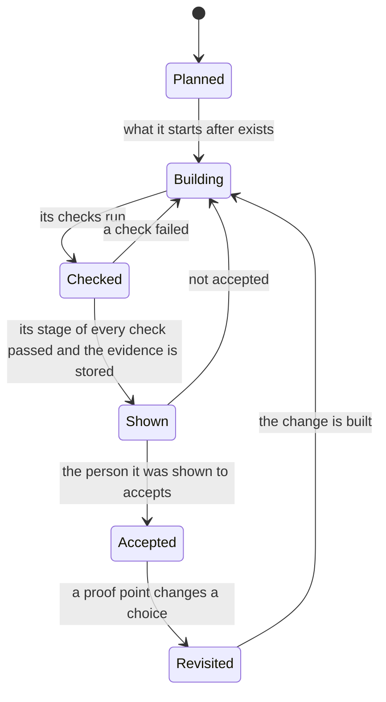
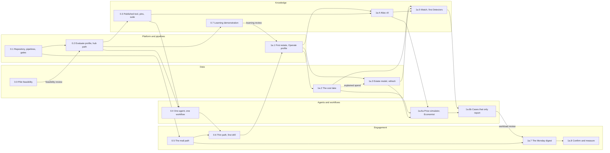

# The slices

**What this document answers.** In what order phase 0 and phase 1a are built, as seventeen slices; what each ends with, waits for and costs in effort; and why it sits where it does.

## How a slice works

A slice is a piece of the build that ends in something shown to a named person, with stored evidence and, for most slices, checks. A check that spans slices has a stage in each, and a slice is done when its stage passes ([First checks](03-first-checks.md#the-checks)). A slice **starts after** the slices it needs, and its checks can need more ([What depends on what](#what-depends-on-what)). Slices 1a.1 to 1a.6b are built in two passes ([the first-workload milestone](#phase-1a-first-value-on-one-estate)), and a slice starts after the first pass of the slices it needs. Every number in a pass condition is a **starting value**, written down before the measurement. Three decision reviews sit between slices ([the reviews](04-cost-effort-and-risks.md#the-three-reviews)).

## Phase 0: foundations

Phase 0 builds the [Evaluate profile](../design/02-architecture.md#7-two-profiles-one-codebase) from code and one thin path from a synthetic lead to a test e-mail, on synthetic data only. Two slices answer the largest unknowns early: whether the pilot's bill can support analysis (0.0, in week 0) and whether new evidence makes the system better (0.7). Each ends in a decision review. **It ends when** proof points P1, P2 and P9 of [the roadmap](../design/13-roadmap.md#2-ten-proof-points) pass, a fresh deployment of dev from scratch works, the isolation test passes (dev cannot reach prod), a first kill-switch drill has run in dev (check C12), and the feasibility and learning reviews have decided to go on. Proof point P6 stays in phase 1b.

| Slice | What exists at the end | Shown, with recorded evidence | Starts after | Checks | Person-weeks |
|---|---|---|---|---|---|
| [0.0 Pilot feasibility](#00-pilot-feasibility-in-week-0) | One closed month of the first estate's bill, read by a route its owner already authorises and reconciled; its price basis; the pilot owner, access, hub, region and model quota named | The FinOps lead and the platform team lead read the feasibility record; the feasibility review decides | Nothing: it is week 0 | C13 (first stage) | 1 to 2 |
| [0.1 Repository](#01-repository-pipelines-and-gates) | Repository layout, code owners, CI, OpenID Connect to dev, budgets and anomaly alerts | A pull request blocked by a failing check | [A GitHub organisation, two subscriptions](02-before-you-start.md#what-the-adopting-organisation-provides) | None | 2 to 3 |
| [0.2 Hub path](#02-the-evaluate-profile-and-the-hub-path-from-code) | The Evaluate profile as Bicep; hub onboarding; the pre-flight job | A call through the hub works; a direct model call fails | 0.1, [a hub](02-before-you-start.md#what-the-adopting-organisation-provides), the feasibility review | C1 (first half) | 4 to 5 (6 to 8 with the accelerator) |
| [0.3 Tool and pins](#03-a-published-tool-its-pins-and-the-first-suite) | A stub `estate-read` tool with pins; the synthetic-estate generator; the suite harness | A changed tool is caught; the suite finds planted waste and ignores its decoy | 0.1, 0.2 | C3 (P9) | 4 to 5 |
| [0.4 Agent, workflow](#04-one-hosted-agent-one-workflow) | One minimal role; a Durable Functions workflow that calls it, waits and resumes | The call in hub logs; a one-hour wait that survives a host restart | 0.2, 0.3 | C1 (P1, second half), C2 (P2) | 3 to 4 |
| [0.5 Mail path](#05-the-mail-path) | A shared mailbox; a scoped Exchange role; the send step with an allow-list; an AI-marked template | A test e-mail arrives with its AI marks; a second mailbox is denied | 0.1, [administrators' grants](02-before-you-start.md#what-the-adopting-organisation-provides) | C4 (first part) | 2 to 3 |
| [0.6 Thin path](#06-the-thin-path-end-to-end-and-the-first-drill) | A synthetic lead goes from plain-code stand-ins for [Watch](../design/03-agents-and-workflows.md#4-seven-workflows), a Case and the Diplomat, through the workflow of 0.4, to a digest e-mail; a switch is pulled and released | The test e-mail; the drill's times; a dev identity that reaches nothing in prod | 0.4, 0.5 | C12 (first drill), isolation test | 3 to 4 |
| [0.7 Learning demonstration](#07-a-small-demonstration-that-it-learns) | A frozen snapshot of a few Atlas claims; a claim the system proposes from one new source and a person accepts; unseen cases and decoys written down beforehand; a scorer | A before-and-after table: cases found, decoys quiet, cost per run; the learning review decides | 0.1, 0.2 | C14 | 3 to 4 |

### 0.0 Pilot feasibility in week 0

Before anything that bills is deployed, the platform team and the FinOps lead find out whether the pilot can support analysis. A named person with the read-only roles that the system will later hold reads one closed month of the first estate's bill lines, by the first path that the agreement allows and the estate's owner already authorises ([the paths](02-before-you-start.md#choosing-the-first-estate)); they reconcile the total with Cost Management and write down the price basis: whose rates the figures use. They also confirm by name the pilot owner, access, hub, region and model quota ([02](02-before-you-start.md#what-the-adopting-organisation-provides)). The record stays in the organisation's tenant, because it names the estate. **Why first:** building for a pilot that cannot support analysis is the costliest mistake available. **Surprise:** an estate that offers only totals can run Cases but cannot pass the exit of phase 1a. **Read:** check C13.

### 0.1 Repository, pipelines and gates

The first infrastructure is budgets and anomaly alerts on the solution's own subscriptions, so cost is visible from the first deployment. **Why first:** every other slice needs a repository that enforces the rules. **Surprise:** a new subscription can need [up to 48 hours](https://learn.microsoft.com/azure/cost-management-billing/costs/tutorial-acm-create-budgets) before Cost Management features work, so create both in week 0. **Read:** the [repository layout](../design/09-delivery-and-operations.md#1-the-repository).

### 0.2 The Evaluate profile and the hub path from code

The solution's Foundry account holds no model deployment of its own, and Azure Policy refuses one, so every model call goes through the hub. **Why here:** the hub path is the riskiest part of the design, so it is proved before any agent exists. **Surprise:** an organisation without a hub deploys [the accelerator](https://github.com/Azure-Samples/ai-hub-gateway-solution-accelerator) at a pinned commit and overrides its loose defaults, which adds 2 to 3 person-weeks. **Read:** check C1 and [the hub and the landing zone](../design/02-architecture.md#6-the-landing-zone-and-the-hub).

### 0.3 A published tool, its pins and the first suite

The hub stores a pin for the stub tool: a fingerprint of its name, description, schema and server digest. The synthetic estate plants waste and decoys, harmless look-alikes that must stay quiet; the first suite scores a plain-code stand-in for the finder against them, which proves the harness before any role exists. **Why before 0.4:** no role is deployed before its suite passes, and no tool before its pins and a negative test. **Surprise:** whether the hub rejects a changed tool inline is [still unverified](../design/06-security-and-governance.md#2-what-can-go-wrong), so check C3 tests it. **Read:** check C3.

### 0.4 One hosted agent, one workflow

A hosted agent runs the minimal role, and a Durable Functions workflow calls it. Both Durable storage backends run (the Azure Storage provider and the Durable Task Scheduler), and the choice follows measured price and recovery. **Why here:** it needs the hub path of 0.2 and the suite harness of 0.3. **Surprise:** the Agent Framework's [Foundry hosting package is a prerelease](https://learn.microsoft.com/agent-framework/hosting/foundry-hosted-agent), so it sits behind a switch, with an adapter of our own around the generally available core as the tested fallback. **Read:** checks C1 and C2.

### 0.5 The mail path

In phase 1a this is the only way the system reaches people. **Why in parallel:** it needs only 0.1, but mailbox and permission requests can take weeks, so they go out in week 0. **Surprise:** grants in Exchange and in Entra [add up](https://learn.microsoft.com/exchange/permissions-exo/application-rbac), and Graph's [`sendMail`](https://learn.microsoft.com/graph/api/user-sendmail) returns 202 Accepted before delivery, so delivery is proved by receipt. **Read:** check C4.

### 0.6 The thin path end to end, and the first drill

The watch, the Case and the digest are stand-ins in plain code, written for this slice and replaced in 1a.5, 1a.6b and 1a.7; the minimal hosted role of 0.4 stands for the model call. In the drill, synthetic usage passes the daily spend cap, an automatic trip pulls the kill switch, and the runbook's commands release it in stages. **Why here:** that is the cheapest time to find that a part does not fit. **Surprise:** a switch that cannot be read counts as pulled, so a fault in the switch store stops the system by design. **Read:** check C12 and [stopping the system](../design/07-safeguards-and-drift.md#3-stopping-the-system).

### 0.7 A small demonstration that it learns

This slice shows the central idea at small scale, on synthetic data and through the hub path of 0.2: the system turns one new source into a claim, a person accepts it, and the system then answers cases it has not seen better than before while staying quiet on look-alikes that are legitimate. A model call and a few claims stand in for the later roles. It does not replace proof point P6, which needs sealed test cases and baselines in phase 1b. **Why here:** if a memory update does not help, the later work needs another design, and that is cheapest to learn now. **Surprise:** the result means something only if the system fails without the new claim, so the cases are chosen for a mechanism no seeded claim covers and are written down before the first run. **Read:** check C14.

## Phase 1a: first value on one estate

Phase 1a reads one real estate and only reports. **It ends when** proof points P4 and P7 (read paths) pass, explained spend (the share of the bill tied to an owner, a purpose and a billing mechanism) is measured, the system has made zero writes to the estate, and the FinOps lead has confirmed a number of findings that count ([the finding record](02-before-you-start.md#what-is-recorded-for-each-finding)), written down before work on the Cases starts, each priced on a named basis. Cost per Case and per confirmed finding are read from hub logs, dead ends (investigations that end without a message) included, with people's hours beside them. **The exit is reached only when that number is reached.** If it is not reached at the review point of the stage that is running, phase 1a stays open and the team decides what to change; the number is never lowered to fit a result, and a new number applies only to work done after it is written.

A confirmation is a judgement that a finding is true and worth acting on, with its price basis shown. It is not an owner's acceptance and not a verified saving, which needs a change and a bill that shows it.

**The first-workload milestone.** Phase 1a is built twice: first for one workload, then for the estate. A workload is a group of resources that serve one purpose for one team, such as an application with its environments, chosen with the first estate. The first pass builds slices 1a.1 to 1a.6b for that workload only: its scopes, the services it uses and a few Detectors. It ends when bill lines of that workload have travelled through the cost lake, the Estate model, an Atlas claim, a Detector or an Advisor lead, `price-sim` and a Case to a priced finding with its evidence, which the FinOps lead has read with the platform team and recorded. The workload review then decides whether to widen. The second pass runs check C6 on synthetic volumes, widens the same slices to the whole estate (check C5 repeats for each scope added) and adds 1a.7 and 1a.8. Phase 1a ends only when both passes are done. A size below covers both passes.

| Slice | What exists at the end | Shown, with recorded evidence | Starts after | Checks | Person-weeks |
|---|---|---|---|---|---|
| [1a.1 Operate profile](#1a1-the-first-estate-access-and-the-operate-profile) | The first workload's scopes readable; the Operate profile from code without the apps no slice uses yet, read roles only; switches and runbook; capability probes | A read works and a write fails on every scope; the pre-release report; the runbook used by two people | Phase 0, the organisation's [prerequisites](02-before-you-start.md#what-the-adopting-organisation-provides) | C5 (raw evidence; repeated for each scope added), C11, C12 (second drill) | 5 to 6 |
| [1a.2 Cost lake](#1a2-the-cost-lake) | Bill lines by the best path each scope allows, in one layout with source and price basis, for the workload's scopes first; 13 months of history where the path allows; 93 days of metrics | A closed month matches Cost Management within a tolerance written down beforehand (a pipeline test) | 1a.1, a per-resource bill path ([check C13](03-first-checks.md#c13-the-first-estate-offers-a-per-resource-bill-path), second stage) | C6 (second pass) | 4 to 6 |
| [1a.3 Estate model](#1a3-the-estate-model-and-its-refresh) | The [Surveyor](../design/03-agents-and-workflows.md#1-ten-roles-in-five-hosted-agents) and the Estate refresh workflow; stored profiles; owners as guesses; cost lines joined to resources, for the workload first | Ten sample resources resolve to candidate owners, which the estate owner checks; counts match Resource Graph; the first explained-spend figure | 1a.1 (the figure needs 1a.2) | C5 (stored profiles), C11 (Safety) | 4 to 5 |
| [1a.4 Atlas v0](#1a4-atlas-v0) | Claims with source, scope and evidence level for the services the first workload uses, then for the five to ten the estate has most of (starting values) | An answer about one of those services that cites a claim | 0.2, 0.3, 1a.1 | None | 3 to 4 |
| [1a.5 Detectors](#1a5-watch-and-the-first-detectors) | The Watch workflow; Detectors, back-tested and run in shadow: three to five for what the first workload runs, then ten to fifteen for the estate (starting values) | A shadow lead on a real resource, beside the Advisor items | 1a.2, 1a.3, 1a.4 | C6 (second pass) | 4 to 5 |
| [1a.6a Price simulator](#1a6a-the-price-simulator-the-economist-and-typed-records) | `price-sim`, `cost-query`, the [Economist](../design/03-agents-and-workflows.md#1-ten-roles-in-five-hosted-agents); price-basis labels and evidence levels in typed records | A price range with its basis; a replay of a closed month's bill matches the lake on the same scope, month, currency and cost type, within a tolerance written down beforehand (a pipeline test) | 1a.2, 1a.3, 1a.4 | C8 (start), C11 (Build and action plane) | 5 to 7 |
| [1a.6b Cases](#1a6b-cases-that-only-report) | The `investigate` hosted agent gains the [Detective](../design/03-agents-and-workflows.md#1-ten-roles-in-five-hosted-agents) and the `skeptic` agent is deployed; the Case workflow; the small reviewed command that records a finding; prompt-injection tests; the path matrix and a red-team session | A Case from lead to priced Recommendation draft; cost per Case from hub logs; at the milestone, a finding the FinOps lead has recorded | 1a.5, 1a.6a, 0.4 | C7 (P7), C8, C11 (Restraint, Honesty) | 7 to 11 |
| [1a.7 Monday digest](#1a7-the-monday-digest) | The [Diplomat's](../design/03-agents-and-workflows.md#1-ten-roles-in-five-hosted-agents) digest and the send step; a letter to the FinOps lead only; templates and tests | The digest arrives by 09:00 on a Monday and renders in classic Outlook and the FinOps lead's client | 1a.6b (first pass, its release gates passed), 0.5, the workload review | C4 (rest, production), C7 (end to end), C11 (Messages and pages) | 4 to 5 |
| [1a.8 Confirm](#1a8-confirm-and-measure) | The FinOps lead's confirmations in the ledger; cost per Case and per confirmed finding; the cost model against a closed bill | The number written down beforehand is reached | 1a.7 | C8 (P10) | 2 to 3, longer elapsed |

### 1a.1 The first estate, access and the Operate profile

The Operate profile is deployed from code, with the network built once, in full: subnets, DNS links and peering. The apps no slice uses wait for their phase: `bot` (the one public endpoint) and `approvals` for phase 2 and `runner` for phase 3, and so do the private endpoints of the last two. That makes nine private endpoints in phase 1a, ten in phase 2 and eleven in phase 3; the cost line of 1a.1 is the Pilot column less the two that wait. A pre-release run in a short-lived Operate environment in dev tests isolation, restores and the kill switch. **Why here:** all real data comes through this profile. **Surprise:** moving from Evaluate to Operate means [a new Foundry account](../design/02-architecture.md#7-two-profiles-one-codebase), deploying needs [a runner inside the network](../design/09-delivery-and-operations.md#3-pipelines-and-releases), and the [Capability gate](../design/08-testing-and-evaluation.md#8-the-path-of-a-change-and-what-blocks-a-release) needs a sealed test set that phase 1b builds, so a reviewed change comes first (check C11). **Read:** checks C5, C11 and C12.

### 1a.2 The cost lake

Every scope's bill lines land in one layout, whichever path delivered them. **Why here:** the Estate model, the Detectors and the price simulator all read the lake. **Surprise:** only a closed month can be reconciled with Cost Management, with scope, month, currency and cost type written down beforehand; check C13 ran by hand in week 0 and runs again, with the system's own identity, before this slice starts. **Read:** checks C13 and C6, and [cost data](../design/05-data-and-integrations.md#2-cost-data).

The cost data comes by the first path that works for each scope, in the order of the table in [Choosing the first estate](02-before-you-start.md#choosing-the-first-estate). The estate or billing owner creates any export, because the system holds only read roles in phase 1a. **A first estate must offer a per-resource bill path** to pass the explained-spend exit.

### 1a.3 The Estate model and its refresh

The Estate refresh workflow stores each scope's capability profile, and the Surveyor builds the Estate model. The stub `estate-read` of 0.3 gets its live version here. **Why here:** it needs the scopes of 1a.1, and the explained-spend figure also needs the lake of 1a.2 (the dashed arrow below). **Surprise:** owners come from the directory as guesses, and a guess is never shown as a fact until a person confirms it. **Read:** check C5 and [the Estate model](../design/04-knowledge-and-learning.md#6-the-estate-model).

### 1a.4 Atlas v0

Atlas v0 starts with the services the first workload uses, counted from Resource Graph, and adds the estate's by spend when the lake lands. Atlas reviewers merge every change by pull request. **Why here:** it needs the search of 0.2, the publishing and pins of 0.3 and the services the estate uses, known from 1a.1. **Surprise:** no priced Recommendation appears here, only in 1a.6b, and which retrieval option is best is proof point P5, in phase 1b. **Read:** [the Atlas](../design/04-knowledge-and-learning.md#2-the-atlas).

### 1a.5 Watch and the first Detectors

Detectors come from rows of the cost-trap bank (a catalogue of sourced Azure cost traps) that a person has verified against their sources. **Why here:** Detectors are back-tested on the lake and rest on Atlas claims. **Why shadow:** a Detector promoted too early turns false positives into Monday mail, so promotion is a person's decision on numbers written into each Detector beforehand, and it is not part of the exit. **Surprise:** the first Cases do not wait: [the Agenda](../design/04-knowledge-and-learning.md#6-the-estate-model) also takes Advisor items, anomaly alerts and the FinOps lead's hunches. **Read:** check C6 and [Detectors](../design/04-knowledge-and-learning.md#5-detectors-expensive-reasoning-once-cheap-checks-afterwards).

### 1a.6a The price simulator, the Economist and typed records

`price-sim` must reproduce a prior month's bill before it prices anything new, and every price carries its basis: contracted, billed or list ([the price order](../design/14-agreements-and-access.md#the-price-order)). **Why before the Cases:** a Case without a trusted price is an opinion. **Surprise:** this slice cannot start until the FinOps lead has written down, by pull request, how many confirmed findings end phase 1a and the margin for C8. **Read:** check C8.

### 1a.6b Cases that only report

This is the largest slice, and the most likely to move. No tool that proposes a change exists yet. The one command it adds records a finding in the ledger, under a platform-team identity with a time-boxed data role, so the ledger's write path stays reviewed; the Respond workflow and the pages replace it in phase 2. **Why here:** it needs leads, prices and a working agent path. **Surprise:** until phase 1b exits, the recommended default is that the Capability gate reports on the development set and cannot block, and every output reaches only the FinOps lead (check C11). **Read:** checks C7 and C8, and [the Detective and Skeptic loop](../design/03-agents-and-workflows.md#5-the-detective-and-skeptic-loop).

### 1a.7 The Monday digest

The 1a letter goes to the FinOps lead only, after an agreed pilot introduction, and has no links to the report card or pages: the owner first-contact flow needs phase 2's page and opt-out. It keeps the sections *What I learned*, *What moved in the bill*, *What I got wrong*, *What I need from you* and *What I cost* of [the Monday letter](../experience/05-letters-and-requests.md#the-monday-letter); the others have nothing to report before phase 3. It ends with a status block: Cases opened, findings confirmed, explained spend and cost per Case. Each finding carries its evidence in words (the figures, where each came from and the price basis), and a platform-team member shows the full record on request, read with the time-boxed data role of 1a.6b.

**Why here:** a digest is sent only once the Cases behind it have passed their gates. **Surprise:** five cold readers, the ten-second test and a native-speaker check come before it goes live, and C4 and C7 are repeated end to end for the production deployment, which completes the P7 evidence. **Read:** check C4 and [the letter rules](../experience/05-letters-and-requests.md#the-monday-letter).

### 1a.8 Confirm and measure

Every confirmation is recorded with the command of 1a.6b, and this slice measures what the digest produced. **Why last:** it needs the digest to have run. **Surprise:** the effort is small, but a billing month must close and the FinOps lead's calendar sets the pace. **Read:** check C8.

## What depends on what

Solid arrows mean *starts after* (after the first pass, for the slices of phase 1a), the dashed arrow *its check needs*, and a label names the review that gates the arrow. Arrows are direct: a slice also waits for what its predecessors wait for.

| Slice | Starts after (slices) |
|---|---|
| 0.0 | None |
| 0.1 | None |
| 0.2 | 0.0 (feasibility review), 0.1 |
| 0.3 | 0.1, 0.2 |
| 0.4 | 0.2, 0.3 |
| 0.5 | 0.1 |
| 0.6 | 0.4, 0.5 |
| 0.7 | 0.1, 0.2 |
| 1a.1 | 0.6, 0.7 (learning review) |
| 1a.2 | 1a.1 |
| 1a.3 | 1a.1 |
| 1a.4 | 0.2, 0.3, 1a.1 |
| 1a.5 | 1a.2, 1a.3, 1a.4 |
| 1a.6a | 1a.2, 1a.3, 1a.4 |
| 1a.6b | 1a.5, 1a.6a, 0.4 |
| 1a.7 | 1a.6b with its release gates passed, 0.5, the workload review |
| 1a.8 | 1a.7 |

A check can need more than the slices that start it: C1 calls the stub tool of 0.3, the explained-spend figure of 1a.3 needs the lake of 1a.2, the mail check of 1a.7 needs the production deployment, and 1a.8 needs a closed billing month. Sizes are person-weeks and scenario parameters, provisional until completed slices show how fast the team works; the totals, months and longest chains are in [How much work it is](04-cost-effort-and-risks.md#how-much-work-it-is).

## What comes after phase 1a

The plan is detailed only as far as phase 1a and is [re-issued at each exit](04-cost-effort-and-risks.md#how-the-plan-is-revised). [The roadmap](../design/13-roadmap.md#1-phases) holds phases 1b to 5. Phase 1b shows that the system learns (the Study workflow, the report card, baselines and sealed test sets); phase 2 reaches owners, with the client matrix (C9) and the sign-in test (C10) run before go-live; phase 3, which starts only after 1b, adds the action plane and runs C7 again once propose tools exist.
