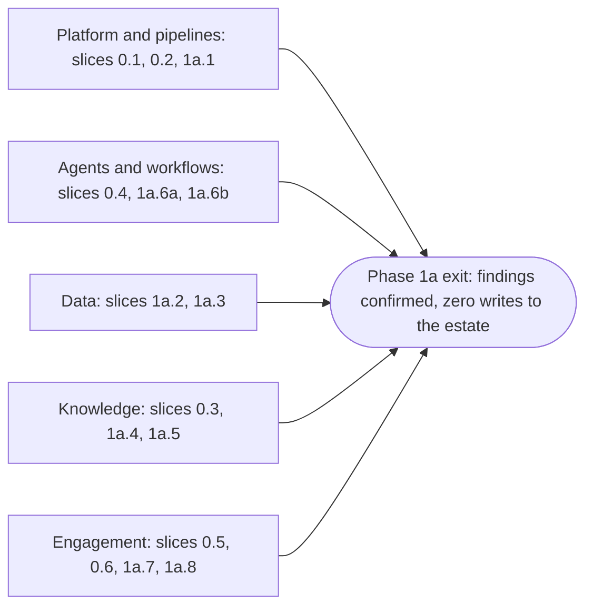

# Build plan: phase 0 and phase 1a

**What this document answers.** What is built first and in what order, how each step is shown to work, what the first stretch costs to run and to build, and what the adopting organisation must provide.

## What this plan is

[Meternaut](../design/README.md) is designed as a team of AI agents that keeps an Azure estate cost-efficient. It finds waste and tells the people who own the resources, with evidence. This plan covers the first two phases of the [roadmap](../design/13-roadmap.md): phase 0, foundations, and phase 1a, first value on one estate.

It is a plan only: nothing is built or deployed because of this folder.

It is written for a platform team and a FinOps lead at an organisation that will build the system from the [technical design](../design/README.md) (what the system is) and the [experience design](../experience/README.md) (what people see), and for a contributor who wants to know where to start. The design's [glossary](../design/README.md#words-used-in-this-design) defines the capitalised words used here, and its [roadmap](../design/13-roadmap.md#2-ten-proof-points) the ten proof points (P1 to P10), each a measurement. The hub is the governance gateway (Citadel, on Azure API Management) that every model and tool call passes through.

**What the first stretch ends with.** The system only reads the estate, and every Monday it e-mails a digest to the FinOps lead. The FinOps lead confirms findings as true and worth acting on, each with its price basis (whose rates the figure uses). The number to confirm is chosen by the FinOps lead (a starting value: five to ten findings) and written down before work on the Cases (investigations) starts. Phase 1a ends only when that number is reached. If it is not reached by the review date the adopting organisation sets, phase 1a stays open and the team decides what to change. The number is never lowered to fit a result; a new number applies only to work done after it is written.

## The shape at a glance

Each phase is cut into slices, fifteen in all: six in phase 0 ([foundations](01-the-slices.md#phase-0-foundations)) and nine in phase 1a ([first value on one estate](01-the-slices.md#phase-1a-first-value-on-one-estate)). A slice ends in something shown to a named person, with evidence that it works.

| Phase | Ends when |
|---|---|
| 0 | Proof points P1, P2 and P9 pass. A fresh deployment of the solution's dev environment from scratch works, and dev cannot reach prod. A first drill of the kill switches, which stop new work, has run in dev |
| 1a | The number of confirmed findings above is reached, and the system has made zero writes to the estate. Proof points P4 and P7 (read paths) pass. Explained spend (the share of the bill tied to an owner, a purpose and a billing mechanism) is measured. Cost per Case and per confirmed finding is read from hub logs, dead ends (investigations that end without a message) included, with people's hours beside it |

Five tracks of slices run in parallel and meet at the phase 1a exit.

Evaluation is not a track of its own: every slice adds its own tests (principle 4 below).

The first stretch is 56 to 76 person-weeks (a scenario parameter), without a hub deployment. That is roughly eight to eleven months for two builders or five to eight for three, before the organisation's approvals and before a billing month closes. It assumes that builders spend four days in five on the project and share the long slices. [Sizes and elapsed time](01-the-slices.md#sizes-and-elapsed-time) gives the detail.

## How the plan works

Eight principles order the work.

| # | Principle | In practice |
|---|---|---|
| 1 | Riskiest first, thinnest path first | Work is ordered by what could change a choice. One synthetic lead travels all the way to a test e-mail by the end of phase 0, before any depth is added |
| 2 | No system writes to the estate until phase 3 | Pipelines write only to the solution's own subscriptions. No action role and no `runner` identity exist in phase 0 or 1a. The kill switches and their runbook exist from the first deployment that reads an estate |
| 3 | Every slice ends in something shown | A named person sees it work, and the evidence is recorded ([How a check works](03-first-checks.md#how-a-check-works)) |
| 4 | Evaluation grows with the code | No role is deployed before its component suite (the tests for that role) passes. No tool is published before its pins and a negative test |
| 5 | Cost is visible from the first deployment | Budgets and anomaly alerts on the solution's own subscriptions are the first infrastructure. Cost per Case is read from hub logs from the first Case |
| 6 | One repository, one release record | Bicep with Azure Verified Modules, GitHub Actions with OpenID Connect, zip deployment, no container registry ([delivery and operations](../design/09-delivery-and-operations.md)) |
| 7 | A slice is done when its conditions hold | Its stage of each check passes with the evidence stored, its tests run in the pipeline, its cost line matches the deployment, a runbook covers it, and the person it was shown to accepts it ([Working agreements and done](02-before-you-start.md#working-agreements-and-done)) |
| 8 | Builders may use AI coding assistants | The same gates apply to every change |

**Numbers.** Sizes are person-weeks and scenario parameters: starting estimates for a team that knows Azure Functions, Bicep and the Microsoft Agent Framework, replaced by measurement. Every pass condition, margin, budget and time window is a starting value, written into the repository's `evaluation/` folder by a pull request before the measurement, never after. The plan gives no euro figure of its own; cloud cost is in [Cost and FinOps](../design/10-cost-and-finops.md).

## How to read this folder

| Document | Answers |
|---|---|
| [01 The slices](01-the-slices.md) | What is built, in what order, what depends on what, how big each slice is |
| [02 Before you start](02-before-you-start.md) | What the adopting organisation provides and decides, how to choose the first estate (it needs a per-resource bill path), who does what |
| [03 First checks](03-first-checks.md) | How each slice is shown to work: thirteen checks (eleven for these slices, two previews of phase 2), each with a pass condition and a fallback |
| [04 Cost, effort and risks](04-cost-effort-and-risks.md) | What it costs to run, how much work it is, where it can go wrong, how the plan is revised |

A platform team lead can start with [What the adopting organisation provides](02-before-you-start.md#what-the-adopting-organisation-provides): those requests begin in week 0. A FinOps lead can start with [Decisions the adopting organisation makes](02-before-you-start.md#decisions-the-adopting-organisation-makes), which includes the number of findings that ends phase 1a.

## What the plan leaves out

- **Calendar dates and staffing commitments.** They belong to the adopting organisation.
- **Phases 1b to 5 in detail.** [What comes after phase 1a](01-the-slices.md#what-comes-after-phase-1a) names them. The plan is detailed only as far as phase 1a and is re-issued at each phase exit ([How the plan is revised](04-cost-effort-and-risks.md#how-the-plan-is-revised)).
- **Build instructions.** The repository will hold them.
- **What people cost.** Effort is given in person-weeks, never in money.
