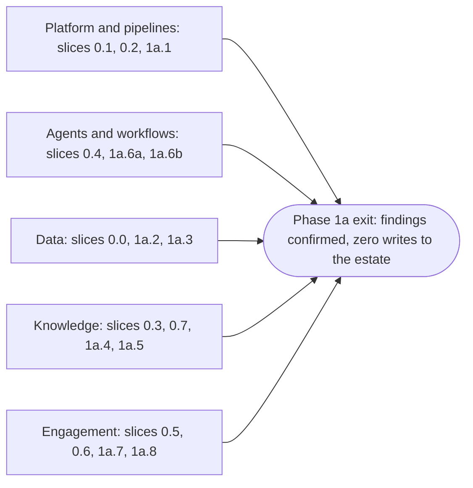

# Build plan: phase 0 and phase 1a

**What this document answers.** What is built first and in what order, how each step is shown to work, what the first stretch costs to run and to build, and what the adopting organisation must provide.

## What this plan is

[Meternaut](../design/README.md) is designed as a team of AI agents that keeps an Azure estate cost-efficient. It finds waste and tells the people who own the resources, with evidence. This plan covers the first two phases of the [roadmap](../design/13-roadmap.md): phase 0, foundations, and phase 1a, first value on one estate.

It is written for a platform team and a FinOps lead at an organisation that will build the system from the [technical design](../design/README.md) and the [experience design](../experience/README.md), and for a contributor who wants to know where to start. The design's [glossary](../design/README.md#words-used-in-this-design) defines the capitalised words used here, and its [roadmap](../design/13-roadmap.md#2-ten-proof-points) the ten proof points (P1 to P10), each a measurement. The hub is the governance gateway (Citadel, on Azure API Management) that every model and tool call passes through.

**What comes first.** Three early answers come before the long build: whether the pilot's bill can support analysis (week 0), whether new evidence makes the system better on cases it has not seen (early in phase 0), and one workload end to end, a priced finding that the FinOps lead has read and recorded (before phase 1a widens). Each ends in a review that can change the plan ([the three reviews](04-cost-effort-and-risks.md#the-three-reviews)).

**What the first stretch ends with.** The system only reads the estate, and every Monday it e-mails a digest to the FinOps lead, who confirms findings as true and worth acting on, each with its price basis (whose rates the figure uses). A finding counts only if it is distinct, credibly priced and adds discovery or follow-through to Azure's own advice ([the finding record](02-before-you-start.md#what-is-recorded-for-each-finding)). The number to count is chosen by the FinOps lead (a starting value: five to ten findings) and written down before work on the Cases (investigations) starts. Phase 1a ends only when that number is reached ([the exit](01-the-slices.md#phase-1a-first-value-on-one-estate)).

## The shape at a glance

Each phase is cut into slices, seventeen in all: eight in phase 0 ([foundations](01-the-slices.md#phase-0-foundations)) and nine in phase 1a ([first value on one estate](01-the-slices.md#phase-1a-first-value-on-one-estate)). A slice ends in something shown to a named person, with evidence that it works; each phase says in [01](01-the-slices.md) when it ends.

Five tracks of slices run in parallel and meet at the phase 1a exit.

The first stretch is 60 to 82 person-weeks (a scenario parameter), without a hub deployment: roughly nine to twelve months for two builders or six to eight for three, if they spend four days in five on the project and share the long slices. [How much work it is](04-cost-effort-and-risks.md#how-much-work-it-is) gives the detail.

## How the plan works

Nine principles order the work.

| # | Principle | In practice |
|---|---|---|
| 1 | Riskiest first, thinnest path first | Work is ordered by what could end the project: whether the pilot's bill supports analysis (0.0), whether the hub path works (0.2) and whether the system learns (0.7). One synthetic lead travels all the way to a test e-mail by the end of phase 0, before any depth is added |
| 2 | No system writes to the estate until phase 3 | Pipelines write only to the solution's own subscriptions. No action role and no `runner` identity exist in phase 0 or 1a. The kill switches and their runbook exist from the first deployment that reads an estate |
| 3 | Every slice ends in something shown | A named person sees it work, and the evidence is recorded ([How a check works](03-first-checks.md#how-a-check-works)) |
| 4 | Evaluation grows with the code | No role is deployed before its component suite (the tests for that role) passes. No tool is published before its pins and a negative test |
| 5 | Cost is visible from the first deployment | Budgets and anomaly alerts on the solution's own subscriptions are the first infrastructure. Cost per Case is read from hub logs from the first Case |
| 6 | One repository, one release record | Bicep with Azure Verified Modules, GitHub Actions with OpenID Connect, zip deployment, no container registry ([delivery and operations](../design/09-delivery-and-operations.md)) |
| 7 | A slice is done when its conditions hold | Its stage of each check passes with the evidence stored, its tests run in the pipeline, its cost line matches the deployment, a runbook covers it, and the person it was shown to accepts it ([Working agreements and done](02-before-you-start.md#working-agreements-and-done)) |
| 8 | Builders may use AI coding assistants | The same gates apply to every change |
| 9 | Narrow first, then wide | Phase 1a is built first for one workload, and widened after the workload review |

**Superseded in part on 2026-11-05:** a runner with action roles in phase 3 (principle 2). A change runs as the approver; see [decision 24](../design/12-decisions.md#24-a-change-runs-as-the-approver-meternaut-holds-no-right-to-change-azure--accepted) and [proposal 05](../proposals/05-run-as-the-approver.md).

**Numbers.** Sizes are person-weeks and scenario parameters. The schedule is provisional, and completed slices replace the estimates with measurements. Every pass condition, margin, budget and time window is a starting value, written into the repository's `evaluation/` folder by a pull request before the measurement, never after. The plan gives no euro figure of its own; cloud cost is in [Cost and FinOps](../design/10-cost-and-finops.md).

## How to read this folder

| Document | Answers |
|---|---|
| [01 The slices](01-the-slices.md) | What is built, in what order, what depends on what, and the first-workload milestone |
| [02 Before you start](02-before-you-start.md) | What the adopting organisation provides and decides, how to choose the first estate (it needs a per-resource bill path), what is recorded for each finding, who does what |
| [03 First checks](03-first-checks.md) | How each slice is shown to work: fourteen checks (twelve for these slices, two previews of phase 2), each with a pass condition and a fallback |
| [04 Cost, effort and risks](04-cost-effort-and-risks.md) | What it costs to run, how much work it is, where it can go wrong, the three reviews, how the plan is revised |

A platform team lead can start with [What the adopting organisation provides](02-before-you-start.md#what-the-adopting-organisation-provides): those requests begin in week 0. A FinOps lead can start with [Decisions the adopting organisation makes](02-before-you-start.md#decisions-the-adopting-organisation-makes), which includes the number of findings that ends phase 1a.

## What the plan leaves out

- **Calendar dates and staffing commitments.** They belong to the adopting organisation.
- **Phases 1b to 5 in detail.** [What comes after phase 1a](01-the-slices.md#what-comes-after-phase-1a) names them. The plan is re-issued at each phase exit ([How the plan is revised](04-cost-effort-and-risks.md#how-the-plan-is-revised)).
- **What people cost.** Effort is given in person-weeks, never in money.
