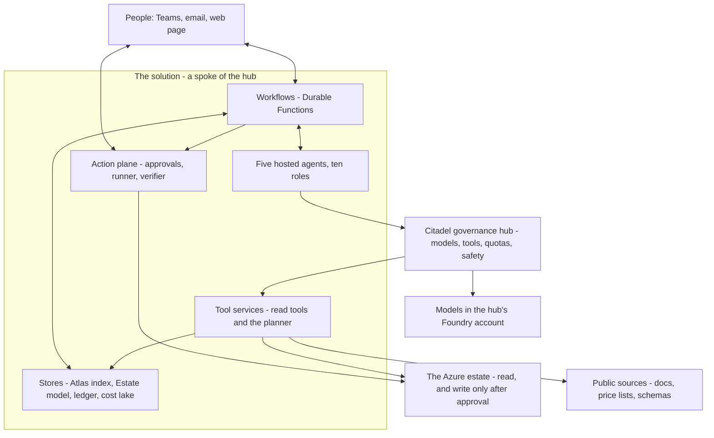
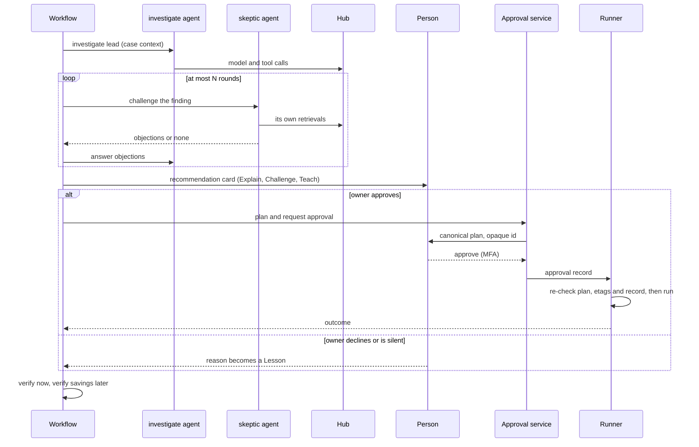

# Architecture

**What this document answers.** What the parts are and how they connect; where the Citadel governance hub sits; what runs where in the two profiles; which traffic goes through the hub and which does not; what happens when something fails.

## 1. The picture

The solution is a **spoke** of the Citadel governance hub. Plain code (workflows) decides when and in what order; AI agents think and return typed records; read tools show the estate; one separate component, the action plane, is the only thing that changes Azure.

Two rules shape everything. **Agents never write to Azure**: they hold read tools and a few *propose* tools (draft a record, a message, a pull request, a what-if). **Nothing talks to a model or a tool except through the hub**: quotas, safety checks and logs live there, not in each agent.

## 2. Planes and components

| Plane | Components | Runs on | Writes to Azure? |
|---|---|---|---|
| Reasoning | Five hosted agents hosting ten roles ([03](03-agents-and-workflows.md)) | Foundry hosted agents, built with Microsoft Agent Framework | No |
| Control | Seven workflows: Watch, Case, Study, Estate refresh, Respond, Strategy, Evaluate and grow | Azure Functions, Durable Functions (`workflows` app) | No |
| Knowledge | Atlas (Git, served from AI Search); Estate model, Lessons, ledger (Cosmos DB) ([04](04-knowledge-and-learning.md)) | Git, AI Search Basic, Cosmos DB serverless | No |
| Data and tools | Cost lake, read tools, price simulator, planner ([05](05-data-and-integrations.md)) | Blob, DuckDB inside the `tools` Function app | No (the planner only runs what-if) |
| Action | Action catalogue, approval service, runner, verifier, audit log, kill switches ([06](06-security-and-governance.md)) | `approvals` and `runner` Function apps; immutable Blob | **Yes: the only writer** |
| Engagement | Teams bot, email, a small web page | `bot` (the one public endpoint) and `approvals` Function apps; Microsoft Graph | No |
| Governance | The Citadel hub: contracts, quotas, safety, usage logs ([07](07-safeguards-and-drift.md)) | API Management based, in the landing zone | No |

## 3. Five Function apps, one compute family

All of our own code runs on Azure Functions (Flex Consumption, zip deployment): no container registry and no container platform to run. Five apps keep identities and exposure apart. In Operate each app calls out through virtual network integration, so it reaches the stores, the Foundry account and the other apps over private endpoints; only `bot` also takes calls from the public internet.

| App | Holds | Identity can | Exposed to |
|---|---|---|---|
| `workflows` | Durable orchestrations and their activities; the send step for messages | Invoke the five hosted agents; read and write workflow state; send e-mail through Graph and queue Teams messages for the `bot`; call the approval service | Nobody: no inbound trigger |
| `tools` | Read tool services, the price simulator, DuckDB analysis, the front of the `plan` tool | Read the estate with Reader, Cost Management Reader, Monitoring Reader, Log Analytics Reader; read the stores | The hub only: private endpoint |
| `approvals` | Approval service, the web page | Write approval records and credentials; start the runner through a queue | People on the organisation's network (Entra sign-in, Conditional Access) and the `bot`: private endpoint |
| `runner` | Action runner (identities per action family), verifier, a what-if-only function for `plan` | Change Azure within opted-in scopes; record that an approval was consumed | `tools`, for what-if by plan id only: private endpoint. Otherwise nobody |
| `bot` | The Teams bot endpoint (C# or TypeScript, as the Agents SDK needs) | Call the approval service with the tapper's own token; put replies on an `inbound` queue; post what `workflows` leaves on an `outbound` queue; install itself for a person | Teams, over the public internet: token-validated ([06](06-security-and-governance.md)) |

A workflow that waits days for a person costs nothing while it waits: Durable Functions stores its state and wakes on an event or timer. A hosted-agent session cannot wait, which is why waiting lives in workflows ([03](03-agents-and-workflows.md)). [Hosted agents](https://learn.microsoft.com/azure/foundry/agents/concepts/hosted-agents) · [Flex Consumption](https://learn.microsoft.com/azure/azure-functions/flex-consumption-plan)

## 4. What goes through the hub, and what does not

| Traffic | Path | Through the hub? | Authentication |
|---|---|---|---|
| Model calls from agents (chat, responses) | Hosted agent → hub → model deployment | **Yes** | Agent's Entra token plus the contract's key |
| Embeddings and evaluator calls | Same | **Yes** (`embed` and `evaluation`) | Same |
| Tool calls from agents | Hosted agent → hub → tool service | **Yes** (published tools, allow-listed, pinned) | Same |
| Invoking an agent from a workflow | `workflows` → Foundry agent endpoint | No | Entra token; Foundry role on the project |
| Atlas retrieval | `atlas` tool → AI Search | Tool call is; search is internal to the tool | Managed identity |
| Reading Azure, Graph, price APIs | `tools` → Azure and Graph | No (these are not AI traffic) | Managed identity, least privilege |
| Writing Azure | `runner` → ARM | No (not AI traffic; guarded by the action plane) | Per-action-family identity |
| Messages to people | E-mail: `workflows` (send step) → Graph. Teams: `workflows` → `outbound` queue → `bot` → Teams | No | Managed identity |
| Replies and taps | Teams → `bot` → `inbound` queue → `workflows` (Respond). A tap: `bot` → approval service with the tapper's token | No | Bot Framework token; the tapper's Entra token |
| Foundry IQ and other direct retrieval | Not used until routable | n/a | n/a |

The spoke's Foundry account holds **no model deployments of its own**; Azure Policy denies them and local keys are off. Egress to model endpoints other than the hub is blocked. A negative-path test in CI proves that a direct model call fails ([08](08-testing-and-evaluation.md)).

## 5. How one Case flows

Every arrow from an agent goes through the hub. The workflow, not an agent, decides to stop the loop (rounds, convergence, budget). If the plan, an etag or the live state no longer matches, the runner **fails closed** and a new plan needs a new approval ([06](06-security-and-governance.md)).

## 6. The landing zone and the hub

The solution onboards to the **Citadel governance hub of the adopting organisation's Azure landing zone**. The [Citadel Governance Hub](https://github.com/Azure-Samples/ai-hub-gateway-solution-accelerator) is an API Management based gateway published as an MIT-licensed sample.

| | What the landing zone or hub provides | What the solution adds |
|---|---|---|
| Identity | Tenant, Entra groups, Conditional Access | Agent identities, per-agent app roles, approver groups |
| Network | Hub network, firewall, private DNS, peering | A delegated agent subnet, private endpoints, hub-spoke-hub peering |
| Models and tools | Model backends, aliases, quotas, safety policies, tool publishing | One **contract per hosted agent** (`study`, `investigate`, `skeptic`, `diplomat`, `engineer`) and one for the evaluation harness (`evaluation`), in dev and prod; the eleven published tools |
| Monitoring | Central Log Analytics and monitor scope | Diagnostic settings, workbooks, alerts |
| Policy | Azure Policy and Defender for Cloud baselines | Policy that denies model deployments in the spoke |

**If the organisation has no hub**, the repository's `hub/` instructions deploy the accelerator at a pinned commit. It has no releases and its defaults loosen security (public endpoints, prompt and completion capture), so we override them. Its always-on usage pipeline is its main fixed cost, priced separately in [the cost document](10-cost-and-finops.md). The Publish Contract that exposes tools as MCP is in preview; the fallback is to import the tool API natively in API Management.

## 7. Two profiles, one codebase

| | Evaluate (dev) | Operate (prod) |
|---|---|---|
| Purpose | Build, test and evaluate on **synthetic data** | Read real estates; act after approval |
| Subscription | Its own | Its own |
| Foundry | Basic setup; public endpoint with Entra sign-in and an IP allow-list | Bring-your-own virtual network with **platform-managed agent data**; private endpoint ([networking options](https://learn.microsoft.com/azure/foundry/agents/concepts/networking-options)) |
| Hub | Dev contracts on the same hub. They reach no production backend, and a negative test in CI gates every release; a separate gateway is an option for stricter organisations | Prod contracts |
| Private endpoints | None | Eleven: eight for the dependencies (Foundry account, AI Search, Cosmos DB, audit storage, platform storage: blob, queue, table; Key Vault) and three inbound to the `tools`, `approvals` and `runner` apps |
| Roles | **No role on any production scope**; tested in CI | Read roles at onboarded scopes; action roles only where the organisation opts in |
| AI Search | Free tier | Basic |

The network setting is chosen when the Foundry account is created and cannot be added later. **Moving between profiles means a new account, not a parameter flip.** A pre-release check counts the private endpoints of a short-lived Operate environment against this table: eleven is our own sum, because Learn gives per-resource rules, not a total. Foundry's own agent data can also be bring-your-own (Cosmos DB and Storage in the organisation's tenant); that adds two private endpoints and is a parameter.

The default region is Sweden Central: hosted agents, the hub accelerator and the AI landing zone all list it. It is a default, not a requirement ([delivery](09-delivery-and-operations.md) says how to check).

## 8. Failure modes

| Failure | What happens | What we do |
|---|---|---|
| Hub unavailable | Agents cannot reach models or tools; nothing falls back to direct access | Workflows queue and retry; digest says "paused"; page the platform team |
| Model throttled (429) or quota reached | Hub returns the limit; the contract's alias may fall back to another member | Back off; park low-priority work; alert on repeated 403 quota |
| Hosted-agent session times out | The session ends; state in the workflow is intact | Workflow starts a new session with the case-context record |
| Activity runs twice (at-least-once) | Idempotency key and deployment name derived from the plan id | Second run reads the existing result |
| Runner crashes mid-action | Outcome unknown | Query the deployment and the resource by correlation id; never retry a purchase automatically; ask a person |
| Approval service or Teams route down | Cards and pages unavailable | Workflow waits; email fallback; nothing runs without an approval |
| Cost export late or rerated | Lake partition is replaced when the new export lands | Savings are verified against the corrected data; late data never triggers an action by itself |
| AI Search or Cosmos DB throttled | Tool returns an error | Retry with back-off; park the case after three failures |
| Region outage | Operate profile unavailable | Redeploy from code in another region; restore records from the optional geo-export ([09](09-delivery-and-operations.md)); no active-active in phase 1 |

## 9. What the architecture does not do

It does not deploy resources to learn, let any agent change Azure, or allow direct model access. It is single-tenant (one organisation, many subscriptions) and not real time: cost data lags by 8 to 72 hours, so metrics and activity serve the fast clock and the bill confirms later. Platform choices are in [the technology register](11-technology-register.md), the reasons in [the decisions](12-decisions.md).
