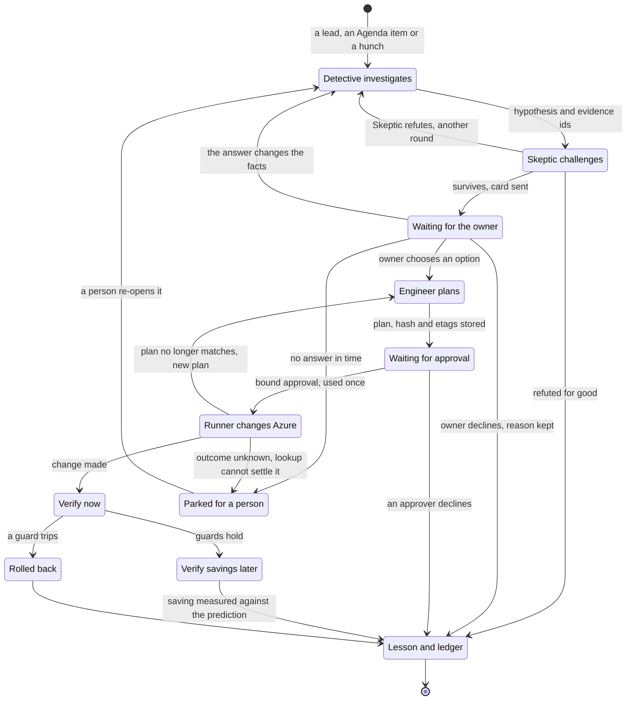
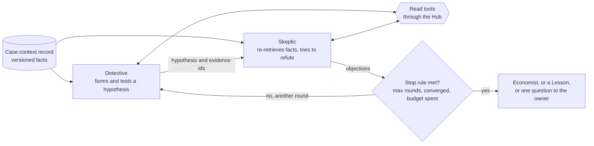

# Agents and workflows

> **What this document answers.** Who the agents are and how they are hosted. How workflows run them. How one Case moves from a lead to a verified outcome. How agents and people hand work to each other. How autonomy is earned. In one sentence: code decides the order, the clock and the budget; agents think and return typed records; the action plane is the only part that changes Azure ([architecture](02-architecture.md)). Terms are defined in the [README](README.md).

## 1. Ten roles in five hosted agents

The system has ten roles, a role being a job with its own prompt, tool subset and typed output. Five hosted agents carry them, grouped by what their roles may read and which tools they may call. The request names the role to run, and each role is a [Microsoft Agent Framework](https://learn.microsoft.com/agent-framework/overview/) agent. Each hosted agent has its own Entra agent identity, Hub contract and token quota, so a confused or compromised agent can use only what they allow. Roles that share a hosted agent share its identity and contract; the workflow keeps them apart by handing each step only the facts and tools its role may have.

| Hosted agent | Roles | Tools through the Hub | Model aliases | Hub contract | Reads untrusted text |
|---|---|---|---|---|---|
| `study` | **Scholar** reads public sources and extracts claims with receipts. **Librarian** curates the Atlas | `docs`, `atlas` | `triage`, `reason` | `study`: public data. The Hub screens prompts | Yes: public pages |
| `investigate` | **Surveyor** builds the Estate model. **Detective** tests hypotheses. **Economist** prices options. **Auditor** compares predictions with outcomes (the arithmetic is code; the model explains the residuals). **Conductor** ranks the Agenda of open questions | `estate-read`, `cost-query`, `price-sim`, `directory` (ids only), `ledger` (read), `atlas` | `triage`, `reason` | `investigate`: estate data | Surveyor and Detective only: tags, names, log lines |
| `skeptic` | **Skeptic** tries to refute Cases and claims | `estate-read`, `cost-query`, `price-sim`, `ledger` (read), `atlas`, `docs` | `judge` | `skeptic`: estate and public data | Yes: screened excerpts, public sources |
| `diplomat` | **Diplomat** writes every message to people and drafts Lessons | `channels-draft`, `ledger` (read), `atlas` | `reason` | `diplomat`: people data. The Hub screens prompts | Yes: owners' replies |
| `engineer` | **Engineer** turns a decision into an Action plan and drafts Action templates, Detectors and pull requests | `plan`, `pr-draft`, `ledger-propose`, `atlas` | `reason` | `engineer`: the only contract with propose tools | No: schema-checked ids and numbers |

Only the Engineer holds tools that propose changes to Azure, code or records. The Diplomat can only store a draft message. The Judge and case generator of the evaluation harness are not runtime roles: they run under a separate `evaluation` contract on another model family, with no tools. The workflow picks the alias for each step: `triage` (a small, cheap model), `reason` (a larger one), `judge` (a model of a different family, used to challenge and to grade) and `batch` (non-urgent steps). The tools are described in [data and integrations](05-data-and-integrations.md#4-tools). A role gets its own hosted agent only if the prompt-injection red team (proof point P7, a measurement the [roadmap](13-roadmap.md) schedules) finds a path from untrusted text to a tool that proposes a change; until then, ten hosted agents would cost more and isolate no more where two roles read the same data.

**Prompts are code.** Instructions, tool subset, output schema and limits are files in Git under CODEOWNERS. They ship as an immutable hosted-agent version, and an endpoint serves one version at a time with no traffic split ([Learn](https://learn.microsoft.com/azure/foundry/agents/concepts/hosted-agents)), so a prompt change is released like code and gated by [evaluation](08-testing-and-evaluation.md). Agents keep no memory of their own: a Case lives in its records.

**Hosted or prompt agent: by capability.** A prompt agent is a Foundry definition of instructions and tools, with no code; a hosted agent is our code in a managed sandbox. All five are hosted today. Behind the Hub a prompt agent can only use the bring-your-own-model route, which does not support the Responses API ([Learn](https://learn.microsoft.com/azure/foundry/agents/how-to/ai-gateway)). Some flagship models need the Responses API for tool calls, as Learn says today of GPT-6.1 Sol ([Learn](https://learn.microsoft.com/azure/foundry/foundry-models/concepts/models-sold-directly-by-azure)). And every role needs code around the model: schema checks, loop limits and excerpt handling. A role that needs none of these may become a prompt agent, which can call tools published through the Hub.

**A fallback for the prerelease part.** Hosted agents and the Agent Framework 1.0 core are generally available ([Learn](https://learn.microsoft.com/agent-framework/support/upgrade/python-2026-significant-changes)); the Framework's Foundry hosting package is prerelease ([Learn](https://learn.microsoft.com/agent-framework/hosting/foundry-hosted-agent)). The default is that package, pinned to one tested set of versions. The fallback is a thin handler of our own on the generally available Invocations library ([Learn](https://learn.microsoft.com/azure/foundry/agents/concepts/long-running-agent-reference)) that calls the same core, so the roles do not change, only their host. A build switch picks one, and proof point P2 (a measurement of workflow-to-agent calls, see the [roadmap](13-roadmap.md)) demonstrates the fallback.

**Sessions and idle time.** A workflow calls a hosted agent over the Invocations protocol (structured JSON in and out), straight at the agent's Foundry endpoint with its own Entra token. The workflow sends one session id per run, so roles that follow one another reuse a warm sandbox. A session is billed while active and stays active until its idle timeout passes after the last call ([Learn](https://learn.microsoft.com/azure/foundry/agents/concepts/hosted-agents)). The timeout is set per agent version, and the design uses the 2-minute minimum. When a run ends, the workflow deletes its sessions ([Learn](https://learn.microsoft.com/azure/foundry/agents/how-to/manage-hosted-sessions)), which ends the idle tail and leaves nothing a Case read in a sandbox. Proof point P2 measures the tail.

## 2. The two records

Agents and workflows exchange two kinds of record. Both use fixed schemas, not free-form chat history.

| Record | Written by | Holds | Rules |
|---|---|---|---|
| **Typed result record** | The agent returns it, the host stamps it | Task id; status `done`, `needs-human` or `failed`; confidence; the result, checked against its schema; evidence ids; tokens used. The host adds the agent version, prompt hash and model | Failing its schema makes it a `failed` result. Confidence feeds calibration and never decides alone |
| **Authorized case-context record** | The workflow, one per role and step | Versioned facts, each with source tool, query hash, timestamp and a completeness flag; the Atlas and Estate-model versions; the step's alias, limits and idempotency key | Structured fields and ids. Free text only as an `untrusted_excerpt`. A role gets only what its row above allows |

**The Skeptic checks facts itself.** It gets the hypothesis and the ids of the facts it rests on, not the Detective's account, and re-runs its own queries through the read tools. In the Study workflow it gets the Scholar's candidate claim and the receipt URLs and re-fetches the sources through `docs`. The completeness flag matters here: a partial month of cost data, or a figure rerated later, shows in the Skeptic's own results.

**Free text is data.** A tag, a resource name, a log line, a document passage or an owner's reply reaches an agent only as an `untrusted_excerpt`: length-capped, screened for document attacks ([Prompt Shields](https://learn.microsoft.com/azure/foundry/openai/concepts/content-filter-prompt-shields)), wrapped in the documents delimiter and labelled as data. The Detective's case notebook quotes such text, so the Engineer never sees it. Action parameters come from typed fields and ids read from Azure, never from model-written text ([security](06-security-and-governance.md)).

## 3. Bounds

The workflow cannot see inside an agent's session, so every loop, call and wait has a bound.

| Bound | What it limits | Where it is enforced |
|---|---|---|
| Tool loop | Model rounds, tool calls and seconds in one agent call | In the agent code, from the case-context limits: Agent Framework's `max_iterations`, `max_function_calls` and `max_duration_seconds`. The last two default to unlimited, and all are best effort, checked after each batch of calls ([Learn](https://learn.microsoft.com/agent-framework/agents/tools/function-tools)). CI fails if one is unset |
| Hub quota | Tokens per minute and per day, per contract | The Hub: 429 for a rate overrun, 403 for a quota overrun ([Learn](https://learn.microsoft.com/azure/api-management/llm-token-limit-policy)), with an alert on each |
| Case budget | Tokens per Case and per step | The workflow reserves before each call and books the tokens the result reports |
| Deadline | Each agent call, step and wait | Durable timers. A call that misses its deadline counts as a failed attempt |
| Retry | Transient errors only | The orchestrator, with back-off. After three failures the Case is parked for a person |
| Idempotency key | Duplicate effects from a repeated step | Every step with an effect carries one. Plans, messages and proposals are deduplicated by it |
| Single-flight | Two changes to one resource at once | A per-resource lease in the ledger: one open plan per resource |

**Steps run at least once.** Durable Functions can rerun an activity after a failure that struck once it had finished ([Learn](https://learn.microsoft.com/azure/durable-task/common/programming-model-overview)), so every step is safe to repeat. Calling an agent twice costs tokens and nothing else, because agents only think and propose, and the propose tools take the idempotency key.

**Unknown outcomes.** A timeout after a change was submitted says nothing about whether it happened, so the runner looks up the resource and the deployment by correlation id before anything is retried. A purchase is never retried automatically.

**Escalation uses objective signals.** Work starts on `triage` and moves to `reason` when a result fails its schema, a tool errors, the Skeptic objects, the completeness flag shows missing facts, or the stakes are high: an R2 or R3 Action, or a value above a threshold. (The approval classes are R1, one tap; R2, a confirmed web page; R3, two people.) A model's own "90 % sure" is recorded for calibration ([evaluation](08-testing-and-evaluation.md)) and never decides an escalation alone.

## 4. Seven workflows

A workflow is a Durable Functions orchestration in the `workflows` Function app: Python on the Flex Consumption plan ([Learn](https://learn.microsoft.com/azure/azure-functions/flex-consumption-plan)), with state in Azure Storage (Durable Task Scheduler is an option, see the [architecture](02-architecture.md)). It is ordinary code that waits for people; agents are the steps it calls.

| Workflow | Trigger | Steps | Clock | Who may wait on whom |
|---|---|---|---|---|
| **Watch** | Hourly timer. Events: a budget or anomaly alert, an Advisor change, an activity burst | Run the Detectors, let the Conductor score each lead with a small model, open a Case or drop the lead | Watch: minutes to hours | Waits on nobody. It starts Cases and moves on |
| **Case** | A lead, an Agenda item or a person's hunch | Refresh facts, Detective and Skeptic in bounded rounds, Economist, Diplomat drafts, send, wait, plan, approval, run, verify, Lesson | Cases: days to weeks | Waits on people, the runner and the verifier, through events. Never on another Case |
| **Study** | Daily timer. Events: a changed source | One Scholar read per source, in parallel. Skeptic. The Librarian's change set becomes a draft pull request. Human review, merge, rebuild the index, tell Watch | Learning: always on | Waits on the Atlas reviewer. Nothing waits on Study |
| **Estate refresh** | Daily or weekly timer. Events: resource changes | One Surveyor pass per subscription, on changes only. Questions for a person become Cases | Learning: always on | Waits on nobody |
| **Respond** | A message or card action, read from the `bot`'s `inbound` queue | Route to the Diplomat (Explain, Challenge, Teach) with the Case context; the Diplomat drafts the reply or the Lesson, and after the person confirms, Respond stores the Lesson itself and wakes the waiting Case | Cases: seconds to minutes | Never waits on a Case. It wakes one |
| **Strategy** | Monthly timer | Commitment coverage and renewals, price changes and large service shifts become Cases. Purchases go through R3 | Strategy: months | Waits on people only through its Cases |
| **Evaluate and grow** | Every change, plus a weekly sample. A monthly timer, after the billing period closes | Run suites, score sampled traces, calibrate, compile and back-test Detectors, retire stale claims, report card, Monday digest, monthly letter | Learning: always on | Waits on nobody. It can block a release or an autonomy level |

**The monthly letter.** Evaluate and grow sends one letter a month to finance and executives, with a small CSV of the same figures, after the billing period closes (a starting value of five days after it ends, because usage charges can change until then; [cost data](05-data-and-integrations.md#2-cost-data)). Each figure says whether it is an estimate or final, and each billing scope shows an invoice status, "Reconciled", "Unreconciled" or "Invoice not available"; see [testing and evaluation](08-testing-and-evaluation.md#4-measures-and-the-report-card) for the invoice status, the saving rule and the commitment pace.

**One Case, end to end.** A Detector notices virtual machines that have sat below 10 % CPU for weeks, and the Conductor opens a Case. The Detective builds a hypothesis, the Skeptic re-runs the queries and tries to break it, and the Economist prices three options, one of them doing nothing. The Diplomat drafts the card; the workflow sends it and waits. The owner picks an option and adds a fact, which Respond stores as a Lesson. The Engineer plans the change, the owner approves the exact plan and the runner makes the change. A bill cycle later the Auditor compares the measured saving with the prediction.

**Reading the diagram.** Choosing an option authorises nothing: the Approval service renders the exact plan from the stored plan record and asks for the approval the runner will check. A failed check after a change rolls back automatically for R1 and goes to a person for the other classes. A decline is not an end: the reason and the condition to ask again become a Lesson. In observe mode a surviving Case ends as a Lesson instead of a card; under a matching Credential a covered Action goes from the challenge straight to planning without a fresh tap, and the owner is told afterwards ([section 7](#7-autonomy-is-earned)).

**When nobody answers,** the Case's timers run coverage routing. At day 7 the owner gets one private reminder, as its own message or, once the person's push budget for the week is used up ([section 8](#8-the-conductor)), a line in the weekly summary of open items; at day 14 the Case is parked with an expiry (days 7 and 14 are starting values). Before cover is asked (an item is parked, or a real deadline is close), the owner is told once, first, by a notice e-mail. Cover is the delegate the owner appointed or, failing that, the custodian queue (the team named for unowned estate), and gets a Question saying only "Ownership or cover needs confirming. Nothing is authorised." A line manager is asked only if the owner appointed that manager as delegate, and no message tells a third person that a named person did not answer. Routing authorises nothing: whoever takes the item sees the same plan and gives their own OK. "Pause messages", a person's own notification setting, holds the reminder and the routing until the return date.

**Waiting costs no compute.** Durable Functions saves an orchestration's state and unloads it while it waits ([Learn](https://learn.microsoft.com/azure/durable-task/durable-functions/durable-functions-billing)); small storage transactions are still billed ([cost](10-cost-and-finops.md)). An external event wakes the orchestration, and a durable timer races it to set a deadline. In Python one timer is limited to six days, so a longer wait is a loop of shorter timers ([Learn](https://learn.microsoft.com/azure/durable-task/common/durable-task-timers)); each tick re-reads the stored Case and the kill switches. Events carry only ids, so a lost event delays a decision but never loses it. A Case can live for weeks, so a release must be safe for orchestrations in flight ([delivery](09-delivery-and-operations.md)).

**Waiting cannot live in a hosted-agent session.** Its compute is released after at most 240 idle minutes and the session is deleted after 30 idle days ([Learn](https://learn.microsoft.com/azure/foundry/agents/concepts/hosted-agents)), so nothing inside it can send the day-7 reminder, park a Case at day 14 or notice that a kill switch flipped overnight. Foundry's long-running agent guidance (preview) says to use a workflow engine for durable timers ([Learn](https://learn.microsoft.com/azure/foundry/agents/concepts/long-running-agent-resilience)). The Agent Framework's durable extension, which would run agents on Durable Functions, is prerelease ([Learn](https://learn.microsoft.com/agent-framework/hosting/durable-extension)); it becomes a switch at general availability.

## 5. The Detective and Skeptic loop

The Skeptic's job is to find what the Detective missed: the month-end batch behind a database that looks oversized, or the replication job behind a cross-region transfer that looks like waste.

**Stop rules.** The loop ends when any rule fires: a maximum number of rounds (three by default, a parameter), convergence (a round brings no new objection and leaves the hypothesis and its evidence ids unchanged) or the investigation budget spent. Then the hypothesis survives, with the objections and what was done about each, and goes to the Economist; or it is refuted and the Case ends as a Lesson, because why it looked true is knowledge too; or an objection stays open, and if only a person can settle it, it becomes the one question the Diplomat asks.

**What independence means.** The Skeptic runs on `judge`, a model family different from `reason`, so the two do not share a blind spot by design (a contract test fails if both aliases resolve to one family). It retrieves its own facts and never sees the Detective's narrative. That makes the check useful, not independent truth: two families trained on much of the same text can still agree on a mistake. The `judge` alias must resolve to a family available inside the adopter's data boundary. Where none is, the Skeptic runs on `reason` with its own prompt and retrieval, and every card it checked says so.

## 6. What a person receives

The Diplomat drafts every message, and the send step sends it after checks ([channels](05-data-and-integrations.md#6-channels)): a model supplies neither a recipient nor a link, numbers, dates and money come from tool results at render time, a content check fails any draft with a number no tool computed, and the notification policy ([section 8](#8-the-conductor)) holds the rate limit and quiet hours. The Monday digest and the monthly letter follow the same rules.

**The recommendation card** has ten parts. The example is a database compute size.

| Part | What it holds | Example |
|---|---|---|
| What it proposes | One sentence in the owner's words | Move the orders database one size down |
| Why, and how to check | The evidence in two lines, with receipts the owner can re-run | CPU under a third for eleven weeks |
| Options | Two to four, always including do nothing. Waiting has a cost, stated once | A: smaller now. B: smaller, with month-end scale-up. C: nothing |
| Consequences | Cost, reliability, performance and security, each as a range | A saving range. Month-end peak 70 to 90 % |
| What was tested | Replays of recorded usage, price simulation, what the Skeptic tried. Where evidence is thin, a small trial the owner approves is an option | Last month-end replayed at the smaller size |
| What would change my mind | The observation that would reverse it | A peak above 80 % in week one |
| Effort | The owner's minutes and any engineering days | Two minutes, no engineering |
| Reversibility | The approval class and how long undo stays open | R2. Scale up again in minutes |
| What happens on yes | The exact change, guard metrics and rollback, as the Approval service will show them | Thursday 22:00, one setting changes |
| How everyone will know | The metric, the date, who sees the result | Checked after the next bill cycle |

The card also names the Atlas claims it relies on and their [evidence level](README.md#words-used-in-this-design). Every figure names the prices it rests on (contracted, billed or list; [agreements and access](14-agreements-and-access.md)). Where no bill is readable, the figure is a scenario priced at list prices, the card says so, and it is called an expected saving only when a bill line confirms the meter.

Explain, Challenge and Teach go on every message that carries a claim or a decision about spend. A message that only asks for a fact, confirms a Lesson or reports housekeeping (first contact, a Question, settings, a confirmation) offers Explain alone. "Talk to a person" is the last button of every card, in the same place, and reaches a person at the adopting organisation. Free text, an email reply or a chat message never approves anything.

| Button | What the person gets | What happens behind it |
|---|---|---|
| **Explain** | The reasoning in plain steps, with receipts and the evidence level of each Atlas claim, in simple, technical or finance terms | Respond: the Diplomat reads the stored Case records and answers |
| **Challenge** | The Skeptic's recorded objections and what was done about each. New information earns the waiting Case another Skeptic round. If the system was wrong, it says so | Respond wakes the Case with an event |
| **Teach** | A box for the person's own words, such as "that is our disaster-recovery environment". The Diplomat reads back what it understood and proposes a scope: this resource, this team or everywhere | After a structured confirmation, Respond, the only writer of Lessons, stores it. A Lesson never widens a Credential or exceeds its author's scope; a wider scope is a request to the person who owns it, with the number of resources affected. The rule is only as good as the owner of record |

**Shared Cases.** Some savings belong to several people: a shared cluster, a shared egress path, a pooled commitment. From phase 4 such a Case has one card per stakeholder, each showing that person's own stake. A proposed split of a shared cost appears beside the alternative, and an objection changes the plan or gets an answer with its price. One accountable name decides, and the result is verified for each party. Until then one card goes to the accountable owner.

**Silence is never consent.** A Case without an answer ends in a decision, a parked Case or an expiry, never in an automatic yes.

## 7. Autonomy is earned

The autonomy ladder is per domain and scope. A domain is a kind of Action, such as resizing non-production virtual machines, changing storage tiers or stopping dev and test machines outside office hours.

| Rung | What the AI does | Granted by | On what evidence | Revoked by |
|---|---|---|---|---|
| **Observe** | Watches, predicts and scores itself. Sends a digest and nothing else | The platform team, when it onboards a scope | Read access only | Removing the role assignments, or the estate kill switch |
| **Advise** | Sends recommendations. People decide and act | The FinOps lead, per estate | Safety suites and red-team results for this level ([evaluation](08-testing-and-evaluation.md)). Calibration on the report card | The FinOps lead or platform team. The estate kill switch |
| **Assist** | Prepares the exact plan. A tap (R1), a confirmed web page (R2) or two people (R3) authorise it. The AI runs it | The adopting organisation, by assigning the Action family's role at a scope | The Action template's CI tests pass, dry-run plans match the what-if results of Azure Resource Manager, the verifier works | The per-action kill switch. Removing the role assignment |
| **Autopilot** | Runs a covered Action without a fresh tap, tells the owner afterwards, offers undo | The FinOps lead and the platform owner together, by writing a Credential | The domain's report card: verified savings, regrets, reversals, calibration | Either grantor, at once. Expiry. Automatic step-down |

A Credential is a human-written policy record: a domain, a scope, a value cap, an expiry and conditions such as "never in a change freeze". The Approval service evaluates it in code against facts the model cannot set ([security](06-security-and-governance.md#3-where-untrusted-text-could-reach-a-write)). Tags, names and Lessons never satisfy it, and neither does a claim that is disputed or not `bill-observed` for the meters concerned ([evidence levels](04-knowledge-and-learning.md)). Each autopilot run still writes a single-use authorization record, and a person reviews a sample of autopilot decisions.

**A Credential is written on a page** by the FinOps lead and the platform owner together, and either can end it there at once ([security and governance](06-security-and-governance.md#credentials-runner-roles-and-purchases) has the route, the sign-in and what the page shows). Before the first run, each owner of a resource it covers is told what it covers, until when and how to pause it, and the run waits until every owner of record has been sent that notice; each run is then reported to the owner within minutes (when quiet hours end, if the run fell in them) and added to their weekly summary. A notice helps only an owner who reads it.

Credentials cover R1 and lower-value R2 Actions only. **They never cover purchases** (two people approve each one, [06](06-security-and-governance.md)), **trials** ([04](04-knowledge-and-learning.md#4-learning-from-bills-replays-owners-outcomes-and-small-trials)) **or a resource an owner marked do-not-touch**.

**Narrowing is automatic; widening is human.** If calibration slips, a regret or a boomerang is recorded or a claim the Credential relies on is revised, the system steps the domain down to Assist at once, pauses the Credential until a person has reviewed it, and tells the grantors. An owner's Undo of a change made under a Credential pauses it the same way. The system cannot raise or widen a Credential; the report card ([evaluation](08-testing-and-evaluation.md)) informs the people who grant one and never grants one.

**"Pause changes here"** is the owner's brake. An owner sets it on resources in their scope and the Approval service reads it before every autopilot run, so the Credentials that cover them stop there at once. It can only narrow what the system may do, it leaves suggestions alone, and only a person resumes it. It stops later runs and undoes none; Undo reverses a change that ran. The platform team's kill switch is separate ([stopping the system](07-safeguards-and-drift.md#3-stopping-the-system)).

## 8. The Conductor

The Conductor decides what the system works on and how much it may spend. It reads structured fields only and runs on `triage`.

- **The Agenda** is the ranked list of open questions ([knowledge and learning](04-knowledge-and-learning.md#6-the-estate-model) lists where they come from).
- **Value of information** ranks it. A question rises with the expected saving, the chance the finding is right and the chance the owner says yes, and falls with the tokens it needs and the owner's minutes. The chances come from the calibration the Auditor keeps, not from a model's own claim. A Case opens only when its expected value beats its expected cost. The ranking is arithmetic in the workflow; the Conductor model extracts its inputs and explains the order.
- **Budgets.** The Conductor proposes a token budget for each workflow and Case, and code applies it only inside the ceilings humans set: the Hub's daily token cap per contract and the daily spend trip that flips the global kill switch. The Conductor cannot raise either.
- **Attention.** The send step applies the notification policy in code ([channels](05-data-and-integrations.md#6-channels)): it counts the pushes (messages the system starts unprompted) each person gets against a weekly ceiling, and the Conductor cannot raise it. The policy bounds how many messages start, not how well they are aimed.
- **The system watches itself.** Its own spend is an estate like any other: a jump in token spend on a `reason` deployment is a lead for Watch.

## 9. What this design does not stop

- **A wrong answer in the right shape.** A schema check proves form, not truth. The Skeptic and a second model family lower the odds of a shared error but do not remove them, and without a second family inside the data boundary they lower them less. People review what reaches them, and the report card measures how often the system was wrong.
- **Repeats.** Steps run at least once. Keys make a repeat harmless in the action plane; a person may rarely get a message twice.
- **Autonomy inside its limits.** A Credential can be wrong many times inside its value cap. The cap bounds each Action; sampled review and automatic step-down catch a pattern afterwards, not before.
- **Everything else.** Prompt injection, tool limits inside one hosted agent and stops that are not instant are covered in [security and governance](06-security-and-governance.md), section 12.
