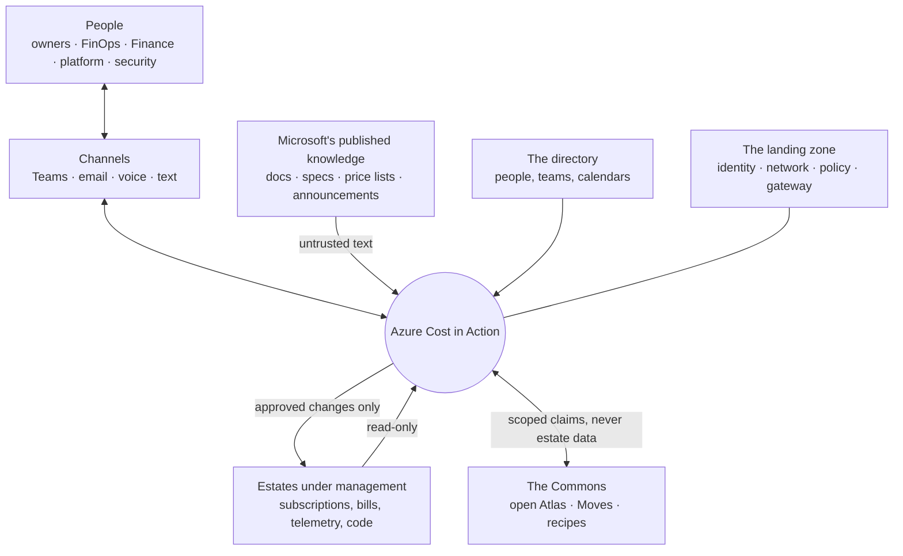
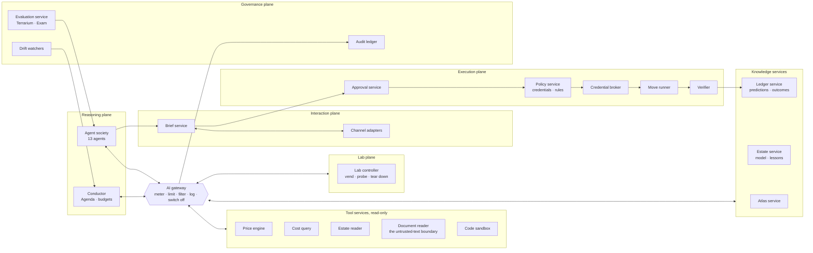
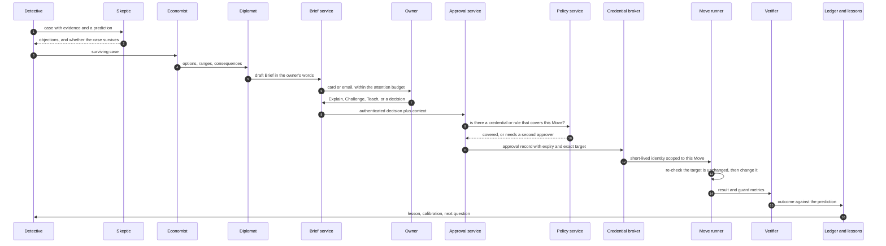
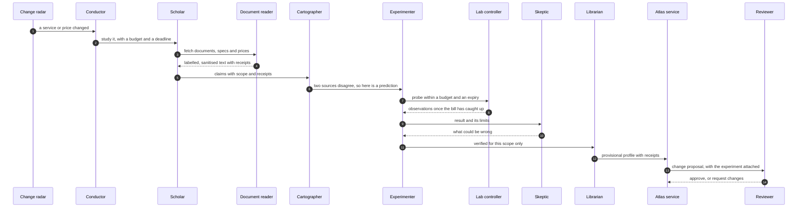
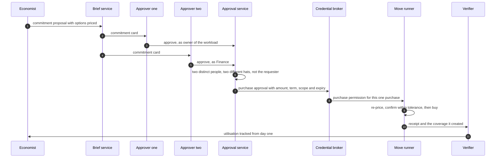

# Design 03 — Logical architecture

> **What this answers:** *What are the parts of the system, what may each one do, where are the trust boundaries, and how does the main loop move through them — before any product is chosen?*
> This document is deliberately **technology-neutral**: it fixes the names, the planes and the rules that the physical design ([04 landing zone and Citadel](04-landing-zone-and-citadel.md), [05 agents and orchestration](05-agents-and-orchestration.md), [06 data and knowledge](06-data-and-knowledge.md)) must keep. Part of the [design](README.md); requirements are in [01](01-requirements-and-principles.md).

---

## 1. The system in its surroundings

Three arrows carry the whole security story: what comes **in** from Microsoft's published text is *untrusted*; what goes **out** to an estate is *approved and scoped*; what goes to the **Commons** is *general, never specific*.

## 2. The building blocks

Six planes around one hub. The hub is the **AI gateway**: nothing in the reasoning plane talks to a model, a tool or another agent except through it.

| Plane | It may | It may not |
|---|---|---|
| **Reasoning** | read through tool services; think; write to the knowledge services; draft Briefs and Moves | change anything in an estate; hold a write permission anywhere; call a model, tool or agent except through the gateway |
| **Tool services** | read estates, prices and documents; compute; return structured results | write; hold state other than caches; follow instructions found in what they read |
| **Knowledge services** | store claims, the Estate Model, lessons, predictions and outcomes; each with scope, receipts, expiry and version | accept a write without provenance; serve one organisation's estate knowledge to another |
| **Lab** | create, probe and delete resources in **Lab subscriptions only**, within a budget and an expiry | touch an estate subscription; outlive its expiry |
| **Execution** | run one **approved Move** with a short-lived, scoped identity; verify the result | run anything without a valid, unexpired approval whose target is unchanged; keep an identity after the Move |
| **Interaction** | compose, route and record Briefs; capture approvals as authenticated human actions | approve on a person's behalf; send what the attention budget forbids |
| **Governance** | audit, evaluate, watch for drift, switch things off | be switched off by the thing it watches |

## 3. Trust boundaries

Data and instructions cross these lines only through a named component, and every crossing is logged.

| Zone | Contains | Trust | Crossing rule |
|---|---|---|---|
| **Z0 — the world** | web pages, documents, tickets, forum posts, tool output from outside | **none**: it is data, never instructions | enters only through the **Document reader**, which fetches, strips, labels (*spotlights*) and size-limits it; a claim extracted from it carries its source and a confidence, never authority |
| **Z1 — reasoning** | agents, their prompts and working memory | bounded: models are fallible and manipulable | reaches everything else only through the gateway; no credentials, no network path to estates |
| **Z2 — tool services** | read-only connectors and calculators | high, but read-only | deterministic code; per-call identity; results typed and size-limited |
| **Z3 — execution** | Move runner, credential broker, approval and policy services | **highest**: the only place with write power | smallest code surface; no model inside the decision to execute; every step recorded |
| **Z4 — estate data** | the Estate Model, lessons, cost data, approvals | confidential, per organisation | never leaves the tenant and the EU boundary |
| **Z5 — the Commons** | open claims, recipes, Moves, counts | public | only generalised, reviewed, estate-free content; counts above a minimum cohort |

**A model never sits inside the decision to execute.** The agents propose; deterministic services in Z3 decide whether a Move may run, from the approval record, the policy and the credential — not from a model's say-so.

## 4. The main loop

The north star's loop — *find, test, ask, change, verify, learn* — crossing the planes. Each arrow below the gateway line is a gateway call.

Three properties hold at every step. **The owner's decision is data, not an instruction to a model:** it is captured by the Brief service and checked by deterministic services. **The identity that changes the estate exists only for that Move.** **The outcome is scored against the prediction made before the change,** so every change also teaches.

### Day zero for a new service

### A commitment purchase

## 5. Who owns which data

| Data | System of record | Written by | Read by | Notes |
|---|---|---|---|---|
| **Claims and profiles** (the Atlas) | Atlas service, mirrored to the open repository | Librarian, after review | everyone | versioned; each claim has scope, receipts and a re-check recipe |
| **Estate Model, Lesson Book** | Estate service | Surveyor, Diplomat (from answers) | agents of that organisation | scoped, dated, expiring; never in the Commons |
| **Cost and usage data** | the cost data store | ingestion jobs only | Cost query service | agents see aggregates and samples through the tool, not raw files |
| **Predictions, experiments, outcomes** | Ledger service | agents (predictions), Verifier (outcomes) | Auditor, Examiner, report card | append-only |
| **Approvals and executions** | Approval service and the audit ledger | Approval service, Move runner | auditors, the Verifier | append-only; tamper-evident |
| **Briefs and conversations** | Brief service | Diplomat, people | the owner, the Diplomat | retention set by policy |
| **Moves** | Move catalogue (source control) | Engineer, reviewed by people | Move runner, Engineer | versioned and signed |
| **Prompts and agent definitions** | source control | engineers, the method-learning loop (by pull request) | the runtime | pinned per release |

## 6. Degraded modes

| If this fails | The system | Because |
|---|---|---|
| the AI gateway | stops all agent activity; read-only dashboards stay up | P3: one place to switch off is also one place to depend on — it is built for availability |
| the execution plane | keeps studying, investigating and asking; queues **no** changes | an approval is valid for one target and one window, not indefinitely |
| a channel | tries the next channel in the owner's preference; never escalates silently to a wider audience | humane, private-first escalation |
| the cost data feed | marks every number *stale* and stops savings claims | verified savings need fresh data |
| a model or a model version | the gateway routes to the pinned alternative; if none is cleared, the agent pauses | models are replaceable behind the gateway; unreviewed models are not |
| the Lab | studies from documents only, and says the profiles are *documentation-only* | no experiment, no mechanism-verified claim |

## 7. The cast, placed

| Agent | Plane | May read through | May write | Acts on estates? |
|---|---|---|---|---|
| Scholar | reasoning | Document reader | draft claims | no |
| Cartographer | reasoning | Atlas service, price engine | claims, taxonomy proposals | no |
| Surveyor | reasoning | Estate reader, directory reader, cost query | Estate Model (draft), ownership proposals | no |
| Detective | reasoning | Estate reader, cost query, Atlas | cases, hypotheses | no |
| Skeptic | reasoning | everything the case used | objections | no |
| Experimenter | reasoning + Lab | Lab controller | experiment records | **Lab only** |
| Economist | reasoning | price engine, cost query, Atlas | option cards, proposals | no |
| Diplomat | reasoning + interaction | Brief service, Estate service | Briefs, lessons (as drafts) | no |
| Engineer | reasoning | Move catalogue, source repositories | Move drafts, pull requests | **no — proposes; the execution plane executes** |
| Auditor | governance | Ledger, audit | outcome scores | no |
| Examiner and Forger | governance | Terrarium | exams, keys | Terrarium only |
| Librarian | reasoning | Atlas, Estate service | reviewed claims and lessons | no |
| Conductor | reasoning | Agenda, budgets, ledger | the Agenda | no |

No agent in the table holds a write permission in an estate. That is the point of the execution plane.
