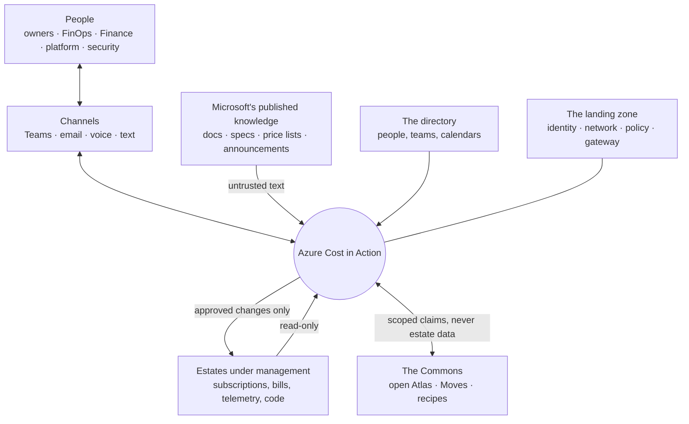
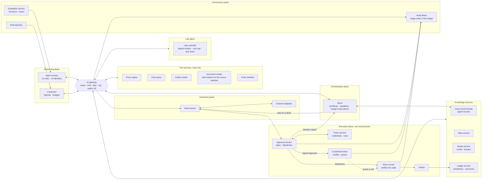
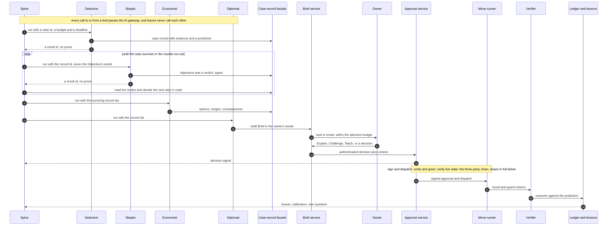
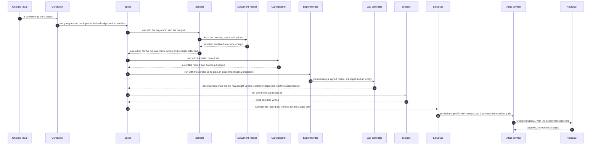
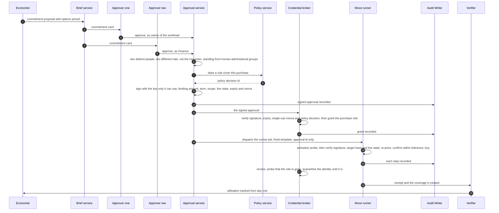

# Design 03 — Logical architecture

> **What this answers:** *What are the parts of the system, what may each one do, where are the trust boundaries, and how does the main loop move through them — before any product is chosen?*
> This document is deliberately **technology-neutral**: it fixes the names, the planes and the rules that the physical design ([04 landing zone and Citadel](04-landing-zone-and-citadel.md), [05 agents and orchestration](05-agents-and-orchestration.md), [06 data and knowledge](06-data-and-knowledge.md)) must keep. Part of the [design](README.md); requirements are in [01](01-requirements-and-principles.md).

---

## 1. The system in its surroundings

Three arrows carry the whole security story: what comes **in** — Microsoft's published text, and the free text in tags, names and replies — is *untrusted*; what goes **out** to an estate is *approved and scoped*; what goes to the **Commons** is *general, never specific*.

## 2. The building blocks

Eight planes around one hub. The hub is the **AI gateway**: nothing in the reasoning plane talks to a model, a tool or another agent except through it, and the spine reaches a leaf only through it too.

| Plane | It may | It may not |
|---|---|---|
| **Orchestration** (the spine) | run workflows from typed records; reserve budgets; invoke a leaf **through the gateway** with an id, a budget and a deadline; wait for signals; read results from the case store | call a model; read a leaf's prose; hold a write permission in an estate; hold a role on any Foundry resource |
| **Reasoning** | read through tool services; think; write typed records, Brief drafts, plans and Move drafts | change anything in an estate; hold a write permission anywhere; call a model, tool or agent except through the gateway; hand a record to another agent |
| **Tool services** | read estates, prices and documents; compute; return structured results (free text only through the source sanitiser) | write; hold state other than caches; follow instructions found in what they read |
| **Knowledge services** | store claims, the Estate Model, lessons, cases, predictions and outcomes, **written only through the case-record facade**: typed, schema-validated, stamped with provenance, scope, expiry and version, each agent writing only its own record types | accept a write without provenance; overwrite a record (a revision is a new version, and contrary evidence stays); serve one organisation's estate knowledge to another |
| **Lab** | the deterministic **Lab controller** creates, probes and deletes resources in **Lab subscriptions only**, from **signed recipes**, within a budget, a pre-deploy cost cap and an expiry; the Experimenter only *plans* | deploy from an agent's free text; touch an estate subscription; outlive its expiry |
| **Execution** | run one **approved Move**: the **Approval service** signs and dispatches, the **credential broker** grants only after verifying the signature itself, the **Move runner** verifies signature, target hash and live state; verify the result | run anything without a valid, unexpired, signed approval whose target and live state are unchanged; act without a ledger entry; keep an identity after the Move |
| **Interaction** | compose, route and record Briefs; capture approvals as authenticated human actions | approve on a person's behalf; send what the attention budget forbids |
| **Governance** | audit (the **Audit Writer** is the only writer of the ledger), evaluate, watch for drift, switch things off | be switched off by the thing it watches |

## 3. Trust boundaries

Data and instructions cross these lines only through a named component, and every crossing is logged.

| Zone | Contains | Trust | Crossing rule |
|---|---|---|---|
| **Z0 — the world** | web pages, documents, tickets, forum posts, tool output from outside — and the free text that people and estates write: tags, resource names, invoice lines, replies | **none**: it is data, never instructions | enters only through a tool service that runs the **source sanitiser** (the **Document reader** is its web instance): delimiter sequences escaped, control characters stripped, fields length-capped, anything over 10,000 characters chunked, the text labelled *untrusted* (*spotlighted*); a claim extracted from it carries its source and a confidence, never authority |
| **Z1 — reasoning** | agents, their prompts and working memory | bounded: models are fallible and manipulable | reaches everything else only through the gateway, and is itself started only by the spine, through the gateway; no credentials, no network path to estates |
| **Z2 — tool services** | read-only connectors and calculators | high, but read-only | deterministic code; per-call identity; results typed and size-limited; free text through the source sanitiser |
| **Z3 — execution** | Approval service, Policy service, credential broker, Move runner, Verifier | **highest**: the only place with write power over estates | **its own environment and subnet** (`snet-exec`, [04 §6](04-landing-zone-and-citadel.md#6-network)), reachable only through the Approval service's ingress; smallest code surface; no model inside; every step recorded through the Audit Writer, and no ledger entry means no change |
| **Z4 — estate data** | the Estate Model, lessons, cases, cost data, approvals | confidential, per organisation | never leaves the tenant and the EU boundary; written only through the case-record facade and the Audit Writer |
| **Z5 — the Commons** | open claims, recipes, Moves, counts | public | only generalised, reviewed, estate-free content; counts above a minimum cohort |

**A model never sits inside the decision to execute, and no single component completes a change.** The agents propose; three deterministic parties in Z3 each verify on their own. The **Approval service** signs the approval with a key only it can use and dispatches the runner. The **credential broker** grants the identity's role only after verifying the signature, the expiry, the single-use nonce and the policy decision itself, and it cannot start the job. The **Move runner** verifies the signature, the target hash and the *live state* of the target before it acts ([07 §3.3](07-security-architecture.md#33-the-execution-identity-just-in-time-without-pim), [07 §4](07-security-architecture.md#4-approvals-that-cannot-be-forged-or-reused)) — not a model's say-so.

## 4. The main loop

The north star's loop — *find, test, ask, change, verify, learn* — crossing the planes. **The spine is the only thing that moves a record from one leaf to the next.** A leaf writes a typed record through the case-record facade and returns a result id; the spine reads the record, decides the next step in code and starts the next leaf with the *id*. Every call to or from a leaf passes the gateway, and leaves never hand records to each other.

Four properties hold at every step. **A leaf never hands anything to another leaf:** the Skeptic reads the Detective's *record*, never its words, and the spine decides whether the case goes round again. **The owner's decision is data, not an instruction to a model:** it is captured by the Brief service and verified by deterministic services. **No single party completes a change, and no change happens without a ledger entry;** the identity that changes the estate is leased to one Move at a time, probed before and after, and exists only for that Move. **The outcome is scored against the prediction made before the change,** so every change also teaches.

### Day zero for a new service

### A commitment purchase

A role assignment can take up to ten minutes to take effect ([Learn](https://learn.microsoft.com/azure/role-based-access-control/troubleshooting#azure-role-assignments)), so the runner's activation probe may wait, and the purchase window and the approval's expiry include that wait. The three parties of [§3](#3-trust-boundaries) verify independently; if the Audit Writer cannot record a step, the Move stops at its next safe point: no ledger entry, no change ([§6](#6-degraded-modes)).

## 5. Who owns which data

| Data | System of record | Written by | Read by | Notes |
|---|---|---|---|---|
| **Claims and profiles** (the Atlas) | Atlas service, mirrored to the open repository | Librarian (Atlas), as pull requests to the data path, after review | everyone | versioned; each claim has scope, receipts and a re-check recipe |
| **Estate Model, Lesson Book** | Estate service | Surveyor, Diplomat (from answers) | agents of that organisation | scoped, dated, expiring; a lesson is a **draft** until an owner confirms it by an authenticated action; never in the Commons |
| **Cases** (hypotheses, evidence, objections, option cards) | the case-record facade, over the operational store | each leaf, only its own record types | the spine and later leaves by record id; the owner through a Brief | typed and versioned: a revision is a new record, and contrary evidence is kept |
| **Cost and usage data** | the cost data store | ingestion jobs only | Cost query service | agents see aggregates and samples through the tool, not raw files |
| **Predictions, experiments, outcomes** | Ledger service | agents (predictions, through the case-record facade), Verifier (outcomes) | Auditor, Examiner, report card | append-only |
| **Approvals and executions** | the audit ledger, written by the **Audit Writer** alone | the Approval service, the broker and the Move runner, each signing its own entries | the Auditor, the Verifier | append-only; tamper-evident; each approval and execution entry signed by the service that produced it |
| **Briefs and conversations** | Brief service | Diplomat, people | the owner, the Diplomat | retention set by policy |
| **Moves** | Move catalogue (source control) | Engineer, reviewed by people | Move runner, Engineer | versioned and signed |
| **Prompts and agent definitions** | source control | engineers, the method-learning loop (by pull request) | the runtime | pinned per release |

## 6. Degraded modes

| If this fails | The system | Because |
|---|---|---|
| the AI gateway | stops all agent activity; read-only dashboards stay up | P3: one place to switch off is also one place to depend on — it is built for availability |
| the execution plane | keeps studying, investigating and asking; queues **no** changes | an approval is valid for one target and one window, not indefinitely |
| the Approval service | keeps studying, investigating and asking; **no new approval is recorded, so no change or purchase starts**; Briefs wait; Moves already dispatched finish on their signed approvals | only this service signs, so nothing can stand in for it |
| signature verification (a key is unavailable or badly rotated, or an approval does not verify) | the broker grants nothing and the runner refuses: **an approval that cannot be verified is no approval**, and nothing falls back to an unsigned path | each of the three parties verifies on its own |
| the credential broker | no grant, so no change; approvals expire unused; studying continues | it is the only party that grants a role |
| the Audit Writer | **fails closed: no change without a ledger entry** — no approval is issued, no role granted, and a Move stops at its next safe point when a step cannot be recorded; reasoning continues | the ledger is what makes every execution accountable |
| a channel | tries the next channel in the owner's preference; never escalates silently to a wider audience | humane, private-first escalation |
| the cost data feed | marks every number *stale* and stops savings claims | verified savings need fresh data |
| a model or a model version | the gateway routes to the pinned alternative; if none is cleared, the agent pauses | models are replaceable behind the gateway; unreviewed models are not |
| the Lab | studies from documents only, and says the profiles are *documentation-only* | no experiment, no mechanism-verified claim |

## 7. The cast, placed

Fourteen roles and **fifteen** identities (the Librarian is deployed twice, for the Atlas and for lessons), in **eleven** groups ([05 §2](05-agents-and-orchestration.md#2-the-roster)). The table has one row per identity.

| Agent | Group | Plane | May read through | May write | Acts on estates? |
|---|---|---|---|---|---|
| Scholar | study | reasoning | Document reader, Microsoft Learn and release-feed tools, Atlas service | draft claims (typed) | no |
| Cartographer | study | reasoning | Atlas service, price engine | claims, taxonomy proposals, conflict records | no |
| Librarian (Atlas) | curate | reasoning | Atlas service, claim records | review records; pull requests to `atlas/**` only | no |
| Surveyor | survey | reasoning | Estate reader, directory reader, cost query | Estate Model (draft), ownership proposals | no |
| Detective | investigate | reasoning | Estate reader, cost query, Atlas, Ledger (read), sandbox | cases, hypotheses, a prediction | no |
| Skeptic | investigate | reasoning | everything the case used | objections, a verdict | no |
| Economist | investigate | reasoning | price engine, cost query, Consequence engine, Atlas | option cards, proposals | no |
| Experimenter | experiment | reasoning + Lab | Atlas, sandbox, Lab controller (plans and observations) | experiment plans, predictions | **no — plans only; the Lab controller deploys** |
| Diplomat | converse | reasoning + interaction | Brief service, Estate service (pseudonymised) | Briefs, lesson drafts | no |
| Engineer | engineer | reasoning | Move catalogue, source repositories, sandbox | Move drafts; pull requests to `moves/**` only | **no — proposes; the execution plane executes** |
| Auditor | govern | governance | Ledger, audit ledger, Entra sign-in records | outcome scores, drift cases | no |
| Librarian (lessons) | govern | reasoning | Lesson Book, Atlas | lesson **drafts**, confirmed only by an owner's authenticated action | no |
| Examiner | examine | governance | exam bank, Terrarium (through the scoring service) | exam scores | Terrarium only |
| Forger | forge | governance | Terrarium generator only | synthetic estates, sealed keys | Terrarium only |
| Conductor | conduct | reasoning | Agenda, budgets, ledger | the Agenda | no |

No agent in the table holds a write permission in an estate. That is the point of the execution plane.
