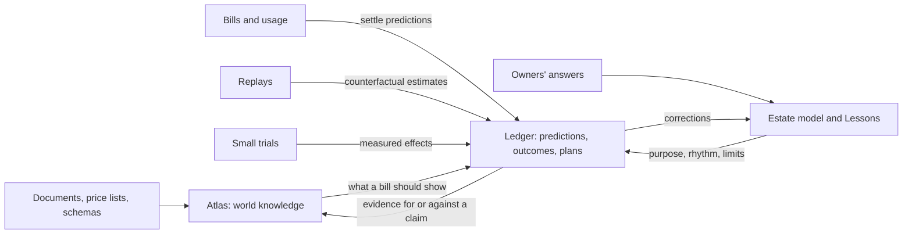
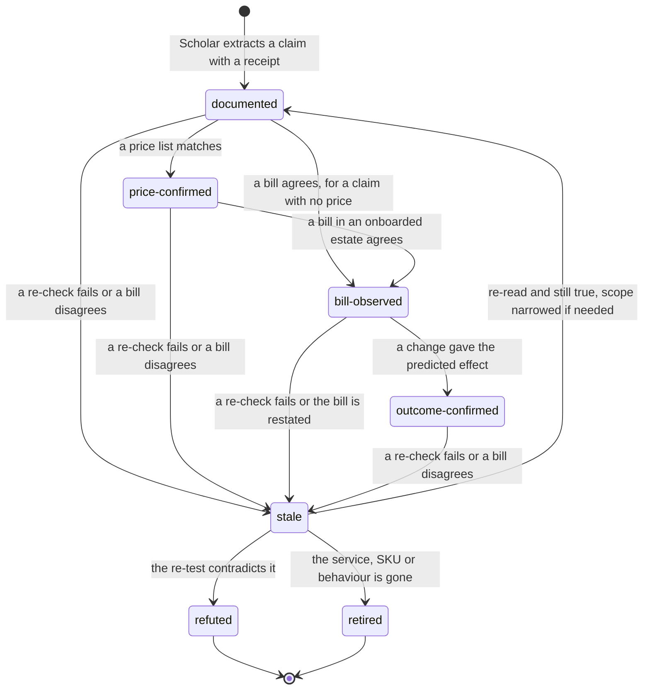
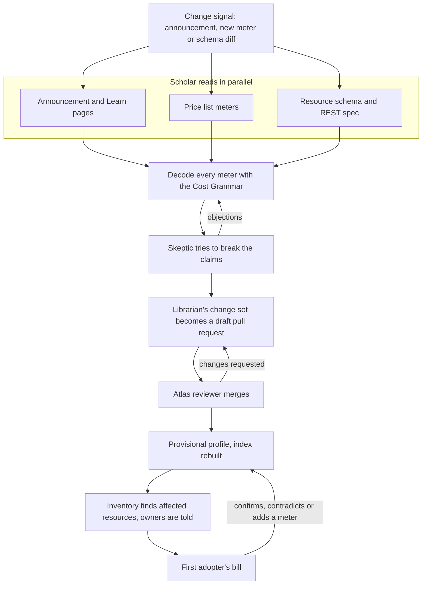
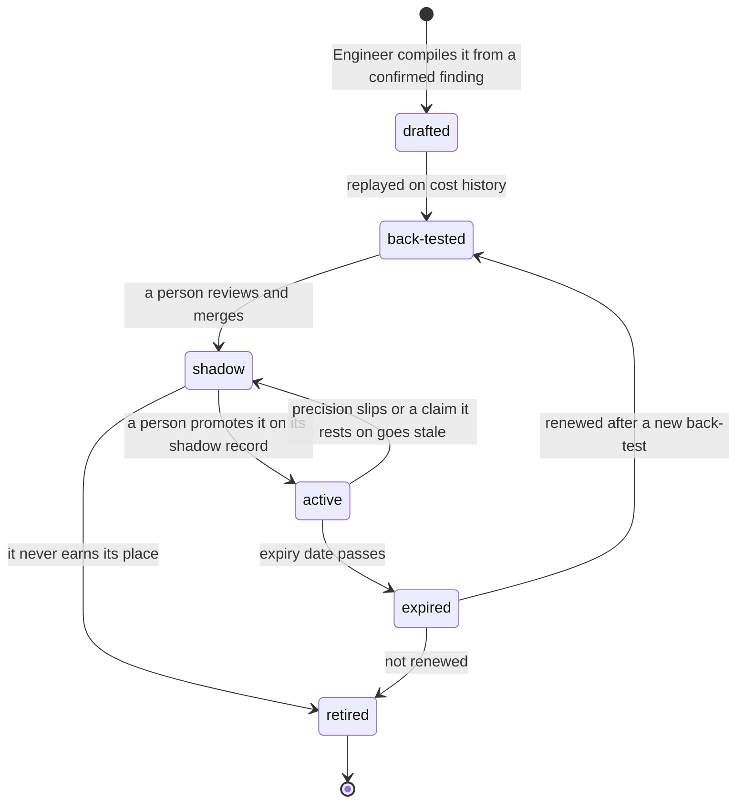

# Knowledge and learning

**What this document answers.** How the system learns how Azure charges, and what each estate is for, without ever deploying a resource to experiment. What actually changes when it learns, and how we would know.

Azure changes weekly, so no list of rules stays right. The system works like a scientist: it reads what Microsoft publishes, decodes how each meter charges, writes down what it expects to see, and compares that with real bills.

## 1. Three kinds of knowledge

| Kind | Lives in |
|---|---|
| **World knowledge**: the Atlas, true for everyone who runs Azure | Git, served from Azure AI Search |
| **Estate knowledge**: the Estate model and Lessons, true for one organisation | [Cosmos DB serverless](https://learn.microsoft.com/azure/cosmos-db/serverless), the solution's own account |
| **Experience**: the ledger of predictions, outcomes and plans | Cosmos DB, plus an immutable audit copy in Blob |

The Atlas holds no estate data, so it can be reviewed in the open. Nothing hides inside a model: agents read knowledge through tools (`atlas`, `estate-read`, `ledger`).

Every kind of learning runs through a **prediction** that a later fact can settle. The Atlas says what a bill should show, the Estate model what is true here, and a bill, a replay, an owner's answer or the outcome of a change settles the prediction. The result becomes evidence for or against a claim, or a correction to the Estate model.



## 2. The Atlas

### The claim

The Atlas is a set of files in Git. Its unit is the **claim**: one statement about how Azure behaves, with its **receipts** (source link, retrieval date, the quoted text and its hash), its **scope**, its Cost Grammar mechanism, an evidence level and a **re-check recipe**. A claim without a receipt is a rumour, and CI rejects it. Retrieval returns claims with scope and level, not pages, so an agent cannot quote a provisional claim as settled.

```yaml
id: blob-version-billing
statement: >
  Previous blob versions are billed at the rate of active data. If no tier was set
  explicitly, only unique blocks are billed across the blob, its versions and its
  snapshots. If a version's tier is set explicitly, that version is billed at its
  full length, and so is the oldest version left in the original tier; archiving
  bills every version and snapshot in full.
mechanism: [stock]
scope:
  service: Blob Storage
  region: any
  offer: any
  sku_or_version: block blobs on accounts that do not use smart tier
  scale: any
  date: 2026-11-01
receipts:
  - url: https://learn.microsoft.com/azure/storage/blobs/versioning-overview
    retrieved: 2026-11-01
    quote: "You are billed for blob versions, like blob snapshots, at the same rate as active data."
    quote_sha256: <hash of the quote>
level: documented
recheck: {kind: semantic, trigger: source changed, schedule: quarterly}
```

The scope line matters: on an account that uses [smart tier](https://learn.microsoft.com/azure/storage/blobs/access-tiers-smart), the same documentation says versions are billed at full length. The last rule shows why levers need pricing: moving old versions to a cooler tier lowers the rate, yet an explicitly tiered version is billed in full.

### The Service Cost Profile

A **Service Cost Profile** groups the claims about one service under an investigator's questions: how it bills, what drives the bill, the knobs and what each trades away, the signals of real need and the blind spots, traps and couplings, discounts, and what is still unknown. It holds no facts of its own: each line is a claim id, so correcting a claim corrects every profile that cites it.

### The Cost Grammar

Spend on Azure falls into **fourteen mechanisms**; a meter is one of them, or two at once. Each brings a question to ask and evidence to look for, so the system can reason about a service it has never seen: it recognises the shape of a meter, not the product's name.

| Mechanism | Question to ask | Signal of real need | Typical levers |
|---|---|---|---|
| **Capacity**: pay for what you provision | Is it near any real demand? | Utilisation, throughput, connections | Resize, scale in, schedule |
| **Consumption**: pay per unit used | Does the use produce value? | Value per unit; retries, errors | Batch, cache, fix the caller |
| **Stock**: pay for what you keep | Is it still read? Why does it grow? | Last access; growth against need | Tier, expire, lifecycle rules |
| **Flow**: pay for what moves | Must it move, and by this path? | Consumers, destinations | Filter, aggregate, co-locate |
| **Feature**: a switch turns on a meter | Is the feature used? | Feature usage | Switch off, narrow |
| **Multiplier**: dimensions multiply | Which dimension exceeds its need? | Load per dimension | Shrink the cheapest dimension |
| **Tier or step**: the price jumps at a threshold | Just past one, or paying for unused features? | Position against the threshold | Re-tier |
| **Commitment**: pay ahead for a discount | Is coverage used, at the right scope and term? | Coverage and utilisation over time | Right-size the next term, re-scope |
| **Time quantum**: granularity prices short things | Do short-lived items each pay a minimum? | Distribution of durations | Batch, pool, reuse |
| **Coupling**: one thing drags in other meters | What else did this switch on? | Meters that appear after a change | Decouple, relocate, remove |
| **Leftover**: billing outlives the parent | Is the parent gone? | Parent state; an owner exists | Clean up with a safety net |
| **Rate and benefit**: the unit price is negotiable | Do we pay list where a benefit applies? | Effective against list price | Apply the benefit, change the offer |
| **Allowance**: an included amount, then paid | Are we just past the free amount? | Use against the allowance | Spread use, pick the fitting plan |
| **Time cliff**: a price changes on a date | What changes on the announced date? | The date; the resources it touches | Plan the move early |

The grammar is data in Git. A meter that fits none of the fourteen is a finding: the Librarian proposes a new mechanism with evidence, and reviewers decide whether it earns a place.

### Scope and evidence levels

Every claim says where it holds: **region**, **offer** (price type or agreement), **SKU or version**, **scale range** and **date**. A claim that holds across regions and offers is strong; one that fails somewhere has learned where it does not hold. Token prices show why: a model's token is billed differently by [deployment type](https://learn.microsoft.com/azure/foundry/foundry-models/concepts/deployment-types) (Global Standard, Data Zone, Batch) and, on Global Standard, by request tier (Flex or Priority), so a price claim names all three.

**Evidence levels** say what kind of evidence stands behind a claim.

| Level | Confirmed by | Lives in | It lets the system say |
|---|---|---|---|
| `documented` | A source says so; the receipt proves it | The Atlas | Leads, questions, labelled advice |
| `price-confirmed` | A published price list shows the meter, unit and rate (the adopter's own price sheet gives the same check for one estate and stays in that estate) | The Atlas | The price part is right |
| `bill-observed` | A bill line in an onboarded estate behaved as predicted: its period had closed, the meter's usage and change history were matched, and the residual was inside the profile's stated error bound | That estate's ledger | Savings advice for that estate |
| `outcome-confirmed` | A change based on the claim gave the predicted effect, normalised for load | That estate's ledger | The measured effect; a Detector candidate |

Advice for an estate rests on `bill-observed` for the meters concerned, or says plainly that it is not confirmed. A claim with no price in it, such as "a stopped VM still bills compute", skips `price-confirmed`. The upper two levels concern one estate, so they never enter the Atlas file: each is a settled prediction in that estate's ledger, shown beside the claim in the Case.



**Evidence is not causality.** A price list verifies a price, not a billing rule. A bill line shows that a meter moved, not why. An outcome can reflect a change in load or a rerated bill, and a replay is only a counterfactual. So predictions are registered before a change, outcomes are normalised for load, and refuted claims are kept with the reason they looked true.

### Re-check recipes

Every claim ships with a recipe that re-checks it.

| Kind | How it works | Runs | When it fails |
|---|---|---|---|
| **Mechanical** | A deterministic query or diff, no model: compare a meter's unit and rate with the [Retail Prices API](https://learn.microsoft.com/rest/api/cost-management/retail-prices/azure-retail-prices); diff a resource type's schema for a property or SKU value; check that the quote is still on the page | In knowledge CI on every pull request and on a schedule; no tokens | The claim goes stale; a changed quote starts a semantic recipe |
| **Semantic** | A model re-reads the source and compares it with the claim; the Skeptic challenges; a person reviews | When a mechanical check or a source change fires, and on a schedule weighted by impact and volatility | The claim goes stale; a question reaches the Agenda |

A stale claim says so on its face. Every Recommendation and Detector that rests on it is flagged, and inventory finds the affected resources.

### Review and release

Agents propose; people merge. A change to the Atlas travels like a change to code.

1. The Librarian's change set becomes a draft pull request that touches only Atlas files.
2. Knowledge CI validates the schema, re-runs mechanical recipes, checks each quote against its source, and screens text for injected instructions and for estate data.
3. An Atlas reviewer, a named person under CODEOWNERS, merges. Nothing merges automatically.
4. A release rebuilds the Azure AI Search index. Retrieval is [hybrid](https://learn.microsoft.com/azure/search/hybrid-search-overview): keywords for SKU names and meter ids, vectors for questions, and the semantic ranker if proof point P5 shows it pays.
5. Each Case records the release it used. Withdrawing a claim is also a release: the index is rebuilt and the Recommendations that cited it are listed.

**A claim can never fill an Action parameter.** Action templates take their values from typed fields and resource ids that tools read from Azure. A claim can still steer *which* Action is proposed, so an Action is proposed only when its own guards pass on facts the tools read (resource type, state, metrics), a person reads the Recommendation, and a claim that is disputed or below `bill-observed` for this estate never qualifies an Action for autopilot ([autonomy](03-agents-and-workflows.md)).

## 3. Learning a new service

A new service is learned from evidence that already exists: its documentation, the new meters in the price list and, as soon as anyone uses it, the bills. Nothing is deployed to find out; learning costs the platform's own running cost and model tokens, and nothing is provisioned just to measure. The chain ends in one honest oracle: the first adopter's bill, which says what was charged, not why.

The Study workflow reads six kinds of public source, daily and on source-change events.

| Source | What it tells the system | How a change is noticed |
|---|---|---|
| Microsoft Learn, through the `docs` tool ([Learn MCP server](https://learn.microsoft.com/training/support/mcp)) | Billing rules, limits, behaviour, retirements | A changed quote or revision date |
| [Retail Prices API](https://learn.microsoft.com/rest/api/cost-management/retail-prices/azure-retail-prices) | Meters, units and list rates by region and SKU: what exists, not what it means | Daily snapshot diff: a new meter id or rate |
| [Resource reference](https://learn.microsoft.com/azure/templates/) and the REST specifications behind it | The knobs: properties, SKU values, API versions | Schema diff; providers list changes per API version |
| [Azure updates](https://azure.microsoft.com/updates) | Announcements, preview or launch status, retirement dates | The feed, read daily |
| [FOCUS](https://learn.microsoft.com/azure/cost-management-billing/dataset-schema/cost-usage-details-focus) | What a bill line can say: columns, cost types, corrections | Changes to the specification and file schema |
| [Advisor recommendation types](https://learn.microsoft.com/azure/advisor/advisor-reference-cost-recommendations) | What Microsoft's own rules count as waste: leads and a baseline | A new or changed type |

The model's memory is a lead, never a source of a number: prices come from tools. A hash shows when a source has not changed, so unchanged sources cost nothing.

**A day-zero story (the service is invented).** Tuesday 09:00: Microsoft announces Azure Prism, a managed retrieval service. The price snapshot shows six new meters. By 10:30 the Scholar has read the announcement, the pricing page and the schema in parallel and decoded the meters: a *Prism Unit* is **capacity**, a *Query Unit* **consumption**, snapshot GB-months **stock**, replicas a **multiplier**, the private-link add-on **coupling**, the preview price a **time cliff**. Two pages disagree on whether scaling down refunds a started hour. No document can settle that, so both quotes stay as receipts and the claim is marked disputed. The Skeptic, another model family, re-reads the sources itself, and a reviewer merges the draft pull request that afternoon.

**Profile v0.1 is provisional**: every line says what it rests on, and it gives no savings advice. Inventory finds two preview deployments owned by one team, and the Diplomat asks one question: "The preview price ends on 1 March. Do you want a heads-up plan?" Nobody wrote a Prism rule.

**The bill is the best oracle available.** The team's first Prism meters reach the cost data a day later, provisionally: cost data lags and is rerated for days. Once the period has closed and usage and change history match, the bill shows a started hour billed after a scale-down. That settles the dispute: the refund claim is refuted, and the "no refund" reading becomes `bill-observed` for that estate. The snapshot meter is still billing for an index deleted last week. No claim explained it, so the Librarian proposes one (leftover), scoped to what was seen.



The same routine handles new features, SKUs, regions, price changes and retirements, in both directions: "this just got cheaper for you" is a Recommendation too.

## 4. Learning from bills, replays, owners, outcomes and small trials

Four channels read what already exists; the fifth, a small trial, changes one resource an owner already runs. In the north star's terms, bills are the Look route, replays are Replay, owners are Ask, outcomes are Follow and small trials are Trial; Pool arrives in phase 5 ([roadmap](13-roadmap.md)). Each channel yields a different kind of evidence, and none yields proof.

**Bills.** For each workload (the resources the Estate model groups by purpose) `price-sim` builds a **blueprint cost model**: what the bill should be, from the estate's real configuration, the profile's meters, measured usage and prices. Where Azure Monitor does not expose a meter's billing quantity, `price-sim` uses diagnostic logs or trailing billed usage, or abstains for that meter and says so. Each day's bill is compared with the blueprint, meter by meter. The blueprint is stored before the bill lands, so a prediction that a meter will not appear is scored too.

A meter with no claim in the Atlas is a *discovery* and goes to the top of the Agenda. A bill above the model (a **positive residual**) is a lead: a switch that turned on a meter, a retry loop, a longer data path. [Traffic between peered virtual networks is billed per GB, and more across regions](https://learn.microsoft.com/azure/virtual-network/virtual-network-cost-optimization), so a web tier moved to a second region shows up as a data-transfer line that no blueprint had. A negative residual is a lead too (a missing resource, an unplanned discount). Small, stable residuals on a closed billing period earn `bill-observed`; large ones narrow or refute a claim.

The join is explicit. A bill line joins a resource by its resource id and a profile by its meter id. FOCUS carries a resource id only on lines that belong to a resource; a purchase, a fee or an indirectly related charge may have none, so it joins a profile by meter id and stays unattributed to a workload. A line that matches no profile, or more than one, is counted as unmatched or ambiguous on the Unexplained Spend list and never guessed: the blueprint abstains for that workload and says so. The share of spend that is explained, ambiguous and unmatched, per estate, is the first number on the report card.

**Replays.** `price-sim` is deterministic: it re-prices recorded usage with the price list or the adopter's price sheet and applies each mechanism's rules (tiers, allowances, billing quantum, commitments). Before it prices anything hypothetical it must reproduce the real bill of the month it replays, and the gap is published with every result. The Economist asks what last year's usage would have cost under another SKU, region, offer or commitment: a reservation is [use-it-or-lose-it](https://learn.microsoft.com/azure/cost-management-billing/manage/understand-vm-reservation-charges), so a replay shows how many hours each candidate quantity would have covered. A replay is counterfactual evidence, not proof, and lists what it did not test. History is limited to what was kept (Azure keeps [platform metrics for 93 days](https://learn.microsoft.com/azure/azure-monitor/metrics/data-platform-metrics) and [resource changes for 14](https://learn.microsoft.com/azure/governance/resource-graph/changes/resource-graph-changes)), so the system keeps its own summaries from onboarding.

**Owners.** Every answer, and every use of Teach, is a candidate Lesson: a typed record with scope, source, evidence and an expiry. Only the Respond workflow writes Lessons. People are witnesses, not oracles. A statement is adopted at the scope given ("this resource", not "all like it") and widened only with corroboration (telemetry that agrees, a second person, repeated outcomes) and the owner's consent ("Remember this for all development subscriptions?"). A Lesson never widens a credential or an approval and never fills an Action parameter.

**Outcomes.** The Economist's prediction is stored in the ledger before approval is requested: the effect, its range, the meters it should move and the date the bill should show it. The Auditor settles it weeks later, normalised for load (cost per unit of work, or against untouched look-alikes), and widens the range where no good comparison exists; it also scores regret (an approved change whose outcome was worse than doing nothing), boomerangs (changes reversed within weeks) and calibration. A dev/test schedule shows why: Advisor [prices shutdowns at retail rates](https://learn.microsoft.com/azure/advisor/advisor-how-to-calculate-total-cost-savings), a VM [stopped but not deallocated](https://learn.microsoft.com/azure/virtual-machines/states-billing) still bills compute, and a deallocated VM [frees its reservation hours](https://learn.microsoft.com/azure/cost-management-billing/manage/understand-vm-reservation-charges) for another matching VM or loses them. Each surprise corrects a claim and widens the ranges for that Action family.

Changes an owner already planned (a resize, a migration, a retirement) teach the same way: the system registers control meters and likely confounders beforehand and reads the result afterwards.

**Small trials.** When documents are silent and no replay can answer (for example, whether a new service's capacity meter stops after a scale-down), the system may propose a **small trial**: one reversible change to one existing resource that an owner already runs, with a guard metric and a rollback. It uses the ordinary action plane: the owner approves after seeing a cost ceiling (a trial is always an R1 change: small and reversible), the runner applies it, and the Verifier rolls back automatically if the guard metric fails; while it runs, a trial can still raise the bill. The Recommendation says it is a trial, the prediction is stored first, and the owner can decline without a reason. Nothing is created in order to be tested; the answer arrives with the bill, hours to days later.

## 5. Detectors: expensive reasoning once, cheap checks afterwards

A Case that confirms a finding and survives the Skeptic has spent real tokens. If the finding is general, the Engineer compiles it into a **Detector**: a deterministic query over the cost lake and the inventory that the Watch workflow runs every hour at no token cost. A Detector nominates a lead, the Conductor scores it with a small model, and a Case decides; it never issues a verdict. For example, a deleted VM's [last backup recovery point is kept indefinitely and keeps billing](https://learn.microsoft.com/azure/backup/manage-recovery-points) unless protection is stopped with deletion. One Case finds this in one estate, and the Detector looks in all of them.



Each Detector declares its **validity domain** (where it applies), its **blind spots** (so silence is not read as clean), a **novelty trigger** that hands a case back to a Detective when the situation no longer fits, an **expiry date** and the claim ids it rests on. The Evaluate and grow workflow runs the life cycle. A **back-test** replays cost history and counts the leads it would have raised against what Cases later showed; proof point P4 measures whether that fits at volume. **Shadow** runs it read-only on real estates and logs its leads. Because Cases are selected, comparing them with what Detectives find could hide missed waste, so each week a sample of resources a Detector did not flag, stratified by service and spend, is investigated in shadow and graded, and a reviewer grades a sample of the shadow leads blind.

## 6. The Estate model

The Estate model is the system's understanding of one estate: not an inventory but a story of what exists, what it is for, who needs it, when it is busy and what must not be touched. The Surveyor maintains it in Cosmos DB through the Estate refresh workflow (daily or weekly, and on resource-change events). It holds workloads, purposes, rhythms, owners, constraints, each scope's capability profile ([agreements and access](14-agreements-and-access.md)) and the bill at list, contracted and effective price, as far as the agreement and the access let it see them. Every statement says whether it is inferred or confirmed by a person.

**Purpose** is rarely written down. The Surveyor assembles a statement from names, tags, deployment history, traffic shape and owners' answers, with a confidence. Low-confidence or high-stakes statements are confirmed with one question to the likeliest owner, asked once and remembered as a Lesson. The rest stay marked "inferred". Purpose turns "this is idle" into "this is idle on purpose".

**Rhythm** decides how long to look. A resource quiet in March can be the star of November, so no Case calls something unused on less than one full cycle of its rhythm. The business calendar (quarter close, launch, audit week, freeze) comes from usage history and owners. With less history than a cycle, the Case says "not enough history" and the question goes to the Agenda.

**Owners** come from the directory. No inference counts as confirmed until a person says so. People are stored as Entra object ids. A resource nobody owns gets a named custodian, never a countdown that deletes it.

**Sacred flags** mark what must not be touched: a disaster-recovery replica, a compliance hold, a frozen quarter-end system. Signals such as a resource lock or an owner's answer can set a flag; only a person can clear it. Cases treat a flag as a stop, and the planner reads it as a precondition.

**The Unexplained Spend list.** Learning starts from money. For each line of the bill the system tries to say, with a confidence, what it is for, who needs it, how much of it is needed and what it would take to need less. A line it can answer for is **explained**; the rest sit on the **Unexplained Spend list**. Explained spend should rise. Explained-but-wasteful spend is the savings pipeline.

The Unexplained Spend list, with its residuals and discoveries, feeds the **Agenda**, the ranked list of open questions that the Conductor keeps ([03](03-agents-and-workflows.md) says how it ranks them). Questions come from unexplained or growing spend, residuals, discoveries, a new profile or price, an old and weakly confirmed claim the system relies on, Advisor and anomaly alerts (checked like any claim) and human hunches ("I bet the test clusters idle at weekends"). A fixed share of study effort, set by people, goes to the frontier: the services most used here and least known. A small, capped share of Agenda slots (a starting value is 5 %) is drawn at random, read-only, with its selection probability logged, so a learned order can be compared with a fixed one.

## 7. What "learning" means

Storing a lesson is not learning. The system has learned only if something that governs its future behaviour changed and its results improved on a test it could not game. Six things can change.

| What changes | How it changes | How we would know |
|---|---|---|
| **Beliefs about Azure**: Atlas claims | Evidence builds up per scoped claim; re-checks and bills move it; a person merges every change | Does the Atlas predict meters on services it has not seen? |
| **What it does next**: Agenda priors | Each source, tactic and question type keeps a record of verified value; a protected share explores | The learned order beats a fixed order on replayed history |
| **Compiled knowledge**: Detectors | Compiled, back-tested, shadowed, expired, retired | Known waste found with and without them |
| **Predictions of consequence**: the Economist's ranges | The Auditor's settled predictions widen or narrow them per Action family | Calibration: when it says 80 %, is it right about 80 % of the time? |
| **Understanding of one estate**: Estate model, Lessons | Testimony adopted at its scope, widened only with corroboration and consent | Fewer questions per decision; fewer corrections; explained spend rises |
| **Its own method**: prompts, aliases, routing, budgets | Versioned in Git; every change passes the evaluation suites and a person's approval | The suites, on every change |

**Frozen against updated memory.** [Testing and evaluation](08-testing-and-evaluation.md) runs the same sealed cases twice, once with the Atlas, Lessons, Detectors and priors frozen at an earlier date and once with everything learned since. The gap is what learning added, and a negative gap exposes a harmful update.

The Monday digest makes learning visible (the numbers are illustrative).

```
This week I learned
  - New profile: Azure Prism (provisional, documented only)
  - A belief was refuted: "scaling down refunds a started hour" (a bill showed otherwise)
  - Two Lessons from your team. I would like to widen one: "weekend idleness is expected
    in development subscriptions" - for all development subscriptions? [Yes] [Only this team] [No]
  - Detector retired: it rested on a claim that went stale
Report card: predictions right 81 % of the time (I said 79 %) - explained spend 72 % (+3 points)
```

## 8. Honest limits

Learning from bills, replays and small trials has limits. Beyond the point that evidence is not causality (section 2), these remain.

| Limit | Why | What the system does |
|---|---|---|
| A meter nobody has used | No bill line exists, so documents and the price list are all there is; the first adopter meets surprises no document mentions | Labels the advice "documented only", offers a small trial, lets the first bill settle it |
| An unseen performance frontier | Whether a cheaper SKU keeps latency in bounds needs load the system will not generate | Says what is unknown; recommends only with a guard metric and a rollback, or proposes a trial |
| Documents wrong or silent | Two pages disagree, or one says nothing about rounding or minimums | Keeps both receipts, marks the claim disputed or open, asks the bill |
| Bills lag and change | Cost data typically arrives [within 8 to 24 hours, up to 72 on pay-as-you-go](https://learn.microsoft.com/azure/cost-management-billing/costs/understand-cost-mgt-data); the open month is an estimate, rerated until the invoice closes | `bill-observed` waits, and can be withdrawn on restatement; fast clocks use metrics and activity |
| Review is not infallible | A reviewer can merge a plausible wrong claim; an attacker can plant text in a public page | Levels, bill checks and re-checks are a second line; text is screened where it enters ([06](06-security-and-governance.md)); a claim cannot fill an Action parameter or alone qualify an Action for autopilot, so the worst case is a wrong proposal that a person reads, or one that a credential's guards and cap bound |

Each limit shows on the Recommendation as a label: *documented only*, *bill-observed here*, *trial proposed*. A stale claim is knowledge drift, and [07](07-safeguards-and-drift.md) has its controls. Still unproven ([roadmap](13-roadmap.md)): whether back-tests fit at volume (P4), whether the semantic ranker pays (P5), whether the Detective and Skeptic beat the baselines on the cost-trap bank (P6), and what a Case costs in tokens (P10); the proof points are measurements scheduled in the [roadmap](13-roadmap.md).
