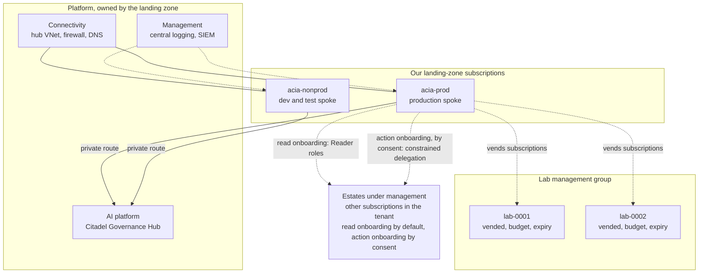

# Design 04 — Landing zone and Citadel

> **What this answers:** *Where does the solution live in the operator's Azure landing zone, what does it need from that landing zone, and how is every AI call, tool call and agent call governed through the Citadel hub?* Facts about Citadel come from the [Citadel research](research/citadel.md), read on 2026-10-31 from the repositories, the Bicep and the contract schemas themselves; facts about Foundry networking come from the [Foundry research](research/foundry-governance-and-framework.md). Part of the [design](README.md); the trust rules this must keep are in the [security architecture](07-security-architecture.md).

---

## 1. What "Citadel" is, and what we adopt

Three things share the name, and they are not the same.

| Name | What it is | Our use |
|---|---|---|
| **AI Citadel Blueprint** | a four-layer governance *architecture* (governance hub; agent operations in the Foundry control plane; agent management in Agent 365; security foundation in Defender, Purview and Entra), described in `Azure-Samples/foundry-citadel-platform` (MIT). "There is no separate Citadel runtime": it is configuration of native Azure services | the reference we follow |
| **Citadel Governance Hub** | the layer-1 reference implementation: an **API Management**-based AI gateway with three *contracts*, in `Azure-Samples/ai-hub-gateway-solution-accelerator` (MIT) | **the gateway for all model, tool and agent traffic** |
| **AI Landing Zone for Microsoft Foundry** | the *spoke* pattern for an AI workload: private Foundry, agent subnet, bring-your-own stores | the shape of our spoke |

**Decision: adopt the Governance Hub, forked and pinned to a commit** ([ADR-02](13-decisions.md#adr-02-the-gateway-is-the-citadel-governance-hub-on-api-management)). The research attaches six conditions, and the design carries all of them:

1. It is a **sample**, not a supported service: no releases or tags, one main committer, commit volume fell from 60 in July to 3 in September. → *Fork, pin a commit (the research read `81599b3`), own the upgrade tests.*
2. It runs on **API Management**, not on the new standalone *AI Gateway* product. → *Contracts are data in our repository, so a later move re-implements three contract types and re-architects nothing* ([§9](#9-the-ai-gateway-product-a-decision-gate)).
3. Its **monthly floor is the always-on usage pipeline** (Cosmos DB with seven containers at 400 request units each, a Logic App Standard plan, Event Hubs ≈ €320 in total), not API Management. → *Share a hub, or shrink the pipeline* ([§3.3](#33-the-hub-and-its-cost)).
4. The **shipped defaults loosen security and age**: public API Management endpoint, public Event Hubs, **full prompts and completions captured to Log Analytics**, retired model names, and an access-contract parameter that decides whether keys land in Key Vault or in deployment outputs (the sources disagree on its default). → *Our parameter file overrides every one* ([§3.4](#34-hardening-the-defaults)).
5. The **Publish contract** (MCP tools and A2A agents) is preview and writes preview ARM properties. → *Native API Management import of MCP servers (generally available) is the named fallback; its policies apply to every tool of a server, so the fallback is one server per trust class* ([§4.4](#44-the-publish-contract-tools-and-who-may-call-them)).
6. Foundry's **portal gateway integration** and the Citadel connection route are two mechanisms. → *Use only the Citadel route; never enable the portal's gateway on the hub.*

## 2. The landing zone: what we need, one by one

The solution assumes an Azure landing zone ([A1 in 01](01-requirements-and-principles.md#2-assumptions)). Each dependency below is stated so that a gap is *visible*, not discovered in week six.

| # | Needed from the landing zone | Why | If it is missing |
|---|---|---|---|
| L1 | **Management groups** for platform and landing zones; a **Lab** management group | policy inheritance; the Lab's blast radius | create ours under the tenant root group (loses inherited platform policy) |
| L2 | **Subscription vending** (or the right to create subscriptions) | our spokes and the vended Lab subscriptions | the operator creates three subscriptions by hand; the Lab is limited to one |
| L3 | **Connectivity hub**: VNet, **firewall**, forced-tunnel routes, address space | hub-and-spoke peering; egress control; FQDN allow-list | a spoke-local Azure Firewall adds about €803 a month for Standard (deployment hour only, plus €0.01408 per GB processed; Premium about €1,124; Basic about €254 plus €0.057198 per GB), from the price snapshot of 2026-10-31 — see [12](12-cost-and-finops.md) |
| L4 | **Central private DNS** (zones listed in [§6](#6-network)) linked to our VNets | private endpoints resolve | we host the zones in the spoke |
| L5 | **The Citadel Governance Hub** in a platform subscription | the single gateway | we deploy one ourselves, as a separate, optional deliverable ([§3.3](#33-the-hub-and-its-cost)) |
| L6 | **Policy initiatives** that do not forbid what we create: public network access *Disabled* is compatible; a tag `SecurityControl: Ignore`, or a Key Vault public toggle, is not; model-deployment deny policies in spokes must leave the hub's own Foundry account alone | deployability | exceptions, recorded |
| L7 | **Central Log Analytics** and an Azure Monitor Private Link Scope | one workspace per environment feeds the SIEM | we deploy ours |
| L8 | **Identity**: an Entra tenant; **Entra P2 or ID Governance** for PIM; permission to create app registrations and assign app roles for the hub's roles | approvers and administrators; hub JWT roles | break-glass and audited standing roles ([07 §11](07-security-architecture.md#11-optional-modules-and-their-fallbacks)) |
| L9 | **Defender for Cloud** foundational plans; optional paid plans | posture, resource-manager alerts | MCSB via Policy only |
| L10 | **Quota**: Foundry model quota in Sweden Central at a tier that allows the GPT-6 family (Tier 5 or 6, or a quota request) | models | request on day zero — lead time is the risk ([14](14-next-phases.md)) |
| L11 | **Agreement information** (EA, MCA or CSP) | purchase mechanism and subscription creation | assumption recorded; spike S-ACT-1 |

## 3. Topology

### 3.1 Where things live

- **`acia-prod`** holds the production Foundry account, stores and compute; **`acia-nonprod`** holds *dev* and *test* as separate Foundry accounts and resource groups, each created in the phase that needs it ([14 §4](14-next-phases.md#4-phases)): phases 0–2 release dev → prod, with prod in **shadow** (read-only), test and the chain environments arrive in phase 3 and the Lab in phase 4, and **no TEST hub or Lab account is required before its phase** (the AI Search services are the one exception: they are created on day zero, [§3.2](#32-region)). A third environment — **shadow** — is production's own spoke reading the real estate with every Move running as a dry run ([10 §5](10-test-and-evaluation.md#5-environments-and-promotion)). Every Foundry account has **two projects**, *reasoning* and *examination* ([§7](#7-the-foundry-layout)).
- **Lab subscriptions** are vended per experiment series, in the Lab management group, with policy, a budget and an expiry. They have **no route** to production or to estate data ([07 §8](07-security-architecture.md#8-the-lab-as-a-security-boundary)). **Azure Deployment Environments retires on 22 February 2027 and Azure Lab Services on 28 June 2027**, so neither is used: the Lab is subscription vending plus Deployment Stacks plus a reaper job ([11](11-delivery-and-operations.md)).
- **Estates** are other subscriptions in the same tenant, and onboarding has **two parts**. **Read onboarding** is the default: Reader, Cost Management Reader and Monitoring Reader plus the cost export, granted by an **onboarding module** that the estate's owner deploys (or accepts by policy); the reasoning plane reaches an estate only through read-only tool services, and nothing in an estate trusts our spokes for writes. **Action onboarding** is a *separate, consented* step and is **not provisioned by default**: it gives the credential broker a **constrained RBAC delegation** at the opted-in scope — role-assignment administration with an ABAC condition that limits *which role definitions* (our custom least-privilege Move roles only), *to which principals* (the execution identities only) and *of which type*; the sweeper is delete-only. The condition cannot limit the **target scope**, which only the scope of the delegate's role bounds ([Learn](https://learn.microsoft.com/azure/role-based-access-control/delegate-role-assignments-overview)), so *target scoping is deterministic code (the signed target hash, the runner's checks) plus detection, not ABAC* ([07 §3.3](07-security-architecture.md#33-the-execution-identity-just-in-time-without-pim), [11 §6](11-delivery-and-operations.md#6-onboarding-and-offboarding-an-estate)). An estate that has not opted in receives proposals only.

**What runs where** in the production spoke ([§6](#6-network) has the subnets and their allowed paths):

| Part | Runs on | Subnet |
|---|---|---|
| **Leaves**: the fifteen hosted-agent identities | Foundry hosted agents, in the account's two projects | `snet-agents` |
| **Spine**: the workflows | Durable Functions on Flex Consumption, C# ([05 §4](05-agents-and-orchestration.md#4-how-the-spine-runs)); it holds **no Foundry role**, reaches a leaf only through the hub ([§4.4](#44-the-publish-contract-tools-and-who-may-call-them)), sends `verify`, and reads `spine-events` and its own queue `spine-signals` (in its task-hub storage account; only the case-record facade and the Brief service send to it) through one queue-triggered function (Flex Consumption supports virtual network triggers, [Learn](https://learn.microsoft.com/azure/azure-functions/functions-networking-options#connecting-to-azure-services-through-a-virtual-network)) | `snet-spine` |
| **Tool services**, case-record facade, Consequence engine, Brief service, **Audit Writer** (internal ingress for every producer), **Lab controller** (its identity holds rights only inside the Lab management group) | Container Apps, internal environment | `snet-aca` |
| **Z3**: Policy service and Approval service (apps with internal ingress); credential broker, Move runner (one job per Move class) and Verifier (event-driven **jobs**, each with a scale rule on its own queue, no ingress) | a **separate internal** Container Apps environment | **`snet-exec`** |
| **Chain queues** `dispatch`, `run` (one per Move class), `verify`, `spine-events`: ids only | one storage account **`stchain`** per chain environment: ZRS, shared-key and public network access off, queue-scoped roles ([§6](#6-network)) | a private endpoint in `snet-exec` |
| Teams adapter and the **approval web page**: the page is the default approval path, and the only one for an irreversible Move, a purchase or a credential grant; a card approves in place only a reversible Move of the lowest class | a separate **external** Container Apps environment | `snet-edge` |
| **Recovery lake**: the hourly export of the operational store and the ledger's hourly copy | Blob Storage, immutable — one account in the primary region and **a second copy in a second EU region** ([06 §7.6](06-data-and-knowledge.md#76-recovery)) | a private endpoint in each region ([§6](#6-network)) |

### 3.2 Region

**Sweden Central is the primary region.** Of the three regions compared here it is the only one that appears in every list that matters (other EU regions were not compared):

| Capability | West Europe | North Europe | Sweden Central |
|---|---|---|---|
| Foundry hosted agents | yes | **no** | yes |
| Foundry managed VNet | no | no | yes |
| AI Landing Zone full deployment | **no** | **no** | yes |
| Citadel hub deployment region list | yes | **no** | yes |
| AI Search Serverless (preview) | no | no | yes — as in Denmark East and Poland Central: three EU regions |
| AI Search: Learn's *high demand* flag on new services | flagged | flagged | **flagged** |
| Foundry Memory | no | no | yes (not used) |
| EU Data Zone models of the GPT-6 family | yes | partly | yes |
| API Management Standard v2 price | about 23 % cheaper | as West Europe | dearer (about 30 % above West Europe) |

**Two notes on the table.** The managed-VNet "no" for West Europe rests on one reading of two Learn statements: the page lists its supported regions explicitly and West Europe is not among them, yet the same page says the managed virtual network is supported in every region where the Agent Service with a custom virtual network is ([Learn](https://learn.microsoft.com/azure/foundry/how-to/managed-virtual-network)); **spike S-NET-2 pins it**. The price row is the *Standard v2 Unit* meter times 730 hours, from the snapshot of 2026-10-31: €1.099965 an hour in Sweden Central (about €803 a month) and €0.843805 in West and North Europe (about €616).

**A day-zero risk: new AI Search services may be refused.** Learn flags Sweden Central — like West Europe, North Europe and Germany West Central — as "in high demand, which prevents the creation of new search services" ([Learn](https://learn.microsoft.com/azure/search/search-region-support#europe)). Standard setup needs an AI Search service per private account, and the Atlas needs one, so the **first day-zero check is to create the Search services**, before the Foundry account and its capability settings or hosts. **Fallback:** a Search service in another EU region — Poland Central and Denmark East appear in the same table without the flag (only Poland Central lists the semantic ranker and agentic retrieval) — with its private endpoint still in our spoke. Whether that is allowed is a **conflict between Learn pages**: *Networking options* says only the Foundry resource and the virtual network must share a region ("Other resources can be in different regions, with cross-region cost implications"), while the *Agent Service FAQ* says "all resources must be in the same region as the Microsoft Foundry resource" ([networking options](https://learn.microsoft.com/azure/foundry/agents/concepts/networking-options#bring-your-own-virtual-network-requirements), [FAQ](https://learn.microsoft.com/azure/foundry/agents/faq)). **Spike S-NET-3 tests the cross-region case and decides.** Until then the fallback is a hypothesis; if it fails, the other ways round are platform-managed data (S-NET-2) or another region for the account — a one-way door, which is why the check comes first. Cross-region traffic would be priced per gigabyte in the cost model ([12](12-cost-and-finops.md)).

**What residency costs.** There is no flat premium. In the price snapshot of 2026-10-31 the EU Data Zone meters of the **GPT-6 family are about 20 % above Global** and those of the earlier GPT-5 family **about 10 %**; the premium belongs to the meter, so the cost model selects meters by exact name ([12](12-cost-and-finops.md#1-how-the-model-works)).

Two consequences. (a) If the landing zone's connectivity hub sits in another region, the spoke peers across regions and pays for the data that crosses the peering: cents per gigabyte, small here, and priced in [12](12-cost-and-finops.md) rather than assumed. (b) A **second region is outside the cost target for phase 1**; the recovery story is *redeploy from code* ([11](11-delivery-and-operations.md)), with data protected by the redundancy of its stores. The Foundry account can hold private endpoints in two regions, which leaves a path to a second gateway later without a redesign.

### 3.3 The hub and its cost

The hub is a platform capability; **we onboard to it with contracts it ships** (A2 in [01](01-requirements-and-principles.md#2-assumptions)). Two ownership models give the same interface:

| Model | Hub owner | We deploy | Fixed monthly cost: **marginal to us** · **all-in** |
|---|---|---|---|
| **A. Shared hub** (preferred) | the platform team | contracts only | marginal ≈ €0 fixed (our share is tokens and calls) · all-in: the hub's own cost, which the platform team carries |
| **B. Our own hub** | us, as a separate deliverable | the hub (`main.bicep` once) and contracts | marginal = all-in: **Small** (Developer tier, no SLA, for dev and lab) ≈ €440; **Medium v2** (Standard v2, 99.95 % SLA, for production) ≈ €1,020 in West Europe, ≈ €1,200 in Sweden Central |

The research read the Bicep and the price list; the figures are indicative, from the Retail Prices API on 2026-10-31. **Marginal versus all-in:** Model A's ≈ €0 is what *we add* to a hub that exists anyway; the *all-in* cost of AI governance includes that hub, and the connectivity firewall where none exists (about €803 a month for Standard, [§2](#2-the-landing-zone-what-we-need-one-by-one) L3). [12](12-cost-and-finops.md) reports both and never presents the marginal figure as the all-in one. The **levers**, largest first:

1. **Reuse an existing hub.** The primary template cannot adopt an existing API Management instance (an upstream issue is open since June); the preview *gateway upgrade* module can configure one it did not create.
2. **Shrink the usage pipeline** (≈ €320 of the ≈ €440 small hub): Cosmos on shared throughput or serverless saves ≈ €123; replacing the always-on Logic App and Event Hubs with Log Analytics queries removes the rest. The template has no flag for either, so this is a fork change. Our agents read cost per case from the gateway's logs and Application Insights by KQL, so the Power BI path and the pricing container are not needed.
3. **Tier.** Developer for dev and lab (a saving of about €761 a month against Standard v2 in Sweden Central and about €574 in West Europe: *Standard v2 Unit* €1.099965 or €0.843805 an hour, *Developer Unit* €0.057902, 730 hours, snapshot of 2026-10-31); one hub for production and non-production, with contracts per environment — the sizing guide allows it.
4. **Logging.** Set the large-language-model message capture to *none* in production (the default captures up to 256 KB of prompt and completion each) and use the Basic or Auxiliary table plan where the table allows.
5. **Safety checks only where needed:** content safety and PII only on contracts that read external text or personal data.
6. **Semantic cache off**, unless a measured hit rate beats the cost of Managed Redis and embeddings.

### 3.4 Hardening the defaults

Our parameter file overrides these shipped defaults; each override is a contract test ([10](10-test-and-evaluation.md)).

| Shipped default | Our setting |
|---|---|
| API Management network type *External* | **Internal**, or Standard v2 with an inbound private endpoint and public access disabled |
| Event Hubs public network access enabled | disabled after first provisioning |
| Logic App public, no private endpoint | private endpoint; or removed with the usage pipeline |
| prompts and completions captured | capture *none* in production; on only in dev, with short retention |
| sample models `gpt-4.1`, `gpt-5.4-mini` (both past retirement) | our alias map ([§4.2](#42-the-alias-map)) |
| `estimate-prompt-tokens` false | **true**: the prompt is estimated before the call, so a tripped limit wastes fewer backend calls. It does **not** make a limit hard — concurrent requests can exceed it ([§4.3](#43-the-access-contracts)) |
| content-safety policy commented out in the tool and agent default | enabled on every contract that carries untrusted text, with Learn's default **1,000-character response windows and a non-zero overlap** set (prompts are screened in windows of 10,000, fixed by the policy; [§4.4](#44-the-publish-contract-tools-and-who-may-call-them)) |
| subscription key always required, JWT optional | **both** (`jwtRequired`), `requiredRoles` assigned directly to agent identities, and the contract's list of agent `azp` ids checked on every call ([§4.3](#43-the-access-contracts)) |
| API Center disabled in the parameter file | enabled; every published tool is registered with owner, classification and compliance metadata |
| tag `SecurityControl: Ignore` | removed |
| access-contract `useTargetAzureKeyVault`: the documented defaults conflict (Bicep `true`, README `false`, per our research; the sample parameter file at the pinned commit sets `false`) | set **explicitly to `true`**, and assert on the *deployed result* that **no key-bearing deployment output exists**; the Bicep default is *to confirm* on the pinned commit `81599b3` |
| callers may send `x-policy-id` (a guardrail policy per request, which overrides the deployment's), an API-version override and `x-ms-service-tier` (which overrides the body's tier) | the product policy **strips all three** from every inbound request, sets the API version itself and sets the tier per alias ([§4.1](#41-the-backend-contract)) |
| PII anonymisation as the only PII control; mappings may be saved (`piiStateSavingEnabled`) | PII is **pseudonymised in the tool services before text reaches the hub**, `piiStateSavingEnabled = false`; the hub's PII policy is a backstop (per the research: no analysis beyond about 125,000 characters, MCP requests only) |
| the Foundry portal's AI Gateway, on by default for new projects once an account has one | none configured on our accounts; an Azure Policy audit of API Management instances in our spokes (B9, [§8](#8-the-gateway-bypass-register)) |

## 4. Contracts per agent group

Citadel's three contracts are `.bicepparam` files against subscription-scope Bicep, kept in our repository as `contracts/<contract>/<env>/main.bicepparam`, where a *contract* is a **group × data class** ([§4.3](#43-the-access-contracts)). A change is a pull request with a `what-if`; a contract change needs the group's **sponsor** to approve (CODEOWNERS).

| Contract | Question it answers | Version and status | Our use |
|---|---|---|---|
| **Backend** | *where* does LLM traffic go (supply) | 1.1.0, generally available (self-declared) | one backend per approved deployment type and model; aliases; retirement dates |
| **Publish** | *what* tools and agents exist | 1.1.0-preview | our MCP tools; **no A2A assets in phase 1** |
| **Access** | *who* may use *what*, under which limits (demand) | 1.2.0, generally available | one product per **group × data class** and environment |

### 4.1 The backend contract

Registers (it does not deploy) the Foundry deployments the hub may call. Backends are separated by **data class**, so a contract's `allowedBackendPools` can *only* include pools its data class may use:

| Pool | Deployment type | Models (starting fill) | For data class |
|---|---|---|---|
| `acia-eu` | **EU Data Zone Standard** | GPT-6.1 Sol, GPT-6 Luna, a second-family model, an embedding model | estate-confidential, personal |
| `acia-global` | Global Standard | the same, plus a Claude model (hosting version pinned: Learn lists Version 1 hosted by Anthropic and Version 2 hosted on Azure, and no EU Data Zone option for either) | public, synthetic — **the only pool with Claude** |
| `acia-flex` | its **own Global Standard deployment**, with **Flex** (preview) requested per call by `service_tier` or the `x-ms-service-tier` header; Flex shares the deployment's quota with Standard; **Batch** only once its adapter exists | the GPT-6 and GPT-5.6 models that Learn lists as Flex-capable | **public, synthetic only**; delay-tolerant |
| `acia-judge-eu` | EU Data Zone | an independent-family model | estate-confidential |

Circuit breakers stay on (three failures in five minutes trip for one minute, honouring `Retry-After`). `retirementDate` is set on every model and alerted 90 days ahead. The sample's model SKU is `GlobalStandard`; whether the routing metadata handles `DataZoneStandard`, and whether the hub can set the Flex tier as described next, is unverified and is exercised in the first contract test (spike **S-GW-1**). **The hub, not the caller, sets the Flex tier per alias:** for `acia-batch` it adds the `x-ms-service-tier` header that Learn describes for gateways, and it **strips any `x-ms-service-tier` a caller sends**, because the header overrides the body's `service_tier` and an agent could otherwise choose Flex or Priority for itself. Claude is reachable only from the public-class contracts (`curate`, `examine-pub`): the `allowedBackendPools` of every EU contract exclude `acia-global` ([Learn](https://learn.microsoft.com/azure/foundry/foundry-models/concepts/claude-models-hosting-comparison)).

### 4.2 The alias map

Agents name aliases; the contract maps each to an ordered list (priority strategy) with a fallback *within the same wire protocol* — a fallback may cross providers but there is no protocol translation. Every fallback is a contract test of its wire protocol, identity, residency and accounting. **`acia-batch` is not an interactive alias:** Flex is a *preview* per-request tier with no SLA, may be unavailable, never falls back to Standard by itself, and runs on Global Standard only — Learn lists no Data Zone deployment and only GPT-6 and GPT-5.6 models ([Learn](https://learn.microsoft.com/azure/foundry/openai/how-to/flex-processing)) — so it serves **public and synthetic data only**; Batch is submit, collect and cancel. Delay-tolerant public work therefore waits and retries in the spine, or the spine decides to pay for Standard. Phase 1 uses Flex only; Batch needs an adapter and waits.

| Alias | Members, in order | Pool |
|---|---|---|
| `acia-triage` | GPT-6 Luna → next cheapest cleared model | `acia-eu` (estate), `acia-global` (public) |
| `acia-reason` | GPT-6.1 Sol → GPT-6.1 Terra | `acia-eu`, `acia-global` |
| `acia-judge-eu` | independent-family model (for example Mistral Large 3, which has an EU Data Zone meter; the choice is an experiment, [14](14-next-phases.md#3-spike-register)) → another family | `acia-judge-eu` |
| `acia-judge-pub` | a Claude model (pinned hosting version); **no fallback until the Claude → EU-judge hop passes its wire-protocol contract test** (S-GW-1) | `acia-global` |
| `acia-embed` | embedding model → alternative | `acia-eu` |
| `acia-batch` | Flex (preview, phase 1; **the hub sets the tier and strips a caller's own `x-ms-service-tier`**), Batch later through an adapter; **public and synthetic data only; no automatic fallback to or from an interactive alias** | `acia-flex` |

**Per-contract mapping.** The contract, not the alias name, picks the model. The `forge` contract resolves `acia-reason` to a model of a **different family** from the one the investigators' contract resolves it to (the second-family model or Claude, both on `acia-global`), so the Forger's generator shares none of the investigators' blind spots; a contract test fails if the two resolve to the same family, and the exam measures the independence ([10 §3](10-test-and-evaluation.md#the-forger-is-tested-for-independence)).

### 4.3 The access contracts

One **product per contract and environment** (`MULTI-ACIA-<contract>-<ENV>`), where a contract is a **group × data class**: eleven groups, **twelve contracts**, because `examine` has two — `examine-pub` for synthetic estates and `examine-eu` for T3 real-estate retrospective cases — and every other group has one data class. Which pools a contract may reach follows its data class ([§4.1](#41-the-backend-contract)); `engineer` and `govern` are **EU only**; Claude (`acia-judge-pub`) is reachable only from the public-class contracts, and so is `batch` — Flex, a preview tier that runs on Global Standard only — which appears on `study` and `examine-pub` alone. A contract has a product in each environment **where it has planned work**: `examine-pub` and `forge` have **no PROD product**, because synthetic estates never run in production, and no TEST or DEV product exists before its phase ([§3.1](#31-where-things-live)). **TEST and DEV carry synthetic data only**, so their products reach the **public pools** (`acia-global`, `acia-flex`) even for the estate contracts, under the **same alias names** — a leaf's code does not change, only the members behind an alias do; the pools in the table are PROD's, and PROD estate contracts stay **EU only**.

| Contract | Agents | Data class · pools | Aliases | Quota | Safety on the contract |
|---|---|---|---|---|---|
| `study` | Scholar, Cartographer | public · `acia-global`, `acia-flex` | triage, reason, embed, batch | 12 §2 | content safety with `shield-prompt`: the Scholar is the only reader of untrusted web text |
| `curate` | Librarian (Atlas) | public · `acia-global` | judge-pub, embed | 12 §2 | content safety; its only external effect is a pull request to `atlas/**` |
| `survey` | Surveyor | estate-confidential · `acia-eu` | triage, reason | 12 §2 | content safety (tags and names are untrusted text); PII pseudonymised in the tool services, anonymisation at the hub as a backstop |
| `investigate` | Detective, Skeptic, Economist | estate-confidential · `acia-eu`, `acia-judge-eu` | reason, judge-eu | 12 §2 | content safety; **per-agent counters keyed on the verified `azp`**, so the Detective cannot starve the Skeptic |
| `experiment` | Experimenter | public · `acia-global` | reason | 12 §2, with a daily quota | content safety; no estate data; it plans, the Lab controller deploys |
| `converse` | Diplomat | personal, pseudonymised · `acia-eu` | triage, reason | 12 §2 | people referenced by pseudonym; outbound messages screened |
| `engineer` | Engineer | estate-confidential (customer source code) · `acia-eu` | reason | 12 §2 | content safety; **EU only** |
| `govern` | Auditor, Librarian (lessons) | estate-confidential · `acia-eu`, `acia-judge-eu` | judge-eu, reason, embed | 12 §2 | content safety; **EU only**: no `judge-pub`, no `batch` |
| `examine-pub` | Examiner, on synthetic estates | public · `acia-global`, `acia-flex`, `acia-judge-eu` | judge-pub, judge-eu, embed, batch | 12 §2; no PROD product | content safety; synthetic data only |
| `examine-eu` | Examiner, on T3 cases | estate-confidential · `acia-eu`, `acia-judge-eu` | judge-eu, embed | 12 §2 | content safety; **EU only** |
| `forge` | Forger | public (synthetic) · `acia-global` | reason, mapped to a **different model family** than the investigators' ([§4.2](#42-the-alias-map)) | 12 §2; no PROD product | separate key and no tools beyond the generator, so the adversary shares nothing with the examinee |
| `conduct` | Conductor | estate-confidential · `acia-eu` | triage, reason, embed | 12 §2 | a contract that cannot spend another group's budget |

**Quotas are generated by the cost model, not chosen.** For every contract in every environment where it has planned work, the model emits a **monthly token quota**, a **starting tokens-per-minute limit**, an **in-flight overrun bound** and, for `experiment`, a **daily quota**; TEST carries at least **25 %** and DEV at least **10 %** of production's plan, or their own planned work where that is larger (exams and gates run in TEST). [12 §2](12-cost-and-finops.md#2-the-results) prints the matrix, and `tools/cost-model.py --check` parses **this table** — the contract names and, in the fourth column, each contract's alias set — and fails on a missing or extra contract or a different alias set; this document holds no quota figure. The euro figure printed beside a quota is a **forecast-equivalent**, with a worst case at the dearest alias the contract lists beside it: neither is a cap.

**Identity and per-agent authorisation.** A subscription key is required (the hub cannot drop it yet), and it identifies the *contract*, not an agent: the same key authorises every MCP server in a product ([Learn](https://learn.microsoft.com/azure/api-management/govern-mcp-server-products)), and the Citadel sample shares one key across every asset of a contract. So an Entra token is validated **as well**, and the product policy checks its `azp`/`oid` against the contract's list of agent identities: a valid token for another agent is refused even with this contract's key. `Model.Invoke` and `MCP.Invoke` are assigned **directly** to each agent identity (group assignments reach users, not workload identities), and every **tool** has an app role of its own (`Tool.<name>`, [§4.4](#44-the-publish-contract-tools-and-who-may-call-them)) assigned directly to the identities that may call it. Per-agent counters, attribution and per-tool authorisation all key on the verified `azp`; **`x-sub-agent-id` is a caller-supplied header, used for attribution only**, and the hub takes the agent role from the token. Whether Entra agent-identity tokens carry the distinct `azp` and `oid` that this needs is spike **S-ID-2**; whether the hub enforces the per-tool roles is **S-GW-3** ([14 §3](14-next-phases.md#3-spike-register)). The Foundry connection that an access contract can create is **not used**: our hosted agents call the hub from code, reading the endpoint and key from Key Vault with their own identity (no key in any deployment output, [§3.4](#34-hardening-the-defaults)). Keys rotate in three steps (switch the active key, confirm, regenerate the idle one).

**What the hub's limits are, and are not.** `llm-token-limit` counts prompt and completion tokens only, per gateway, and "concurrent or near-concurrent requests can temporarily exceed the configured token limit" ([Learn](https://learn.microsoft.com/azure/api-management/llm-token-limit-policy)); estimating prompts in advance trims wasted calls without making the limit exact. Tokens are not euros either: cached input, tool calls, sandbox hours and a different model behind an alias price differently. So the hub's limits are the **second, coarser layer**, not a hard budget. The budget that holds is the **spine's**: before every leaf call it **reserves the worst-case cost atomically** and reconciles from the hub's usage afterwards ([05 §4](05-agents-and-orchestration.md#4-how-the-spine-runs)). The **residual overrun** is what is already in flight when a limit trips — at most the concurrent calls times the largest call the contract allows (prompt estimate plus output cap) — and a leaf that ignores its envelope is stopped by the quota once the counter shows it. The model generates that bound for every product, in tokens and at the dearest rate the contract's aliases allow, and [12 §2](12-cost-and-finops.md#2-the-results) prints it beside the quota, so a changed contract changes it.

**Kill switch.** Suspending a contract's product takes that contract away from the hub in seconds ([07 §10.3](07-security-architecture.md#103-kill-switches)); removing one agent's `azp` from the contract's list, or adding it to the hub's deny list, does the same for one agent. Disabling an agent's Entra identity blocks **new tokens only**: tokens already issued live until they expire, so the list is the faster switch (its propagation time is measured in the kill-switch drill, [10 §2](10-test-and-evaluation.md#2-the-layers), L6).

### 4.4 The publish contract: tools, and who may call them

Tools are published as MCP servers through the hub, registered in API Center with owner, classification and compliance metadata. Reading is separated from writing; most tools are read-only. **A call needs two things:** the caller's *contract* lists the tool's server, **and** the caller's own identity holds the tool's app role. Authorisation lives in the hub and in the service, never in what a prompt implies.

| Tool | Backend | Reads / writes | Agents holding the role |
|---|---|---|---|
| `ms-learn` | Microsoft Learn MCP | read, public text (untrusted) | Scholar |
| `release-feed` | Release Communications MCP (keyless) | read, public text (untrusted) | Scholar |
| `docs-fetch` (Document reader) | our service, egress allow-list | read, **untrusted** | Scholar |
| `atlas` | our service | read: claims with their receipts, **including those of an Atlas pull request under review** (read only: the Skeptic cannot write to the pull request, and has no web tool) | Scholar, Cartographer, Librarian (Atlas), Detective, Skeptic, Economist, Experimenter, Engineer, Librarian (lessons) |
| `atlas-propose` | repository pull-request service: its identity reads the **GitHub App's private key** from the secrets vault ([07 §6.1](07-security-architecture.md#61-secrets), [07 §9](07-security-architecture.md#9-supply-chain)); **`atlas/**` only** | write (a pull request); after knowledge CI the Skeptic (read only) and a person with standing review it, and the human merges | Librarian (Atlas) |
| `price-engine` | our service | read | Cartographer, Skeptic, Economist |
| `cost-query` | our service (aggregates; result ids) | read | Surveyor, Detective, Skeptic, Economist, Conductor |
| `estate-read` | Azure MCP Server, read-only identity | read; free text sanitised | Surveyor, Detective, Skeptic |
| `directory-read` | our service, pseudonyms | read | Surveyor |
| `consequence` | Consequence engine (deterministic) | read | Economist, Skeptic |
| `case-record` | **case-record facade** | read by id, scoped to the caller's group and case (the Diplomat sees the Estate Model only pseudonymised); write the caller's own record types (the Experimenter's include `method-hypotheses` and `method-proposals`); receive each run's one terminal `run-completed` event | **all fifteen identities**: the twelve that write typed records read and write; the **Examiner** (records of exam runs) and the **Conductor** (parked cases and drift cases) **read only**; the **Forger** has the event route only |
| `ledger` | our service | read (predictions arrive through `case-record`, outcomes from the Verifier) | Detective, Skeptic, Auditor, Conductor |
| `lessons` | our service | read; write **drafts** | Diplomat (read minimal, drafts), Librarian (lessons) |
| `brief-draft` | Brief service | write (typed) | Diplomat |
| `moves` | our service: the Move catalogue and the source repositories a Move targets | read | Engineer |
| `moves-propose` | the same repository pull-request service, **`moves/**` YAML only** | write (a pull request) | Engineer |
| `lab-control` | Lab controller | **plan** (a signed recipe's opaque code, a budget, an expiry; the Experimenter only) and **read observations** (read only; the Experimenter, and the Skeptic for W6) — the controller deploys, under a pre-deploy cost cap | Experimenter (plan, observe), Skeptic (observe) |
| `evals-read` | our service | read only: exam results, the records of **training-exam** runs on synthetic estates, the **aggregate reports** of release-gate runs, and outcome-score records with a failed-step class — scores, ids and enumerations, free text only through the source sanitiser, and nothing an estate wrote or named, because the Experimenter's contract reaches public pools only; **never** the held-out or credential exam cases, the sealed gate seeds or any key | Experimenter (W10) |
| `sandbox` | dynamic sessions (Container Apps Sandboxes are generally available since September 2026; EU regions and price *to confirm*) | compute, no identity; one session per **(group, case)**, never reused | Detective, Experimenter, Engineer |
| `exam-bank` | scoring service | read (no keys); write scores | Examiner |
| `terrarium-gen` | our service | write (synthetic) | Forger |
| `agenda` | our service | read / write | Conductor |
| `audit-read` | our service: the Audit Writer's read side and the Entra sign-in records that corroborate approvals | read | Auditor |

The facade is the only write path for records and the only route of a run's terminal event, which it passes to the spine as an id on the queue `spine-signals` ([§6](#6-network)), and it validates their schema in the service. **Taint is enforced in the tool service and at the hub, not in the agent process**: the call's envelope carries it, and a write tool refuses a call whose envelope taint is `untrusted` unless the field is on its allow-list. `lab-control` carries **two app roles**, `Tool.lab-control.plan` and `Tool.lab-control.observe`, so the Skeptic can read observations and cannot plan; if S-GW-3 shows that the hub cannot key a role on an operation, the one-server-per-trust-class fallback below makes them two servers.

**Job-backed tools return a result id, not a result.** `cost-query` over the lake, the Lab's observations and any tool that outlives a request answer at once with a *result id*; the result is read later, by id, through the same tool, and the service checks that the reader is the caller that asked (identity, group and case) — holding the id is not a permission. A leaf's invocation works the same way: it returns a run id at once, the leaf's wrapper emits **one terminal `run-completed` event** through `case-record` when its handler exits, and the spine reads the result from the case store, never from the response body ([05 §4](05-agents-and-orchestration.md#4-how-the-spine-runs)).

#### Leaf endpoints are published through the hub

Each hosted agent's stable invocation endpoint is imported into the hub as an **ordinary API, not an A2A asset**: one API per leaf, defined in our repository beside the Citadel contracts. The spine's identity holds **no Foundry role at all**: the hub admits only the spine (its managed identity's `azp` and the role `Agent.Invoke`, which no agent identity holds) and calls the leaf with its own identity, which holds *Foundry Agent Consumer* at that agent's scope ([Learn](https://learn.microsoft.com/azure/foundry/concepts/rbac-foundry#manage-role-assignments)). A call that skips the hub therefore fails on RBAC at Foundry, and the daily canary proves it ([§8](#8-the-gateway-bypass-register), B12); that the hub can front a hosted agent's endpoint this way, with its session parameter, is *to confirm* in spike **S-NET-1b**. If spike **S-HOST-1** chooses to hold the invocation request open, the request lasts as long as the leaf **works**, up to the role's p99 active time (the idle timeout is the platform's deprovision rule, not a request length), and the hub's `forward-request` `timeout` waits only for the response *headers* — default 300 seconds, and Learn says values above 240 may not be honoured ([Learn](https://learn.microsoft.com/azure/api-management/forward-request-policy#attributes)) — so the stream must send its headers and keep-alives at once, and the leaf API's backend timeout is set for the active time (*to confirm* on the hub).

**Screening and streaming.** Two Learn statements, and they differ. The built-in **`llm-content-safety`** policy can screen the requests *and responses* of MCP tools and A2A agent APIs; on a streamed response it buffers events in a sliding window and, on a violation, stops forwarding without returning a 403, so a tool client treats a stream that ends early as a failed call ([Learn](https://learn.microsoft.com/azure/api-management/llm-content-safety-policy)). **Custom** policies must not read `context.Response.Body` on an MCP server, because that buffers the stream and can break the server ([Learn](https://learn.microsoft.com/azure/api-management/expose-existing-mcp-server#configure-policies-for-the-mcp-server)). So response screening uses the built-in policy only, and spike **S-GW-4** confirms it on our hub, streams included. The policy screens **responses in windows of 1,000 characters by default** (`window-size`, configurable only for responses) and **prompts in windows of 10,000** (always); `window-overlap-size` is optional and **windows do not overlap unless it is set** ([Learn](https://learn.microsoft.com/azure/api-management/llm-content-safety-policy)), so our policy sets a **non-zero overlap**, and the contract test plants an injection across a window boundary. The hub also **strips `x-policy-id`, any API-version override and any `x-ms-service-tier`** ([§3.4](#34-hardening-the-defaults)), and the tool services sanitise free text themselves ([07 §5](07-security-architecture.md#5-defence-against-prompt-injection-in-nine-layers)): the hub's screen is the second layer. If a source API of an `mcp-from-api` tool requires its own key, the contract forwards the subscription key in a named header; otherwise `tools/call` fails with 401 while `initialize` and `tools/list` pass.

**Fallback.** If the preview contract's schema changes, MCP servers are imported natively into API Management (generally available since June 2026: products, Bicep) and granted by the access contract. **Policies on a native MCP server apply to all of its tools** ([Learn](https://learn.microsoft.com/azure/api-management/mcp-server-overview#govern-mcp-servers)); Learn documents no per-tool allow-list there, only counters that can be keyed on the tool name for throttling ([Learn](https://learn.microsoft.com/azure/api-management/govern-mcp-server-products)). So the fallback is **one MCP server per trust class** — public read-only, estate read-only, typed write, Lab — each with its own role; whether a role check can also be keyed on the tool name is part of S-GW-3.

## 5. Observability and attribution at the hub

`customDimension1` carries the agent role, taken from the **verified `azp`** (a caller-supplied `x-sub-agent-id` is kept as a separate, untrusted dimension for anomaly detection and never decides anything), and `customDimension2` the **case id**, so the Economist reads *cost per case* from the gateway's logs and Application Insights by KQL. The hub's alerts are on for throttling, quota and backend failure, and we turn on authentication, content-safety and PII failure alerts. The hub's `GET /version` and `GET /version/backend-contract` (anonymous) are polled as a **drift probe** ([09](09-safeguards-and-drift-controls.md)).

## 6. Network

**Hub-spoke-hub**: our spoke VNet peers with the connectivity hub, and the Governance Hub has its own spoke; traffic from our agents to the hub passes the connectivity firewall first. This is the recommended pattern for strict segmentation.

| Subnet (illustrative, one spoke) | Purpose | Notes |
|---|---|---|
| `snet-agents` /24 | Foundry **agent subnet**, delegated to `Microsoft.App/environments` | one per Foundry account, exclusive, shared by its two projects; about one address per hosted-agent session (Learn: /27 minimum, /24 recommended); HTTP 429 `subnet_exhausted` is the only signal. **Reaches:** the hub through the connectivity firewall, its own contract's key and endpoint in Key Vault, Entra, telemetry, the registry — nothing else |
| `snet-spine` /27 | the **Flex Consumption** integration subnet of the spine, delegated to `Microsoft.App/environments` | cannot share a subnet with a Container Apps environment or hold private endpoints ([Learn](https://learn.microsoft.com/azure/azure-functions/flex-consumption-how-to#configure-virtual-network-integration)); /27 for one app, /26 for several; no inbound. **Reaches:** the hub, the operational store, Entra, its task-hub storage account through **three private endpoints** in `snet-pe` (blob, queue and table; the queue-triggered function also reads `spine-signals` there), the **Policy service** (internal ingress in `snet-exec`), and **`stchain`** through its private endpoint in `snet-exec` — it sends `verify` and the function reads `spine-events` |
| `snet-aca` /27 | Container Apps environment (internal), workload-profiles, Consumption | **Z2**: tool services, case-record facade, Consequence engine, Brief service, Audit Writer, Lab controller; its callers are the hub and the spine; the **Audit Writer takes internal ingress from every producer**, those of `snet-exec` included, and the **Estate service from the Approval service**, for the approver-set snapshot. **Reaches**, besides the hub and the stores: the task-hub account's queue endpoint in `snet-pe`, to send ids to `spine-signals` (the case-record facade and the Brief service only) |
| `snet-exec` /27 | a **separate, internal** Container Apps environment | **Z3**: Policy service and Approval service (internal ingress); credential broker, Move runner jobs (one per Move class) and Verifier job (event-driven, **no ingress**); the private endpoint of **`stchain`**; allowed paths enumerated below |
| `snet-edge` /27 | a **separate, external** Container Apps environment | the Teams adapter (X1) and the Entra-authenticated approval web page (X5): the only public ingress ([07 §7](07-security-architecture.md#7-network-and-the-short-list-of-exceptions)); X5 is the default approval path and the only one for an irreversible Move, a purchase or a credential grant, and a card of any other class links to it; neither holds a signing key or an execution role |
| `snet-pe` /26 | private endpoints for Foundry, Storage (the ledger's blob endpoint among them), Cosmos DB, AI Search, Key Vault, the registry, Monitor, **the spine's task-hub storage (three: blob, queue, table)** and the **recovery lake** | one endpoint per sub-resource: **each is an hourly meter**. The task-hub queue endpoint also carries the facade's and the Brief service's sends to `spine-signals`. The recovery lake has an endpoint in **each region**; the second-region one lives in that region's own subnet, outside this spoke, and serves the export job's second copy and the regional-failure drill, over a peering and a private DNS zone (below; [06 §7.6](06-data-and-knowledge.md#76-recovery)) |

**`snet-exec`: allowed paths, enumerated.** The subnet's network security group and the firewall deny everything that is not listed.

1. **In (internal ingress):** HTTPS to the **Approval service**, from `snet-edge` (the Teams adapter and the approval page) and from the Brief service in `snet-aca` — it validates the approver's token itself — and to the **Policy service**, from the spine in `snet-spine` and from the Brief service in `snet-aca`, before an approval; and the **private endpoint of `stchain`**, from the spine (it sends `verify` and reads `spine-events`) and from the parties of this subnet. The **broker, the runner and the Verifier take no ingress**: they consume queues.
2. **`stchain`** (private endpoint in this subnet; ZRS; shared-key and public network access off) holds the queues `dispatch`, `run` (**one per Move class**, because a queue scale rule counts the messages of one queue and a class's job must wake only for its own work), `verify` and `spine-events`, and a message carries **an id only**. Each party holds a role only on **its own queues**: the Approval service sends to `dispatch` and `spine-events`; the broker receives from `dispatch` and sends to each class's `run`; a runner receives from its class's `run` and sends to `spine-events`; the Verifier receives from `verify` and sends to `spine-events`; the spine sends to `verify` and receives from `spine-events`. Each party's role assignment is **scoped to its own queue** (queue-level scope is supported for the built-in queue data roles, [Learn](https://learn.microsoft.com/azure/storage/queues/secure-queues)); a **condition on the queue name** is the generally available alternative but covers only the five message actions (peek, put, put or update, clear, get or delete; [Learn](https://learn.microsoft.com/azure/storage/queues/queues-auth-abac-attributes)); that the queue trigger and the runner job's scale rule work with a queue-scoped role carrying the least data-plane right the scaler needs is *to confirm* in S-ID-3, and one storage account per queue pair is the fallback.
3. **Key Vault** (private endpoint): each signing party reaches **only its own vault**, with the custom data-plane role **`acia-signer`** there — `keys/read` and `keys/sign/action` on that vault's key and nothing else — to sign: the Policy service its permits, the Approval service its approval records, the broker, the runner and the Verifier their own ledger entries ([07 §6.1](07-security-architecture.md#61-secrets)). The built-in *Key Vault Crypto User* is **not** used, because it also holds `keys/update/action` and `keys/backup/action`, so a signer could re-enable a key that the kill switch disabled ([Learn](https://learn.microsoft.com/azure/role-based-access-control/built-in-roles/security)); DR-19 checks that no signing identity holds `keys/update/action`. A verifier reads a producer's **public key** through the custom role **`acia-key-reader`** (`keys/read`, scoped to that key); how the public keys reach each verifier and how they are pinned is *to confirm* in spike S-ID-3. Nobody holds a permission on another party's vault but that read.
4. **The operational store** (private endpoint, container-level roles): `approval-records`, `approvals-index` (the nonce markers and the runner's start and done markers), `leases` and `controls`, and the Verifier's outcome writes — nothing else. The **broker creates, replaces and deletes** the lease in `leases`; the **runner only reads it**, before every step, and ends a Move by writing its done marker. Every chain service reads `controls` with a **cache of at most 60 seconds, and a stale cache fails closed**.
5. **Azure Resource Manager, Entra and Microsoft Graph, through the connectivity firewall** (FQDN allow-list: `management.azure.com`; `login.microsoftonline.com` for sign-in metadata and **Entra's published signing keys**; `graph.microsoft.com` for the broker's read-only group lookups, the narrowest permission being *to confirm*): the Approval service (to validate the person's token), the broker (role assignments, the token again, the approver's standing read live), the runner (the target scope, purchases, its own re-verification) and the Verifier (read-only checks).
6. **Internal endpoints and the ledger:** the **Audit Writer** and the **Estate service** (both in `snet-aca`), the **Policy service**, and a **read-only** path to the ledger through its private endpoint in `snet-pe` (*Storage Blob Data Reader* on the ledger container, [07 §3.1](07-security-architecture.md#31-who-has-an-identity)). The Estate service is reached by the **Approval service only**, for the approver-set snapshot; it is not a trust anchor, because the broker re-reads the approver's standing live from Graph and the role assignments. Every Z3 component records through the Audit Writer with signed entries, and the broker, the runner and the Verifier **read their own appended block back** and match its hash before they go on; none holds a write role on the ledger.
7. **Bootstrap and telemetry:** image pulls from the private registry, by digest, and telemetry to the Azure Monitor private link scope.

**Nothing else:** no route to the hub, a model, a tool service, Foundry, the Lab or the internet, and no inbound from any other subnet than those of item 1. One Learn caution shapes the chain: the *start* call of a Container Apps job accepts an execution template that can override the image, command and environment variables, and the container can use any managed identity made available to it ([Learn](https://learn.microsoft.com/azure/container-apps/jobs#permissions)), so whoever may start a job could run any image with the job's identities. So **nothing starts a chain job by a call**. The broker, the runner and the Verifier are **event-driven jobs**, each with a scale rule on its own queue (scale rules for Azure resources, including Azure Queue Storage, support managed identity ([Learn](https://learn.microsoft.com/azure/container-apps/scale-app#authentication)), and the job's resource schema has an `identity` property on its scale rule ([Learn](https://learn.microsoft.com/azure/templates/microsoft.app/jobs)); the combination with a queue-scoped role is *to confirm* in S-ID-3), **one message per execution** (our code takes one message and exits; Learn says an execution *typically* performs a single unit of work, and nothing here depends on it, because a repeat finds the markers), a **template fixed by the pipeline** — image digest, command, environment — and, for a runner, **only its Move class's execution identity** available to it; and **only the `deploy` pipeline holds `Microsoft.App/jobs/write` and `Microsoft.App/jobs/start/action`** on them. The Approval service holds **no `Microsoft.App/jobs/*` action of any kind**: it can only enqueue an id. Detection **D16** fires on a chain-job execution started by any principal other than the queue trigger, or with a template that is not the pinned one ([07 §10.2](07-security-architecture.md#102-detections-we-ship-as-code)).

**The spine's signals lie outside `snet-exec`.** Leaf completion and Brief answers do not travel through `stchain`: the case-record facade (each leaf's terminal `run-completed` event) and the Brief service (`brief-answered`) send ids to one more queue, **`spine-signals`**, in the spine's own **task-hub storage account**. The reasoning side must not hold a right in the execution account, and the chain must not hold a right on the task-hub account; and that account exists from the first workflow (phase 1), `stchain` only from phase 3. The path is `snet-aca` → the task-hub account's queue private endpoint in `snet-pe`; each sender holds a send-only role (*Storage Queue Data Message Sender*) scoped to that one queue, the spine's identity alone holds the account's other data roles, and the spine's one queue-triggered function reads `spine-signals` and `spine-events` alike ([05 §4](05-agents-and-orchestration.md#4-how-the-spine-runs)). The chain senders (Approval service, runner, Verifier) send to `spine-events` only. An event is a doorbell, not evidence: the spine re-reads the record.

**The recovery-lake route.** The export job runs in `snet-aca` and writes the primary copy through the lake's private endpoint in `snet-pe` and the second copy through the second-region account's private endpoint in **that region's own subnet**. The route needs two things: a **peering** between our spoke's network and the second-region network (global virtual-network peering, or through the connectivity hub), and a **private DNS zone**, `privatelink.blob.core.windows.net`, linked to both networks and holding the second-region endpoint's record, because peering does not carry DNS. The connectivity firewall's FQDN allow-list for `snet-aca` names the second-region account's blob endpoint for the export job only. The regional-failure drill resolves and reaches the second-region account with the primary endpoint blocked ([06 §7.6](06-data-and-knowledge.md#76-recovery), [11 §8](11-delivery-and-operations.md#8-resilience-and-recovery)).

- **Private DNS** zones (centrally owned, linked to every client VNet; peering does not carry DNS): cognitive services, Azure OpenAI, services.ai, search, Cosmos DB, blob, queue, file, table, Key Vault, the registry, the Monitor private link set, and the API Management zone for the hub.
- **Egress.** Traffic from every subnet leaves through the connectivity firewall with a **FQDN allow-list per subnet** (the list for `snet-exec` is above): Entra sign-in hosts, `*.identity.azure.net`, Application Insights, the hub's private address, and — only for the Document reader — an allow-list of Microsoft documentation and feed hosts. The Foundry telemetry endpoint of Agent 365 is blocked and its logging disabled (`a365LoggingEnabled=false`), so no denied-traffic noise or unlicensed telemetry.
- **One Azure Monitor Private Link Scope** per shared DNS; several override each other.
- **Hosted-agent egress rules** are a preview — "Preview features are provided without a service-level agreement and are not intended to be used in production or in a live operating environment" ([Learn](https://learn.microsoft.com/azure/foundry/agents/how-to/add-hosted-agent-guardrails)) — and run in *audit* mode only.

## 7. The Foundry layout

| Choice | Decision | Why |
|---|---|---|
| **Accounts** | one Foundry account (`AIServices`) per environment: dev, test, prod, and one for the Lab — each **created in the phase that needs it** | environments must not share a trust boundary; quota is pooled per subscription, so separate subscriptions also separate quota; every private standard-setup account carries its own Cosmos DB, Storage and AI Search floor ([12](12-cost-and-finops.md)) |
| **Projects** | **two per account**: *reasoning* (the other thirteen identities) and *examination* (the Examiner and the Forger) | a project is the isolation unit for agent data, and the Forger must share no project with the examinee; the *groups* are enforced at the hub (contracts) and by one Entra agent identity per agent, **not** by projects — one project per group would create 11 × 5 = 55 Foundry Cosmos containers per environment, each requiring 1,000 RU/s |
| **Setup** | **Standard setup** stays the production default: our own Cosmos DB (**serverless**), Storage and AI Search behind private endpoints, with the account's and the project's **capability settings** (ARM or Bicep API `2026-07-15-preview`, a preview) **or the legacy capability host** (REST and ARM only; neither can be updated in place) as code, and spike **S-NET-3** decides which and tests the caller-role failure: a caller that can create the account but lacks *Storage Blob Data Contributor* or *Cosmos DB Operator* on each bring-your-own account fails the provisioning ([Learn](https://learn.microsoft.com/azure/foundry/agents/how-to/virtual-networks)), so the `foundation` pipeline identity holds both roles for that step only ([07 §3.1](07-security-architecture.md#31-who-has-an-identity)); Foundry creates **five Cosmos containers per project, each requiring 1,000 RU/s**, provisioned or serverless ([Learn](https://learn.microsoft.com/azure/foundry/agents/concepts/standard-agent-setup)) | the driver is **sovereignty** — agent data in stores we own, in our tenant and the EU — not network isolation: BYO-VNet also works with *platform-managed* data ([Learn](https://learn.microsoft.com/azure/foundry/agents/concepts/networking-options)), whose residency is *to confirm*; spike **S-NET-2**, extended to production, decides before stores are repeated per account. The AI Search service may be refused in Sweden Central ([§3.2](#32-region)): create it first. Cosmos serverless keeps the stores scale-to-zero |
| **Network** | **BYO-VNet agent injection** into `snet-agents`, set **when the account is created** | cannot be added or changed later; the managed-VNet alternative creates an Azure Firewall once an FQDN rule exists — **Standard by default**, about €803 a month (deployment hour only) plus €0.01408 per GB, or Basic at about €254 plus €0.057198 per GB, fixed at creation ([Learn](https://learn.microsoft.com/azure/foundry/how-to/managed-virtual-network#pricing); prices from the snapshot of 2026-10-31) — and West Europe is outside Learn's explicit region list for it, a reading that **S-NET-2** pins ([§3.2](#32-region)) |
| **Registry** | private registry, **projects created after 25 June 2026** | a private registry works only for those |
| **Models** | deployments live in the *hub's* Foundry account; our accounts hold **no model deployments** | the hub is the only route; Azure Policy denies a deployment in a spoke |
| **Keys** | local (key) authentication disabled everywhere | keys bypass RBAC |

**One-way doors, to check before the first deployment:** region, BYO-VNet versus managed VNet, standard setup versus platform-managed data, capability settings or capability hosts (neither can be updated in place), and the region of each AI Search service (S-NET-3). The pre-flight check is part of the first build sprint ([14](14-next-phases.md)); its first step is to **create the Search services**, because new services may be refused in Sweden Central ([§3.2](#32-region)).

**Two silent failures to test.** (1) Without capability hosts (or, on the preview API, capability settings), an agent service silently falls back to Microsoft-managed storage, so the bring-your-own stores *stay empty with no error*. (2) Private AI Search indexes nothing silently unless the indexer's execution environment is private. Both become acceptance tests: a request from inside the VNet returns 200, from outside 403, **and the stores fill**.

## 8. The gateway-bypass register

"Everything through the gateway" is a claim about the *network and the roles*, not about intentions. Each path below is how a call could skip the hub, and what closes it.

| # | Bypass path | Closed by | Detected by | State |
|---|---|---|---|---|
| B1 | a hosted agent calls a model deployment directly | no data-plane role on deployments; deployments exist only in the hub's account; Policy denies deployments in spokes; private networking | canary agent; D1 | by design |
| B2 | a hosted agent calls its Foundry **project endpoint** for a model | project holds no deployments | canary; D1 | by design; Responses-API coverage of a Foundry gateway is unverified |
| B3 | **Foundry Memory** extraction and embedding calls | not used | inventory (Control Plane) | closed by non-use |
| B4 | **Cosmos DB integrated embeddings** (the Cosmos identity calls Foundry itself) | feature not enabled on our accounts; Policy audit | D8 | closed by non-use |
| B5 | **AI Search skillsets and vectorizers** calling Foundry models | Atlas embeddings are produced by our job through the hub; indexes hold vectors only; the preview "API Management in front of Foundry models in Search" is a future alternative | D1 | closed by design |
| B6 | **web search and Bing grounding** (outside the data-protection terms, public endpoints) | Policy blocks the tools; the Scholar uses the Document reader | tool inventory | closed |
| B7 | **Foundry toolbox** or Foundry IQ MCP calls | not used by default; no toolbox is created in our accounts | D8; inventory | unproven; spike S-NET-1a (toolbox pass-through) |
| B8 | **Copilot harness** and **GitHub Copilot agents** in the Agent Framework (no bring-your-own-model) | not used | inventory | closed by non-use |
| B9 | **Foundry portal AI Gateway**: on an account it creates a Basic v2 API Management instance or uses an *existing v2-tier* instance in the same subscription as the Foundry resource; new projects of that account then have it enabled by default — a second set of limits and logs outside our contracts ([Learn](https://learn.microsoft.com/azure/foundry/configuration/enable-ai-api-management-gateway-portal)). Our shared hub is a Standard v2 instance in a platform subscription, so association with it is *unlikely*; the realistic path is a *second* instance in our subscription | none configured on our accounts; an Azure Policy audit of API Management instances in our spokes; an own hub (model B) in one of our subscriptions would be eligible and is never associated | resource inventory | to verify at project creation; spike S-NET-1c tests association with the hub |
| B10 | a person in the Foundry portal calling a model | Foundry User role withheld from day-to-day staff; PIM for administrators | Entra audit | by design |
| B11 | the **Teams/Microsoft 365 publish route** | optional module, conversational only | D8 | optional |
| B12 | the **spine calls a leaf's Foundry endpoint directly**, skipping the hub | leaf endpoints are published through the hub as ordinary APIs ([§4.4](#44-the-publish-contract-tools-and-who-may-call-them)); the spine's identity holds **no Foundry role**; only the hub's identity holds *Foundry Agent Consumer* on a leaf | the canary, run with the spine's identity; D1 widened to agent endpoints | by design; the routes are proven by S-NET-1b |

A **canary agent** runs daily from the agent subnet and tries B1, B2 and an estate API directly, and a **canary job with the spine's identity** tries a leaf's endpoint directly (B12); each must be blocked and the block must alert. A silent success blocks the release ([10 §2](10-test-and-evaluation.md#2-the-layers), L5).

## 9. The AI Gateway product: a decision gate

A *new* standalone **AI Gateway** (`Microsoft.ApiManagement/aigateways`, preview since July 2026) exists beside API Management. The research found: preview only in East US 2 and Sweden Central; no SLA; pricing "coming soon" and no meter in the price API; policies are inline objects, not API Management XML, so Citadel's contracts do not apply to it unchanged; Learn says full parity with API Management "isn't planned" (backend-pool load balancing, failover, semantic caching, A2A); and Learn and the product's own docs disagree about private endpoints and content-safety policy. It also reaches things we want (calendar budgets, tool-level governance with Agent 365).

**Decision: stay on API Management; re-test the AI Gateway product when all of these hold** — generally available; a published price; private inbound networking verified; a content-safety policy; EU region availability beyond one; and a Citadel-compatible contract path. The decision costs little to reverse: contracts are data, and a re-implementation of three contract types is the whole migration ([ADR-02](13-decisions.md#adr-02-the-gateway-is-the-citadel-governance-hub-on-api-management)).

## 10. Minimal hub, if the landing zone has none

If no hub exists, a **separate deliverable** deploys one: Standard v2 in Sweden Central with the hardening of [§3.4](#34-hardening-the-defaults), the usage pipeline trimmed ([§3.3](#33-the-hub-and-its-cost)), and the contracts of [§4](#4-contracts-per-agent-group). A Developer-tier hub is used only for dev and lab. This is documented, tested and costed ([12](12-cost-and-finops.md)); it is not the preferred path because a governance hub is a platform capability, not a per-application one.

## 11. What stays unproven here

Each has a spike in [14](14-next-phases.md#3-spike-register): **S-GW-1** (data-zone SKUs through the hub's routing, the Flex tier for one alias via the `x-ms-service-tier` header, the Claude-to-EU-judge wire protocol), **S-GW-3** (per-tool authorisation by verified `azp` and app roles on our hub), **S-GW-4** (`llm-content-safety` on MCP and A2A responses, streams included), **S-ID-2** (Entra agent-identity tokens against the hub's `azp` check), **S-NET-1a** (toolbox pass-through: toolboxes and the hub), **S-NET-1b** (whether the hub forwards a hosted agent's `/invocations` routes and session parameter) and **S-NET-1c** (whether the Foundry portal gateway could be associated with the hub at all, which looks unlikely across subscriptions), each with its own fallback in 14, **S-NET-2**, **extended to production** (hosted-agent-only projects with VNet injection and platform-managed data instead of bring-your-own stores; it also pins the West Europe reading of the managed-VNet region list), **S-NET-3** (bring-your-own resources in another region than the Foundry resource and the VNet — the Learn pages disagree — including a Search service created outside Sweden Central; capability settings against the legacy capability host, with the caller-role failure), **S-HOST-1** (a leaf that returns at once and works for ten minutes under its idle timeout: does it finish, and what is billed; the hub's backend timeout if the request is held open), **S-ID-3** (the chain's first build: how the producers' public keys reach each verifier and how they are pinned; whether a queue-scoped role (the alternative is a condition on the queue name, which covers only the message actions) lets the queue trigger and each Move class's `run` job scale rule work with the least data-plane right that the scaler needs), **S-GW-2** (A2A authentication on the hub, needed only when the first A2A asset is proposed).
