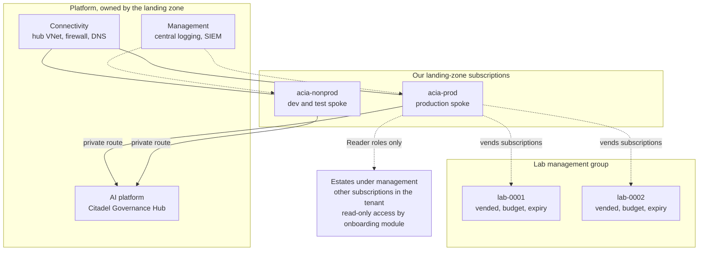

# Design 04 — Landing zone and Citadel

> **What this answers:** *Where does the solution live in the operator's Azure landing zone, what does it need from that landing zone, and how is every AI call, tool call and agent call governed through the Citadel hub?* Facts about Citadel come from the [Citadel research](research/citadel.md), read on 2026-10-31 from the repositories, the Bicep and the contract schemas themselves; facts about Foundry networking come from the [Foundry research](research/foundry-governance-and-framework.md). Part of the [design](README.md); the trust rules this must keep are in the [security architecture](07-security-architecture.md).

---

## 1. What "Citadel" is, and what we adopt

Three things share the name, and they are not the same.

| Name | What it is | Our use |
|---|---|---|
| **AI Citadel Blueprint** | a four-layer governance *architecture* (governance hub; agent operations in the Foundry control plane; agent management in Agent 365; security foundation in Defender, Purview and Entra), described in `Azure-Samples/foundry-citadel-platform` (MIT). "There is no separate Citadel runtime": it is configuration of native Azure services | the reference we follow |
| **Citadel Governance Hub** | the layer-1 reference implementation: an **API Management**-based AI gateway with three *contracts*, in `Azure-Samples/ai-hub-gateway-solution-accelerator` (MIT) | **the gateway for all model, tool and agent traffic** |
| **AI Landing Zone for Microsoft Foundry** | the *spoke* pattern for an AI workload: private Foundry, agent subnet, bring-your-own stores | the shape of our spoke |

**Decision: adopt the Governance Hub, forked and pinned to a commit** ([ADR-02](13-decisions.md#adr-02-the-gateway-is-the-citadel-governance-hub-on-api-management)). The research attaches six conditions, and the design carries all of them:

1. It is a **sample**, not a supported service: no releases or tags, one main committer, commit volume fell from 60 in July to 3 in September. → *Fork, pin a commit (the research read `81599b3`), own the upgrade tests.*
2. It runs on **API Management**, not on the new standalone *AI Gateway* product. → *Contracts are data in our repository, so a later move re-implements three contract types and re-architects nothing* ([§9](#9-the-ai-gateway-product-a-decision-gate)).
3. Its **monthly floor is the always-on usage pipeline** (Cosmos DB with seven containers at 400 request units each, a Logic App Standard plan, Event Hubs ≈ €320 in total), not API Management. → *Share a hub, or shrink the pipeline* ([§3.3](#33-the-hub-and-its-cost)).
4. The **shipped defaults loosen security and age**: public API Management endpoint, public Event Hubs, **full prompts and completions captured to Log Analytics**, retired model names. → *Our parameter file overrides every one* ([§3.4](#34-hardening-the-defaults)).
5. The **Publish contract** (MCP tools and A2A agents) is preview and writes preview ARM properties. → *Native API Management import of MCP servers (generally available) is the named fallback.*
6. Foundry's **portal gateway integration** and the Citadel connection route are two mechanisms. → *Use only the Citadel route; never enable the portal's gateway on the hub.*

## 2. The landing zone: what we need, one by one

The solution assumes an Azure landing zone ([A1 in 01](01-requirements-and-principles.md#2-assumptions)). Each dependency below is stated so that a gap is *visible*, not discovered in week six.

| # | Needed from the landing zone | Why | If it is missing |
|---|---|---|---|
| L1 | **Management groups** for platform and landing zones; a **Lab** management group | policy inheritance; the Lab's blast radius | create ours under the tenant root group (loses inherited platform policy) |
| L2 | **Subscription vending** (or the right to create subscriptions) | our spokes and the vended Lab subscriptions | the operator creates three subscriptions by hand; the Lab is limited to one |
| L3 | **Connectivity hub**: VNet, **firewall**, forced-tunnel routes, address space | hub-and-spoke peering; egress control; FQDN allow-list | a spoke-local firewall adds roughly €900 a month for the standard SKU, less for Basic — see [12](12-cost-and-finops.md) |
| L4 | **Central private DNS** (zones listed in [§6](#6-network)) linked to our VNets | private endpoints resolve | we host the zones in the spoke |
| L5 | **The Citadel Governance Hub** in a platform subscription | the single gateway | we deploy one ourselves, as a separate, optional deliverable ([§3.3](#33-the-hub-and-its-cost)) |
| L6 | **Policy initiatives** that do not forbid what we create: public network access *Disabled* is compatible; a tag `SecurityControl: Ignore`, or a Key Vault public toggle, is not; model-deployment deny policies in spokes must leave the hub's own Foundry account alone | deployability | exceptions, recorded |
| L7 | **Central Log Analytics** and an Azure Monitor Private Link Scope | one workspace per environment feeds the SIEM | we deploy ours |
| L8 | **Identity**: an Entra tenant; **Entra P2 or ID Governance** for PIM; permission to create app registrations and assign app roles for the hub's roles | approvers and administrators; hub JWT roles | break-glass and audited standing roles ([07 §11](07-security-architecture.md#11-optional-modules-and-their-fallbacks)) |
| L9 | **Defender for Cloud** foundational plans; optional paid plans | posture, resource-manager alerts | MCSB via Policy only |
| L10 | **Quota**: Foundry model quota in Sweden Central at a tier that allows the GPT-6 family (Tier 5 or 6, or a quota request) | models | request on day zero — lead time is the risk ([14](14-next-phases.md)) |
| L11 | **Agreement information** (EA, MCA or CSP) | purchase mechanism and subscription creation | assumption recorded; spike S-ACT-1 |

## 3. Topology

### 3.1 Where things live

- **`acia-prod`** holds the production Foundry account, stores and compute; **`acia-nonprod`** holds *dev* and *test* as separate Foundry accounts and resource groups. A third environment — **shadow** — is production's own spoke reading the real estate with every Move running as a dry run ([10 §5](10-test-and-evaluation.md#5-environments-and-promotion)).
- **Lab subscriptions** are vended per experiment series, in the Lab management group, with policy, a budget and an expiry. They have **no route** to production or to estate data ([07 §8](07-security-architecture.md#8-the-lab-as-a-security-boundary)). **Azure Deployment Environments retires on 22 February 2027 and Azure Lab Services on 28 June 2027**, so neither is used: the Lab is subscription vending plus Deployment Stacks plus a reaper job ([11](11-delivery-and-operations.md)).
- **Estates** are other subscriptions in the same tenant. The reasoning plane reaches them only through read-only tool services, with Reader, Cost Management Reader and Monitoring Reader granted by a **onboarding module** the estate's owner deploys (or accepts by policy). Nothing in an estate trusts our spokes for writes ([07 §3.3](07-security-architecture.md#33-the-execution-identity-just-in-time-without-pim)).

### 3.2 Region

**Sweden Central is the primary region.** It is the only EU region that appears in every list that matters:

| Capability | West Europe | North Europe | Sweden Central |
|---|---|---|---|
| Foundry hosted agents | yes | **no** | yes |
| Foundry managed VNet | no | no | yes |
| AI Landing Zone full deployment | **no** | **no** | yes |
| Citadel hub deployment region list | yes | **no** | yes |
| AI Search Serverless (preview) | no | no | yes |
| Foundry Memory | no | no | yes (not used) |
| EU Data Zone models of the GPT-6 family | yes | partly | yes |
| API Management Standard v2 price | cheaper (≈ 30 %) | — | dearer |

Two consequences. (a) If the landing zone's connectivity hub sits in another region, the spoke peers across regions; the cost is modest and is counted in [12](12-cost-and-finops.md). (b) A **second region is outside the cost target for phase 1**; the recovery story is *redeploy from code* ([11](11-delivery-and-operations.md)), with data protected by the redundancy of its stores. The Foundry account can hold private endpoints in two regions, which leaves a path to a second gateway later without a redesign.

### 3.3 The hub and its cost

The hub is a platform capability; **we onboard to it with contracts it ships** (A2 in [01](01-requirements-and-principles.md#2-assumptions)). Two ownership models give the same interface:

| Model | Hub owner | We deploy | Fixed monthly cost that is *ours* |
|---|---|---|---|
| **A. Shared hub** (preferred) | the platform team | contracts only | ≈ €0 fixed; our share is tokens and calls |
| **B. Our own hub** | us, as a separate deliverable | the hub (`main.bicep` once) and contracts | **Small** (Developer tier, no SLA, for dev and lab) ≈ €440; **Medium v2** (Standard v2, 99.95 % SLA, for production) ≈ €1,020, ≈ €1,200 in Sweden Central |

The research read the Bicep and the price list; the figures are indicative, from the Retail Prices API on 2026-10-31. The **levers**, largest first:

1. **Reuse an existing hub.** The primary template cannot adopt an existing API Management instance (an upstream issue is open since June); the preview *gateway upgrade* module can configure one it did not create.
2. **Shrink the usage pipeline** (≈ €320 of the ≈ €440 small hub): Cosmos on shared throughput or serverless saves ≈ €123; replacing the always-on Logic App and Event Hubs with Log Analytics queries removes the rest. The template has no flag for either, so this is a fork change. Our agents read cost per case from the gateway's logs and Application Insights by KQL, so the Power BI path and the pricing container are not needed.
3. **Tier.** Developer for dev and lab (a saving of ≈ €574 a month against Standard v2); one hub for production and non-production, with contracts per environment — the sizing guide allows it.
4. **Logging.** Set the large-language-model message capture to *none* in production (the default captures up to 256 KB of prompt and completion each) and use the Basic or Auxiliary table plan where the table allows.
5. **Safety checks only where needed:** content safety and PII only on contracts that read external text or personal data.
6. **Semantic cache off**, unless a measured hit rate beats the cost of Managed Redis and embeddings.

### 3.4 Hardening the defaults

Our parameter file overrides these shipped defaults; each override is a contract test ([10](10-test-and-evaluation.md)).

| Shipped default | Our setting |
|---|---|
| API Management network type *External* | **Internal**, or Standard v2 with an inbound private endpoint and public access disabled |
| Event Hubs public network access enabled | disabled after first provisioning |
| Logic App public, no private endpoint | private endpoint; or removed with the usage pipeline |
| prompts and completions captured | capture *none* in production; on only in dev, with short retention |
| sample models `gpt-4.1`, `gpt-5.4-mini` (both past retirement) | our alias map ([§4.2](#42-the-alias-map)) |
| `estimate-prompt-tokens` false | **true**, so token limits are hard budgets |
| content-safety policy commented out in the tool and agent default | enabled on every contract that carries untrusted text |
| subscription key always required, JWT optional | **both** (`jwtRequired`), with `requiredRoles` assigned directly to agent identities |
| API Center disabled in the parameter file | enabled; every published tool is registered with owner, classification and compliance metadata |
| tag `SecurityControl: Ignore` | removed |

## 4. Contracts per agent group

Citadel's three contracts are `.bicepparam` files against subscription-scope Bicep, kept in our repository as `contracts/<group>/<env>/main.bicepparam`. A change is a pull request with a `what-if`; a contract change needs the group's **sponsor** to approve (CODEOWNERS).

| Contract | Question it answers | Version and status | Our use |
|---|---|---|---|
| **Backend** | *where* does LLM traffic go (supply) | 1.1.0, generally available (self-declared) | one backend per approved deployment type and model; aliases; retirement dates |
| **Publish** | *what* tools and agents exist | 1.1.0-preview | our MCP tools; **no A2A assets in phase 1** |
| **Access** | *who* may use *what*, under which limits (demand) | 1.2.0, generally available | one product per agent group and environment |

### 4.1 The backend contract

Registers (it does not deploy) the Foundry deployments the hub may call. Backends are separated by **data class**, so a contract's `allowedBackendPools` can *only* include pools its data class may use:

| Pool | Deployment type | Models (starting fill) | For data class |
|---|---|---|---|
| `acia-eu` | **EU Data Zone Standard** | GPT-6.1 Sol, GPT-6 Luna, a second-family model, an embedding model | estate-confidential, personal |
| `acia-global` | Global Standard | the same, plus a Claude model | public, synthetic |
| `acia-flex` | Global **Flex** and **Batch** | GPT-6 family | public, synthetic; delay-tolerant |
| `acia-judge-eu` | EU Data Zone | an independent-family model | estate-confidential |

Circuit breakers stay on (three failures in five minutes trip for one minute, honouring `Retry-After`). `retirementDate` is set on every model and alerted 90 days ahead. The sample's model SKU is `GlobalStandard`; whether the routing metadata handles `DataZoneStandard` is unverified and is exercised in the first contract test (spike **S-GW-1**).

### 4.2 The alias map

Agents name aliases; the contract maps each to an ordered list (priority strategy) with a fallback *within the same wire protocol* — a fallback may cross providers but there is no protocol translation.

| Alias | Members, in order | Pool |
|---|---|---|
| `acia-triage` | GPT-6 Luna → next cheapest cleared model | `acia-eu` (estate), `acia-global` (public) |
| `acia-reason` | GPT-6.1 Sol → GPT-6.1 Terra | `acia-eu`, `acia-global` |
| `acia-judge-eu` | independent-family model → another family | `acia-judge-eu` |
| `acia-judge-pub` | a Claude model → `acia-judge-eu` | `acia-global` |
| `acia-embed` | embedding model → alternative | `acia-eu` |
| `acia-batch` | Flex or Batch deployment → interactive alias | `acia-flex` |

### 4.3 The access contracts

One **product per group and environment** (`MULTI-ACIA-<group>-<ENV>`). Environments are scaled as **DEV 10 %, TEST 25 %** of production quotas. The seeds below are *starting points to be fitted by the cost model* ([12](12-cost-and-finops.md)), not findings.

| Group | Agents | Aliases | Tokens per minute · per month (prod seed) | Safety on the contract |
|---|---|---|---|---|
| `study` | Scholar, Cartographer, Librarian (Atlas) | triage, reason, judge-pub, embed, batch | 40,000 · 60 M | content safety with `shield-prompt` (external text) |
| `survey` | Surveyor | triage, reason | 30,000 · 40 M | PII anonymisation (owner names, e-mail) |
| `investigate` | Detective, Skeptic, Economist | reason, judge-eu | 60,000 · 80 M | content safety; **per-agent counters** so the Detective cannot starve the Skeptic |
| `experiment` | Experimenter | reason | 10,000 · 5 M, with a daily quota | content safety; no estate data |
| `converse` | Diplomat | triage, reason | 10,000 · 10 M | PII anonymisation; people referenced by pseudonym; outbound messages screened |
| `engineer` | Engineer | reason | 10,000 · 10 M | content safety |
| `govern` | Auditor, Examiner, Librarian (lessons) | judge-eu, judge-pub, batch, embed | 30,000 · 60 M | content safety |
| `forge` | Forger | reason | 30,000 · 30 M | separate key and no tools, so the adversary shares nothing with the examinee |
| `conduct` | Conductor | triage, reason, embed | 5,000 · 5 M | — |

**Identity on every contract.** The subscription key is required (the hub cannot drop it yet) **and** an Entra token is validated, with the `Model.Invoke`, `MCP.Invoke` and `Agent.Invoke` roles assigned **directly** to each agent's identity (group assignments reach users, not workload identities). Because one key is shared by everyone holding a contract, per-agent attribution comes from the token's `azp` claim and, until that is proven for Entra agent identities (spike **S-ID-2**), an `x-sub-agent-id` header. The Foundry connection that an access contract can create is **not used**: our hosted agents call the hub from code, reading the endpoint and key from Key Vault with their own identity. Keys rotate in three steps (switch the active key, confirm, regenerate the idle one).

**Kill switch.** Suspending a product's subscription takes one group away from the hub in seconds ([07 §10.3](07-security-architecture.md#103-kill-switches)).

### 4.4 The publish contract: tools, and who may call them

Tools are published as MCP servers through the hub, registered in API Center with owner, classification and compliance metadata. Reading is separated from writing; most tools are read-only.

| Tool | Backend | Reads / writes | `study` | `survey` | `investigate` | `experiment` | `converse` | `engineer` | `govern` | `forge` | `conduct` |
|---|---|---|---|---|---|---|---|---|---|---|---|
| `ms-learn` | Microsoft Learn MCP | read, public | ✓ | | | ✓ | | | | | |
| `release-feed` | Release Communications MCP (keyless) | read, public | ✓ | | | | | | | | |
| `docs-fetch` (Document reader) | our service, egress allow-list | read, untrusted | ✓ | | | ✓ | | | | | |
| `atlas` | our service | read | ✓ | | ✓ | ✓ | | ✓ | ✓ | | |
| `atlas-propose` | our service | write (to a pull request) | ✓ | | | | | | | | |
| `price-engine` | our service | read | ✓ | ✓ | ✓ | | | | | | |
| `cost-query` | our service (aggregates) | read | | ✓ | ✓ | | | | | | ✓ |
| `estate-read` | Azure MCP Server, read-only identity | read | | ✓ | ✓ | | | | | | |
| `directory-read` | our service, pseudonyms | read | | ✓ | | | | | | | |
| `ledger` | our service | read | | | ✓ | ✓ (write experiments) | | | ✓ | | ✓ |
| `lessons` | our service | read / write | | | | | ✓ (read, minimal) | | ✓ | | |
| `brief-draft` | Brief service | write (typed) | | | | | ✓ | | | | |
| `moves` | our service | read | | | | | | ✓ | | | |
| `lab-control` | Lab controller | write (Lab only) | | | | ✓ | | | | | |
| `sandbox` | dynamic sessions | compute, no identity | | | ✓ | ✓ | | ✓ | | | |
| `exam-bank` | scoring service | read (no keys) | | | | | | | ✓ | | |
| `terrarium-gen` | our service | write (synthetic) | | | | | | | | ✓ | |
| `agenda` | our service | read / write | | | | | | | | | ✓ |

**Streaming caveat.** MCP responses stream, so gateway policies that read the *response* body (content-safety on the response, PII de-anonymisation) do not apply; inbound screening, authentication, limits and usage logging do. Tools that return untrusted text are screened by the Document reader *before* they return ([07 §5](07-security-architecture.md#5-defence-against-prompt-injection-in-nine-layers)). If a source API of an `mcp-from-api` tool requires its own key, the contract forwards the subscription key in a named header; otherwise `tools/call` fails with 401 while `initialize` and `tools/list` pass.

**Fallback.** If the preview contract's schema changes, MCP servers are imported natively into API Management (generally available since June 2026: products, per-tool allow-lists, Bicep) and granted by the access contract.

## 5. Observability and attribution at the hub

`customDimension1` carries the agent role and `customDimension2` the **case id**, so the Economist reads *cost per case* from the gateway's logs and Application Insights by KQL. The hub's alerts are on for throttling, quota and backend failure, and we turn on authentication, content-safety and PII failure alerts. The hub's `GET /version` and `GET /version/backend-contract` (anonymous) are polled as a **drift probe** ([09](09-safeguards-and-drift-controls.md)).

## 6. Network

**Hub-spoke-hub**: our spoke VNet peers with the connectivity hub, and the Governance Hub has its own spoke; traffic from our agents to the hub passes the connectivity firewall first. This is the recommended pattern for strict segmentation.

| Subnet (illustrative, one spoke) | Purpose | Notes |
|---|---|---|
| `snet-agents` /24 | Foundry **agent subnet**, delegated to `Microsoft.App/environments` | one per Foundry account, exclusive; a session uses about one address: ≈ 250 sessions in a /24; HTTP 429 `subnet_exhausted` is the only signal |
| `snet-aca` /27 | Container Apps environment (internal), workload-profiles, Consumption | tool services, Approval, Policy, Brief, jobs |
| `snet-edge` /27 | a **separate, external** Container Apps environment for the Teams adapter | the only public ingress ([07 §7](07-security-architecture.md#7-network-and-the-short-list-of-exceptions)) |
| `snet-pe` /26 | private endpoints for Foundry, Storage, Cosmos DB, AI Search, Key Vault, the registry, Monitor | one endpoint per sub-resource: **each is an hourly meter** |

- **Private DNS** zones (centrally owned, linked to every client VNet; peering does not carry DNS): cognitive services, Azure OpenAI, services.ai, search, Cosmos DB, blob, queue, file, table, Key Vault, the registry, the Monitor private link set, and the API Management zone for the hub.
- **Egress.** Hosted-agent and job traffic leaves through the connectivity firewall with a **FQDN allow-list**: Entra sign-in hosts, `*.identity.azure.net`, Application Insights, the hub's private address, and — only for the Document reader — an allow-list of Microsoft documentation and feed hosts. The Foundry telemetry endpoint of Agent 365 is blocked and its logging disabled (`a365LoggingEnabled=false`), so no denied-traffic noise or unlicensed telemetry.
- **One Azure Monitor Private Link Scope** per shared DNS; several override each other.
- **Hosted-agent egress rules** (preview, "not intended for production use") run in *audit* mode only.

## 7. The Foundry layout

| Choice | Decision | Why |
|---|---|---|
| **Accounts** | one Foundry account (`AIServices`) per environment: dev, test, prod, and one for the Lab | environments must not share a trust boundary; quota is pooled per subscription, so separate subscriptions also separate quota |
| **Projects** | one project per **agent group** in each account | a project is the isolation unit for agent data; it mirrors the access contracts |
| **Setup** | **Standard setup** in production: our own Cosmos DB (**serverless**), Storage and AI Search, each behind private endpoints, with account- and project-level *capability hosts* as infrastructure as code | network-isolated agents need it; Cosmos serverless keeps it scale-to-zero |
| **Network** | **BYO-VNet agent injection** into `snet-agents`, set **when the account is created** | cannot be added or changed later; the managed-VNet alternative creates a managed firewall that bills ≈ €250–800 a month and is not offered in West Europe |
| **Registry** | private registry, **projects created after 25 June 2026** | a private registry works only for those |
| **Models** | deployments live in the *hub's* Foundry account; our accounts hold **no model deployments** | the hub is the only route; Azure Policy denies a deployment in a spoke |
| **Keys** | local (key) authentication disabled everywhere | keys bypass RBAC |

**One-way doors, to check before the first deployment:** region, BYO-VNet versus managed VNet, standard versus basic setup, capability hosts (REST/ARM only; no in-place update). The pre-flight check is part of the first build sprint ([14](14-next-phases.md)).

**Two silent failures to test.** (1) Without capability hosts, an agent service silently falls back to Microsoft-managed storage, so the bring-your-own stores *stay empty with no error*. (2) Private AI Search indexes nothing silently unless the indexer's execution environment is private. Both become acceptance tests: a request from inside the VNet returns 200, from outside 403, **and the stores fill**.

## 8. The gateway-bypass register

"Everything through the gateway" is a claim about the *network and the roles*, not about intentions. Each path below is how a call could skip the hub, and what closes it.

| # | Bypass path | Closed by | Detected by | State |
|---|---|---|---|---|
| B1 | a hosted agent calls a model deployment directly | no data-plane role on deployments; deployments exist only in the hub's account; Policy denies deployments in spokes; private networking | canary agent; D1 | by design |
| B2 | a hosted agent calls its Foundry **project endpoint** for a model | project holds no deployments | canary; D1 | by design; Responses-API coverage of a Foundry gateway is unverified |
| B3 | **Foundry Memory** extraction and embedding calls | not used | inventory (Control Plane) | closed by non-use |
| B4 | **Cosmos DB integrated embeddings** (the Cosmos identity calls Foundry itself) | feature not enabled on our accounts; Policy audit | D8 | closed by non-use |
| B5 | **AI Search skillsets and vectorizers** calling Foundry models | Atlas embeddings are produced by our job through the hub; indexes hold vectors only; the preview "API Management in front of Foundry models in Search" is a future alternative | D1 | closed by design |
| B6 | **web search and Bing grounding** (outside the data-protection terms, public endpoints) | Policy blocks the tools; the Scholar uses the Document reader | tool inventory | closed |
| B7 | **Foundry toolbox** or Foundry IQ MCP calls | not used by default | D8 | unproven; spike S-NET-1 |
| B8 | **Copilot harness** and **GitHub Copilot agents** in the Agent Framework (no bring-your-own-model) | not used | inventory | closed by non-use |
| B9 | **Foundry portal AI gateway** creating a *second* API Management next to the hub (on by default for new projects) | disabled in Bicep; Policy audit | resource inventory | to verify at project creation |
| B10 | a person in the Foundry portal calling a model | Foundry User role withheld from day-to-day staff; PIM for administrators | Entra audit | by design |
| B11 | the **Teams/Microsoft 365 publish route** | optional module, conversational only | D8 | optional |

A **canary agent** runs daily from the agent subnet and tries B1, B2 and an estate API directly; it must be blocked and the block must alert. A silent success blocks the release ([10 §2](10-test-and-evaluation.md#2-the-layers), L5).

## 9. The AI Gateway product: a decision gate

A *new* standalone **AI Gateway** (`Microsoft.ApiManagement/aigateways`, preview since July 2026) exists beside API Management. The research found: preview only in East US 2 and Sweden Central; no SLA; pricing "coming soon" and no meter in the price API; policies are inline objects, not API Management XML, so Citadel's contracts do not apply to it unchanged; Learn says full parity with API Management "isn't planned" (backend-pool load balancing, failover, semantic caching, A2A); and Learn and the product's own docs disagree about private endpoints and content-safety policy. It also reaches things we want (calendar budgets, tool-level governance with Agent 365).

**Decision: stay on API Management; re-test the AI Gateway product when all of these hold** — generally available; a published price; private inbound networking verified; a content-safety policy; EU region availability beyond one; and a Citadel-compatible contract path. The decision costs little to reverse: contracts are data, and a re-implementation of three contract types is the whole migration ([ADR-02](13-decisions.md#adr-02-the-gateway-is-the-citadel-governance-hub-on-api-management)).

## 10. Minimal hub, if the landing zone has none

If no hub exists, a **separate deliverable** deploys one: Standard v2 in Sweden Central with the hardening of [§3.4](#34-hardening-the-defaults), the usage pipeline trimmed ([§3.3](#33-the-hub-and-its-cost)), and the contracts of [§4](#4-contracts-per-agent-group). A Developer-tier hub is used only for dev and lab. This is documented, tested and costed ([12](12-cost-and-finops.md)); it is not the preferred path because a governance hub is a platform capability, not a per-application one.

## 11. What stays unproven here

Each has a spike in [14](14-next-phases.md): **S-GW-1** (data-zone SKUs through the hub's routing), **S-ID-2** (Entra agent-identity tokens against the hub's `azp` check), **S-NET-1** (toolboxes and the hub; a Foundry gateway in another subscription), **S-NET-2** (hosted-agent-only projects with VNet injection and platform-managed data instead of bring-your-own stores), **S-GW-2** (A2A authentication on the hub, needed only when the first A2A asset is proposed).
