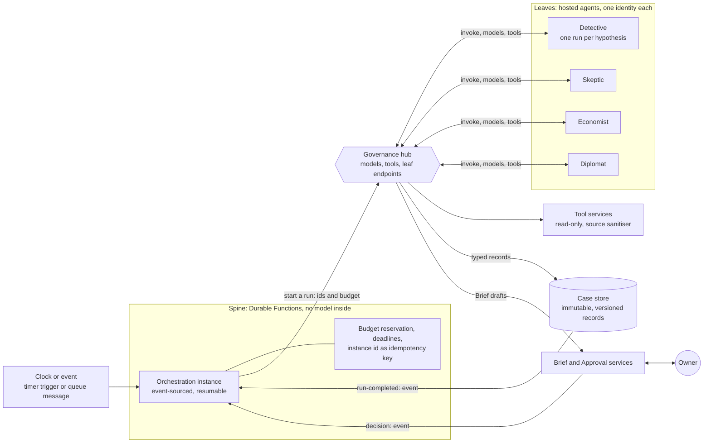
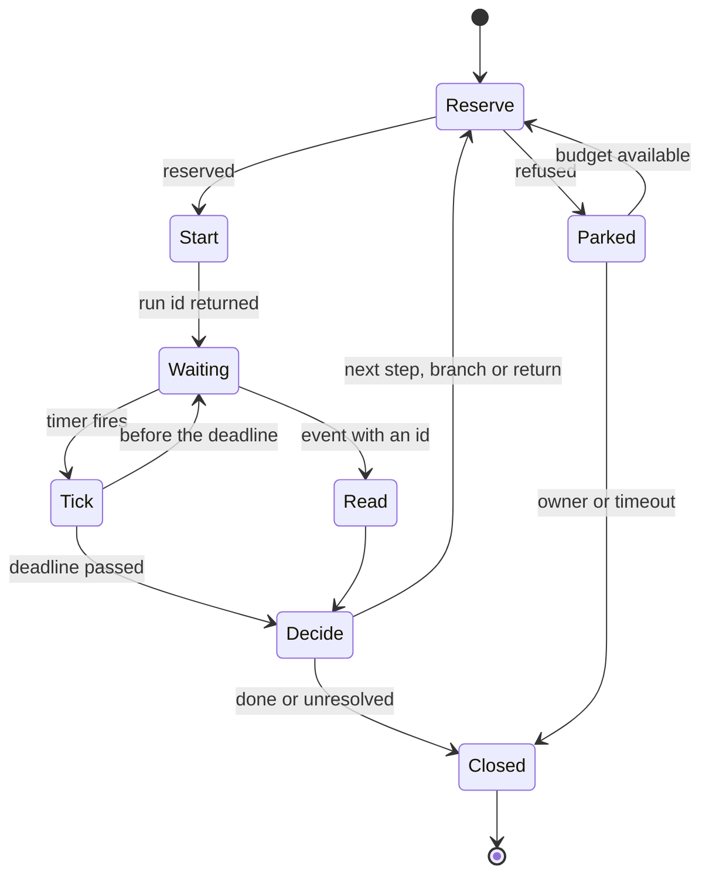

# Design 05 — Agents and orchestration

> **What this answers:** *How do fourteen agent roles actually run — on what, under which identity, calling what, in what order, waiting for whom — and how does the cost stay proportional to the thinking done?* The agents themselves are described in the [north star](../01-north-star.md#9-the-cast); the trust rules they run under are in the [logical architecture](03-logical-architecture.md) and the [security architecture](07-security-architecture.md). Every product statement rests on the research in [Foundry Agent Service](research/foundry-agent-service.md), [governance and Agent Framework](research/foundry-governance-and-framework.md) and [options analysis](research/options-analysis.md), checked on 2026-10-31. Part of the [design](README.md).

---

## 1. The pattern: a deterministic spine with agentic leaves

The system is not one big agent and not a swarm of agents talking to each other. It is **a spine of ordinary, deterministic workflows that call agents as leaves**, one step at a time, with a budget. The spine may branch, fan out competing hypotheses in parallel and return to an earlier step; what it never does is let an agent choose the next step or pass its words to another agent. Every loop is bounded by a budget and a maximum number of rounds.



Six rules make the pattern what it is:

1. **Agents never call each other.** There is no agent-to-agent message channel. That closes the direct route for an injected instruction, not every route: the free-text fields of a typed record are read by whoever reads the record next, which is why those fields are length-limited and labelled *untrusted*, why every tool service that returns free text passes the shared source sanitiser, and why a session that has read untrusted text is tainted ([07 §5](07-security-architecture.md#5-defence-against-prompt-injection-in-nine-layers)). The Skeptic does not receive the Detective's *words*; the spine hands it the **ids of the records** to read, and it reads them through a read tool, as labelled data.
2. **The spine passes ids and budgets, never prose.** An invocation envelope carries the case id, the step, the ids of the records to read, a budget, a deadline and an idempotency key ([§4](#4-how-the-spine-runs)).
3. **Everything an agent produces is a typed record,** validated against a schema by the case store before any later step may read it. Records are **immutable and versioned**: a correction is a new version that names what it supersedes, and the records of a case form an **evidence graph** in which each hypothesis points at the evidence *for* and *against* it. Contrary evidence stays — an objection, a negative result and a failed experiment are records like any other, and a verdict must cite them ([06 §2](06-data-and-knowledge.md#2-the-information-model)). Free-text fields exist, are length-limited, and are marked *untrusted* for whoever reads them next.
4. **The spine never calls a model.** Whether a step runs, repeats, branches, returns to an earlier step, escalates or stops is decided by deterministic code from typed records, never from an agent's say-so — a *does not survive* verdict, for instance, sends the case back to the Detective, at most *n* times. This is the "no model inside the decision to execute" rule, applied to the whole loop.
5. **A leaf can fail without failing the case.** Retries, a cheaper or different model alias, and "pause and ask a person" are the spine's job.
6. **People are signals.** An owner's decision reaches the spine as a message from the Approval service, never through an agent ([07 §4](07-security-architecture.md#4-approvals-that-cannot-be-forged-or-reused)).

**Why this and not the alternatives.**

| Alternative | Why not |
|---|---|
| One agent with all the tools | one identity holds every capability: the lethal trifecta in one place; one context window for everything |
| Agents that hand off to each other (handoff, group chat, A2A) | an injection in one agent's input becomes another agent's instruction; A2A through the gateway is still preview and its authentication is described inconsistently; each hop adds tokens and latency |
| Foundry's visual workflow agents | **retire on 1 December 2026**; no outbound VNet injection; not covered by the cloud red-teaming agent |
| A model-driven planner that decides the next step | the decision to run, repeat or stop becomes probabilistic and unreviewable; cost control moves into a prompt |

The price of the pattern is schema upkeep and less free-form collaboration. The mitigation is a bounded free-text `notes` field in every record, and that the *Skeptic's* job — to break a case — works *better* when it reads the evidence instead of the Detective's rhetoric. The added freedom — branching, parallel hypotheses, return edges — has to earn its place: the exam compares the flexible investigation with the fixed Detective → Skeptic → Economist path on rediscovery, transfer, injection resistance, tokens and latency before the flexible path runs on real cases.

## 2. The roster

**Fourteen agent roles**, deployed as **fifteen hosted-agent identities** — the Librarian runs twice — in Foundry Agent Service, in **eleven groups**. A **group** is a *trust class*: its agents share the kind of gateway contract ([04 §4](04-landing-zone-and-citadel.md#4-contracts-per-agent-group); one contract per group, data class and environment) and one row of the capability matrix ([07 §5.1](07-security-architecture.md#51-the-lethal-trifecta-per-agent-group)). Each *agent* still has its own Entra agent identity, created automatically when it is deployed, and its own per-tool app roles.

| Agent | Group | Alias | Reads and calls (published through the hub) | Writes (typed record) |
|---|---|---|---|---|
| **Scholar** | study | `acia-triage`, `acia-reason` | Document reader, Microsoft Learn MCP, release-feed MCP, Atlas read | draft **claims** with receipts |
| **Cartographer** | study | `acia-reason` | Atlas, price engine | profile and taxonomy **proposals**, conflicts between sources |
| **Librarian (Atlas)** | curate | `acia-judge-pub` | Atlas, claim re-check results | reviewed claims; release proposals (pull requests to data paths) |
| **Surveyor** | survey | `acia-triage`, `acia-reason` | Estate reader, directory reader, Cost query | Estate Model **drafts**, ownership proposals |
| **Detective** | investigate | `acia-reason` | Cost query, Estate reader, Atlas, Ledger (read), Sandbox | **case notebook** entries: hypotheses, evidence, a *prediction* |
| **Skeptic** | investigate | `acia-judge-eu` | Atlas (claims with their receipts, including those of an Atlas pull request under review: read-only, no write to the pull request), price engine, Cost query, Estate reader, Consequence engine, Ledger (read), the case's records by id (`case-record`), and Lab observations (read, in W6); **no web tool**, because the Scholar stays the only reader of untrusted web text | **objections** and a survives / does not survive verdict |
| **Economist** | investigate | `acia-reason` | Price engine, Cost query, Consequence engine | **option cards** with ranges and consequences |
| **Experimenter** | experiment | `acia-reason` | Atlas, Sandbox, `evals-read` (W10: typed scores and ids only); *requests* runs from the Lab controller | experiment **plans** (a recipe id and a run code), predictions; **method hypotheses and method proposals** (W10) |
| **Diplomat** | converse | `acia-reason` (small share), `acia-triage` | Brief drafting tool, Estate service (pseudonymised), Lesson read | **Brief drafts**; lesson drafts |
| **Engineer** | engineer | `acia-reason` | Move catalogue, source repositories, Sandbox | **Move drafts** and pull requests (to data paths only) |
| **Auditor** | govern | `acia-judge-eu` | Ledger, audit ledger, Entra sign-in logs (through a tool service), the drift cases it triages (`case-record`) | outcome scores with their failed-step class, drift cases, approval cross-checks |
| **Examiner** | examine | `acia-judge-pub` on synthetic estates, `acia-judge-eu` on real-estate retrospective cases | Exam bank, Terrarium (through the scoring service), the run records of exam cases (`case-record`, read) | exam scores |
| **Librarian (lessons)** | govern | `acia-reason` | Lesson Book, Atlas | reviewed lesson **drafts** (an owner confirms them) |
| **Forger** | forge | `acia-reason`, resolved by the `forge` contract to a **different model family** from the investigators' ([04 §4.2](04-landing-zone-and-citadel.md#42-the-alias-map)) | Terrarium generator only | synthetic estates; answer keys, sealed |
| **Conductor** | conduct | `acia-triage`, `acia-reason` | Agenda, budgets, Ledger (read), `case-record` (read: parked and drift cases) | the **Agenda** |

Two splits are deliberate, and round 1 added two more pairs that are kept apart:

- **The Librarian runs as two instances** with separate identities and contracts. *Atlas* (group `curate`) may write proposals to the public Atlas and sees no estate data; *lessons* (group `govern`) may read estate lessons and has no route to anything public. One agent with both would be a ready-made leak path.
- **The Forger and the Conductor sit in groups of their own.** The Forger must share nothing with the examinee — not a key, not a tool, not a contract, **not a model family**: the `forge` contract resolves `acia-reason` to a model of a different family from the one the investigators' contract resolves it to (Detective, Economist, Experimenter; the second-family model or Claude, both on `acia-global`), because a separate key stops a shared key, not a shared blind spot. A contract test fails if the two resolve to the same family, and the exam measures the independence ([10 §3](10-test-and-evaluation.md#the-forger-is-tested-for-independence)). The Conductor holds budget authority, so a compromised planner must not be able to spend another group's budget.
- **The Scholar and the Librarian (Atlas) are apart** (`study`, `curate`). The Scholar is the only reader of untrusted web text, and only through the Document reader; it has no path to the Atlas. The Atlas writer reads claims with receipts and no web page, so a page that carried an injection cannot reach the one role that proposes Atlas changes.
- **The Examiner and the Auditor are apart** (`examine`, `govern`). The Examiner may use a Claude judge on synthetic estates (public class); the Auditor reads the live ledger, which is EU-only. No contract can mix the two data classes.

Not every call goes through the hub as a *person* would see it: the **Move runner, Approval service, Policy service, Credential broker, Verifier, Audit Writer and Lab controller hold no model contract**, because they call no model ([03 §3](03-logical-architecture.md#3-trust-boundaries)). The **spine** is a consumer of the hub's publish contract: its identity may invoke the leaf endpoints the hub publishes (one app role, `Agent.Invoke`) and send to the queue `verify`, and holds **no Foundry role and no model role** ([§4](#4-how-the-spine-runs)). **Every role ends a run the same way** ([§5](#5-anatomy-of-a-leaf)): a terminal **`run-result` record**, written through the case-record facade and bound to the caller's verified `azp`, the case, the step, the invocation id and the epoch, and then one **`run-completed` event**, which is only a doorbell. That includes the Conductor, the Examiner and the Forger, who write no other case record: for them the `run-result` is all they write there, so the spine always has a record to re-read ([§4](#4-how-the-spine-runs)).

## 3. The workflows

Ten workflows run on the spine (W1–W10), with the fast-signal path W3b beside W3: eleven entry points. Each is a graph of typed steps — an orchestration that may branch, fan out and return within its budget.

| # | Workflow | Triggered by | Steps | Waits for people | Cost guard |
|---|---|---|---|---|---|
| **W1** | **Watch** | daily timer trigger; a feed event | deterministic job reads the Release Communications feed and Learn's change data → cheap triage step classifies relevance → *study requests* | no | triage tier only; a daily token ceiling |
| **W2** | **Study** | a study request | Scholar → *Document reader* → claims → Cartographer (conflicts) → Experimenter if sources disagree → Librarian curates → Atlas pull request → knowledge CI → **Skeptic review** | a human reviewer with standing reviews and merges to the Atlas | per-request budget; public-class data, so cheap deployment types |
| **W3** | **Survey** | hourly and daily timer triggers | deterministic estate and cost refresh jobs → Surveyor interprets *changes only* → Estate Model drafts → ownership **proposals** (hints only: approver standing comes from human-administered groups and roles on the target, [07 §4](07-security-architecture.md#4-approvals-that-cannot-be-forged-or-reused)) → Diplomat asks (rate-limited) | owners answer questions | interprets deltas, never the whole estate |
| **W3b** | **Fast signal** | an event from an opted-in estate: a budget or anomaly alert, a resource-change notification (sources *to confirm* in S-FAST-1) | event → per-estate queue → deterministic check against the estate's usual rhythm → a triage step only if the check is ambiguous → **owner notification** through the Brief service | the owner acknowledges, snoozes, or asks for a case | triage tier only; a rate limit per estate and a daily token ceiling; a flood becomes one grouped message |
| **W4** | **Case** | the Agenda opens a case | Detective (one run per competing hypothesis, in parallel) → Skeptic (an objection returns the case to the Detective, up to *n* rounds) → Economist → Policy service (signs a **permit** that binds the target) → Diplomat → Brief (shows the target and the permit id) → **decision** by a person (the web approval page by default; a Teams card in place only for reversible Moves of the lowest class) → Approval service (signs the approval record, has it entered in the ledger and enqueues its id) → Credential broker (verifies everything itself, **including the approval's own ledger entry**, takes the lease, then grants) → Move runner (an event-driven job: verifies again and against the live state, then acts) → Verifier (an event-driven job that wakes on the `verify` queue, to which the spine sends an id when the runner reports *execution finished*) → Auditor → lesson drafts | owner decides; approver(s) | per-case budget, reserved before each call; expected value must exceed expected cost to open |
| **W5** | **Commitment** | periodic; a W4 outcome | Economist proposal → re-price → Brief to two approvers → two signed purchase approvals → the AI executes through the same chain → utilisation tracked | two named approvers, different hats | high stakes, so the stronger tier is justified |
| **W6** | **Experiment** | a question the Atlas cannot answer | Experimenter **plans** (a recipe id and a run code) → the deterministic **Lab controller** deploys a **signed recipe** under a pre-deploy cost cap from the price engine → probe → **waits for the bill** (hours to days, as a loop of timers) → Skeptic → Librarian | a human reviews any *new* recipe before it can be signed; otherwise none, and the Lab expiry is a hard stop | Lab budget and expiry; the pre-deploy cap; runs at least two days |
| **W7** | **Dream** | nightly | consolidate the day: lesson **drafts**, detector candidates, Atlas change proposals (pull requests to data paths) | owners confirm lessons by an authenticated action; reviewers merge | `acia-batch` (the Flex tier in phase 1) where the data class allows |
| **W8** | **Exam and release** | nightly (small), weekly and per release (full) | Forger (on a **model family other than the investigators'**, so a shared blind spot cannot seed the traps) → Terrarium → agents under test run W4 on synthetic estates → Examiner scores → gates G1–G9 ([10](10-test-and-evaluation.md)) | a human approves a promotion | evaluation budget; judge-prompt caching |
| **W9** | **Self-watch** | continuous detections; weekly | drift watchers and detections ([09](09-safeguards-and-drift-controls.md), [07 §10](07-security-architecture.md#10-detection-response-and-the-kill-switches)) → Auditor triage → *cases about ourselves*, including stuck or failed orchestrations and the platform's own cost | the operator | the platform's own spend is the first entry on its own Agenda (FR-X4) |
| **W10** | **Method learning** | weekly, after the full exam; after a real outcome miss | **post-mortem** by the **Experimenter** of exam and outcome misses (which step failed: source, hypothesis, test, estimate, wording) → *method hypotheses* → pre-registered **experiments** on paper (Terrarium) and Lab estates, planned by the Experimenter and reviewed by the Skeptic, with protected exploration → a typed **method proposal** (the patch and the exam evidence) → gates G2–G6 → a human opens the pull request with the **method desk** and merges | a human reviews and merges; the system never edits its own prompts, tools, rubrics or gates | a fixed exploration share of the evaluation budget; comparisons registered before they run |

**W3b, the fast path.** Hourly deltas (W3) cannot meet a target of minutes ([01 §4](01-requirements-and-principles.md#4-quality-targets)), so an event from an opted-in estate takes a shorter, bounded route: a per-estate queue, an orchestration whose id is `w3b:` plus the event id (under the instance-id budget of [§4](#4-how-the-spine-runs); a duplicate collapses into it), a deterministic check against the estate's usual rhythm, and a triage call only if that is ambiguous. The output is a notification, never a case. Estate-side throttling, hosted-agent session and subnet-IP headroom, and p95 latency are load-tested in spike **S-FAST-1**.

**The chain behind W4: what it promises and what it does not.** *No single credential completes a change that needs a person's web-page approval.* A compromised Approval service cannot start a job, fabricate a permit or fabricate a person's Entra-signed token. On the card path (reversible Moves of the lowest class only) the proof is the bot channel's assertion, which a compromised Approval service can fabricate; that is why the path ends at that class. A compromised Approval and Policy service can approve within an autonomy credential's constraints, which the broker and the runner check against the credential itself. A compromised broker can grant constrained Move roles without a lease; a compromised release pipeline can run code as a runner identity while it holds a role. Each is bounded and detected as stated in [07 §3.3](07-security-architecture.md#33-the-execution-identity-just-in-time-without-pim).

**W10, how the system studies its own method.** *Source reliability*, *action selection* (which tactic, question or model to try first) and *counterfactual prediction* are kept apart. A replay of a real case cannot show what another method would have found, so a change is scored on synthetic estates with answer keys and on held-out retrospective cases, against the current method and a retrieval-only baseline, with sample sizes from spike **S-EVAL-1** and a share of runs reserved for deliberate exploration so the learner does not collapse onto the easy wins. The output is a proposal, never a change: agent identities may open pull requests only to data paths ([07 §9](07-security-architecture.md#9-supply-chain)), and prompts, tools and rubrics are not data paths, so a human opens it.

**Who performs W10, and with what.** The **Experimenter** performs it, because it already plans experiments and pre-registers predictions. Its tool `evals-read` reads the results and run records of the *training* Terrarium and the outcome scores with their failed-step class, and only the aggregate reports of the release-gate runs; what comes back is **typed fields** (scores, ids and the failed-step class), never estate text or resource names, because the Experimenter's contract reaches public pools only, and any free text passes the source sanitiser. The credential exam and the sealed gate seeds stay readable by the scoring service alone ([10 §3](10-test-and-evaluation.md#exam-isolation)), so the learner cannot fit what judges it. It writes two typed records through the facade, *method hypotheses* and *method proposals* ([06 §2](06-data-and-knowledge.md#2-the-information-model)); the Skeptic reviews the evidence as in W6, and the gates decide. **The method desk** is the human step: an engineer's command in `tools/` that opens the pull request from a `method-proposals` record under the engineer's own GitHub identity, so no agent opens it and the ordinary review rules apply ([11 §3](11-delivery-and-operations.md#3-pipelines)).

Two things recur. **Every wait is explicit** (a signal, a deadline, an expiry), so nothing waits on an agent's patience. **Every workflow has a budget in tokens, euros, seconds and tool calls,** enforced in the spine (reserved before each call), in the agent middleware and at the hub, so three independent layers must fail before a loop can run away — the hub's layer is not an exact one ([§4](#4-how-the-spine-runs)).

## 4. How the spine runs

**The spine is ordinary code on ordinary serverless compute: Durable Functions on the Flex Consumption plan.** It does not need a model, so it does not run inside an agent's identity boundary. Round 1 reversed the draft's own design here: our checkpoint-and-jobs spine had been weighed against the pre-release Durable Extension for the Agent Framework instead of the generally available runtime beneath it. Durable Functions already supplies what that design would have had to build, test and secure — event-sourced state, timers, external events, fan-out and fan-in, instance management and versioning ([ADR-33](13-decisions.md#adr-33-the-spine-is-durable-functions-on-flex-consumption-calling-leaves-through-the-hub)). Its replay model also requires the separation we want: an orchestrator must be deterministic, so it may not do I/O, read a clock or call a network, and everything that touches the world — every model call included — sits in an activity, behind the hub.



One turn of the loop: every orchestration, whatever its workflow, is this loop, and a fan-out runs several of them side by side.

| Aspect | Design |
|---|---|
| **Runtime** | **Durable Functions** in C#, isolated worker (Learn: in-process support ends on 10 November 2026), on the **Flex Consumption** plan in our spoke: outbound through virtual-network integration in a delegated `/27` subnet (`Microsoft.App/environments`), no HTTP function published. One user-assigned managed identity, **the spine's identity**, apart from every agent identity: data roles on its own storage account and the few operational containers it needs ([06 §7.2](06-data-and-knowledge.md#72-the-operational-store-container-by-container)), the hub's app role `Agent.Invoke` for the leaf APIs, queue-send on `verify`, and **no Foundry role, no model role, no key**. |
| **Provider and state** | the **Azure Storage provider** (Learn: the lowest-cost serverless billing model) in a storage account used only by the task hub: identity-based connections (a user-assigned identity by **client id**; a resource id is not supported), blob, queue and table data roles for the spine's identity alone (the case-record facade and the Brief service each hold a send-only role on the one queue `spine-signals`), key access off, private endpoints. Histories are trusted infrastructure. The partition count (default four, at most sixteen) is fixed **before** the task hub exists; Learn: it cannot be changed afterwards. |
| **Orchestrations** | one orchestrator per workflow (W1–W10). It only *decides*: it asks activities for typed verdicts and picks the next step, a branch or a return. No I/O, clock, random value or model (Learn's code constraints), so replay repeats the same decisions. Histories hold ids, numbers and statuses, **never prose or personal data**; typed records stay in the case store. |
| **Calling a leaf** | an *activity*, never the orchestrator, reserves the budget, **registers the run** with the case-record facade (the invocation id, the workflow, the step, the epoch, the leaf's `azp` and the deadline) and then calls the leaf **through the hub**, which publishes each leaf's invocation endpoint as an ordinary API, not as A2A ([04 §4.4](04-landing-zone-and-citadel.md#44-the-publish-contract-tools-and-who-may-call-them)). The spine's identity holds **no Foundry role**: the hub admits it by its verified `azp` and the role `Agent.Invoke`, then calls the leaf with **its own backend identity, the only one that holds *Foundry Agent Consumer*, at that leaf's scope**. The hub is therefore the only route, and a call that skipped it would fail on RBAC at Foundry and count as bypass **B12** ([04 §8](04-landing-zone-and-citadel.md#8-the-gateway-bypass-register)). The call is `POST /invocations` (structured JSON) with the idempotency key as the invocation id and the case id as the session; it **returns at once with a run id**. **A run ends on a record, and the event is only its doorbell:** the wrapper's HTTP handler claims the invocation id in the run registry, starts the **worker** (the agent loop) as a task and returns the run id at once; the **worker's** `finally` writes a terminal **`run-result`** through the case-record facade and *then* emits one `run-completed` event, so a leaf that fails before it has written anything still ends visibly, and the handler's own exit decides nothing. A crash, or a deprovisioning at the idle timeout, that skips the `finally` ends at the spine's **deadline timer, which stays the backstop**. A record written during the run is **data, not a signal**. **The result is read from the case store**, not from the response body, so a leaf cannot smuggle prose into the spine; the mechanism and its races are in *How a run ends*, below. Returning at once is safe only because **each role's idle timeout is at least its p99 active time plus a margin** ([§5](#5-anatomy-of-a-leaf)): Learn deprovisions a session's compute when no request arrives within the idle timeout, and a returned `POST` leaves no request open. **Fallbacks, decided by spike S-HOST-1** (its test: *a leaf that returns at once and works ten minutes with no further request, under its idle timeout: does it finish, and what is billed?*): (a) the activity **holds the `POST /invocations` request open**, with server-sent events and keep-alive, once the hub's backend timeout has been checked (*to confirm*: `forward-request` waits for the response headers, defaults to 300 seconds, and Learn says values above 240 may not be honoured; on the leaf routes it also has `buffer-response="false"`, because Learn says to turn response buffering off so that events are relayed at once, and the stream sends its headers at once and a keep-alive comment at least every 15 seconds, where Learn asks for traffic at least every 4 minutes because of the 4-minute idle timeout of the Azure Load Balancer under API Management; S-HOST-1 tests every hop for the role's longest active time; [Learn](https://learn.microsoft.com/azure/api-management/forward-request-policy#attributes), [Learn](https://learn.microsoft.com/azure/api-management/how-to-server-sent-events#guidelines-for-sse)); (b) the **Responses protocol with `background: true`**, whose polling and cancellation the platform manages ([Learn](https://learn.microsoft.com/azure/foundry/agents/concepts/hosted-agents#key-concepts)); (c) a `GET /invocations/{id}` handler that *we* register, because the adapter prescribes none, and only if a poll resets the idle clock. `GET` and `cancel` are optional handlers that nothing relies on, and the **resilient-task APIs stay off** (preview). That the hub forwards the routes and the session parameter is *to confirm* in S-NET-1b. |
| **Waiting** | an **external event** races a **deadline timer** (Learn's human-interaction pattern), and the timer is cancelled when the event wins. Events — a leaf's terminal `run-completed`, the owner's *decision*, a `brief-answered`, a Move's *execution finished* — are raised by a small **queue-triggered function in the spine app** from messages that carry **ids only**, read from two queues. **`spine-signals`**, in the spine's own task-hub storage account, takes `run-completed` from the case-record facade and `brief-answered` from the Brief service, each sending through the queue private endpoint in `snet-pe` with a send-only role scoped to that one queue (*to confirm* in S-ID-3, as for `stchain`). **`spine-events`**, in `stchain`, takes the decision, `execution finished` and the verification result from the chain senders only (the Approval service, the runner and the Verifier). There are two because the reasoning plane must not hold a right in the execution account, and the chain must not hold a right on the task-hub account; so no sender holds a Durable management key or any right on the task hub ([06 §7.1](06-data-and-knowledge.md#71-the-stores)). An event is a **doorbell, not evidence**, because a queue message proves nothing (`spine-signals` is shared by the facade and the Brief service, and its roles are queue-level, not per message): the orchestrator re-reads the typed record from the store — a leaf's **`run-result`**, or the approval's state in `approvals-index` (no personal data) — and **ignores an event with no matching record**. A `run-completed` message carries the workflow, the case, the step, the invocation id and the **epoch**; one for another epoch is **discarded and logged**. Events arrive at least once, so duplicates are dropped by id; an event for an instance that does not exist is discarded, so a lost one costs a timer tick, never an approval or a result. A waiting orchestration is not running and not billed (Learn). |
| **Long waits** | a wait of more than a few days (a reminder ladder, a Lab bill, a 30-day expiry) is a **loop of bounded timers**. Learn limits durable timers to six days for JavaScript, Python and PowerShell and says current .NET supports arbitrary lengths; **we loop anyway**, because each tick re-reads the deadline and the kill-switch flags, and nothing then depends on how long timers are implemented. `ContinueAsNew` restarts the history (same instance id; C# keeps unprocessed events; a pending timer is discarded, so the next is created afterwards). S-ORCH-1 runs a 30-day wait. |
| **Parallel work** | **fan-out and fan-in** (Learn's pattern): competing hypotheses or independent leaves start as parallel activities, or as sub-orchestrations with deterministic ids when a branch has steps of its own, and are awaited together. The fan-in is a deterministic join over returned **ids**, never content; branches and rounds (*n*) are in the envelope, and each branch reserves its own budget. |
| **Identity and idempotency** | **instance ids are deterministic idempotency keys**: `<workflow>:<case id>`, and `<workflow>:<case id>:<epoch>` for a case that is re-opened after a restore or a failure (*What survives the task hub*, below). **The id has a budget, so that the longest one always fits:** the workflow's short name (`w4`, `w3b`, `w10`) at most 16 characters, the case id at most 48 characters from `[A-Za-z0-9._-]` and the epoch at most 8 digits, which composes to at most 74 characters with the colons. Learn requires 1 to 100 characters, no leading `@`, none of `/`, `\`, `#` or `?`, and no control character, and says that enforcement can vary by storage provider, so we follow the rules for every provider ([Learn](https://learn.microsoft.com/azure/durable-task/common/durable-task-orchestrations#orchestration-identity)); the Agenda issues case ids inside that charset, and a restore test uses a case id of the full 48 characters. A step is a sub-orchestration or an activity with an id of its own, **never part of the instance id**. A start request for an id that exists, **finished or not**, returns the earlier instance (Learn's singleton sample restarts a finished id; ours does not). **Activities run at least once**, so each activity with an effect carries its own key — reservation id, invocation id, approval nonce — and returns the first run's result instead of repeating the effect. Exactly-once *effects* come from keys at every boundary, not from the runtime; S-ORCH-1 forces restarts at each boundary and counts lost and doubled effects. |
| **Versioning** | **orchestration versioning** (worker extension 1.14.0 or later; any provider), a **preview**: the Azure release record 498144 says *Public Preview* and Learn's page carries no label, so it is treated as preview and listed in the register ([09 §5](09-safeguards-and-drift-controls.md#5-the-preview-register-and-the-dependency-register)). `defaultVersion` in `host.json`; an instance keeps the version it started under; a newer worker runs older instances (`CurrentOrOlder`, the default), an older worker never runs newer ones, and a mismatch returns to the queue (`Reject`, the default). The orchestrator branches on `context.Version`, and an old branch goes only after its version has **drained** (no pending or running instance). A changed activity signature follows the same rule. Flex has no deployment slots, so Learn's slot-based strategies are out. Its rolling site updates are *public preview* on the [Flex plan](https://learn.microsoft.com/azure/azure-functions/flex-consumption-plan) and [how-to](https://learn.microsoft.com/azure/azure-functions/flex-consumption-how-to) pages but generally available in some regions on the [site-updates](https://learn.microsoft.com/azure/azure-functions/flex-consumption-site-updates) page: the pages disagree, so the register fails closed to preview, and nothing depends on them. **Fallback**, if versioning is withdrawn or misbehaves: a **new orchestrator function name per breaking change**, the old name drained, and the Flex `Recreate` strategy used only when nothing is in flight. |
| **Hosting economics** | an **always-ready instance for the `durable` group** (one in production) and a **queue polling interval of 10 seconds or less**, both Learn's guidance for Durable Functions on Flex: a standing instance and extra storage transactions ([12 §4](12-cost-and-finops.md#4-what-still-costs-money-when-nothing-is-happening)). **Always-ready billing has no free grants**, and Learn allows **no fewer than two always-ready instances per function or function group while zone redundancy is enabled**. The design does **not** enable zone redundancy for the spine at Pilot and Team, because recovery is a redeploy ([11 §8](11-delivery-and-operations.md#8-resilience-and-recovery)) and one always-ready instance serves the `durable` group; a scale that enables it counts two. Whether an orchestrator replay is a billed execution on Flex is *to confirm* in S-ORCH-1. |
| **Stuck and failed work** | a **watchdog** function queries orchestrations by status (failed, or past their deadline) and raises a *case about ourselves* (W9). A failed instance is **re-opened from the case store as `<workflow>:<case id>:<epoch>`**, with its spend and deadlines rebuilt, never replayed against changed code. A signal that keeps failing goes to the poison queue and the `dead-letter` container; completed instances are purged after 30 days. |

**How a run ends.** A queue message proves nothing: `spine-signals` is shared by the case-record facade and the Brief service, and its roles are queue-level, so either could ring the bell for any case. A run therefore ends on a **record**, and the event only rings the bell.

- **Registration.** Before the call, the activity registers the run with the facade: a `run-registration` in `cases` with the invocation id, the workflow, the case, the step, the epoch, the leaf's `azp` and the deadline ([06 §2](06-data-and-knowledge.md#2-the-information-model)).
- **Claim.** Before the wrapper starts the worker it **conditionally creates a run-registry item keyed by the invocation id**, through the facade, in `cases`. A repeat of the call (after a lost response, say) finds the item and returns the earlier run's id instead of starting a second worker, because the Invocations adapter only echoes the id (Learn: "Echoed if provided, otherwise a UUID is generated") and does not deduplicate ([Learn](https://learn.microsoft.com/python/api/overview/azure/ai-agentserver-invocations-readme?view=azure-python)).
- **Result.** Every role, the Conductor, the Examiner and the Forger included, ends its worker by writing a **`run-result`**: the outcome (succeeded, failed or abstained), an error code and the ids of the records written, **bound to its verified `azp`, the workflow, the case, the step, the invocation id and the epoch**. The facade creates the claim and the result only if the caller's verified `azp` is the one the spine registered for that invocation id and epoch, so no other leaf, and not the Brief service, can end a run that is not its own.
- **Arbitration.** On a `run-completed` event the orchestrator **re-reads the `run-result`** and ignores an event with no matching record; an event for another epoch is discarded and logged. **The first of a matching `run-result` and the deadline wins**, and when the timer fires the orchestrator reads the store once more, so a result that arrived in time wins even if its event was lost. A `run-result` that arrives after the deadline is stored as **`late`** (the facade compares its receipt time with the registered deadline): its spend is settled by the rules below, and the case may re-run the step as a **new attempt**, with a new invocation id and a new reservation, so a dead run's claim cannot be mistaken for a live one. A leaf that never completed leaves its reservation **reserved until it is reconciled**.

**Budget reservation.** Before each leaf call an activity reserves the call's worst case — the envelope's euro cap — against two heads in the operational store (`budgets`, [06 §7.2](06-data-and-knowledge.md#72-the-operational-store-container-by-container)): the *case's* head and the *group's and contract's monthly* head. A head changes only by a **conditional patch**: `reserved` grows only if the limit minus spent minus reserved still covers the call (Cosmos DB's partial-document update with a filter predicate), in one transactional batch with the reservation document, whose id is the reservation id, so a retried activity cannot reserve twice. The two heads sit in different partitions, so they are two batches, the case's first and the contract's second; a refusal at the second releases the first (keyed by the same reservation id; no call has started, so nothing can have been spent), and a crash between them is repaired by the retry. **The reservation also records the step's deadline, its epoch and its four components** (below). A refused reservation parks the step and the Conductor decides. A Durable entity per budget scope is the alternative if one document becomes a point of contention.

**What a reservation covers.** The euro cap is the **worst case of every metered part of the call**, priced by the price engine from the price snapshot, and the reservation keeps four parts apart: **tokens**, at the dearest alias and the dearest *service tier the contract allows*, which is never Priority because the hub refuses a caller's own tier ([04 §4.1](04-landing-zone-and-citadel.md#41-the-backend-contract)); the leaf's **own session compute**, vCPU and GiB for the role's **idle timeout**, because the cost model bills the idle tail ([§5](#5-anatomy-of-a-leaf)); the **Content Safety records** the call may add; and the **metered tools** it may use (sandbox hours, Search queries, Functions executions). The leaf's compute is **a cost of the call, not a tool**: no tool contract lists it, and the envelope's `tool_calls` limit does not bound it. The hub's usage record shows **tokens only**, so the compute, screening and tool parts **stay reserved at their worst case** until our daily Cost Management export reconciles them — its data is eight to twenty-four hours old on EA and MCA subscriptions and up to 72 on pay-as-you-go ([Learn](https://learn.microsoft.com/azure/cost-management-billing/costs/understand-cost-mgt-data#cost-and-usage-data-updates-and-retention)) — and each is **lowered only by a matching actual**, never by the passage of time. The export is by resource, meter and day, so it can settle a day's reservations of a meter together, not one call: how its lines are shared among them is *to confirm* in S-COST-1.

**Settlement.** A deterministic reconciler in the spine app lowers each part to its actual: the tokens when the hub's usage record arrives, the others when the export does. An actual **above the reservation**, or one with **no reservation** (a restore can lose one), is **debited to the head**: the head may go **negative**, the next reservation against it is refused, and D4 raises ([07 §10.2](07-security-architecture.md#102-detections-we-ship-as-code)). A reservation with **no matching record is never released early**: it stays reserved at its worst case and, after a day (three for the parts the export settles), becomes a finding for the drift controller ([09](09-safeguards-and-drift-controls.md)).

**The reservation id** is `<case id>:<step>:<epoch>:<attempt>`. An activity **retry** inside an epoch reuses it, so the retry finds the run it already started and reserves nothing twice. A **re-opened case** (a new epoch) or a **new attempt** (the step runs again as a new run, which bills again) takes a **new** id, and the old epoch's reservation **stays**, at least until its deadline and then until its actuals settle it, so a restore **double-reserves, which is safe, and never reserves nothing**. That the hub's usage record keeps a header that carries the id is *to confirm* in S-COST-1; if it cannot, the reconciler attributes a record by the caller's `azp`, the contract and the step's time window, and releases **only on a match**.

**What survives the task hub.** The task hub is derived and is not restored ([06 §7.6](06-data-and-knowledge.md#76-recovery)), so nothing a restored spine must not lose lives only in orchestration state. The case's **cumulative spend** is its head in `budgets`; every **timer deadline** is written with the reservation or, for a wait with no call (a reminder ladder, a Lab bill), into the case's **progress record** in `cases`, a new version before each wait; and that record names the step reached and the **epoch**. After a restore, or when a failed instance is re-opened, the new instance `<workflow>:<case id>:<epoch>` reads the progress record, rebuilds its spend and its deadlines from the case store and carries on from the last completed step. A deterministic instance id makes a replay idempotent on the *same* hub only; across a restore, the **keys on every effect** that do not carry the epoch (invocation id, approval nonce) are what let a re-opened step find what the first run did. The reservation id does carry it, on purpose: a re-opened step reserves again, and the old epoch's reservation stays (*The reservation id*, above). The epoch counts re-openings, and a case's first run has the plain id.

**The residual overrun is stated, not hidden.** A leaf can overshoot its envelope by the call in flight when its middleware stops it, and the hub's `llm-token-limit` can be overshot by concurrent requests ([04 §4.3](04-landing-zone-and-citadel.md#43-the-access-contracts)), so per contract the worst case is its concurrency times its largest call above the reservation. The cap is *a* control, bounded by the plan-computed quota ([12 §6](12-cost-and-finops.md#6-how-the-systems-own-spend-is-governed)) and by detection, not a hard budget.

**The invocation envelope** (illustrative):

```yaml
envelope: 2
case_id: c-2026-10-31-0042
step: investigate.skeptic
agent_version: skeptic@sha256:…        # pinned; the release manifest names it
contract: investigate/estate-confidential/prod   # group, data class, environment (04 §4)
data_class: estate-confidential
reads: [ev-0412, ev-0413]              # record ids chosen by the spine, never prose
budget: { tokens: 150000, euros: 0.60, seconds: 300, tool_calls: 25 }   # euros: the worst case of tokens, compute, screening and tools
reservation_id: c-2026-10-31-0042:investigate.skeptic:0:1   # case, step, epoch, attempt: the euros reserved before this call
deadline: 2026-10-31T14:05:00Z
idempotency_key: c-2026-10-31-0042/investigate.skeptic/1   # case, step, attempt, no epoch; also the invocation id at the leaf
trace_parent: 00-…
```

**Why not the platform's own options?**

| Option | Status | Verdict |
|---|---|---|
| **Durable Functions, Flex, Azure Storage provider** | generally available; Learn lists Flex as fully supported for the Azure Storage provider, the Durable Task Scheduler and MSSQL (not Netherite) | **chosen**: the lowest-cost serverless provider, identity-based connections, scale to zero apart from the always-ready instance |
| **Durable Task Scheduler** (same programming model, managed backend) | generally available and Learn's recommended provider; Dedicated SKU (fixed price per capacity unit, 90 days of retention, high availability from three units) and Consumption SKU (per action, 30 days, no high availability; **generally available since April 2026** per the Azure release record 560957, although Learn's [Durable Functions billing](https://learn.microsoft.com/azure/durable-task/durable-functions/durable-functions-billing) page still labels it *preview*); private endpoints on both; offered in Sweden Central | **optional upgrade** if the storage provider proves too slow or too chatty (S-ORCH-1; cost in [12 §4](12-cost-and-finops.md#4-what-still-costs-money-when-nothing-is-happening)). No code change but **no state migration** — Learn says to create a new app on the new provider — so a switch is a drain and a cut-over |
| **Our checkpoint-and-jobs design** (Agent Framework graph workflows as Container Apps jobs, checkpoints in Cosmos DB) | ours; the draft's choice | **named fallback**; it needs JSON-only state (the Framework's Python checkpoint stores use `pickle` for non-JSON state), an inbox and an outbox, lease fencing, timers of our own and idempotent effects |
| **Durable Extension for the Agent Framework** | pre-release packages | not used; revisited if generally available *and* better than Durable Functions in S-ORCH-1 |
| Workflow inside a hosted agent, state in the platform's durable store | hosted agents GA; Agent Framework hosting packages pre-release | the spine would run *inside an agent identity*; used only for tests |
| Foundry visual workflows | retire 1 December 2026 | not used |
| Logic Apps | agent loops in preview; always-on pricing in the usage pipeline of the hub | not used |
| Foundry **Routines** | **preview**: Learn and a Foundry devblog read as generally available, the Azure release record says public preview, the .NET packages are beta | optional for a single-agent clock, **not the default**: one trigger, one action, a five-minute minimum interval, no customer-managed keys, five regions excluded. Its input can be text or JSON, so an envelope is possible; the unclear status is the obstacle |

*Learn pages read on 2026-10-31 for this section:* [timers](https://learn.microsoft.com/azure/durable-task/common/durable-task-timers), [external events](https://learn.microsoft.com/azure/durable-task/common/durable-task-external-events), [human interaction](https://learn.microsoft.com/azure/durable-task/common/durable-task-human-interaction), [fan-out and fan-in](https://learn.microsoft.com/azure/durable-task/common/durable-task-fan-in-fan-out), [singletons](https://learn.microsoft.com/azure/durable-task/common/durable-task-singletons), [eternal orchestrations](https://learn.microsoft.com/azure/durable-task/common/durable-task-eternal-orchestrations), [code constraints](https://learn.microsoft.com/azure/durable-task/common/durable-task-code-constraints), [versioning](https://learn.microsoft.com/azure/durable-task/common/durable-orchestration-versioning), [zero-downtime deployment](https://learn.microsoft.com/azure/durable-task/durable-functions/durable-functions-zero-downtime-deployment), the [Azure Storage provider](https://learn.microsoft.com/azure/durable-task/durable-functions/durable-functions-azure-storage-provider), [provider comparison](https://learn.microsoft.com/azure/durable-task/common/durable-task-storage-providers), the [Durable Task Scheduler](https://learn.microsoft.com/azure/durable-task/scheduler/durable-task-scheduler) and its [billing](https://learn.microsoft.com/azure/durable-task/scheduler/durable-task-scheduler-billing), [Flex Consumption](https://learn.microsoft.com/azure/azure-functions/flex-consumption-plan), the [Invocations library](https://learn.microsoft.com/python/api/overview/azure/ai-agentserver-invocations-readme?view=azure-python), [Routines](https://learn.microsoft.com/azure/foundry/agents/how-to/use-routines) and [partial-document update](https://learn.microsoft.com/azure/cosmos-db/partial-document-update). Flex Consumption and the Durable Task Scheduler are both offered in Sweden Central (`az functionapp list-flexconsumption-locations`, `az provider show --namespace Microsoft.DurableTask`). *Read on 2026-11-01:* [hosted agents](https://learn.microsoft.com/azure/foundry/agents/concepts/hosted-agents), [manage hosted-agent sessions](https://learn.microsoft.com/azure/foundry/agents/how-to/manage-hosted-sessions#manage-session-idleness), the [runtime contract](https://learn.microsoft.com/azure/foundry/agents/concepts/hosted-agent-contract), the Flex plan's billing section and its [site-update strategies](https://learn.microsoft.com/azure/azure-functions/flex-consumption-site-updates), and [when Cost Management data arrives](https://learn.microsoft.com/azure/cost-management-billing/costs/understand-cost-mgt-data#cost-and-usage-data-updates-and-retention), the rules for [orchestration instance ids](https://learn.microsoft.com/azure/durable-task/common/durable-task-orchestrations#orchestration-identity) and the [server-sent-events guidelines for API Management](https://learn.microsoft.com/azure/api-management/how-to-server-sent-events#guidelines-for-sse); the Azure release records 498144 (orchestration versioning, preview) and 560957 (Durable Task Scheduler Consumption SKU, generally available).

## 5. Anatomy of a leaf

| Part | Design |
|---|---|
| **Runtime** | a **hosted agent** (generally available since June 2026): a per-session microVM sandbox, its own Entra agent identity, scale to zero, billed on the CPU and memory of *active* sessions. Size 0.5 vCPU / 1 GiB by default (maximum 2 vCPU / 4 GiB); idle timeout **per role, never shorter than the role's p99 active time plus a margin**. This is not a tuning detail: Learn deprovisions a session's compute when no request arrives within the idle timeout (2 minutes to 4 hours, default 15; each request resets the timer), and a leaf that returned its run id has no request open, so a short timeout would evict it mid-run. The timeout is set in `session_configuration.idle_timeout_seconds` when the agent version is created ([Learn](https://learn.microsoft.com/azure/foundry/agents/how-to/manage-hosted-sessions#manage-session-idleness)), so changing it is a new version and a release. **Starting values: Detective 20 minutes, Skeptic and Economist 10, Diplomat 15, Triage and Auditor 5**; every other role takes its first measured p99 (S-COST-1), never below the 2-minute minimum. Whether the idle tail is billed is not stated on the pricing or concepts pages, so the cost model prices a session at the **larger of its active time and its idle timeout**, and the spine's reservation prices the same worst case ([§4](#4-how-the-spine-runs)); spike S-COST-1 measures which is true, and S-HOST-1 tests that a leaf that returns at once and works ten minutes still finishes. One session per role per case (the session id is the case id), so the tail is paid once per case and role, not once per call. Limits: no traffic splitting between versions, versions immutable (up to 1,000 per agent), **not offered in North Europe**. |
| **Code** | **Python**, Agent Framework 1.x pinned, one image per group, built in CI from a pinned base, signed, in a private registry. The role is selected by the agent version's (immutable) environment. The Framework core is generally available, but its **Python hosting integration `agent-framework-foundry-hosting` is prerelease** (the managed hosting service is GA, the integration is not), so it sits in the preview register ([09 §5](09-safeguards-and-drift-controls.md#5-the-preview-register-and-the-dependency-register)) with a **framework-agnostic fallback**: our own container speaks the Invocations protocol through `azure-ai-agentserver-invocations` and calls the Framework as a library inside its handler. The leaf's logic does not change, only its host. On the Python path the prerelease part is the **hosting integration**, not the protocol packages: Learn lists the Python `azure-ai-agentserver-*` packages as generally available (core and Responses 2.0.0 or later, Invocations 1.0.0 or later), the .NET packages as beta and the long-running APIs as preview, on which nothing here depends ([Learn](https://learn.microsoft.com/azure/foundry/agents/concepts/long-running-agent-reference)); its migration page still names core 2.0.0b1, so the exact versions are *to confirm* when pinning. |
| **Completion** | the **leaf wrapper**, a shared library in every image. Its HTTP handler **claims the invocation id** (a conditional create of a run-registry item, through the case-record facade), **starts the worker** (the agent loop) as a task and returns the run id at once. The **worker's** `finally`, not the handler's exit, writes the terminal **`run-result`** through the facade — the outcome (succeeded, failed or abstained), an error code and the ids of the records written, bound to the caller's verified `azp`, the workflow, the case, the step, the invocation id and the epoch — and **only then** emits one `run-completed` event, which the facade sends to `spine-signals` as ids: the workflow, the case, the step, the invocation id and the epoch. **Every role writes a `run-result`**, the Conductor, the Examiner and the Forger included, so a leaf that fails before it writes anything is visible at once and the event is always a doorbell for a record that exists. A crash, or a deprovisioning at the idle timeout, that skips the `finally` leaves no result and no event, and the spine's deadline timer catches it ([§4](#4-how-the-spine-runs)). The wrapper also registers the optional `cancel` handler that stops a run cooperatively (documented as preview, so nothing depends on it: the deadline timer and the budget are the backstops) |
| **Instructions** | `agents/<name>/instructions.md` and skills in the repository; a **hash** of each is computed at build time and written to every span and every record (`prompt_hash`), so behaviour can be tied to an exact text |
| **Model access** | the hub's unified surface, by **alias**, with the agent identity's token (the app role `Model.Invoke` assigned directly to that identity) plus the contract's key from Key Vault. A hosted agent holds no model-deployment role, so it *cannot* reach a deployment any other way ([07 §3.2](07-security-architecture.md#32-roles--least-privilege-in-foundry)) |
| **Tools** | the hub's published MCP endpoints, through the Agent Framework's MCP client; the contract's allow-list decides which. Toolboxes (GA) are **not** used by default, because whether a toolbox's tool calls pass the hub is unproven (spike **S-NET-1a**) |
| **Memory** | none beyond the case record. **Foundry Memory is not used**: preview, no VNet support, available in a handful of regions, and its extraction model calls cannot be shown to pass the hub. Conversation state is the case notebook, compacted by deterministic code |
| **Middleware** (GA) | in order: **budget guard** (stops at the envelope's limits), **taint labels** (marks fields from untrusted sources, and taints the session once untrusted text has entered it: privileged tools then need a human or are blocked, [07 §5](07-security-architecture.md#5-defence-against-prompt-injection-in-nine-layers)), **deterministic gate** (allow / deny / require-approval before any tool call — the Agent Governance Toolkit if it proves out, otherwise our own check), **output validator** (schema) |
| **Loop** | the Framework's agent loop with the middleware above. The Framework *Harness* (tool loop, compaction, file memory) is marked stable in one place and experimental in the Python status table in another; it is **EVALUATE** for the Scholar and the Detective (spike **S-AGT-1**) |
| **Code execution** | avoided where a deterministic query tool can answer. Where an agent must compute, it calls the **Sandbox** tool — **Container Apps dynamic sessions** or **Container Apps Sandboxes** (generally available since September 2026; EU regions and price *unverified*) — which hold no identity and no secrets and deny egress. A session or sandbox is scoped to **(group, case)** and never reused across them. Typed query tools stay preferred, because every sandbox hour is a cost line and a code path to defend; between the two options the choice rests on measured isolation, region, suspended-state cost, egress denial, audit and latency, not on status ([ADR-37](13-decisions.md#adr-37-model-written-code-runs-only-in-a-sandbox-with-no-identity)) |
| **Telemetry** | OpenTelemetry through the Framework to Application Insights; span attributes `case_id`, `group`, `alias`, `prompt_hash`, `envelope.budget`, `cost.estimate` |

**Languages.** *Python* for agents, evaluation and analytics; *C#* for the spine (Durable Functions), the execution plane (Approval service, Policy service, Credential broker, Move runner, Audit Writer) and the Teams adapter. The reason is not fashion: the code that sequences work and moves money is small and security-critical, so it gets a statically typed language, property-based tests, **signed contracts shared** by the Approval service, the broker and the runner, and a **dependency surface that is deliberately small**; Durable Functions is also most mature on .NET. It is *not* because Python lacks Teams card actions — the Python Microsoft 365 Agents SDK registers `Action.Execute` handlers — so the adapter is C# for typing and shared contracts ([ADR-36](13-decisions.md#adr-36-c-for-the-spine-the-execution-plane-and-the-teams-adapter-python-for-agents)).

## 6. Models and the alias map

An agent never names a model. It names an **alias**; the hub's contract maps the alias to a model, a deployment type and a fallback, and **enforces the data class** ([07 §6.2](07-security-architecture.md#62-data-classes-and-what-each-may-touch)).

| Alias | Used for | Starting model | Deployment type | Fallback |
|---|---|---|---|---|
| `acia-triage` | volume: classification, relevance, "ask or not" | GPT-6 **Luna** | EU Data Zone for estate data; Global for public | the next cheapest cleared model |
| `acia-reason` | investigation, economics, drafting | GPT-6.1 **Sol**; the contract, not the alias, picks the model, and the `forge` contract resolves `acia-reason` to a model of a **different family** from the one the investigators' contract resolves it to (the second-family model or Claude, both on `acia-global`; [04 §4.2](04-landing-zone-and-citadel.md#42-the-alias-map)) | EU Data Zone for estate data; Global for public | GPT-6.1 Terra |
| `acia-judge-eu` | the Skeptic, the Auditor, estate-data evaluation | a model from a **different family** than `acia-reason`, with an EU Data Zone option; chosen by exam, not by taste | EU Data Zone | another family or `acia-reason` with a changed prompt, flagged as *not independent* |
| `acia-judge-pub` | claim review, synthetic and public evaluation | a Claude model, **Global Standard**, only for public and synthetic data; the model **and its hosting version** are pinned | Global | `acia-judge-eu`, after a contract test of the protocol and the accounting |
| `acia-embed` | retrieval | an embedding model | EU Data Zone | pinned alternative |
| `acia-batch` | delay-tolerant public-class work: nightly consolidation, synthetic exams | a Flex-capable model from the same families (Learn lists the GPT-5.6 and GPT-6 families; any other gets HTTP 400); **Batch** waits for an adapter with submit, collect and cancel | Global Standard deployment of its own, **Flex requested per call** (a tier, not a deployment type; preview, no SLA, 429 when capacity is short) | none: Flex does not fall back to Standard by itself, and the alias is *not* a fallback for the interactive aliases, so a refused call waits for the next window or the spine decides to pay for Standard |

Rules:

- **Independence is a tested property.** A contract test fails if a judge alias resolves to the same family as the alias it judges, or if the `forge` contract's `acia-reason` resolves to the same family as the investigators' contract does; the exam measures the independence ([10 §3](10-test-and-evaluation.md#the-forger-is-tested-for-independence)).
- **Claude is never the default and never sees estate data**: no EU Data Zone option exists (Learn lists Global Standard and Data Zone Standard (US) only), and only public-class contracts reach it. Foundry hosts it in two versions — **Version 1 on Anthropic's infrastructure, outside Azure; Version 2 on Azure end to end** — so the model *and the hosting version* are pinned and the processor and residency terms are read for that version. It is billed through the Azure Marketplace, Foundry applies no built-in content filter to it (the hub's content-safety policy is its filter), and its lifetime as a generally available model is 12 months.
- **GPT-6 Astra is never a default**: it costs five times the Sol tier and its EU availability is described inconsistently.
- The **model router** is used only with a pinned subset and an exam run on every pool change; its version label does not pin its behaviour.
- The **Decisions API** (GA, runs on Luna) is a candidate for triage and "ask or not" gates, because it returns typed probabilities; spike **S-MOD-2** measures it against plain structured output.
- **Flex and Batch** serve only the public and synthetic data classes. **Flex is a per-request service tier** (`service_tier`, or the `x-ms-service-tier` header a gateway can set), not a deployment type, and Learn documents it only on **Global Standard** deployments, whose processing may leave the EU; it has **no automatic fallback** ([Learn](https://learn.microsoft.com/azure/foundry/openai/how-to/flex-processing), read 2026-10-31), so a refused call is retried within a bound by the spine or paid for as Standard by an explicit decision, and every response's `service_tier` is recorded. Flex and Standard requests **share a deployment's quota**, which is why `acia-batch` has a deployment of its own and a Flex burst cannot starve an interactive alias. **Batch** is a separate deployment type behind an adapter that does not exist yet. Both sit behind their own alias, never behind an interactive one.
- **No model name appears in agent code.** A retirement date is data in the contract; an alert fires 90 days before it ([09](09-safeguards-and-drift-controls.md)).

## 7. The token economy

Cost is a design constraint ([C7](01-requirements-and-principles.md#1-constraints--what-is-not-negotiable)), and in this system **tokens, not compute, are the variable bill**: the largest line from Team scale upward, while the private-network floor dominates below it ([12 §3](12-cost-and-finops.md#3-reading-the-numbers)). The design therefore spends tokens like money:

1. **Think cheaply first.** The triage tier decides whether anything deeper is worth running. The Conductor opens a case only when *expected saving × confidence* exceeds the case's expected cost.
2. **Summaries, not rows, and ids, not notebooks.** Agents see aggregates and samples from the Cost query tool; raw cost lines never enter a prompt. A reader gets the records it needs by id — immutable, so they digest and cache cleanly — instead of re-reading a whole mutable case.
3. **A stable prefix.** Instructions, the skills index and tool definitions come first and do not change within a release, so prompt caching applies from 1,024 tokens; a `prompt_cache_key` groups related calls, and on the GPT-5.6-and-later families `prompt_cache_options.mode` set to `explicit` with one breakpoint after the static prefix keeps the variable tail from being written. **A cache is not a release-long store**: an entry lives at least 30 minutes on those families (the only supported lifetime), and on earlier models in-memory entries typically clear after 5 to 10 minutes of inactivity and always within an hour. A prefix is therefore rewritten whenever its traffic pauses — in practice once per session or burst, **not once per release or per case** — and **cache writes are billed** on the newer families only. What caching is worth is a scenario, not a constant: about **a fifth** of a case's token cost when a prefix is written once per session (€0.68 with no cache, €0.55 warm), and *worse than no cache* when the prefix is rewritten on every call (€0.73), because cache writes are billed and nothing reads them ([12 §3](12-cost-and-finops.md#3-reading-the-numbers)); the model prices both readings and spike S-COST-1 measures which is true.
4. **Fewer, sharper tools.** Every published tool adds tokens to every call; the tool list is small and schema-driven, with tool search where a group's list grows.
5. **Bounded loops.** Every envelope carries limits; `max_tokens` is set deliberately because rate limits count it at request time.
6. **The cheapest deployment the data class allows.** Estate data pays the EU Data Zone premium — about +20 % on the GPT-6 family, about +10 % on earlier models, and it varies by meter; public and synthetic work does not.
7. **Cost per case is a trace attribute and an evaluation metric.** A regression in cost per case fails a release like a regression in accuracy (G6). It is reported as p50, p95 and p99 (a mean hides the tail), with cache hits, writes and misses by alias and context length, and with the value each extra agent hop adds.
8. **Budgets are layered, and none is exact.** The envelope, reserved before the call at the worst case of every metered part of it ([§4](#4-how-the-spine-runs)), is the first cap; the contract at the hub is the second (`llm-token-limit` can be overrun by concurrent requests, [§4](#4-how-the-spine-runs)); Azure budgets alert on data that is hours old and stop nothing, so they are a backstop only.

## 8. People in the spine

- **Reminders, expiry and attention.** The Brief service owns the attention budget, and the reminder ladder is a loop of timers inside the waiting orchestration ([§4](#4-how-the-spine-runs)). A question that is not answered ages out into a lesson ("no answer"); nothing auto-acts on silence.
- **Explain, Challenge, Teach** are new cases, not chat: *Explain* is a Diplomat run over the stored case record; *Challenge* re-opens the case for the Skeptic with the owner's objection attached as untrusted data; *Teach* creates a lesson **draft**. A draft stays a draft until its owner **confirms it by an authenticated action** — the same sign-in discipline as a decision — and a draft is never an instruction to an acting agent: retrieval for the Detective, Economist and Diplomat returns confirmed lessons only, and an unconfirmed draft ages out like an unanswered question.
- **Decisions and approvals** are authenticated actions captured by the Approval service ([07 §4](07-security-architecture.md#4-approvals-that-cannot-be-forged-or-reused)). The workflow receives an event that carries only the approval's id and re-reads the approval's state from `approvals-index` (no personal data); it never treats the event as proof, because the broker and the runner verify the signed record themselves.

## 9. The five clocks

| Clock | Cadence | Mechanism | What runs |
|---|---|---|---|
| **Watch** | daily; plus a feed event | timer-trigger function → orchestration | W1, then W2 for what matters |
| **Estate** | hourly deltas, daily cost refresh; plus estate events | timer-trigger functions (deterministic) → orchestrations; an event → queue → orchestration | W3, W3b; the cost-data ingestion |
| **Case** | event-driven | the Agenda enqueues a case; a queue-triggered function starts its orchestration | W4, W5 |
| **Learning** | nightly; weekly for W10 | timer-trigger function | W7, W6 follow-ups, W10 |
| **Exam and drift** | nightly (small), weekly (full), per release | timer-trigger function and pipeline | W8, W9 |

Five clocks, one mechanism: **a timer-trigger function or a queue message starts an orchestration** ([ADR-34](13-decisions.md#adr-34-clocks-are-timer-triggers-and-queues-routines-are-optional-and-preview)). Foundry Routines may serve a single-agent clock, but they are preview and not the default ([§4](#4-how-the-spine-runs)). Almost nothing is always on: a waiting orchestration is not running, and the spine's idle cost is the always-ready instance and the queue polling ([12 §4](12-cost-and-finops.md#4-what-still-costs-money-when-nothing-is-happening)).

## 10. Failure and degradation

| Failure | Response |
|---|---|
| a model alias returns 429 or 5xx | the hub's fallback member answers; the envelope records the alias actually used |
| a tool returns a typed error | the agent sees the error as data and may try another route within its budget; the spine does not retry blindly |
| a leaf exceeds its budget or deadline | the middleware stops it and writes a *partial* record, and the worker's `finally` still writes a `run-result` (outcome failed) and then emits `run-completed`; if no matching `run-result` is in the store when the deadline timer fires, **the spine cancels the run through the hub** (the optional `cancel` handler, where the wrapper has registered it); then it decides: escalate, park, or close with "unresolved" |
| a hosted-agent session is lost, or a call is repeated after a lost response | the spine re-invokes with the same idempotency key, which is the invocation id; the wrapper's **conditional create of the run-registry item** finds the earlier run and returns its id instead of starting a second worker (the Invocations adapter only echoes the id; it does not deduplicate), and what ended is read from the `run-result` |
| a leaf outlives its idle timeout, so its compute is deprovisioned while it works | the worker's `finally` never runs, so no `run-result` and no `run-completed` arrive, and the deadline timer fires; the spine parks the step or runs it again as a **new attempt** (a new invocation id and a new reservation: the old claim stays, so a dead run is never mistaken for a live one). A p99 above the role's idle timeout is a finding, and the timeout is raised by a new agent version (a release); S-HOST-1 sets the starting values and the fallback |
| an activity runs twice, or a signal is lost or duplicated (delivery is at least once) | every activity with an effect carries its own key — reservation id, invocation id, approval nonce — and finds the first run's result; a signal is a doorbell that carries ids, so the waiting loop's next tick re-reads the store, a duplicate is dropped by id and an event with no matching record is ignored |
| an event arrives for another epoch, or with no matching `run-result` | the orchestrator discards the first and logs it, and ignores the second: a queue message proves nothing, so the record decides ([§4](#4-how-the-spine-runs)); a forged or stray message costs a re-read, nothing more |
| a `run-result` arrives after the deadline | it is stored as `late` and reconciled: its spend is settled by the rules of [§4](#4-how-the-spine-runs), its reservation stays until then, and the case may re-run the step as a new attempt |
| a chain job (the broker, the runner or the Verifier) is killed mid-Move, or its message is delivered again | **Exactly one execution is not claimed**: Learn says an execution *typically* performs a single unit of work ([Learn](https://learn.microsoft.com/azure/container-apps/jobs)). The broker creates the nonce marker once (a second create fails with HTTP 409 and the delivery is refused, so a crash before the grant costs the approval, which is asked for again). The runner's start marker records `started` with the attempt *n*, and a delivery that finds a start marker with no done marker does **reconcile-then-resume**: it reads the live state and the intent entries, then finishes or rolls back, and it does not refuse and does not repeat an effect. A message dequeued more than three times is moved by **our code** to a `poison` queue (Storage queues have no automatic dead-lettering: [Learn](https://learn.microsoft.com/azure/service-bus-messaging/service-bus-azure-and-service-bus-queues-compared-contrasted)) and raises an alert ([07 §4](07-security-architecture.md#4-approvals-that-cannot-be-forged-or-reused), [09 §4](09-safeguards-and-drift-controls.md#4-the-safeguards-between-a-mistake-and-an-irreversible-action)); S-ID-3 kills the runner after the nonce marker, after the intent, after the effect and before the done marker |
| the budget store refuses or is unreachable | no leaf call starts: the step parks (fail closed) |
| a reservation has no matching record, an actual is above its reservation, or a record matches no reservation | the reservation stays at its worst case and becomes a finding after a day; an actual above it, or with none, is debited to the head, which may go negative: the next reservation against it is refused and D4 raises. Nothing is released early ([§4](#4-how-the-spine-runs)) |
| the task hub's storage is unreachable | the spine stops and resumes when the storage returns; delivery is at least once, so a step may repeat but is never silently lost; read-only dashboards stay up |
| a deployment changes orchestrator code | versioning keeps in-flight instances on compatible code; a failed instance is a case about ourselves, re-opened from the case store as `<workflow>:<case id>:<epoch>` |
| the task hub is lost or restored | its histories are not restored; each open case is re-opened as `<workflow>:<case id>:<epoch>` with its spend and its deadlines rebuilt from `budgets` and `cases` ([06 §7.6](06-data-and-knowledge.md#76-recovery)); the old epoch's reservations stay, so a restore double-reserves, which is safe; a leaf of the old epoch that is still running ends with a `run-result` and an event that carry the old epoch, so the event is discarded and logged and the result is kept |
| the Policy service, the Approval service, the broker or the Audit Writer is down | no change executes (fail closed: each is needed, and so is a ledger entry; the one exemption, a rollback to the pre-state named in the signed record, is in [07 §3.3](07-security-architecture.md#33-the-execution-identity-just-in-time-without-pim)); investigation continues and the case waits at *awaiting execution* ([03 §6](03-logical-architecture.md#6-degraded-modes)) |
| the hub is down | all agent activity stops ([03 §6](03-logical-architecture.md#6-degraded-modes)); orchestrations park on their deadline timers |
| two agents disagree | the disagreement is a record; the **Skeptic's objection stands until answered**; a person sees both |

## 11. The life of an agent version

```
build (CI) → L0–L3 → register an immutable version → shadow (dry runs on real data) → L4–L8 → promote (set the pinned version) → monitor → retire
```

- A **release manifest** names every pin: agent versions, image digests, hosting-library and framework versions, contract versions, model aliases and their resolved models, Atlas release, Move versions, and the spine's package and orchestration version. **Rollback is redeploying the previous manifest.**
- Hosted agents are **data-plane objects, not Azure Resource Manager resources**, so Bicep and Deployment Stacks cannot own or guard them. The pipeline registers versions through the Foundry API; a **drift watcher** compares what is serving traffic with the manifest (detection D11); an agent version cap (1,000) is handled by pruning in the pipeline.
- **The spine is versioned too.** A new orchestrator version rolls out beside the old one (orchestration versioning, a preview with a named fallback: a new orchestrator function name per breaking change, [§4](#4-how-the-spine-runs)): in-flight cases finish on code compatible with their history, an old branch goes only after its version has drained, and a change to the envelope or a record schema bumps the version. A rollback of the spine does not rewind instances: those that started under the newer version are rejected by the older worker and wait until a compatible worker returns, or are re-opened from the case store as `<workflow>:<case id>:<epoch>`.
- A change of **model, prompt, tool, contract or framework version** is a release and passes the gates ([10 §4](10-test-and-evaluation.md#4-release-gates)).

## 12. What is deliberately not used

| Capability | Why not (as of 2026-10-31) | Revisit when |
|---|---|---|
| Foundry **visual workflow agents** | retire 1 December 2026 | never |
| **Durable Extension for the Agent Framework** | pre-release; our spine is plain Durable Functions that call leaves | it is generally available *and* beats Durable Functions in S-ORCH-1 |
| **Foundry Routines** as the default clock | preview (the records conflict); one trigger and one action, a five-minute minimum interval, no customer-managed keys, five regions excluded | a routine is confirmed generally available and can start our orchestration with its envelope |
| **Durable Task Scheduler** by default | a fixed monthly cost per capacity unit on the Dedicated SKU, no high availability on the Consumption SKU; the Azure Storage provider costs least at our volume | S-ORCH-1 shows the storage provider too slow or too chatty |
| **Our own checkpoint-and-jobs spine** | the named fallback: more to build, test and secure than the runtime beneath it | S-ORCH-1 fails |
| **Prompt agents** on the critical path | reaching the hub needs a model connection limited to Chat Completions, while the strongest models need the Responses API for tool calls | the connection supports Responses |
| **Foundry Memory** | preview, no VNet, few EU regions, extraction cannot be shown to pass the hub | GA with private networking |
| **Copilot harness** for prompt agents | preview; no bring-your-own-model; no Foundry Memory, so its model calls cannot go through the hub | it can |
| **Agent-to-agent (A2A)** inside the system | an injection channel by design; preview through the hub | a case needs a partner's agent, through a publish contract |
| **Azure SRE Agent** as default operator | bills 4 agent units per hour *always on* — about €283 a month in Sweden Central and €349 in West Europe (Retail Prices API, 2026-10-31) — conflicting with scale to zero | a 30-day trial in non-production shows value that beats the meter |
| **Semantic caching** at the hub | needs Azure Managed Redis plus embeddings; unsafe hits across subscribers unless keyed | a measured hit rate beats its cost |
| **Foundry toolboxes** by default | whether toolbox calls pass the hub is unproven | spike S-NET-1a passes |
| **Model router** as a default | silent pool changes under an unchanged version label | pinned subset plus an exam on every change |
| **Fine-tuning, distillation** | no need yet; data-zone training is US-only; legal check on general-purpose-model obligations | the exam shows a ceiling prompts cannot lift |
| **Claude** for estate data | no EU Data Zone option | one appears |

## 13. What this document leaves to spikes

**S-ORCH-1** (the Durable Functions spine on Flex Consumption in our spoke: private storage, identity-based connections, forced restarts at every boundary, a 30-day wait as timer loops, an in-flight version upgrade with its fallback (a new orchestrator function name), a restore that re-opens cases with their spend and deadlines, an event with no `run-result`, an event from another epoch, a late result, a case id of the full 48 characters, and the always-ready cost; fallback: our checkpoint-and-jobs design), **S-HOST-1** (a hosted leaf that returns at once and works ten minutes under its idle timeout: does it finish, and what is billed; the worker's `finally` after the handler has returned, and a crash or an idle-timeout eviction that skips it; the held-open and background-mode fallbacks, with `buffer-response="false"` and the keep-alive tested at every hop), **S-FAST-1** (the event-driven fast path under load), **S-GW-3** (per-tool authorisation by verified `azp` and app roles, on which the spine's call to a leaf, a leaf's tool calls and the facade's check of a run's `azp` rely), **S-AGT-1** (the Harness against a plain loop), **S-SEC-1** (the Agent Governance Toolkit as the deterministic gate, against an in-house check), **S-MOD-2** (Decisions API for triage), **S-ID-2** (whether an Entra agent identity's token validates at the hub with its own `azp`, so attribution is per agent rather than by header), **S-NET-1a** (toolbox calls pass the hub) and **S-NET-1b** (the leaf routes and the session parameter pass it), **S-COST-1** (what the idle tail and cache writes really bill; whether the hub's usage record keeps the reservation id; how the daily export's lines settle a day's reservations; reserved against billed over the first hundred cases) and **S-EVAL-1** (sample sizes for W10's comparisons and the gates) are specified in [14](14-next-phases.md#3-spike-register).
