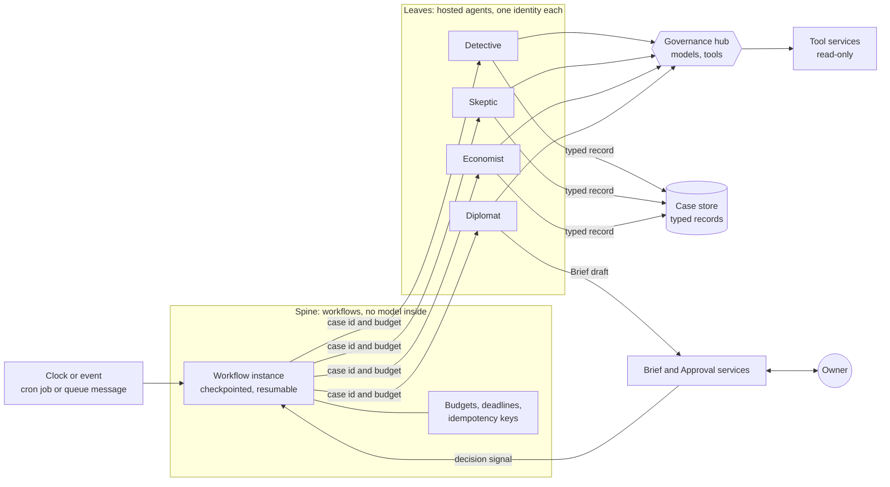

# Design 05 — Agents and orchestration

> **What this answers:** *How do fourteen agents actually run — on what, under which identity, calling what, in what order, waiting for whom — and how does the cost stay proportional to the thinking done?* The agents themselves are described in the [north star](../01-north-star.md#9-the-cast); the trust rules they run under are in the [logical architecture](03-logical-architecture.md) and the [security architecture](07-security-architecture.md). Every product statement rests on the research in [Foundry Agent Service](research/foundry-agent-service.md), [governance and Agent Framework](research/foundry-governance-and-framework.md) and [options analysis](research/options-analysis.md), checked on 2026-10-31. Part of the [design](README.md).

---

## 1. The pattern: a deterministic spine with agentic leaves

The system is not one big agent and not a swarm of agents talking to each other. It is **a spine of ordinary, deterministic workflows that call agents as leaves**, one step at a time, with a budget.



Six rules make the pattern what it is:

1. **Agents never call each other.** There is no agent-to-agent message channel, so there is nothing for an injected instruction to travel along. The Skeptic does not receive the Detective's *words*; it receives a **case id** and reads the Detective's *record* through a read tool, as labelled data.
2. **The spine passes ids and budgets, never prose.** An invocation envelope carries the case id, the step, a budget, a deadline and an idempotency key ([§4](#4-how-the-spine-runs)).
3. **Everything an agent produces is a typed record,** validated against a schema by the case store before any later step may read it. Free-text fields exist, are length-limited, and are marked *untrusted* for whoever reads them next.
4. **The spine never calls a model.** Whether a step runs, repeats, escalates or stops is decided by deterministic code from typed records, never from an agent's say-so. This is the "no model inside the decision to execute" rule, applied to the whole loop.
5. **A leaf can fail without failing the case.** Retries, a cheaper or different model alias, and "pause and ask a person" are the spine's job.
6. **People are signals.** An owner's decision reaches the spine as a message from the Approval service, never through an agent ([07 §4](07-security-architecture.md#4-approvals-that-cannot-be-forged-or-reused)).

**Why this and not the alternatives.**

| Alternative | Why not |
|---|---|
| One agent with all the tools | one identity holds every capability: the lethal trifecta in one place; one context window for everything |
| Agents that hand off to each other (handoff, group chat, A2A) | an injection in one agent's input becomes another agent's instruction; A2A through the gateway is still preview and its authentication is described inconsistently; each hop adds tokens and latency |
| Foundry's visual workflow agents | **retire on 1 December 2026**; no outbound VNet injection; not covered by the cloud red-teaming agent |
| A model-driven planner that decides the next step | the decision to run, repeat or stop becomes probabilistic and unreviewable; cost control moves into a prompt |

The price of the pattern is schema upkeep and less free-form collaboration. The mitigation is a bounded free-text `notes` field in every record, and that the *Skeptic's* job — to break a case — works *better* when it reads the evidence instead of the Detective's rhetoric.

## 2. The roster

Fourteen agents, deployed as **hosted agents** in Foundry Agent Service, in nine groups. A **group** is a *contract and trust class*: it shares one gateway contract ([04 §4](04-landing-zone-and-citadel.md#4-contracts-per-agent-group)) and one position in the capability matrix ([07 §5.1](07-security-architecture.md#51-the-lethal-trifecta-per-agent-group)). Each *agent* still has its own Entra agent identity, created automatically when it is deployed.

| Agent | Group | Alias | Reads and calls (published through the hub) | Writes (typed record) |
|---|---|---|---|---|
| **Scholar** | study | `acia-triage`, `acia-reason` | Document reader, Microsoft Learn MCP, release-feed MCP, Atlas read | draft **claims** with receipts |
| **Cartographer** | study | `acia-reason` | Atlas, price engine | profile and taxonomy **proposals**, conflicts between sources |
| **Librarian (Atlas)** | study | `acia-judge-pub` | Atlas, claim re-check results | reviewed claims; release proposal |
| **Surveyor** | survey | `acia-triage`, `acia-reason` | Estate reader, directory reader, Cost query | Estate Model **drafts**, ownership proposals |
| **Detective** | investigate | `acia-reason` | Cost query, Estate reader, Atlas, Ledger (read), Sandbox | **case notebook** entries: hypotheses, evidence, a *prediction* |
| **Skeptic** | investigate | `acia-judge-eu` | the same read tools as the case used | **objections** and a survives / does not survive verdict |
| **Economist** | investigate | `acia-reason` | Price engine, Cost query, Consequence engine | **option cards** with ranges and consequences |
| **Experimenter** | experiment | `acia-reason` | Lab controller, Atlas, Sandbox | experiment records, predictions |
| **Diplomat** | converse | `acia-reason` (small share), `acia-triage` | Brief drafting tool, Estate service (pseudonymised), Lesson read | **Brief drafts**; lesson drafts |
| **Engineer** | engineer | `acia-reason` | Move catalogue, source repositories, Sandbox | **Move drafts** and pull requests |
| **Auditor** | govern | `acia-judge-eu` | Ledger, audit ledger, evaluation results | outcome scores, drift cases |
| **Examiner** | govern | `acia-judge-eu` or `acia-judge-pub` | Exam bank, Terrarium (through the scoring service) | exam scores |
| **Librarian (lessons)** | govern | `acia-reason` | Lesson Book, Atlas | reviewed lessons |
| **Forger** | forge | `acia-reason` | Terrarium generator only | synthetic estates; answer keys, sealed |
| **Conductor** | conduct | `acia-triage`, `acia-reason` | Agenda, budgets, Ledger (read) | the **Agenda** |

Two splits are deliberate:

- **The Librarian runs as two instances** with separate identities and contracts. One may write to the public Atlas and sees no estate data; the other may read estate lessons and has no route to anything public. One agent with both would be a ready-made leak path.
- **The Forger and the Conductor sit in groups of their own.** The Forger must share nothing with the examinee — not a key, not a tool, not a contract. The Conductor holds budget authority, so a compromised planner must not be able to spend another group's budget.

Not every call goes through the hub as a *person* would see it: the **Move runner, Approval service, Policy service, Credential broker and Verifier hold no contract**, because they call no model ([03 §3](03-logical-architecture.md#3-trust-boundaries)).

## 3. The workflows

Nine workflows run on the spine. Each is a graph of typed steps.

| # | Workflow | Triggered by | Steps | Waits for people | Cost guard |
|---|---|---|---|---|---|
| **W1** | **Watch** | daily cron; a feed event | deterministic job reads the Release Communications feed and Learn's change data → cheap triage step classifies relevance → *study requests* | no | triage tier only; a daily token ceiling |
| **W2** | **Study** | a study request | Scholar → *Document reader* → claims → Cartographer (conflicts) → Experimenter if sources disagree → Librarian review → Atlas pull request → knowledge CI | a human reviewer merges to the Atlas | per-request budget; public-class data, so cheap deployment types |
| **W3** | **Survey** | hourly and daily cron | deterministic estate and cost refresh jobs → Surveyor interprets *changes only* → Estate Model drafts → ownership proposals → Diplomat asks (rate-limited) | owners answer questions | interprets deltas, never the whole estate |
| **W4** | **Case** | the Agenda opens a case | Detective → Skeptic (loop up to *n*) → Economist → Diplomat → Brief → **decision** → Approval → Policy → Broker → Move runner → Verifier → Auditor → lessons | owner decides; approver(s) | per-case budget; expected value must exceed expected cost to open |
| **W5** | **Commitment** | periodic; a W4 outcome | Economist proposal → re-price → Brief to two approvers → purchase approval → execute → utilisation tracked | two named approvers, different hats | high stakes, so the stronger tier is justified |
| **W6** | **Experiment** | a question the Atlas cannot answer | Experimenter plans → Lab controller vends → probe → **waits for the bill** (hours to days) → Skeptic → Librarian | none, but the Lab expiry is a hard stop | Lab budget and expiry; runs at least two days |
| **W7** | **Dream** | nightly | consolidate the day: lessons, detector candidates, Atlas change proposals | no | batch or flex deployments where the data class allows |
| **W8** | **Exam and release** | nightly (small), weekly and per release (full) | Forger → Terrarium → agents under test run W4 on synthetic estates → Examiner scores → gates G1–G9 ([10](10-test-and-evaluation.md)) | a human approves a promotion | evaluation budget; judge-prompt caching |
| **W9** | **Self-watch** | continuous detections; weekly | drift watchers and detections ([09](09-safeguards-and-drift-controls.md), [07 §10](07-security-architecture.md#10-detection-response-and-the-kill-switches)) → Auditor triage → *cases about ourselves*, including the platform's own cost | the operator | the platform's own spend is the first entry on its own Agenda (FR-X4) |

Two things recur. **Every wait is explicit** (a signal, a deadline, an expiry), so nothing waits on an agent's patience. **Every workflow has a budget in tokens, euros, seconds and tool calls,** enforced in the spine, in the agent middleware and at the hub, so three independent layers must fail before a loop can run away.

## 4. How the spine runs

**The spine is ordinary code on ordinary serverless compute.** It does not need a model, so it does not run inside an agent's identity boundary.

| Aspect | Design |
|---|---|
| **Definition** | **Microsoft Agent Framework graph workflows** (GA, 1.0 since 2 April 2026; orchestrations and declarative YAML workflows 1.0 in July 2026). Simple sequences are declarative YAML so a change is a readable diff; branching ones are code. |
| **Execution** | **Azure Container Apps jobs** (Consumption): triggered by a cron schedule or by a Storage Queue message (KEDA scaler). One execution advances a workflow instance to its next wait, checkpoints, and exits. **Nothing runs while a workflow waits for a person.** |
| **Checkpoints** | a custom checkpoint store over our own Cosmos DB account (the Framework's storage protocol allows a custom store); state is JSON only, integrity-protected, and **only the spine's identity can read or write it** — a checkpoint is trusted infrastructure, and the Framework's own guidance is never to load checkpoints from an untrusted source |
| **Human waits** | a workflow raises a typed *request* (the Framework's request-and-response mechanism) and ends the execution; the Approval or Brief service later enqueues the signal that resumes it; a deadline message does the same on expiry |
| **Invocation of a leaf** | the spine calls the hosted agent's endpoint under its own managed identity, which holds the least-privilege **Foundry Agent Consumer** role *at that agent's scope*. The response carries a status and a record id; **the result is read from the case store, not from the response body**, so a leaf cannot smuggle prose into the spine |
| **Idempotency** | every step has an idempotency key; a duplicate delivery returns the earlier record |
| **Poison and stuck work** | a poison message goes to a dead-letter store; a watchdog job finds instances with no progress and raises a case about it |

**The invocation envelope** (illustrative):

```yaml
envelope: 1
case_id: c-2026-10-31-0042
step: investigate.skeptic
agent_version: skeptic@sha256:…        # pinned; the release manifest names it
data_class: estate-confidential
budget: { tokens: 150000, euros: 0.60, seconds: 300, tool_calls: 25 }
deadline: 2026-10-31T14:05:00Z
idempotency_key: c-0042/skeptic/2
trace_parent: 00-…
```

**Why not the platform's own options?**

| Option | Status | Verdict |
|---|---|---|
| Workflow inside a hosted agent, state in the platform's durable store | hosted agents GA; Agent Framework hosting packages pre-release | the spine would run *inside an agent identity*; used only for tests |
| **Durable Extension for Agent Framework** (Functions Flex Consumption, Durable Task Scheduler) | pre-release packages | ADOPT-PREVIEW as the **named alternative**; chosen if our checkpoint store proves brittle (spike **S-ORCH-1**) |
| Foundry visual workflows | retire 1 December 2026 | not used |
| Logic Apps | agent loops in preview; always-on pricing in the usage pipeline of the hub | not used |
| Foundry **Routines** | GA 24 September 2026 | optional for a single-agent clock; **not the default**: a routine has one trigger and one action and cannot carry an envelope, and Routines support no customer-managed keys |

## 5. Anatomy of a leaf

| Part | Design |
|---|---|
| **Runtime** | a **hosted agent** (GA): a per-session microVM sandbox, its own Entra agent identity, scale to zero, billed per active vCPU-hour and GiB-hour. Size 0.5 vCPU / 1 GiB by default; idle timeout **2 minutes** for batch-style roles (the default is 15, which would bill a 30-second job thirty-fold), 15 for the Diplomat. Limits to design around: no traffic splitting between versions, versions immutable, **not offered in North Europe**. |
| **Code** | **Python**, Agent Framework 1.x pinned, one image per group, built in CI from a pinned base, signed, in a private registry. The role is selected by the agent version's (immutable) environment. |
| **Instructions** | `agents/<name>/instructions.md` and skills in the repository; a **hash** of each is computed at build time and written to every span and every record (`prompt_hash`), so behaviour can be tied to an exact text |
| **Model access** | the hub's unified surface, by **alias**, with the agent identity's token (the app role `Model.Invoke` assigned directly to that identity) plus the contract's key from Key Vault. A hosted agent holds no model-deployment role, so it *cannot* reach a deployment any other way ([07 §3.2](07-security-architecture.md#32-roles--least-privilege-in-foundry)) |
| **Tools** | the hub's published MCP endpoints, through the Agent Framework's MCP client; the contract's allow-list decides which. Toolboxes (GA) are **not** used by default, because whether a toolbox's tool calls pass the hub is unproven (spike **S-NET-1**) |
| **Memory** | none beyond the case record. **Foundry Memory is not used**: preview, no VNet support, available in a handful of regions, and its extraction model calls cannot be shown to pass the hub. Conversation state is the case notebook, compacted by deterministic code |
| **Middleware** (GA) | in order: **budget guard** (stops at the envelope's limits), **taint labels** (marks fields from untrusted sources), **deterministic gate** (allow / deny / require-approval before any tool call — the Agent Governance Toolkit if it proves out, otherwise our own check), **output validator** (schema) |
| **Loop** | the Framework's agent loop with the middleware above. The Framework *Harness* (tool loop, compaction, file memory) is marked stable in one place and experimental in the Python status table in another; it is **EVALUATE** for the Scholar and the Detective (spike **S-AGT-1**) |
| **Code execution** | avoided where a deterministic query tool can answer. Where an agent must compute, it calls the **Sandbox** tool — **Container Apps dynamic sessions** (GA), which hold no identity and no secrets, and deny egress. Container Apps Sandboxes (preview) are the cheaper per-second option once proven, behind a switch |
| **Telemetry** | OpenTelemetry through the Framework to Application Insights; span attributes `case_id`, `group`, `alias`, `prompt_hash`, `envelope.budget`, `cost.estimate` |

**Languages.** *Python* for agents, evaluation and analytics; *C#* for the execution plane (Approval service, Policy service, Credential broker, Move runner) and the Teams adapter. The reason is not fashion: the money-moving and approving code is small and security-critical, so it gets a statically typed language, property-based tests and a **dependency surface that is deliberately small**, while the Teams card-action handlers exist in the .NET and JavaScript Agents SDKs but not in the Python one.

## 6. Models and the alias map

An agent never names a model. It names an **alias**; the hub's contract maps the alias to a model, a deployment type and a fallback, and **enforces the data class** ([07 §6.2](07-security-architecture.md#62-data-classes-and-what-each-may-touch)).

| Alias | Used for | Starting model | Deployment type | Fallback |
|---|---|---|---|---|
| `acia-triage` | volume: classification, relevance, "ask or not" | GPT-6 **Luna** | EU Data Zone for estate data; Global for public | the next cheapest cleared model |
| `acia-reason` | investigation, economics, drafting | GPT-6.1 **Sol** | EU Data Zone for estate data; Global (or flex) for public | GPT-6.1 Terra |
| `acia-judge-eu` | the Skeptic, the Auditor, estate-data evaluation | a model from a **different family** than `acia-reason`, with an EU Data Zone option; chosen by exam, not by taste | EU Data Zone | another family or `acia-reason` with a changed prompt, flagged as *not independent* |
| `acia-judge-pub` | claim review, synthetic and public evaluation | a Claude model, **Global Standard**, only for public and synthetic data | Global | `acia-judge-eu` |
| `acia-embed` | retrieval | an embedding model | EU Data Zone | pinned alternative |
| `acia-batch` | nightly consolidation of public-class work | the same families on **Batch or Flex** | Global | the interactive alias |

Rules:

- **Independence is a tested property.** A contract test fails if a judge alias resolves to the same family as the alias it judges.
- **Claude is never the default and never sees estate data**: no EU Data Zone option exists, it is sold through the Marketplace with Anthropic as a separate processor, and its lifetime as a generally available model is 12 months.
- **GPT-6 Astra is never a default**: it costs five times the Sol tier and its EU availability is described inconsistently.
- The **model router** is used only with a pinned subset and an exam run on every pool change; its version label does not pin its behaviour.
- The **Decisions API** (GA, runs on Luna) is a candidate for triage and "ask or not" gates, because it returns typed probabilities; spike **S-MOD-2** measures it against plain structured output.
- **Flex and Batch** serve only the public and synthetic data classes, because Flex needs a Global deployment whose processing may leave the EU.
- **No model name appears in agent code.** A retirement date is data in the contract; an alert fires 90 days before it ([09](09-safeguards-and-drift-controls.md)).

## 7. The token economy

Cost is a design constraint ([C7](01-requirements-and-principles.md#1-constraints--what-is-not-negotiable)), and in this system **tokens, not compute, are the bill**: an illustrative thousand cases a month on the strongest tier costs more than twenty times the hosted compute that runs them ([12](12-cost-and-finops.md)). The design therefore spends tokens like money:

1. **Think cheaply first.** The triage tier decides whether anything deeper is worth running. The Conductor opens a case only when *expected saving × confidence* exceeds the case's expected cost.
2. **Summaries, not rows.** Agents see aggregates and samples from the Cost query tool; raw cost lines never enter a prompt.
3. **A stable prefix.** Instructions, the skills index and tool definitions come first and do not change within a release, so prompt caching applies from 1,024 tokens; a `prompt_cache_key` groups related calls. Cache *writes* are billed on the newest models, so the prefix is written once per release, not per case.
4. **Fewer, sharper tools.** Every published tool adds tokens to every call; the tool list is small and schema-driven, with tool search where a group's list grows.
5. **Bounded loops.** Every envelope carries limits; `max_tokens` is set deliberately because rate limits count it at request time.
6. **The cheapest deployment the data class allows.** Estate data pays the EU Data Zone premium; public and synthetic work does not.
7. **Cost per case is a trace attribute and an evaluation metric.** A regression in cost per case fails a release like a regression in accuracy (G6).
8. **Budgets at the hub are the real cap.** Azure budgets alert on data that is hours old and stop nothing, so they are a backstop only.

## 8. People in the spine

- **Reminders, expiry and attention.** The Brief service owns the attention budget. A question that is not answered ages out into a lesson ("no answer"); nothing auto-acts on silence.
- **Explain, Challenge, Teach** are new cases, not chat: *Explain* is a Diplomat run over the stored case record; *Challenge* re-opens the case for the Skeptic with the owner's objection attached as untrusted data; *Teach* creates a lesson draft that a reviewer confirms.
- **Decisions and approvals** are authenticated actions captured by the Approval service ([07 §4](07-security-architecture.md#4-approvals-that-cannot-be-forged-or-reused)). The workflow sees only the signed result.

## 9. The five clocks

| Clock | Cadence | Mechanism | What runs |
|---|---|---|---|
| **Watch** | daily; plus a feed event | Container Apps cron job → queue | W1, then W2 for what matters |
| **Estate** | hourly deltas, daily cost refresh | cron jobs (deterministic) → queue | W3; the cost-data ingestion |
| **Case** | event-driven | the Agenda enqueues a case | W4, W5 |
| **Learning** | nightly | cron job | W7, W6 follow-ups |
| **Exam and drift** | nightly (small), weekly (full), per release | cron job and pipeline | W8, W9 |

Five clocks, one mechanism (cron job, queue, job). Nothing is always on.

## 10. Failure and degradation

| Failure | Response |
|---|---|
| a model alias returns 429 or 5xx | the hub's fallback member answers; the envelope records the alias actually used |
| a tool returns a typed error | the agent sees the error as data and may try another route within its budget; the spine does not retry blindly |
| a leaf exceeds its budget or deadline | the middleware stops it and writes a *partial* record; the spine decides: escalate, park, or close with "unresolved" |
| a hosted-agent session is lost | the spine re-invokes with the same idempotency key |
| the checkpoint store is unreachable | workflows stop; read-only dashboards stay up |
| the hub is down | all agent activity stops ([03 §6](03-logical-architecture.md#6-degraded-modes)) |
| two agents disagree | the disagreement is a record; the **Skeptic's objection stands until answered**; a person sees both |

## 11. The life of an agent version

```
build (CI) → L0–L3 → register an immutable version → shadow (dry runs on real data) → L4–L8 → promote (set the pinned version) → monitor → retire
```

- A **release manifest** names every pin: agent versions, image digests, contract versions, model aliases and their resolved models, Atlas release, Move versions. **Rollback is redeploying the previous manifest.**
- Hosted agents are **data-plane objects, not Azure Resource Manager resources**, so Bicep and Deployment Stacks cannot own or guard them. The pipeline registers versions through the Foundry API; a **drift watcher** compares what is serving traffic with the manifest (detection D11); an agent version cap (1,000) is handled by pruning in the pipeline.
- A change of **model, prompt, tool, contract or framework version** is a release and passes the gates ([10 §4](10-test-and-evaluation.md#4-release-gates)).

## 12. What is deliberately not used

| Capability | Why not (as of 2026-10-31) | Revisit when |
|---|---|---|
| Foundry **visual workflow agents** | retire 1 December 2026 | never |
| **Prompt agents** on the critical path | reaching the hub needs a model connection limited to Chat Completions, while the strongest models need the Responses API for tool calls | the connection supports Responses |
| **Foundry Memory** | preview, no VNet, few EU regions, extraction cannot be shown to pass the hub | GA with private networking |
| **Copilot harness** for prompt agents | preview; no bring-your-own-model; no Foundry Memory, so its model calls cannot go through the hub | it can |
| **Agent-to-agent (A2A)** inside the system | an injection channel by design; preview through the hub | a case needs a partner's agent, through a publish contract |
| **Azure SRE Agent** as default operator | bills 4 agent units per hour *always on* — a fixed cost of roughly €280–350 a month in Sweden Central — conflicting with scale to zero | a 30-day trial in non-production shows value that beats the meter |
| **Semantic caching** at the hub | needs Azure Managed Redis plus embeddings; unsafe hits across subscribers unless keyed | a measured hit rate beats its cost |
| **Foundry toolboxes** by default | whether toolbox calls pass the hub is unproven | spike S-NET-1 passes |
| **Model router** as a default | silent pool changes under an unchanged version label | pinned subset plus an exam on every change |
| **Fine-tuning, distillation** | no need yet; data-zone training is US-only; legal check on general-purpose-model obligations | the exam shows a ceiling prompts cannot lift |
| **Claude** for estate data | no EU Data Zone option | one appears |

## 13. What this document leaves to spikes

**S-ORCH-1** (checkpoint store versus the Durable Extension), **S-AGT-1** (Harness; deterministic gate: Agent Governance Toolkit versus in-house), **S-MOD-2** (Decisions API for triage), **S-ID-2** (whether an Entra agent identity's token validates at the hub with its own `azp`, so attribution is per agent rather than by header) and **S-NET-1** (toolboxes and the hub) are specified in [14](14-next-phases.md).
