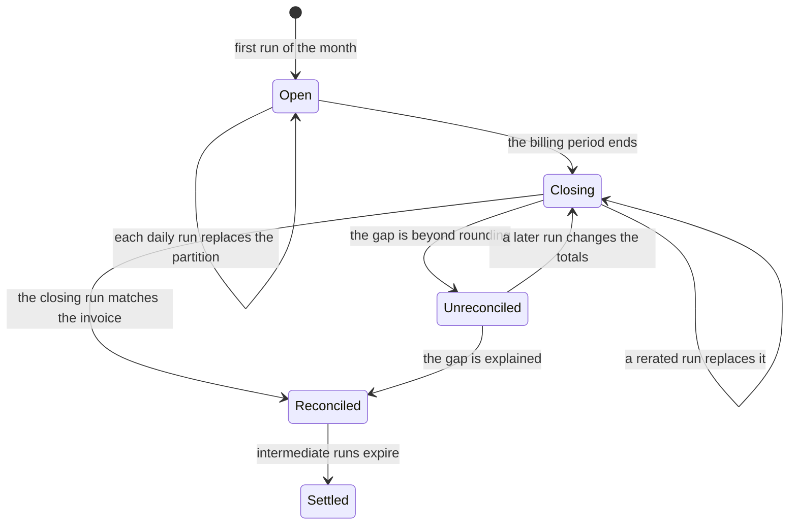
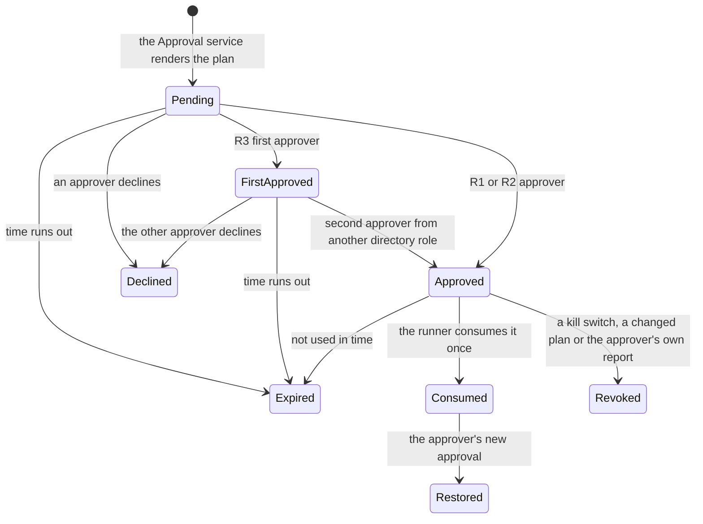

# Data and integrations

> **What this document answers**
> - Where does each kind of data live, and who may read or write it?
> - How do cost and estate data come in, and how fresh are they?
> - How do tools hand data to Agents without handing them instructions?
> - How are people reached, and what is stored when one of them approves?
> - How is data kept, restored and protected?

No Agent holds a right on any store. An Agent calls a tool; the tool or a Workflow reads and writes, under its own identity. Capitalised terms (Atlas, Detector, Action catalogue, Contract, hat) are defined in [the glossary](README.md#words-used-in-this-design); a *hat* is the role in which a person acts.

## 1. Where data lives

| Store | Holds | Written by | Read by | Retention | Restore |
|---|---|---|---|---|---|
| Git | Atlas, Detectors, Action catalogue, Contracts, prompts, templates and message catalogs (one per language), Workbooks; never estate data | People under CODEOWNERS ([repository](09-delivery-and-operations.md#1-the-repository)); `pr-draft` (draft pull requests, from a fork) | CI, people | History; a pull request retires a file | Clone |
| AI Search Basic | The Atlas index, derived | Release build | `atlas` | Replaced each release | Rebuild from Git |
| Cosmos DB serverless, our own account | Nine containers, below | See the matrix | See the matrix | Per container | [Continuous backup](https://learn.microsoft.com/azure/cosmos-db/continuous-backup-restore-introduction) into a new account |
| Blob: cost lake | Export runs as delivered, curated Parquet, prices | The export (raw), the ingestion job | `cost-query`, `price-sim` | Intermediate runs 35 days after month close; closing run 3 years | Rebuild from raw; soft delete |
| Blob: audit log | Approvals, runs, grants, switch changes: ids and hashes | `approvals`, `runner`, append only | Platform team | Records policy, locked | [Immutable](https://learn.microsoft.com/azure/storage/blobs/immutable-container-level-worm-policies); soft delete before the lock |
| Azure Storage | Durable state: ids, numbers, statuses | `workflows` | `workflows` | Purged after 30 days | Derived; Cases resume from the ledger |
| Log Analytics, Application Insights | Traces, Hub usage logs, cost per Case | Hosts, the Hub | Platform team | [Per-table plans](https://learn.microsoft.com/azure/azure-monitor/logs/data-platform-logs) | None |
| Log Analytics: report events | Business events with no object id (below) | Workflows, the Approval service | Workbooks, `workflows`, `approvals` | At least 13 months, then deleted | None |
| Key Vault | Hub keys, the few other secrets | Pipeline | Apps using them | [Soft delete](https://learn.microsoft.com/azure/key-vault/general/soft-delete-overview), purge protection | Recover, rotate |

Retention values are defaults the adopting organisation sets. A locked policy can be extended but never shortened, so the audit period comes from its records policy first. Estate evidence never enters the Atlas: the Librarian (in `study`) only returns a change set and the Study workflow opens the draft pull request; `study` has no tool that returns estate data, and pull-request checks reject subscription ids, resource ids and tenant names.

| Container | Holds | Partition key | Retention |
|---|---|---|---|
| `estate-model` | Resources: purpose, owner object ids, rhythms, metric summaries | `/subscriptionId` | Until superseded |
| `lessons` | Lessons: scope, statement, source object id | `/scopeId` | 12 months unless renewed |
| `ledger` | Cases, predictions, outcomes, plans, drafts, one lease per resource | `/caseId` | Kept |
| `approvals` | Approval records (section 7) | `/requestId` | As the audit log |
| `credentials` | Autopilot credentials | `/credentialId` | Until expired, then as the audit log |
| `switches` | Kill switches: a switch is on while a trip item exists | `/scope` | Cleared trips 1 year |
| `agenda` | Ranked open questions | `/estateId` | Closed items 90 days |
| `consumption` | One item for each approval used | `/requestId` | As the audit log |
| `preferences` | One record per person (section 8); an opt-out is a separate item | `/objectId` | Until the person deletes it; an opt-out stays |

The account has one region, and zone redundancy is chosen at creation ([Learn](https://learn.microsoft.com/azure/reliability/reliability-cosmos-db-nosql)).

**Who may touch what.** Roles are per container and per action; key access is off. R reads, C creates only, W creates, replaces and deletes.

| Principal | `estate-model` | `lessons` | `ledger` | `approvals` | `credentials` | `switches` | `agenda` | `consumption` | `preferences` |
|---|---|---|---|---|---|---|---|---|---|
| `approvals` app: Approval service and page | R | R | R | W | W | W | – | R | W |
| `runner` app: per-class and purchase identities | – | – | C | R | R | R | – | C | – |
| `workflows` app | W | W¹ | W | – | – | R, C | W | – | R |
| `tools` app | R | R | R, C | – | – | – | R | – | – |
| The five hosted agents | – | – | – | – | – | – | – | – | – |
| Evaluation harness | – | – | – | – | – | – | – | – | – |

¹ Only the Respond Workflow writes Lessons. One app has one identity, so this is a code rule (CODEOWNERS and a test), not a platform rule: a compromised `workflows` app could write a false Lesson, which is scoped and expires.

**Superseded in part on 2026-11-05:** the `runner` app's identities and the what-if function of `plan` (what `plan` uses for what-if is not decided). A change runs as the approver; see [decision 24](12-decisions.md#24-a-change-runs-as-the-approver-meternaut-holds-no-right-to-change-azure--accepted) and [proposal 05](../proposals/05-run-as-the-approver.md).

`approvals` reads `estate-model` to resolve a page's scope and alone writes `preferences`, for the signed-in person's own record, because a named delegate may decide for that person.

A Cosmos replace right cannot be limited to one field ([Learn](https://learn.microsoft.com/azure/cosmos-db/reference-data-plane-security)), so nobody holds one they do not need. The fields an approval record binds (plan hash, resources, quote, requester, expiry) never change after the Approval service writes them; only its decisions, its status and a revocation are added, by the Approval service alone and under an etag check, and the runner can read the record but not write it. The runner records that it used an approval by **creating** an item in `consumption` whose id derives from the request id; a second create fails, so an approval is used once. The container is separate because only the runner may create there and no one may replace or delete, which `workflows` could do in `ledger`. A CI test fails if a hosted-agent identity holds any right here ([testing](08-testing-and-evaluation.md)).

**Queues.** Four queues in the platform storage account carry hand-offs, each with one receiver and fixed senders, assigned per queue (the Storage Queue Data roles): `run` (`approvals` sends, `runner` receives), `inbound` (`approvals` sends, `workflows` receives), `teams-cards` (`workflows` sends, a Power Automate flow receives) and `teams-posted` (the flow sends, `workflows` receives). A message holds ids and, in `inbound`, one length-capped `untrusted_excerpt`; a `teams-cards` message holds one card, and a `teams-posted` message the id of the Teams message that the card became.

**Report events.** One custom table (Analytics plan) feeds the dashboards, letters and pages; the workflows and the Approval service fill it through the Logs Ingestion API. An event carries no object id; a count over fewer than five people is rolled up, and a result that a subtraction could isolate is suppressed. The table keeps at least 13 months, which a year-on-year commitment comparison needs ([Learn](https://learn.microsoft.com/azure/azure-monitor/logs/data-retention-configure)). The Workbooks are code in Git, granted by Azure role and unable to filter per viewer, so owners and team leads read pages instead. These rules keep people out of the table, not the organisation's spend from whoever can open a Workbook.

## 2. Cost data

Cost Management exports are the system of record for spend wherever the agreement offers them; where it does not, the Cost Details, Usage Details or Query API fills the same lake. A capability profile per scope says which path applies, and with which roles ([agreements and access](14-agreements-and-access.md#cost-data-paths)).

**Exports.** At billing-account scope (Enterprise Agreement or Microsoft Customer Agreement): [FOCUS](https://learn.microsoft.com/azure/cost-management-billing/dataset-schema/cost-usage-details-focus) 1.0 (1.2 is preview) as Parquet, a daily run of the month so far and a monthly run of last month; the price sheet; reservation details, transactions and recommendations. Overwrite is off, so each run keeps its own `RunID` folder. The lake's firewall stays on, with the documented trusted-services exception for the export and its copy scope set to From any storage account, which exports need ([Learn](https://learn.microsoft.com/azure/cost-management-billing/costs/tutorial-improved-exports)).

**Freshness.** Data for those two agreement types typically lands within 8 to 24 hours, pay-as-you-go within 72. A period closes up to 72 hours after it ends, charges can change until about day five, and the open month can be rerated ([Learn](https://learn.microsoft.com/azure/cost-management-billing/costs/understand-cost-mgt-data)). Azure re-exports the previous month on each of the first five days, so its final file is the closing Cost Management input to reconciliation.

**Manifest-based replacement.** Each run's `manifest.json` lists every file with its size and row count. An hourly job in `tools` takes new manifests in `submittedTime` order and proceeds only when every listed file is present at the listed size. It writes a curated Parquet partition for that period and run, then moves the period's `current` pointer to it. A Case records the run it used, and an older run never replaces a newer one.

**Which cost.** `BilledCost` is the invoice basis, without the amortisation of upfront purchases; `EffectiveCost` spreads reservations and savings plans over the days they cover. Waste and savings use `EffectiveCost`; budgets and invoice checks use `BilledCost`. Sums never mix `BillingCurrency` values.

**Reconciliation.** After the closing run, `BilledCost` per `InvoiceId` is compared with the invoice's pre-tax amount (Billing invoices API), once the charges that Cost Management leaves out (credits, taxes and support: [agreements and access](14-agreements-and-access.md#cost-data-paths)) have been accounted for. A gap beyond rounding that this does not explain marks the month unreconciled, and every Recommendation that rests on it says so; an explained difference is kept and shown beside the figures.

**Fresh questions.** `cost-query` can call the [Query API](https://learn.microsoft.com/azure/cost-management-billing/costs/manage-automation) for one scope and a few days. Its tenant quota ([agreements and access](14-agreements-and-access.md#cost-data-paths)) means it caches and caps ranges.

**Prices and commitments.** A daily snapshot of the [Retail Prices API](https://learn.microsoft.com/rest/api/cost-management/retail-prices/azure-retail-prices) gives list prices (unauthenticated, 1,000 rows a page, savings-plan rates only in the `2023-01-01-preview` version, USD base). `price-sim` states which price basis it used ([the price order](14-agreements-and-access.md#the-price-order)). Utilisation comes from the Reserved Instance usage API and the [Benefit Utilization Summary API](https://learn.microsoft.com/azure/cost-management-billing/savings-plan/view-utilization); both need [tenant-scope roles](https://learn.microsoft.com/azure/cost-management-billing/reservations/view-reservations).

**The engine.** [DuckDB](https://duckdb.org/docs/stable/core_extensions/azure.html) (MIT), inside the `tools` app, reads the lake with its managed identity. A Flex Consumption instance has at most 4 GB of memory ([Learn](https://learn.microsoft.com/azure/azure-functions/flex-consumption-plan)), so `cost-query` offers named queries with validated parameters; no model writes SQL. Proof point P4 ([roadmap](13-roadmap.md)) measures where this stops being enough.

## 3. Estate data

| What | Read with | What shapes the read |
|---|---|---|
| Inventory, tags | Resource Graph `resources`, `resourcecontainers` | 1,000 rows a page; about 15 queries per 5 seconds per user; group subscriptions (under 300 a query), stagger ([Learn](https://learn.microsoft.com/azure/governance/resource-graph/concepts/guidance-for-throttled-requests)) |
| Changes | `resourcechanges`, ready within 5 minutes ([Learn](https://learn.microsoft.com/azure/governance/resource-graph/how-to/get-resource-changes)) | `changedBy` is an e-mail address or app id; the tool maps it to an object id |
| Advisor, Policy, role assignments | `advisorresources`, `policyresources`, `authorizationresources` ([tables](https://learn.microsoft.com/azure/governance/resource-graph/reference/supported-tables-resources)) | As above |
| Metrics | Monitor `metrics:getBatch`, 50 resources of one subscription, region and type | Platform metrics last 93 days and lose history on a move or rename, so the Estate model keeps summaries ([Learn](https://learn.microsoft.com/azure/azure-monitor/metrics/data-platform-metrics)) |

**Budget.** Each service principal gets 250 reads per subscription, refilled at 25 a second; the limits cannot be raised ([Learn](https://learn.microsoft.com/azure/azure-resource-manager/management/request-limits-and-throttling)). `estate-read` spends a fifth of that on average, tracks `x-ms-ratelimit-remaining-subscription-reads` and alerts on every 429. Answers are cached per scope (inventory and Advisor a day, metric summaries an hour) and carry `as_of` and a completeness flag; a throttled read returns a partial answer.

**Azure MCP Server.** Our default `estate-read` is a typed tool of our own on Resource Graph, Monitor and the Advisor tables, so it can return structured fields within the read budget. [Azure MCP Server 3.0](https://learn.microsoft.com/azure/developer/azure-mcp-server/tools/) (generally available) is an optional extra for generic reads, evaluated in P9 ([technology register](11-technology-register.md)). MCP responses stream, so the Hub cannot screen them: its answers count as untrusted and only `investigate` and `skeptic` may call it.

**Publishing.** Our tools are ordinary HTTPS APIs on the `tools` app. The Hub publishes each as MCP with the Publish Contract asset type `mcp-from-api` (preview; `operationNames` is the allow-list). The generally available fallback is to [expose the REST API as an MCP server](https://learn.microsoft.com/azure/api-management/mcp-server-overview) in API Management and grant it through the Access Contract. The `tools` app accepts only calls the Hub forwards.

## 4. Tools

Every tool returns structured fields. Free text (tag values, names, log lines, documents, replies) comes back only as an `untrusted_excerpt`.

| Tool | Returns | Free text | Identity and roles | Called by |
|---|---|---|---|---|
| `docs` | Title, URL, page date, source type | Page text and community answers, as excerpts | None: our tool fetches public sources from an allow-list of hosts: Microsoft Learn (the [Learn MCP Server](https://learn.microsoft.com/training/support/mcp)), the Azure updates feed, resource-provider REST specifications and the Retail Prices API | `study`, `skeptic` |
| `atlas` | Claims, profiles, Detectors, Action templates: id, scope, evidence level | Source quotes, as excerpts (never to `engineer`) | Search Index Data Reader ([roles](https://learn.microsoft.com/azure/search/search-security-rbac)) | All five |
| `estate-read` | Resources, tag keys, owner ids, purpose, Advisor and Policy flags, metric summaries, changes | Tag values, names, log lines | Reader, Monitoring Reader, Log Analytics Reader (opt-in); Cosmos read | `investigate`, `skeptic` |
| `cost-query` | Named queries: `BilledCost`, `EffectiveCost`, currency, run id | Tag values, names | Storage Blob Data Reader, Cost Management Reader; Reservations Reader, Savings plan reader (tenant, optional) | `investigate`, `skeptic` |
| `price-sim` | Price before and after a change, source, date | None | Storage Blob Data Reader | `investigate`, `skeptic` |
| `directory` | Owner candidates: object id, hat, status, evidence, confirmed | None; names never leave it | Graph `User.Read.All`, `GroupMember.Read.All`; Reader | `investigate` |
| `ledger` | Past Cases, predictions, outcomes, agenda | None | Cosmos read | `investigate`, `skeptic` |
| `ledger-propose` | A draft record id | Refused | Cosmos create on `ledger` | `engineer` |
| `plan` | What-if summary, plan hash, etags, predicted effect, rollback | None | Reader; Cosmos create | `engineer` |
| `channels-draft` | A draft message id | The Diplomat's text, screened before sending | Cosmos create on `ledger` | `diplomat` |
| `pr-draft` | A draft pull request number | Diffs of schema-valid files only | GitHub App key in Key Vault. The App holds Pull requests and Checks write and no Contents write on the base repository, so it can neither push there nor merge ([merging needs Contents write](https://docs.github.com/en/rest/pulls/pulls#merge-a-pull-request)). It proposes from a fork, which a credential limited to that fork writes to. A stolen key can open a proposal and post a passing check, but cannot merge ([merge rules](09-delivery-and-operations.md#1-the-repository)) | `engineer`; the Study workflow calls the same API directly (Atlas change sets) |

ARM what-if needs the same permissions as the deployment itself ([Learn](https://learn.microsoft.com/azure/azure-resource-manager/templates/deploy-what-if)). So `plan` holds no write role: it calls a what-if-only function of the `runner` app, which already holds the Action family's role. That function takes a stored plan id, never a template from the caller, and answers only `tools`.

**The `untrusted_excerpt`** holds its source (tool, field, resource id), length, content hash, the [Prompt Shields](https://learn.microsoft.com/azure/ai-services/content-safety/concepts/jailbreak-detection) result and the text inside a fixed delimiter pair. At most 1,000 characters each and five per response, so one Prompt Shields call (five documents) screens a response. Delimiter strings inside the text are escaped, a flagged excerpt is withheld and counted, and e-mail addresses become object ids or are masked. A secret scan covers the whole response. Prompt Shields judge patterns, not intent, so the structural limits hold regardless ([security](06-security-and-governance.md)).

## 5. The directory

`directory` finds owners from four sources and returns each candidate with its evidence: **tags** (a tag naming someone is a claim, never proof), **role assignments** on the resource and its parents, **who created or last changed it** (`resourcechanges`, deployment history), and **Entra** (account active or disabled, manager, group membership).

A candidate becomes the owner of record when a person confirms it; until then the Case labels it a guess and asks one question. If nobody is found, the custodian the adopting organisation named for unowned estate gets the Case. People are stored as Entra object ids; a person who leaves is a disabled or deleted object, and the next refresh finds a new candidate. Names, e-mail addresses and language are resolved when a message is rendered, outside the model: the Diplomat writes `{person:<objectId>}`.

## 6. Channels

**Teams.** A card is a message on the private `teams-cards` queue in the platform storage account. A Power Automate flow reads the queue through Power Platform's virtual network support and posts the card with the Teams action "Post card in a chat or channel", as the Flow bot, in a chat with the person ([proposal 13](../proposals/13-teams-and-outlook.md)). There is no bot, no Azure Bot resource, no Teams app to install, no app registration and no Graph permission, and nothing in Teams calls an endpoint of ours. `workflows` renders the message ([The send step](#the-send-step), below) and puts it on the queue ([Teams delivery](#teams-delivery)). After the post the flow writes the id of the Teams message to the queue `teams-posted`, which the app reads; when the request ends the app queues an update that the flow applies with the Teams action "Update an adaptive card in a chat or channel", so that no button is left on the card ([proposal 19](../proposals/19-teams-cards-through-power-automate.md#the-card-closes-itself)).

A card carries the link to the page and its answer buttons, which are links to pages of the function app that send the answer ([proposal 19](../proposals/19-teams-cards-through-power-automate.md#the-card-carries-the-decision)): nothing is approved, declined, asked or taught in Teams itself. Delivery is best effort: the app learns which message a card is, and not that the person saw it.

**E-mail.** Microsoft Graph [`sendMail`](https://learn.microsoft.com/graph/api/user-sendmail) with `Mail.Send`, from one shared mailbox. [Exchange RBAC for Applications](https://learn.microsoft.com/exchange/permissions-exo/application-rbac) limits the app to that mailbox but not its recipients, so the sender enforces the recipient allow-list and a mail-flow rule in Exchange rejects mail from that mailbox to any address not on it, which a bypassed send step cannot skip. The scope holds only if the app has no organisation-wide `Mail.Send` consent in Entra, because the two grants add up. Replies need `Mail.Read` on the same mailbox, are screened as excerpts, and never approve.

### Pages

The `approvals` app renders the pages on the server, on its private endpoint and behind Entra sign-in ([security](06-security-and-governance.md#8-network)). `/ok/<requestId>` is the page of one request: it shows the exact plan from the stored plan record and takes the decision or, for any other card, shows the card's own words and answers; opening it records no decision. The other routes are the notebook (`/why/<id>`), a person's decisions (`/me/decisions`), the Lessons about their resources (`/me/notes`), the changes made as the approver (`/me/activity`), the preferences (`/me/settings`), the kill switch (`/ops/pause`) and the page that shows what Meternaut can change in Azure (`/ops/permissions`). The last two are for the platform owner and the FinOps lead only (the kill switch also for a security reviewer), and no message links to them.

Each page reads through an `approvals` API that takes the person from the sign-in token, resolves their resources from `estate-model` and returns only records in that scope. A decision submitted on `/ok/<requestId>` is refused unless the token's object id is the designated approver or a named delegate and the token carries the class's authentication-context claim; a forwarded link authorises nobody. A decision, an Undo, a preference, a switch or a Credential is handled by the Approval service; any other page action (a note edited, a question asked) reaches Respond on `inbound`.

### The send step

Agents draft; workflows send. The send step takes the recipient from the directory's owner of record, never from the draft; strips URLs and escapes markdown in every bound value, because Teams renders [markdown links](https://learn.microsoft.com/microsoftteams/platform/task-modules-and-cards/cards/cards-format#format-cards-with-markdown) in card text (persuasive plain text still gets through, so owner text appears only as a labelled quote); and builds every link from a configured origin plus an opaque request id (a card carries the page of its request and the links of its answer buttons; a letter may carry several, a page per item).

It fills numbers, dates and money in model-written text from tool results at render time, in the person's locale, applies the e-mail allow-list and the notification policy, screens the text, sends once (the draft id is the idempotency key) and records delivery.

Every message says an AI wrote it: the sender name ends "(AI)", a footer line says so, and a machine-readable mark says so (the header `x-ai-generated: true` in e-mail). A test checks that the marks survive delivery. A card that the flow posts has the footer line only: the action takes the card and nothing else, so the sender is the Flow bot and the platform's AI-generated label is not set. The marks sit on the message, not in the card: a card's `metadata` needs [schema 1.6](https://learn.microsoft.com/adaptive-cards/schema-explorer/adaptive-card) and the cards use 1.4.

**The notification policy** is a step of the send workflow, in code. Humans set its ceilings, the code applies them, and the Conductor cannot raise any ([the Conductor](03-agents-and-workflows.md#8-the-conductor)). It counts, per person, the pushes (any message the system starts unprompted) and the asks among them (a Question or a Recommendation). Against the weekly ceiling count a new ask, the one reminder, a request about a note and a heads-up; not counted, and never held for the budget, are Hello (sent once), the weekly desk, answers to a person's own action and safety notices (a run under a Credential and the notice before its first run). A slow start allows one push a week for 30 days after a person's own first contact, then three, under a ceiling the FinOps lead sets and the person may lower; a counted push over budget waits for the weekly desk, and any push due in quiet hours waits. It allows one reminder per waiting ask (inside the weekly desk once the budget is used up) and routes unanswered items to cover ([the rules](03-agents-and-workflows.md#4-seven-workflows)).

An emergency lane is opt-in per scope, with absolute thresholds and an on-call route; voice or SMS goes only through the organisation's own paging. The weekly desk holds at most five items; a fatigue review counts groups of at least five, never names. Every number is a starting value, and the policy counts what it sends, not what is read.

### Teams delivery

A message is one JSON text on the queue: the card, the recipient's address from the people list and a short title (and, for a request, its id), at most 30,000 bytes; a card that does not fit is replaced by a minimal one with the headline and the link ([proposal 13](../proposals/13-teams-and-outlook.md)). The flow posts it as the Flow bot, within the connector's limit of 25 posts in 300 seconds a connection. A failure to put the message on the queue is a failed try (tried again after 15 minutes, 12 tries at most), and the letter still goes. The flow answers only with the id of the Teams message that a request's card became: a card that the queue took and the flow did not post is not noticed. Only members of the directory get cards; partners and other outsiders get e-mail only.

A card to an approver is not enough where the link may open in an embedded view: every purchase request, and any one-person page request where the client matrix shows that, also goes by e-mail with the same request id, plan code and expiry and a line saying the page opens only from the organisation's network.

### E-mail outside the directory

A purchase request to a partner or a billing owner ([agreements and access](14-agreements-and-access.md#four-purchase-paths)) carries an **external flag**, a field on the message record that routes it through the external path: plain text with no link and no button; one recipient, an address the platform team put on the allow-list; no figures in the subject line; and minimum estate data, only the scope identifiers needed to quote or buy (the management group or subscriptions the purchase applies to; no resource names, owners, tags or other spend). A reply is read as a question. The approval page reads the flag and shows the approvers the recipient's address and the exact text to be sent. The send step refuses any address that is not on the list, whoever named it. A wrong address on the list, or a forward, is not stopped.

### First contact

Before the system writes to anyone, the platform team or a team lead announces it in the organisation's own channels: the name that a card comes from and the one address of the approval page; that it never asks for a password or a code; and that a sign-in asking to grant an app permissions is [fraud](https://learn.microsoft.com/entra/identity/enterprise-apps/protect-against-consent-phishing). The person then receives a first card or a first-contact e-mail; an opt-out is recorded in `preferences` and honoured. An administrator consents to the app's delegated permissions for the whole organisation before first contact, so the real sign-in never asks a person to grant anything and any consent screen is a fake. The announcement cannot stop a convincing fake; it gives people the address to compare later links with ([onboarding](09-delivery-and-operations.md#9-onboarding-an-estate)).

## 7. The approval record

The Approval service writes one record per request, rendered from the stored plan record. The record holds no free text, so nothing a model wrote can enter it.

| Field | Holds |
|---|---|
| `requestId` | Opaque, random; the only identifier a card or page carries, beside its verb, the plan code where it decides, and the inputs the card manifest lists for that verb |
| `class`, `actionFamily` | R1, R2 or R3; the family whose role the runner uses |
| `planId`, `planHash` | The stored plan and the hash of its canonical form |
| `resources[]` | Resource ids with etags (a configuration hash where a type has none) |
| `quote` | Purchases: the stored calculate quote id, amount, currency, term, billing subscription, applied scope type and scopes |
| `requestedBy` | The requester's object id; for R3 neither approver may be this person |
| `approvals[]` | Per approver: object id, directory role, decision, time, route (card or page), satisfied authentication-context (`acrs`) claim |
| `createdAt`, `expiresAt` | Timestamps |
| `status` | Pending, approved, declined, expired or revoked, written only by the Approval service; consumption is a separate item |
| `credentialId`, `evaluated` | Autopilot only: the credential and the facts the service read (management-group path, Policy state, owner object id, resource type, SKU, cost) |
| `recordHash`, `auditRef` | The record's hash at approval and its audit entry |

R3 needs two approvals from two different directory objects, one in each of two directory roles (the resource-owner group, the FinOps or finance approver group), neither the requester; the service checks membership with [`checkMemberGroups`](https://learn.microsoft.com/graph/api/directoryobject-checkmembergroups). The runner re-checks every bound field against live state and consumes the record once. A field that no longer matches aborts the run and asks for a new plan. A live fact that no longer holds (a tag, a lock, a state) aborts the run before anything is written and uses nothing: the request stays open, with the reason, and a person approves it again.

**One decision per approver.** Each approver records one decision against the plan; a second submit by the same person is refused, and the other approver's decision still counts. The short code on a card or page (eight characters from the plan hash) is a display reference, not a secret and not a token; the plan is consumed once, when the Runner runs it.

**Undo.** A failed check stops and tells the approver. Where Azure offers an undo, the approver makes it as a new change, with their own sign-in and rights. A purchase cannot be undone.

**One contract for every verb.** (Superseded in part on 2026-11-11: a card that the flow posts carries links and no verb, [Teams](#6-channels); what follows is the earlier contract of the cards.) A card button sends an opaque request id, a verb and, when it decides something, the plan code; at most an option key, a scope or a reason chip joins them. Only Challenge, Teach and the text boxes send words (bounded, screened, quoted as untrusted data); free text never approves. The [card manifest](../experience/cards/manifest.json) lists each verb's inputs, plan-code need and return. One contract covers every verb: who may tap (the card's addressee; for a decision, the designated approver or a named delegate, by directory object id); a repeat does nothing (the service answers "already recorded"); a verb is refused when its request is expired, changed, answered or paused, except the two that stay open whatever the record shows: "I did not approve this" and "Talk to a person"; a tap returns one immediate response, then the outcome by updating the same message.

## 8. Privacy, retention and recovery

- **Minimise.** About a person: an object id, a hat (owner, budget holder, platform owner) and the preferences below. No names, e-mail addresses or home data.
- **Preferences.** One record per directory object id in `preferences`: channel, language, working days, time zone, quiet hours, desk day (the weekly summary), weekly push budget, delegates, mutes, and a return date for "Pause messages". No names. A person sets it on the settings page and exports or deletes it there, with the Lessons they taught. A delegate is named only on the page, after the sign-in that R2 needs, and the person is sent a notice of it. An opt-out is a separate item that deletion leaves in place, so the system does not write to the person again.
- **Erasure.** A request removes the object id from `estate-model`, `lessons`, `ledger`, `preferences`, drafts and traces, and writes an audit entry with a hash of the id. Approval records and the audit log are not erased: they hold only object ids, which resolve to nobody once Entra deletes the account, and follow the adopting organisation's retention; whether that satisfies an erasure request is its data-protection decision, made before the log is locked. The restore job replays those entries, so a restore does not bring the person back.
- **Residency is a parameter.** The adopting organisation chooses each store's region ([security](06-security-and-governance.md#7-data-protection-and-privacy) covers the model deployment type); Teams and Exchange data follow the Microsoft 365 tenant's own residency settings.
- **Recovery.** A restore creates a new account; restore with TTL disabled so nothing expires on arrival ([delivery and operations](09-delivery-and-operations.md#8-recovery) has targets, tests and version-safe resume).

**What this does not stop.** The audit lock stops edits and deletes, not a wrong entry from a compromised writer. The matrix limits blast radius, but a compromised `approvals` app can write approvals and preferences, delegates included, and release any switch: it is the trust anchor. Reconciliation proves the lake matches the bill, not that the bill is right.
