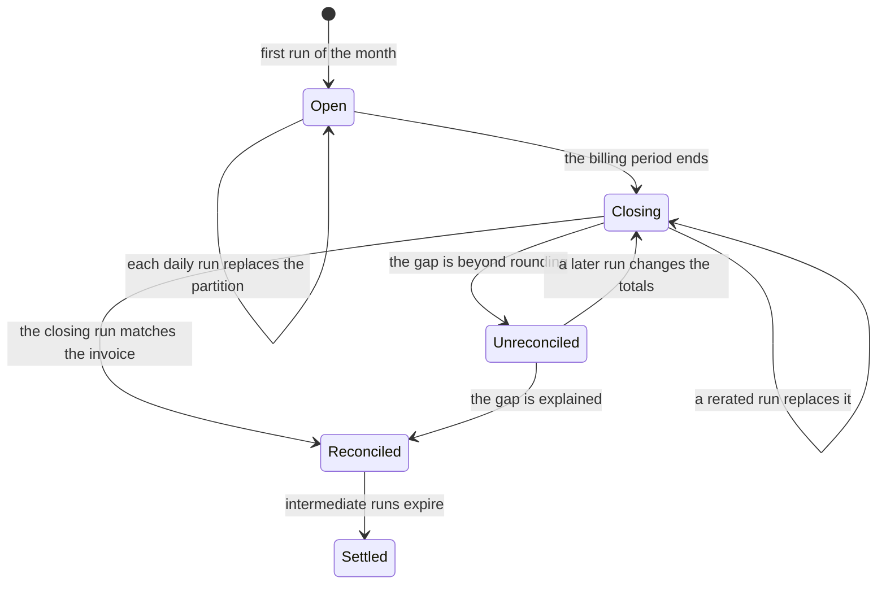
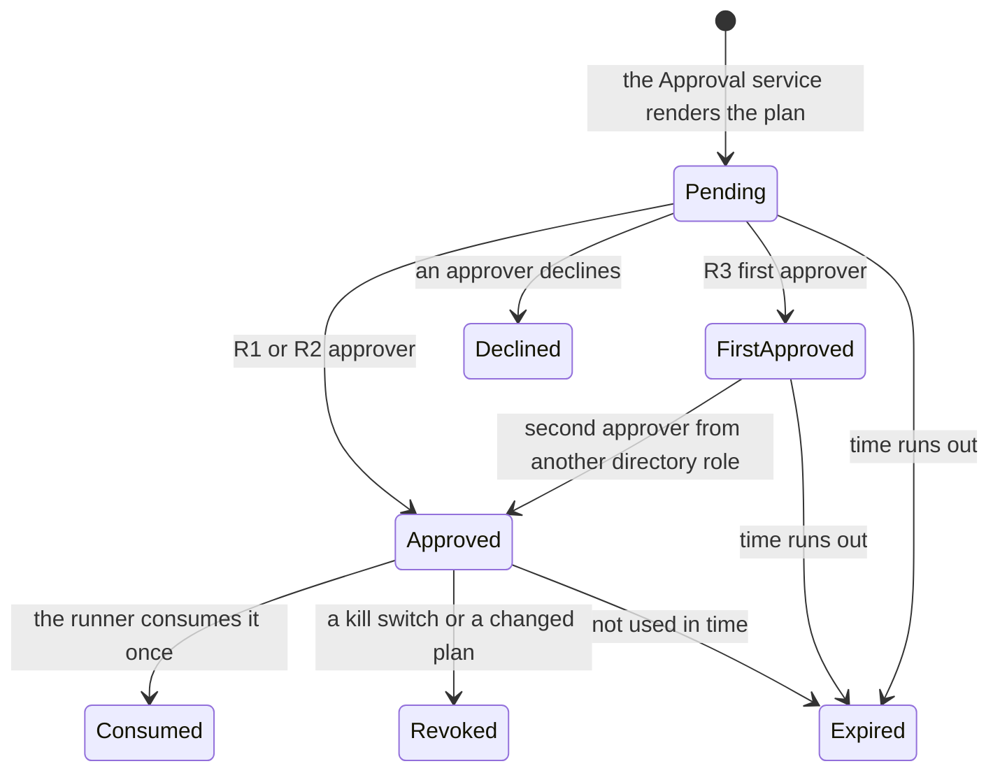

# Data and integrations

> **What this document answers**
> - Where does each kind of data live, and who may read or write it?
> - How do cost and estate data come in, and how fresh are they?
> - How do tools hand data to Agents without handing them instructions?
> - How are people reached, and what is stored when one of them approves?
> - How is data kept, restored and protected?

No Agent holds a right on any store. An Agent calls a tool; the tool or a Workflow reads and writes, under its own identity. See [the architecture](02-architecture.md) and [security](06-security-and-governance.md).

## 1. Where data lives

| Store | Holds | Written by | Read by | Retention | Restore |
|---|---|---|---|---|---|
| Git | Atlas, Detectors, Action catalogue, Contracts, prompts; never estate data | People; `pr-draft` (draft pull requests) | CI, people | History | Clone |
| AI Search Basic | The Atlas index, derived | Release build | `atlas` | Replaced each release | Rebuild from Git |
| Cosmos DB serverless, our own account | Eight containers, below | See the matrix | See the matrix | Per container | [Continuous backup](https://learn.microsoft.com/azure/cosmos-db/continuous-backup-restore-introduction) into a new account |
| Blob: cost lake | Export runs as delivered, curated Parquet, prices | The export (raw), the ingestion job | `cost-query`, `price-sim` | Intermediate runs 35 days after month close; closing run 3 years | Rebuild from raw; soft delete |
| Blob: audit log | Approvals, runs, grants, switch changes: ids and hashes | `approvals`, `runner`, append only | Platform team | Records policy, locked | [Immutable](https://learn.microsoft.com/azure/storage/blobs/immutable-container-level-worm-policies); soft delete before the lock |
| Azure Storage | Durable state: ids, numbers, statuses | `workflows` | `workflows` | Purged after 30 days | Derived; Cases resume from the ledger |
| Log Analytics, Application Insights | Traces, Hub usage logs, cost per Case | Hosts, the Hub | Platform team | [Per-table plans](https://learn.microsoft.com/azure/azure-monitor/logs/data-platform-logs) | None |
| Key Vault | Hub keys, the few other secrets | Pipeline | Apps using them | [Soft delete](https://learn.microsoft.com/azure/key-vault/general/soft-delete-overview), purge protection | Recover, rotate |

Retention values are defaults the adopting organisation sets. A locked policy can be extended but never shortened, so the audit period comes from its records policy first. [Delivery and operations](09-delivery-and-operations.md) sets restore targets and tests. Estate evidence never enters the Atlas: the Librarian (in `study`) only returns a change set and the Study workflow opens the draft pull request; `study` has no tool that returns estate data, and pull-request checks reject subscription ids, resource ids and tenant names. Foundry's own agent state is platform-managed in the Operate profile ([networking options](https://learn.microsoft.com/azure/foundry/agents/concepts/networking-options)); nothing here depends on it.

| Container | Holds | Partition key | Retention |
|---|---|---|---|
| `estate-model` | Resources: purpose, owner object ids, rhythms, metric summaries | `/subscriptionId` | Until superseded |
| `lessons` | Lessons: scope, statement, source object id | `/scopeId` | 12 months unless renewed |
| `ledger` | Cases, predictions, outcomes, plans, drafts, one lease per resource | `/caseId` | Kept |
| `approvals` | Approval records (section 7) | `/requestId` | As the audit log |
| `credentials` | Autopilot credentials | `/credentialId` | Until expired, then as the audit log |
| `switches` | Kill switches: a switch is on while a trip item exists | `/scope` | Cleared trips 1 year |
| `agenda` | Ranked open questions | `/estateId` | Closed items 90 days |
| `consumption` | One item for each approval used | `/requestId` | As the audit log |

The account has one region, and zone redundancy is chosen at creation ([Learn](https://learn.microsoft.com/azure/reliability/reliability-cosmos-db-nosql)).

**Who may touch what.** Roles are per container and per action; key access is off. R reads, C creates only, W creates, replaces and deletes.

| Principal | `estate-model` | `lessons` | `ledger` | `approvals` | `credentials` | `switches` | `agenda` | `consumption` |
|---|---|---|---|---|---|---|---|---|
| `approvals` app: Approval service and page | – | R | R | W | W | W | – | R |
| `bot` app: calls the Approval service; uses two queues | – | – | – | – | – | – | – | – |
| `runner` app: per-class and purchase identities | – | – | C | R | R | R | – | C |
| `workflows` app | W | W¹ | W | – | – | R, C | W | – |
| `tools` app | R | R | R, C | – | – | – | R | – |
| The five hosted agents | – | – | – | – | – | – | – | – |
| Evaluation harness | – | – | – | – | – | – | – | – |

¹ Only the Respond Workflow writes Lessons. One app has one identity, so this is a code rule (CODEOWNERS and a test), not a platform rule. A compromised `workflows` app could therefore write a false Lesson; Lessons are scoped, expire and never widen a credential, and owners can read and correct them.

A Cosmos replace right cannot be limited to one field ([Learn](https://learn.microsoft.com/azure/cosmos-db/reference-data-plane-security)), so nobody holds one they do not need, and an approval record is never changed after the Approval service writes it. The runner records that it used an approval by **creating** an item in `consumption` whose id derives from the request id; a second create fails, so an approval is used once. The container is separate because only the runner may create there and no one may replace or delete, which `workflows` could do in `ledger`. Workflows can only create trip items; clearing a switch goes through the Approval service, with one person (two for the purchase switch). A CI test fails if a hosted-agent identity holds any right here ([testing](08-testing-and-evaluation.md)).

**Queues.** Three queues in the platform storage account carry hand-offs, each with one sender and one receiver, assigned per queue (the Storage Queue Data roles): `run` (`approvals` sends, `runner` receives), `inbound` (`bot` sends, `workflows` receives) and `outbound` (`workflows` sends, `bot` receives). A message holds ids and, in `inbound`, one length-capped `untrusted_excerpt`.

## 2. Cost data

Cost Management exports are the system of record for spend. A person with billing rights creates them once.

**Exports.** At billing-account scope (Enterprise Agreement or Microsoft Customer Agreement): [FOCUS](https://learn.microsoft.com/azure/cost-management-billing/dataset-schema/cost-usage-details-focus) 1.0 (1.2 is preview) as Parquet, a daily run of the month so far and a monthly run of last month; the price sheet; reservation details, transactions and recommendations. Overwrite is off, so each run keeps its own `RunID` folder. Management-group scope and pay-as-you-go accounts cannot export FOCUS ([Learn](https://learn.microsoft.com/azure/cost-management-billing/costs/tutorial-improved-exports)); pay-as-you-go uses the actual and amortised exports and a column mapping. The lake's firewall stays on, with the documented trusted-services exception for the export.

**Freshness.** Data for those two agreement types lands within 8 to 24 hours, pay-as-you-go within 72. Each refresh is cumulative, so each run holds the month so far. A period closes up to 72 hours after it ends, charges can change until about day five, and the open month can be rerated ([Learn](https://learn.microsoft.com/azure/cost-management-billing/costs/understand-cost-mgt-data)). Azure re-exports the previous month on each of the first five days, so its final file matches the invoice. Fast clocks use metrics, activity and anomaly alerts; the bill confirms later.

**Manifest-based replacement.** Each run's `manifest.json` lists every file with its size and row count. An hourly job in `tools` takes new manifests in `submittedTime` order and proceeds only when every listed file is present at the listed size. It writes a curated Parquet partition for that period and run, then moves the period's `current` pointer to it. The pointer changes; raw files do not. A Case records the run it used, and an older run never replaces a newer one.

**Which cost.** `BilledCost` is the invoice basis, without the amortisation of upfront purchases; `EffectiveCost` spreads reservations and savings plans over the days they cover. Waste and savings use `EffectiveCost`; budgets and invoice checks use `BilledCost`. Sums never mix `BillingCurrency` values.

**Reconciliation.** After the closing run, `BilledCost` per `InvoiceId` is compared with the invoice's pre-tax amount (Billing invoices API); Cost Management leaves out tax, credits and support. A gap beyond rounding marks the month unreconciled, and every Recommendation that rests on it says so.

**Fresh questions.** `cost-query` can call the [Query API](https://learn.microsoft.com/azure/cost-management-billing/costs/manage-automation) for one scope and a few days. It reads the same data (refreshed about every four hours), so it is not faster. Tenant quotas (600 query units an hour, one per month of range) mean `cost-query` caches and caps ranges.

**Prices and commitments.** A daily snapshot of the [Retail Prices API](https://learn.microsoft.com/rest/api/cost-management/retail-prices/azure-retail-prices) gives list prices (unauthenticated, 1,000 rows a page, savings-plan rates only in the `2023-01-01-preview` version, USD base). The price sheet export adds contracted prices where the agreement offers it; `price-sim` states which it used. Utilisation comes from the Reserved Instance usage API and the [Benefit Utilization Summary API](https://learn.microsoft.com/azure/cost-management-billing/savings-plan/view-utilization); both need [tenant-scope roles](https://learn.microsoft.com/azure/cost-management-billing/reservations/view-reservations).

**The engine.** [DuckDB](https://duckdb.org/docs/stable/core_extensions/azure.html) (MIT), inside the `tools` app, reads the lake with its managed identity. It is the one non-Microsoft engine. A Flex Consumption instance has at most 4 GB of memory ([Learn](https://learn.microsoft.com/azure/azure-functions/flex-consumption-plan)), so `cost-query` offers named queries with validated parameters; no model writes SQL. [P4](13-roadmap.md) measures when Enterprise scale (hundreds of GB, by the [FinOps hubs estimate](https://learn.microsoft.com/cloud-computing/finops/toolkit/hubs/finops-hubs-overview)) forces a move to a container job, Azure Data Explorer or Synapse serverless SQL. Fabric and Databricks are not needed in phase 1: they add a capacity and a second governance model for data one process can scan. An adapter for an existing FinOps hub is a phase 4 item ([cost](10-cost-and-finops.md)).

## 3. Estate data

Estate reads are read-only and bulk-first, because the limits are per second.

| What | Read with | What shapes the read |
|---|---|---|
| Inventory, tags | Resource Graph `resources`, `resourcecontainers` | 1,000 rows a page; about 15 queries per 5 seconds per user; group subscriptions (under 300 a query), stagger ([Learn](https://learn.microsoft.com/azure/governance/resource-graph/concepts/guidance-for-throttled-requests)) |
| Changes | `resourcechanges`, ready within 5 minutes ([Learn](https://learn.microsoft.com/azure/governance/resource-graph/how-to/get-resource-changes)) | `changedBy` is an e-mail address or app id; the tool maps it to an object id |
| Advisor, Policy, role assignments | `advisorresources`, `policyresources`, `authorizationresources` ([tables](https://learn.microsoft.com/azure/governance/resource-graph/reference/supported-tables-resources)) | As above |
| Metrics | Monitor `metrics:getBatch`, 50 resources of one subscription, region and type | Platform metrics last 93 days and lose history on a move or rename, so the Estate model keeps summaries ([Learn](https://learn.microsoft.com/azure/azure-monitor/metrics/data-platform-metrics)) |

**Budget.** Each service principal gets 250 reads per subscription, refilled at 25 a second; the limits cannot be raised ([Learn](https://learn.microsoft.com/azure/azure-resource-manager/management/request-limits-and-throttling)). `estate-read` spends a fifth of that on average, tracks `x-ms-ratelimit-remaining-subscription-reads` and alerts on every 429. Answers are cached per scope (inventory and Advisor a day, metric summaries an hour) and carry `as_of` and a completeness flag; a throttled read returns a partial answer marked partial. The Estate refresh Workflow staggers bulk reads across the day.

**Azure MCP Server.** Our default `estate-read` is a typed tool of our own on Resource Graph, Monitor and the Advisor tables, so it can return structured fields within the read budget. [Azure MCP Server 3.0](https://learn.microsoft.com/azure/developer/azure-mcp-server/tools/) (generally available) is an optional extra for generic Advisor and Monitor reads, evaluated in P9. It has a `Read only` start option, but Learn documents remote hosting only as a [container app](https://learn.microsoft.com/azure/developer/azure-mcp-server/how-to/deploy-remote-mcp-server-microsoft-foundry), which nothing else here uses. If adopted, it runs under a Reader-only identity with its image pinned by digest, and the Hub rejects `tools/list` drift. MCP responses stream, so the Hub cannot screen them: its answers count as untrusted and only `investigate` and `skeptic` may call it.

**Publishing.** Our tools are ordinary HTTPS APIs on the `tools` app. The Hub publishes each as MCP with the Publish Contract asset type `mcp-from-api` (preview; `operationNames` is the allow-list). The generally available fallback is to [expose the REST API as an MCP server](https://learn.microsoft.com/azure/api-management/mcp-server-overview) in API Management and grant it through the Access Contract. The `tools` app accepts only calls the Hub forwards.

## 4. Tools

Every tool returns structured fields. Free text (tag values, names, log lines, documents, replies) comes back only as an `untrusted_excerpt`. The Hub grants each hosted agent only the tools in its row; `evaluation` gets none.

| Tool | Returns | Free text | Identity and roles | Called by |
|---|---|---|---|---|
| `docs` | Title, URL, page date, source type | Page text and community answers, as excerpts | None: our tool fetches public sources from an allow-list of hosts: Microsoft Learn (the [Learn MCP Server](https://learn.microsoft.com/training/support/mcp)), the Azure updates feed, resource-provider REST specifications and the Retail Prices API | `study`, `skeptic` |
| `atlas` | Claims, profiles, Detectors, Action templates: id, scope, evidence level | Source quotes, as excerpts | Search Index Data Reader ([roles](https://learn.microsoft.com/azure/search/search-security-rbac)) | All five |
| `estate-read` | Resources, tag keys, owner ids, purpose, Advisor and Policy flags, metric summaries, changes | Tag values, names, log lines | Reader, Monitoring Reader, Log Analytics Reader (opt-in); Cosmos read | `investigate`, `skeptic` |
| `cost-query` | Named queries: `BilledCost`, `EffectiveCost`, currency, run id | Tag values, names | Storage Blob Data Reader, Cost Management Reader; Reservations Reader, Savings plan reader (tenant, optional) | `investigate`, `skeptic` |
| `price-sim` | Price before and after a change, source, date | None | Storage Blob Data Reader | `investigate`, `skeptic` |
| `directory` | Owner candidates: object id, hat, status, evidence, confirmed | None; names never leave it | Graph `User.Read.All`, `GroupMember.Read.All`; Reader | `investigate` |
| `ledger` | Past Cases, predictions, outcomes, agenda | None | Cosmos read | `investigate`, `skeptic` |
| `ledger-propose` | A draft record id | Refused | Cosmos create on `ledger` | `engineer` |
| `plan` | What-if summary, plan hash, etags, predicted effect, rollback | None | Reader; Cosmos create | `engineer` |
| `channels-draft` | A draft message id | The Diplomat's text, screened before sending | Cosmos create on `ledger` | `diplomat` |
| `pr-draft` | A draft pull request number | Diffs of schema-valid files only | GitHub App key in Key Vault. The App can push branches and open pull requests; rulesets on the default branch require CODEOWNERS review and bar the App from pushing or merging there | `engineer`; the Study workflow calls the same API directly (Atlas change sets) |

ARM what-if needs the same permissions as the deployment itself ([Learn](https://learn.microsoft.com/azure/azure-resource-manager/templates/deploy-what-if)). So `plan` holds no write role: it calls a what-if-only function of the `runner` app, which already holds the Action family's role. That function takes a stored plan id, never a template from the caller, and answers only `tools`.

**The `untrusted_excerpt`** holds its source (tool, field, resource id), length, content hash, the [Prompt Shields](https://learn.microsoft.com/azure/ai-services/content-safety/concepts/jailbreak-detection) result and the text inside a fixed delimiter pair. At most 1,000 characters each and five per response, so one Prompt Shields call (five documents) screens a response. Delimiter strings inside the text are escaped, a flagged excerpt is withheld and counted, and e-mail addresses become object ids or are masked. A secret scan covers the whole response. This does not stop an attack that Prompt Shields misses: it judges patterns, not intent, and is trained mostly on English. So the structural limits hold regardless: Agents hold only read tools and four propose tools, and free text never fills an Action parameter ([security](06-security-and-governance.md)).

## 5. The directory

`directory` finds owners from four sources and returns each candidate with its evidence: **tags** (a tag naming someone is a claim, never proof), **role assignments** on the resource and its parents, **who created or last changed it** (`resourcechanges`, deployment history), and **Entra** (account active or disabled, manager, group membership).

A candidate becomes the owner of record when a person confirms it; until then the Case labels it a guess and asks one question. If nobody is found, the custodian the adopting organisation named for unowned estate gets the Case. People are stored as Entra object ids; a person who leaves is a disabled or deleted object, and the next refresh finds a new candidate. Names, e-mail addresses and language are resolved when a message is rendered, outside the model: the Diplomat writes `{person:<objectId>}`. No model supplies a recipient.

## 6. Channels

**Teams.** The bot uses the Microsoft 365 Agents SDK. Adaptive Card routing is documented for .NET and JavaScript, [not Python](https://learn.microsoft.com/microsoft-365/agents-sdk/adaptive-cards), so the bot is a small C# or TypeScript Function app of its own, `bot`, the one component that is not Python ([P3](13-roadmap.md) checks whether Python can replace it). It has three jobs and holds almost nothing to do them:

| Job | How |
|---|---|
| **Tap (R1)** | The bot validates the Bot Framework token, then uses the SDK's [user authorization](https://learn.microsoft.com/microsoft-365/agents-sdk/agent-oauth-configuration) to get the tapper's own token (an on-behalf-of exchange: Entra trades the tapper's sign-in token for one meant for the Approval service) and calls the Approval service with that token and the opaque request id. The Approval service validates the token itself and takes the approver from it, so a compromised bot cannot invent a tap. If P3 shows that card actions cannot carry the token, R1 cards open the web page like R2 |
| **Reply** (Explain, Challenge, Teach, chat text) | The bot puts the sender's object id, the opaque id and the text, as an `untrusted_excerpt`, on the `inbound` queue. Respond reads it, caps replies per sender and accepts a Lesson only from a recipient of record for that scope |
| **Message out** | `workflows` renders the message (see Draft, then send, below) and leaves it on the `outbound` queue; the bot posts it. A proactive message needs the bot [installed for the person](https://learn.microsoft.com/microsoftteams/platform/graph-api/proactive-bots-and-messages/graph-proactive-bots-and-messages): the bot installs itself through Graph (`TeamsAppInstallation.ReadWriteSelfForUser.All`, its own installation only; the app must be in the organisation's app catalogue), or the first contact is an e-mail |

R2 and R3 cards carry one `Action.OpenUrl` button to the web page; nothing above R1 is approved in Teams.

The Bot Service expects an answer within [10 to 15 seconds](https://learn.microsoft.com/azure/bot-service/bot-builder-howto-long-operations-guidance), so the bot acknowledges at once and finishes asynchronously. Teams cannot reach a private endpoint ([Learn](https://learn.microsoft.com/azure/bot-service/dl-network-isolation-concept)), so this endpoint is the one public route; [security](06-security-and-governance.md) says how it is secured.

**E-mail.** Microsoft Graph [`sendMail`](https://learn.microsoft.com/graph/api/user-sendmail) with `Mail.Send`, from one shared mailbox. [Exchange RBAC for Applications](https://learn.microsoft.com/exchange/permissions-exo/application-rbac) limits the app to that mailbox but not its recipients, so the sender enforces the recipient allow-list. Replies need `Mail.Read` on the same mailbox, are screened as excerpts, and never approve. Azure Communication Services Email is not used: Microsoft [retires it on 30 September 2028](https://learn.microsoft.com/azure/communication-services/acs-retirement-and-breaking-changes-guide) and names Exchange Online and Microsoft 365 High Volume Email (internal recipients only) as successors. Without Exchange Online there is no e-mail path; Teams and the web page carry everything.

**Web page.** A small page in `approvals` behind Entra sign-in. Approvals need Conditional Access: an MFA [authentication context](https://learn.microsoft.com/entra/identity-platform/developer-guide-conditional-access-authentication-context) for R2, phishing-resistant MFA for R3. Owners also read the Lessons about their resources and correct them through Teach.

**Draft, then send.** Agents draft; Workflows send. The send step takes the recipient from the Case's owner of record, never from the draft; checks the allow-list, a per-person rate limit and quiet hours; screens the text and removes every link except the page URL with an opaque id; renders names and language; sends once (e-mail through Graph, Teams through the `outbound` queue; the draft id is the idempotency key) and records delivery. Every message says an AI wrote it and offers Explain, Challenge and Teach ([security](06-security-and-governance.md) maps this to the EU AI Act).

## 7. The approval record

The Approval service renders the plan from the stored plan record, shows the plan hash, and writes one record per request. A card or page carries only the opaque request id. The record holds no free text, so nothing a model wrote can enter it.

| Field | Holds |
|---|---|
| `requestId` | Opaque, random; the only value a card or page carries |
| `class`, `actionFamily` | R1, R2 or R3; the family whose role the runner uses |
| `planId`, `planHash` | The stored plan and the hash of its canonical form |
| `resources[]` | Resource ids with etags (a configuration hash where a type has none) |
| `quote` | Purchases: the stored calculate quote id, amount, currency, term, billing subscription, applied scope type and scopes |
| `requestedBy` | The requester's object id; for R3 neither approver may be this person |
| `approvals[]` | Per approver: object id, directory role, decision, time, satisfied authentication-context (`acrs`) claim |
| `createdAt`, `expiresAt` | Timestamps |
| `status` | Pending, approved, declined, expired or revoked: written only by the Approval service. Consumption is a separate item in `consumption` that the runner creates once |
| `credentialId`, `evaluated` | Autopilot only: the credential and the facts the service read (management-group path, Policy state, owner object id, resource type, SKU, cost) |
| `recordHash`, `auditRef` | The record's hash at approval and its audit entry |

R3 needs two approvals from two different directory roles (the resource-owner group, the FinOps or finance approver group), neither from the requester; the service checks membership with [`checkMemberGroups`](https://learn.microsoft.com/graph/api/directoryobject-checkmembergroups). The runner re-checks every bound field against live state and consumes the record once; a mismatch aborts the run and asks for a new plan.

## 8. Privacy, retention and recovery

- **Minimise.** About a person: an object id, a hat (owner, budget holder, platform owner) and stated preferences (channel, language, quiet hours). No names, e-mail addresses or home data.
- **Audit log.** Ids and hashes only. Once Entra deletes an account its object id resolves to nobody; whether that counts as erasure is the adopting organisation's data-protection decision.
- **Erasure.** A request removes the object id from `estate-model`, `lessons`, drafts and traces, and writes an audit entry with a hash of the id. The restore job replays those entries, so a restore does not bring the person back. Hosted-agent sessions hold nothing to erase: [security](06-security-and-governance.md) says why.
- **No content recording in production.** Agent Framework's [sensitive-data capture](https://learn.microsoft.com/agent-framework/user-guide/observability) is off by default, a CI check keeps it off, and the Hub's default capture of prompts and completions is switched off. Development records content, with synthetic data only.
- **Residency is a parameter.** The adopting organisation chooses each store's region and the deployment type (Global, Data Zone, regional) per Contract. Teams and Exchange data follow the Microsoft 365 tenant's own residency settings.
- **Recovery.** A restore creates a new account and `infra/` re-applies its settings ([delivery and operations](09-delivery-and-operations.md)); restore with TTL disabled so nothing expires on arrival. A suspended Case resumes after a restore because each step stores the versions it used: Atlas release, Estate model version, prompt hashes, cost run id.

**What this does not stop.** The audit lock stops edits and deletes, not a wrong entry from a compromised writer. The matrix limits blast radius, but a compromised `approvals` app can write approvals: it is the trust anchor. Reconciliation proves the lake matches the bill, not that the bill is right. A single-region Cosmos account has no backup answer to a regional loss: recovery waits for the region or restores elsewhere ([Learn](https://learn.microsoft.com/azure/reliability/reliability-cosmos-db-nosql)).
