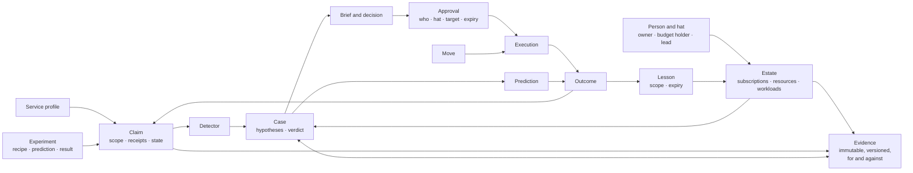
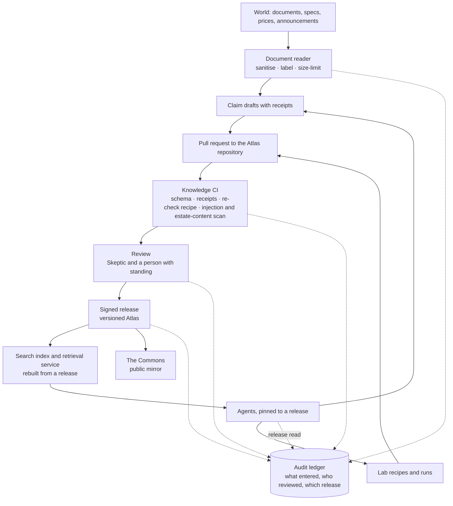

# Design 06 — Data and knowledge

> **What this answers:** *What does the system know and remember, in what shapes, where does each kind of data live, how does knowledge get in and out safely, and what does it cost to keep?*
> The information model and the knowledge pipeline are product-neutral; the physical stores are chosen in [§7](#7-the-physical-stores) from the options analysis. Part of the [design](README.md); the planes and trust zones are in [03](03-logical-architecture.md), the security controls in [07](07-security-architecture.md).

---

## 1. Six kinds of data

| Kind | Examples | Sensitivity | Shape | Lifetime |
|---|---|---|---|---|
| **World knowledge** | claims about how Azure charges, profiles, laws, Detectors, Moves, Lab recipes | public (the Commons) | small structured documents in **source control** | versioned for ever; individual claims expire and are re-checked |
| **Estate knowledge** | the Estate Model, owners, intent, rhythms, lessons, cases, Briefs, decisions | confidential, per organisation | documents with relations | per policy; lessons carry their own expiry |
| **Cost and usage data** | cost exports, price sheets, commitments, usage and metric summaries | confidential, per organisation | large, columnar, append-mostly | hot for months, cold for years; raw rarely read |
| **Experience** | predictions, experiments, outcomes, scores, the Exam and its keys | internal; keys are **restricted** | small append-only records | for ever (they are the system's memory of being right or wrong) |
| **Governance record** | approvals, executions, audit events, contract and credential changes | confidential, tamper-evident | append-only | retention set by compliance |
| **Telemetry** | traces of agent runs, model and tool calls, costs, evaluations | confidential; may contain personal data | high-volume events | short for content, long for aggregates |

Two rules cut across them. **Estate knowledge never enters the Commons**, and anything that goes there is generalised, reviewed and checked for estate content first ([Q-PRV-1](01-requirements-and-principles.md#4-quality-targets)). **Cost data is reached through a tool, not a file path**: an agent sees aggregates, samples and the answer to a typed query, never a bucket.

## 2. The information model

### The records that matter most

**Claim** — one scoped, checkable statement about Azure.

| Field | Meaning |
|---|---|
| `id`, `version`, `supersedes` | stable identity and history |
| `statement` | the claim, in one sentence |
| `scope` | service · SKU · API version · region · offer or price level · feature set · load condition · date · test environment |
| `receipts[]` | the source URL, the retrieval time, a **hash of the quoted text** and the quote — never the page |
| `evidence[]` | Lab runs: recipe id, run id, prediction and observation |
| `state` | heard · disputed · tested · mechanism-verified · replicated · commercially verified · refuted · stale · retired |
| `confidence`, `reviewers[]` | a number with its calibration record; who reviewed it, in which role |
| `recheck` | the recipe, the schedule and the triggers (a document or price change) |
| `license`, `commons_tier` | MIT or the source's terms; draft, replicated, maintained |

**Move** — a tested, versioned way to change something.

| Field | Meaning |
|---|---|
| `id`, `version`, `signature` | identity; signed by reviewers |
| `target_types`, `max_targets`, `max_value` | what it may touch, how many, how much |
| `preconditions`, `dry_run`, `guard_metrics`, `rollback`, `invariants`, `assurance_boundary`, `verification_plan` | the recipe, exactly as in [north star 05 §4](../05-recommend-act-verify.md#4-moves--tested-reusable-ways-to-change-things) |
| `required_role` | **the one narrowly scoped role** the execution identity needs — and nothing else |
| `approver_hats` | who must say yes (owner, change authority, two people for commitments) |
| `fixtures` | the Lab or Terrarium fixture that tests it |

**Detector** — a *lead generator, never a verdict*: it nominates a case and an investigator decides ([learning contract](../11-the-learning-contract.md#7-one-vocabulary)).

| Field | Meaning |
|---|---|
| `id`, `version`, `supersedes` | stable identity and history; a change is a new version, and the previous one stays available for a rollback |
| `rule`, `fixtures` | the check, written against the typed cost and usage schema, and the Terrarium or Lab cases that test it |
| `validity_domain` | where it applies: services, SKUs, regions, price levels, load conditions, dates |
| `blind_spots` | what it cannot see (consumers that leave no signal, for one), so that silence is not read as "clean" |
| `novelty_trigger` | the conditions under which it must hand the case back to a Detective instead of nominating |
| `expiry` | the date after which it is demoted unless it has been re-checked |
| `state` | drafted · back-tested · lab-tested · attacked · reviewed · shadow · active · demoted · retired |
| `depends_on` | the claims, data snapshots, tools, evaluators and credentials it rests on, named when the Detector is written: the dependency graph of [09 DR-11](09-safeguards-and-drift-controls.md#22-drift-under-us) |

A Detector is **promoted through the same CI, exam and shadow pipeline as a Move** ([10 §4](10-test-and-evaluation.md#4-release-gates)): back-tested on held-out retrospective cases, tested in the Lab, attacked with decoys and injected text, reviewed by a person with standing and by the Skeptic, then run in **shadow** on real estates, read-only, until its precision and harm record earn `active`. It is **demoted**, not edited, when its `expiry` passes, when any node in `depends_on` is invalidated (DR-11 invalidates every consumer first) or when its shadow or live record degrades; it returns to `back-tested` after repair or is `retired`, and a **rollback** re-activates the previous version through the same pipeline.

**Case and evidence** — the evidence graph: immutable, versioned records, contrary evidence kept.

| Field | Meaning |
|---|---|
| `id`, `version`, `supersedes` | a correction is a new version; nothing is edited or deleted (the writers' role can create and read, never replace or delete) |
| `case_id`, `hypothesis_ids[]` | which hypotheses the record bears on; a case id is **at most 48 characters from `[A-Za-z0-9._-]`**, because it becomes part of an orchestration instance id ([05 §4](05-agents-and-orchestration.md#4-how-the-spine-runs)) |
| `stance` | supports · contradicts · inconclusive. Contrary and negative evidence is a record like any other, and a verdict must cite the evidence *for* and *against* |
| `kind`, `receipt` | observation, claim, experiment result, objection or owner reply, with the tool, the parameter hash, the result digest and the time, so a reader can re-check it and a number can be traced to its source |
| `written_by` | agent, `prompt_hash`, alias, Atlas release |
| free-text fields | length-limited and labelled *untrusted* for whoever reads them next |

A hypothesis is a small record of its own (`statement`, `status`: open · supported · contradicted · abandoned, a prediction id). Verdicts, objections and option cards point at evidence ids, and the spine decides which ids a reader receives ([05 §1](05-agents-and-orchestration.md#1-the-pattern-a-deterministic-spine-with-agentic-leaves)).

The spine keeps one more record per case, so that a lost task hub costs nothing: a **progress record** (the workflow, the step reached, the epoch and every open timer deadline), created as a new version before each leaf call and each wait; the case's cumulative spend is its head in `budgets` ([§7.2](#72-the-operational-store-container-by-container), [05 §4](05-agents-and-orchestration.md#4-how-the-spine-runs)).

**Run records** — three small records in `cases` that make the end of a run trustworthy. The case-record facade creates them, none holds prose, and [05 §4](05-agents-and-orchestration.md#4-how-the-spine-runs) says how the spine uses them.

| Record | Created by | Holds |
|---|---|---|
| `run-registration` | the spine, before it calls a leaf | the invocation id, the workflow, the case id, the step, the epoch, the leaf's expected `azp` and the deadline: *the run the spine registered* |
| run-registry item | the leaf wrapper, **before it starts the worker**, as a conditional create keyed by the invocation id: a repeat of the call gets HTTP 409, and the wrapper returns the earlier run's id instead of starting a second worker (the Invocations adapter only echoes the id and does not deduplicate: [Learn](https://learn.microsoft.com/python/api/overview/azure/ai-agentserver-invocations-readme?view=azure-python)) | the invocation id, the caller's `azp`, the start time |
| **`run-result`** | the **worker**, as its last act, in its `finally`, **for every role**: the Conductor, the Examiner and the Forger write no other case record, so for them it is the only one | the outcome (succeeded, failed or abstained), an error code, the ids of the records written, and the binding: the caller's verified `azp`, the workflow, the case id, the step, the invocation id and the epoch; `late` when it arrived after the registered deadline |

The facade creates a run-registry item or a `run-result` **only if the caller's verified `azp` is the one the spine registered** for that invocation id and epoch, so no other leaf, and not the Brief service, can end a run that is not its own; it compares a result's receipt time with the registered deadline and stores a later one as `late`. The `run-completed` event that follows carries the same workflow, case, step, invocation id and epoch and nothing else: it is a doorbell, and the orchestrator re-reads the `run-result`.

**Approval** — the record the execution plane trusts.

| Field | Meaning |
|---|---|
| `permit` | the **Policy service's signed permit**: `permit_id`, `proposal_id`, the Move id and version, `target_hash`, `scope`, `class`, `caps`, `nonce` and `expiry`, signed with the Policy service's own key; it names the rule or the autonomy credential that covers the Move, or that a second approver is required. The hash covers the Move version, the canonical resource ids, the **ARM etags or configuration hashes of the live state**, the parameters, the price and the **policy decision id** |
| `brief_id`, `card_hash` | the Brief the approver saw, and the hash of the card as rendered |
| `human_proof[]` | one per approver (two for a purchase, a credential grant, or an irreversible Move that needs two approvers). **Web approval** (the default, and the only path for an irreversible Move, a purchase or a credential grant): the **Entra-signed ID token itself**, requested with `nonce = SHA-256(target_hash ‖ "approve" ‖ challenge)`, where the `challenge` is a random value that the Brief service creates for each approval request and keeps in it (it is not a secret); the record carries `decision: approve` and the `challenge`, and the broker and the runner **recompute the nonce** and compare it with the token's `nonce` claim, so a token obtained for any other decision, a decline for one, never verifies as an approval. **Teams card** (in place only for reversible Moves of the lowest class): the bot channel's assertion, which is not an end-to-end token. **Autonomy credential:** its id, with no person's click; the broker and the runner compare the permit and the target with the credential's **own signed grant record, read live from `controls`** (scope, cap, class, expiry, status), never with the caps that the permit or the approval states |
| `approvers[]` | what was read from the proof: the approver's **pseudonymous id**, the hat, the time and **`received_at`**, the moment the Approval service received that approver's token (the signed record carries it), and the Entra claims `iss`, `tid`, `aud`, `oid`, `iat`, `exp`, **`auth_time`** and **`amr`** — **personal data**, which is why the signed record lives in an erasable container and its claims never enter the ledger. The broker and the runner require the recomputed `nonce` to match, `iss`, `tid` and `aud` to be ours, **freshness** — `auth_time` not earlier than the creation of the approval *request* (the Brief's request time, which comes before the sign-in), and `iat` at most five minutes before `received_at`, which they compare with that **recorded moment** (allowing two minutes of clock skew) and not with their own clock, because a signed approval can wait for hours; the approval's validity window is the permit's `expiry` — `amr` to contain `mfa` (or the class's required method) and `oid` in the approver set. **`exp` is not used for freshness**, because an ID token is valid for one hour by default ([Learn](https://learn.microsoft.com/entra/identity-platform/id-tokens)); `max_age` is not used either. Where two approvers are needed, the broker also checks that the two `oid`s differ, that the two hold **different hats**, read live from the sources, and that neither is the requester or the preparer; the runner re-checks the signed record (two proofs, distinct pseudonymous ids, different hat labels, neither the requester) and the epoch |
| `approver_set_snapshot_id`, `epoch` | the human-administered groups or roles on the target that gave the approvers standing, read at the moment of approval and kept as a snapshot, and the approval epoch in force when the record was signed. **The broker reads standing live again at grant**, from the sources (Microsoft Graph); **the runner holds no Graph permission** and checks the epoch and the deny lists when it starts, so a removal after the grant is handled by the approval epoch or a deny-list entry, and Moves are minutes long. Which call gives a consistent read is *to confirm* in S-ID-3: Learn says the `ConsistencyLevel: eventual` form of the group-membership calls, which `$filter`, `$search`, `$orderby` and OData casts need, "uses an index that might not be up-to-date with recent changes to the object" ([Learn](https://learn.microsoft.com/graph/api/group-list-transitivemembers)) |
| `ledger_entry` | the entry's **ledger position**, its sequence number and block hash, which the Approval service adds to the record **under a second signature** after the Audit Writer's acknowledgement and its own read-back, and **only then enqueues the record id** ([07 §4](07-security-architecture.md#4-approvals-that-cannot-be-forged-or-reused)). It sits beside the payload of the first signature, not in it, because the entry covers the record's hash and a record cannot contain the hash of its own entry. It is a **pointer, not proof**: the broker still reads that block itself through the ledger's read-only blob endpoint and verifies its hash, the entry's signature and that the entry covers this record, **before it grants**: no entry, no grant ([§7.3](#73-the-audit-ledger)) |
| `expires`, `nonce` | one use, one window; the broker and the runner reject an expired or replayed approval |
| `signature` | made by the Approval service with its own key, verified by the broker and the runner ([07 §4](07-security-architecture.md#4-approvals-that-cannot-be-forged-or-reused)) |

`auth_time` and `amr` are documented optional claims that the app registration requests ([Learn](https://learn.microsoft.com/entra/identity-platform/optional-claims-reference), read 2026-11-01); spike **S-ID-3** asserts that both arrive for a web sign-in and for a Teams single sign-on.

**What each store keeps of an approval.** The signed record carries the approver's Entra claims, and the human's Entra-signed token with them, so it is personal data and lives in the erasable `approval-records` container ([§7.2](#72-the-operational-store-container-by-container)): deleted after its retention period and on an erasure by identity. The permanent traces hold no claim. The **ledger entry** carries the approval id, the **hash of the signed record**, the approver's **pseudonymous id**, the hat, the channel, the hash of the rendered card, the target hash, the nonce, the expiry and the producer's signature ([§7.3](#73-the-audit-ledger)); `approvals-index`, **partitioned by nonce**, carries the ids, the hashes, the state and the same pseudonymous id, for lookup and for the single-use markers, each marker signed by its producer ([§7.2](#72-the-operational-store-container-by-container)).

**Prediction** — what the system said would happen, before it happened: *target · window · counterfactual method · loss · scoring rule · distribution or interval · made by · made at · prompt, model and Atlas versions in force*. The last part is what makes a miss diagnosable.

**Lesson** — testimony, scoped and expiring: *statement · scope · who said it, in which role · evidence · expiry · corroboration · track record · **status: `draft` or `confirmed`** · who confirmed it, and when*. A lesson is a **draft** until its owner confirms it by an authenticated action ([05 §8](05-agents-and-orchestration.md#8-people-in-the-spine)); retrieval for an acting agent returns confirmed lessons only, so a draft is never an instruction, and an unconfirmed draft ages out as a "no answer".

**Method hypothesis and method proposal** — typed records that the Experimenter writes in W10 ([05 §3](05-agents-and-orchestration.md#3-the-workflows)), kept in `cases` under a case of their own. A *hypothesis* names a tactic, the stratum it should help, the comparison registered before it runs and the prediction; a *proposal* adds the patch text, the ids of the exam evidence and the baseline results. Both are data: free text is length-limited and labelled *untrusted*, and a proposal changes nothing until a person opens the pull request with the **method desk** (an engineer's command in `tools/`, under the engineer's own GitHub identity).

## 3. The knowledge pipeline

Knowledge gets into the Atlas the way code gets into a product: through review, tests and a release.

- **Agents propose; people merge.** A claim reaches a release only through a pull request that passed knowledge CI and review. Agent identities may open pull requests only to data paths (`atlas/**`); the workflows that check them run on GitHub-hosted runners with no secrets ([07 §9](07-security-architecture.md#9-supply-chain)); and no agent has write access to the release branch.
- **The index is derived.** The search index is rebuilt from a release; it is never edited. A wrong claim is fixed in source control and re-released, and the index follows.
- **Agents are pinned to an Atlas release.** An agent run records the release it read; a change of release is a release of the system and passes the gates in [design 10](10-test-and-evaluation.md#4-release-gates).
- **Revocation is a release too**: a withdrawn claim is marked, the index is rebuilt, and everything that relied on it is listed from the audit record.
- **Retrieval returns claims, not pages**, with their scope and state, so an agent cannot quote a provisional claim as if it were verified.

## 4. Cost and usage data

The system's raw material is the bill; what it needs from it is *meters, price levels and what changed*.

| Layer | What it holds | Rule |
|---|---|---|
| **Raw** | exports exactly as delivered: usage and cost in the open FOCUS shape where the agreement supports it, price sheets, reservation and savings-plan records | immutable; kept as received |
| **Curated** | conformed to one schema, with list, contracted and effective price levels, amortised and actual views, and the commitment each line drew on | rebuilt from raw by deterministic jobs |
| **Aggregates** | by meter, resource, workload, owner, day; the Unexplained Spend Ledger | what the tools mostly serve |
| **Usage signals** | per-resource **summaries** (percentiles and idle fractions per hour and day) of the metrics that matter, collected from the day an estate is connected | native retention is short (14 days of property changes, about 93 days of platform metrics), so the system **keeps its own history** and keeps *summaries*, not raw series |

Cost data is large and cold; the design therefore puts it in **columnar files in object storage**, queried by a scale-to-zero engine, and keeps the *answers* in the operational store.

## 5. Estate knowledge: privacy by design

| Concern | Design |
|---|---|
| **Personal data** | the Estate Model holds names, work addresses, roles, language and stated working hours (**contact preferences**, given by the person or their owner and never inferred from behaviour) and the text of conversations. Minimised to what the human graph needs; no home addresses, no health, no performance data. **Personal data is pseudonymised in the tool services before text reaches the hub**: a tool that returns owner names or e-mail addresses replaces them with stable pseudonyms first, so the hub's own PII screening is a second line, not the control, and the hub's `piiStateSavingEnabled` is `false` (no raw-value mapping is kept there). |
| **Purpose limitation** | personal data is used to reach the right person at the right time and for nothing else — it is never an input to evaluating a person. |
| **Retention** | conversations and Briefs: a stated period, then summarised into lessons that carry no personal text; lessons expire. |
| **Rights** | access, correction and erasure are supported **by identity** across the Estate Model, Lesson Book, Briefs, **signed approval records** and traces. The audit ledger holds **pseudonymous ids, hashes and resource ids, never names, e-mail addresses, UPNs, `oid`s, Teams ids or other Entra claims**, and its entry schema rejects them ([§7.3](#73-the-audit-ledger)); the personal data, the approvers' claims and the pseudonym-to-person mapping live in erasable stores. An erasure first revokes the person's live approvals, then deletes the mapping and the content, is itself recorded (an erasure register that every restore re-applies, [§7.6](#76-recovery)) and leaves the governance record intact. Whether pseudonymous ids that can be correlated with other logs count as anonymised, and which ground justifies keeping the approval record, are legal positions: *to confirm with counsel* ([08 §4](08-governance-and-compliance.md#4-privacy-and-gdpr)). |
| **Transparency** | every message says it is from an AI, who is accountable for it, and how to reach a person ([design 08](08-governance-and-compliance.md#2-the-eu-ai-act)). |
| **Residency** | everything stays in the tenant and the EU boundary; nothing in the Commons derives from it. In **single-tenant mode the Commons receives no counts at all**: with one organisation, a cohort of one would re-identify its estate ([Q-PRV-1](01-requirements-and-principles.md#4-quality-targets)). |

## 6. Cost of keeping knowledge

| Principle | Effect |
|---|---|
| Keep **summaries**, not raw series | metrics history costs megabytes, not terabytes |
| **Cold by default** | raw cost files and old traces move to cheaper tiers on a schedule |
| **Derived data is disposable** | indexes and aggregates can be rebuilt, so they need no backup |
| **Short life for verbose content** | prompts, completions and tool payloads in traces expire quickly; aggregates and scores last |
| **One operational store** | one serverless database for estate knowledge, experience and approvals — not one product per data kind |

## 7. The physical stores

Chosen from the [options analysis](research/options-analysis.md) and the [Foundry research](research/foundry-agent-service.md). Four rules shaped the choice. **One store per kind of guarantee, not one per kind of data** (§6). **Scale to zero wherever it exists**, because the always-on meters of a private design add up. **Every private endpoint is an hourly meter**, so accounts are shared where trust allows. **Derived data is disposable**, so it needs no backup.

### 7.1 The stores

| Store | Product | Holds | Why | Idle cost | Protection |
|---|---|---|---|---|---|
| **Operational store** | **Azure Cosmos DB for NoSQL, serverless** — one account of our own, single region, separate from Foundry's | the Estate Model, Lesson Book, cases and the **evidence graph** (case notebooks), the Agenda, the Ledger (predictions, experiments, outcomes), Brief state, the controls (kill-switch flags, revocations, the approval epoch, the deployment lock), the **budget heads and reservations** (per case, group and contract; a reservation keeps its four components — tokens, compute, screening and tools — and its epoch), the **execution-identity leases**, the erasure register, and the approval records: a permanent *index* with no name and no Entra claim, and the erasable **signed records** with the approver's claims | no minimum throughput: pay for request units used plus storage; JSON documents; change feed; Foundry's standard setup accepts serverless too | **storage only** | private endpoint; Entra data-plane roles only, **each scoped to the container** ([§7.2](#72-the-operational-store-container-by-container)), key access off, **append-only roles on evidence** (create and read, no replace or delete); **signed items where a container-level role cannot tell one item type from another** ([§7.2](#72-the-operational-store-container-by-container)); TTL on verbose records |
| **Spine state** | an **Azure Storage account** (standard general-purpose) behind the Durable Functions task hub: queues, tables, blobs | orchestration histories and instance state — ids, numbers and statuses, never prose or personal data — and the queue **`spine-signals`** (ids only), to which the case-record facade (`run-completed`) and the Brief service (`brief-answered`) send through the queue private endpoint in `snet-pe`; the spine reads it with the same queue-triggered function that reads `spine-events` | the runtime's own store; the Azure Storage provider is the lowest-cost serverless backend ([05 §4](05-agents-and-orchestration.md#4-how-the-spine-runs)); Learn notes that the legacy v1 account type can cost less for Durable Functions, so v2 stays the default until S-ORCH-1 shows v1 fits private endpoints and identity-based connections | capacity, plus the transactions of queue polling | the spine's identity alone holds the data roles; the facade and the Brief service each hold a **send-only** role scoped to the single queue `spine-signals` (queue-level scope, as for `stchain`; a condition on the queue name is the alternative: *to confirm* in S-ID-3); key access off; private endpoints for blob, queue and table; completed instances purged after 30 days; **derived and disposable** for recovery ([§7.6](#76-recovery)): what a restored spine must not lose — each case's spend, its timer deadlines and its step — is kept in `budgets` and `cases`, not here |
| **Chain queues** | a dedicated **Azure Storage account**, `stchain`, in each chain environment (ZRS; **private endpoint in `snet-pe`**, a subnet that is not delegated, because Learn says a delegated subnet "can't be used with a private endpoint" ([Learn](https://learn.microsoft.com/azure/virtual-network/subnet-delegation-overview)) and `snet-exec` is one; network security groups allow `snet-exec` and `snet-spine` to the endpoint's address on 443 only; shared-key and public access off) | the queues `dispatch`, `run` (one per Move class), `verify` and `spine-events` (chain senders only: the Approval service, the runner and the Verifier); messages carry **ids only** | the authority chain is event-driven: the broker and the runner consume queues and take no ingress, and the spine reads `spine-events` through the function that also reads `spine-signals`. The two queues live in two accounts because the reasoning plane must not hold a right in the execution account, and the chain must not hold a right on the task-hub account ([05 §4](05-agents-and-orchestration.md#4-how-the-spine-runs)) | capacity, plus transactions | Each party's role assignment is **scoped to its own queue** (queue-level scope is supported for the built-in queue data roles, [Learn](https://learn.microsoft.com/azure/storage/queues/secure-queues)); a **condition on the queue name** is the generally available alternative but covers only the five message actions; that the queue trigger and the runner job's scale rule work with a queue-scoped role carrying the least data-plane right the scaler needs is *to confirm* in S-ID-3, and one storage account per queue pair is the fallback; **not restored**: the approval epoch voids what was in flight ([§7.6](#76-recovery)) |
| **Audit ledger** | **Blob Storage, immutable (WORM) containers** — append blobs in a *locked*, time-based retention policy (`allowProtectedAppendWrites` set *before* locking), hash-chained, written by **one Audit Writer** | approvals (an id, the hash of the signed record and a pseudonymous id — never the approver's claims), executions, grants and revokes, contract and credential changes, drift findings; **every entry signed** by the service that produced it | tamper-evident at near-zero cost; modification and deletion are blocked, even for owners, during retention | capacity | locked retention; versioning; **GZRS**, which does not by itself make the secondary readable in a regional loss ([§7.6](#76-recovery)); a **daily signed digest** of the chain head anchored in a second account in a second EU region; private endpoint ([§7.3](#73-the-audit-ledger)) |
| **Recovery lake** | **Blob Storage**, immutable containers — one account in the primary region and **a second copy in a second EU region** | the hourly change-feed export of the operational store (with tombstones), daily snapshots, the erasure register, closed ledger blobs | reachable when the primary region is not: Learn says Microsoft-managed failover of geo-redundant storage happens only in catastrophic situations, so the hourly change-feed export job, which runs in `snet-aca` (*to confirm*), writes both copies itself, and that **copy process** (transfer, duration, retries, private route) is part of recovery ([§7.6](#76-recovery)) | capacity | immutable; export objects and snapshots keep a **bounded retention** (35 days by default, to be set in [08 §4.3](08-governance-and-compliance.md#43-retention)) because immutability would otherwise hold an erased person's data, and ledger copies keep the ledger's; a private endpoint in each region ([§7.6](#76-recovery)) |
| **Cost lake** | **Data Lake Storage Gen2** (Blob), Parquet | raw FOCUS exports; curated tables; aggregates; usage-signal summaries | columnar and cold; no compute at rest. A Cost Management export writes Parquet through the storage firewall's *trusted Azure services* exception, Learn's documented path ([Learn](https://learn.microsoft.com/azure/cost-management-billing/costs/tutorial-improved-exports)); whether an account with public network access **disabled** accepts the export is *to confirm*, so S-NET-2 or the onboarding acceptance test lands one export both ways and records a Policy exemption if only the trusted-services path works | capacity (cool tier for raw) | private endpoints; lifecycle rules; raw is immutable |
| **Atlas** | a **Git repository** (the source of truth) and a **derived search index** | claims, profiles, Detectors, Moves, recipes | review, versions, a public mirror; the index is rebuilt from a release | none | signed releases; knowledge CI |
| **Search** | **Azure AI Search, Basic** — the service Foundry's standard setup already requires for the **production account**; the **Atlas index is a separate index on it** if its isolation allows (spike **S-DATA-3**); *Serverless Developer* when it leaves preview | the Atlas index (vectors, keywords, semantic ranking), through Foundry IQ's generally available source kinds or direct hybrid queries; the semantic ranker depends on the region ([§7.5](#75-atlas-retrieval-and-vectors)) | a floor that is already paid | search-unit hours | private endpoint; key access off; the Atlas build job *writes* the index, so no indexer needs a private source |
| **Foundry agent data** | Foundry **standard setup**: Cosmos DB (serverless), Storage, AI Search — five Cosmos DB containers per project, each at 1,000 RU/s (serverless is supported), and **two projects per private account** (*reasoning* and *examination*) | threads and files of any prompt agent, and tests | the production default because agent data stays in our tenant, not because network isolation demands it: Learn offers a BYO virtual network with *platform-managed* data resources too, and spike **S-NET-2**, extended to production, compares the two before the stores are repeated per account | as above | customer-managed keys optional, each keyed |
| **Registry** | Azure Container Registry (Premium, for the private endpoint) | agent and service images | private image pulls for hosted agents (projects created after 25 June 2026) | the Premium floor; the alternative is deploying from source | signed images; scan in CI |
| **Secrets and signing keys** | Azure Key Vault | the contract keys; **asymmetric signing keys, one vault per signing party** — the Approval service, the Policy service, the broker, the runner, the Verifier and the Audit Writer (whose key signs the daily digest). A signing identity holds the custom role **`acia-signer`**, `keys/read` and `keys/sign/action` on its own vault only, because the built-in *Key Vault Crypto User* also holds `keys/update/action` and so could re-enable a key that the kill switch disabled. Everyone else verifies with that party's public key, read with the custom role **`acia-key-reader`** (`keys/read` only, on the producer's own vault) and pinned (spike **S-ID-3**) ([07 §4](07-security-architecture.md#4-approvals-that-cannot-be-forged-or-reused), [07 §6.1](07-security-architecture.md#61-secrets)). Learn recommends a vault per application and environment with roles assigned at vault scope and advises against key-scope assignments ([Learn](https://learn.microsoft.com/azure/key-vault/general/rbac-guide), read 2026-11-01), which is why each party has a vault of its own; rotation is one scheduled workflow | RBAC, purge protection, private endpoint, rotation | near zero | Defender for Key Vault |
| **Telemetry** | Log Analytics with per-table plans, workspace-based Application Insights; the protected `AppGenAIContent` table (preview) | traces, hub logs, detections | platform-managed; one Azure Monitor Private Link Scope | ingestion | content capture off by default; role-restricted |

### 7.2 The operational store, container by container

One account, one database, fifteen containers. Serverless has no per-container throughput to pay for, so splitting is free. (The draft's `workflow-checkpoints` container is gone: orchestration state lives in the Durable Functions task hub, [§7.1](#71-the-stores), and what must outlive that hub lives in `cases` and `budgets`.)

| Container | Partition key | Life |
|---|---|---|
| `estate-model` | `/subscriptionId` | until superseded; entries carry expiry |
| `lessons` | `/scope` | expire by design (default twelve months, renewable) |
| `cases` and `case-notes` | `/caseId` | the evidence graph: records are created, never replaced or deleted (the spine's **progress record** is a new version each time); the **run records** of [§2](#2-the-information-model) (registration, registry item, result) live here too; notes expire a year after closing |
| `agenda` | `/clock` | rolling |
| `ledger` (predictions, experiments, outcomes) | `/caseId` | for ever — the system's memory of being right or wrong |
| `briefs` | `/ownerPseudonym` | 90 days, then summarised into lessons |
| `approvals-index` | `/nonce` | for ever, because it holds no name and no Entra claim: ids, hashes, state, the approver's pseudonymous id and the single-use markers, **each signed by its producer** (the Approval service's entry, the broker's nonce and grant markers, the runner's start and done markers; whether a pseudonymous id is itself personal data is *to confirm with counsel*, [§5](#5-estate-knowledge-privacy-by-design)); the authoritative record is the audit ledger |
| `approval-records` | `/approvalId` | **erasable**: the signed record with the approver's Entra claims; deleted 90 days after it expires by default (to be set in [08 §4.3](08-governance-and-compliance.md#43-retention)) and at once on an erasure by identity (a cross-partition query on the approver's pseudonym, cheap on a container this small) |
| `controls` | `/scope` | the kill-switch and feature flags that every chain service reads with a cache of **at most 60 seconds**, and **a stale cache fails closed** (no grant, no start, no dispatch); revocations; the autonomy credentials with their live status and a **withdrawal deny list** of their own, separate from the epoch; the **approval epoch**, a time before which the broker and the runner refuse every approval ([07 §10.3](07-security-architecture.md#103-kill-switches)); the **deployment lock** item (below). **Only narrowing is unsigned here**: an item that widens authority carries the signature of the party that may widen it, and every reader verifies it (below) |
| `leases` | `/executionIdentity` | one active lease per execution identity, **signed by the broker**, which is the container's only writer: the broker takes it before it grants and deletes it after the revocation probe (it creates, replaces and deletes it), the runner only reads it and verifies its signature (its *done* marker in `approvals-index` ends the Move), and the chain verifies it. Each lease carries an expiry (the Move's longest run plus the RBAC propagation window), so a Move that never finishes cannot hold an identity for ever, and an identity whose lease lapses stays quarantined until its revocation probe passes ([07 §3.3](07-security-architecture.md#33-the-execution-identity-just-in-time-without-pim)); **not restored** |
| `budgets` | `/budgetScope` | the budget heads — one per case, one per group and contract; a head holds its limit, `spent` and `reserved`, and **may go negative**, because an actual above a reservation is debited to it and the next reservation against it is refused — and their reservations. A reservation's id is `<case id>:<step>:<epoch>:<attempt>` ([05 §4](05-agents-and-orchestration.md#4-how-the-spine-runs)); it is created, and its head patched, in one transactional batch, and it records its step's deadline, its **epoch** and its **four components**, each priced at its worst case from the price snapshot and **settled on its own**: **tokens** (by the hub's usage record), the leaf's **compute** (vCPU and GiB for the role's idle timeout), **screening** (Content Safety records) and **tools** (sandbox hours, Search queries, Functions executions), the last three by the daily Cost Management export. A component is lowered only by a matching actual; a reservation with no match stays reserved and becomes a finding; reservations expire 30 days after their last component is settled, and a case's head 30 days after the case closes |
| `erasures` | `/subjectPseudonym` | for ever: pseudonymous ids and times, no content; re-applied after every restore |
| `dead-letter` | `/workflow` | until handled |
| `drift-findings` | `/layer` | a year |

**Every role is scoped to its container.** Cosmos DB's data-plane access control scopes an assignment to the account, to a database or to **a single container** (`/dbs/<database>/colls/<container>`; [Learn](https://learn.microsoft.com/azure/cosmos-db/how-to-connect-role-based-access-control#grant-data-plane-role-based-access), read 2026-10-31), and a custom role lists only the data actions it needs ([Learn](https://learn.microsoft.com/azure/cosmos-db/reference-data-plane-security)). With key access off, **no service identity holds an account-wide or database-wide data role**, and a compromised service reaches its own containers and nothing else. The assignments that carry weight:

| Container | Write | Read |
|---|---|---|
| `approval-records` | the Approval service: create; the erasure job ([08 §4.2](08-governance-and-compliance.md#42-positions)): delete | the broker and the runner, to verify; the detection job for D13 (code, not an agent) |
| `approvals-index` | create only: the Approval service (the entry), the broker (the nonce and grant markers) and the runner (its start and done markers); **each item carries its producer's signature** | the same identities, and the spine's identity, to re-read a decision's state (the container holds no personal data); **a reader that relies on a marker verifies its signature** against the producer's pinned key first, and a marker that fails is ignored and raises D14 (the spine's re-read is informational: it changes what the spine shows, never what executes) |
| `cases`, `case-notes` | the case-record facade: create only, because a revision is a new record (the run-registry item is a conditional create keyed by the invocation id) | the facade, for the spine and the leaves |
| `budgets` | the spine's identity, its reconciler included: create a reservation, conditionally patch the head (a case's or a contract's), settle a component with its actual | the spine's identity |
| `controls` | named humans through an Entra role, who write the items that **widen** authority — an autonomy credential's grant, a flag set on, an epoch lowered — each **signed** by the party that may widen it; the kill-switch path of [07 §10.3](07-security-architecture.md#103-kill-switches), the drift controller (which withdraws automatically, [09 §3](09-safeguards-and-drift-controls.md#3-the-drift-controller)) and the deploying pipeline's identity (`deploy` for dev and test, `release` for production), who create **narrowing** items only: a deny-list entry, an epoch raised, a switch pulled, a withdrawal, a deployment lock (create only: no replace, no delete) | every chain service and the spine, with a cache of at most 60 seconds; **a reader verifies a widening item's signature** against the pinned key, and ignores a widening item that is unsigned or that the drift controller created |
| `leases` | the broker, the container's only writer: create (taking the lease is a conditional create), replace and delete (after the revocation probe); **each lease carries the broker's signature** | the runner, which only reads it (its fence token) and verifies its signature; the Audit Writer (the fence check); the deploying pipeline's identity, to see that none is held before it creates the deployment lock; the detection job for D14 |
| `ledger` (predictions, experiments, outcomes) | the case-record facade, for the leaves' predictions and experiment records (create only); the Verifier: its outcome records (create only) | the Verifier, **read-only**, which uses the role for the **predictions** it compares with what it measures; the Ledger service, for the leaves that read it |
| `erasures` | the erasure job: create only | the restore job |

**A container is the finest scope, so two rules live in the items.** Learn calls a single container "the most granular scope" for Cosmos DB's data-plane roles ([Learn](https://learn.microsoft.com/azure/cosmos-db/how-to-connect-role-based-access-control)): a role on `controls` cannot tell a deny-list entry from a credential grant, and a role on `approvals-index` cannot tell the runner's marker from the Approval service's entry. So the store cannot enforce who may write which item, and each reader enforces it by signature. **Only narrowing is unsigned.** An item in `controls` that *widens* authority — an autonomy credential's grant, a flag set on, an epoch lowered — carries the signature of the party that may widen it (the Approval service's signed record of the two named approvers for a credential; a named person's approval record for a flag), and every reader verifies that signature against the pinned key. An item that *narrows* — a deny-list entry, an epoch raised, a switch pulled — is unsigned and create-only, because forging one only stops things. The drift controller may create narrowing items only, and a widening item it creates is ignored by every reader. **The deployment lock** is a narrowing item too: the deploying pipeline's identity creates it, unsigned and create-only, with a **time-to-live of 30 minutes** so that nothing has to delete it (`controls` has TTL on with no default expiry, so only an item with its own `ttl` expires: [Learn](https://learn.microsoft.com/azure/cosmos-db/time-to-live)), as its first step after it has read `leases` and found none held in that environment; every chain service reads it with the 60-second cache (a stale cache fails closed), the broker grants and dispatches nothing while a lock item for its environment exists, and a deployment waits while a lease exists. The pipeline therefore needs create, not replace or delete, on `controls`, and a widening item it created would be ignored by every reader; the lock keeps an honest deployment from overlapping a lease and does not stop a compromised pipeline ([07 §3.3](07-security-architecture.md#33-the-execution-identity-just-in-time-without-pim)). **Every marker is signed by its producer.** Each item in `approvals-index` (the Approval service's entry, the broker's nonce and grant markers, the runner's start and done markers) and each lease in `leases` carries the signature of the party that produced it, made with the key that signs that party's ledger entries, and a reader verifies it against the pinned key before it trusts the item. A marker that fails verification is ignored and raises D14. `leases` also has a single writer, the broker, at container level.

**Single use is a create that can succeed only once.** `approvals-index` is **partitioned by nonce**, so everything about one approval sits in one logical partition. The broker consumes a nonce by creating its marker there, and the runner marks the start and the end with markers of its own; a second create of the same marker fails with HTTP 409, because an id is unique within its partition key ([Learn](https://learn.microsoft.com/rest/api/cosmos-db/http-status-codes-for-cosmosdb)), so neither identity needs a replace right. The runner's start marker records the **attempt** (`started`, attempt *n*), so a delivery that finds a start marker with no done marker reconciles the live state and the intent entries before it resumes, and does not repeat an effect ([05 §10](05-agents-and-orchestration.md#10-failure-and-degradation)). **The lease works the same way**: the broker takes it with a conditional create in `leases` before it grants, and a second create for the same execution identity fails. Every other container follows the rule: the service that owns it writes it, and nothing is assigned above container scope.

### 7.3 The audit ledger

Each entry is a JSON line carrying a sequence number, the hash of the previous entry, the hash of its payload, a pseudonymous actor id, a timestamp and **the signature of the service that produced it**. A single **Audit Writer** — the only identity with a write role on the ledger container — verifies each signature, sequences the entries, packs concurrent ones into one block and acknowledges each only after its block is appended; entries go to a day's append blob inside a container whose **retention policy is time-based and locked**. Four platform facts shape this (Learn, read 2026-10-31):

- Container-level immutability permits `Append Block` only when **`allowProtectedAppendWrites`** is enabled, and **that setting cannot be changed once the policy is locked**, so it is set *before* locking; spike **S-DATA-2** proves the appends, the rollover and the signatures on a scratch container first.
- An append blob holds **at most 50,000 blocks** (a further append fails with HTTP 409), so the writer **rolls over to a new blob well before the limit** (for example at 40,000 blocks); the new blob's first entry carries the last hash of the old one, so the chain runs across blobs.
- A blob's retention runs from its **last append**, so a day's blob stays immutable until its last entry is as old as the retention interval.
- One writer turns the chain into a sequence instead of a race, and the **append-position condition** (`x-ms-blob-condition-appendpos`) lets it tell, after a network failure, whether an append landed; a gap or a duplicate sequence number is detectable.

**Every entry is signed by its producer** — the Approval service for an approval, the Credential broker for a grant or a revoke, the Move runner for an execution step, and so on — over the canonical payload. The writer **verifies the signature against that producer's pinned public key before it sequences the entry** and refuses an entry that fails; it records the signature and does not make it. An approval's entry covers the approval id, the hash of the signed record and the pseudonymous id, never the approver's claims ([§2](#2-the-information-model)). Each producer's key lives in a vault of its own ([§7.1](#71-the-stores)). **The entry schema is closed** (`additionalProperties: false`), and a deny-pattern test **rejects** any field that holds a name, an e-mail address, a UPN, an `oid` or a Teams id — an L1 property test ([10 §2](10-test-and-evaluation.md#2-the-layers)) — because nothing can erase a locked log. **The acknowledgement is not the proof:** the broker, the runner and the Verifier proceed only after **reading their own appended block back** and matching its hash, and the broker also reads the **approval's** block, whose sequence number and hash the approval record names ([§2](#2-the-information-model)), through the ledger's read-only blob endpoint and verifies its hash, the entry's signature and that the entry covers that record **before it grants**: no entry, no grant. **The nightly verifier is a separate identity and code path from the Audit Writer**: it recomputes the chain across blobs, verifies every signature again and alerts on a break — a gap, a broken chain, a failed signature or a missing digest is detection D19 ([07 §10.2](07-security-architecture.md#102-detections-we-ship-as-code)); a **daily digest** (head hash, entry count, blob list) is signed with a Key Vault key and anchored in a second immutable account in a second EU region — in the platform's management subscription if it offers one. **Nothing changes without a ledger entry**: if the Audit Writer is unavailable, the execution plane fails closed ([03 §6](03-logical-architecture.md#6-degraded-modes)) — no approval is dispatched and no grant is made, and the signed human approvals are kept in `approval-records` and dispatched once their entry commits. The one exemption is a **rollback to the pre-state named in the signed record**, which runs from a signed outbox; the gap is flagged D19 and reconciled afterwards ([07 §3.3](07-security-architecture.md#33-the-execution-identity-just-in-time-without-pim)). **Confidential Ledger** (a standard instance costs about €103 a month; a three-node managed CCF about €289) is an optional module for organisations that need hardware-backed attestation; SQL ledger tables are the alternative if relational audit queries matter more than cost.

### 7.4 Cost data: Parquet and an embedded engine

The analytic workload is bursty — ingestion, then a few thousand typed queries a day — and mostly cold. A standing analytics cluster would cost more than the rest of the data tier together. So:

1. Cost Management **exports** (FOCUS, Parquet, daily) land in the lake, in a storage account behind a firewall.
2. The **Cost query service** runs parameterised queries in a Container Apps job (scale to zero) with an **embedded columnar engine** reading the lake in place, pruning by partition.
3. The *answers* — aggregates and the Unexplained Spend Ledger — go to the operational store; agents see only these ([§1](#1-six-kinds-of-data)).

The embedded engine is **DuckDB (MIT)**: an open-source *library*, not a Microsoft service. This is a recorded **exception to constraint C1** ([ADR-13](13-decisions.md#adr-13-cost-analytics-is-parquet-and-an-embedded-engine-in-a-job)), kept swappable behind the Cost query interface. It rests on **measured simplicity and cost**, not on exclusivity: Synapse serverless SQL reserves no idle compute either (Learn: no charge for reserved resources, only for the data processed), so spike **S-DATA-1** compares query cost, network and operational effort, and the exception record carries an owner and an expiry date ([08 §10](08-governance-and-compliance.md#10-exceptions)). **Microsoft-only fallbacks behind the same interface:** Synapse serverless SQL (per terabyte processed), Azure Data Explorer Dev/Test (a floor of about $120 a month, started by a job when a study needs it) and, for aggregates only, Azure SQL serverless. The **FinOps toolkit hubs** (version 15, *None* mode: storage plus Data Factory runs, roughly $5 per $1M monitored) are an alternative ingestion layer to evaluate against our own, also in S-DATA-1.

### 7.5 Atlas retrieval and vectors

The Atlas index is built in CI from a release, with embeddings from `acia-embed` through the hub, and lives as **a separate index on the production account's search service** (spike **S-DATA-3** confirms the isolation). Retrieval is a **Foundry IQ knowledge base** on that service, restricted to the generally available parts (minimal, extractive retrieval over search-index, Blob and web sources), or a direct hybrid query; the preview parts (LLM query planning, answer synthesis) stay off. **The semantic ranker depends on the region.** Learn's regional table (read 2026-10-31) lists none for Denmark East and lists it for Poland Central, France Central, Italy North and Sweden Central — the last flagged *in high demand, which prevents the creation of new search services*. If the service has to be created or moved, it goes to an EU region that offers the ranker (Poland Central does; a region other than the Foundry account's brings cross-region cost, per Learn's networking options), checked before creation with the regional-offerings management API (preview); if none fits, retrieval falls back to hybrid search without the ranker and the exam measures the loss ([10 §4](10-test-and-evaluation.md#4-release-gates)). Retrieval returns *claims* with scope and state, never pages. Estate and lesson recall use **Cosmos DB vector search** if a test on serverless passes, otherwise a second index on the search service (spike **S-DATA-4**). **Foundry Memory is not used.**

### 7.6 Recovery

Targets from [Q-REL-2](01-requirements-and-principles.md#4-quality-targets): approvals, audit trail and Lesson Book recoverable to within an hour; the platform to a working state within a working day. A restore must not bring back what was erased or revoked, and must not honour an approval it cannot vouch for.

| Data | How it is recovered | Notes |
|---|---|---|
| Audit ledger | WORM and **GZRS**, which protect the data but are not a path we can read during a regional loss **unless the account is RA-GZRS or fails over** (Learn: a GRS or GZRS secondary is unreadable "unless there's a failover"; customer-managed unplanned failover may lose writes since the last sync, and an immutability policy changed after that sync does not reach the secondary), so **we rely on neither**; new entries and each daily signed digest are also copied every hour to the **recovery lake in a second EU region** | a restore never rewrites the ledger: the Audit Writer starts a new blob that continues the chain from the last verified head |
| Operational store (lessons, approval index and records, Agenda, controls, budgets, erasures, cases and case notes; not `leases`) | an **hourly change-feed export** to the recovery lake, so the one-hour target does not depend on the backup mode the serverless tier offers (spike **S-DATA-5**), plus a **daily snapshot** of each container; every export object carries a watermark | restore by snapshot, then replay in watermark order. The default (latest-version) change feed misses deletes and intermediate versions, so every delete is written as a **tombstone** (`deleted: true`, with a TTL longer than the export's retention); the all-versions-and-deletes mode is preview and needs continuous backup, so nothing relies on it |
| Spine state (the task hub) | **not restored**: a new, empty task hub is created, and the restore **re-opens each open case as `<workflow>:<case id>:<epoch>`** with its **spend and its timer deadlines rebuilt from the case store** (the case's head in `budgets`, the progress record in `cases`) | the histories are derived. A deterministic instance id makes a replay idempotent on the *same* hub only; across a restore it is the **keys on every effect** that let a re-opened step find what the first run did, all but the reservation id, which carries the epoch: the old epoch's reservations stay in `budgets`, so a restore double-reserves, which is safe. A leaf of the old epoch that is still running ends with a `run-result` and an event that carry the old epoch: the event is discarded and logged, and the result is kept, as `late` once its deadline has passed ([05 §4](05-agents-and-orchestration.md#4-how-the-spine-runs)) |
| Leases and queues | **not restored**: `leases` starts empty, the queues in `stchain` are recreated and `spine-signals` comes back with the new task-hub account; every execution identity starts **quarantined** until its revocation probe passes | a message lost is not a change lost: the approval epoch voids every approval that was in flight, a lost `run-completed` costs a deadline tick, and a Move dispatched with no ledger entry is reconciled against the live state |
| Estate Model | rebuilt from the estates and the directory | derived; erased people are not re-created, because the erasure register is re-applied |
| Cost lake | raw exports can be requested again for past periods (to confirm); aggregates are rebuilt | derived |
| Atlas | Git; the index is rebuilt | derived |
| Everything else | redeployed from code ([11](11-delivery-and-operations.md)) | a restore drill each month |

**Restore order.**

1. Redeploy the infrastructure and the spine with **every contract suspended and the execution plane in its kill-switch state**: a restore never starts agents or Moves by itself.
2. Verify the **ledger** — the chain across blobs, every signature and the daily digests from the second account — and take its head.
3. Restore `controls` first and **keep every revocation**: the union of those in the export and in the ledger wins, so a suspension, a revoked Move or a kill-switch flag is never rolled back.
4. Restore the other containers (not `leases`, which starts empty) from the latest snapshot, replay the export in watermark order, then **re-apply the tombstones and the erasure register**, so erased data is not resurrected.
5. **Raise the approval epoch** in `controls` to the time of the restore ([07 §10.3](07-security-architecture.md#103-kill-switches)): the broker and the runner read it and refuse every approval signed before it, so **an older approval is invalid** and is requested again if it still matters — its single-use marker may have been created after the last export, and an older approval is uncertain by definition.
6. Re-open each open case from the case store under a new instance id, `<workflow>:<case id>:<epoch>`, with its spend and its deadlines rebuilt; a Move that was dispatched with no matching ledger entry is **reconciled against the live state** before anything is dispatched again. Lift the suspensions last: contracts, then agents, then the execution plane.

**The copy process is part of recovery.** The hourly change-feed export and the copy to the second region are **one job of our own, which runs in `snet-aca`** (*to confirm*): it reads the change feed, writes the primary copy through the lake's private endpoint in `snet-pe` and the second copy through the second-region account's private endpoint in that region's own subnet, and stamps each object with a **watermark**; the daily digests travel the same way. The transfer between regions is billed per gigabyte ([12 §2](12-cost-and-finops.md#2-the-results)). The recovery point is **the age of the second-region watermark**, measured **including the job's duration and its retries**, not the schedule: the monthly drill fails if that age exceeds the one-hour target. The route needs a peering between the two networks and a private DNS zone, `privatelink.blob.core.windows.net`, linked to both, because peering does not carry DNS; both are specified in [04 §6](04-landing-zone-and-citadel.md#6-network), and the regional-failure drill resolves and reaches the account with the primary endpoint blocked.

The monthly drill walks this order, and a regional-failure drill uses the second-region copies ([11 §8](11-delivery-and-operations.md#8-resilience-and-recovery)).
