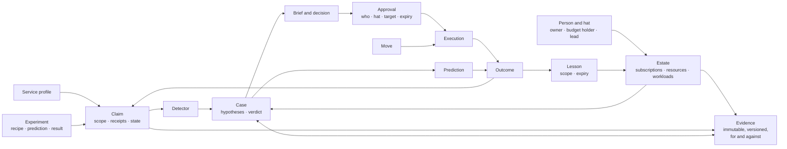
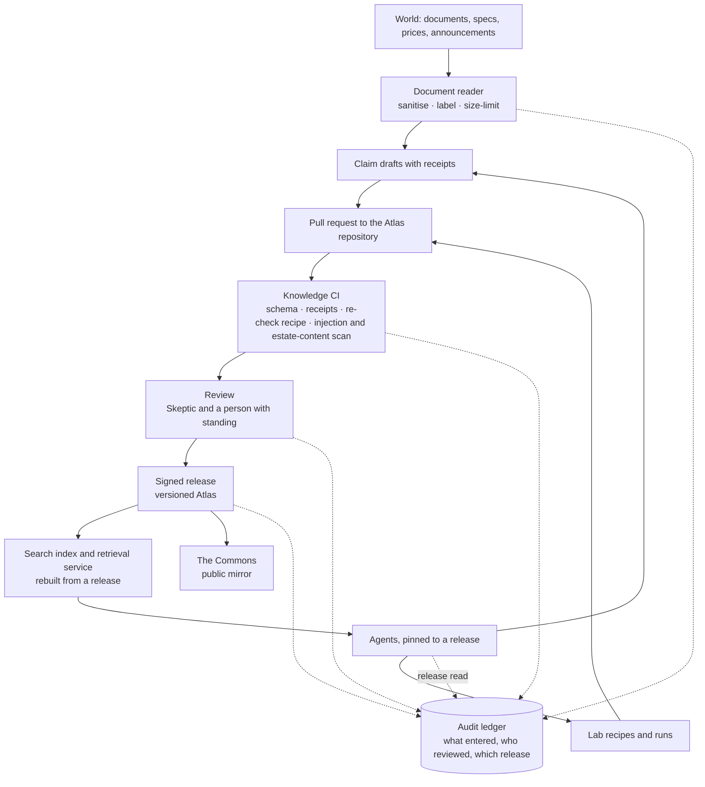

# Design 06 — Data and knowledge

> **What this answers:** *What does the system know and remember, in what shapes, where does each kind of data live, how does knowledge get in and out safely, and what does it cost to keep?*
> The information model and the knowledge pipeline are product-neutral; the physical stores are chosen in [§7](#7-the-physical-stores) from the options analysis. Part of the [design](README.md); the planes and trust zones are in [03](03-logical-architecture.md), the security controls in [07](07-security-architecture.md).

---

## 1. Six kinds of data

| Kind | Examples | Sensitivity | Shape | Lifetime |
|---|---|---|---|---|
| **World knowledge** | claims about how Azure charges, profiles, laws, Detectors, Moves, Lab recipes | public (the Commons) | small structured documents in **source control** | versioned for ever; individual claims expire and are re-checked |
| **Estate knowledge** | the Estate Model, owners, intent, rhythms, lessons, cases, Briefs, decisions | confidential, per organisation | documents with relations | per policy; lessons carry their own expiry |
| **Cost and usage data** | cost exports, price sheets, commitments, usage and metric summaries | confidential, per organisation | large, columnar, append-mostly | hot for months, cold for years; raw rarely read |
| **Experience** | predictions, experiments, outcomes, scores, the Exam and its keys | internal; keys are **restricted** | small append-only records | for ever (they are the system's memory of being right or wrong) |
| **Governance record** | approvals, executions, audit events, contract and credential changes | confidential, tamper-evident | append-only | retention set by compliance |
| **Telemetry** | traces of agent runs, model and tool calls, costs, evaluations | confidential; may contain personal data | high-volume events | short for content, long for aggregates |

Two rules cut across them. **Estate knowledge never enters the Commons**, and anything that goes there is generalised, reviewed and checked for estate content first ([Q-PRV-1](01-requirements-and-principles.md#4-quality-targets)). **Cost data is reached through a tool, not a file path**: an agent sees aggregates, samples and the answer to a typed query, never a bucket.

## 2. The information model

### The records that matter most

**Claim** — one scoped, checkable statement about Azure.

| Field | Meaning |
|---|---|
| `id`, `version`, `supersedes` | stable identity and history |
| `statement` | the claim, in one sentence |
| `scope` | service · SKU · API version · region · offer or price level · feature set · load condition · date · test environment |
| `receipts[]` | the source URL, the retrieval time, a **hash of the quoted text** and the quote — never the page |
| `evidence[]` | Lab runs: recipe id, run id, prediction and observation |
| `state` | heard · disputed · tested · mechanism-verified · replicated · commercially verified · refuted · stale · retired |
| `confidence`, `reviewers[]` | a number with its calibration record; who reviewed it, in which role |
| `recheck` | the recipe, the schedule and the triggers (a document or price change) |
| `license`, `commons_tier` | MIT or the source's terms; draft, replicated, maintained |

**Move** — a tested, versioned way to change something.

| Field | Meaning |
|---|---|
| `id`, `version`, `signature` | identity; signed by reviewers |
| `target_types`, `max_targets`, `max_value` | what it may touch, how many, how much |
| `preconditions`, `dry_run`, `guard_metrics`, `rollback`, `invariants`, `assurance_boundary`, `verification_plan` | the recipe, exactly as in [north star 05 §4](../05-recommend-act-verify.md#4-moves--tested-reusable-ways-to-change-things) |
| `required_role` | **the one narrowly scoped role** the execution identity needs — and nothing else |
| `approver_hats` | who must say yes (owner, change authority, two people for commitments) |
| `fixtures` | the Lab or Terrarium fixture that tests it |

**Case and evidence** — the evidence graph: immutable, versioned records, contrary evidence kept.

| Field | Meaning |
|---|---|
| `id`, `version`, `supersedes` | a correction is a new version; nothing is edited or deleted (the writers' role can create and read, never replace or delete) |
| `case_id`, `hypothesis_ids[]` | which hypotheses the record bears on |
| `stance` | supports · contradicts · inconclusive. Contrary and negative evidence is a record like any other, and a verdict must cite the evidence *for* and *against* |
| `kind`, `receipt` | observation, claim, experiment result, objection or owner reply, with the tool, the parameter hash, the result digest and the time, so a reader can re-check it and a number can be traced to its source |
| `written_by` | agent, `prompt_hash`, alias, Atlas release |
| free-text fields | length-limited and labelled *untrusted* for whoever reads them next |

A hypothesis is a small record of its own (`statement`, `status`: open · supported · contradicted · abandoned, a prediction id). Verdicts, objections and option cards point at evidence ids, and the spine decides which ids a reader receives ([05 §1](05-agents-and-orchestration.md#1-the-pattern-a-deterministic-spine-with-agentic-leaves)).

**Approval** — the record the execution plane trusts.

| Field | Meaning |
|---|---|
| `brief_id`, `move_id@version`, `target_hash` | exactly what was approved: the hash covers the Move version, the canonical resource ids, the **ARM etags or configuration hashes of the live state**, the parameters, the price and the **policy decision id** |
| `approvers[]` | the approver's **pseudonymous id**, the hat and the time, and the Entra identity claims (`oid`, `tid`, `amr`, `auth_time`) — **personal data**, which is why the signed record lives in an erasable container and its claims never enter the ledger; standing comes only from human-administered groups or roles on the target |
| `expires`, `nonce` | one use, one window; the broker and the runner reject an expired or replayed approval |
| `policy_decision` | which credential or rule covered it, or that a second approver was required |
| `signature` | made by the Approval service with its Key Vault key, verified by the broker and the runner ([07 §4](07-security-architecture.md#4-approvals-that-cannot-be-forged-or-reused)) |

**What each store keeps of an approval.** The signed record carries the approver's Entra claims, so it is personal data and lives in the erasable `approval-records` container ([§7.2](#72-the-operational-store-container-by-container)): deleted after its retention period and on an erasure by identity. The permanent traces hold no claim. The **ledger entry** carries the approval id, the **hash of the signed record**, the approver's **pseudonymous id**, the hat, the channel, the hash of the rendered card, the target hash, the nonce, the expiry and the producer's signature ([§7.3](#73-the-audit-ledger)); `approvals-index` carries the ids, the hashes, the state and the same pseudonymous id, for lookup and for the single-use markers.

**Prediction** — what the system said would happen, before it happened: *target · window · counterfactual method · loss · scoring rule · distribution or interval · made by · made at · prompt, model and Atlas versions in force*. The last part is what makes a miss diagnosable.

**Lesson** — testimony, scoped and expiring: *statement · scope · who said it, in which role · evidence · expiry · corroboration · track record · **status: `draft` or `confirmed`** · who confirmed it, and when*. A lesson is a **draft** until its owner confirms it by an authenticated action ([05 §8](05-agents-and-orchestration.md#8-people-in-the-spine)); retrieval for an acting agent returns confirmed lessons only, so a draft is never an instruction, and an unconfirmed draft ages out as a "no answer".

## 3. The knowledge pipeline

Knowledge gets into the Atlas the way code gets into a product: through review, tests and a release.

- **Agents propose; people merge.** A claim reaches a release only through a pull request that passed knowledge CI and review. Agent identities may open pull requests only to data paths (`atlas/**`); the workflows that check them run on GitHub-hosted runners with no secrets ([07 §9](07-security-architecture.md#9-supply-chain)); and no agent has write access to the release branch.
- **The index is derived.** The search index is rebuilt from a release; it is never edited. A wrong claim is fixed in source control and re-released, and the index follows.
- **Agents are pinned to an Atlas release.** An agent run records the release it read; a change of release is a release of the system and passes the gates in [design 10](10-test-and-evaluation.md#4-release-gates).
- **Revocation is a release too**: a withdrawn claim is marked, the index is rebuilt, and everything that relied on it is listed from the audit record.
- **Retrieval returns claims, not pages**, with their scope and state, so an agent cannot quote a provisional claim as if it were verified.

## 4. Cost and usage data

The system's raw material is the bill; what it needs from it is *meters, price levels and what changed*.

| Layer | What it holds | Rule |
|---|---|---|
| **Raw** | exports exactly as delivered: usage and cost in the open FOCUS shape where the agreement supports it, price sheets, reservation and savings-plan records | immutable; kept as received |
| **Curated** | conformed to one schema, with list, contracted and effective price levels, amortised and actual views, and the commitment each line drew on | rebuilt from raw by deterministic jobs |
| **Aggregates** | by meter, resource, workload, owner, day; the Unexplained Spend Ledger | what the tools mostly serve |
| **Usage signals** | per-resource **summaries** (percentiles and idle fractions per hour and day) of the metrics that matter, collected from the day an estate is connected | native retention is short (14 days of property changes, about 93 days of platform metrics), so the system **keeps its own history** and keeps *summaries*, not raw series |

Cost data is large and cold; the design therefore puts it in **columnar files in object storage**, queried by a scale-to-zero engine, and keeps the *answers* in the operational store.

## 5. Estate knowledge: privacy by design

| Concern | Design |
|---|---|
| **Personal data** | the Estate Model holds names, work addresses, roles, language and stated working hours (**contact preferences**, given by the person or their owner and never inferred from behaviour) and the text of conversations. Minimised to what the human graph needs; no home addresses, no health, no performance data. **Personal data is pseudonymised in the tool services before text reaches the hub**: a tool that returns owner names or e-mail addresses replaces them with stable pseudonyms first, so the hub's own PII screening is a second line, not the control, and the hub's `piiStateSavingEnabled` is `false` (no raw-value mapping is kept there). |
| **Purpose limitation** | personal data is used to reach the right person at the right time and for nothing else — it is never an input to evaluating a person. |
| **Retention** | conversations and Briefs: a stated period, then summarised into lessons that carry no personal text; lessons expire. |
| **Rights** | access, correction and erasure are supported **by identity** across the Estate Model, Lesson Book, Briefs, **signed approval records** and traces. The audit ledger holds **pseudonymous ids, hashes and resource ids, never names, addresses or Entra claims**; the personal data, the approvers' claims and the pseudonym-to-person mapping live in erasable stores. An erasure first revokes the person's live approvals, then deletes the mapping and the content, is itself recorded (an erasure register that every restore re-applies, [§7.6](#76-recovery)) and leaves the governance record intact. Whether pseudonymous ids that can be correlated with other logs count as anonymised, and which ground justifies keeping the approval record, are legal positions: *to confirm with counsel* ([08 §4](08-governance-and-compliance.md#4-privacy-and-gdpr)). |
| **Transparency** | every message says it is from an AI, who is accountable for it, and how to reach a person ([design 08](08-governance-and-compliance.md#2-the-eu-ai-act)). |
| **Residency** | everything stays in the tenant and the EU boundary; nothing in the Commons derives from it. In **single-tenant mode the Commons receives no counts at all**: with one organisation, a cohort of one would re-identify its estate ([Q-PRV-1](01-requirements-and-principles.md#4-quality-targets)). |

## 6. Cost of keeping knowledge

| Principle | Effect |
|---|---|
| Keep **summaries**, not raw series | metrics history costs megabytes, not terabytes |
| **Cold by default** | raw cost files and old traces move to cheaper tiers on a schedule |
| **Derived data is disposable** | indexes and aggregates can be rebuilt, so they need no backup |
| **Short life for verbose content** | prompts, completions and tool payloads in traces expire quickly; aggregates and scores last |
| **One operational store** | one serverless database for estate knowledge, experience and approvals — not one product per data kind |

## 7. The physical stores

Chosen from the [options analysis](research/options-analysis.md) and the [Foundry research](research/foundry-agent-service.md). Four rules shaped the choice. **One store per kind of guarantee, not one per kind of data** (§6). **Scale to zero wherever it exists**, because the always-on meters of a private design add up. **Every private endpoint is an hourly meter**, so accounts are shared where trust allows. **Derived data is disposable**, so it needs no backup.

### 7.1 The stores

| Store | Product | Holds | Why | Idle cost | Protection |
|---|---|---|---|---|---|
| **Operational store** | **Azure Cosmos DB for NoSQL, serverless** — one account of our own, single region, separate from Foundry's | the Estate Model, Lesson Book, cases and the **evidence graph** (case notebooks), the Agenda, the Ledger (predictions, experiments, outcomes), Brief state, the controls (kill-switch flags, revocations, the approval epoch), **budget reservations**, the erasure register, and the approval records: a permanent *index* with no name and no Entra claim, and the erasable **signed records** with the approver's claims | no minimum throughput: pay for request units used plus storage; JSON documents; change feed; Foundry's standard setup accepts serverless too | **storage only** | private endpoint; Entra data-plane roles only, **each scoped to the container** ([§7.2](#72-the-operational-store-container-by-container)), key access off, **append-only roles on evidence** (create and read, no replace or delete); TTL on verbose records |
| **Spine state** | an **Azure Storage account** (standard general-purpose) behind the Durable Functions task hub: queues, tables, blobs | orchestration histories and instance state — ids, numbers and statuses, never prose or personal data | the runtime's own store; the Azure Storage provider is the lowest-cost serverless backend ([05 §4](05-agents-and-orchestration.md#4-how-the-spine-runs)); Learn notes that the legacy v1 account type can cost less for Durable Functions, so v2 stays the default until S-ORCH-1 shows v1 fits private endpoints and identity-based connections | capacity, plus the transactions of queue polling | the spine's identity alone holds the data roles; key access off; private endpoints for blob, queue and table; completed instances purged after 30 days; **derived and disposable** for recovery ([§7.6](#76-recovery)) |
| **Audit ledger** | **Blob Storage, immutable (WORM) containers** — append blobs in a *locked*, time-based retention policy (`allowProtectedAppendWrites` set *before* locking), hash-chained, written by **one Audit Writer** | approvals (an id, the hash of the signed record and a pseudonymous id — never the approver's claims), executions, grants and revokes, contract and credential changes, drift findings; **every entry signed** by the service that produced it | tamper-evident at near-zero cost; modification and deletion are blocked, even for owners, during retention | capacity | locked retention; versioning; geo-zone redundancy; a **daily signed digest** of the chain head anchored in a second account in a second EU region; private endpoint ([§7.3](#73-the-audit-ledger)) |
| **Recovery lake** | **Blob Storage**, immutable containers — one account in the primary region and **a second copy in a second EU region** | the hourly change-feed export of the operational store (with tombstones), daily snapshots, the erasure register, closed ledger blobs | reachable when the primary region is not: Learn says Microsoft-managed failover of geo-redundant storage happens only in catastrophic situations, so the export job writes both copies itself | capacity | immutable; export objects and snapshots keep a **bounded retention** (35 days by default, to be set in [08 §4.3](08-governance-and-compliance.md#43-retention)) because immutability would otherwise hold an erased person's data, and ledger copies keep the ledger's; a private endpoint in each region ([§7.6](#76-recovery)) |
| **Cost lake** | **Data Lake Storage Gen2** (Blob), Parquet | raw FOCUS exports; curated tables; aggregates; usage-signal summaries | columnar and cold; Cost Management exports write Parquet to firewalled storage; no compute at rest | capacity (cool tier for raw) | private endpoints; lifecycle rules; raw is immutable |
| **Atlas** | a **Git repository** (the source of truth) and a **derived search index** | claims, profiles, Detectors, Moves, recipes | review, versions, a public mirror; the index is rebuilt from a release | none | signed releases; knowledge CI |
| **Search** | **Azure AI Search, Basic** — the service Foundry's standard setup already requires for the **production account**; the **Atlas index is a separate index on it** if its isolation allows (spike **S-DATA-3**); *Serverless Developer* when it leaves preview | the Atlas index (vectors, keywords, semantic ranking), through Foundry IQ's generally available source kinds or direct hybrid queries; the semantic ranker depends on the region ([§7.5](#75-atlas-retrieval-and-vectors)) | a floor that is already paid | search-unit hours | private endpoint; key access off; the Atlas build job *writes* the index, so no indexer needs a private source |
| **Foundry agent data** | Foundry **standard setup**: Cosmos DB (serverless), Storage, AI Search — five Cosmos DB containers per project, each at 1,000 RU/s (serverless is supported), and **two projects per private account** (*reasoning* and *examination*) | threads and files of any prompt agent, and tests | the production default because agent data stays in our tenant, not because network isolation demands it: Learn offers a BYO virtual network with *platform-managed* data resources too, and spike **S-NET-2**, extended to production, compares the two before the stores are repeated per account | as above | customer-managed keys optional, each keyed |
| **Registry** | Azure Container Registry (Premium, for the private endpoint) | agent and service images | private image pulls for hosted agents (projects created after 25 June 2026) | the Premium floor; the alternative is deploying from source | signed images; scan in CI |
| **Secrets and signing keys** | Azure Key Vault | the contract keys; **asymmetric signing keys, one per signing service** — the approval-signing key (a vault of its own; only the Approval service may use it), the **entry-signing key of every other service that appends to the ledger**, and the Audit Writer's digest key; everyone else verifies with the pinned public key and holds no vault permission ([07 §4](07-security-architecture.md#4-approvals-that-cannot-be-forged-or-reused), [07 §6.1](07-security-architecture.md#61-secrets)). Where each producer's entry key lives is *to confirm* in spike **S-ID-3**: Learn discourages key-scoped role assignments, so a key that one service alone may use needs a vault of its own | RBAC, purge protection, private endpoint, rotation | near zero | Defender for Key Vault |
| **Telemetry** | Log Analytics with per-table plans, workspace-based Application Insights; the protected `AppGenAIContent` table (preview) | traces, hub logs, detections | platform-managed; one Azure Monitor Private Link Scope | ingestion | content capture off by default; role-restricted |

### 7.2 The operational store, container by container

One account, one database, fourteen containers. Serverless has no per-container throughput to pay for, so splitting is free. (The draft's `workflow-checkpoints` container is gone: orchestration state lives in the Durable Functions task hub, [§7.1](#71-the-stores).)

| Container | Partition key | Life |
|---|---|---|
| `estate-model` | `/subscriptionId` | until superseded; entries carry expiry |
| `lessons` | `/scope` | expire by design (default twelve months, renewable) |
| `cases` and `case-notes` | `/caseId` | the evidence graph: records are created, never replaced or deleted; notes expire a year after closing |
| `agenda` | `/clock` | rolling |
| `ledger` (predictions, experiments, outcomes) | `/caseId` | for ever — the system's memory of being right or wrong |
| `briefs` | `/ownerPseudonym` | 90 days, then summarised into lessons |
| `approvals-index` | `/approvalId` | for ever, because it holds no name and no Entra claim: ids, hashes, state, the approver's pseudonymous id and the single-use markers (whether a pseudonymous id is itself personal data is *to confirm with counsel*, [§5](#5-estate-knowledge-privacy-by-design)); the authoritative record is the audit ledger |
| `approval-records` | `/approvalId` | **erasable**: the signed record with the approver's Entra claims; deleted 90 days after it expires by default (to be set in [08 §4.3](08-governance-and-compliance.md#43-retention)) and at once on an erasure by identity (a cross-partition query on the approver's pseudonym, cheap on a container this small) |
| `controls` | `/scope` | the kill-switch and feature flags the services read with a short cache; revocations; the **approval epoch**, a time before which the broker and the runner refuse every approval ([07 §10.3](07-security-architecture.md#103-kill-switches)) |
| `budgets` | `/budgetScope` | the budget heads and their reservations (a reservation is created and its head patched in one transactional batch); reservations expire 30 days after reconciliation |
| `erasures` | `/subjectPseudonym` | for ever: pseudonymous ids and times, no content; re-applied after every restore |
| `dead-letter` | `/workflow` | until handled |
| `drift-findings` | `/layer` | a year |

**Every role is scoped to its container.** Cosmos DB's data-plane access control scopes an assignment to the account, to a database or to **a single container** (`/dbs/<database>/colls/<container>`; [Learn](https://learn.microsoft.com/azure/cosmos-db/how-to-connect-role-based-access-control#grant-data-plane-role-based-access), read 2026-10-31), and a custom role lists only the data actions it needs ([Learn](https://learn.microsoft.com/azure/cosmos-db/reference-data-plane-security)). With key access off, **no service identity holds an account-wide or database-wide data role**, and a compromised service reaches its own containers and nothing else. The assignments that carry weight:

| Container | Write | Read |
|---|---|---|
| `approval-records` | the Approval service: create; the erasure job ([08 §4.2](08-governance-and-compliance.md#42-positions)): delete | the broker and the runner, to verify; the detection job for D13 (code, not an agent) |
| `approvals-index` | create only: the Approval service (the entry), the broker and the runner (their single-use markers) | the same identities |
| `cases`, `case-notes` | the case-record facade: create only, because a revision is a new record | the facade, for the spine and the leaves |
| `budgets` | the spine's identity: create a reservation, conditionally patch the head | the spine's identity |
| `controls` | the kill-switch path of [07 §10.3](07-security-architecture.md#103-kill-switches) | every service, with a short cache |
| `erasures` | the erasure job: create only | the restore job |

**Single use is a create that can succeed only once.** The broker consumes a nonce by creating a marker whose id is the nonce, and the runner marks the start the same way; a second create with that id fails with HTTP 409, because an id is unique within its partition key ([Learn](https://learn.microsoft.com/rest/api/cosmos-db/http-status-codes-for-cosmosdb)), so neither identity needs a replace right. Every other container follows the rule: the service that owns it writes it, and nothing is assigned above container scope.

### 7.3 The audit ledger

Each entry is a JSON line carrying a sequence number, the hash of the previous entry, the hash of its payload, a pseudonymous actor id, a timestamp and **the signature of the service that produced it**. A single **Audit Writer** — the only identity with a write role on the ledger container — verifies each signature, sequences the entries, packs concurrent ones into one block and acknowledges each only after its block is appended; entries go to a day's append blob inside a container whose **retention policy is time-based and locked**. Four platform facts shape this (Learn, read 2026-10-31):

- Container-level immutability permits `Append Block` only when **`allowProtectedAppendWrites`** is enabled, and **that setting cannot be changed once the policy is locked**, so it is set *before* locking; spike **S-DATA-2** proves the appends, the rollover and the signatures on a scratch container first.
- An append blob holds **at most 50,000 blocks** (a further append fails with HTTP 409), so the writer **rolls over to a new blob well before the limit** (for example at 40,000 blocks); the new blob's first entry carries the last hash of the old one, so the chain runs across blobs.
- A blob's retention runs from its **last append**, so a day's blob stays immutable until its last entry is as old as the retention interval.
- One writer turns the chain into a sequence instead of a race, and the **append-position condition** (`x-ms-blob-condition-appendpos`) lets it tell, after a network failure, whether an append landed; a gap or a duplicate sequence number is detectable.

**Every entry is signed by its producer** — the Approval service for an approval, the Credential broker for a grant or a revoke, the Move runner for an execution step, and so on — over the canonical payload. The writer **verifies the signature against that producer's pinned public key before it sequences the entry** and refuses an entry that fails; it records the signature and does not make it. An approval's entry covers the approval id, the hash of the signed record and the pseudonymous id, never the approver's claims ([§2](#2-the-information-model)). Where each producer's key lives is *to confirm* ([§7.1](#71-the-stores)). **A nightly job recomputes the chain across blobs, verifies every signature again and alerts on a break** — a gap, a broken chain, a failed signature or a missing digest is detection D19 ([07 §10.2](07-security-architecture.md#102-detections-we-ship-as-code)); a **daily digest** (head hash, entry count, blob list) is signed with a Key Vault key and anchored in a second immutable account in a second EU region — in the platform's management subscription if it offers one. **Nothing changes without a ledger entry**: if the Audit Writer is unavailable, the execution plane fails closed ([03 §6](03-logical-architecture.md#6-degraded-modes)). **Confidential Ledger** (a standard instance costs about €103 a month; a three-node managed CCF about €289) is an optional module for organisations that need hardware-backed attestation; SQL ledger tables are the alternative if relational audit queries matter more than cost.

### 7.4 Cost data: Parquet and an embedded engine

The analytic workload is bursty — ingestion, then a few thousand typed queries a day — and mostly cold. A standing analytics cluster would cost more than the rest of the data tier together. So:

1. Cost Management **exports** (FOCUS, Parquet, daily) land in the lake, in a storage account behind a firewall.
2. The **Cost query service** runs parameterised queries in a Container Apps job (scale to zero) with an **embedded columnar engine** reading the lake in place, pruning by partition.
3. The *answers* — aggregates and the Unexplained Spend Ledger — go to the operational store; agents see only these ([§1](#1-six-kinds-of-data)).

The embedded engine is **DuckDB (MIT)**: an open-source *library*, not a Microsoft service. This is a recorded **exception to constraint C1** ([ADR-13](13-decisions.md#adr-13-cost-analytics-is-parquet-and-an-embedded-engine-in-a-job)), kept swappable behind the Cost query interface. It rests on **measured simplicity and cost**, not on exclusivity: Synapse serverless SQL reserves no idle compute either (Learn: no charge for reserved resources, only for the data processed), so spike **S-DATA-1** compares query cost, network and operational effort, and the exception record carries an owner and an expiry date ([08 §10](08-governance-and-compliance.md#10-exceptions)). **Microsoft-only fallbacks behind the same interface:** Synapse serverless SQL (per terabyte processed), Azure Data Explorer Dev/Test (a floor of about $120 a month, started by a job when a study needs it) and, for aggregates only, Azure SQL serverless. The **FinOps toolkit hubs** (version 15, *None* mode: storage plus Data Factory runs, roughly $5 per $1M monitored) are an alternative ingestion layer to evaluate against our own, also in S-DATA-1.

### 7.5 Atlas retrieval and vectors

The Atlas index is built in CI from a release, with embeddings from `acia-embed` through the hub, and lives as **a separate index on the production account's search service** (spike **S-DATA-3** confirms the isolation). Retrieval is a **Foundry IQ knowledge base** on that service, restricted to the generally available parts (minimal, extractive retrieval over search-index, Blob and web sources), or a direct hybrid query; the preview parts (LLM query planning, answer synthesis) stay off. **The semantic ranker depends on the region.** Learn's regional table (read 2026-10-31) lists none for Denmark East and lists it for Poland Central, France Central, Italy North and Sweden Central — the last flagged *in high demand, which prevents the creation of new search services*. If the service has to be created or moved, it goes to an EU region that offers the ranker (Poland Central does; a region other than the Foundry account's brings cross-region cost, per Learn's networking options), checked before creation with the regional-offerings management API (preview); if none fits, retrieval falls back to hybrid search without the ranker and the exam measures the loss ([10 §4](10-test-and-evaluation.md#4-release-gates)). Retrieval returns *claims* with scope and state, never pages. Estate and lesson recall use **Cosmos DB vector search** if a test on serverless passes, otherwise a second index on the search service (spike **S-DATA-4**). **Foundry Memory is not used.**

### 7.6 Recovery

Targets from [Q-REL-2](01-requirements-and-principles.md#4-quality-targets): approvals, audit trail and Lesson Book recoverable to within an hour; the platform to a working state within a working day. A restore must not bring back what was erased or revoked, and must not honour an approval it cannot vouch for.

| Data | How it is recovered | Notes |
|---|---|---|
| Audit ledger | WORM and geo-zone redundancy, which protect the data but are not a path we can read from during a regional loss; new entries and each daily signed digest are also copied every hour to the **recovery lake in a second EU region** | a restore never rewrites the ledger: the Audit Writer starts a new blob that continues the chain from the last verified head |
| Operational store (lessons, approval index and records, Agenda, controls, budgets, erasures, case notes) | an **hourly change-feed export** to the recovery lake, so the one-hour target does not depend on the backup mode the serverless tier offers (spike **S-DATA-5**), plus a **daily snapshot** of each container; every export object carries a watermark | restore by snapshot, then replay in watermark order. The default (latest-version) change feed misses deletes and intermediate versions, so every delete is written as a **tombstone** (`deleted: true`, with a TTL longer than the export's retention); the all-versions-and-deletes mode is preview and needs continuous backup, so nothing relies on it |
| Spine state (the task hub) | **not restored**: a new task hub is created and the open cases are re-opened from the case store | histories are derived; effects carry keys, so a re-opened step finds what the first run did ([05 §4](05-agents-and-orchestration.md#4-how-the-spine-runs)) |
| Estate Model | rebuilt from the estates and the directory | derived; erased people are not re-created, because the erasure register is re-applied |
| Cost lake | raw exports can be requested again for past periods (to confirm); aggregates are rebuilt | derived |
| Atlas | Git; the index is rebuilt | derived |
| Everything else | redeployed from code ([11](11-delivery-and-operations.md)) | a restore drill each month |

**Restore order.**

1. Redeploy the infrastructure and the spine with **every contract suspended and the execution plane in its kill-switch state**: a restore never starts agents or Moves by itself.
2. Verify the **ledger** — the chain across blobs, every signature and the daily digests from the second account — and take its head.
3. Restore `controls` first and **keep every revocation**: the union of those in the export and in the ledger wins, so a suspension, a revoked Move or a kill-switch flag is never rolled back.
4. Restore the other containers from the latest snapshot, replay the export in watermark order, then **re-apply the tombstones and the erasure register**, so erased data is not resurrected.
5. **Raise the approval epoch** in `controls` to the time of the restore ([07 §10.3](07-security-architecture.md#103-kill-switches)): the broker and the runner read it and refuse every approval signed before it, so **an older approval is invalid** and is requested again if it still matters — its single-use marker may have been created after the last export, and an older approval is uncertain by definition.
6. Re-open the cases from the case store; a Move that was dispatched with no matching ledger entry is **reconciled against the live state** before anything is dispatched again. Lift the suspensions last: contracts, then agents, then the execution plane.

The monthly drill walks this order, and a regional-failure drill uses the second-region copies ([11 §8](11-delivery-and-operations.md#8-resilience-and-recovery)).
