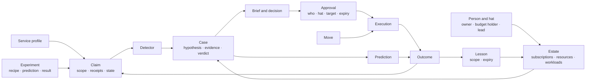
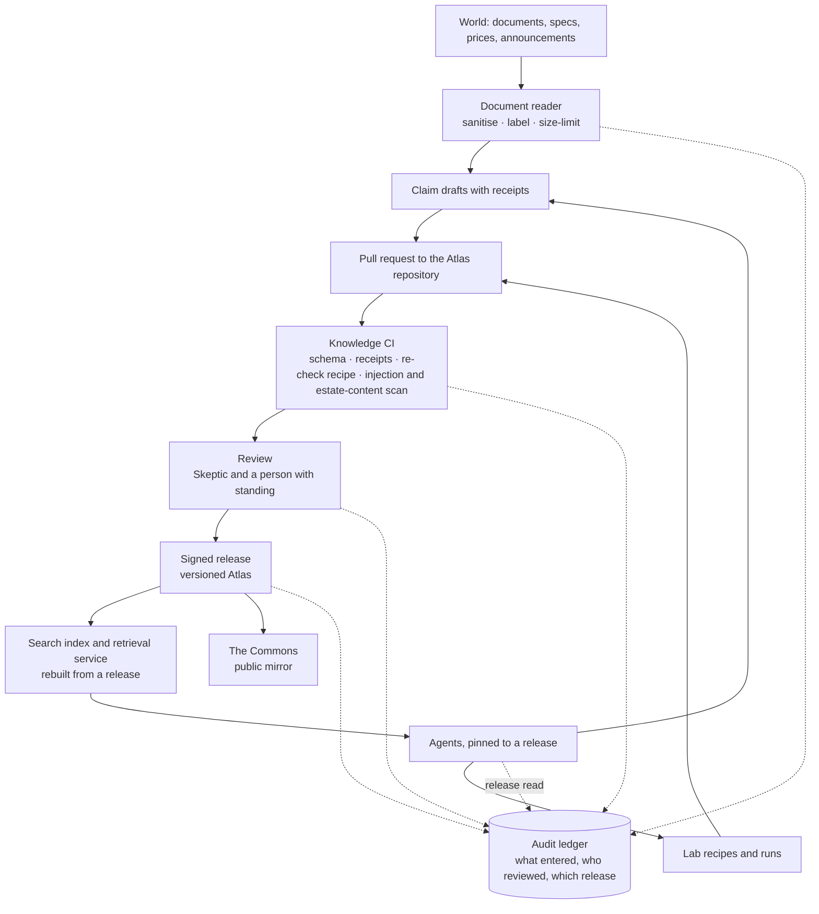

# Design 06 — Data and knowledge

> **What this answers:** *What does the system know and remember, in what shapes, where does each kind of data live, how does knowledge get in and out safely, and what does it cost to keep?*
> The information model and the knowledge pipeline are product-neutral; the physical stores are chosen in [§7](#7-the-physical-stores) from the options analysis. Part of the [design](README.md); the planes and trust zones are in [03](03-logical-architecture.md), the security controls in [07](07-security-architecture.md).

---

## 1. Six kinds of data

| Kind | Examples | Sensitivity | Shape | Lifetime |
|---|---|---|---|---|
| **World knowledge** | claims about how Azure charges, profiles, laws, Detectors, Moves, Lab recipes | public (the Commons) | small structured documents in **source control** | versioned for ever; individual claims expire and are re-checked |
| **Estate knowledge** | the Estate Model, owners, intent, rhythms, lessons, cases, Briefs, decisions | confidential, per organisation | documents with relations | per policy; lessons carry their own expiry |
| **Cost and usage data** | cost exports, price sheets, commitments, usage and metric summaries | confidential, per organisation | large, columnar, append-mostly | hot for months, cold for years; raw rarely read |
| **Experience** | predictions, experiments, outcomes, scores, the Exam and its keys | internal; keys are **restricted** | small append-only records | for ever (they are the system's memory of being right or wrong) |
| **Governance record** | approvals, executions, audit events, contract and credential changes | confidential, tamper-evident | append-only | retention set by compliance |
| **Telemetry** | traces of agent runs, model and tool calls, costs, evaluations | confidential; may contain personal data | high-volume events | short for content, long for aggregates |

Two rules cut across them. **Estate knowledge never enters the Commons**, and anything that goes there is generalised, reviewed and checked for estate content first ([Q-PRV-1](01-requirements-and-principles.md#4-quality-targets)). **Cost data is reached through a tool, not a file path**: an agent sees aggregates, samples and the answer to a typed query, never a bucket.

## 2. The information model

### The records that matter most

**Claim** — one scoped, checkable statement about Azure.

| Field | Meaning |
|---|---|
| `id`, `version`, `supersedes` | stable identity and history |
| `statement` | the claim, in one sentence |
| `scope` | service · SKU · API version · region · offer or price level · feature set · load condition · date · test environment |
| `receipts[]` | the source URL, the retrieval time, a **hash of the quoted text** and the quote — never the page |
| `evidence[]` | Lab runs: recipe id, run id, prediction and observation |
| `state` | heard · disputed · tested · mechanism-verified · replicated · commercially verified · refuted · stale · retired |
| `confidence`, `reviewers[]` | a number with its calibration record; who reviewed it, in which role |
| `recheck` | the recipe, the schedule and the triggers (a document or price change) |
| `license`, `commons_tier` | MIT or the source's terms; draft, replicated, maintained |

**Move** — a tested, versioned way to change something.

| Field | Meaning |
|---|---|
| `id`, `version`, `signature` | identity; signed by reviewers |
| `target_types`, `max_targets`, `max_value` | what it may touch, how many, how much |
| `preconditions`, `dry_run`, `guard_metrics`, `rollback`, `invariants`, `assurance_boundary`, `verification_plan` | the recipe, exactly as in [north star 05 §4](../05-recommend-act-verify.md#4-moves--tested-reusable-ways-to-change-things) |
| `required_role` | **the one narrowly scoped role** the execution identity needs — and nothing else |
| `approver_hats` | who must say yes (owner, change authority, two people for commitments) |
| `fixtures` | the Lab or Terrarium fixture that tests it |

**Approval** — the record the execution plane trusts.

| Field | Meaning |
|---|---|
| `brief_id`, `move_id@version`, `target_hash` | exactly what was approved, bound to the *state* of the target when the decision was made |
| `approvers[]` | identity, hat, **authentication strength**, time |
| `expires`, `nonce` | one use, one window |
| `policy_decision` | which credential or rule covered it, or that a second approver was required |

**Prediction** — what the system said would happen, before it happened: *target · window · counterfactual method · loss · scoring rule · distribution or interval · made by · made at · prompt, model and Atlas versions in force*. The last part is what makes a miss diagnosable.

**Lesson** — testimony, scoped and expiring: *statement · scope · who said it, in which role · evidence · expiry · corroboration · track record · status*.

## 3. The knowledge pipeline

Knowledge gets into the Atlas the way code gets into a product: through review, tests and a release.

- **Agents propose; people merge.** A claim reaches a release only through a pull request that passed knowledge CI and review. No agent has write access to the release branch.
- **The index is derived.** The search index is rebuilt from a release; it is never edited. A wrong claim is fixed in source control and re-released, and the index follows.
- **Agents are pinned to an Atlas release.** An agent run records the release it read; a change of release is a release of the system and passes the gates in [design 10](10-test-and-evaluation.md#4-release-gates).
- **Revocation is a release too**: a withdrawn claim is marked, the index is rebuilt, and everything that relied on it is listed from the audit record.
- **Retrieval returns claims, not pages**, with their scope and state, so an agent cannot quote a provisional claim as if it were verified.

## 4. Cost and usage data

The system's raw material is the bill; what it needs from it is *meters, price levels and what changed*.

| Layer | What it holds | Rule |
|---|---|---|
| **Raw** | exports exactly as delivered: usage and cost in the open FOCUS shape where the agreement supports it, price sheets, reservation and savings-plan records | immutable; kept as received |
| **Curated** | conformed to one schema, with list, contracted and effective price levels, amortised and actual views, and the commitment each line drew on | rebuilt from raw by deterministic jobs |
| **Aggregates** | by meter, resource, workload, owner, day; the Unexplained Spend Ledger | what the tools mostly serve |
| **Usage signals** | per-resource **summaries** (percentiles and idle fractions per hour and day) of the metrics that matter, collected from the day an estate is connected | native retention is short (14 days of property changes, about 93 days of platform metrics), so the system **keeps its own history** and keeps *summaries*, not raw series |

Cost data is large and cold; the design therefore puts it in **columnar files in object storage**, queried by a scale-to-zero engine, and keeps the *answers* in the operational store.

## 5. Estate knowledge: privacy by design

| Concern | Design |
|---|---|
| **Personal data** | the Estate Model holds names, work addresses, roles, working hours, language and the text of conversations. Minimised to what the human graph needs; no home addresses, no health, no performance data. |
| **Purpose limitation** | personal data is used to reach the right person at the right time and for nothing else — it is never an input to evaluating a person. |
| **Retention** | conversations and Briefs: a stated period, then summarised into lessons that carry no personal text; lessons expire. |
| **Rights** | access, correction and erasure are supported **by identity** across the Estate Model, Lesson Book, Briefs and traces; an erasure leaves the audit record with the person's identifier replaced by a stable pseudonym, as the governance record must survive. |
| **Transparency** | every message says it is from an AI, who is accountable for it, and how to reach a person ([design 08](08-governance-and-compliance.md#2-the-eu-ai-act)). |
| **Residency** | everything stays in the tenant and the EU boundary; nothing in the Commons derives from it. |

## 6. Cost of keeping knowledge

| Principle | Effect |
|---|---|
| Keep **summaries**, not raw series | metrics history costs megabytes, not terabytes |
| **Cold by default** | raw cost files and old traces move to cheaper tiers on a schedule |
| **Derived data is disposable** | indexes and aggregates can be rebuilt, so they need no backup |
| **Short life for verbose content** | prompts, completions and tool payloads in traces expire quickly; aggregates and scores last |
| **One operational store** | one serverless database for estate knowledge, experience and approvals — not one product per data kind |

## 7. The physical stores

Chosen from the [options analysis](research/options-analysis.md) and the [Foundry research](research/foundry-agent-service.md). Four rules shaped the choice. **One store per kind of guarantee, not one per kind of data** (§6). **Scale to zero wherever it exists**, because the always-on meters of a private design add up. **Every private endpoint is an hourly meter**, so accounts are shared where trust allows. **Derived data is disposable**, so it needs no backup.

### 7.1 The stores

| Store | Product | Holds | Why | Idle cost | Protection |
|---|---|---|---|---|---|
| **Operational store** | **Azure Cosmos DB for NoSQL, serverless** — one account of our own, single region, separate from Foundry's | the Estate Model, Lesson Book, cases and case notebooks, the Agenda, the Ledger (predictions, experiments, outcomes), Brief state, the approval *index*, the controls (kill-switch flags), workflow checkpoints | no minimum throughput: pay for request units used plus storage; JSON documents; change feed; Foundry's standard setup accepts serverless too | **storage only** | private endpoint; Entra data-plane roles only, key access off; TTL on verbose records |
| **Audit ledger** | **Blob Storage, immutable (WORM) containers** — append blobs in a *locked*, time-based retention policy, hash-chained | approvals, executions, grants and revokes, contract and credential changes, drift findings | tamper-evident at near-zero cost; modification and deletion are blocked, even for owners, during retention | capacity | locked retention; versioning; geo-zone redundancy; a **daily signed digest** of the chain head anchored in a second account; private endpoint |
| **Cost lake** | **Data Lake Storage Gen2** (Blob), Parquet | raw FOCUS exports; curated tables; aggregates; usage-signal summaries | columnar and cold; Cost Management exports write Parquet to firewalled storage; no compute at rest | capacity (cool tier for raw) | private endpoints; lifecycle rules; raw is immutable |
| **Atlas** | a **Git repository** (the source of truth) and a **derived search index** | claims, profiles, Detectors, Moves, recipes | review, versions, a public mirror; the index is rebuilt from a release | none | signed releases; knowledge CI |
| **Search** | **Azure AI Search, Basic** — the service Foundry's standard setup already requires, shared with a separate index if its isolation allows (spike **S-DATA-3**); *Serverless Developer* when it leaves preview | the Atlas index (vectors, keywords, semantic ranking), through Foundry IQ's generally available source kinds or direct hybrid queries | a floor that is already paid | search-unit hours | private endpoint; key access off; the Atlas build job *writes* the index, so no indexer needs a private source |
| **Foundry agent data** | Foundry **standard setup**: Cosmos DB (serverless), Storage, AI Search | threads and files of any prompt agent, and tests | network-isolated agents require it | as above | customer-managed keys optional, each keyed |
| **Registry** | Azure Container Registry (Premium, for the private endpoint) | agent and service images | private image pulls for hosted agents (projects created after 25 June 2026) | the Premium floor; the alternative is deploying from source | signed images; scan in CI |
| **Secrets and signing keys** | Azure Key Vault | the contract keys, the ledger-digest signing key | RBAC, purge protection, private endpoint, rotation | near zero | Defender for Key Vault |
| **Telemetry** | Log Analytics with per-table plans, workspace-based Application Insights; the protected `AppGenAIContent` table (preview) | traces, hub logs, detections | platform-managed; one Azure Monitor Private Link Scope | ingestion | content capture off by default; role-restricted |

### 7.2 The operational store, container by container

One account, one database, twelve containers. Serverless has no per-container throughput to pay for, so splitting is free.

| Container | Partition key | Life |
|---|---|---|
| `estate-model` | `/subscriptionId` | until superseded; entries carry expiry |
| `lessons` | `/scope` | expire by design (default twelve months, renewable) |
| `cases` and `case-notes` | `/caseId` | notes expire a year after closing |
| `agenda` | `/clock` | rolling |
| `ledger` (predictions, experiments, outcomes) | `/caseId` | for ever — the system's memory of being right or wrong |
| `briefs` | `/ownerPseudonym` | 90 days, then summarised into lessons |
| `approvals-index` | `/approvalId` | for ever; the authoritative record is the audit ledger |
| `controls` | `/scope` | the kill-switch and feature flags the services read with a short cache |
| `workflow-checkpoints` | `/workflowId` | 30 days after completion |
| `dead-letter` | `/workflow` | until handled |
| `drift-findings` | `/layer` | a year |

### 7.3 The audit ledger

Each entry is a JSON line carrying a sequence number, the hash of the previous entry, the hash of its payload, a pseudonymous actor id and a timestamp; entries are appended to a day's append blob inside a container whose **retention policy is time-based and locked**. A nightly job recomputes the chain and **alerts on a break**; a **daily digest** (head hash and count) is signed with a Key Vault key and anchored in a second immutable account — in the platform's management subscription if it offers one. Whether container-level immutability permits appends to existing append blobs, as the design needs, is documented as a *protected append* option and is verified in spike **S-DATA-2**. **Confidential Ledger** (a standard instance costs about €103 a month; a three-node managed CCF about €289) is an optional module for organisations that need hardware-backed attestation; SQL ledger tables are the alternative if relational audit queries matter more than cost.

### 7.4 Cost data: Parquet and an embedded engine

The analytic workload is bursty — ingestion, then a few thousand typed queries a day — and mostly cold. A standing analytics cluster would cost more than the rest of the data tier together. So:

1. Cost Management **exports** (FOCUS, Parquet, daily) land in the lake, in a storage account behind a firewall.
2. The **Cost query service** runs parameterised queries in a Container Apps job (scale to zero) with an **embedded columnar engine** reading the lake in place, pruning by partition.
3. The *answers* — aggregates and the Unexplained Spend Ledger — go to the operational store; agents see only these ([§1](#1-six-kinds-of-data)).

The embedded engine is **DuckDB (MIT)**: an open-source *library*, not a Microsoft service. This is a recorded **exception to constraint C1** ([ADR-13](13-decisions.md#adr-13-cost-analytics-is-parquet-and-an-embedded-engine-in-a-job)), kept swappable behind the Cost query interface. **Microsoft-only fallbacks:** Azure Data Explorer Dev/Test (a floor of about $120 a month, started by a job when a study needs it), Synapse serverless SQL (per terabyte processed) and, for aggregates only, Azure SQL serverless. The **FinOps toolkit hubs** (version 15, *None* mode: storage plus Data Factory runs, roughly $5 per $1M monitored) are an alternative ingestion layer to evaluate against our own — spike **S-DATA-1**.

### 7.5 Atlas retrieval and vectors

The Atlas index is built in CI from a release, with embeddings from `acia-embed` through the hub. Retrieval is a **Foundry IQ knowledge base** on the search service, restricted to the generally available parts (minimal, extractive retrieval over search-index, Blob and web sources), or a direct hybrid query; the preview parts (LLM query planning, answer synthesis) stay off. Retrieval returns *claims* with scope and state, never pages. Estate and lesson recall use **Cosmos DB vector search** if a test on serverless passes, otherwise a second index on the search service (spike **S-DATA-4**). **Foundry Memory is not used.**

### 7.6 Recovery

Targets from [Q-REL-2](01-requirements-and-principles.md#4-quality-targets): approvals, audit trail and Lesson Book recoverable to within an hour; the platform to a working state within a working day.

| Data | How it is recovered | Notes |
|---|---|---|
| Audit ledger | WORM plus geo-zone redundancy; the signed digests prove integrity | nothing to restore from backup |
| Lessons, approval index, Agenda | an **hourly change-feed export** to the immutable lake, so the one-hour target does not depend on the backup mode the serverless tier offers (spike **S-DATA-5**) | restore by replay |
| Estate Model | rebuilt from the estates and the directory | derived |
| Cost lake | raw exports can be requested again for past periods (to confirm); aggregates are rebuilt | derived |
| Atlas | Git; the index is rebuilt | derived |
| Everything else | redeployed from code ([11](11-delivery-and-operations.md)) | a restore drill each month |
