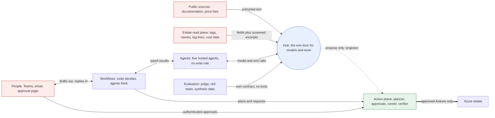

# Security and governance

**What this document answers**

- What can go wrong in a system that reads text from outside, talks to people and can change an Azure estate.
- Which controls stop each failure, and what they do *not* stop.
- Who is accountable for each decision.
- Which frameworks the design maps to (a mapping, not a certification).

An agent can be talked into anything, so no agent can do harm. Agents read and propose. One component, the action plane, writes, and only what a person approved or a rule a person wrote allows. The solution onboards to the [Citadel governance hub](https://github.com/Azure-Samples/ai-hub-gateway-solution-accelerator) of the adopting organisation's Azure landing zone (the Hub). Proof points P1 to P10 are in [the roadmap](13-roadmap.md); components are in [the architecture](02-architecture.md).

## 1. Goals, trust zones and data classes

Five goals drive every control.

1. No change in Azure without a bound approval from a person, or a rule a person wrote and code checks.
2. Outside text never becomes a decision, a recipient, a parameter or a permission.
3. The Hub is the only door from an agent to a model or a tool, and no agent holds a write role.
4. Every failure is bounded, visible and recoverable.
5. Personal data stays minimal, inside the adopting organisation's boundary, and erasable.

Red boxes hold text an attacker can write. Blue is the only route from an agent to a model or tool. Green is the only place that changes Azure.

| Class | Examples | In a prompt? | Lives in |
|---|---|---|---|
| Public documentation | Azure documentation, price lists | Yes, via the `study` contract | Git (Atlas), AI Search |
| Estate metadata | resource ids, SKUs, usage, cost lines, tags, names, log lines | Fields yes; free text only as a screened excerpt, inside the adopter's data boundary | Cosmos DB, cost lake |
| People data | owner object ids, names, addresses, replies (tags can hold them too) | Ids only; names are resolved at send time, outside the model; replies as screened excerpts | Directory; ids in Cosmos DB |
| Secrets | Hub subscription keys, one repository key | Never | Key Vault |
| Financial commitments | quotes, reservation orders, amounts, approvals | Quote id and numbers only | Approval records, ledger, audit log |

## 2. What can go wrong

Each row gives a threat, its path, the controls and what they leave open. Names follow the OWASP Top 10 for [LLM](https://genai.owasp.org/llm-top-10/) and [agentic](https://genai.owasp.org/resource/owasp-top-10-for-agentic-applications-for-2026/) applications. Incident playbooks are in [delivery and operations](09-delivery-and-operations.md).

| Threat | Path | Controls | What they do not stop |
|---|---|---|---|
| Prompt injection | A tag, name, log line, document or reply tells an agent what to do | Free text arrives only as a screened, length-capped `untrusted_excerpt`; no agent that reads it can write (section 3) | Screening misses attacks. A fooled agent can still write a wrong draft; people must catch it |
| Tool misuse, excessive agency | An agent calls a tool it should not, or too often | One contract per hosted agent; read and propose tools on separate servers; only the Engineer proposes; quotas, `max_iterations`, call budgets | The Engineer can still propose. A loop inside a session is bounded, not watched |
| Poisoned Atlas | A planted page becomes a claim, then advice | Pull request, human merge, knowledge CI re-checks each claim; a claim never fills an Action parameter | A reviewer who approves it; a re-check the same page satisfies |
| Tool rug pull | A tool or server changes after approval | Own tools: the contract's operation allow-list, so changes go through pull requests. Other servers: pinned version or digest and a scheduled probe that hashes each tool's name, description and schema; a mismatch suspends the contract | A same-schema change or a poisoned response. Inline rejection at the Hub is UNVERIFIED (P9): policies cannot read streamed MCP responses |
| Forged attribution | A caller sets a header to pose as another agent | Identity is the agent's Entra token and app role; headers are cost labels; role and policy headers are stripped | A stolen agent token plus the key |
| Leaked Hub key | The key appears in a log, trace or repository | Key only in Key Vault and the Foundry connection; a call also needs an agent token; secret scans; three-step rotation; auth-failure alerts | Key plus token until rotation ends. Conditional Access ignores key-based paths |
| Compromised runner | An attacker controls the runner | One role per action family at opted-in scopes; purchases on a separate identity with no standing role; every run needs a bound, single-use approval; alarms; switches | Its family's Actions at every opted-in scope until revoked |
| Stolen approver session | An attacker uses an approver's signed-in browser | R2 and R3 need an authentication context, checked in the token; R3 also needs phishing-resistant sign-in and two people | One session approves R1 and R2 within limits; an approver who agrees to a wrong plan |
| Confused deputy | A component with wide rights acts for a caller with fewer | Each tool validates the caller's token and role; the runner acts only on approval records; any Azure MCP Server runs as a Reader-only identity; the bot forwards only an opaque id | A new tool without a caller check (CI tests each tool) |
| Time of check, time of use | State changes between approval and run | The record binds plan hash, version stamps (etags) and the stored quote; the runner re-checks and fails closed; single use; expiry; one open plan per resource | Changes etags miss; the Verifier checks the effect |
| Denial of wallet | A loop, an injected agent or a flood of Cases burns tokens | Token quotas per contract with prompt estimation; alerts on 429 and 403; a daily cap the Conductor cannot raise; a run-rate trip flips the global switch; purchase alarms disable the purchase identity | Budgets only alert; concurrent calls overshoot briefly; a purchase is not a token |
| Data exfiltration | Data leaves in a prompt, message, trace or pull request | Ids not names; recipients from the directory; models only through the Hub; no deployments in the spoke; egress blocked; content recording off; no estate evidence in the Atlas | The chosen processing location; Microsoft's abuse monitoring; a person who pastes data |
| Supply chain | A package, image, server, model or template turns hostile | Bill of materials, hash-locked dependencies, pinned digests, provenance (section 9) | A hostile update that passes review |

## 3. Where untrusted text could reach a write

A write is a propose tool (`plan`, `pr-draft`, `ledger-propose`), a message, an approval or an Action. Each path starts with text an attacker can influence and is cut by a rule that does not depend on the model behaving.

| Path | Where it is cut | Still open |
|---|---|---|
| Tag, name or log line, then notebook, then Engineer, then a propose tool, then the runner | The Engineer is its own hosted agent and gets only schema-checked ids and numbers from an authorised case-context record, never the notebook. Action parameters come from typed fields and ids resolved from Resource Graph, never from model-written text | Wrong data from Azure itself |
| A tag or name saying "non-production", then an autopilot credential | A credential is a rule a person wrote, evaluated in code on facts the model cannot set: management-group path, Azure Policy state, Entra owner id, resource type, SKU, cost. Tags, names and Lessons cannot satisfy it | A mis-scoped credential; never R3 |
| A reply, email or card saying "yes", then an approval | Free text never approves. Only the Approval service records an approval, for an authenticated approver, against an opaque id; the Teams bot forwards only that id | An approver who misreads the plan |
| A reply, then a Lesson, then a wider scope | Lessons never widen a credential or scope; only the Respond workflow writes them | A wrong Lesson misdirects advice |
| A name, tag or address in text, then a recipient | The recipient is the directory object id of record, resolved by the Workflow; a model never chooses one. Agents draft; the Workflow sends after checks | A wrong owner of record |
| A public page, then a claim, then the Atlas, then a Case | Pull request, human merge, knowledge CI; a claim never fills an Action parameter | A poisoned claim can mislead a Recommendation, not an Action |
| Model text, then a card, page or template | Cards and pages render the plan from the stored record; agent prose is escaped, set apart and carries no control | A person who trusts prose over plan |

Host separation is the strongest cut. `study`, `investigate`, `skeptic` and `diplomat` read untrusted text and hold no propose tool; `engineer` holds them and reads no free text. Roles inside one hosted agent share an identity and a contract; code separates them, not the platform. If P7 finds a path to a propose tool, that role moves into its own hosted agent.

## 4. Identity

| Principal | Identity | Holds |
|---|---|---|
| Five hosted agents | One [Entra Agent ID](https://learn.microsoft.com/azure/foundry/agents/concepts/agent-identity) each | App roles `Model.Invoke` and `MCP.Invoke` on its own Hub contract; no Azure role |
| Five Function apps | Managed identities; one per action family for the runner; its own for purchases; the `bot` app's identity can only call the Approval service | Only the reads or writes the job needs |
| Evaluation | Its own identity and contract | Synthetic data and redacted samples; no tools; no production role |
| People | Entra groups: platform team, FinOps lead, approver (resource-owner and FinOps or finance groups), Atlas reviewer, security reviewer | Rights follow the group; reviewed quarterly |

**A hosted agent with no grants** starts with no role, but not with no capability: Learn says it can already run model inference through its project endpoint and use its session storage ([permissions](https://learn.microsoft.com/azure/foundry/agents/concepts/hosted-agent-permissions)). So the spoke's Foundry account has no model deployments (section 6), P1 tests from inside a hosted agent what it can reach, and CI repeats the test.

**What the Hub sees.** Every call carries the agent's Entra token with its app role (assigned directly to the agent identity) and the contract's subscription key, which the Hub always requires. The key is a secret in Key Vault and the Foundry connection, rotated in three steps: switch, confirm, regenerate ([guide](https://github.com/Azure-Samples/ai-hub-gateway-solution-accelerator/blob/main/bicep/infra/citadel-access-contracts/README.md)). Headers are labels, never identity. P1 tests that the Hub accepts a hosted agent's token.

**Break-glass.** Two cloud-only emergency accounts with passkeys, excluded from blocking policies, an alert on every sign-in, tested every 90 days ([Learn](https://learn.microsoft.com/entra/identity/role-based-access-control/security-emergency-access)). One person can flip a kill switch, but re-enabling purchases needs two, and an emergency account counts as one.

| Feature | Needs ([Learn](https://learn.microsoft.com/entra/fundamentals/licensing)) | Without it |
|---|---|---|
| Conditional Access for approvers: authentication context, phishing-resistant strength | Entra ID P1 | The Approval service refuses R2 and R3: it cannot get the claim |
| PIM; Azure-enforced end dates | Entra ID P2 or ID Governance | Our code removes assignments; people hold fewer standing roles, with alerts |
| Access reviews | ID Governance (some features P2) | A quarterly group-membership export, reviewed and kept |
| Conditional Access and governance for agent identities | [Agent 365 or Microsoft 365 E7, plus P1](https://learn.microsoft.com/entra/identity/conditional-access/agent-id); Agent ID itself is available to all Entra customers | Optional: Hub token, app roles, quotas and RBAC are the baseline |
| Defender | [Agent-level protection needs Agent 365](https://learn.microsoft.com/defender-xdr/security-for-ai/transition-agent-security-to-agent-365); Defender for AI Services covers models, metered by tokens | Hub logs and alerts |
| Teams and Exchange | Microsoft 365 | The approval web page; no e-mail path without Exchange Online (Azure Communication Services Email retires on 30 September 2028) |

## 5. Action-plane safety

The action plane alone changes Azure: Action catalogue, Planner (`plan`), Approval service, runner, Verifier, audit log, kill switches and credentials.

### The approval record

The Approval service renders the plan from the stored plan record, never from agent prose, and shows its hash. A card or page carries only an opaque request id. The record binds:

| Field | Why |
|---|---|
| Request id | The only thing a card, button or bot may carry |
| Plan hash | What the approver saw is what runs |
| Resource etags | The live state has not moved |
| Purchases: stored quote id, amount, term | The runner buys exactly that quote |
| Approver's Entra object id and directory role | Who approved, in which hat |
| Authentication-context claim; sign-in strength for R3 | The sign-in met the policy ([how apps check](https://learn.microsoft.com/entra/identity-platform/developer-guide-conditional-access-authentication-context)) |
| Timestamps, expiry | An old approval cannot be replayed |

The runner consumes a record once and re-checks every field. Cosmos DB roles work per container and action, not per field ([Learn](https://learn.microsoft.com/azure/cosmos-db/reference-data-plane-security)), so the consumed marker must live where the runner can only create items ([data and integrations](05-data-and-integrations.md)). Any mismatch (hash, etag, quote, live state, expiry, switch) aborts the run and asks the Planner for a new plan; the runner never refreshes and proceeds. Runs are safe to repeat: deployment names derive from the plan id, an unknown outcome is looked up before anything else, and a purchase is never retried automatically.

### Approval classes

| Class | Typical Actions | Who approves | Autopilot |
|---|---|---|---|
| R1: reversible, small, non-production | Stop a dev VM out of hours; lower a dev disk tier | The resource owner, one tap in Teams (Entra sign-in; P3 tests it) | A credential may cover it; the Verifier rolls back |
| R2: reversible, production or larger | Resize a production database; change a storage tier at scale | The resource owner on the approval page, Conditional Access with an authentication context | A credential may cover low-value Actions under a value cap |
| R3: irreversible or a commitment purchase | Buy a reservation or savings plan; delete data | Two people with two distinct directory roles (resource owner or budget holder; FinOps or finance approver), neither the requester, phishing-resistant sign-in | Never |

### Credentials, runner roles and purchases

A **credential** is a rule a person wrote: domain, scope, value cap, expiry. The Approval service evaluates it in code on facts the model cannot set (section 3), and each autopilot run still writes a single-use record. Credentials expire, can be revoked at once, and a person reviews a sample of autopilot runs. The report card never grants or widens a credential.

The runner has **one narrow custom role per action family** (VM resize, storage tier change, schedule), derived from the operations its templates use; R1 to R3 are approval classes, not Azure permissions. The adopting organisation assigns each role at the scopes it opts in, and nowhere else does the runner write.

**Purchases** use their own identity with no standing role.

1. After the second approval, the Approval service gives that identity the built-in Reservation Purchaser role on one subscription and removes it after the run or at expiry. A custom role that mimics it cannot buy ([Learn](https://learn.microsoft.com/azure/cost-management-billing/reservations/prepare-buy-reservation)).
2. The Approval service can create only that assignment: Role Based Access Control Administrator with a condition naming role and principal, free of charge ([Learn](https://learn.microsoft.com/azure/role-based-access-control/delegate-role-assignments-overview)).
3. The runner buys exactly the stored quote from the reservation calculate step.
4. Every purchase alerts. A daily count or amount above its limit disables the purchase identity.

PIM cannot make a service principal eligible ([Learn](https://learn.microsoft.com/azure/role-based-access-control/pim-integration)), so our code removes the assignment unless Entra P2 or ID Governance lets Azure enforce an end date. P8 tests propagation delay and revocation; a standing role with an alert on every use is the weaker fallback. Two limits sit outside the design: the billing account's policy can bar role-based purchases, and Azure caps refunds in a rolling 12-month window and ends exchange for new reservations of savings-plan services from 1 February 2027 ([Learn](https://learn.microsoft.com/azure/cost-management-billing/reservations/exchange-and-refund-azure-reservations)).

### Kill switches

Three switches exist: global, per Action, per estate. The Approval service and the runner read them before approving and before each step. One person flips a switch; re-enabling purchases needs two. A switch stops new work and the next step, but cannot recall a purchase already submitted. Stopping a hosted agent or session is not a kill switch: Learn says an in-flight turn can stay in progress for later recovery ([Learn](https://learn.microsoft.com/azure/foundry/agents/how-to/manage-hosted-sessions)). The hard stops are suspending the agent's Hub contract (model and tool access end at once), cancelling its orchestrations and the runner's own check. Drills: [safeguards and drift](07-safeguards-and-drift.md).

## 6. Screening and Hub controls

| Text enters through | Screen | Why there |
|---|---|---|
| Tool results with free text | Our tool services return fields; free text only as an `untrusted_excerpt`: length-capped, checked for document attacks with Prompt Shields, wrapped in the documents delimiter; secrets scanned out of all output | The Hub cannot read streamed MCP responses ([Learn](https://learn.microsoft.com/azure/api-management/mcp-server-overview)) and Foundry's tool-response controls skip MCP |
| Owner replies | At ingress, before any agent: Prompt Shields on prompt and document, length cap | Untrusted from the first byte |
| Raw text in prompts | At the Hub on `study` and `diplomat`: `llm-content-safety` with `shield-prompt` ([Learn](https://learn.microsoft.com/azure/api-management/llm-content-safety-policy)) | These prompts take raw web text and replies |
| Other contracts' prompts | Not screened at the Hub | Their free text arrives as screened excerpts; screening every prompt costs tokens and time |

Prompt Shields do not verify where text came from, are trained mostly on English and take 10,000 characters per call, five documents at most; the Hub policy returns 403 above that ([Learn](https://learn.microsoft.com/azure/ai-services/content-safety/concepts/jailbreak-detection)). Foundry guardrails leave document-attack checks off by default, so our calls ask for them. Costs are in [cost and FinOps](10-cost-and-finops.md).

| Hub control | Setting that matters |
|---|---|
| Token, role, model access | Token validated (audience, issuer, signature, expiry) and app role required on every contract; each contract lists aliases only, so no model name reaches an agent |
| Quotas | `llm-token-limit` per contract with `estimate-prompt-tokens` on; the accelerator ships it off ([Learn](https://learn.microsoft.com/azure/api-management/llm-token-limit-policy)) |
| Personal data | The Hub can anonymise personal data in prompts with Azure AI Language (inbound only; fails closed) |
| Tool grants | APIM policies apply to every tool of an MCP server, so read tools and propose tools sit on separate servers |
| Headers | `x-policy-id` lets a caller pick its own guardrail per request ([Learn](https://learn.microsoft.com/azure/foundry/guardrails/how-to-create-guardrails)); the Hub strips it and any role header |
| Alerts, logs | Auth-failure, content-safety and PII alerts on (the accelerator ships them off); prompt and completion capture off in production (the accelerator captures up to 256 KB each) |

**Foundry guardrails are preview.** An agent whose definition omits `rai_config` has no guardrail at the agent boundary, and a missing policy fails open. Tool-call and tool-response controls cover only listed tools (Azure AI Search, Azure Functions, OpenAPI, SharePoint, Fabric data agent, Bing, Browser Automation), not MCP ([Learn](https://learn.microsoft.com/azure/foundry/agents/concepts/hosted-agent-guardrails)). They run behind a switch where a policy exists (CI asserts it does); nothing depends on them. The generally available fallback is the screening above.

**No way around the Hub.**

- The spoke's Foundry account has no model deployments: Azure Policy denies them (the built-in [approved-models policy](https://learn.microsoft.com/azure/foundry/how-to/model-deployment-policy) with an empty list, or a custom Deny; P1 confirms which works) and key access is off.
- Egress from the agent subnet allows only the Hub and the platform endpoints Learn lists, through a firewall or network rules. Hosted-agent egress rules are preview and "not intended for production" ([Learn](https://learn.microsoft.com/azure/foundry/agents/how-to/add-hosted-agent-guardrails)); they are a second layer behind a switch.
- Direct retrieval paths such as Foundry IQ stay off until the Hub can route them ([traffic inventory](02-architecture.md)). A negative-path test in CI proves that a direct model call from an agent identity fails.

## 7. Data protection and privacy

| Topic | Rule |
|---|---|
| Minimisation | Prompts get ids, not names; names and addresses are resolved when a message is rendered, outside the model. Foundry keeps conversation history for hosted agents (messages, tool calls, responses; [Learn](https://learn.microsoft.com/azure/foundry/agents/concepts/hosted-agents)), so minimise at the prompt |
| Audit log | Ids and hashes only, never names or addresses, so an erasure never touches an immutable record. Immutable Blob ([Learn](https://learn.microsoft.com/azure/storage/blobs/immutable-storage-overview)) plus Log Analytics |
| Traces | Content recording is off in production: `OTEL_INSTRUMENTATION_GENAI_CAPTURE_MESSAGE_CONTENT` defaults to false and Learn says keep it off ([Learn](https://learn.microsoft.com/azure/foundry/observability/how-to/trace-agent-framework)). On in dev, on synthetic data. Evaluators see redacted samples |
| Erasure, retention | Personal data sits in stores an erasure can reach (Estate model, Lessons, approval records); the audit log holds none. Whether the remaining id-to-person link is enough is the adopting organisation's legal call. Retention values are adopter parameters ([data and integrations](05-data-and-integrations.md)); Foundry deletes a hosted-agent session after 30 idle days |
| Residency | Deployment type is an adopter parameter: Global Standard only for public documents and synthetic data. The `judge` alias must resolve to a model deployable in the adopter's boundary: all Claude models support Global Standard, and some run on Anthropic's own infrastructure ([Learn](https://learn.microsoft.com/azure/foundry/foundry-models/how-to/use-foundry-models-claude)) |
| Abuse monitoring | Flagged prompts can get automated and human review unless the organisation has an approved modification ([Learn](https://learn.microsoft.com/azure/foundry/openai/concepts/abuse-monitoring)); record it in the DPIA |
| People | The system never ranks, scores or evaluates a person or infers emotion; cost goes to resources, services and teams. Voice, avatar and meeting modules stay off until the adopting organisation's DPIA and any works-council step are done |

## 8. Network

| | Evaluate | Operate |
|---|---|---|
| Data and reach | Synthetic data; public endpoints with Entra sign-in and an IP allow-list | Real data; private endpoints; hub-spoke-hub |
| Foundry | Basic setup | BYO virtual network with platform-managed data, no public egress ([Learn](https://learn.microsoft.com/azure/foundry/agents/concepts/networking-options)) |
| Hub and roles | Dev contracts; no role on any production scope, and CI proves a dev identity cannot call a prod contract or scope | Prod contracts; the roles of sections 4 and 5 |

Network injection cannot be added to an existing Foundry account, so moving from Evaluate to Operate means a new account.

**The one public route.** Microsoft 365 reaches an agent only over the public internet ([Learn](https://learn.microsoft.com/azure/foundry/agents/how-to/publish-copilot-virtual-network)), so in Operate the Teams bot endpoint is the one deliberate public route. R2 and R3 cards only open the approval page; the bot forwards only opaque ids. It is secured like this:

- The Agents SDK validates every request's token before a handler runs: signature, expiry, exact audience, permitted issuer, service URL. The bot never acts on decoded but unverified claims ([Learn](https://learn.microsoft.com/microsoft-365/agents-sdk/production-ready-agent/production-ready-agent)).
- It runs under its own identity, which can send an opaque id to the Approval service and nothing else: no model access, no Azure role.
- An IP filter is not available for a bot we host: Azure Bot Service publishes no inbound ranges and does not support an inbound allow-list ([Learn](https://learn.microsoft.com/azure/bot-service/security-faq)). Foundry's source-IP-filtered route covers only agents published from Foundry, and Learn calls even that defence in depth. The design relies on token validation.
- An adopting organisation that will not accept a public route turns Teams off: approvals use the web page and messages use email.
- Email: Graph `Mail.Send` can send as any mailbox, so Exchange Online role-based access for applications limits the app to one shared mailbox ([Learn](https://learn.microsoft.com/exchange/permissions-exo/application-rbac)). Recipients come from the directory, never from a model.

## 9. Supply chain

- **Bill of materials** in SPDX format from the dependency graph, attached to every release ([GitHub](https://docs.github.com/en/code-security/how-tos/secure-your-supply-chain/establish-provenance-and-integrity/export-dependencies-as-sbom)); **hash-locked dependencies** and one pinned package cohort for the agent runtime, so prerelease packages move together.
- **Tool pins**: any Azure MCP Server by version (and digest if it ships as an image), started with its Read only option and a Reader-only identity ([Learn](https://learn.microsoft.com/azure/developer/azure-mcp-server/tools/)); tool schema changes count as dependency changes that need re-approval ([Learn](https://learn.microsoft.com/azure/developer/azure-mcp-server/security)).
- **Build provenance** with GitHub artifact attestations, verified at deploy ([GitHub](https://docs.github.com/en/actions/concepts/security/artifact-attestations)). **Pinned models and Hub**: aliases resolve to pinned model versions with retirement dates alerted; the Hub accelerator is pinned to a commit (it publishes no releases).
- **CODEOWNERS** on the Atlas, contracts, Action catalogue, credentials, prompts and Detectors.

## 10. Who is accountable

| Decision or control | Accountable | Evidence |
|---|---|---|
| An R1 or R2 Action | The resource owner of the scope | Approval record |
| An R3 Action or purchase | Resource owner or budget holder, and a FinOps or finance approver | Two approval records, the stored quote |
| A credential | The FinOps lead with the scope's owner; never an agent or the report card | Credential record with expiry |
| An Atlas merge | Atlas reviewer | Merged pull request, knowledge CI |
| Contracts, prompts, Action catalogue | Platform owner and security reviewer | Pull request under CODEOWNERS |
| Kill switches, break-glass, quarterly access reviews | Platform owner, FinOps lead or security reviewer may stop; two re-enable purchases; the security reviewer runs the reviews | Switch record, sign-in alert, kept review |
| AI Act class, DPIA, data boundary, lawful basis | The adopting organisation | Its own records |

## 11. Compliance mapping

Mapping, not certification, not legal advice.

| Framework | What it asks | Where this design answers |
|---|---|---|
| EU AI Act: transparency (Art. 50) | Tell people they interact with an AI system; mark AI-generated text so machines can detect it. Applies since 2 August 2026; systems already on the market have until 2 December 2026 to mark ([Commission](https://ai-act-service-desk.ec.europa.eu/en/ai-act/timeline/timeline-implementation-eu-ai-act)). An MIT licence does not lift it (Art. 2(12), [text](https://artificialintelligenceact.eu/article/2/)) | Every message says it is AI-written and offers Explain, Challenge, Teach; a machine-readable mark goes in email headers and card metadata where the channel allows ([guidelines](https://digital-strategy.ec.europa.eu/en/policies/guidelines-ai-transparency-obligations)). No emotion inference |
| EU AI Act: risk class, oversight, logging | Classify the system. Annex III duties apply from 2 December 2027, Annex I from 2 August 2028 ([Digital Omnibus, in force 27 July 2026](https://digital-strategy.ec.europa.eu/en/news/ai-omnibus-enters-force)). High-risk systems need human oversight (Art. 14) and logs (Art. 12) | Likely not high-risk: the purpose is cost control of cloud resources. **The adopting organisation must assess it.** Evaluating employees ([Annex III 4(b)](https://artificialintelligenceact.eu/annex/3/)) or acting as a safety component of critical digital infrastructure would change the class. Approvals, switches, audit log and traces meet the intent of Arts 12 and 14 anyway |
| GDPR ([text](https://eur-lex.europa.eu/eli/reg/2016/679/oj)) | Minimisation and storage limits (Art. 5), erasure (17), automated decisions (22), design and default (25), processors (28), security (32), breach notice in 72 hours (33), impact assessment (35) | Ids not names; audit log without personal data; erasable stores; residency parameter; approvals are a person's own authenticated act on decisions about cloud resources. Lawful basis, DPIA and works-council steps stay with the adopting organisation |
| NIS2 ([Commission](https://digital-strategy.ec.europa.eu/en/policies/nis2-directive)) | If in scope (medium and large entities in listed sectors; national law): risk measures such as incident handling, continuity, supply chain security, access control, MFA (Art. 21); warning in 24 hours, notice in 72 (Art. 23) | Sections 4, 5, 9; playbooks and recovery in [delivery and operations](09-delivery-and-operations.md). Scope and reporting stay with the adopting organisation |
| ISO/IEC 42001 | An AI management system. Microsoft Foundry is in scope of Microsoft's certificate; the adopter needs its own assessor ([Learn](https://learn.microsoft.com/compliance/regulatory/offering-iso-42001)) | Evidence: section 10, [decisions](12-decisions.md), the report card ([testing](08-testing-and-evaluation.md)), pull-request change control |
| NIST AI RMF 1.0 ([NIST](https://www.nist.gov/itl/ai-risk-management-framework)) | Govern, Map, Measure, Manage; NIST says a revision is under way | Govern: sections 4 and 10. Map: 1 to 3. Measure: Evaluation. Manage: kill switches, [drift controls](07-safeguards-and-drift.md), playbooks |
| Cloud Adoption Framework: Govern, Secure, Manage | For agents: ownership, one identity each, policy applied alike, observability, data governance, a security baseline ([Learn](https://learn.microsoft.com/azure/cloud-adoption-framework/ai-agents/governance-security-across-organization)) | Entra Agent ID per hosted agent; Hub contracts and Azure Policy; sections 6 and 7 |
| Well-Architected pillars ([Learn](https://learn.microsoft.com/azure/well-architected/pillars)) | Reliability, Security, Cost Optimization, Operational Excellence, Performance Efficiency | Security: here. Reliability: idempotent runs. Cost: quotas ([cost and FinOps](10-cost-and-finops.md)). Operations: everything as code. Performance: small models first |

## 12. What each safeguard does not stop

| Safeguard | What it does not stop |
|---|---|
| Agents with no write role | Propose tools held by the Engineer; a wrong draft a person reads; the runner |
| Hub door: token, key, quotas | What the runner does through Azure; a stolen token plus the key; a tool misused inside its quota |
| Screening, fields and excerpts | Missed attacks, other languages, MCP responses at the Hub; a person who copies attacker text into a decision; wrong data from Azure |
| Host separation, tool pins | A compromised hosted agent (its roles share identity and contract); a same-schema change or poisoned tool response |
| Bound, single-use approval; two-person R3 | A stolen Approval service identity; deceived or colluding approvers; a mis-written credential |
| Per-family runner roles; time-boxed purchase role | A compromised runner doing its family's Actions at every opted-in scope; a purchase already submitted; Azure's refund and exchange limits |
| Kill switches | Work already submitted; a stopped hosted agent whose turn is later recovered |
| Quotas and run-rate trip | Brief overshoot; a purchase, which is not a token; budgets, which only alert |
| No deployments, blocked egress | A path nobody inventoried; preview egress rules are not production-grade |
| Content recording off | Conversation history Foundry keeps; the adopter's own stores |
| Human Atlas merge, bill of materials, pins | A reviewer who approves a poisoned claim; a hostile update that passes review |
| Conditional Access | Key-based paths; a deceived approver; missing licences, where R2 and R3 are refused |
| Evaluation and red team ([testing](08-testing-and-evaluation.md)) | A targeted production attack no suite anticipated; a sampled run is not every run |
