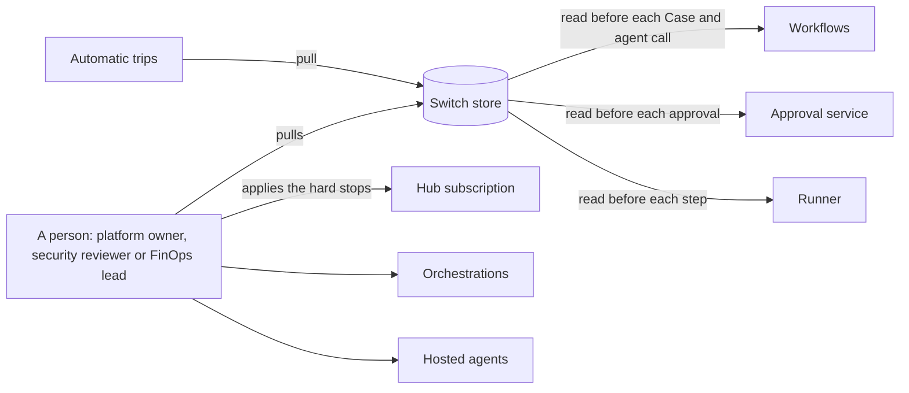
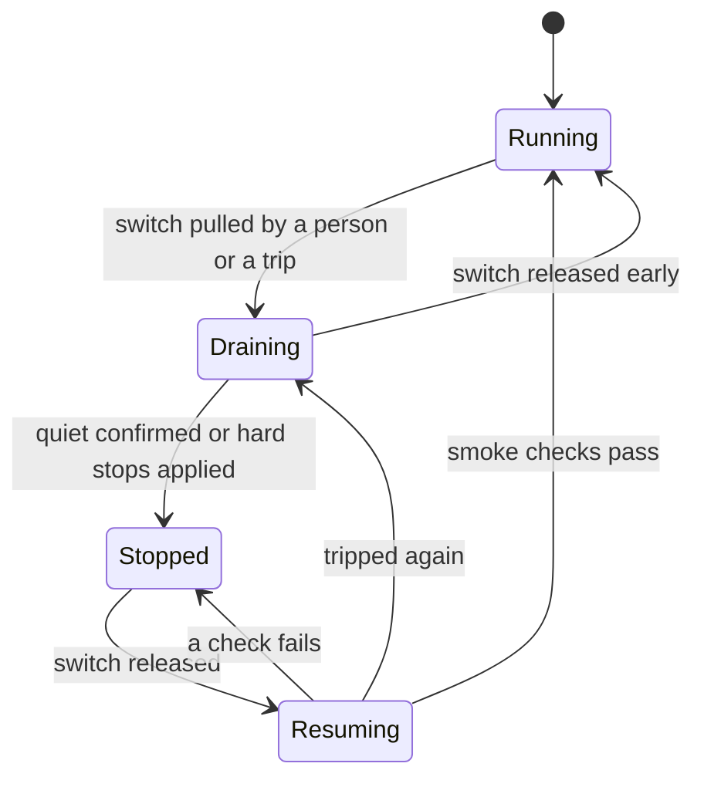

# Safeguards and drift controls

**What this document answers.**

- Which safeguards stand in which layer, who owns each, how it is tested and what it does not stop.
- What can drift, how we notice, who owns the check and what happens when it fires.
- How the system is stopped, and what "stopped" means for work already running.
- How we practise failure, and who is told.

Drift is a gap between what is declared (Git), what was evaluated (the version that passed [the evaluations](08-testing-and-evaluation.md)) and what runs. Two rules hold everywhere. **Fail closed**: when a check fails or cannot decide, the answer is no. **Only narrow**: a check or a trip may pull a switch, park a Case, mark a claim stale or withdraw a credential; a person widens again. Capitalised terms (Case, Action, Atlas, Detector, Credential, Contract) are defined in [the glossary](README.md#words-used-in-this-design).

## 1. Safeguards by layer

The mechanisms are in [security and governance](06-security-and-governance.md), [agents and workflows](03-agents-and-workflows.md) and [testing and evaluation](08-testing-and-evaluation.md).

| Layer | Safeguards | Owner | Tested by | Does not stop |
|---|---|---|---|---|
| Hub | One contract per hosted agent; Entra token plus key; pinned, allow-listed tools; token quotas; screening on `study` and `diplomat` | Platform owner | CI: a direct model call fails; a dev identity cannot reach a prod contract | A caller with a valid token and key; text in streamed MCP responses; the runner's calls to Azure |
| Agent | Read tools; propose tools for the Engineer only; typed results; bounded tool loops; free text only as screened excerpts | Platform owner | Injection red team on every untrusted-text path; evaluation suites | A model misled into a wrong proposal; a tool that changes behaviour behind an unchanged schema |
| Workflow | Bounded rounds and budgets; single flight per resource (one run on a resource at a time); idempotent steps; a Case that fails three times is parked | Platform owner | Replay and duplicate-delivery tests; the drills | A correct workflow reaching a poor decision; an activity already running when its orchestration ends |
| Action plane | Bound single-use approval; a runner that fails closed; one role per action family; time-boxed purchase role; Verifier and rollback; immutable audit log | Security reviewer; FinOps lead for purchases | Forged, replayed and mismatched approvals in CI; the drills | A compromised runner inside its family; a purchase already submitted; a coerced approver; a sound purchase that turns out wrong |
| Platform | Azure Policy; Deployment Stacks with deny settings; private endpoints; least-privilege roles; Conditional Access for approvers | Platform owner | `what-if` and Policy state, in CI and nightly | Entra and portal edits by someone with the rights: noticed, not prevented |
| Assurance | Three evaluation tiers; sampled scoring; red teaming before each autonomy level; report card; drills; access reviews | Security reviewer; FinOps lead | Planted faults: a check that never found one does not count | Rare failures; a judge's blind spot; an attack nobody imagined |

**Superseded in part on 2026-11-05:** the runner, its per-family roles, the time-boxed purchase role and the rollback, here and below. A change runs as the approver; see [decision 24](12-decisions.md#24-a-change-runs-as-the-approver-meternaut-holds-no-right-to-change-azure--accepted) and [proposal 05](../proposals/05-run-as-the-approver.md).

## 2. What drifts, and how we notice

Drift checks run as scheduled pipeline jobs under a read-only identity (on a runner that reaches the Operate profile's private endpoints, see [delivery and operations](09-delivery-and-operations.md)) and as Azure Monitor alert rules, never inside an agent or an app they watch. A check or trip pulls a switch only by asking the `workflows` app, whose single right on `switches` is creating trip items ([data](05-data-and-integrations.md)); suspending or re-pinning a Hub contract is a person's act. Each sends a heartbeat metric; a metric alert fires when it goes missing. Intervals and limits are initial values.

| What drifts | Check | Interval | Owner | Fail-closed response |
|---|---|---|---|---|
| **Models**: version, protocol or retirement; a silent swap by an automatic upgrade or an alias fallback | Model and version on every response against the alias's pinned list; the Models List operation (API version `2024-10-01`, per region: [Learn](https://learn.microsoft.com/rest/api/aiservices/accountmanagement/models/list?view=rest-aiservices-accountmanagement-2024-10-01)) for `lifecycleStatus`, `deprecation.inference` and each SKU's `deprecationDate` (if no validated date can be read, an alert fires and no pin changes); a weekly behaviour probe | Hourly; daily; weekly | Platform owner | A model outside the pinned list pulls the global switch until a person re-pins or accepts it after evaluation. Retirement alerts at 180, 90 and 30 days; a re-pin is a release |
| **Prompts, agents and tools**: a deployed agent differs from the prompts in Git; an unlisted agent; an agent without `rai_config`; a changed tool or MCP server | Served agent version, zip SHA-256 and definition (including `rai_config`) against the release manifest; the Hub's digest of each tool's `tools/list`; package and MCP server digests | 15 minutes; each release | Platform owner | A served agent that differs or lacks `rai_config` pulls the global switch; a person redeploys from Git or accepts the change by pull request. An unlisted agent opens a finding. The Hub rejects a tool whose digest changed until it is re-pinned (until P9 passes, the contract blocks `tools/list` changes) |
| **Knowledge**: an Atlas claim goes stale or its source changes; the search index lags Git | Knowledge CI re-runs each claim's re-check recipe and its expiry; index release against Git | Daily; at expiry; hourly | Atlas reviewer | The claim is marked stale at once, and advice resting on it says it is not confirmed. The Study workflow opens a pull request to refresh or retire it |
| **Data and prices**: the FOCUS version or columns change; Retail Prices change; an unknown meter or Advisor recommendation type | Each export validated against the pinned schema before it replaces a partition; daily Retail Prices diff by `meterId`; the Advisor type list against the Atlas | Each export; daily | Platform owner; Atlas reviewer | A failing export is not ingested: figures go stale and savings claims stop. An unknown meter or type becomes a Study lead; advice touching it says so |
| **Infrastructure and policy**: a resource differs from its template; a Policy assignment or exemption changes; a model deployment, public endpoint or local key appears; audit retention is unlocked | `what-if` of each template; stack deny settings; Policy state plus an on-demand scan after a change; Resource Graph queries; a direct model call that must fail | Nightly; hourly for Policy | Platform owner | The deployment pipeline restores the solution's own resources of safe classes (tags, diagnostics, public access off) from Git. A difference in a control that guards the action plane pulls the per-estate or global switch until a person reverts or accepts it |
| **Entra and portal edits**: Conditional Access for approvers; role and app-role assignments; our identities' secrets and certificates; Teams app installs for anyone who is not an owner of record; a portal edit to an agent, Hub policy or contract | Graph snapshot diff against Git; the [Microsoft Graph activity log](https://learn.microsoft.com/graph/microsoft-graph-activity-logs-overview) of the bot's identity against the live owners; an Activity Log alert on any write to our resources by a caller outside the allowed list | 5 minutes; hourly | Security reviewer | Drift on the approver or purchase path pulls the purchase switch. A portal edit to an agent or contract pulls the global switch until it is redeployed from Git or accepted by pull request. Anything else opens a finding |
| **Hub contracts**: a contract, policy, backend or alias edited outside the pipeline; a Hub upgrade changes a policy | `GET /version` and `/version/backend-contract` against the pins; nightly `what-if` of every contract; assertions: token estimate on, JWT required, no open product, no content capture in production, `x-policy-id` stripped | 15 minutes; nightly | Platform owner with the Hub owner | A failed assertion pulls the global switch, and a person redeploys the contract from Git; nothing falls back to direct model access. A new Hub version alone starts contract tests in dev and a pull request to move the pin |
| **Agent behaviour**: tokens per Case, tool-call mix, refusal rate, escalation rate or Action proposals per Case leave their band | Azure Monitor alert rules per role on Case metrics and Hub logs: dynamic thresholds or a KQL anomaly query, plus caps | Hourly; daily | Platform owner | A cap breach parks the Case. A band breach pages the platform team. Action proposals above their band pull the per-estate switch until a person looks |
| **Savings and predictions**: calibration, boomerangs (a change reversed within weeks), regret, net savings after the system's own cost | The Auditor compares each prediction with its outcome, normalised for load; the Evaluate and grow workflow rolls them up | Per Action; weekly | FinOps lead | Regret, a boomerang, or calibration below the level a credential was granted at withdraws that credential at once; a person re-grants from the report card |
| **People and permissions**: approver and reviewer groups; roles on runner and dev identities; expiring autopilot credentials, Hub keys and certificates | Snapshot diff of groups and role assignments at onboarded scopes; no dev identity holds a production role; a daily expiry list with key age; a quarterly access review | Hourly; daily; quarterly | Security reviewer | An unexpected write role on a runner identity pulls the per-estate switch. Expired autopilot credentials are invalid by construction. An old Hub key is rotated with the Hub's three-step flow |
| **Approvals**: an approval recorded without the authenticated events of its route | Each approval against its route's events: the approval page's sign-in and submit, and the sign-in to Azure | 5 minutes | Security reviewer | An alarm; the approver's approvals pause until a person has looked ([approval classes](06-security-and-governance.md#approval-classes)). |
| **The solution's own spend**: tokens, hosted-agent compute, Functions, storage, telemetry | Hub usage logs priced per contract; an Azure budget and cost anomaly alert on the solution's resource groups; cost per Case | Hourly; daily | FinOps lead | A daily run rate above the cap pulls the global switch; a contract whose quota ends refuses calls. Budgets and anomaly alerts only notify |

A [model lifecycle](https://learn.microsoft.com/azure/foundry/openai/concepts/model-retirements) ends in `410 Gone`, and Standard-type deployments upgrade automatically at retirement. [Hosted-agent versions are immutable](https://learn.microsoft.com/azure/foundry/agents/concepts/hosted-agents), and a [zip deployment stores its SHA-256](https://learn.microsoft.com/azure/foundry/agents/how-to/deploy-hosted-agent-code). [Policy](https://learn.microsoft.com/azure/governance/policy/how-to/get-compliance-data) shows a change after about 15 minutes and re-evaluates every 24 hours. [Deployment Stacks](https://learn.microsoft.com/azure/azure-resource-manager/bicep/deployment-stacks-known-issues) have no what-if yet, and a moved resource loses their protection.

## 3. Stopping the system

Three switches stop work: **global** (everything), **per Action** (one Action in every estate) and **per estate** (new Cases and every Action in one onboarded estate). They are items in the `switches` container of Cosmos DB. No reader caches a switch, and a switch that cannot be read counts as pulled.

One person pulls any switch, on the kill switch page ([security](06-security-and-governance.md#kill-switches)), or with the runbook's commands if the page is down ([incident playbooks](09-delivery-and-operations.md#7-incident-playbooks)). Releasing the purchase switch (the per-Action switch of the purchase Actions) takes two people holding the two roles of an R3 approval; a break-glass account cannot do it alone.

A resource owner has a smaller brake, "Pause changes here", which stops Credential runs on the owner's resources ([autonomy](03-agents-and-workflows.md#7-autonomy-is-earned)).

**Draining** is the soft stop: no new Cases, sessions, approvals or runs, and a run in flight stops at its next step. Cases waiting for a person stay asleep, because their state is durable. **Stopped** means quiet: no orchestration step, agent session or Hub call is active. **Resuming** is staged: contracts and agents, then the global switch with every per-Action switch still pulled, then the Actions one by one after a smoke Case ends cleanly.

A trip pulls a switch or pauses autopilot credentials, and does little else. The identity that may suspend a Hub subscription may also activate one, so trips and checks hold no write rights over the Hub or Foundry; the approval service alone also ends the purchase role. The platform team applies the hard stops by hand ([delivery and operations](09-delivery-and-operations.md)) when compromise is suspected or the soft stop does not bite. Fastest first:

| Hard stop | What it does | Its limit |
|---|---|---|
| Suspend the agent's Hub subscription | Model and tool calls are refused at the gateway at once ([Learn](https://learn.microsoft.com/azure/api-management/api-management-subscriptions)) | Work that needs no Hub call goes on |
| The switch check in the approval service and runner | New approvals and runs are refused; a run stops at its next step | A call already sent to Azure is not recalled, a purchase included; an unknown outcome is resolved by lookup ([architecture](02-architecture.md)) |
| End the orchestrations | Queued in the task hub, then no further steps ([Learn](https://learn.microsoft.com/azure/durable-task/common/durable-task-instance-management)) | Termination does not propagate: running activities and sub-orchestrations run to completion |
| Stop the hosted agent | No new runs; needs Contributor on the Foundry resource; block is for custom agents only ([Learn](https://learn.microsoft.com/azure/foundry/control-plane/how-to-manage-agents)) | Runs in flight are not ended |
| Stop a session | Ends the container; a turn in flight is recovered later or cut off, depending on its handler ([Learn](https://learn.microsoft.com/azure/foundry/agents/how-to/manage-hosted-sessions)) | One call per session |
| Remove roles or disable an identity | Role changes take up to 10 minutes ([Learn](https://learn.microsoft.com/azure/role-based-access-control/troubleshooting)); managed-identity tokens are cached for around 24 hours ([Learn](https://learn.microsoft.com/entra/identity/managed-identities-azure-resources/managed-identity-best-practice-recommendations)) | Slow: the last resort |

### Automatic trips and who is told

People set the thresholds in the contract and switch files; the Conductor cannot raise them. Alerts reach people through [action groups](https://learn.microsoft.com/azure/azure-monitor/alerts/action-groups) (voice, SMS, push, email), not the Teams bot, so a trip is visible when Teams or the approval service is down.

| Trip | Fires when | Pulls | Paged |
|---|---|---|---|
| Run rate | The day's model spend, priced from Hub usage logs, passes the daily cap | Global switch | Platform team and FinOps lead |
| Purchases | The purchase count or amount passes its limit; every purchase also alerts | Purchase switch; the approval service ends the purchase role | FinOps lead, security reviewer and platform team |
| Repeated failures | One step fails for three Cases in an hour, or one Action rolls back twice in a day | That Action's switch | Platform team |
| Silent check | A check that guards the action plane misses two intervals | Autopilot credentials pause; approvals continue | Security reviewer |

## 4. Runaway protections

Azure budgets only alert: resources are untouched and consumption continues. Budgets are [evaluated every 24 hours](https://learn.microsoft.com/azure/cost-management-billing/costs/tutorial-acm-create-budgets) on data 8 to 24 hours old, and [cost anomaly alerts](https://learn.microsoft.com/azure/cost-management-billing/understand/analyze-unexpected-charges) run 36 hours after the end of the day. The stops that count sit in the Hub and in our workflows.

| Bound | How it works | What it does not stop |
|---|---|---|
| Hub quota per contract | [`llm-token-limit`](https://learn.microsoft.com/azure/api-management/llm-token-limit-policy): tokens per minute (429) and a daily quota (403), with `estimate-prompt-tokens` on (the accelerator's default policy has it off) | Money: it counts tokens. Concurrent requests can briefly exceed it, and counters are kept per gateway |
| In-agent bounds | `max_iterations`, a tool-call budget, an output cap and a two-minute idle timeout | A loop inside them that still burns quota: the workflow cannot see inside a session |
| Per-Case budget | The Conductor allocates tokens and time per run within limits people set; the Case stops at its budget and is parked | One call can overshoot by its own size |
| Back-pressure | A limit on open Cases per estate; low-priority work waits when the Hub answers 429 | A real incident can fill the queue; the run-rate trip catches the spend |
| Meters that are not tokens | A maximum instance count below the default on every Function app ([Learn](https://learn.microsoft.com/azure/azure-functions/flex-consumption-plan)); a daily cap on any Log Analytics workspace we own; length and count caps on screened excerpts; a case count and token budget on every evaluation suite; and a daily reconciliation of Hub token logs, Functions executions and Cosmos DB request units against [the cost model](10-cost-and-finops.md), with an alert when a meter exceeds its model for two days | Cosmos DB serverless has no spending cap, so only the run-rate trip and that alert watch it; a meter that misbehaves between two reconciliations |

A purchase is not a token, so quotas do not bound it; the purchase alarms above do.

## 5. Failure drills

Drills break our own components in dev, on synthetic data; those that need private networking run in the pre-release check's short-lived Operate-profile environment. [Testing](08-testing-and-evaluation.md) checks behaviours on fakes; a drill runs the whole system. *Each release* is automated; *quarterly* is a game day with the people. The first five pass before phase 3 ends, the rest before phase 4 ([roadmap](13-roadmap.md)).

| Drill | What we break | What must happen | How often |
|---|---|---|---|
| Runner fails mid-action | Kill the runner after it submits, before it records the outcome | The restart finds the deployment by its plan-derived name and submits no second one; a purchase goes to a person | Each release |
| Approval service down | Stop `approvals` for an hour with approvals pending | Workflows wait; email sends the request; nothing runs; no approval is lost | Quarterly |
| Switch pulled | Push synthetic usage over the daily cap, unannounced | The run-rate trip pulls the global switch; the pager reaches the platform team; one person cannot release the purchase switch; times are recorded | Quarterly |
| Kill switch page down | Take the page down; pull and release each switch with the runbook's commands | Every pull and release is audited and alerted as it is from the page; one person still cannot release the purchase switch; the time to effect is recorded | Quarterly |
| Forged approval, and "I did not approve this" | Record an approval with no event of its route on a synthetic estate; report another approval from its card | The alarm fires within its interval and that person's approvals pause; the report revokes the approval that had not run, starts the incident path and alerts the platform team | Each release |
| Hub down | Refuse all Hub traffic, then suspend one contract | Agents stop, workflows queue, no call reaches a model directly; queued work resumes after release | Each release |
| Leaked Hub key | Call a contract with its key and no agent token; rotate with the three-step flow | The call is refused; rotation causes no outage | Quarterly |
| Poisoned Atlas claim | Open a pull request with a wrong claim a recipe catches, and another only a reader can | CI fails the first; a reviewer catches the second (catch rate recorded); a merged one is reverted and the ledger lists the Cases that used it | Quarterly |
| Wrong Action rolled back | Plant an Action whose guard metric fails on a synthetic estate | R1 rolls back automatically; for R2 and R3 the Case goes to the approver of record, who chooses a feasible rollback or keeps the change; if the request expires or reversal is impossible, the Case is parked and the FinOps lead is paged; the Credentials covering the resource are paused; a second failure trips the Action's switch | Each release |
| Model retirement | Give an alias a model that retires within 30 days, then make it return `410 Gone` | Alerts fired at 180, 90 and 30 days; calls fail and Cases are parked, never run on an unevaluated model; time to re-pin recorded | Twice a year |
| Compromised runner | Use a runner identity to write outside its action family, then at a scope not opted in | Azure refuses both; the alert fires; the per-estate switch is pulled; the time to remove the roles is recorded | Quarterly |
| Cost-data schema change | Add, rename and retype a column in a synthetic FOCUS export | Ingestion rejects the file; figures go stale; no Action is proposed on stale data | Each release |
| Teams route down | Block the public bot endpoint | Cards fail; email and the web page still reach approvers; nothing runs without a bound approval | Quarterly |

## 6. Escalation and ownership

The platform owner's team holds the pager. *Paged* means voice, SMS or push through an action group; *told* means email or Teams.

| Signal | Who is told | A person decides |
|---|---|---|
| A trip or any pulled switch | Platform team (paged); FinOps lead for spend and purchases, security reviewer for identity or approval drift (told) | Whether and when to release; the purchase switch needs two people |
| Hub down, quota exhausted, a model retired or swapped | Platform team (paged) | Re-pin (a release), raise a quota (a pull request on the contract), or wait |
| Drift in Entra, roles, contracts or Policy | Security reviewer (paged); platform team (told) | Revert, or accept by pull request |
| A stale claim or unknown meter; regret, a boomerang or falling calibration | Atlas reviewer; FinOps lead and the resource owner (told) | Refresh, retire or merge; roll back, re-grant a credential or change the Action |
| Unknown outcome of a run | Resource owner for R1 and R2, FinOps lead for R3 (paged) | Accept, roll back, or ask for a new plan, which needs a new approval |

## 7. What is not proven yet

- **Tool pinning at the Hub** is our design on top of API Management; P9 proves or replaces it.
- **The time-boxed purchase role** and **switch latency** ("at the next step"): P8 and the drills measure them.
- **Hub quotas under bursts**: P1 and P10 measure the overshoot.
- **Preview features**: agent guardrails (fallback: screening in our tool services and at the Hub, plus a CI assertion that the policy exists), the Publish Contract (fallback: native API Management import), cancelling a hosted-agent turn (not relied on).
