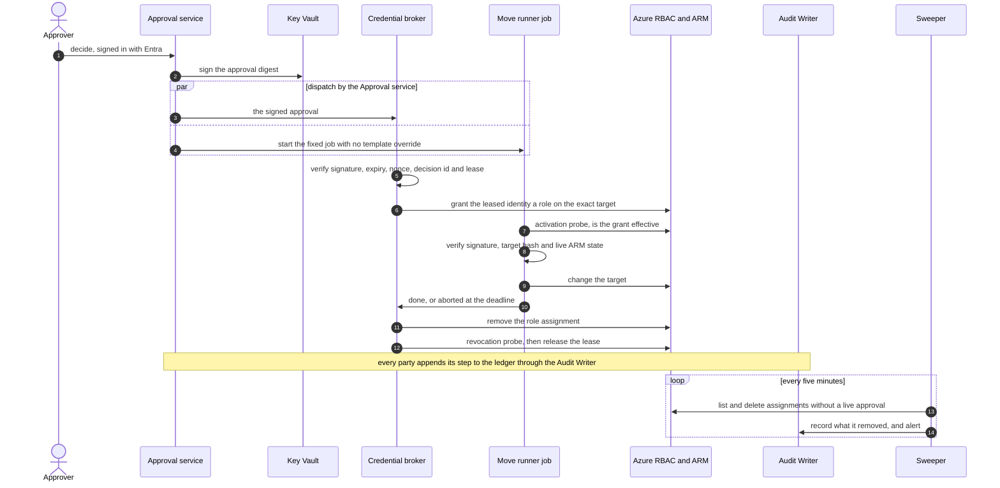
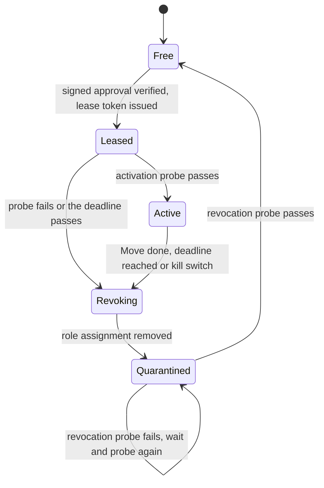

# Design 07 — Security architecture

> **What this answers:** *Who and what is trusted to do what, how is an agent that has been fooled kept from doing harm, and how do we know when something is wrong?* This is the physical security design for the [logical architecture](03-logical-architecture.md); it names products, and each product claim rests on the research in [security and compliance](research/security-and-compliance.md) and [Foundry Agent Service](research/foundry-agent-service.md), checked on 2026-10-31. Part of the [design](README.md).

**The idea in one paragraph.** An agent can be talked into anything, so no agent is given the power to do harm. The reasoning plane can only *read*. The one place that can *write* is a small deterministic execution plane that acts for **one approved Move at a time**, with an identity that holds a role only while that Move runs and that no other Move may use meanwhile. **No single component can complete a change:** one service signs the human's approval, a second grants the role only after verifying that signature itself, and a third verifies the signature and the live state of the target before it acts. Everything an agent says, calls or reads passes the governance hub, which is the single place to filter, meter, log and switch off, and free text is sanitised at the tool that returns it. What we cannot make impossible, we make visible, bounded and reversible.

---

## 1. Security principles, restated as controls

| Principle ([01 §5](01-requirements-and-principles.md#5-design-principles)) | The control that makes it true |
|---|---|
| P2 two planes, **Q-SEC-1** no standing write | Agent identities hold **zero** write roles; the execution plane gets a role assignment per approved Move, on an identity leased to that one Move, and removed afterwards ([§3](#3-identity)) |
| P3 everything through the gateway, **Q-SEC-2** | Model deployments grant no data-plane role to any agent identity; private networking leaves the hub as the only route, and the spine reaches a leaf through the hub too ([04 §8](04-landing-zone-and-citadel.md#8-the-gateway-bypass-register), B12); a canary agent proves it every day ([§7](#7-network-and-the-short-list-of-exceptions)) |
| P5 a prompt is not a boundary | Authorisation lives in Entra roles, per-tool app roles at the hub, gateway contracts and the deterministic gate — no rule exists only in a system prompt |
| P6 external text is data, **Q-SAF-2** | Free text enters through many tools, so a **source sanitiser** sits in every tool service that returns it (the Document reader is its web instance): text is neutralised, labelled, size-limited and screened, and a session that has read it is *tainted* — privileged tools refuse its arguments or ask a human ([§5](#5-defence-against-prompt-injection-in-nine-layers)) |
| **Q-SAF-1** approvals | Approvals are authenticated human actions, **signed**, and bound to one target and its live state; purchases need two named people with different hats ([§4](#4-approvals-that-cannot-be-forged-or-reused)) |
| **Q-SEC-3** no secrets | Keyless by default: managed identities, workload identity federation, Entra tokens; local (key) authentication is denied by policy; the only deliberate keys are Key Vault signing keys, each usable by one service, and none sits in code ([§6](#6-secrets-keys-and-data-protection)) |

## 2. Trust zones, physically

The zones of the [logical design](03-logical-architecture.md#3-trust-boundaries) map to Azure like this. A zone boundary is a *network* boundary, an *identity* boundary and a *log* boundary at once.

| Zone | Where it lives | Identity it runs as | Network position |
|---|---|---|---|
| **Z0 the world** | the public internet and Microsoft's published pages | none | reached **only** by the Document reader, through an egress firewall with a host allow-list |
| **Z1 reasoning** | hosted agents in Foundry Agent Service (one identity per agent: fifteen identities for fourteen roles, in eleven contract groups, [05](05-agents-and-orchestration.md)) | Entra **agent identity**, read-only roles only | VNet-injected outbound; models, tools and agents are reachable **only** through the governance hub, and the other internal destinations are the enumerated bootstrap paths (Key Vault for the contract key, Entra sign-in, telemetry) in [04 §6](04-landing-zone-and-citadel.md#6-network) |
| **Z2 tool services** | MCP servers on Azure Functions or Container Apps, published through the hub | one managed identity per tool service, read-only roles | private endpoints; callers authenticated at the hub *and* in the tool; free text leaves only through the source sanitiser ([§5](#5-defence-against-prompt-injection-in-nine-layers)) |
| **Z3 execution** | Approval service, Policy service, Credential broker, Move runner, Verifier (Container Apps and jobs) | separate managed identities per component, each with the narrowest role ([§3.1](#31-who-has-an-identity)) | **its own internal Container Apps environment in its own subnet, `snet-exec`** (an environment owns its subnet, so Z3 shares a network with nothing); inbound only to the Approval service, from the Brief service and the two approval front-ends (X1, X5); outbound paths enumerated in [04 §6](04-landing-zone-and-citadel.md#6-network): Key Vault for each service's own signing key, the target ARM scope through the firewall, the ledger through the Audit Writer; **no model call inside this zone** |
| **Z4 estate data** | the operational store, cost data in Blob, the Ledger and its single writer, the **Audit Writer** | managed identities of the services that own them | private endpoints; no public access; EU only; the Audit Writer's ingress sits in the tools environment ([04 §6](04-landing-zone-and-citadel.md#6-network)) |
| **Z5 the Commons** | a public Git repository | GitHub accounts of contributors | published only through a pull request and a human review; **no counts in single-tenant mode**, where a cohort of one would re-identify the organisation |

A **separate Lab subscription set** is a sixth place that is never a zone of the estate: it has its own budget, policy and expiry, and no network route to anything in Z4 ([§8](#8-the-lab-as-a-security-boundary)).

## 3. Identity

### 3.1 Who has an identity

| Principal | Kind | Count | Purpose | Standing permissions |
|---|---|---|---|---|
| People: owners, approvers, FinOps, platform | Entra users | many | decide, review, administer | owners and approvers: none in Azure; administrators: eligible through PIM |
| **Agent identity** per hosted agent | Entra Agent ID, created at deploy | **fifteen** (fourteen roles; the Librarian runs twice), in eleven contract groups | call the hub, read the knowledge services | the hub APIs of its group's contract, with per-tool app roles assigned **directly to it**; **no** estate role, **no** data-plane role on model deployments |
| **Tool-service identity** | user-assigned managed identity | one per tool service | read estates, prices, documents for an authorised caller | Reader, Cost Management Reader, Monitoring Reader at the estate scopes it serves |
| **Approval service** | user-assigned managed identity | one | authenticate the approver, **sign** the approval, **start** the runner job | *Key Vault Crypto User* on the approval-signing key's own vault ([§6.1](#61-secrets)); a custom role with only job *start* on the runner jobs; **create** on `approvals-index` (the entry) and `approval-records` (the signed record), Cosmos data roles scoped to the container ([06 §7.2](06-data-and-knowledge.md#72-the-operational-store-container-by-container), [Learn](https://learn.microsoft.com/azure/cosmos-db/how-to-connect-role-based-access-control#grant-data-plane-role-based-access)); **no estate role, no role-assignment right** |
| **Policy service** | user-assigned managed identity | one | decide, in code, whether a rule or an **autonomy credential** covers a proposed Move or purchase, and return a **signed policy decision** that binds the proposal's hash | reads the Move catalogue and the rules and credentials it evaluates, and **nothing about any estate**; *Crypto User* on its own decision-signing key only ([§6.1](#61-secrets)), so the broker and the runner check the decision against its pinned public key instead of the Approval service's word; **no model, no estate role, no role-assignment right; cannot start a job or sign an approval** |
| **Credential broker** | user-assigned managed identity | one | grant and remove the execution identity's role | the **constrained delegation** of [§3.3](#33-the-execution-identity-just-in-time-without-pim) at the scopes an estate owner opted in; creates the single-use nonce marker in `approvals-index` (a second create returns HTTP 409) and reads `approval-records`, container-scoped; *Crypto User* on its own entry-signing key only ([§6.1](#61-secrets)); **cannot start a job, sign an approval or use another service's key** |
| **Execution identities** | user-assigned managed identities, one per *Move class*, available to that class's runner job only | a handful | carry out one approved Move | **no estate role** at rest; a role exists only while a Move runs, lists only what that Move needs and never the move right, and the identity is **leased exclusively** ([§3.3](#33-the-execution-identity-just-in-time-without-pim)); container-scoped create on the start marker in `approvals-index` and read on `approval-records`, and its own entry-signing key ([§6.1](#61-secrets)) |
| **Verifier** | user-assigned managed identity | one | after a Move, re-read the live state, compare it with the prediction (saving, coverage, utilisation) and write the **outcome** | **read-only**: Reader, Cost Management Reader and Monitoring Reader at the scopes where the estate owner consented to *action* onboarding ([11 §6](11-delivery-and-operations.md#6-onboarding-and-offboarding-an-estate)); any further read that reservation or savings-plan utilisation needs is *to confirm* before phase 5; container-scoped create on its outcome records in `ledger` ([06 §7.2](06-data-and-knowledge.md#72-the-operational-store-container-by-container)); *Crypto User* on its own entry-signing key only ([§6.1](#61-secrets)); **no write role on any estate, no role-assignment right; cannot start a job; no ingress** |
| **Sweeper** | user-assigned managed identity | one | remove leftover role assignments | **delete-only**: read and delete under the same condition |
| **Audit Writer** | user-assigned managed identity | one | the ledger's single writer: verifies each producer's signature, sequences and chains entries | the only write role on the ledger ([06 §7.3](06-data-and-knowledge.md#73-the-audit-ledger)); *Crypto User* on its own digest key only |
| **Erasure job** | user-assigned managed identity | one | serves an erasure by identity | container-scoped Cosmos roles: delete on the erasable containers (`approval-records` among them), create on `erasures`; no estate role, no ledger role |
| **Approval cross-check job** (D13) | user-assigned managed identity | one | compares each signed approval with the Entra sign-in log; code, not an agent | container-scoped read on `approval-records`; a read-only Graph application permission for sign-in logs (`AuditLog.Read.All`, [Learn](https://learn.microsoft.com/entra/identity/monitoring-health/howto-analyze-activity-logs-with-microsoft-graph); Entra ID P1 or P2); reports findings, writes nothing else |
| **Release pipelines** | GitHub Actions, workload identity federation (OIDC) | one per environment | deploy infrastructure | a Contributor-style custom role **without the move right** (below) on our own resource groups plus a *conditioned* RBAC Administrator for the role assignments our templates create there (Contributor cannot assign roles); no lock or deny-assignment rights; nothing above a resource group |
| **Bootstrap** | a PIM-eligible role of a named platform engineer, break-glass, or the identity of a **protected environment** that runs only after human approval ([11 §3](11-delivery-and-operations.md#3-pipelines)); never a routine pipeline run | rare | foundation above resource-group scope: management groups, policy, subscription vending, **stack deny settings**, and lifting and re-applying the resource-group locks of the stack-move procedure | *Azure Deployment Stack Owner* (creating or deleting deny assignments needs it; *Contributor* cannot, [Learn](https://learn.microsoft.com/azure/azure-resource-manager/bicep/deployment-stacks)) **plus the lock rights**, `Microsoft.Authorization/locks/*`, which a custom role can hold on its own ([Learn](https://learn.microsoft.com/azure/azure-resource-manager/management/lock-resources#who-can-create-or-delete-locks)), on our own subscriptions ([09 DR-1](09-safeguards-and-drift-controls.md#21-drift-in-what-we-own), [11 §3](11-delivery-and-operations.md#3-pipelines)); any other foundation role is held for a stated change only; the platform owner grants and revokes it |
| Platform identities | managed identities of the drift watchers, the Lab controller and the Janitor | few | verify, repair, run experiments, clean up | watchers: read; Lab controller and Janitor: Lab subscriptions only, with a Contributor-style custom role **without the move right** |

**No routine identity holds the move right.** A move needs `Microsoft.Resources/subscriptions/resourceGroups/moveResources/action` on the source resource group ([Learn](https://learn.microsoft.com/azure/azure-resource-manager/management/move-resource-group-and-subscription#checklist-before-moving-resources)), and moving a managed resource out of its stack removes the stack's protection ([09 DR-1](09-safeguards-and-drift-controls.md#21-drift-in-what-we-own)). Apart from the bootstrap row, no identity above holds that action or a wildcard that contains it: where Contributor's breadth is needed (the release pipelines, the Lab controller, the Janitor) the role is a custom Contributor-style role with the action in `NotActions`, a subtraction and not a deny ([Learn](https://learn.microsoft.com/azure/role-based-access-control/role-definitions#notactions)), so a Resource Graph diff of role assignments catches a second assignment that grants it back and D17 catches the move itself. Locks and deny assignments are bootstrap-only too; the planted-drift job ([09 §6](09-safeguards-and-drift-controls.md#6-testing-the-safeguards)) holds the right on the test spoke alone.

**A named human sponsor stands behind every agent identity and every execution identity** (Entra Agent ID has sponsors and owners; for managed identities the sponsor is a tag and a record in the Estate service). If a sponsor leaves, the identity is disabled until a new one is named — an automated check, not a policy document. The estate owner grants and revokes **read** and **action** onboarding at their scope ([11 §6](11-delivery-and-operations.md#6-onboarding-and-offboarding-an-estate)); the **purchaser role** goes to a purchase execution identity only while an approved purchase runs (spike **S-ACT-1**); the Estate service holds read-only Graph permission to check approver standing, and nothing that writes.

### 3.2 Roles — least privilege in Foundry

- Foundry roles were renamed in 2026 (Foundry User, Project Manager, Account Owner, Owner); the **role IDs are unchanged**, so Bicep and Policy reference IDs, never names ([Foundry RBAC](research/features-05.md)).
- The least-privilege **Foundry Agent Consumer** role is held at *agent* scope, not project scope, and only by the hub's backend identity: the spine reaches a leaf through the hub and holds no Foundry role of its own ([04 §4.4](04-landing-zone-and-citadel.md#44-the-publish-contract-tools-and-who-may-call-them)).
- **API-key authentication is denied** on Foundry, AI Search, Storage and Cosmos DB by Azure Policy; a key bypasses RBAC and so bypasses every control above.
- No agent identity holds a role on a model deployment. A hosted agent reaches models through the hub; if it tries the deployment directly, the call fails on RBAC *and* on the network, and the canary alerts ([§7](#7-network-and-the-short-list-of-exceptions)).

### 3.3 The execution identity: just-in-time, without PIM

The north star asks for "a short-lived, scoped identity for each Move". The design delivers a **persistent identity with a short-lived, scoped permission**, leased to one Move at a time. **Privileged Identity Management cannot make a managed identity or service principal *eligible*, because it cannot perform the activation step** ([research](research/security-and-compliance.md), finding 4), so the design does the same with parts that exist, and splits the authority across **three parties that each verify independently** ([ADR-07](13-decisions.md#adr-07-execution-identities-are-granted-just-in-time-by-a-broker-on-a-signed-approval)):

| Party | Verifies before it acts | Cannot |
|---|---|---|
| **Approval service** | the approver's token and standing, the policy decision, the live etags it binds | grant a role; hold an estate role |
| **Credential broker** | **itself**: the approval's signature (pinned public key), expiry, single-use nonce, the **Policy service's own signature** on the policy decision, and the lease | start the job; sign an approval; use another service's key |
| **Move runner** | the signature, the target hash **and the live ARM state**; it refuses anything else | grant; sign an approval; touch another target |

The **Auditor** cross-checks approvals in the ledger against the Entra sign-in logs (D13). Every party appends through the **Audit Writer**, the ledger's single writer, which sequences entries that each carry their producer's signature ([06 §7.3](06-data-and-knowledge.md#73-the-audit-ledger)); if it is unavailable nothing changes — no ledger entry, no change ([03 §6](03-logical-architecture.md#6-degraded-modes)).

1. **The delegation, stated honestly.** Onboarding has two parts: **read onboarding** (the three reader roles) and a separate, consented **action onboarding** that gives the broker a *constrained* delegation — *Role Based Access Control Administrator* with an ABAC **condition** — at the scopes the estate owner opted in. The condition limits the **role definitions** (our custom Move roles only), the **principals** (the execution identities only) and the **principal type**, separately for adding and for removing, so the sweeper's delegation is **delete-only** ([Learn](https://learn.microsoft.com/azure/role-based-access-control/delegate-role-assignments-overview)). **It cannot limit the target scope**, which is bounded only by where the delegate holds the role. So *target scoping is deterministic code — the signed target hash and the runner's check of live state — plus detection (D15), not ABAC*, and the estate owner trusts the broker with a constrained delegation, not with nothing ([04 §3.1](04-landing-zone-and-citadel.md#31-where-things-live), [11 §6](11-delivery-and-operations.md#6-onboarding-and-offboarding-an-estate)). The syntax and the delete-only form are spike **S-ID-1** ([14](14-next-phases.md)).
2. **Only the Approval service starts the runner.** The runner is a Container Apps job per Move class: image pinned by digest, **no secrets**, only that class's identity available to it, and its assignment at the exact resource, never at subscription scope. Learn warns that the job *start* API accepts a template that can override images, commands and environment variables, and that a container can use any identity available to the job ([Jobs in Azure Container Apps](https://learn.microsoft.com/azure/container-apps/jobs#permissions)): permission to start is permission to run code as that identity. So the Approval service alone holds start, its call carries no template, and any other start, or one with a template, raises D16. The identity still holds no estate role until the broker has verified a signed approval.
3. **Leases, probes and quarantine.** Each execution identity is **leased exclusively** — one active Move at a time, fenced by a lease token that the runner and the Audit Writer check. An **activation probe** before the Move proves the grant is effective and matches the approval; a **revocation probe** after it proves the role is gone, and the identity stays **quarantined** until it passes. **Azure RBAC changes can take up to ten minutes to take effect** ([Learn](https://learn.microsoft.com/azure/role-based-access-control/troubleshooting#azure-role-assignments)), so a Move starts only after its activation probe, a purchase window includes the delay, and *revoked* means removed *and probed*. Moves of a class queue behind its lease: the price is latency, not safety. Spike **S-ID-3** measures it.

4. **Expiry has three layers.** The broker revokes in a `finally` step; the independent **sweeper** (own identity and schedule) removes leftovers; a **Resource Graph alert** fires if an assignment outlives its approval. The runner checks a revocation flag between steps and aborts cooperatively at the lease deadline. PIM time-bound *active* assignments, if licensed, would be a fourth layer — a later hardening, not a dependency.
5. **Purchases** use a purchaser role at the billing or subscription scope that fits the agreement type; role, scope and second approver are part of the approval record. The mechanism per agreement type is spike **S-ACT-1**; where AI execution cannot be shown, purchases of that type stay disabled.

**What is left if parts fail.** If the sweeper, the broker and the alert all fail, an unused role assignment is usable only by its class's runner job, which only the Approval service starts. A compromised *broker* can grant only our Move roles to execution identities and starts nothing; D15 flags any grant that matches no signed approval. A compromised *Approval service* can sign — forge — an approval for anything the Policy service permits, but cannot widen the delegation; D13 and D18 detect it after the fact. That is **defence in depth with independent failures needed**, not impossibility, and it is why the Approval service is the smallest, most reviewed code we own: typed C#, property-tested, no model.

### 3.4 Conditional Access and the licence line

Conditional Access, Identity Protection and governance workflows *for agents* need a **Microsoft Agent 365 licence** (per user, for owners and sponsors) on top of Entra P1 ([research](research/security-and-compliance.md), E3–E5). Entra Agent ID itself, managed identities and workload identity federation are included. The MIT core therefore works without any of it; the licence-bound controls are **optional modules** ([§11](#11-optional-modules-and-their-fallbacks)) and the fallbacks are least-privilege roles, the network and the gateway.

**Approver standing** comes only from **human-administered** Entra groups or RBAC roles on the target, re-read at the moment of approval. An owner inferred from a tag, a reply or the directory is a *hint for proposing approvers*, never standing: the Surveyor and the Diplomat may propose, and editing a tag cannot make anyone an approver (D10).

**Step-up without Entra P1.** With P1, a purchase uses a Conditional Access **authentication context**. Without it, the Approval service enforces a **fresh sign-in in code**: `prompt=login` (it forces credentials again and negates single sign-on, [Learn](https://learn.microsoft.com/entra/identity-platform/v2-protocols-oidc)); a `nonce` bound to that approval; the ID token's `iat`, which Learn defines as when the authentication occurred ([claims](https://learn.microsoft.com/entra/identity-platform/id-token-claims-reference)), within a short window; and an `amr` check for multi-factor (an optional claim to request in the app registration, [Learn](https://learn.microsoft.com/entra/identity-platform/optional-claims#amr-claim)). `max_age` and `auth_time` are not documented for the Microsoft identity platform, so nothing depends on them (*to confirm*).

## 4. Approvals that cannot be forged or reused

An approval is the only thing that lets the execution plane change an estate, so it is built like a payment authorisation.

| Property | Mechanism |
|---|---|
| **Authenticated human** | a Teams Adaptive Card `Action.Execute` with single sign-on, or an Entra-authenticated approval page (exception **X5**, [§7](#7-network-and-the-short-list-of-exceptions)); the adapter and the page only relay — the Approval service validates the user's token itself |
| **Right person** | the approver holds *standing* for that target — a human-administered Entra group or RBAC role ([§3.4](#34-conditional-access-and-the-licence-line)) — checked by deterministic code at the moment of approval, not by a model |
| **Bound to one target and its live state** | the **target hash** covers the Move id and version, the canonical resource ids, the **ARM etags or configuration hashes of the live state**, the parameters, the price or saving shown and the **policy decision id**; the runner recomputes it against the live target and refuses on any difference |
| **Signed** | the Approval service signs the record with an **asymmetric Key Vault key** only it may use ([§6.1](#61-secrets)) and creates it in the erasable `approval-records` container. It carries the approver's `oid`, `tid` and `amr`, the sign-in time (the token's `iat`; an `auth_time` claim is *to confirm*), the target hash, an **expiry** and a **nonce**. Broker and runner verify with the pinned public key and hold no permission on that key; a record without a valid signature is a forgery by definition |
| **Expires** | a validity window (default hours for a Move, minutes for a purchase re-price); an expired approval is dead |
| **Single use** | the broker consumes the nonce at grant by creating a marker whose id is the nonce in `approvals-index`, and the runner marks the start the same way: a second create fails with HTTP 409 ([06 §7.2](06-data-and-knowledge.md#72-the-operational-store-container-by-container)) and raises D20, so a replay gets no second grant and a second run is refused |
| **Separation of duties** | purchases need **two distinct people with different hats** (workload owner and Finance), neither the requester; the service enforces *different hats*, not just different names |
| **Step-up for money** | a Conditional Access **authentication context** (fresh MFA) at the approval page where licensed, otherwise the code-enforced fresh sign-in ([§3.4](#34-conditional-access-and-the-licence-line)); no card can approve a purchase by itself |
| **No impersonation channels** | voice, avatar, text message and a free-text e-mail reply can *start a conversation* but **never approve**; the only approving act is the authenticated action above |
| **Recorded** | each approval is appended through the **Audit Writer** as an entry holding the approval id, the hash of the signed record and a pseudonymous id — never the approver's claims — signed by the Approval service. The signed record sits in the erasable `approval-records`, where an erasure can reach it ([08 §4.2](08-governance-and-compliance.md#42-positions)); the permanent `approvals-index` holds only ids, hashes, state and the single-use markers. The Auditor's D13 job cross-checks every approval against the Entra sign-in log and the Brief record |

**A model's reading of a chat is never an approval.** A documented counter-example exists in which an agent inferred consent from a conversation ([research](research/features-02.md), F2-20). The Brief service therefore captures the click; the agents only see the *result*. Where a human has granted an **autonomy credential** for a domain, the Approval service signs a record whose basis is that credential instead of a click: target hash, live state, nonce and expiry are the same, the credential's cap and expiry are part of the policy decision, and a purchase never runs on a credential ([10 §4](10-test-and-evaluation.md#4-release-gates), G9).

## 5. Defence against prompt injection in nine layers

Cost data is full of text that an attacker can influence — tags, resource names, descriptions, invoice lines, e-mail replies, public pages — and it arrives through many tools, not only the web. The design assumes **some injection will succeed against a model**, and makes sure that it cannot reach anything that matters. Layers are ordered from *architectural* (cannot be bypassed by a cleverer prompt) to *probabilistic* (can).

| # | Layer | What it does | Status today | If unavailable |
|---|---|---|---|---|
| 0 | **Architecture** | the reasoning plane has no write power; no agent group holds all three legs of the *lethal trifecta* ([§5.1](#51-the-lethal-trifecta-per-agent-group)) | by design | n/a |
| 1 | **Source sanitiser** | a library in **every tool service that returns free text** — tags, names, invoice lines, directory fields, replies, documents: it neutralises delimiters such as `</documents>`, strips control characters, caps field lengths, labels text *untrusted* and **chunks anything over 10,000 characters** (the content-safety window). The **Document reader** is its web instance, and also fetches only from an allow-list, strips markup and records source and hash | our code | n/a |
| 2 | **Gateway screening** | `llm-content-safety` with `shield-prompt` on every route that carries untrusted text. The policy screens **MCP and A2A requests and responses** in windows — prompts in 10,000 characters, responses in a configurable window (1,000 by default) — buffering streams in a **sliding window**; a violation in a *stream* stops it with no 403, so a cut stream counts as a failure. *Custom* policies must **not** read `context.Response.Body` on MCP servers ([policy](https://learn.microsoft.com/azure/api-management/llm-content-safety-policy), [MCP](https://learn.microsoft.com/azure/api-management/expose-existing-mcp-server#configure-policies-for-the-mcp-server)). The hub strips `x-policy-id` and API-version overrides | GA ([features-05](research/features-05.md), F5-09); on our hub: spike **S-GW-4** | in-code screening before the call |
| 3 | **Model guardrails** | Foundry content filters per access contract; Prompt Shields for *documents* are **off by default** and must be turned on for every untrusted-text route; English-primary, so multilingual cases are tested. Foundry guardrails moderate only the **first 1,000 characters** of text ([Learn](https://learn.microsoft.com/azure/ai-services/content-safety/region-availability#service-limits)), so they are never relied on for long untrusted input: layers 1 and 2 carry it, and an **L5 test** plants an injection after character 1,000 and after character 10,000 of a long input and shows it is still caught. On the **Invocations** protocol a policy screens nothing without the `invocations_moderation` settings ([Learn](https://learn.microsoft.com/azure/foundry/agents/concepts/hosted-agent-guardrails#scope-and-limitations)): an **L5 test** asserts they exist on the *deployed* path, that a canary payload is blocked, and **fails closed** if either is missing | GA for models; agent-level guardrails and tool-call/tool-response checks are **Preview** | gateway screening plus layer 5 |
| 4 | **Information-flow labels and taint** | text from Z0 carries an *untrusted* label through the workflow, including the free-text fields of typed records; **session-level taint**: once untrusted text has entered a session, privileged tools require human confirmation or are blocked for it | FIDES in Agent Framework is **experimental**; fallback is our own label in the tool-call envelope | the fallback is the default; FIDES is a spike |
| 5 | **Deterministic gate before every tool call** | allow / deny / require-approval policy as code, in the agent process | Agent Governance Toolkit (MIT) is **public preview** with breaking changes between majors; fallback is an in-house policy check with the same contract | in-house check |
| 6 | **Tool contracts at the hub** | **per-tool app roles assigned directly to agent identities**, checked on the verified `azp` (`x-sub-agent-id` is attribution only; spike **S-GW-3**); read-only identities behind the tools; typed, size-limited results. A native MCP server applies its policies to *all* its tools, so tools of different trust classes sit on separate servers | GA | n/a |
| 7 | **Egress control** | VNet-injected outbound with a firewall allow-list; hosted-agent egress rules (audit or enforce) | hosted-agent egress policy is **Preview, "not intended for production use"** — treated as *audit-only* until GA | the firewall allow-list carries the load |
| 8 | **Human approval** | the only path to a change ([§4](#4-approvals-that-cannot-be-forged-or-reused)) | by design | n/a |
| 9 | **Detection and testing** | injection canaries in every data source and tool-service free-text field, a red-team suite in CI with **sanitiser attacks** (breakouts, oversize, control characters), the moderation-setting, long-input (an injection after characters 1,000 and 10,000) and session-taint tests, scheduled red-teaming in a purple environment, alerts on screening blocks | self-hosted PyRIT and ASSERT in CI are the baseline, as EU availability of cloud red-teaming is unverified ([10](10-test-and-evaluation.md#2-the-layers)); Foundry's red-teaming agent where supported (cloud runs support prompt and container agents, not function tools or non-Azure tools) | PyRIT |

**Order of trust:** layers 0, 1, 6, 8 are deterministic and carry the weight. Layers 2–5, 7 reduce probability and give visibility. Layer 9 proves the rest keeps working.

**What typed records do and do not stop.** There is no agent-to-agent channel: a leaf never hands text to another leaf; the spine passes a case id and a record reference. But instructions can still travel through the **free-text fields of typed records** — `notes`, rationales, strings derived from tags — so every free-text field is sanitised at its source and length-limited, the typed-field policy limits where free text may appear ([05 §1](05-agents-and-orchestration.md#1-the-pattern-a-deterministic-spine-with-agentic-leaves)), and a session that has read such text is tainted.

### 5.1 The lethal trifecta, per agent group

An agent that holds **private data**, reads **untrusted content** and can **communicate externally or change state** can be made to leak or damage. The design splits the cast so that no group holds all three — or, where it must, the third leg is made *typed and pre-resolved*. There are **eleven groups, one row each**; `engineer` and `govern` run on EU contracts only, and `examine` has two contracts that never share a session.

| Agent group (see [05](05-agents-and-orchestration.md)) | Private data | Untrusted content | External effect | Verdict |
|---|---|---|---|---|
| **`study`** — Scholar, Cartographer | no: public knowledge | **yes**: the Scholar is the *only* reader of web text, through the Document reader | none: draft claims go to the case store | broken at *private data* and *external effect* |
| **`curate`** — Librarian (Atlas) | no: the Atlas is public | second-hand: draft claims derived from web text, read as labelled data | the *only* writer of Atlas proposals: pull requests to `atlas/**`, human-reviewed; `acia-judge-pub`, public class only | broken at *private data*; the repository leg is reviewed and path-limited |
| **`survey`** — Surveyor | **yes**: estate inventory, owners | **yes**: tags, names, descriptions | none: no egress, the hub is the only route | broken at *external effect* |
| **`investigate`** — Detective, Skeptic, Economist | **yes**: cost, usage, the Estate Model | **yes**: the same free text | none | broken at *external effect* |
| **`experiment`** — Experimenter | no: Lab estates hold synthetic data | low: reviewed Atlas claims and recipes, sanitised; no web reader | none of its own: it **plans**, and the deterministic Lab controller deploys signed recipes within a cost cap and an expiry ([§8](#8-the-lab-as-a-security-boundary)) | broken at *private data* and *external effect* |
| **`converse`** — Diplomat | **yes**: the case, in minimal form | **yes**: owners' replies, e-mail | **yes**: it speaks to people | **all three — constrained, see below** |
| **`engineer`** — Engineer (EU only) | **yes**: customer source code is estate-confidential | **yes**: source repositories, comments, recipes | pull requests to `moves/**` YAML in our repository, reviewed; their CI has no secrets or federation ([§9](#9-supply-chain)) | **all three — constrained: a reviewed, path-limited pull request** |
| **`govern`** — Auditor, Librarian (lessons); EU only | **yes**: ledgers, audit, lessons | low: outcomes, traces; owners' words only as *draft* lessons | none: no route to anything public | broken at *external effect* |
| **`examine`** — Examiner (`examine-pub`: synthetic estates; `examine-eu`: real-estate retrospective cases) | `examine-eu` only | **yes**: the examinee's output is untrusted text for the judge | none: it writes scores | broken at *external effect*; the two contracts never share a session |
| **`forge`** — Forger | no: synthetic estates | no | writes synthetic data to the Terrarium only | broken at *private data* and *untrusted content* |
| **`conduct`** — Conductor | **yes**: budgets, ledger summaries | low: typed records only | none | broken at *external effect* |

**The Librarian runs as two instances with separate identities, in separate groups.** The Atlas instance (`curate`) writes proposals to the public repository and sees no estate data; the lessons instance (`govern`) reads estate lessons and has no route to anything public — one agent holding both would be a ready-made leak path from the Lesson Book to the Commons. The same logic separates the **Scholar**, the only reader of web text, from the Atlas Librarian, the only writer of proposals, and the **Examiner**, which reads the examinee's output and may hold real-estate cases, from the **Auditor**.

**The Diplomat is the one group that cannot avoid the third leg,** because talking to people is its job. It is therefore built as a *typed channel*, not a free one:

- It cannot choose a recipient: the Brief service resolves the person from the Estate service.
- It cannot send raw text: it fills a **Brief template** with structured fields and a short, length-limited rationale; the card is rendered from the template, never from model-authored markup or links.
- It sees a **minimal** view of the case — resource aliases and money, owner *pseudonyms* — not the raw estate.
- Links are generated by the Brief service from an allow-list; attachments are not supported.
- Every outbound message is screened at the hub, counted against the attention budget and written to the audit ledger.
- Its replies from people are untrusted text, screened like any other; the first reply taints the session, after which nothing but typed Brief fields may leave it.

## 6. Secrets, keys and data protection

### 6.1 Secrets

- **Keyless by default.** Managed identities between services, workload identity federation from GitHub Actions, Entra tokens for the hub. No secret in a container image, an environment variable of a hosted agent, a prompt, a trace or a contract (hosted-agent guidance forbids secrets in images and environment variables).
- **Key Vault** only where a secret cannot be avoided (for example an optional SMS provider key), with RBAC, purge protection, private endpoint and rotation by Policy. Defender for Key Vault is enabled (≈ €0.22 a vault a month).
- **Signing keys are the only keys we keep, and none is in code.** Each service that signs has its own asymmetric Key Vault key, usable by that identity alone: the **approval-signing key** (its misuse forges a human approval; it also signs the Approval service's ledger entries), the **entry-signing key of every other producer of ledger entries**, the Policy service's **decision-signing key** (its misuse forges a policy decision, which alone grants nothing), and the Audit Writer's **digest key** ([06 §7.3](06-data-and-knowledge.md#73-the-audit-ledger)). A service hashes its payload and calls `sign` on the digest ([built-in roles](https://learn.microsoft.com/azure/role-based-access-control/built-in-roles/security#key-vault-crypto-user)); private key material never leaves Key Vault, and no key sits in code, an image, a variable or a deployment output. Everyone else verifies with **public keys pinned in their configuration** (distribution: spike **S-ID-3**). Where a producer's entry key lives has three honest answers: (a) **a vault of its own** — the default for the chain (Policy service, broker, runner, Verifier), because Learn recommends vault-scope role assignments and discourages per-key ones ([RBAC guide](https://learn.microsoft.com/azure/key-vault/general/rbac-guide)); each vault adds a private-endpoint meter and a per-vault Defender line to the cost model ([12](12-cost-and-finops.md)); (b) **one shared vault with a key-scoped role per key and one assignee each** — supported but discouraged, for lesser producers only (those whose entries record no grant, revoke or execution step, such as the Brief service or the sweeper), with a test that no identity holds a vault-scope role there; (c) **the Audit Writer signing on a producer's behalf** — it would stop producers forging each other but let a compromised writer forge any of them, which the producer's own signature exists to prevent, so never for approvals, grants, revokes or execution steps. Keys rotate by release, verifiers accept the previous key id for the longest approval validity, every `sign` is logged, and a `sign` with no matching ledger entry is D18 ([§10.2](#102-detections-we-ship-as-code)).
- **No key in a deployment output.** The documented defaults of the Citadel access-contract sample conflict for `useTargetAzureKeyVault`: the Bicep parameter default is **true**, while the README parameter table says **false**. We rely on neither: our parameter file sets it **explicitly to true**, and a test asserts on the *deployed result* that **no key-bearing deployment output exists**, because a key in an output would sit outside Key Vault and RBAC (*to confirm* on the pinned commit `81599b3`; [04 §3.4](04-landing-zone-and-citadel.md#34-hardening-the-defaults)).
- **Customer-managed keys are a decision, not a default.** Foundry CMK for prompt agents needs your own Cosmos DB, Storage and AI Search each keyed, hosted-agent `$HOME` cannot be CMK-encrypted, and regions are limited. Platform-managed keys are the default; CMK is added only where a recorded driver exists. **No Managed HSM** (≈ €2,000 a month, no driver).

### 6.2 Data classes and what each may touch

| Class | Examples | Allowed deployment types | Logged content | Retention |
|---|---|---|---|---|
| **Public** | Microsoft documentation, price lists, the Atlas, synthetic data | EU Data Zone **or** Global Standard, Flex, Batch (cheapest) | full | as the Atlas |
| **Estate-confidential** | resource ids, costs, configuration, Estate Model | **EU Data Zone Standard** or regional — never Global | spans and metrics; content capture **off** by default; when on, into the protected GenAI content table | short, stated |
| **Personal** | owner names, e-mail, Teams content, voice | EU Data Zone; **pseudonymised** before it reaches a prompt | pseudonyms only | per the GDPR section of [08](08-governance-and-compliance.md) |
| **Secret-adjacent** | role-assignment ids, approval nonces | never in a prompt | ledger only | audit retention |

The data class is a property of the **access contract** at the hub. The gateway routes each call to a deployment type that its class allows and *refuses* a call whose data class exceeds what the target deployment permits. That is how the EU Data Zone premium — about +20 % on the GPT-6 family and about +10 % on earlier models, varying by meter ([12](12-cost-and-finops.md)) — is paid only on the data that needs it.

**One contract per group, data class and environment.** A contract serves one class: `govern` and `engineer` are EU only, and `examine` has `examine-pub` (synthetic estates) and `examine-eu` (real-estate retrospective cases). `acia-judge-pub` — Claude on a Global deployment, with no EU Data Zone option — and the `acia-batch` and Flex pools are reachable **only from public-class contracts**; EU contracts have no route to them ([04 §4](04-landing-zone-and-citadel.md#4-contracts-per-agent-group)).

### 6.3 Protecting what traces contain

Traces and gateway logs can contain prompts and tool results. Therefore: content capture is off by default; where on, content goes to a **protected table** (preview) that only a named role reads; the platform workspace has table-level access control; logs are policy-deployed to the platform workspace, not to a workspace the reasoning plane can read; and the **audit ledger is a different store from the traces**, so deleting or editing a trace never changes the record of what was approved or done ([06 §7](06-data-and-knowledge.md#7-the-physical-stores)).

**PII never relies on the hub.** Tool services pseudonymise personal data *before* text reaches the hub; the hub's PII policy is a second net — it analyses MCP traffic inbound only and stops at about 125,000 characters ([research](research/citadel.md)) — and with `piiStateSavingEnabled=false` the gateway stores no PII mappings.

## 7. Network and the short list of exceptions

The topology is in [04](04-landing-zone-and-citadel.md). The security rules on top of it:

1. Every PaaS resource we own has public network access **off** and a private endpoint; Azure Policy denies the opposite.
2. The **hub is the only route** from Z1 to a model, a tool or another agent.
3. **Network security perimeters** protect Storage, Key Vault, AI Search and Foundry from exfiltration (GA for Foundry, preview for some other kinds — adopted where GA).
4. A **canary agent** runs daily: it tries to call a model deployment, a Foundry project endpoint, a leaf endpoint without the hub and an estate API directly. It must be blocked, and the block must raise an alert; a silent success fails the release gate G2.
5. **Z3 has a network of its own.** `snet-exec` holds the only environment with execution components; its allowed paths are enumerated in [04 §6](04-landing-zone-and-citadel.md#6-network), and a network test asserts that nothing else reaches it and that it reaches nothing else.

**Public-ingress exceptions — the complete list.** "Private only" is only honest with the exceptions written down.

| # | Exception | Why | Compensating controls |
|---|---|---|---|
| X1 | The **Teams bot endpoint** that receives card actions | Teams and Bot Service reach the bot over the internet | only the Bot Service source ranges, JWT validation of every inbound activity, Front Door or Application Gateway WAF if the landing zone offers one, no data beyond the activity; the route serves nothing else and relays to the Approval service (the approval page is X5) |
| X2 | Optional: ACS e-mail, SMS and voice callbacks | the channel provider calls back | signed webhooks, source ranges, module off by default |
| X3 | Optional: Foundry-published agent in Microsoft 365 (`enable_m365_public_endpoint`) | Microsoft 365 requires a public, source-IP-filtered route for the Activity protocol | optional; the card path (X1) does not need it; conversational agent only, never approval |
| X4 | Foundry features that are **not** private-capable: Memory, web and Bing grounding, browser automation | no VNet support | **not used**; the Scholar uses the Document reader instead |
| X5 | The **approval web page**: the Entra-authenticated page that an e-mailed link opens and that purchases use | an approver may be outside Teams, and an e-mailed link has to open something | served from `snet-edge` on its own route and identity; **no anonymous route** but the sign-in redirect, so Entra sign-in (`prompt=login` for purchases, [§3.4](#34-conditional-access-and-the-licence-line)) precedes anything shown; the link carries only an opaque approval id and dies with the approval; the page shows what the Brief shows, rendered by the Approval service, which validates the token itself; each state change needs an anti-forgery token and the nonce; no framing, short sessions, rate limits, WAF if the landing zone offers one. An organisation that can reach an internal address may serve the page privately and drop X5 |

## 8. The Lab as a security boundary

The Lab does real things in real subscriptions, which makes it the likeliest place for a mistake to cost money or leak. It is isolated by construction:

- **Separate subscriptions**, vended on demand, in their own management group, with a **budget that stops** (an action group disables the spend path; budgets alone evaluate on 8–24-hour-old data and stop nothing), an **expiry tag**, and a **Janitor** that deletes expired resources.
- **No route** to Z4; synthetic data only; the Experimenter holds no role in any Lab or estate subscription, and the **Lab controller's** identity has rights only inside Lab subscriptions; policy denies anything outside an approved list of SKUs and regions.
- **The Experimenter plans; the Lab controller deploys.** The controller is deterministic code with no model and deploys **only signed recipes** — declarative experiment definitions that a human reviewer merged to the Atlas and the Atlas release signed. A run code that maps to no signed recipe is refused, a *new* recipe waits for human review, and **before it creates anything** the controller prices the recipe with the price engine and refuses above an hourly and a total cap. Lab data never leaves the Lab: only the bill, the probe results and the experiment record come back, as typed data.
- Experiments take **opaque run codes**, not raw parameters: in a published test, parameters embedded in prompts were followed 68 % of the time, while a code resolved by the Lab was followed 100 % ([research](research/features-07.md), F7-28). Requested and applied values are both logged.
- Code an agent writes runs in a **sandbox** with no identity and deny-by-default egress: Azure Container Apps Sandboxes (generally available since September 2026, Release Communications 561262; EU regions and prices *unverified*, *to confirm*) or dynamic sessions. A session is scoped to **(group, case)** and never reused across them.

## 9. Supply chain

| Asset | Control |
|---|---|
| **Models** | only models on the approved list, enforced by Azure Policy for deployments and the router subset; router pool changes are drift ([09](09-safeguards-and-drift-controls.md)) |
| **Agent framework and SDKs** | exact versions pinned; the Agent Framework core is GA, but many integrations are beta, and RC releases have broken credentials — upgrades are releases that pass the gates |
| **Containers** | built in CI from pinned bases, SBOM generated, images signed, only signed images admitted by the registry policy; private ACR. A Move runner job's image is pinned by digest and no job start may override it ([§3.3](#33-the-execution-identity-just-in-time-without-pim)) |
| **Pull requests and GitHub Actions** | **agent identities open pull requests only to data paths** (`atlas/**`, `moves/**` YAML). Workflows triggered by a bot-authored pull request run on **GitHub-hosted runners with no secrets and no federation**. Privileged workflows (OIDC to Azure, or self-hosted runners in the spoke) run from the **base branch** after a human approves and do not execute code from a pull request's head. A **required status check counts two distinct approvers who are not the author**: a GitHub environment needs only one of its required reviewers, so it is not a two-person rule by itself, and private-repository availability is spike **S-DEL-2** ([11 §3](11-delivery-and-operations.md#3-pipelines)). Actions are pinned by commit SHA; OIDC is per environment; no long-lived secret exists |
| **Infrastructure state** | **moving a managed resource removes its Deployment Stack protection** (Learn, [known issues](https://learn.microsoft.com/azure/azure-resource-manager/bicep/deployment-stacks-known-issues#known-issues)). So: detection **D17**; a read-only lock on the resource group as the documented procedure, lifted for a stack update and reapplied; and a planted-drift test that moves a resource every release ([09 §2.1](09-safeguards-and-drift-controls.md#21-drift-in-what-we-own)) |
| **MCP servers** | only servers we own or Microsoft's first-party servers; published to agents only through hub contracts; tool lists are reviewed like code; the Azure MCP Server runs in read-only mode |
| **Skills (`SKILL.md`) and Moves** | treated as code: pull request, review, tests; skill scripts run only in a sandbox; skills from outside are input from Z0; an agent-authored Move draft is YAML under `moves/**`, never code |
| **Atlas and Commons contributions** | pull request, knowledge CI, a human reviewer, a signed release ([06](06-data-and-knowledge.md)); the recipes the Lab controller may deploy ride in that signed release ([§8](#8-the-lab-as-a-security-boundary)) |
| **Developer machines** | package restores go through the organisation's approved feeds; nothing is pulled from public registries by the build |

## 10. Detection, response and the kill switches

### 10.1 What we log and where

Foundry, the hub and Azure services send diagnostic logs to the **platform Log Analytics workspace by Azure Policy** (deploy-if-not-exists). The audit ledger is separate and append-only, with the Audit Writer as its single writer ([06 §7.3](06-data-and-knowledge.md#73-the-audit-ledger)). The authority chain adds **approvals**, **leases**, **probe results** and **key operations** (the Key Vault log of every `sign`); the Activity Log, which records every create, update, delete and *action* operation through Resource Manager ([Learn](https://learn.microsoft.com/azure/azure-monitor/platform/activity-log-schema#administrative-category)), shows role-assignment writes, runner job starts and resource moves. The approval cross-check (D13) needs Entra sign-in logs, which Learn says need Entra ID P1 or P2 to download through Microsoft Graph ([Learn](https://learn.microsoft.com/graph/api/resources/signin?view=graph-rest-1.0)); an unlicensed tenant falls back to the signed record's own token claims and the Brief record — weaker, and stated as such. Where the landing zone runs a SIEM, our workspace feeds it; we **do not buy a SIEM** (Sentinel leaves the Azure portal on 31 March 2027; lake-tier ingestion is cheap if it exists).

### 10.2 Detections we ship as code

| # | Detection | Signal |
|---|---|---|
| D1 | a model deployment called by anything but the hub | Foundry request logs and caller identity |
| D2 | a role assignment on an execution identity without a live approval, or older than its approval | Resource Graph and Activity Log |
| D3 | a Move run without a matching approval id, target hash and live-state hash | ledger versus runner logs |
| D4 | spend or tokens per contract above 3× the trailing median | hub metrics |
| D5 | a spike in screening blocks, or a screening block on an internal route | hub logs |
| D6 | an agent identity sign-in from outside the expected network, or a new credential on an agent identity | Entra sign-in and audit logs |
| D7 | egress denials from hosted agents | firewall logs, egress-rule audit |
| D8 | an MCP tool, A2A agent or model alias published without a contract | APIM configuration versus the contract repository |
| D9 | the model router pool or a deployment version changed | Foundry control-plane changes versus the pinned list |
| D10 | an approval for a person with no standing for that target, or whose standing did not come from a human-administered group or role | ledger and the Estate service's approver sources |
| D11 | a hosted-agent version that is not the pinned one is receiving traffic | Foundry control-plane read |
| D12 | a purchase attempted outside the approved price tolerance | runner and price engine logs |
| D13 | an **approval without a matching Entra sign-in** by that approver in its window, or with no multi-factor | `approval-records` and the ledger versus Entra sign-in logs (P1 or P2); else the signed record's token claims versus the Brief record |
| D14 | a **lease violation**: two active Moves on one identity, a stale lease token, or reuse before the revocation probe passed | lease records, ledger, runner logs |
| D15 | a **role assignment that matches no signed approval** (another role definition, principal or scope) | Resource Graph and Activity Log versus the signed approvals |
| D16 | a **runner job started outside the Approval service**, or running an image other than the pinned digest (*to confirm* that job executions expose the image or template) | Activity Log (job start), job execution records |
| D17 | a **managed resource moved out of a Deployment Stack** | Activity Log (moves) versus the stack's managed-resource list |
| D18 | a **signing key used** by anything but its owner, or a `sign` with no matching ledger entry | Key Vault log versus the ledger |
| D19 | a **gap or break in the audit ledger**: sequence gap, broken chain, failed producer signature, missing daily digest | the Audit Writer's chain verification ([06 §7.3](06-data-and-knowledge.md#73-the-audit-ledger)) |
| D20 | an **approval refused** for a bad signature (on the approval or on its policy decision), an unknown key id or a replayed nonce (the second create of a single-use marker returns HTTP 409) | broker and runner logs; marker create conflicts in `approvals-index` |

### 10.3 Kill switches

| Level | Action | Effect | Time to take effect |
|---|---|---|---|
| One **model or alias** | repoint the alias at the hub, or remove it from the contract | agents get the next pinned alternative, or pause | seconds |
| One **contract** (an agent group in an environment) | suspend the APIM subscription or product | that group loses models, tools and agents | seconds |
| One **agent** | disable its Entra agent identity | **no new token; tokens already issued live until they expire** — about an hour for ordinary tokens, around 24 hours for managed identities ([Learn](https://learn.microsoft.com/entra/identity/managed-identities-azure-resources/managed-identity-best-practice-recommendations#limitation-of-using-managed-identities-for-authorization)), *to confirm* for agent identities. For an immediate stop, suspend the contract or add the agent's `azp` to the hub's deny list | identity: minutes to hours; contract or deny list: seconds |
| One **Move** | mark the version revoked in the catalogue | the runner refuses it; an in-flight Move **aborts at its next step** | seconds; in flight, the next step |
| One **approval**, or **all approvals before a time** | revoke the nonce, or raise the approval epoch (the broker and the runner read both) | no grant and no run; raising the epoch is how a restore invalidates older approvals ([06 §7.6](06-data-and-knowledge.md#76-recovery)) | seconds |
| The **approval-signing key** | disable the key and add its id to the verifiers' deny list | no new approval is signed; verifiers refuse its approvals | seconds |
| The **execution plane** | set the stop flag in the configuration store, read by the Approval service and the broker | **no new grant or dispatch** at once; in-flight Moves **abort cooperatively**; the sweeper removes remaining assignments; removing the broker's delegation at the estate is the last resort | seconds for grants and dispatch; **minutes for role removal — RBAC changes take up to ten minutes** |
| **Everything** | suspend all hub products; the platform degrades to read-only dashboards ([03 §6](03-logical-architecture.md#6-degraded-modes)) | no agent activity; the execution plane stops as above | seconds |

Each switch is exercised in the L6 resilience drills ([10 §2](10-test-and-evaluation.md#2-the-layers)) and the drill is evidence for gate G7. **Who may pull a switch** is an Entra role assigned to named humans, never to an agent; the Governance plane may also pull the execution-plane switch automatically (Auditor evidence of regret, or a D2, D3, D13, D14, D15 or D16 alert), and that fact is recorded. **The table says what stops when:** blocking *new* tokens does not stop a token already issued, removing a role does not stop what Resource Manager still honours for up to ten minutes, and an in-flight Move stops at its next step, not mid-step.

### 10.4 Incident response

Each detection has a runbook ([11](11-delivery-and-operations.md)): contain (a switch), preserve (export the relevant traces and ledger slice), assess (what could the agent reach?), recover, learn (a new golden case in the injection suite). A suspected prompt-injection incident always includes **"what could this model have done if fully obeyed?"** — which is answerable from the capability matrix in [§5.1](#51-the-lethal-trifecta-per-agent-group), by design. A suspected **forged approval or key misuse** adds: raise the approval epoch, disable the signing key, quarantine every lease, export the Key Vault log and the ledger slice, and compare the approvals with the sign-in log (D13) before any Move runs again; the runbooks for key rotation, Audit Writer failure and lease quarantine are in [11 §7.5](11-delivery-and-operations.md#75-runbooks).

## 11. Optional modules and their fallbacks

Nothing here is assumed to be licensed. Each control that depends on a licence is *optional*, and each has a fallback in the core.

| Optional module | Needs | Adds | Fallback in the MIT core |
|---|---|---|---|
| **Agent 365** (agent inventory, Conditional Access, risk, governance for agents) | per-user licence for owners and sponsors | policy on agent sign-in, tenant-wide agent registry, Defender-style agent threat protection | least-privilege roles, the hub, our own inventory in the Estate service, detections D1, D6, D11 |
| **Defender CSPM** and **Defender for AI Services** | per-resource-hour; per-token (≈ €0.70 per million tokens, text only) | posture, attack paths, prompt-attack alerts | MCSB recommendations (free), gateway screening, our detections; scope the token-metered plan away from high-volume cheap tiers |
| **Defender for APIs** | per subscription | API inventory and anomaly detection on the hub | APIM logs and D4, D5, D8 |
| **Purview** (audit, DSPM for AI) | pay-as-you-go or licences | content governance for user-context calls | our own ledger and retention; **Purview's Foundry integration does not support network isolation** and only governs user-context calls |
| **Entra P2 / ID Governance** (PIM, access reviews) | per user | eligible roles for human administrators and approvers | break-glass, narrow standing roles audited by Policy |
| **Entra P1: Conditional Access authentication contexts** | per user | step-up for purchases by policy | the **code-enforced fresh sign-in** in the Approval service ([§3.4](#34-conditional-access-and-the-licence-line)) |
| **Entra ID P1 or P2: sign-in log access** | per user | D13 against the sign-in log | the signed record's token claims and the Brief record: weaker, and stated |
| **Workload ID Premium** | $3 per identity a month | Conditional Access for the few execution identities | network, leases and the three-party chain |
| **Front Door WAF or Application Gateway WAF** | fixed monthly base | WAF in front of the Teams bot endpoint and the approval page (X1, X5) | JWT validation, Entra sign-in and source ranges |
| **Compliance Manager premium templates** | per template per year | assessment templates for the AI Act, ISO/IEC 42001, NIST AI RMF | the control mapping in [08](08-governance-and-compliance.md) |

## 12. Threats, controls and what remains

The ten threats of the [research](research/security-and-compliance.md#3-threat-frameworks-and-this-systems-threat-model), plus four that the review of the authority chain and the pipeline added (T11–T14), with the controls above and the residual risk we accept. OWASP and ATLAS identifiers are in the research.

| # | Threat | Primary controls | Test | Residual risk |
|---|---|---|---|---|
| T1 | **Indirect prompt injection** through tags, billing text, replies, pages | layers 0–9 ([§5](#5-defence-against-prompt-injection-in-nine-layers)); capability matrix ([§5.1](#51-the-lethal-trifecta-per-agent-group)) | L5 attack suite, canaries, G2 | a model may produce a *wrong proposal*; it cannot execute one. Wrong proposals are caught by the Skeptic, the owner and the approval gate |
| T2 | **Knowledge and memory poisoning** (Atlas, Commons, Lesson Book) | claims need receipts and scope; pull-request review; re-check recipes; lessons are *testimony* with expiry and stay *draft* until an owner confirms them by an authenticated action; Foundry Memory not used | L4 decoys, G5 | a plausible false claim that passes review: mitigated by the continuing re-check |
| T3 | **Excessive agency** | no standing write; JIT identity; Move catalogue; approvals bound to target | L1 properties, L5, G2 | purchaser mistakes by approvers — mitigated by two hats and re-pricing at execution |
| T4 | **Denial of wallet** | the spine reserves worst-case cost before each call ([05 §4](05-agents-and-orchestration.md#4-how-the-spine-runs)); token limits and quotas per contract at the hub; `max_tokens` set deliberately; Lab budgets that stop; alerts D4 | L7, G6 | a bounded overrun: the hub's token limit can overshoot on concurrent requests, so the reservation is the primary cap |
| T5 | **Estate-data disclosure** | data classes, EU Data Zone, pseudonymised owners, no Global for estate data, private endpoints, protected logs | L5, G8 | operator error in an access contract — mitigated by contract tests |
| T6 | **Supply chain** | [§9](#9-supply-chain) | L0, G1 | a compromised upstream preview package: pinned, scanned, and staged through Lab |
| T7 | **Inter-agent spoofing and cascade** | A2A through hub with identity and screening; typed messages; circuit breakers per contract | L5, L6 | a loop that burns tokens until its cap |
| T8 | **Approval-path abuse** (impersonation, persuasion) | [§4](#4-approvals-that-cannot-be-forged-or-reused); the approval page is declared as X5 ([§7](#7-network-and-the-short-list-of-exceptions)) | L5, L6 | a coerced human with a legitimate right |
| T9 | **Output injection** (agent text rendered as cards, KQL, Bicep, CLI) | typed templates; no model-authored markup; Move parameters validated against schemas; Bicep produced from templates, not free text | L1, L2 | rendering bug in a client |
| T10 | **Confident wrong numbers** | arithmetic only from the price engine; prediction ledger; ranges, not points; the Skeptic | L3, L4, G5 | calibration error within the stated interval |
| T11 | **Forged or replayed approval** | approvals signed with a key one service may use; broker and runner verify independently; single-use nonce, expiry, live-state hash; epoch and key deny list; the Auditor's cross-check; refusals alert (D20) ([§3.3](#33-the-execution-identity-just-in-time-without-pim), [§4](#4-approvals-that-cannot-be-forged-or-reused)) | L1 properties, L5, L6 | a compromised Approval service can sign what policy permits: *detected* (D13, D18), not prevented |
| T12 | **Poisoned approver registry** | standing only from human-administered groups or roles; tags, replies and directory guesses are hints ([§3.4](#34-conditional-access-and-the-licence-line)); D10 | L1, L5 | a human administrator who adds the wrong person to a group |
| T13 | **CI poisoning through agent pull requests** | data paths only; hosted runners without secrets or federation; privileged workflows from the base branch after a human approves; two distinct approvers ([§9](#9-supply-chain)) | L0, G1 | a harmful *data* file that passes review, such as a wrong Move draft: caught by Move tests, shadow mode and the approval gate |
| T14 | **Lease collision** and slow revocation | exclusive leases, fence tokens, probes, quarantine; D14, D15 ([§3.3](#33-the-execution-identity-just-in-time-without-pim)) | L1 properties, L6 | the propagation window (up to ten minutes) in which a revoked identity may still act within its approved target |

## 13. What is still unproven here

Listed so nobody mistakes a design for a fact; each has a spike in [14](14-next-phases.md).

- **S-ID-1** — the condition syntax and limits for delegating role assignment to the broker (roles, principals and principal types can be constrained, the target scope cannot), the delete-only sweeper, and whether a time-bound *active* PIM assignment for a managed identity is available and licensed.
- **S-ID-3** — leases, activation and revocation probes, quarantine and the measured RBAC propagation delay.
- **S-ACT-1** — the purchase role and scope per agreement type (EA, MCA, CSP), and whether AI execution can be shown for each.
- **S-GW-3** — per-tool authorisation on the verified `azp` with app roles assigned directly to agent identities, so `x-sub-agent-id` is attribution only, on our hub.
- **S-GW-4** — `llm-content-safety` on MCP and A2A responses, streams and the window sizes (prompts 10,000 characters, responses 1,000 by default), on our hub, with nothing reading an MCP server's response body; and that an injection planted after characters 1,000 and 10,000 of a long input is still caught.
- **S-DEL-2** — whether the private repository's plan allows required reviewers and rulesets, and a required check that counts two distinct approvers who are not the author.
- **S-DATA-2** — ledger rollover before the append-blob block limit, `allowProtectedAppendWrites` set before locking, signed entries ([06 §7.3](06-data-and-knowledge.md#73-the-audit-ledger)).
- **S-SEC-1** — whether the Agent Governance Toolkit's policy engine and the in-house gate can share one policy format.
- **S-SEC-2** — whether Foundry guardrail and Prompt Shields settings apply to calls the agent makes through the hub, and which characters of a long input they moderate (documented: the first 1,000).
- **S-SEC-3** — the behaviour of hosted-agent egress rules in enforce mode, once they reach GA.
- **S-NET-1** — whether the hub can front Foundry toolbox endpoints, so a toolbox is not a bypass, and whether the portal's gateway feature can attach to the existing hub instead of creating a second one.
