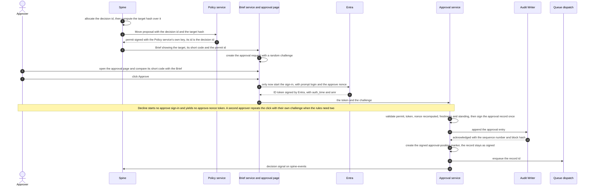
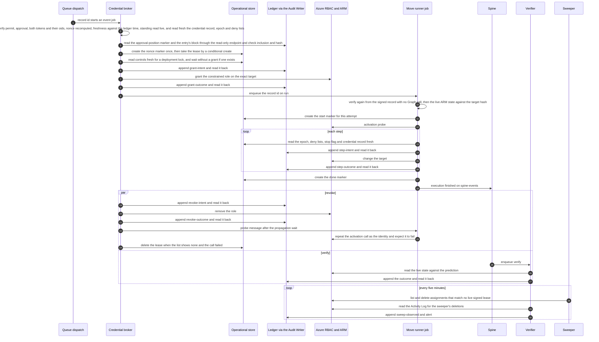
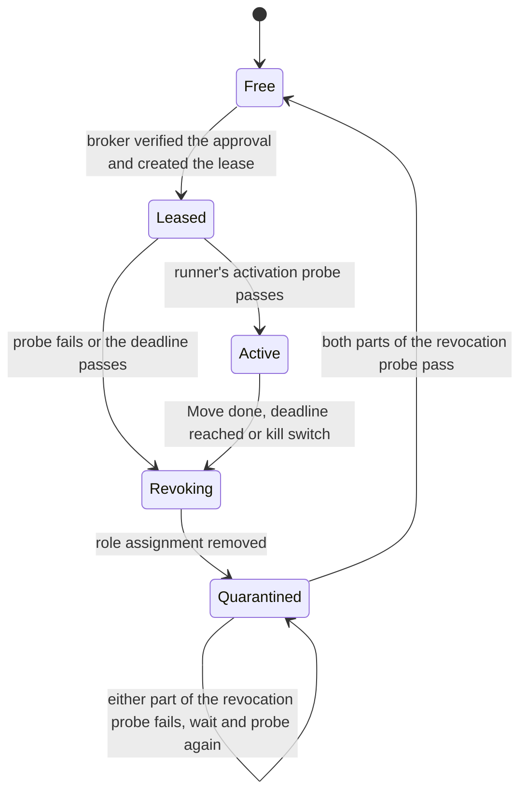

# Design 07 — Security architecture

> **What this answers:** *Who and what is trusted to do what, how is an agent that has been fooled kept from doing harm, and how do we know when something is wrong?* This is the physical security design for the [logical architecture](03-logical-architecture.md); it names products, and each product claim rests on the research in [security and compliance](research/security-and-compliance.md) and [Foundry Agent Service](research/foundry-agent-service.md), checked on 2026-10-31 (the platform claims added after the second review round, on 2026-11-01). Part of the [design](README.md).

**The idea in one paragraph.** An agent can be talked into anything, so no agent is given the power to do harm. The reasoning plane can only *read*. The one place that can *write* is a small deterministic execution plane that acts for **one approved Move at a time**, with an identity that holds a role only while that Move runs and that no other Move may use meanwhile. **No single credential completes a change that needs a person's web-page approval:** a policy service signs a permit, a person's approve sign-in, which starts only from a click on Approve, yields an Entra-signed token bound to the target and the decision, the Approval service signs the record and enqueues it (it starts nothing), a broker verifies everything again, including the approval's own entry in the ledger, before it leases and grants, and an event-driven runner verifies it a third time against the live state before it acts; [§3.3](#33-the-execution-identity-just-in-time-without-pim) states what a compromised service, the broker or the release pipeline can still do. Everything an agent says, calls or reads passes the governance hub, which is the single place to filter, meter, log and switch off, and free text is sanitised at the tool that returns it. What we cannot make impossible, we make visible, bounded and reversible.

---

## 1. Security principles, restated as controls

| Principle ([01 §5](01-requirements-and-principles.md#5-design-principles)) | The control that makes it true |
|---|---|
| P2 two planes, **Q-SEC-1** no standing write | Agent identities hold **zero** write roles; the execution plane gets a role assignment per approved Move, on an identity leased to that one Move, and removed afterwards ([§3](#3-identity)) |
| P3 everything through the gateway, **Q-SEC-2** | Model deployments grant no data-plane role to any agent identity; private networking leaves the hub as the only route, and the spine reaches a leaf through the hub too ([04 §8](04-landing-zone-and-citadel.md#8-the-gateway-bypass-register), B12); a canary agent proves it every day ([§7](#7-network-and-the-short-list-of-exceptions)) |
| P5 a prompt is not a boundary | Authorisation lives in Entra roles, per-tool app roles at the hub, gateway contracts and the deterministic gate — no rule exists only in a system prompt |
| P6 external text is data, **Q-SAF-2** | Free text enters through many tools, so a **source sanitiser** sits in every tool service that returns it (the Document reader is its web instance): text is neutralised, labelled, size-limited and screened, and a session that has read it is *tainted* — privileged tools refuse its arguments or ask a human ([§5](#5-defence-against-prompt-injection-in-nine-layers)) |
| **Q-SAF-1** approvals | Approvals are authenticated human actions that carry the person's **Entra-signed token**, are **signed** by a service that cannot start anything, and are bound to one target and its live state; purchases need two named people with different hats ([§4](#4-approvals-that-cannot-be-forged-or-reused)) |
| **Q-SEC-3** no secrets | Keyless by default: managed identities, workload identity federation, Entra tokens; local (key) authentication is denied by policy; the only deliberate keys are Key Vault signing keys, each usable by one service through a signing-only role, plus the GitHub App key of the agents' repository credential; none sits in code ([§6](#6-secrets-keys-and-data-protection)) |

## 2. Trust zones, physically

The zones of the [logical design](03-logical-architecture.md#3-trust-boundaries) map to Azure like this. A zone boundary is a *network* boundary, an *identity* boundary and a *log* boundary at once.

| Zone | Where it lives | Identity it runs as | Network position |
|---|---|---|---|
| **Z0 the world** | the public internet and Microsoft's published pages | none | reached **only** by the Document reader, through an egress firewall with a host allow-list |
| **Z1 reasoning** | hosted agents in Foundry Agent Service (one identity per agent: fifteen identities for fourteen roles, in eleven contract groups, [05](05-agents-and-orchestration.md)) | Entra **agent identity**, read-only roles only | VNet-injected outbound; models, tools and agents are reachable **only** through the governance hub, and the other internal destinations are the enumerated bootstrap paths (Key Vault for the contract key, Entra sign-in, telemetry) in [04 §6](04-landing-zone-and-citadel.md#6-network) |
| **Z2 tool services** | MCP servers on Azure Functions or Container Apps, published through the hub | one managed identity per tool service, read-only roles | private endpoints; callers authenticated at the hub *and* in the tool; free text leaves only through the source sanitiser ([§5](#5-defence-against-prompt-injection-in-nine-layers)); the case-record facade also reaches one queue endpoint of the spine's task-hub account, send-only ([§3.1](#the-execution-chain-who-may-do-what)) |
| **Z3 execution** | Approval service, Policy service, Credential broker, Move runner, Verifier (Container Apps and jobs) | separate managed identities per component, each with the narrowest role ([§3.1](#31-who-has-an-identity)) | **its own internal Container Apps environment in its own subnet, `snet-exec`** (an environment owns its subnet, so Z3 shares a network with nothing; the subnet is delegated to `Microsoft.App/environments` and a delegated subnet cannot hold a private endpoint, so every private endpoint the zone uses is in `snet-pe`); **VNet ingress, restricted to the named subnets** only for the Approval service (called by the two approval front-ends, X1 and X5, from `snet-edge` and by the Brief service from `snet-aca`) and the Policy service (called by the spine from `snet-spine` and by the Brief service): the environment is internal and the app accepts traffic from the virtual network, because "limited to the environment" would hide it from every other subnet, so the network security groups admit the named caller subnets only, the app's IP restrictions name them too, and the app validates the caller's Entra token itself ([04 §6](04-landing-zone-and-citadel.md#6-network) carries the Learn quotes); the broker, the runner and the Verifier have **no ingress at all**: they are event-driven jobs that consume the queues of the chain's own storage account, **`stchain`**, whose private endpoint is in `snet-pe` and which `snet-exec` and `snet-spine` reach on port 443 only; outbound paths enumerated in [04 §6](04-landing-zone-and-citadel.md#6-network): `stchain`, the operational store, each party's own vault and the public-key reads, Azure Resource Manager, the Entra metadata and signing-key endpoints, Microsoft Graph (the broker's live approver standing; the runner holds no Graph permission), the Estate service (VNet ingress in `snet-aca`; from `snet-exec` the Approval service only, because its other caller, the drift controller, runs in `snet-aca`), the ledger's blob endpoint (read-back and the broker's check of the approval's entry, read only), the Audit Writer and the Policy service — nothing else; **no model call inside this zone** |
| **Z4 estate data** | the operational store, cost data in Blob, the Ledger and its single writer, the **Audit Writer** | managed identities of the services that own them | private endpoints, all in `snet-pe` (a delegated subnet cannot hold one); no public access; EU only; the Audit Writer sits in the tools environment (`snet-aca`) with VNet ingress, restricted to the named subnets of every producer ([04 §6](04-landing-zone-and-citadel.md#6-network)) |
| **Z5 the Commons** | a public Git repository | GitHub accounts of contributors | published only through a pull request and a human review; **no counts in single-tenant mode**, where a cohort of one would re-identify the organisation |

A **separate Lab subscription set** is a sixth place that is never a zone of the estate: it has its own budget (created once the new subscription accepts one, [§8](#8-the-lab-as-a-security-boundary)), policy and expiry, and no network route to anything in Z4.

## 3. Identity

### 3.1 Who has an identity

| Principal | Kind | Count | Purpose | Standing permissions |
|---|---|---|---|---|
| People: owners, approvers, FinOps, platform | Entra users | many | decide, review, administer | owners and approvers: none in Azure; administrators: eligible through PIM |
| **Agent identity** per hosted agent | Entra Agent ID, created at deploy | **fifteen** (fourteen roles; the Librarian runs twice), in eleven contract groups | call the hub, read the knowledge services | the hub APIs of its group's contract, with per-tool app roles assigned **directly to it**; **no** estate role, **no** data-plane role on model deployments |
| **Tool-service identity** | user-assigned managed identity | one per tool service | read estates, prices, documents for an authorised caller | Reader, Cost Management Reader, Monitoring Reader at the estate scopes it serves |
| **The execution chain**: Policy service, Approval service, credential broker, Move runner, Verifier, Audit Writer, ledger verifier | user-assigned managed identities, **one vault each** for the parties that sign; one runner identity per *Move class* | one each (a handful of runner identities) | carry a change from permit to outcome ([§3.3](#33-the-execution-identity-just-in-time-without-pim)) | **no estate role at rest**; the exact rights are in [the table below](#the-execution-chain-who-may-do-what) |
| **Sweeper** | user-assigned managed identity | one | remove leftover role assignments | **delete-only**: read and delete under the same condition; container-scoped read on `leases` to tell a leftover from a live lease, and `acia-key-reader` on the broker's entry key, because a lease counts only when its signature verifies; it holds **no signing key, no ledger role and no create right on `approvals-index`**, and writes nothing: the Verifier records its removals by observation ([§3.3](#33-the-execution-identity-just-in-time-without-pim) point 4) |
| **Erasure job** | user-assigned managed identity | one | serves an erasure by identity | container-scoped Cosmos roles: delete on the erasable containers (`approval-records` among them), create on `erasures`; no estate role, no ledger role |
| **Approval cross-check job** (D13) | user-assigned managed identity | one | re-validates the Entra-signed token stored in each approval record and compares the approval with the Entra sign-in log; code, not an agent | container-scoped read on `approval-records`; a read-only Graph application permission for sign-in logs (`AuditLog.Read.All`, [Learn](https://learn.microsoft.com/entra/identity/monitoring-health/howto-analyze-activity-logs-with-microsoft-graph); Entra ID P1 or P2); reports findings, writes nothing else |
| **Release pipelines** | GitHub Actions, workload identity federation (OIDC) | one per environment | deploy infrastructure | a Contributor-style custom role **without the move right** (below) on our own resource groups plus a *conditioned* RBAC Administrator for the role assignments our templates create there (Contributor cannot assign roles); only **the pipeline that deploys the environment** (`deploy` for dev and test, `release` for production, [11 §3](11-delivery-and-operations.md#3-pipelines)) holds **`Microsoft.App/jobs/write` on the chain's jobs**, and every other role excludes it there ([§3.3](#33-the-execution-identity-just-in-time-without-pim)); **`release` holds no `Microsoft.App/jobs/start/action`**, because event-driven jobs need no manual start, while `deploy` may start a chain job in dev and test for smoke tests; its data-plane rights on the chain's state are **read on `leases` and `controls` and create (not delete or replace) on `controls`**, for the deployment lock and its successors ([§3.3](#33-the-execution-identity-just-in-time-without-pim)); no Azure resource-lock or deny-assignment rights; nothing above a resource group |
| **Bootstrap** | a PIM-eligible role of a named platform engineer, break-glass, or the identity of a **protected environment** that runs only after human approval ([11 §3](11-delivery-and-operations.md#3-pipelines)); never a routine pipeline run | rare | foundation above resource-group scope: management groups, policy, subscription vending, **stack deny settings**, and lifting and re-applying the resource-group locks of the stack-move procedure | *Azure Deployment Stack Owner* (creating or deleting deny assignments needs it; *Contributor* cannot, [Learn](https://learn.microsoft.com/azure/azure-resource-manager/bicep/deployment-stacks)) **plus the lock rights**, `Microsoft.Authorization/locks/*`, which a custom role can hold on its own ([Learn](https://learn.microsoft.com/azure/azure-resource-manager/management/lock-resources#who-can-create-or-delete-locks)), on our own subscriptions ([09 DR-1](09-safeguards-and-drift-controls.md#21-drift-in-what-we-own), [11 §3](11-delivery-and-operations.md#3-pipelines)); any other foundation role is held for a stated change only; the platform owner grants and revokes it |
| Platform identities | managed identities of the drift watchers, the Lab controller and the Janitor | few | verify, repair, run experiments, clean up | watchers: read, and the drift controller also creates *narrowing* items in `controls` ([§10.3](#103-kill-switches)) and holds `Standing.Read` on the Estate service; Lab controller and Janitor: Lab subscriptions only, with a Contributor-style custom role **without the move right** |

**No routine identity holds the move right.** A move needs `Microsoft.Resources/subscriptions/resourceGroups/moveResources/action` on the source resource group ([Learn](https://learn.microsoft.com/azure/azure-resource-manager/management/move-resource-group-and-subscription#checklist-before-moving-resources)), and moving a managed resource out of its stack removes the stack's protection ([09 DR-1](09-safeguards-and-drift-controls.md#21-drift-in-what-we-own)). Apart from the bootstrap row, no identity above holds that action or a wildcard that contains it: where Contributor's breadth is needed (the release pipelines, the Lab controller, the Janitor) the role is a custom Contributor-style role with the action in `NotActions`, a subtraction and not a deny ([Learn](https://learn.microsoft.com/azure/role-based-access-control/role-definitions#notactions)), so a Resource Graph diff of role assignments catches a second assignment that grants it back and D17 catches the move itself. Locks and deny assignments are bootstrap-only too; the planted-drift job ([09 §6](09-safeguards-and-drift-controls.md#6-testing-the-safeguards)) holds the right on the test spoke only.

**A named human sponsor stands behind every agent identity and every execution identity** (Entra Agent ID has sponsors and owners; for managed identities the sponsor is a tag and a record in the Estate service). If a sponsor leaves, the identity is disabled until a new one is named — an automated check, not a policy document. The estate owner grants and revokes **read** and **action** onboarding at their scope ([11 §6](11-delivery-and-operations.md#6-onboarding-and-offboarding-an-estate)); the **purchaser role** goes to a purchase execution identity only while an approved purchase runs (spike **S-ACT-1**); the Estate service holds read-only Graph permission to check approver standing, and nothing that writes, and it has two callers only, the Approval service and the drift controller, which reads its standing endpoint through the app role `Standing.Read` ([§3.4](#34-conditional-access-and-the-licence-line)).

#### The execution chain: who may do what

Every party has its own identity (a user-assigned managed identity; for the deploying pipeline, workload identity federation), and only that pipeline holds a `Microsoft.App/jobs/*` action, `jobs/write`. **`acia-signer`** is a custom Key Vault data-plane role with `keys/read` and `keys/sign/action` only, on the party's own vault: the built-in *Key Vault Crypto User* also holds `keys/update/action` and `keys/backup/action`, so a signer that held it could re-enable a key that the kill switch had disabled ([Learn](https://learn.microsoft.com/azure/role-based-access-control/built-in-roles/security#key-vault-crypto-user)). **`acia-key-reader`** is `keys/read` on **one key**, to read a public key. **Sender** and **Processor** are *Storage Queue Data Message Sender* and *Processor* on a **single queue**; the broker and the runner, which keep a message invisible while they work, and the spine's queue trigger, which updates a message to retry it, hold the custom role **`acia-queue-worker`** instead of Processor: its two data actions plus `messages/write`, because Update Message needs `messages/write` ([Learn](https://learn.microsoft.com/rest/api/storageservices/authorize-with-azure-active-directory#permissions-for-calling-data-operations)) and the built-in Processor holds only `messages/read` and `messages/process/action` ([Learn](https://learn.microsoft.com/azure/role-based-access-control/built-in-roles/storage#storage-queue-data-message-processor)); **`messages/write` also admits Put Message, so a holder can put to the queue it consumes** (the exact sender sets are in the `stchain` paragraph below); the broker, the runner and the Verifier each also hold Sender on the **`-poison` queue** of the queue they process, and the spine on those of `spine-events` and `spine-signals`. A job's scale rule reads the queue length with the job's identity, so the broker, the runner and the Verifier also need the least data-plane right that allows it (*to confirm*); Cosmos DB roles are on **one container**, the most granular scope Learn offers ([06 §7.2](06-data-and-knowledge.md#72-the-operational-store-container-by-container), [Learn](https://learn.microsoft.com/azure/cosmos-db/how-to-connect-role-based-access-control#grant-data-plane-role-based-access)); **read-back** is *Storage Blob Data Reader* on the ledger container. Every chain party reads `controls` with a **cache of at most 60 seconds, and a stale cache fails closed**, with two exceptions: **the runner reads the epoch, the deny lists, the stop flag and its credential's grant record fresh, with no cache, before every step, and the broker reads them fresh at grant** (and at the deployment-lock re-read, [§3.3](#33-the-execution-identity-just-in-time-without-pim) point 2). That is one point read each, so an epoch raised during a Move stops it at its next step. **A role cannot tell one item type from another inside a container, so separation inside a container is an item-level rule: every marker in `approvals-index`, every lease in `leases` and every item in `controls` that *widens* authority carries its producer's signature** — the entry key of the party that created it, or for a widening `controls` item the Approval service's signature on the record behind it — **and every reader verifies it against the producer's pinned public key before it trusts it**. **The signature covers the canonical item and its location**: the item is signed as canonical JSON (RFC 8785) including its `type`, `container`, partition key, `id`, `producer` and key id, `created_at`, `scope` and every value, and a verifier **rejects an item whose location or `type` differs from the signed fields**, whose `producer` is not the key's owner, or whose key id is not pinned (the previous key id is accepted for the longest approval validity). Such an item is ignored and raises D14 ([§10.2](#102-detections-we-ship-as-code)), so **a valid signature cannot be moved to another id, partition or item type**. An item that *narrows* authority (a deny entry, an epoch raised, a switch pulled, the deployment lock) is unsigned and create-only, because forging one only stops things ([§10.3](#103-kill-switches)). **Unsigned narrowing items can deny service, and that is accepted**: every narrowing item raises an alert naming its creator, and expires by its `ttl` or is lifted by a signed widening item, so the cost is availability, never authority. `leases` also has one writer, the broker, at container level.

| Party | Runs as | Keys | Queues | Store and ledger | Azure and Entra | Cannot |
|---|---|---|---|---|---|---|
| **Policy service** | Container App; VNet ingress, restricted to the named subnets (the spine in `snet-spine`, the Brief service in `snet-aca`) | `acia-signer` (permit key; also signs its entries) | none | reads the rules in `controls` and each autonomy credential's signed grant record there; signs a permit whose id is the decision id that the spine allocated and which carries `requester_ref` and `preparer_ref`; appends through the Audit Writer | reads the Move catalogue from the signed release; nothing about any estate | start a job, sign an approval, send to a queue, hold an estate role, call a model |
| **Approval service** | Container App; VNet ingress, restricted to the named subnets (the approval front-ends in `snet-edge`, the Brief service in `snet-aca`) | `acia-signer` (approval key; also signs its entries and the markers it creates); `acia-key-reader` on the Policy key | Sender on `dispatch` and `spine-events` | creates `approval-records` (create-only: a record is signed once and never amended) and `approvals-index` items, among them the signed `approval-position` marker with the sequence number and block hash of its entry; reads `controls`; appends through the Audit Writer; holds no ledger read role and does no read-back, so the acknowledgement is not a proof | Entra metadata and signing keys (validates the token); approver sources through the Estate service (VNet ingress in `snet-aca`, two callers only: this service, from `snet-exec`, for the approver-set snapshot, and the drift controller, from `snet-aca` under the app role `Standing.Read`, each admitted by its own Entra token), kept as the approver-set snapshot (the broker re-reads standing live from Microsoft Graph); no Graph permission of its own | **any `Microsoft.App/jobs/*` action**, grant a role, hold an estate role, fabricate a permit or a person's token, send to `run` or `verify` |
| **Credential broker** | event job on `dispatch`; no ingress | `acia-signer` (entry key); `acia-key-reader` on the Approval, Policy and runner keys | `acia-queue-worker` on `dispatch`; Sender on each class's `run` and on `dispatch-poison` | creates the nonce and grant markers in `approvals-index`; the only writer of `leases`, where it creates, replaces and deletes the lease; reads `approval-records`, the `approval-position` marker and `controls` (the epoch, the deny lists and an autonomy credential's own grant record **fresh at grant**, and a lock item fresh after its lease) and the approval's block in the ledger through the read-only blob endpoint; appends intent and outcome entries and reads each back | the constrained RBAC delegation at opted-in scopes (reads assignments there); read-only Graph for live approver standing and hats (narrowest permission and a consistent read *to confirm*); Entra metadata and signing keys | start or change a job, sign an approval or a permit, use another party's key, make the runner act without a verified approval, a lease and a matching live state |
| **Move runner**, as the execution identity of its class | event job on the class's `run` queue; takes one message and exits; template fixed by the pipeline; no ingress | `acia-signer` (entry key); `acia-key-reader` on the Approval, Policy and broker keys | `acia-queue-worker` on its `run`; Sender on `spine-events` and on that queue's `-poison` queue | creates the start (`started(attempt n)`) and done markers in `approvals-index`; reads `approval-records`, the `approval-position` marker, `leases` and `controls` (the epoch, the deny lists, the stop flag and its credential's grant record **fresh before every step**) and the approval's block in the ledger; appends intent and outcome entries and reads each back | **no estate role at rest**: the custom Move role on the exact target only while the broker's grant lasts, never the move right; Entra metadata and signing keys; **no Microsoft Graph permission** | grant a role, sign an approval, touch a target that it holds no grant on, start or change a job, read approver standing |
| **Verifier** | event job on `verify`; no ingress | `acia-signer` (entry key) | Processor on `verify`; Sender on `spine-events` and on `verify-poison` | creates its outcome records in `ledger` and **reads the predictions there**; reads `controls`; appends and reads back, reads the ledger's intent entries to reconcile an intent that has no outcome, and appends a `sweep-observed` entry for each role-assignment deletion by the sweeper that it finds in the Activity Log | read-only: Reader, Cost Management Reader and Monitoring Reader at the scopes where the estate owner consented to *action* onboarding ([11 §6](11-delivery-and-operations.md#6-onboarding-and-offboarding-an-estate)), Monitoring Reader being what reads the Activity Log (that a delete event names the sweeper's principal is *to confirm* in S-ID-3); further utilisation reads *to confirm* before phase 5 | write to any estate, start a job, hold a role-assignment right |
| **Audit Writer** | Container App in the tools environment; VNet ingress, restricted to the named subnets of every producer | `acia-signer` (digest key); `acia-key-reader` on every producer's key | none | the only write role on the ledger ([06 §7.3](06-data-and-knowledge.md#73-the-audit-ledger)); reads `leases` for the fence token | none | grant, approve, permit, start |
| **Ledger verifier** (nightly) | scheduled job, a **separate identity and code path** from the Audit Writer | `acia-key-reader` on every producer's key and the digest key | none | reads the ledger and its second-region copy; writes nothing | none | write the ledger, sign anything |
| **Sweeper** | scheduled job (every five minutes) with its own identity | `acia-key-reader` on the broker's entry key, to verify a lease's signature; **no signing key** | none | read on `leases`; **no ledger role and no create right on `approvals-index`**: it writes nothing, and the Verifier records its removals by observation | the delete-only delegation at the opted-in scopes (read and delete under the same condition) | sign, append, create a marker, grant a role |
| **Spine** | Durable Functions app | none | Sender on `verify`; on `spine-events` (in `stchain`) and on `spine-signals` (in its own task-hub account) the rights that the Functions queue trigger needs: it consumes, deletes and **updates a message to retry it**, so Processor plus `messages/write`, the same `acia-queue-worker` (the exact minimal set is *to confirm* in S-ID-3); and **Sender on `spine-events-poison` and `spine-signals-poison`**, because "the functions runtime adds a message to a queue named" `<originalqueuename>-poison` ([Learn](https://learn.microsoft.com/azure/azure-functions/functions-bindings-storage-queue-trigger#poison-messages)), with the host's identity, which is the spine's; one queue-triggered function in the spine app reads both queues, so no chain party holds a Durable management key | reads `approvals-index` and `budgets`; its own containers | calls the Policy service, and the case-record facade under the app role **`Run.Manage`** (`register`, `close`), which only the spine holds | hold a chain-job right, a vault role, an estate role or any right on `runs` |
| **Case-record facade** | Container App in the tools environment; called by the hub and by the spine, and the spine alone holds its app role **`Run.Manage`** (`register`, `close`) | none | send-only on `spine-signals` (`run-completed`) | **create and read only** on `cases` and `case-notes` (no replace, no delete), so the evidence graph stays create-only by RBAC; **create, read and replace** on `runs`, the run-registry items, of which it is the only writer: a container-level role cannot tell item types apart, so the registry has a container of its own | none | hold any right in `stchain`, send to a chain queue, replace or delete in `cases` or `case-notes` |
| **Brief service** | Container App in the tools environment | none | send-only on `spine-signals` (`brief-answered`) | its own containers (the Brief store) | none | hold any right in `stchain`, send to a chain queue |
| **Deploying pipeline** (`deploy` for dev and test, `release` for production) | GitHub Actions, workload identity federation | none | none | reads `leases` and `controls` (to re-read its lock item before every write of a chain job); **creates, and cannot delete or replace, in `controls`**, for the deployment-lock item and its successors (a widening item that it created would be ignored by readers) | `Microsoft.App/jobs/write` on the chain's jobs; **`release` holds no `jobs/start/action`**, `deploy` may start a chain job in dev and test for smoke tests | sign, send to a chain queue, hold an estate role or the move right, delete or replace an item in `controls` |

**`stchain`** is one dedicated storage account per chain environment (ZRS, shared-key and public network access off, and its **private endpoint in `snet-pe`**: `snet-exec` is a delegated subnet, and Learn lists for a delegated subnet "Can't be used with a private endpoint if the subnet is delegated" ([Learn](https://learn.microsoft.com/azure/virtual-network/subnet-delegation-overview)), so the network security group of `snet-pe` admits `snet-exec` and `snet-spine` to the endpoint's address on port 443 only, [04 §6](04-landing-zone-and-citadel.md#6-network)) holding the queues `dispatch`, `run`, `verify` and `spine-events`, **each with a `-poison` queue** (`dispatch-poison` and so on: Storage queues have no dead-letter queue, so our code moves a message whose failures, its dequeue count less its counted waits, exceed three, and raises an alert, [§4](#4-approvals-that-cannot-be-forged-or-reused); for the spine's two queues the Functions runtime does it). The reasoning plane must not hold a right in the execution account, and the chain must not hold one on the task-hub account, so the signals that come from outside the chain use a second spine-bound queue, **`spine-signals`**, in the spine's own task-hub storage account (queue private endpoint in `snet-pe`): the case-record facade (`run-completed`) and the Brief service (`brief-answered`) hold a send-only role on that one queue, and the spine's queue-triggered function reads both queues. **`run` exists once per Move class**: a queue scale rule counts the messages of one queue, and a class's job must wake only for its own work. **The senders of every queue, exactly.** `acia-queue-worker` holds `messages/write`, and Learn lists Put Message as "Microsoft.Storage/storageAccounts/queueServices/queues/messages/add/action or Microsoft.Storage/storageAccounts/queueServices/queues/messages/write" ([Learn](https://learn.microsoft.com/rest/api/storageservices/authorize-with-azure-active-directory#permissions-for-calling-data-operations)), so **a consumer that holds it can also put to its own queue**. The sets are: `dispatch` = the Approval service, and the broker as its consumer; `run` (each class) = the broker, and that class's runner as its consumer; `verify` = **the spine only** (the Verifier holds plain Processor and renews nothing); `spine-events` = the Approval service, the runner and the Verifier, and the spine as its consumer; `spine-signals` = the case-record facade and the Brief service, and the spine as its consumer. **Messages carry ids only, and a queue is a doorbell, not an authority**: a job wakes for any message in its queue, believes nothing in it and verifies the record, the signatures, the lease and the live state itself, so a message injected by a party that may not send is at most a denial of service (refused, counted, moved to `-poison` and alerted). The control is the verification, not the queue's access list. Role assignments are scoped to the single queue. Learn documents queue-level scope for the built-in queue data roles ([Learn](https://learn.microsoft.com/azure/storage/queues/secure-queues)), conditions on the queue name as generally available ([Learn](https://learn.microsoft.com/azure/storage/queues/queues-auth-abac-attributes)), and managed-identity authentication for queue scale rules, including on a job's scale rule ([Learn](https://learn.microsoft.com/azure/container-apps/scale-app#custom), [Learn](https://learn.microsoft.com/azure/templates/microsoft.app/2026-07-01/jobs#property-values)). What stays *to confirm* in S-ID-3 is the combination: an *Event* job scaling on a queue-scoped role that carries the least data-plane right the scaler needs. One storage account per queue pair is the fallback.

### 3.2 Roles — least privilege in Foundry

- Foundry roles were renamed in 2026 (Foundry User, Project Manager, Account Owner, Owner); the **role IDs are unchanged**, so Bicep and Policy reference IDs, never names ([Foundry RBAC](research/features-05.md)).
- The least-privilege **Foundry Agent Consumer** role is held at *agent* scope, not project scope, and only by the hub's backend identity: the spine reaches a leaf through the hub and holds no Foundry role of its own ([04 §4.4](04-landing-zone-and-citadel.md#44-the-publish-contract-tools-and-who-may-call-them)).
- **API-key authentication is denied** on Foundry, AI Search, Storage and Cosmos DB by Azure Policy; a key bypasses RBAC and so bypasses every control above.
- No agent identity holds a role on a model deployment. A hosted agent reaches models through the hub; if it tries the deployment directly, the call fails on RBAC *and* on the network, and the canary alerts ([§7](#7-network-and-the-short-list-of-exceptions)).

### 3.3 The execution identity: just-in-time, without PIM

The north star asks for "a short-lived, scoped identity for each Move". The design delivers a **persistent identity with a short-lived, scoped permission**, leased to one Move at a time. **Privileged Identity Management cannot make a managed identity or service principal *eligible*, because it cannot perform the activation step** ([research](research/security-and-compliance.md), finding 4), so the design does the same with parts that exist: **a chain of independent checks in which no single credential completes a change that needs a person's web-page approval** ([ADR-07](13-decisions.md#adr-07-execution-identities-are-granted-just-in-time-by-a-broker-on-a-signed-approval)). The order is the same in every document: **Policy permit → Brief → a person approves → the Approval service signs and enqueues → the broker verifies, leases, grants and enqueues `run` → the event-driven runner re-verifies and acts → the Verifier on `verify`.**

| Party | Verifies before it acts |
|---|---|
| **Policy service** | the proposal against the Move catalogue, its rules, the autonomy credential (cap, scope, expiry, live status) and the price tolerance; then it signs a **permit** whose id is the decision id that the spine allocated before it computed the target hash |
| **Approval service** | the permit's signature; each person's Entra-signed token (the claims are in [§4](#4-approvals-that-cannot-be-forged-or-reused): the `nonce` is recomputed from the target hash, the decision and the challenge, and the token must be fresh); the approver's standing; **two proofs from two people** where the rules need two (a purchase, an irreversible Move that needs two approvers, a credential grant), with different `oid`s and different hats and neither person the requester or the preparer; the approval epoch. It holds **no `Microsoft.App/jobs/*` action** and starts nothing |
| **Credential broker** | **itself, again**: both signatures, each token against Entra's published keys (the `nonce` recomputed from the record, freshness against the time that the Audit Writer stamped on the approval entry), where two approvers are needed the two `oid`s **taken from the tokens** (they differ, and neither `SHA-256(decision id ‖ oid)` equals the permit's `requester_ref` or `preparer_ref`) and the two hats read **live** from the sources and written as labels into its signed `grant-intent` entry, the approver's standing read **live**, the class's authentication strength, **the approval's own entry in the ledger** (the `approval-position` marker and the block, by inclusion and hash), the epoch, the key and `azp` deny lists and an autonomy credential's **own signed grant record**, all read **fresh**, the single-use nonce marker; only then it takes the lease, reads `controls` fresh once more for a lock item, writes its intent and grants |
| **Move runner** | **itself, a third time**: both signatures, each token and its `nonce` (freshness against the time that the Audit Writer stamped), the same `oid` and requester or preparer checks from the two tokens, the hat labels in the broker's signed `grant-intent` entry (the Approval service's labels are informational), the approval's entry in the ledger, the lease and its fence, **fresh before every step** the epoch, the deny lists, the stop flag and its credential's grant record (it holds no Graph permission), and the target hash against the **live ARM state**; it refuses anything else |
| **Verifier** | the outcome against the live state and the prediction it reads from `ledger`, and any intent that has no outcome; it also records the sweeper's removals as `sweep-observed` entries |

The **Auditor** cross-checks approvals in the ledger against the Entra sign-in logs (D13). Every party appends through the **Audit Writer**, the ledger's single writer, whose entries each carry their producer's signature ([06 §7.3](06-data-and-knowledge.md#73-the-audit-ledger)); points 6 to 8 below say how every effect is written ahead and read back, what happens when the writer cannot be trusted or reached, and why a redelivered message is reconciled, not repeated.

1. **The delegation, stated honestly.** Onboarding has two parts: **read onboarding** (the three reader roles) and a separate, consented **action onboarding** that gives the broker a *constrained* delegation — *Role Based Access Control Administrator* with an ABAC **condition** — at the scopes the estate owner opted in. The condition limits the **role definitions** (our custom Move roles only), the **principals** (the execution identities only) and the **principal type**, separately for adding and for removing, so the sweeper's delegation is **delete-only** ([Learn](https://learn.microsoft.com/azure/role-based-access-control/delegate-role-assignments-overview)). **It cannot limit the target scope**, which is bounded only by where the delegate holds the role. So *target scoping is deterministic code — the signed target hash and the runner's check of live state — plus detection (D15), not ABAC*, and the estate owner trusts the broker with a constrained delegation, not with nothing ([04 §3.1](04-landing-zone-and-citadel.md#31-where-things-live), [11 §6](11-delivery-and-operations.md#6-onboarding-and-offboarding-an-estate)). **The broker can grant the constrained Move roles to the execution identities at any scope where the estate opted in, whether or not one is leased, because the delegation cannot tell.** A leftover is usable only by that class's runner job, which wakes for any message in its queue, believes nothing in it and verifies the approval, the permit, the person's token, the lease and the live state itself; D15 flags any grant that matches no signed approval, and the delete-only sweeper removes leftovers (its removals are recorded by the Verifier's observation, point 4). The syntax and the delete-only form are spike **S-ID-1** ([14](14-next-phases.md)).
2. **Only the deploying pipeline can change a chain job, and a production release cannot start one.** Learn warns that the job *start* API accepts a template that can override images, commands and environment variables, and that a container can use any identity available to the job ([Jobs in Azure Container Apps](https://learn.microsoft.com/azure/container-apps/jobs#permissions)): whoever holds `Microsoft.App/jobs/start/action` can run any code as the job's identities, and whoever can write the job changes what its next execution runs. So no signer holds either. The runner, the broker and the Verifier are **event-driven jobs** (type *Event*), each with a scale rule on its own queue — each execution *typically* processes a single message ([Learn](https://learn.microsoft.com/azure/container-apps/jobs#event-driven-jobs)), a tendency and not a guarantee, which [§4](#4-approvals-that-cannot-be-forged-or-reused) answers — and a **template fixed by the pipeline**: image pinned by digest from our private registry, **no secrets**, command and environment set at deploy, `parallelism` 1, `replicaCompletionCount` 1 and `replicaRetryLimit` 0 (the platform does not retry a failed replica: the message becomes visible again and a fresh execution reconciles it), and for a runner only that class's identity available to it. **Only the pipeline that deploys the environment (`deploy` for dev and test, `release` for production) holds `Microsoft.App/jobs/write` on them, and the production `release` pipeline holds no `Microsoft.App/jobs/start/action`**: an event-driven job needs no manual start, and `deploy` may start a chain job in dev and test for smoke tests ([§3.1](#31-who-has-an-identity)); in production any start by a principal other than the queue trigger, and in any environment an execution whose template is not the pinned one, raises **D16**. The **deployment lock** (below) keeps an honest deployment from overlapping a lease. The scale rule authenticates to the queue with a managed identity instead of a secret: Learn documents it for Azure Queue Storage scale rules ([Learn](https://learn.microsoft.com/azure/container-apps/scale-app#custom)), and the job's scale rule has an `identity` property ([Learn](https://learn.microsoft.com/azure/templates/microsoft.app/2026-07-01/jobs#property-values)); what stays *to confirm* in S-ID-3 is the combination with a queue-scoped role that carries the least data-plane right the scaler needs.

   **The deployment lock** is a two-sided protocol with fresh reads and a heartbeat, because a check on a cached read, followed by an act, would race. **The pipeline:** **(a)** reads `leases` and waits until none is held in the environment; **(b)** creates the **lock item** in `controls` — a *narrowing* item, unsigned and create-only, with its own `ttl` of 30 minutes so that nothing has to delete it (the container has time to live switched on with no default expiry, so only an item that carries its own `ttl` expires: the item property is "applicable only if `DefaultTimeToLive` is present and it isn't set to null for the parent container", [Learn](https://learn.microsoft.com/azure/cosmos-db/time-to-live#time-to-live-for-containers-and-items)); **(c)** waits **one cache period, 60 seconds**, which must be many times the measured replica lag; **(d)** reads `leases` **fresh**, and if a lease is held it waits and repeats (d), the lock staying; **(e)** **before every write of a chain job**, re-reads its lock item by id and checks that at least the step's longest duration plus one cache period of the item's life is left, and otherwise creates a **successor lock item** and goes back to (c). The job's `timeout-minutes` is **shorter than the lock's `ttl`** (25 minutes against 30), so a stalled deployment ends before its lock does, and **if the lock is lost** (expired with no successor) the pipeline **stops writing and fails the run**: the chain jobs' templates are idempotent, and the next run starts at (a). **The broker**, after it creates its lease (a conditional create) and **before** it writes `grant-intent`, reads `controls` **fresh, with no cache**, for a lock item of the environment; if one exists it **deletes its own lease item, grants nothing and puts the message back with a delay** (a wait, point 3). Its earlier, cached check is only an optimisation. **Why it is correct:** either the broker's fresh read sees the lock, or the lock item was created after that read and therefore after the lease, and the pipeline's step (d) runs at least one cache period after the lock and sees the lease. The argument needs the replica lag to be much shorter than the wait. The default consistency level, Session, guarantees "within a single client session, reads are guaranteed to honor the read-your-writes, and write-follows-reads guarantees" ([Learn](https://learn.microsoft.com/azure/cosmos-db/consistency-levels#guarantees-associated-with-consistency-levels)) and says nothing across clients that do not share a session token, so **S-ID-3 measures the lag**; the documented fallbacks are **Bounded Staleness** on the chain's control account (for a single region, "the minimum value of K and T is 10 write operations or 5 seconds", [Learn](https://learn.microsoft.com/azure/cosmos-db/consistency-levels)) or a longer wait. The pipeline holds **read** on `leases` and on `controls` and **create** (not delete or replace) on `controls`, so a widening item that it created would be ignored by readers ([§3.1](#the-execution-chain-who-may-do-what)). The lock narrows the window; it does not stop a compromised pipeline (below).
3. **Leases, probes and quarantine.** Each execution identity is **leased exclusively** — one active Move at a time. The lease is **one item per identity in `leases`, taken by a conditional create that fails while the item exists**, so two executions cannot both win; the broker, the only writer of the container, takes it **before** it grants and **signs it with its entry key**. Every marker in `approvals-index` and every lease carries its producer's signature over the canonical item and its location ([§3.1](#the-execution-chain-who-may-do-what)), and the runner, the Audit Writer and the sweeper verify it against the pinned public key before they trust it; one that fails is ignored and raises **D14**. The lease carries a fence token and a deadline: the runner reads it before every step, and the Audit Writer refuses a runner entry whose token is not the current one. **A Move class is enabled only if its schema defines a probe that is harmless and permission-equivalent**: a call that the Move's role allows and that changes nothing (the effective-permissions list for the target scope, a what-if, a read on the same scope). The **activation probe** before the Move proves the grant is effective and matches the approval, and the revocation probe repeats the same call. For purchases and irreversible Moves **S-ACT-1** proves that such a probe exists, and a class without one **stays disabled**. When the Move is done the runner **releases** the lease by creating a signed *done* marker in `approvals-index`; the broker, still running, removes the role, and the identity is *Free* again only when a **two-part revocation probe** has passed: **(1)** the assignment list shows none, and **(2)** after the propagation wait the probe call, made *as the execution identity*, **fails**. The broker sends a *probe* message on the class's `run` queue, and the runner job repeats the activation probe's call as that identity and records the expected failure in a signed marker (*to confirm* in S-ID-3); only then does the broker delete the lease item. Until both parts pass the identity is **quarantined**. **Azure RBAC changes can take up to ten minutes to take effect** ([Learn](https://learn.microsoft.com/azure/role-based-access-control/troubleshooting#azure-role-assignments)), so a Move starts only after its activation probe, a purchase window includes the delay, and *revoked* means removed *and the call failed*. Moves of a class queue behind its lease. **A message that must wait** (the identity is leased, or a deployment lock exists) is put back with a delay and **counted as a wait, not a failure** ([§4](#4-approvals-that-cannot-be-forged-or-reused)), and waiting ends when the decision's permit expires: the price is latency, not safety. Spike **S-ID-3** measures it.

4. **Expiry has three layers.** The broker's execution lasts until its lease is done or past its deadline and then revokes in a `finally` step (its replica timeout is set above the longest lease, *to confirm*, and it renews its message's visibility while it waits, [§4](#4-approvals-that-cannot-be-forged-or-reused)); the independent **sweeper** (own identity and schedule) removes any Move-role assignment whose lease item is absent, past its deadline or unsigned, including after a broker crash; it holds no signing key, no ledger role and no create right on `approvals-index` and writes nothing, so **the Verifier records each removal by observation**: it reads the Activity Log events of role-assignment deletions by the sweeper's principal, appends a signed `sweep-observed` entry (a new entry type, closed schema, no personal data) and raises the alert "a leftover grant was removed" (D15), and that the delete event names the sweeper's principal is *to confirm* in S-ID-3; a **Resource Graph alert** fires if an assignment outlives its approval. The runner reads the revocation flag, the epoch and the deny lists **fresh before every step** and aborts cooperatively at the lease deadline. PIM time-bound *active* assignments, if licensed, would be a fourth layer — a later hardening, not a dependency.
5. **Purchases** use a purchaser role at the billing or subscription scope that fits the agreement type; role, scope and **two person proofs** (two people with different hats) are part of the approval record. The mechanism per agreement type is spike **S-ACT-1**; where AI execution cannot be shown, purchases of that type stay disabled.
6. **Write ahead, read back, and no party takes the Audit Writer's word for it.** Every effect is preceded by a signed **intent** entry that the actor reads back, and followed by an **outcome** entry: the broker's `grant-intent`, the ARM grant, `grant-outcome`; the runner's `step-intent`, the change, `step-outcome`; the broker's `revoke-intent`, the removal, `revoke-outcome`. So *no change without a ledger entry* holds literally, and an effect whose intent cannot be read back does not happen. A party appends through the Audit Writer and then **reads the appended block back** from the ledger container, by position and hash, and proceeds only if it matches; an acknowledgement without a matching block stops the step and raises D19. **The approval is checked the same way**: after the Audit Writer acknowledges the approval entry, the Approval service creates a signed **`approval-position` marker** in `approvals-index` `{approval id, sequence number, block hash}` and **only then** enqueues the record id. An approval record is create-only and **never amended**, and the Approval service holds **no ledger read role and does no read-back**, so its acknowledgement is not a proof. The broker, and the runner, read the record, the marker and the block themselves (*Storage Blob Data Reader* on the ledger) and **refuse a grant on any mismatch or a missing block** (D19). *No entry, no grant*: the Audit Writer's acknowledgement is not the proof, the block is. An **intent with no outcome** after its window is reconciled by the Verifier, which the spine's deadline timer runs for the decision: it compares the live state with the intent (an assignment with no outcome raises D15, a gap in the ledger D19). The nightly **ledger verifier** is a separate identity and code path from the Audit Writer: it recomputes the chain across blobs, every producer's signature and the daily digest against the second-region copy and lists any intent still open (D19), so the writer is never the judge of its own chain ([06 §7.3](06-data-and-knowledge.md#73-the-audit-ledger)).
7. **When the Audit Writer is down, nothing new starts and nothing already running is stranded.** No approval is dispatched and no grant is made, because no intent can be written, and a running Move does not start its next step. A signed human approval is not lost: it stays in `approval-records` and is dispatched when its ledger entry commits, so the person does not click again. **The one exemption is the rollback to the pre-state named in the signed record.** It only removes power or restores what was, and for a grant the pre-state is *no assignment*, so **removing a granted role** is that rollback, and removing power is never gated. The **broker's** removal and the **runner's** rollback run from a signed **outbox**, an entry that the party signs and creates as a marker in `approvals-index`, which the Audit Writer appends when it returns; **the sweeper needs no outbox**, because it holds no signing key and no ledger role and writes nothing, and its removals are recorded by the Verifier's observation of the Activity Log (a signed `sweep-observed` entry, point 4). The gap is flagged **D19** and reconciled ([03 §6](03-logical-architecture.md#6-degraded-modes)).
8. **Delivery is at least once, and nothing here claims exactly-once execution.** A queue message can be delivered again, so every effect is guarded by a single-use marker, an intent that was read back and a check of the live state. A redelivery that finds a runner's `start` marker without a `done` marker **reconciles, then resumes**, and so does a broker redelivery that finds its own nonce marker for the same approval id: it reads the lease, the intent and outcome entries and the live state and finishes or rolls back; it neither refuses nor repeats an effect. A create conflict that is not the party's own earlier write is a preemption and fails closed ([§4](#4-approvals-that-cannot-be-forged-or-reused)). The S-ID-3 drill kills the broker after its nonce marker and the runner after the nonce marker, after the intent, after the effect and before the done marker ([§4](#4-approvals-that-cannot-be-forged-or-reused), [§13](#13-what-is-still-unproven-here)).

**What the chain promises, and what it does not.** The other documents echo this short form word for word:

> *No single credential completes a change that needs a person's web-page approval.* A compromised Approval service cannot start a job, fabricate a permit or fabricate a person's Entra-signed token. On the card path (reversible Moves of the lowest class only) the proof is the bot channel's assertion, which a compromised Approval service can fabricate; that is why the path ends at that class. A compromised Approval and Policy service can approve within an autonomy credential's constraints, which the broker and the runner check against the credential itself. A compromised broker can grant constrained Move roles without a lease; a compromised release pipeline can run code as a runner identity while it holds a role. Each is bounded and detected as stated in 07 §3.3.

The long form, one compromise at a time:

- **Approval service.** It holds no `Microsoft.App/jobs/*` action, no permit key and no way to produce a person's Entra-signed token, so it cannot complete a change that needs a person's web-page approval. It can **withhold, delay or replay**: a replay is stopped by the single-use nonce marker, the expiry and the approve nonce, which only an approve sign-in carries, and a decline never yields a token with that nonce ([§4](#4-approvals-that-cannot-be-forged-or-reused)).
- **The approval page.** The approval page is the person's display: a compromised page can show one transaction and submit another. The page therefore shows the target's short code (the first eight characters of the target hash and the permit id), the Brief in the second channel shows the same code, D13 cross-checks every approval against Entra sign-in logs, and cards approve only the lowest reversible class. A compromised page can also **induce** an approve sign-in without a click: the nonce is chosen by the app and proves a request, a target and a decision, not a click, so what bounds it is the short code that the person compares in the second channel before the click, the two-approver rule for the three web-only classes, D13 and the autonomy cap ([§4](#4-approvals-that-cannot-be-forged-or-reused)). It can induce a sign-in; it cannot fabricate a token.
- **The card path** (reversible Moves of the lowest class only). The proof is the bot channel's assertion, which a compromised Approval service can fabricate; that is why the path ends at that class, and D13 cross-checks it.
- **Approval and Policy service together.** They can approve within an **autonomy credential's** constraints, because no person's click is required there. The broker and the runner compare the permit and the target with the **credential's own signed grant record**, read **fresh** from `controls` (scope, cap, class, expiry, status), never with the caps that the permit or the approval state, so a permit with overstated caps is refused. D13, D15, D16 and D20 and the cap bound what remains, and credentials are withdrawn automatically on invalidating drift ([09 §3](09-safeguards-and-drift-controls.md#3-the-drift-controller)). A compromised Policy service on its own can only issue permits, which grant nothing.
- **Broker.** A compromised broker can grant the constrained Move roles to the execution identities at any scope where the estate opted in, whether or not one is leased, because the delegation cannot tell. A leftover is usable only by that class's runner job, which wakes for any message in its queue, believes nothing in it and verifies the approval, the permit, the person's token, the lease and the live state itself; D15 flags any grant that matches no signed approval, and the delete-only sweeper removes leftovers, which the Verifier records by observation. Its `run` message makes a runner act only on a verified approval, a lease and a matching live state.
- **Release pipeline.** A compromised release pipeline, the only holder of `Microsoft.App/jobs/write`, can run code as a runner identity while that identity holds a role. That is bounded by the lease (one target, one Move class, minutes), by signed-image admission (images by digest from our private registry, built by the pinned pipeline) and by the two-approver release rule, and it is detected by D16. The same right covers the broker's job, so a compromised pipeline is at least as strong as a compromised broker. The production `release` pipeline holds no `jobs/start/action`, and the deployment lock keeps an honest deployment from overlapping a lease; both narrow the window and neither stops a compromised pipeline.
- **Runner.** A compromised runner, its image or its build, acts only as the identity it holds, only on the target of the broker's grant and only while the grant lasts; it holds no Graph permission and no way to sign for anyone else.
- **Verifier.** A compromised Verifier can sign a false success. Three words are used everywhere in this design, and this is where they are defined: **verified** means the Verifier confirmed the Move's effect on the live state; **corroborated** means the Auditor re-measured the saving from the cost export, through its own read path, and it agrees within the tolerance; **claimed** means verified but not yet corroborated. The Auditor's read path is the deterministic `corroborate` operation of the `cost-query` tool, which compares a Verifier outcome's claimed saving with the export and returns the delta, with no model in it; the Auditor agent reads the result and writes the score. **Every purchase and every Move above the materiality threshold is corroborated before its saving counts in the headline number**; below the threshold a saving counts as *claimed* until a random sample of its class has been corroborated, and reports show the two separately. The threshold is a Policy value (seed: the larger of €100 a month and 10 % of the class's median saving). Cost data is "typically available in Cost Management within 8-24 hours" for EA and MCA subscriptions, and for pay-as-you-go "it could take up to 72 hours" ([Learn](https://learn.microsoft.com/azure/cost-management-billing/costs/understand-cost-mgt-data#cost-and-usage-data-updates-and-retention)), so corroboration is late by design.
- **Audit Writer.** A compromised Audit Writer can refuse and delay but cannot forge a producer's entry: a dropped approval entry stops the grant (*no entry, no grant*) and shows as D19.
- **Queues and stores.** A consumer that holds `acia-queue-worker` can put to the queue it consumes, so a compromised broker can put to `dispatch` and a compromised runner to its class's `run`; the Approval service, the runner and the Verifier can put to `spine-events`, and the facade and the Brief service to `spine-signals` (the exact sets are in [§3.1](#the-execution-chain-who-may-do-what)). A queue is a doorbell: a job wakes for any message, believes nothing in it and verifies the record, the signatures, the lease and the live state itself, so such a message is at most a denial of service, refused, counted, moved to `-poison` and alerted. In the stores, **unsigned narrowing items can deny service**, which is accepted and alerted, because every narrowing item names its creator and expires by its `ttl` or is lifted by a signed widening item; and a marker id can be **squatted** by another writer of `approvals-index`, which denies one decision and cannot forge one: the step fails closed, D14 names the writer and the kill switch for that identity or key applies ([§4](#4-approvals-that-cannot-be-forged-or-reused)). The cost is availability, never authority.

That is **defence in depth with independent failures needed**, not impossibility, and it is why the Approval service, the Policy service and the broker are the smallest, most reviewed code we own: typed C#, property-tested, no model.

### 3.4 Conditional Access and the licence line

Conditional Access, Identity Protection and governance workflows *for agents* need a **Microsoft Agent 365 licence** (per user, for owners and sponsors) on top of Entra P1 ([research](research/security-and-compliance.md), E3–E5). Entra Agent ID itself, managed identities and workload identity federation are included. The MIT core therefore works without any of it for reading, advising and the lowest reversible class of Moves; the licence-bound controls are **optional modules** ([§11](#11-optional-modules-and-their-fallbacks)) and the fallbacks are least-privilege roles, the network and the gateway. **One licence is a precondition, not an option:** the web-page approval of an irreversible Move, a purchase or a credential grant needs Entra ID P1, because the multifactor enforcement is a Conditional Access policy on the approval app (below), and without it those classes stay off.

**Approver standing** comes only from **human-administered** Entra groups or RBAC roles on the target. It is checked at the moment of approval, kept as the approver-set snapshot, and read **live by the broker at grant** from the sources themselves (Microsoft Graph for groups, Azure RBAC for role assignments), so a removal **before** the grant stops the grant. **Which Graph call gives a consistent read is *to confirm* in S-ID-3**: the transitive-membership queries that need `ConsistencyLevel: eventual` use "an index that might not be up-to-date with recent changes to the object" ([Learn](https://learn.microsoft.com/graph/api/group-list-transitivemembers?view=graph-rest-1.0#optional-query-parameters)). **The runner holds no Graph permission.** A removal **after** the grant is caught by a **standing watcher**: the **drift controller** ([09 §3](09-safeguards-and-drift-controls.md#3-the-drift-controller)) polls the **Estate service's standing endpoint** every five minutes for every **in-flight approval** (approved, not done) and every **active lease**, and on finding that an approver's standing is gone it **creates a deny entry for that approval** in `controls` (a narrowing item). The runner reads the deny lists **fresh before every step** ([§3.1](#the-execution-chain-who-may-do-what)), so the Move stops at its next step, **within the poll interval plus the step time**. The Estate service keeps its read-only Graph permission and gains no write right; the controller holds the app role `Standing.Read` on it (route and role in [04 §6](04-landing-zone-and-citadel.md#6-network)). An owner inferred from a tag, a reply or the directory is a *hint for proposing approvers*, never standing: the Surveyor and the Diplomat may propose, and editing a tag cannot make anyone an approver (D10).

**Step-up is Conditional Access, and the web page fails closed without it.** The enforcement is a Conditional Access policy on the approval app that requires the built-in **Multifactor authentication strength** ([Learn](https://learn.microsoft.com/entra/identity/authentication/concept-authentication-strengths#built-in-and-custom-authentication-strengths)); Conditional Access needs Entra ID P1 ("To use Conditional Access, your tenant needs to have Microsoft Entra ID P1 license", [Learn](https://learn.microsoft.com/entra/identity/authentication/concept-authentication-strengths#prerequisites)). The app registration **requests the optional claims `auth_time` and `amr`** ([Learn](https://learn.microsoft.com/entra/identity-platform/optional-claims-reference)), and the Approval service, the broker and the runner **verify them where they arrive**: `auth_time` is fresh as [§4](#4-approvals-that-cannot-be-forged-or-reused) defines it, and `amr` contains `mfa` or the class's required method. **If the claims cannot be obtained** — no P1, a policy that is not assigned, a token that omits them — **the web page is not used for an irreversible Move, a purchase or a credential grant**: those classes stay off, and only the lowest reversible class remains, by the card path, which trusts the channel ([§4](#4-approvals-that-cannot-be-forged-or-reused)). A forced fresh sign-in (`prompt=login`) with `iat` proves no second factor, so it is **not** a fallback. `max_age` is not used, because Learn does not document it for the Microsoft identity platform. Spike **S-ID-3** asserts that both claims arrive for a web sign-in with the policy assigned and for a Teams single sign-on.

## 4. Approvals that cannot be forged or reused

An approval is the only thing that lets the execution plane change an estate, so it is built like a payment authorisation.

| Property | Mechanism |
|---|---|
| **Authenticated human** | the **web approval page** (exception **X5**, [§7](#7-network-and-the-short-list-of-exceptions)) is the default, and the **only** path for every irreversible Move, every purchase and every credential grant: an Entra sign-in by a **confidential client** that holds no stored secret (a federated identity credential configured **on the page's application registration** that trusts the page's user-assigned managed identity, [Learn](https://learn.microsoft.com/entra/workload-id/workload-identity-federation-config-app-trust-managed-identity); the authorization-code flow with a managed-identity client assertion is *to confirm* in S-ID-3, with a certificate in the secrets vault as the fallback). The page offers **Approve** and **Decline**. **The approve sign-in starts only from a click on Approve**, with `prompt=login` so that an interactive sign-in follows the click (the second factor is enforced by the Conditional Access policy of [§3.4](#34-conditional-access-and-the-licence-line), and `prompt=login` is no fallback for it); nothing starts an approve-bound sign-in when the page opens, in the background or after any other action. **Decline starts no approve sign-in and never yields a token with the approve nonce**: it needs no proof of a person, because forging one only stops things, and a signed-in decline, if the design records one, uses the nonce `SHA-256(target_hash ‖ "decline" ‖ challenge)`. The approve sign-in carries the **nonce `SHA-256(target_hash ‖ "approve" ‖ challenge)`**, where the `challenge` is a random value that the Brief service creates for each approval request and stores in the request (it is not secret). The record carries `decision: approve` and the `challenge`, and **the broker and the runner recompute the nonce from the record** and compare it with the token's `nonce` claim. The page stores the **Entra-signed ID token** in the record; the page and the adapter only relay, and every verifier checks the token itself. The page is the person's display, so it shows the target's **short code**, which the person compares with the Brief in the second channel **before** the click ([§3.3](#33-the-execution-identity-just-in-time-without-pim) says what a compromised page can still do). A **Teams card action** is a notification, and an in-place approval only for **reversible Moves of the lowest class**: the bot channel asserts the user and no end-to-end Entra token is bound to the target and the decision, so a card of any other class carries an `Action.OpenUrl` to the web page and approves nothing itself |
| **Claims the verifiers check** | `iss`, `tid`, `aud` (the page's client id), the `nonce` **recomputed from the record** (above), **freshness** (below), **`amr` containing `mfa`** or the class's required method, and `oid` in the approver set. The app registration requests the optional claims `auth_time` and `amr` ([§3.4](#34-conditional-access-and-the-licence-line)); the signature is checked against Entra's published signing keys ([Learn](https://learn.microsoft.com/entra/identity-platform/access-tokens#validate-tokens)). **Freshness, defined once, is anchored on the ledger and not on the Approval service's word.** The anchor is **`appended_at`**, stamped by the **Audit Writer**, an independent party, inside the hash-chained block of the approval entry (the Approval service's own `received_at` is kept as information). The broker and the runner check: `iat ≤ appended_at` and `appended_at − iat ≤ 5 minutes` (two minutes of clock skew allowed); `auth_time` is **not earlier than the creation of the approval request** (the Brief's request time); and **`appended_at ≤` the permit's `expiry`** (expiry at receipt); then the permit's `expiry` again at grant and at start. A compromised Approval service can therefore only be *too late*, never back-date. **`exp` is not used for freshness**: an ID token is valid for one hour by default ([Learn](https://learn.microsoft.com/entra/identity-platform/id-tokens#token-lifetime)), which says nothing about when the person last authenticated |
| **Right person** | the approver holds *standing* for that target — a human-administered Entra group or RBAC role ([§3.4](#34-conditional-access-and-the-licence-line)) — checked by deterministic code at the moment of approval and kept as an **approver-set snapshot id**, and read **live** again **by the broker at grant** (which Graph call gives a consistent read is *to confirm* in S-ID-3); **the runner holds no Graph permission** and reads the epoch, the deny lists, the stop flag and its credential's grant record **fresh before every step**, and a **standing watcher** covers the time after the grant: the drift controller polls the Estate service's standing endpoint every five minutes for every in-flight approval and active lease and turns a removed approver into a deny entry for that approval, so the Move stops at its next step ([§3.4](#34-conditional-access-and-the-licence-line)); never by a model |
| **Permitted by policy** | the spine allocates the **decision id** first, computes the **target hash** over it and passes both to the Policy service, which signs a **permit** `{permit_id, proposal_id, move id and version, target_hash, scope, class, caps, requester_ref, preparer_ref, nonce, expiry}` with its own key before the Brief is shown: the `permit_id` *is* the decision id that the target hash covers, so there is no circularity, and `requester_ref` and `preparer_ref` are each `SHA-256(decision id ‖ oid)` for a person (the agent's identity reference for an AI preparer), signed by the Policy service from the proposal. The broker and the runner verify the permit's signature themselves, and **where the basis is an autonomy credential** they compare the permit and the target with the **credential's own signed grant record**, read **fresh** from `controls` (scope, cap, class, expiry, status), never with the caps that the permit or the approval state |
| **Bound to one target and its live state** | the **target hash** covers the Move id and version, the canonical resource ids, the **ARM etags or configuration hashes of the live state**, the parameters, the price or saving shown and the **policy decision id**; the runner recomputes it against the live target and refuses on any difference. A target with no ARM etag, such as a billing scope or a reservation order, gets a **configuration hash** over the properties the Move reads, defined per target kind in the Move's schema and proven for purchases in S-ACT-1 |
| **Signed** | the Approval service signs the record `{permit, decision: approve, challenge, human proof(s), received_at (information), approver-set snapshot id, epoch, nonce, expiry}` with **its own asymmetric key in its own vault** (the `acia-signer` role, [§3.1](#the-execution-chain-who-may-do-what)) and creates it in the erasable `approval-records` container, which is **create-only**: **the record carries one signature and is never amended** (nobody but the erasure job's delete holds more than create there). **A purchase, an irreversible Move that needs two approvers and a credential grant carry two proofs**, one token from each person. The proof is the Entra-signed token, so the record carries the approver's `oid`, `tid`, `amr` and `auth_time` — personal data, which is why the record sits in an erasable store. After the Audit Writer acknowledges the approval entry, the Approval service creates a signed **`approval-position` marker** in `approvals-index` `{approval id, sequence number, block hash}`, signed with its entry key like every marker, and only then enqueues the record id. It holds no ledger read role and does no read-back, so the acknowledgement is not a proof: the broker and the runner read the record, the marker and the block themselves ([§3.3](#33-the-execution-identity-just-in-time-without-pim) point 6). The broker and the runner verify with the public key and hold no permission to sign with it; a record without a valid signature is a forgery by definition |
| **Expires** | a validity window (default hours for a Move, minutes for a purchase re-price); an expired approval is dead |
| **Single use** | marker ids are **deterministic** from their logical key (kind, approval or decision, nonce, attempt). The broker consumes the single-use nonce at grant by a conditional create of a signed marker `{nonce, approval id, producer, attempt}` in `approvals-index`, **partitioned by the nonce**. **A create that returns HTTP 409** ([06 §7.2](06-data-and-knowledge.md#72-the-operational-store-container-by-container)) is never retried under another id: the party reads the existing item. If it **verifies** (the producer's signature and the canonical binding of [§3.1](#the-execution-chain-who-may-do-what)) and is **this party's own earlier write for the same logical key**, it is a **redelivery**: the broker reads the lease, the `grant-intent` and `grant-outcome` entries and the live RBAC state and **finishes or rolls back**, as the runner does with its own `start` marker. If it belongs to **another approval id**, it is a **replay**, refused and raised as D20. If it **does not verify**, or belongs to another producer or other content, it is a **preemption**: the step **fails closed**, the decision is refused and closed (a new proposal gets a new decision id, challenge and nonce), **D14** names the writer's principal (from the Cosmos DB data-plane request log, *to confirm* in S-ID-3) and the kill switch for that identity or key applies ([§10.3](#103-kill-switches)). Preemption can deny a decision and cannot forge one, and the writers of `approvals-index` are three named parties (the Approval service, the broker and the runner), so the squatter is identified and stopped. The runner's signed `start` marker records `started(attempt n)`. **Queue semantics are ours to define, not the platform's.** Each chain job runs with `parallelism` 1, `replicaCompletionCount` 1 and `replicaRetryLimit` 0. The visibility timeout exceeds the longest Move plus the RBAC propagation wait, and the broker and the runner **renew it by updating the message** while they work (the `acia-queue-worker` role, [§3.1](#the-execution-chain-who-may-do-what)). **The poison rule counts failures, not waits.** The queue's `DequeueCount` "is incremented each time the message is subsequently dequeued" ([Learn](https://learn.microsoft.com/rest/api/storageservices/get-messages)), so it cannot exclude a wait, and the rule is **`failures = DequeueCount − waits > 3`**: `waits` is a counter in the message text (the ids, `waits`, `first_seen`) that the consumer rewrites by Update Message ("You can also use this operation to update the contents of a message", [Learn](https://learn.microsoft.com/rest/api/storageservices/update-message)), together with a new visibility delay, each time it puts the message back to wait because the identity is leased or a deployment lock exists. A message that fails by that rule goes to the queue's `-poison` queue with an alert, because Storage queues have no automatic dead-lettering. **Waiting is bounded by the decision's own validity**: after the permit's `expiry` the message is closed as *expired, not run*, the spine is told, and there is no poison and no alert beyond an information event. **A redelivery that finds a `start` marker without a `done` marker reconciles, then resumes**, and so does the broker's redelivery above: it reads the live state and the intent entries and finishes or rolls back, and it neither refuses nor repeats an effect. **We do not claim exactly-once execution**: the guarantees are single-use consumption of the nonce, effects that are checked against the live state, and an intent that is read back before each effect |
| **Separation of duties** | a purchase, an irreversible Move that needs two approvers and a credential grant need **two distinct people with different hats** (for a purchase, workload owner and Finance), neither the requester nor the preparer, each with their own token and their own challenge. **The broker and the runner each check this from the two Entra tokens themselves** (signature, nonce, freshness): the two `oid`s differ, and neither `SHA-256(decision id ‖ oid)` equals the permit's `requester_ref` or `preparer_ref`. That value is keyless and per decision, so it links nothing across decisions, and the ledger still holds no `oid`. The **hats** are read **live** by the broker from the sources and written as labels into its signed `grant-intent` entry; **the runner checks that entry, not the Approval service's labels**, which are informational. The Approval service enforces the same rules first. A duplicated token, one person in both hats and the requester or the preparer as an approver are each refused (tests: [10 §2](10-test-and-evaluation.md#2-the-layers)) |
| **Step-up for money, irreversible Moves and credential grants** | a Conditional Access policy on the approval app requires the **multifactor authentication strength**, and each party verifies `amr` and `auth_time` where they arrive ([§3.4](#34-conditional-access-and-the-licence-line)); **without Entra ID P1, or if the claims do not arrive, the web page is not used for these classes and they stay off**: there is no code-enforced fallback, because a forced fresh sign-in proves no second factor. These are web-page approvals only, so no card can approve one |
| **No impersonation channels** | voice, avatar, text message and a free-text e-mail reply can *start a conversation* but **never approve**; the only approving act is the authenticated action above |
| **Recorded** | each approval is appended through the **Audit Writer** as an entry holding the approval id, the hash of the signed record and a pseudonymous id, signed by the Approval service, **before** the record is dispatched (the broker verifies that entry itself). **The ledger holds no name, e-mail address, UPN, `oid` or Teams id**: its entry schema is closed (`additionalProperties: false`), and an L1 property test with a deny-pattern test rejects any such field ([10 §2](10-test-and-evaluation.md#2-the-layers)). The signed record sits in the erasable `approval-records`, where an erasure can reach it ([08 §4.2](08-governance-and-compliance.md#42-positions)); the permanent `approvals-index` holds only ids, hashes, state, the `approval-position` marker and the single-use, start and done markers, **each signed by its producer** with the entry key over the canonical item and its location, so that readers verify it before they trust it and an unverifiable marker is ignored and raises D14. The Auditor's D13 job re-validates the stored token and cross-checks every approval against the Entra sign-in log and the Brief record |

**What the nonce proves, and what it does not.** The nonce proves that the token was minted for *this* request, target and decision, after the request existed, at the required authentication strength. It does **not** prove that a click preceded it, or what the person saw: the OpenID Connect nonce is "A value generated and sent by your app" ([Learn](https://learn.microsoft.com/entra/identity-platform/v2-protocols-oidc)), so a compromised page can start an approve sign-in without a click, or submit another transaction than the one it shows. That is the trusted-display residual of [§3.3](#33-the-execution-identity-just-in-time-without-pim). It is bounded by the short code that the person compares in the second channel before the click, by the two-approver rule for the three web-only classes (irreversible Moves, purchases, credential grants), by D13 and by the autonomy cap; no receipt-and-hold mechanism is added, because the component that serves the page would be the one to send the receipt.

**A model's reading of a chat is never an approval.** A documented counter-example exists in which an agent inferred consent from a conversation ([research](research/features-02.md), F2-20). The Brief service therefore captures the click; the agents only see the *result*. Where a human has granted an **autonomy credential** for a domain, the Approval service signs a record whose basis is that credential instead of a click: target hash, live state, nonce and expiry are the same, and the credential's cap, scope and expiry are part of the permit — **but the broker and the runner never trust those figures**: they compare the permit and the target with the **credential's own signed grant record**, read **fresh** from `controls` (scope, cap, class, expiry, status), so a permit with overstated caps is refused. A credential is an item in `controls` (domain, cap, scope, expiry, manifest hash, state), **a widening item, so it carries the Approval service's signature on the record of the two named approvers who granted it, and every reader verifies that signature against the pinned key** ([§10.3](#103-kill-switches)); it is written only by a named human's grant action — never by an agent, a pipeline or a pull request — and read by the Policy service. **Its live status is read fresh by the broker at grant and by the runner before every step**, because a signed approval can wait in a queue while its credential is withdrawn; a withdrawal creates an entry in its **own scoped deny list** in `controls`, separate from the all-approvals epoch, so withdrawing one credential neither leaves a race window open nor halts every other approval in flight ([09 §3](09-safeguards-and-drift-controls.md#3-the-drift-controller)). A purchase never runs on a credential ([10 §4](10-test-and-evaluation.md#4-release-gates), G9). What a compromised service can still do is stated once, in [§3.3](#33-the-execution-identity-just-in-time-without-pim).

## 5. Defence against prompt injection in nine layers

Cost data is full of text that an attacker can influence — tags, resource names, descriptions, invoice lines, e-mail replies, public pages — and it arrives through many tools, not only the web. The design assumes **some injection will succeed against a model**, and makes sure that it cannot reach anything that matters. Layers are ordered from *architectural* (cannot be bypassed by a cleverer prompt) to *probabilistic* (can).

| # | Layer | What it does | Status today | If unavailable |
|---|---|---|---|---|
| 0 | **Architecture** | the reasoning plane has no write power; no agent group holds all three legs of the *lethal trifecta* ([§5.1](#51-the-lethal-trifecta-per-agent-group)) | by design | n/a |
| 1 | **Source sanitiser** | a library in **every tool service that returns free text** — tags, names, invoice lines, directory fields, replies, documents: it neutralises delimiters such as `</documents>`, strips control characters, caps field lengths, labels text *untrusted* and **splits anything over 10,000 characters into labelled chunks** (the Content Safety text limit) that **overlap** as the hub's response windows do, so that nothing straddling a boundary escapes whole. The **Document reader** is its web instance, and also fetches only from an allow-list, strips markup and records source and hash | our code | n/a |
| 2 | **Gateway screening** | `llm-content-safety` with `shield-prompt` on every route that carries untrusted text. The policy screens **MCP and A2A requests and responses** in windows: **prompts in windows of 10,000 characters** (fixed) and **responses in windows of 1,000 characters by default** (`window-size`, configurable for responses only). `window-overlap-size` is optional and defaults to **none**, so we set a **non-zero overlap** (a starting value of 100 characters, priced in [12](12-cost-and-finops.md); S-GW-4 measures what it catches), because without one an injection that straddles a window boundary is seen in halves. Streams are buffered in a **sliding window**, and a violation in a *stream* stops it with no 403, so a cut stream counts as a failure; a request or response over the Content Safety character limit gets a 403. *Custom* policies must **not** read `context.Response.Body` on MCP servers ([policy](https://learn.microsoft.com/azure/api-management/llm-content-safety-policy), [MCP](https://learn.microsoft.com/azure/api-management/expose-existing-mcp-server#configure-policies-for-the-mcp-server)). The hub strips `x-policy-id` and API-version overrides | GA ([features-05](research/features-05.md), F5-09); on our hub: spike **S-GW-4** | in-code screening before the call |
| 3 | **Model guardrails** | Foundry content filters per access contract; Prompt Shields for *documents* are **off by default** and must be turned on for every untrusted-text route; English-primary, so multilingual cases are tested. Foundry guardrails moderate only the **first 1,000 characters** of text ([Learn](https://learn.microsoft.com/azure/ai-services/content-safety/region-availability#service-limits)), so they are never relied on for long untrusted input: layers 1 and 2 carry it, and an **L5 test** plants an injection after character 1,000 and after character 10,000 of a long input and shows it is still caught. On the **Invocations** protocol a policy screens nothing without the `invocations_moderation` settings ([Learn](https://learn.microsoft.com/azure/foundry/agents/concepts/hosted-agent-guardrails#scope-and-limitations)): an **L5 test** asserts they exist on the *deployed* path, that a canary payload is blocked, and **fails closed** if either is missing | GA for models; agent-level guardrails and tool-call/tool-response checks are **Preview** | gateway screening plus layer 5 |
| 4 | **Information-flow labels and taint** | text from Z0 carries an *untrusted* label through the workflow, including the free-text fields of typed records; **session-level taint**: once untrusted text has entered a session, privileged tools require human confirmation or are blocked for it. **Taint is enforced in the tool service and at the hub, not in the agent process**: the label travels in the tool-call envelope, a **write tool refuses a call whose envelope taint is `untrusted`** unless the field is on that tool's allow-list, and where the hub can read the envelope header it refuses the same call before it reaches the tool (*to confirm* in S-GW-3) | FIDES in Agent Framework is **experimental**; fallback is our own label in the tool-call envelope | the fallback is the default; FIDES is a spike |
| 5 | **Deterministic gate before every tool call** | allow / deny / require-approval policy as code, in the agent process: an early refusal and a source of telemetry, **not the boundary** — layers 4 and 6 hold where a fooled agent cannot reach | Agent Governance Toolkit (MIT) is **public preview** with breaking changes between majors; fallback is an in-house policy check with the same contract | in-house check |
| 6 | **Tool contracts at the hub** | **per-tool app roles assigned directly to agent identities**, checked on the verified `azp` (`x-sub-agent-id` is attribution only; spike **S-GW-3**); read-only identities behind the tools; typed, size-limited results. A native MCP server applies its policies to *all* its tools, so tools of different trust classes sit on separate servers. **Until S-GW-3 passes, a call that the hub cannot attribute to an agent identity is refused**; it is never authorised by group | **Evaluated** (S-GW-3); separate servers per trust class is the generally available fallback | the tool service validates the forwarded token itself |
| 7 | **Egress control** | VNet-injected outbound with a firewall allow-list; hosted-agent egress rules (audit or enforce) | hosted-agent egress controls are **Preview**, and Learn says preview features "are not intended to be used in production or in a live operating environment" ([Learn](https://learn.microsoft.com/azure/foundry/agents/how-to/add-hosted-agent-guardrails#network-egress-controls-preview)) — treated as *audit-only* until GA | the firewall allow-list carries the load |
| 8 | **Human approval** | the only path to a change ([§4](#4-approvals-that-cannot-be-forged-or-reused)) | by design | n/a |
| 9 | **Detection and testing** | injection canaries in every data source and tool-service free-text field, a red-team suite in CI with **sanitiser attacks** (breakouts, oversize, control characters), the moderation-setting, long-input (an injection after characters 1,000 and 10,000, and one across a window boundary) and session-taint tests, scheduled red-teaming in a purple environment, alerts on screening blocks | self-hosted PyRIT and ASSERT in CI are the baseline, as EU availability of cloud red-teaming is unverified ([10](10-test-and-evaluation.md#2-the-layers)); Foundry's red-teaming agent where supported (cloud runs support prompt and container agents, not function tools or non-Azure tools) | PyRIT |

**Order of trust:** layers 0, 1, 6 and 8 are deterministic and carry the weight, and layer 4's refusal is deterministic where the tool service and the hub enforce it. Layers 2, 3, 5 and 7 reduce probability and give visibility. Layer 9 proves the rest keeps working.

**What typed records do and do not stop.** There is no agent-to-agent channel: a leaf never hands text to another leaf; the spine passes a case id and a record reference. But instructions can still travel through the **free-text fields of typed records** — `notes`, rationales, strings derived from tags — so every free-text field is sanitised at its source and length-limited, the typed-field policy limits where free text may appear ([05 §1](05-agents-and-orchestration.md#1-the-pattern-a-deterministic-spine-with-agentic-leaves)), and a session that has read such text is tainted.

### 5.1 The lethal trifecta, per agent group

An agent that holds **private data**, reads **untrusted content** and can **communicate externally or change state** can be made to leak or damage. The design splits the cast so that no group holds all three — or, where it must, the third leg is made *typed and pre-resolved*. There are **eleven groups, one row each**; `engineer` and `govern` run on EU contracts only, and `examine` has two contracts that never share a session.

| Agent group (see [05](05-agents-and-orchestration.md)) | Private data | Untrusted content | External effect | Verdict |
|---|---|---|---|---|
| **`study`** — Scholar, Cartographer | no: public knowledge | **yes**: the Scholar is the *only* reader of web text, through the Document reader | none: draft claims go to the case store | broken at *private data* and *external effect* |
| **`curate`** — Librarian (Atlas) | no: the Atlas is public | second-hand: draft claims derived from web text, read as labelled data | the *only* writer of Atlas proposals: pull requests to `atlas/**`, human-reviewed; `acia-judge-pub`, public class only | broken at *private data*; the repository leg is reviewed and path-limited |
| **`survey`** — Surveyor | **yes**: estate inventory, owners | **yes**: tags, names, descriptions | none: no egress, the hub is the only route | broken at *external effect* |
| **`investigate`** — Detective, Skeptic, Economist | **yes**: cost, usage, the Estate Model | **yes**: the same free text | none | broken at *external effect* |
| **`experiment`** — Experimenter | no: Lab estates hold synthetic data | low: reviewed Atlas claims and recipes, sanitised; no web reader | none of its own: it **plans**, and the deterministic Lab controller deploys signed recipes within a cost cap and an expiry ([§8](#8-the-lab-as-a-security-boundary)) | broken at *private data* and *external effect* |
| **`converse`** — Diplomat | **yes**: the case, in minimal form | **yes**: owners' replies, e-mail | **yes**: it speaks to people | **all three — constrained, see below** |
| **`engineer`** — Engineer (EU only) | **yes**: customer source code is estate-confidential | **yes**: source repositories, comments, recipes | pull requests to `moves/**` YAML in our repository, merged only after two approvers who are not the author, in a schema with no executable field; their CI has no secrets or federation ([§9](#9-supply-chain)) | **all three — constrained: a doubly reviewed, path-limited pull request** |
| **`govern`** — Auditor, Librarian (lessons); EU only | **yes**: ledgers, audit, lessons | low: outcomes, traces; owners' words only as *draft* lessons | none: no route to anything public | broken at *external effect* |
| **`examine`** — Examiner (`examine-pub`: synthetic estates; `examine-eu`: real-estate retrospective cases) | `examine-eu` only | **yes**: the examinee's output is untrusted text for the judge | none: it writes scores | broken at *external effect*; the two contracts never share a session |
| **`forge`** — Forger | no: synthetic estates | no | writes synthetic data to the Terrarium only | broken at *private data* and *untrusted content* |
| **`conduct`** — Conductor | **yes**: budgets, ledger summaries | low: typed records only | none | broken at *external effect* |

**The Librarian runs as two instances with separate identities, in separate groups.** The Atlas instance (`curate`) writes proposals to the public repository and sees no estate data; the lessons instance (`govern`) reads estate lessons and has no route to anything public — one agent holding both would be a ready-made leak path from the Lesson Book to the Commons. The same logic separates the **Scholar**, the only reader of web text, from the Atlas Librarian, the only writer of proposals, and the **Examiner**, which reads the examinee's output and may hold real-estate cases, from the **Auditor**.

**The Diplomat is the one group that cannot avoid the third leg,** because talking to people is its job. It is therefore built as a *typed channel*, not a free one:

- It cannot choose a recipient: the Brief service resolves the person from the Estate service.
- It cannot send raw text: it fills a **Brief template** with structured fields and a short, length-limited rationale; the card is rendered from the template, never from model-authored markup or links.
- It sees a **minimal** view of the case — resource aliases and money, owner *pseudonyms* — not the raw estate.
- Links are generated by the Brief service from an allow-list; attachments are not supported.
- Every outbound message is screened at the hub, counted against the attention budget and written to the audit ledger.
- Its replies from people are untrusted text, screened like any other; the first reply taints the session, after which nothing but typed Brief fields may leave it.

## 6. Secrets, keys and data protection

### 6.1 Secrets

- **Keyless by default.** Managed identities between services, workload identity federation from GitHub Actions, Entra tokens for the hub. No secret in a container image, an environment variable of a hosted agent, a prompt, a trace or a contract (hosted-agent guidance forbids secrets in images and environment variables).
- **Key Vault** only where a secret cannot be avoided (for example an optional SMS provider key, and the **GitHub App private key** of the agents' repository credential, [§9](#9-supply-chain)), with RBAC, purge protection, private endpoint and rotation by Policy. Those secrets live in the **secrets vault**, the vault that already holds the hub's contract keys ([06 §7.1](06-data-and-knowledge.md#71-the-stores)), and never in a signing vault. Defender for Key Vault is enabled (priced per vault in [12 §2](12-cost-and-finops.md)).
- **Signing keys are the only keys we keep, and none is in code.** Each signing party has **its own asymmetric Key Vault key in its own vault**, usable by that identity only, through the custom role **`acia-signer`** (`keys/read` and `keys/sign/action` only, [§3.1](#the-execution-chain-who-may-do-what)): the **permit key** of the Policy service (its misuse forges a permit, which grants nothing by itself), the **approval key** of the Approval service (its misuse forges a signed record, which counts only with a person's token or a credential), the **entry-signing keys** of the broker, the runner and the Verifier, and the Audit Writer's **digest key** ([06 §7.3](06-data-and-knowledge.md#73-the-audit-ledger)); the permit and approval keys also sign their service's ledger entries, and **every producer's entry key also signs the markers and leases it creates**, which readers verify before they trust them ([§3.1](#the-execution-chain-who-may-do-what)). A service hashes its payload and calls `sign` on the digest; private key material never leaves Key Vault, and no key sits in code, an image, a variable or a deployment output. The built-in *Key Vault Crypto User* is **not** used for signing: it also holds `keys/update/action` and `keys/backup/action` ([Learn](https://learn.microsoft.com/azure/role-based-access-control/built-in-roles/security#key-vault-crypto-user)), so a compromised signer could re-enable a key that the kill switch disabled. Verifiers hold **`acia-key-reader`**, which is `keys/read` and nothing else, on the **one key** whose public part they need, and verify with **public keys pinned in their configuration** (entries, markers, leases and widening `controls` items alike); how the producers' public keys reach each verifier and how they are pinned is spike **S-ID-3**.
- **A vault per signing party is deliberate.** Learn advises one vault per application, region and environment and says that security boundaries "can be more granular for large applications, for example, per group of related services" ([Learn](https://learn.microsoft.com/azure/key-vault/general/secure-key-vault#service-specific-security)), and it recommends vault-scope role assignments while discouraging per-key ones ([RBAC guide](https://learn.microsoft.com/azure/key-vault/general/rbac-guide)), so a key that only one service may use needs a vault of its own. The cost is a private endpoint and a Defender line per vault (priced in [12 §2](12-cost-and-finops.md)); the toil is removed by automation, not by weaker separation: **rotation is one scheduled workflow** (RB-12, [11 §7.5](11-delivery-and-operations.md#75-runbooks)) that creates the new version in every signing vault and publishes its key id to the verifiers, not six procedures. The alternatives are honest but weaker: (b) one shared vault with a key-scoped role per key and one assignee each — supported but discouraged, for lesser producers only (those whose entries record no grant, revoke or execution step, such as the Brief service), with a test that no identity holds a vault-scope role there; (c) the Audit Writer signing on a producer's behalf — it would stop producers forging each other but let a compromised writer forge any of them, so never for permits, approvals, grants, revokes or execution steps. Verifiers accept the previous key id for the longest approval validity, every `sign` is logged, and a `sign` with no matching ledger entry, or a signing identity that holds `keys/update/action`, is D18 ([§10.2](#102-detections-we-ship-as-code)).
- **No key in a deployment output.** The documented defaults of the Citadel access-contract sample conflict for `useTargetAzureKeyVault`: the Bicep parameter default is **true**, while the README parameter table says **false**. We rely on neither: our parameter file sets it **explicitly to true**, and a test asserts on the *deployed result* that **no key-bearing deployment output exists**, because a key in an output would sit outside Key Vault and RBAC (*to confirm* on the pinned commit `81599b3`; [04 §3.4](04-landing-zone-and-citadel.md#34-hardening-the-defaults)).
- **Customer-managed keys are a decision, not a default.** Foundry CMK for prompt agents needs your own Cosmos DB, Storage and AI Search each keyed, hosted-agent `$HOME` cannot be CMK-encrypted, and regions are limited. Platform-managed keys are the default; CMK is added only where a recorded driver exists. **No Managed HSM** (≈ €2,000 a month, no driver).

### 6.2 Data classes and what each may touch

| Class | Examples | Allowed deployment types | Logged content | Retention |
|---|---|---|---|---|
| **Public** | Microsoft documentation, price lists, the Atlas, synthetic data | EU Data Zone **or** Global Standard, Flex, Batch (cheapest) | full | as the Atlas |
| **Estate-confidential** | resource ids, costs, configuration, Estate Model | **EU Data Zone Standard** or regional — never Global | spans and metrics; content capture **off** by default; when on, into the protected GenAI content table | short, stated |
| **Personal** | owner names, e-mail, Teams content, voice | EU Data Zone; **pseudonymised** before it reaches a prompt | pseudonyms only | per the GDPR section of [08](08-governance-and-compliance.md) |
| **Secret-adjacent** | role-assignment ids, approval nonces | never in a prompt | ledger only | audit retention |

The data class is a property of the **access contract** at the hub. The gateway routes each call to a deployment type that its class allows and *refuses* a call whose data class exceeds what the target deployment permits. That is how the EU Data Zone premium — about +20 % on the GPT-6 family and about +10 % on earlier models, varying by meter ([12](12-cost-and-finops.md)) — is paid only on the data that needs it.

**One contract per group, data class and environment.** A contract serves one class: `govern` and `engineer` are EU only, and `examine` has `examine-pub` (synthetic estates) and `examine-eu` (real-estate retrospective cases). `acia-judge-pub` — Claude on a Global deployment, with no EU Data Zone option — and the `acia-batch` and Flex pools are reachable **only from public-class contracts**; EU contracts have no route to them ([04 §4](04-landing-zone-and-citadel.md#4-contracts-per-agent-group)).

### 6.3 Protecting what traces contain

Traces and gateway logs can contain prompts and tool results. Therefore: content capture is off by default; where on, content goes to a **protected table** (preview) that only a named role reads; the platform workspace has table-level access control; logs are policy-deployed to the platform workspace, not to a workspace the reasoning plane can read; and the **audit ledger is a different store from the traces**, so deleting or editing a trace never changes the record of what was approved or done ([06 §7](06-data-and-knowledge.md#7-the-physical-stores)).

**PII never relies on the hub.** Tool services pseudonymise personal data *before* text reaches the hub; the hub's PII policy is a second net — it analyses MCP traffic inbound only and stops at about 125,000 characters ([research](research/citadel.md)) — and with `piiStateSavingEnabled=false` the gateway stores no PII mappings.

## 7. Network and the short list of exceptions

The topology is in [04](04-landing-zone-and-citadel.md). The security rules on top of it:

1. Every PaaS resource we own has public network access **off** and a private endpoint; Azure Policy denies the opposite. One path is tested rather than assumed: Learn documents a Cost Management export into a firewalled storage account with *Allow trusted Azure services access* enabled, where the firewall governs the account's public endpoint, and only for storage in the same tenant ([Learn](https://learn.microsoft.com/azure/cost-management-billing/costs/tutorial-improved-exports)); whether an account with public access *disabled* accepts export writes is not documented (*to confirm*). So S-NET-2 or the onboarding acceptance test lands an export in the cost lake under the trusted-services exception and, separately, with public access disabled, and a Policy exemption is recorded if only the first works.
2. The **hub is the only route** from Z1 to a model, a tool or another agent.
3. **Network security perimeters** protect Storage, Key Vault, Foundry and AI Search from exfiltration where the platform supports them. Learn lists all four as generally available in the public cloud, but **Cosmos DB and Azure OpenAI are public previews** ([Learn](https://learn.microsoft.com/azure/private-link/network-security-perimeter-concepts#onboarded-private-link-resources)), so the operational store stays on a private endpoint alone; and a perimeter covers a search service's indexers only for Blob Storage, Cosmos DB for NoSQL, SQL Database and Foundry resources ([Learn](https://learn.microsoft.com/azure/search/search-security-network-security-perimiter)), so its other outbound paths stay on private endpoints and shared private links. Adopted where GA.
4. A **canary agent** runs daily: it tries to call a model deployment, a Foundry project endpoint, a leaf endpoint without the hub and an estate API directly. It must be blocked, and the block must raise an alert; a silent success fails the release gate G2.
5. **Z3 has a network of its own.** `snet-exec` holds the only environment with execution components; its allowed paths are enumerated in [04 §6](04-landing-zone-and-citadel.md#6-network), and a network test asserts that nothing else reaches it, that it reaches nothing else and that each cross-environment callee answers its named caller subnets only (S-NET-2). The subnet is delegated, so it holds no private endpoint: `stchain`'s endpoint is in `snet-pe`, where only `snet-exec` and `snet-spine` reach it, on port 443. The broker, the runner and the Verifier have no ingress: the queues of `stchain` are the only way work reaches them. The reasoning and tool planes hold no right in `stchain`, and the chain holds none on the spine's task-hub account: from `snet-aca`, only the case-record facade and the Brief service reach one queue endpoint there through `snet-pe` (`spine-signals`, send-only).

**Public-ingress exceptions — the complete list.** "Private only" is only honest with the exceptions written down.

| # | Exception | Why | Compensating controls |
|---|---|---|---|
| X1 | The **Teams bot endpoint** that receives card actions | Teams and Bot Service reach the bot over the internet | only the Bot Service source ranges, JWT validation of every inbound activity, Front Door or Application Gateway WAF if the landing zone offers one, no data beyond the activity; the route serves nothing else and relays card actions to the Approval service, which accepts an in-place approval only for reversible Moves of the lowest class — a card of any other class opens the approval page (X5) and approves nothing itself |
| X2 | Optional: ACS e-mail, SMS and voice callbacks | the channel provider calls back | signed webhooks, source ranges, module off by default |
| X3 | Optional: Foundry-published agent in Microsoft 365 (`enable_m365_public_endpoint`) | Microsoft 365 requires a public, source-IP-filtered route for the Activity protocol | optional; the card path (X1) does not need it; conversational agent only, never approval |
| X4 | Foundry features that are **not** private-capable: Memory, web and Bing grounding, browser automation | no VNet support | **not used**; the Scholar uses the Document reader instead |
| X5 | The **approval web page**: the Entra-authenticated page that an e-mailed link or a card opens, and the **default approval path** | it is the only path that carries an end-to-end Entra-signed token bound to the target hash, and so the path for every irreversible Move, every purchase and every credential grant; an approver may also be outside Teams, and an e-mailed link has to open something | served from `snet-edge` on its own route and identity; **no anonymous route** but the sign-in redirect, so Entra sign-in under the multifactor authentication strength ([§3.4](#34-conditional-access-and-the-licence-line)) precedes anything shown; the link carries only an opaque approval id and dies with the approval; the page shows what the Brief shows (the target, its short code and the permit id), rendered by the Approval service, which validates the token before it signs and stores it in the record so that the broker and the runner can check it again; the page offers **Approve** and **Decline**, and only a click on Approve starts a sign-in (Decline starts none); each state change needs an anti-forgery token and the nonce; no framing, short sessions, rate limits, WAF if the landing zone offers one. An organisation that can reach an internal address may serve the page privately and drop X5 |

## 8. The Lab as a security boundary

The Lab does real things in real subscriptions, which makes it the likeliest place for a mistake to cost money or leak. It is isolated by construction:

- **Separate subscriptions**, vended on demand, in their own management group, with a **budget that stops** (an action group disables the spend path; budgets alone evaluate on 8–24-hour-old data and stop nothing), an **expiry tag**, and a **Janitor** that deletes expired resources. A new subscription **cannot create a budget at once**: Learn says it can take up to 48 hours before all Cost Management features work ([Learn](https://learn.microsoft.com/azure/cost-management-billing/costs/quick-create-budget-bicep#prerequisites)). So the Lab controller creates the budget on its first successful call, retried, until it exists; in the meantime the **structural cap** — policy on SKUs and regions, and quotas — is the control, and **no experiment starts before the budget exists**.
- **No route** to Z4; synthetic data only; the Experimenter holds no role in any Lab or estate subscription, and the **Lab controller's** identity has rights only inside Lab subscriptions; policy denies anything outside an approved list of SKUs and regions.
- **The Experimenter plans; the Lab controller deploys.** The controller is deterministic code with no model and deploys **only signed recipes** — declarative experiment definitions that a human reviewer merged to the Atlas and the Atlas release signed. A run code that maps to no signed recipe is refused, a *new* recipe waits for human review, and **before it creates anything** the controller prices the recipe with the price engine and refuses above an hourly and a total cap. Lab data never leaves the Lab: only the bill, the probe results and the experiment record come back, as typed data.
- Experiments take **opaque run codes**, not raw parameters: in a published test, parameters embedded in prompts were followed 68 % of the time, while a code resolved by the Lab was followed 100 % ([research](research/features-07.md), F7-28). Requested and applied values are both logged.
- Code an agent writes runs in a **sandbox** with no identity and deny-by-default egress: Azure Container Apps Sandboxes (generally available since September 2026, Release Communications 561262; EU regions and prices *unverified*, *to confirm*) or dynamic sessions. A session is scoped to **(group, case)** and never reused across them.

## 9. Supply chain

| Asset | Control |
|---|---|
| **Models** | only models on the approved list, enforced by Azure Policy for deployments and the router subset; router pool changes are drift ([09](09-safeguards-and-drift-controls.md)) |
| **Agent framework and SDKs** | exact versions pinned; the Agent Framework core is GA, but many integrations are beta, and RC releases have broken credentials — upgrades are releases that pass the gates |
| **Containers** | built in CI from pinned bases, SBOM generated, images signed, only signed images admitted by the registry policy; private ACR. The images of the runner, broker and Verifier jobs are pinned by digest in a template fixed by the pipeline, and only the pipeline that deploys the environment (`deploy` for dev and test, `release` for production) may write those jobs, while `release` starts none ([§3.3](#33-the-execution-identity-just-in-time-without-pim)) |
| **Pull requests and GitHub Actions** | **agent identities open pull requests only to data paths** (`atlas/**`, `moves/**` YAML), with a **GitHub App installation** as their repository credential: its private key lives in the secrets vault ([§6.1](#61-secrets)), it can only open pull requests, and the path guard and a repository ruleset that restricts file paths confine its pushes to the data paths (*to confirm* in S-DEL-2). **A pull request that touches `moves/**` needs two approvers who are not the author before it merges**, and a Move's schema has **no executable field** — no script, URL or command, and parameters from enumerations only — because the catalogue is policy input (the Policy service reads it), so a merge there widens what policy permits. Workflows triggered by a bot-authored pull request run on **GitHub-hosted runners with no secrets and no federation**. Privileged workflows (OIDC to Azure, or self-hosted runners in the spoke) run from the **base branch** after a human approves and do not execute code from a pull request's head; the **`pr-spoke` workflow runs after the merge, inside `deploy`**, never on the pull request. A **required status check counts two distinct approvers who are not the author**: a GitHub environment needs only one of its required reviewers, so it is not a two-person rule by itself, and private-repository availability is spike **S-DEL-2** ([11 §3](11-delivery-and-operations.md#3-pipelines)). The step from a method proposal to a pull request is a person's: the **method desk**, an engineer's command in `tools/` that opens the pull request from a `method-proposals` record under the engineer's own GitHub identity ([05 §3](05-agents-and-orchestration.md#3-the-workflows)). Actions are pinned by commit SHA; OIDC is per environment; no long-lived secret is stored in GitHub (the App key stays in Key Vault) |
| **Infrastructure state** | **moving a managed resource removes its Deployment Stack protection** (Learn, [known issues](https://learn.microsoft.com/azure/azure-resource-manager/bicep/deployment-stacks-known-issues#known-issues)). So: detection **D17**; a read-only lock on the resource group as the documented procedure, lifted for a stack update and reapplied; and a planted-drift test that moves a resource every release ([09 §2.1](09-safeguards-and-drift-controls.md#21-drift-in-what-we-own)) |
| **MCP servers** | only servers we own or Microsoft's first-party servers; published to agents only through hub contracts; tool lists are reviewed like code; the Azure MCP Server runs in read-only mode |
| **Skills (`SKILL.md`) and Moves** | treated as code: pull request, review, tests; skill scripts run only in a sandbox; skills from outside are input from Z0; an agent-authored Move draft is YAML under `moves/**`, never code — the schema has no executable field and the merge needs two approvers |
| **Policy inputs and `controls`** | the Move catalogue and the Policy service's rules change only by a merged pull request with two approvers, and ride in the signed release; **autonomy credentials** change only by a named human's grant action, and a credential carries the Approval service's signature on the record of its two named approvers; `controls` (kill-switch flags, the approval epoch, the deny lists, credential status, the deployment lock) is written by named humans through an Entra role and, for *narrowing* items only, by the Governance plane and by the deploying pipeline's create-only role (the lock); **an item that widens authority carries a signature that every reader verifies, and an unsigned one is ignored** ([§10.3](#103-kill-switches)); no agent identity or pull request holds a role on any of them |
| **Atlas and Commons contributions** | pull request, knowledge CI, a human reviewer, a signed release ([06](06-data-and-knowledge.md)); the recipes the Lab controller may deploy ride in that signed release ([§8](#8-the-lab-as-a-security-boundary)) |
| **Developer machines** | package restores go through the organisation's approved feeds; nothing is pulled from public registries by the build |

## 10. Detection, response and the kill switches

### 10.1 What we log and where

Foundry, the hub and Azure services send diagnostic logs to the **platform Log Analytics workspace by Azure Policy** (deploy-if-not-exists). The audit ledger is separate and append-only, with the Audit Writer as its single writer ([06 §7.3](06-data-and-knowledge.md#73-the-audit-ledger)). The authority chain adds **approvals**, **leases**, **intent and outcome entries**, **probe results**, **`sweep-observed` entries**, **queue operations on `stchain`** (poison-queue moves among them) and **key operations** (the Key Vault log of every `sign`); the Activity Log, which records every create, update, delete and *action* operation through Resource Manager ([Learn](https://learn.microsoft.com/azure/azure-monitor/platform/activity-log-schema#administrative-category)), shows role-assignment writes, chain-job writes and starts, and resource moves. The approval cross-check (D13) re-validates the Entra-signed token stored in each record, and its comparison with the Entra sign-in logs needs Entra ID P1 or P2, which Learn says are needed to download them through Microsoft Graph ([Learn](https://learn.microsoft.com/graph/api/resources/signin?view=graph-rest-1.0)); an unlicensed tenant keeps the token check and the Brief record — weaker than the sign-in log, and stated as such, but no longer self-attested, because the Approval service cannot fabricate a person's Entra-signed token. Where the landing zone runs a SIEM, our workspace feeds it; we **do not buy a SIEM** (Sentinel leaves the Azure portal on 31 March 2027; lake-tier ingestion is cheap if it exists).

### 10.2 Detections we ship as code

| # | Detection | Signal |
|---|---|---|
| D1 | a model deployment called by anything but the hub | Foundry request logs and caller identity |
| D2 | a role assignment on an execution identity without a live approval, or older than its approval | Resource Graph and Activity Log |
| D3 | a Move run without a matching approval id, target hash and live-state hash | ledger versus runner logs |
| D4 | spend or tokens per contract above 3× the trailing median, or a budget head below zero (an actual above its reservation was debited) | hub metrics, the spine's `budgets` store |
| D5 | a spike in screening blocks, or a screening block on an internal route | hub logs |
| D6 | an agent identity sign-in from outside the expected network, or a new credential on an agent identity | Entra sign-in and audit logs |
| D7 | egress denials from hosted agents | firewall logs, egress-rule audit |
| D8 | an MCP tool, A2A agent or model alias published without a contract | APIM configuration versus the contract repository |
| D9 | the model router pool or a deployment version changed | Foundry control-plane changes versus the pinned list |
| D10 | an approval for a person with no standing for that target, or whose standing did not come from a human-administered group or role | ledger and the Estate service's approver sources |
| D11 | a hosted-agent version that is not the pinned one is receiving traffic | Foundry control-plane read |
| D12 | a purchase attempted outside the approved price tolerance | runner and price engine logs |
| D13 | an **approval without a matching Entra sign-in** by that approver in its window, with no multi-factor, whose target differs from the Brief record, or whose stored token fails validation | `approval-records` and the ledger versus Entra sign-in logs (P1 or P2) and the Brief record; else the stored Entra-signed token (signature, `nonce` recomputed from the target hash, `approve` and the challenge, `auth_time`, `amr`) versus the Brief record |
| D14 | a **lease violation**: two active Moves on one identity, a stale lease token, a Move role on an identity with no lease item, reuse before **both parts** of the revocation probe passed, a **marker in `approvals-index`, a lease or a widening `controls` item whose producer signature does not verify, whose signed location or `type` differs from where it sits, whose `producer` is not the key's owner or whose key id is not pinned** (readers ignore it), or a **create conflict whose existing item is not the party's own signed marker for the same key** (a preemption: the decision is refused and closed) | the `leases` container, `approvals-index`, `controls`, ledger, runner logs, and the Cosmos DB data-plane request log, which names the writer's principal (*to confirm* in S-ID-3) |
| D15 | a **role assignment that matches no signed approval** (another role definition, principal or scope), whether or not an identity is leased, a **`grant-intent` that has no `grant-outcome` after its window**, or a **leftover grant removed by the sweeper** (the Verifier's `sweep-observed` entry) | Resource Graph and Activity Log versus the signed approvals; the Verifier's reconciliation of the intent entries against the live assignments, and its reading of the sweeper's deletions in the Activity Log |
| D16 | **in production, a runner execution started by any principal other than the queue trigger** (in dev and test, other than the `deploy` pipeline's smoke tests), **or with a template that is not the pinned one** (*to confirm* that job executions expose the image or template), a **job write by anyone but the pipeline that deploys the environment**, or a **job write while a lease is held** (a deployment that ignored the deployment lock) | Activity Log (job write and start) and job execution records versus `leases`, for the runner, broker and Verifier jobs alike |
| D17 | a **managed resource moved out of a Deployment Stack** | Activity Log (moves) versus the stack's managed-resource list |
| D18 | a **signing key used** by anything but its owner, a `sign` with no matching ledger entry, or a signing identity that holds any key action beyond `read` and `sign` (`keys/update/action` among them) | Key Vault log versus the ledger; Resource Graph on role assignments and definitions versus `acia-signer` and `acia-key-reader` |
| D19 | a **gap or break in the audit ledger**: sequence gap, broken chain, failed producer signature, missing or mismatched daily digest, a producer's read-back that does not match what the writer acknowledged, an **approval whose entry the broker or the runner could not find in the ledger, or whose `approval-position` marker is missing or does not match the block**, or an **intent that has no outcome after its window** | the **ledger verifier's** nightly recomputation, a separate identity and code path from the Audit Writer ([06 §7.3](06-data-and-knowledge.md#73-the-audit-ledger)); the producers' read-back results and the broker's inclusion check |
| D20 | an **approval refused**: a bad signature on the approval, the permit or the person's token, an unknown key id, a token whose `nonce` does not match the one recomputed from the record, a stale token (against the ledger's `appended_at`), one proof where two are needed, two proofs with the same `oid`, an approver whose `SHA-256(decision id ‖ oid)` equals the permit's requester or preparer reference, a permit with overstated caps, a replayed nonce (the second create of a single-use marker returns HTTP 409), or an approval that rests on a withdrawn credential | broker and runner logs; marker create conflicts in `approvals-index` |

### 10.3 Kill switches

| Level | Action | Effect | Time to take effect |
|---|---|---|---|
| One **model or alias** | repoint the alias at the hub, or remove it from the contract | agents get the next pinned alternative, or pause | seconds |
| One **contract** (an agent group in an environment) | suspend the APIM subscription or product | that group loses models, tools and agents | seconds |
| One **agent** | disable its Entra agent identity | **no new token; tokens already issued live until they expire** — about an hour for ordinary tokens, around 24 hours for managed identities ([Learn](https://learn.microsoft.com/entra/identity/managed-identities-azure-resources/managed-identity-best-practice-recommendations#limitation-of-using-managed-identities-for-authorization)), *to confirm* for agent identities. For an immediate stop, suspend the contract or add the agent's `azp` to the hub's deny list | identity: minutes to hours; contract or deny list: seconds |
| One **Move** | mark the version revoked in `controls` (the catalogue follows with the next release) | the Policy service stops permitting it, the broker refuses it at grant, and the runner reads it **fresh before every step**, so an in-flight Move **aborts at its next step** | Policy service: within 60 seconds; broker at grant and runner at its next step: the next read, seconds |
| One **approval**, or **all approvals before a time** | revoke the nonce, or raise the approval epoch (both are items in `controls`, which the broker reads fresh at grant and the runner fresh before every step) | no grant and no further step; raising the epoch is how a restore invalidates older approvals ([06 §7.6](06-data-and-knowledge.md#76-recovery)) | the next grant or step, one point read; other parties within 60 seconds |
| One **autonomy credential** | withdraw it: a scoped deny entry in `controls`, separate from the epoch | no new approval on that credential; the broker refuses a queued one at grant and the runner stops before its next step, and every other approval is untouched | the next grant or step; other parties within 60 seconds |
| The **signing key of a party** | disable the key in Key Vault (a signer holds `acia-signer`, not `keys/update/action`, so it cannot re-enable it) and add its id to the verifiers' deny list in `controls` | that party signs nothing new; verifiers refuse what it signed | the key: seconds; the deny list: the runner at its next step and the broker at grant (fresh), other verifiers within 60 seconds |
| The **execution plane** | set the stop flag in `controls`, read by the Approval service, the broker and the runner | **stops new grants and dispatches within the cache bound of at most 60 seconds (a stale cache fails closed; the broker reads the flag fresh at grant); a Move already granted continues to its next safe point**, where the runner, which reads the flag fresh before every step, aborts cooperatively; the sweeper removes remaining assignments; removing the broker's delegation at the estate is the last resort | within 60 seconds for dispatch and at the next grant for the broker; the next step for a Move in flight; **minutes for role removal — RBAC changes take up to ten minutes** |
| **Everything** | suspend all hub products; the platform degrades to read-only dashboards ([03 §6](03-logical-architecture.md#6-degraded-modes)) | no agent activity; the execution plane stops as above | seconds |

Each switch is exercised in the L6 resilience drills ([10 §2](10-test-and-evaluation.md#2-the-layers)) and the drill is evidence for gate G7. **Who may pull a switch** is an Entra role assigned to named humans, never to an agent; the Governance plane may also pull the execution-plane switch automatically (Auditor evidence of regret, or a D2, D3, D13, D14, D15 or D16 alert), and that fact is recorded. **`controls` has named writers:** named humans through an eligible Entra role; the Governance plane, whose drift controller creates *narrowing* items only; and the deploying pipeline, which reads `controls` and creates (but does not delete or replace) the deployment-lock item and its successors. A Cosmos DB role is scoped to a container at most ([Learn](https://learn.microsoft.com/azure/cosmos-db/how-to-connect-role-based-access-control#grant-data-plane-role-based-access)), so a role cannot tell item types apart and **the separation is an item-level rule**: an item that *widens* authority — an autonomy credential's grant (the Approval service's signed record of the two named approvers), a feature flag set on (a named person's approval record), an epoch lowered — **carries a signature, and every reader verifies it against the pinned key**; an item that *narrows* — a deny entry, an epoch raised, a switch pulled, the deployment lock — is **unsigned and create-only**, because forging one only stops things. **Unsigned narrowing items can deny service, and that is accepted**: each raises an alert naming its creator and expires by its `ttl` or is lifted by a signed widening item, so the cost is availability, never authority. Every signed item is signed over its canonical JSON, including its type, container, partition key and id ([§3.1](#the-execution-chain-who-may-do-what)), so a valid signature cannot be moved to another item. Whatever a create-only writer creates that would widen anything is **ignored by readers**, and the verifiers take the highest epoch. No agent or pull request holds a role on `controls`. **Every chain service reads `controls` with a cache of at most 60 seconds, and a stale cache fails closed**, with two exceptions: **the runner reads the epoch, the deny lists, the stop flag and its credential's grant record fresh, with no cache, before every step, and the broker reads them fresh at grant** ([§3.1](#the-execution-chain-who-may-do-what)). If the store cannot be read, a cached party stops granting, dispatching and acting after 60 seconds, and the runner and the broker stop at once. So wherever the table says "within 60 seconds", that is the bound for the cached parties, not an average, and "the next step" and "the next grant" are one point read away. **The table says what stops when:** blocking *new* tokens does not stop a token already issued, removing a role does not stop what Resource Manager still honours for up to ten minutes, and an in-flight Move stops at its next step, not mid-step.

### 10.4 Incident response

Each detection has a runbook ([11](11-delivery-and-operations.md)): contain (a switch), preserve (export the relevant traces and ledger slice), assess (what could the agent reach?), recover, learn (a new golden case in the injection suite). A suspected prompt-injection incident always includes **"what could this model have done if fully obeyed?"** — which is answerable from the capability matrix in [§5.1](#51-the-lethal-trifecta-per-agent-group), by design. A suspected **forged approval or key misuse** adds: raise the approval epoch, disable the signing key (its owner cannot re-enable it), quarantine every lease, export the Key Vault log and the ledger slice, and re-validate the stored tokens and compare the approvals with the sign-in log (D13) before any Move runs again; the runbooks for key rotation (RB-12), Audit Writer failure and lease quarantine are in [11 §7.5](11-delivery-and-operations.md#75-runbooks).

## 11. Optional modules and their fallbacks

Nothing here is assumed to be licensed. Each control that depends on a licence is *optional*, and each has a fallback in the core; where the fallback is to fail closed (the Entra P1 row), the table says which classes stay off.

| Optional module | Needs | Adds | Fallback in the MIT core |
|---|---|---|---|
| **Agent 365** (agent inventory, Conditional Access, risk, governance for agents) | per-user licence for owners and sponsors | policy on agent sign-in, tenant-wide agent registry, Defender-style agent threat protection | least-privilege roles, the hub, our own inventory in the Estate service, detections D1, D6, D11 |
| **Defender CSPM** and **Defender for AI Services** | per-resource-hour; per-token (≈ €0.70 per million tokens, text only) | posture, attack paths, prompt-attack alerts | MCSB recommendations (free), gateway screening, our detections; scope the token-metered plan away from high-volume cheap tiers |
| **Defender for APIs** | per subscription | API inventory and anomaly detection on the hub | APIM logs and D4, D5, D8 |
| **Purview** (audit, DSPM for AI) | pay-as-you-go or licences | content governance for user-context calls | our own ledger and retention; **Purview's Foundry integration does not support network isolation** and only governs user-context calls |
| **Entra P2 / ID Governance** (PIM, access reviews) | per user | eligible roles for human administrators and approvers | break-glass, narrow standing roles audited by Policy |
| **Entra P1: Conditional Access authentication strength on the approval app** | per user | the multifactor enforcement behind every web-page approval of an irreversible Move, a purchase or a credential grant | **none that keeps those classes on**: without it they stay off, and only the lowest reversible class remains, by the card path ([§3.4](#34-conditional-access-and-the-licence-line)) |
| **Entra ID P1 or P2: sign-in log access** | per user | D13 against the sign-in log | the Entra-signed token stored in the record, which the Approval service cannot fabricate, and the Brief record: weaker than the sign-in log, and stated |
| **Workload ID Premium** | $3 per identity a month | Conditional Access for the few execution identities | network, leases and the chain of independent checks |
| **Front Door WAF or Application Gateway WAF** | fixed monthly base | WAF in front of the Teams bot endpoint and the approval page (X1, X5) | JWT validation, Entra sign-in and source ranges |
| **Compliance Manager premium templates** | per template per year | assessment templates for the AI Act, ISO/IEC 42001, NIST AI RMF | the control mapping in [08](08-governance-and-compliance.md) |

## 12. Threats, controls and what remains

The ten threats of the [research](research/security-and-compliance.md#3-threat-frameworks-and-this-systems-threat-model), plus four that the review of the authority chain and the pipeline added (T11–T14), with the controls above and the residual risk we accept. OWASP and ATLAS identifiers are in the research.

| # | Threat | Primary controls | Test | Residual risk |
|---|---|---|---|---|
| T1 | **Indirect prompt injection** through tags, billing text, replies, pages | layers 0–9 ([§5](#5-defence-against-prompt-injection-in-nine-layers)); capability matrix ([§5.1](#51-the-lethal-trifecta-per-agent-group)) | L5 attack suite, canaries, G2 | a model may produce a *wrong proposal*; it cannot execute one. Wrong proposals are caught by the Skeptic, the owner and the approval gate |
| T2 | **Knowledge and memory poisoning** (Atlas, Commons, Lesson Book) | claims need receipts and scope; pull-request review; re-check recipes; lessons are *testimony* with expiry and stay *draft* until an owner confirms them by an authenticated action; Foundry Memory not used | L4 decoys, G5 | a plausible false claim that passes review: mitigated by the continuing re-check |
| T3 | **Excessive agency** | no standing write; JIT identity; Move catalogue; approvals bound to target | L1 properties, L5, G2 | purchaser mistakes by approvers — mitigated by two hats and re-pricing at execution |
| T4 | **Denial of wallet** | the spine reserves worst-case cost before each call ([05 §4](05-agents-and-orchestration.md#4-how-the-spine-runs)); token limits and quotas per contract at the hub; `max_tokens` set deliberately; Lab budgets that stop, created by the Lab controller once a new subscription accepts them (up to 48 hours), with policy, SKUs and quotas as the cap until then and **no experiment before the budget exists** ([§8](#8-the-lab-as-a-security-boundary)); alerts D4 | L7, G6 | a bounded overrun: the hub's token limit can overshoot on concurrent requests, so the reservation is the primary cap |
| T5 | **Estate-data disclosure** | data classes, EU Data Zone, pseudonymised owners, no Global for estate data, private endpoints, protected logs | L5, G8 | operator error in an access contract — mitigated by contract tests |
| T6 | **Supply chain** | [§9](#9-supply-chain) | L0, G1 | a compromised upstream preview package: pinned, scanned, and staged through Lab |
| T7 | **Inter-agent spoofing and cascade** | A2A through hub with identity and screening; typed messages; circuit breakers per contract | L5, L6 | a loop that burns tokens until its cap |
| T8 | **Approval-path abuse** (impersonation, persuasion) | [§4](#4-approvals-that-cannot-be-forged-or-reused); the approval page is declared as X5 ([§7](#7-network-and-the-short-list-of-exceptions)) | L5, L6 | a coerced human with a legitimate right |
| T9 | **Output injection** (agent text rendered as cards, KQL, Bicep, CLI) | typed templates; no model-authored markup; Move parameters validated against schemas; Bicep produced from templates, not free text | L1, L2 | rendering bug in a client |
| T10 | **Confident wrong numbers** | arithmetic only from the price engine; prediction ledger; ranges, not points; the Skeptic | L3, L4, G5 | calibration error within the stated interval; a compromised Verifier can sign a false success, so a saving counts as *claimed* until the Auditor has corroborated it through its own read path from the cost export: always for a purchase and above the materiality threshold, by a random sample of its class below it ([§3.3](#33-the-execution-identity-just-in-time-without-pim)) |
| T11 | **Forged or replayed approval** | a Policy permit and a person's Entra-signed token that the Approval service cannot fabricate; an approve sign-in that starts only from a click on Approve, with a `nonce` bound to the target, the decision and a per-request challenge, which the broker and the runner recompute; two verified proofs from two people and two hats where the rules need two, checked from the tokens and the permit's requester and preparer references; the approval's own ledger entry, which the broker and the runner verify; producer-signed markers and leases, bound to their canonical item and location; a permit checked against the credential's own signed record, read fresh; an Approval service that signs and enqueues but holds no `Microsoft.App/jobs/*` action; the broker and the runner verify everything again themselves; single-use nonce (partitioned by nonce), expiry, live-state hash; epoch, key and `azp` deny lists, a scoped credential deny list; the Auditor's cross-check; refusals alert (D20) ([§3.3](#33-the-execution-identity-just-in-time-without-pim), [§4](#4-approvals-that-cannot-be-forged-or-reused)) | L1 properties, L5, L6 | no single credential completes a change that needs a person's web-page approval; a compromised page can show one transaction and submit another, or induce an approve sign-in without a click (short code compared in the second channel before the click, two approvers for the web-only classes, D13, the autonomy cap); a compromised Approval and Policy service can approve within an autonomy credential's constraints, which the broker and the runner check against the credential itself; on the Teams card path a compromised Approval service can fabricate a lowest-class reversible approval; a compromised broker or release pipeline is bounded as [§3.3](#33-the-execution-identity-just-in-time-without-pim) states; a consumer that puts to its own queue, an unsigned narrowing item or a squatted marker id can deny service and not forge anything, and fails closed with an alert: *detected* (D13, D14, D15, D16, D20), bounded, not prevented |
| T12 | **Poisoned approver registry** | standing only from human-administered groups or roles; tags, replies and directory guesses are hints ([§3.4](#34-conditional-access-and-the-licence-line)); D10 | L1, L5 | a human administrator who adds the wrong person to a group |
| T13 | **CI poisoning through agent pull requests** | data paths only, through a GitHub App installation; two approvers who are not the author on `moves/**` and a schema with no executable field; hosted runners without secrets or federation; privileged workflows from the base branch after a human approves, and `pr-spoke` only after the merge ([§9](#9-supply-chain)) | L0, G1 | a harmful *data* file that passes two reviewers, such as a wrong Move draft: caught by Move tests, shadow mode and the approval gate; a compromised release pipeline, the only holder of `jobs/write`, is bounded and detected as [§3.3](#33-the-execution-identity-just-in-time-without-pim) states (D16) |
| T14 | **Lease collision**, redelivery and slow revocation | exclusive leases taken by a conditional create and signed by the broker, fence tokens, a two-part revocation probe on a harmless probe call per class, quarantine; the deployment lock's two-sided protocol with fresh reads; queue semantics that count waits apart from failures and reconcile a redelivery, the broker's included, instead of repeating an effect, with a poison queue; D14, D15 ([§3.3](#33-the-execution-identity-just-in-time-without-pim), [§4](#4-approvals-that-cannot-be-forged-or-reused)) | L1 properties, L6, the S-ID-3 kill drill | the propagation window (up to ten minutes) in which a revoked identity may still act within its approved target; execution is at least once, not exactly once |

## 13. What is still unproven here

Listed so nobody mistakes a design for a fact; each has a spike in [14](14-next-phases.md).

- **S-ID-1** — the condition syntax and limits for delegating role assignment to the broker (roles, principals and principal types can be constrained, the target scope cannot), the delete-only sweeper, and whether a time-bound *active* PIM assignment for a managed identity is available and licensed.
- **S-ID-3** — leases, activation and revocation probes (the second part, a call made as the revoked identity through a probe message, is *to confirm*), quarantine and the measured RBAC propagation delay; the queue roles scoped to one queue and the identity-based scale rule of each runner job (each is documented, their combination is *to confirm*), the `acia-queue-worker` role that renews a message's visibility, and the **minimal set of rights that the spine's queue trigger needs** on `spine-events` and `spine-signals`, with Sender on their `-poison` queues; **kills** of the broker after its nonce marker and of the runner after the nonce marker, after the intent, after the effect and before the done marker, each ending in reconcile-then-resume with no repeated effect; **a message that waits ten times is not poisoned and one dequeued four times by crashes is**; **a create conflict** on a marker id, where the party's own earlier write is reconciled and anything else fails closed with D14 naming the writer (that the Cosmos DB data-plane request log names it is *to confirm*); **how the producers' public keys reach each verifier and how they are pinned**, and that a marker, a lease or a widening `controls` item with a bad signature is ignored, as is a legitimate signed marker **copied to another id and partition** (D14 raises); **no sign-in starts until Approve is clicked, and a decline yields no approve-nonce token**; a duplicated token, one person in both hats, and the requester or the preparer as an approver, each refused; **which Graph call gives the broker a consistent read of standing**, and an approver removed after the grant stops the Move at its next step, within the poll interval plus the step time; **the raise-to-stop time** of an epoch, a deny entry and the stop flag, which the runner reads fresh before every step; **the deployment lock's two races** (the broker paused between its cached read and its lease while the pipeline takes the lock; a deployment stalled beyond its lock) and the **measured replica lag** of the control account, with Bounded Staleness as the fallback; that the sweeper's delete events name its principal; the approval page's confidential client with no stored secret (the authorization-code flow with a managed-identity client assertion on the application registration, with a certificate as the fallback); and that `auth_time` and `amr` arrive for a web sign-in under the Conditional Access policy and for a Teams single sign-on.
- **Chain confirmations** ([14 §2](14-next-phases.md#2-assumptions-to-confirm-in-the-first-week), the first build sprint, no spike of their own) — the broker's narrowest read-only Graph permission for live approver standing; the broker job's replica timeout against the longest lease; and what a job execution exposes of its image and template (D16).
- **S-ACT-1** — the purchase role and scope per agreement type (EA, MCA, CSP), whether AI execution can be shown for each, and, for purchases and irreversible Moves, the **harmless, permission-equivalent probe** that the class's schema defines (a call that the role allows and that changes nothing); a class without one stays disabled.
- **S-GW-3** — per-tool authorisation on the verified `azp` with app roles assigned directly to agent identities, so `x-sub-agent-id` is attribution only, on our hub; and whether the hub can read the taint label in the envelope header. Until it passes, a call the hub cannot attribute is refused.
- **S-GW-4** — `llm-content-safety` on MCP and A2A responses, streams and the window sizes (prompts 10,000 characters, responses 1,000 by default) with a non-zero `window-overlap-size`, on our hub, with nothing reading an MCP server's response body; and that an injection planted after characters 1,000 and 10,000 of a long input, and one across a window boundary, is still caught.
- **S-DEL-2** — whether the private repository's plan allows required reviewers and rulesets (including a file-path restriction that confines the agents' GitHub App to the data paths), and a required check that counts two distinct approvers who are not the author.
- **S-DATA-2** — ledger rollover before the append-blob block limit, `allowProtectedAppendWrites` set before locking, signed entries ([06 §7.3](06-data-and-knowledge.md#73-the-audit-ledger)).
- **S-SEC-1** — whether the Agent Governance Toolkit's policy engine and the in-house gate can share one policy format.
- **S-SEC-2** — whether Foundry guardrail and Prompt Shields settings apply to calls the agent makes through the hub, and which characters of a long input they moderate (documented: the first 1,000).
- **S-SEC-3** — the behaviour of hosted-agent egress rules in enforce mode, once they reach GA.
- **S-NET-1a** — whether the hub can front Foundry toolbox endpoints, so that a toolbox is not a bypass. **S-NET-1b** — `/invocations` forwarding and the session parameter through the hub, so that the moderation setting sits on a path the hub sees. **S-NET-1c** — whether the portal's gateway feature can attach to the existing hub instead of creating a second one. Each has its own fallback ([14](14-next-phases.md#3-spike-register)).
