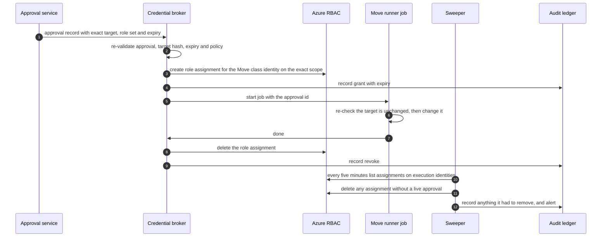

# Design 07 — Security architecture

> **What this answers:** *Who and what is trusted to do what, how is an agent that has been fooled kept from doing harm, and how do we know when something is wrong?* This is the physical security design for the [logical architecture](03-logical-architecture.md); it names products, and each product claim rests on the research in [security and compliance](research/security-and-compliance.md) and [Foundry Agent Service](research/foundry-agent-service.md), checked on 2026-10-31. Part of the [design](README.md).

**The idea in one paragraph.** An agent can be talked into anything, so no agent is given the power to do harm. The reasoning plane can only *read*. The one place that can *write* is a small deterministic execution plane that acts for **one approved Move at a time** with an identity that exists only for that Move. Everything an agent says, calls or reads passes the governance hub, which is the single place to filter, meter, log and switch off. What we cannot make impossible, we make visible, bounded and reversible.

---

## 1. Security principles, restated as controls

| Principle ([01 §5](01-requirements-and-principles.md#5-design-principles)) | The control that makes it true |
|---|---|
| P2 two planes, **Q-SEC-1** no standing write | Agent identities hold **zero** write roles; the execution plane gets a role assignment per approved Move, removed afterwards ([§3](#3-identity)) |
| P3 everything through the gateway, **Q-SEC-2** | Model deployments grant no data-plane role to any agent identity; private networking leaves the hub as the only route; a canary agent proves it every day ([§7](#7-network-and-the-short-list-of-exceptions)) |
| P5 a prompt is not a boundary | Authorisation lives in Entra roles, gateway contracts, tool allow-lists and the deterministic gate — no rule exists only in a system prompt |
| P6 external text is data, **Q-SAF-2** | The Document reader is the only door for untrusted text; text is labelled, size-limited and screened; privileged tools refuse arguments that came from it ([§5](#5-defence-against-prompt-injection-in-nine-layers)) |
| **Q-SAF-1** approvals | Approvals are authenticated human actions bound to one target; purchases need two named people with different hats ([§4](#4-approvals-that-cannot-be-forged-or-reused)) |
| **Q-SEC-3** no secrets | Keyless by default: managed identities, workload identity federation, Entra tokens; local (key) authentication is denied by policy ([§6](#6-secrets-keys-and-data-protection)) |

## 2. Trust zones, physically

The zones of the [logical design](03-logical-architecture.md#3-trust-boundaries) map to Azure like this. A zone boundary is a *network* boundary, an *identity* boundary and a *log* boundary at once.

| Zone | Where it lives | Identity it runs as | Network position |
|---|---|---|---|
| **Z0 the world** | the public internet and Microsoft's published pages | none | reached **only** by the Document reader, through an egress firewall with a host allow-list |
| **Z1 reasoning** | hosted agents in Foundry Agent Service (one identity per agent, nine contract groups, [05](05-agents-and-orchestration.md)) | Entra **agent identity**, read-only roles only | VNet-injected outbound; the only reachable internal destination is the governance hub |
| **Z2 tool services** | MCP servers on Azure Functions or Container Apps, published through the hub | one managed identity per tool service, read-only roles | private endpoints; callers authenticated at the hub *and* in the tool |
| **Z3 execution** | Approval service, Policy service, Credential broker, Move runner, Verifier (Container Apps and jobs) | separate managed identities per component, each with the narrowest role | its own subnet; reachable only from the Approval service; **no model call inside this zone** |
| **Z4 estate data** | the operational store, cost data in Blob, the Ledger | managed identities of the services that own them | private endpoints; no public access; EU only |
| **Z5 the Commons** | a public Git repository | GitHub accounts of contributors | published only through a pull request and a human review |

A **separate Lab subscription set** is a sixth place that is never a zone of the estate: it has its own budget, policy and expiry, and no network route to anything in Z4 ([§8](#8-the-lab-as-a-security-boundary)).

## 3. Identity

### 3.1 Who has an identity

| Principal | Kind | Count | Purpose | Standing permissions |
|---|---|---|---|---|
| People: owners, approvers, FinOps, platform | Entra users | many | decide, review, administer | owners and approvers: none in Azure; administrators: eligible through PIM |
| **Agent identity** per hosted agent | Entra Agent ID, created automatically for each hosted agent at deploy | fourteen, in nine contract groups | call the hub, read the knowledge services | invoke the hub's APIs of its own group's contract; **no** roles on estates; **no** data-plane role on model deployments |
| **Tool-service identity** | user-assigned managed identity | one per tool service | read estates, prices, documents on behalf of an authorised caller | Reader, Cost Management Reader, Monitoring Reader at the estate scopes it serves |
| **Execution identities** | user-assigned managed identities, one per *Move class* | a handful | carry out one approved Move | **none** at rest; a time-boxed role assignment exists only while a Move runs ([§3.3](#33-the-execution-identity-just-in-time-without-pim)) |
| Platform identities | managed identities of the pipeline, sweeper, drift watchers | few | deploy, verify, repair | deploy: scoped to our own resource groups only; watchers: read |
| GitHub Actions | workload identity federation (OIDC), no stored secret | per environment | deploy infrastructure | contributor on our own resource groups, per environment |

**A named human sponsor stands behind every agent identity and every execution identity** (Entra Agent ID has sponsors and owners; for managed identities the sponsor is a tag and a record in the Estate service). If a sponsor leaves, the identity is disabled until a new one is named — an automated check, not a policy document.

### 3.2 Roles — least privilege in Foundry

- Foundry roles were renamed in 2026 (Foundry User, Project Manager, Account Owner, Owner); the **role IDs are unchanged**, so Bicep and Policy reference IDs, never names ([Foundry RBAC](research/features-05.md)).
- Callers get the least-privilege **Foundry Agent Consumer** role at *agent* scope, not project scope.
- **API-key authentication is denied** on Foundry, AI Search, Storage and Cosmos DB by Azure Policy; a key bypasses RBAC and so bypasses every control above.
- No agent identity holds a role on a model deployment. A hosted agent reaches models through the hub; if it tries the deployment directly, the call fails on RBAC *and* on the network, and the canary alerts ([§7](#7-network-and-the-short-list-of-exceptions)).

### 3.3 The execution identity: just-in-time, without PIM

The north star needs "a short-lived, scoped identity for each Move". The obvious tool does not fit: **Privileged Identity Management cannot make a managed identity or service principal *eligible*, because it cannot perform the activation step** ([research](research/security-and-compliance.md), finding 4). So the design does the same thing with parts that exist:

1. **The broker is the only principal that can grant**, and it holds *Role Based Access Control Administrator* with a **condition** that limits which role definitions it may assign and to which principals (the execution identities only). A compromised broker cannot grant Owner, and cannot grant anything to anyone else. (Delegated role assignment with conditions; verify the exact condition syntax in the first build sprint — spike **S-ID-1** in [14](14-next-phases.md).)
2. **Scope is the target.** The assignment is at the exact resource (or the exact resource group for a create), never at subscription scope, so the role set is what ABAC cannot add for compute resources: *where* it applies.
3. **The Move runner is a job that only the broker can start,** with the approval id as its only input; it cannot be started by an agent identity or by a person without the broker.
4. **Expiry has three layers.** The broker revokes in a `finally` step; an independent **sweeper** (separate identity, separate schedule) removes anything left; and a **Resource Graph alert** fires if an assignment on an execution identity lives longer than its approval. If PIM supports time-bound *active* assignments for service principals and the tenant is licensed for it, it becomes a fourth layer — treat that as a later hardening, not a dependency.
5. **Purchases** use a purchaser role at the billing or subscription scope that fits the agreement type; the role, the scope and the second approver are part of the approval record. The exact mechanism per agreement type is spike **S-ACT-1**.

If the sweeper, the broker and the alert all fail, an unused role assignment still cannot be exercised by anyone: the identity is attached only to the runner job, and only the broker starts it. That is **defence in depth with three independent failures needed**, not a claim of impossibility.

### 3.4 Conditional Access and the licence line

Conditional Access, Identity Protection and governance workflows *for agents* need a **Microsoft Agent 365 licence** (per user, for owners and sponsors) on top of Entra P1 ([research](research/security-and-compliance.md), E3–E5). Entra Agent ID itself, managed identities and workload identity federation are included. The MIT core therefore works without any of it; the licence-bound controls are **optional modules** ([§11](#11-optional-modules-and-their-fallbacks)) and the fallbacks are least-privilege roles, the network and the gateway.

## 4. Approvals that cannot be forged or reused

An approval is the only thing that lets the execution plane change an estate, so it is built like a payment authorisation.

| Property | Mechanism |
|---|---|
| **Authenticated human** | a Teams Adaptive Card `Action.Execute` with single sign-on, or an e-mailed link to an approval page behind Entra sign-in; the Approval service validates the user's token itself |
| **Right person** | the approver must be a registered approver *for that target* in the Estate service (owner or delegate), checked by deterministic code, not by a model |
| **Bound to one target** | the approval stores a hash of the Move id and version, the exact resource ids, the parameters and the price or saving shown; the Move runner recomputes the hash and refuses on any difference |
| **Expires** | a validity window (default hours for a Move, minutes for a purchase re-price); an expired approval is dead |
| **Single use** | a nonce is consumed at execution; a replay fails |
| **Separation of duties** | purchases need **two distinct people with different hats** (workload owner and Finance), neither the requester; the service enforces *different hats*, not just different names |
| **Step-up for money** | purchases require a Conditional Access **authentication context** (fresh MFA) at the approval page; no card can approve a purchase by itself |
| **No impersonation channels** | voice, avatar, text message and a free-text e-mail reply can *start a conversation* but **never approve**; the only approving act is the authenticated action above |
| **Recorded** | each approval is appended to the audit ledger with who, when, from which channel, what they saw |

**A model's reading of a chat is never an approval.** A documented counter-example exists in which an agent inferred consent from a conversation ([research](research/features-02.md), F2-20). The Brief service therefore captures the click; the agents only see the *result*.

## 5. Defence against prompt injection in nine layers

Cost data is full of text that an attacker can influence — tags, resource names, descriptions, invoice lines, e-mail replies, public pages. The design assumes **some injection will succeed against a model**, and makes sure that it cannot reach anything that matters. Layers are ordered from *architectural* (cannot be bypassed by a cleverer prompt) to *probabilistic* (can).

| # | Layer | What it does | Status today | If unavailable |
|---|---|---|---|---|
| 0 | **Architecture** | the reasoning plane has no write power; no agent group holds all three legs of the *lethal trifecta* ([§5.1](#51-the-lethal-trifecta-per-agent-group)) | by design | n/a |
| 1 | **Document reader** | the only route for untrusted text: fetches from an allow-list of hosts, strips markup, truncates, labels text as *untrusted* (spotlighting), records the source and hash | our code | n/a |
| 2 | **Gateway screening** | `llm-content-safety` with `shield-prompt` on every route that carries untrusted text; the policy now covers **MCP and A2A** payloads, not only chat | GA ([features-05](research/features-05.md), F5-09) | in-code screening before the call |
| 3 | **Model guardrails** | Foundry content filters per access contract; Prompt Shields for *documents* are **off by default** and must be turned on for every untrusted-text route; English-primary, so multilingual cases are tested | GA for models; agent-level guardrails and tool-call/tool-response checks are **Preview** | gateway screening plus layer 5 |
| 4 | **Information-flow labels** | text from Z0 carries an *untrusted* label through the workflow; privileged tools refuse arguments derived from it without a human confirmation | FIDES in Agent Framework is **experimental**; fallback is our own label in the tool-call envelope | the fallback is the default; FIDES is a spike |
| 5 | **Deterministic gate before every tool call** | allow / deny / require-approval policy as code, in the agent process | Agent Governance Toolkit (MIT) is **public preview** with breaking changes between majors; fallback is an in-house policy check with the same contract | in-house check |
| 6 | **Tool contracts at the hub** | per-agent-group allow-lists of tools (APIM MCP products), read-only identities behind the tools, typed and size-limited results | GA | n/a |
| 7 | **Egress control** | VNet-injected outbound with a firewall allow-list; hosted-agent egress rules (audit or enforce) | hosted-agent egress policy is **Preview, "not intended for production use"** — treated as *audit-only* until GA | the firewall allow-list carries the load |
| 8 | **Human approval** | the only path to a change ([§4](#4-approvals-that-cannot-be-forged-or-reused)) | by design | n/a |
| 9 | **Detection and testing** | injection canaries in every data source, a red-team suite in CI, scheduled red-teaming in a purple environment, alerts on screening blocks | PyRIT and ASSERT in CI; Foundry's red-teaming agent for supported agent types (cloud runs support prompt and container agents, not function tools or non-Azure tools) | PyRIT |

**Order of trust:** layers 0, 1, 6, 8 are deterministic and carry the weight. Layers 2–5, 7 reduce probability and give visibility. Layer 9 proves the rest keeps working.

### 5.1 The lethal trifecta, per agent group

An agent that holds **private data**, reads **untrusted content** and can **communicate externally or change state** can be made to leak or damage. The design splits the cast so that no group holds all three — or, where it must, the third leg is made *typed and pre-resolved*.

| Agent group (see [05](05-agents-and-orchestration.md)) | Private data | Untrusted content | External effect | Verdict |
|---|---|---|---|---|
| **Study** — Scholar, Cartographer, Librarian (Atlas instance) | no: the Atlas is public knowledge | **yes**: documents, pages, specs | pull request to the Atlas repository only; reviewed | broken at *private data* |
| **Survey** — Surveyor | **yes**: estate inventory, owners | **yes**: tags, names, descriptions | none: no egress, the hub is the only route | broken at *external effect* |
| **Investigate** — Detective, Skeptic, Economist | **yes**: cost, usage, the Estate Model | **yes**: the same free text | none | broken at *external effect* |
| **Experiment** — Experimenter | no: Lab estates hold synthetic data | **yes**: vendor documents | Lab subscriptions only, within a budget and an expiry | broken at *private data*; blast radius bounded by the Lab |
| **Engineer** — Engineer | no estate data in the prompt | **yes**: source repositories, recipes | pull requests to our own repository; reviewed | broken at *private data* |
| **Govern** — Auditor, Examiner, Librarian (lessons instance) | **yes**: ledgers, audit, lessons | low: outcomes and traces | none: no route to anything public | broken at *external effect* |
| **Forge** — Forger | no: it generates synthetic estates | no | writes synthetic data to the Terrarium only | broken at *private data* and *untrusted content* |
| **Conduct** — Conductor | **yes**: budgets, ledger summaries | low: it reads typed records only | none | broken at *external effect* |
| **Converse** — Diplomat | **yes**: the case, in minimal form | **yes**: owners' replies, e-mail | **yes**: it speaks to people | **all three — constrained, see below** |

**The Librarian runs as two instances with separate identities.** The Atlas instance may write to the public repository and sees no estate data; the lessons instance reads estate lessons and has no route to anything public. One agent holding both would be a ready-made leak path from the Lesson Book to the Commons.

**The Diplomat is the one group that cannot avoid the third leg,** because talking to people is its job. It is therefore built as a *typed channel*, not a free one:

- It cannot choose a recipient: the Brief service resolves the person from the Estate service.
- It cannot send raw text: it fills a **Brief template** with structured fields and a short, length-limited rationale; the card is rendered from the template, never from model-authored markup or links.
- It sees a **minimal** view of the case — resource aliases and money, owner *pseudonyms* — not the raw estate.
- Links are generated by the Brief service from an allow-list; attachments are not supported.
- Every outbound message is screened at the hub, counted against the attention budget and written to the audit ledger.
- Its replies from people are untrusted text, screened like any other.

## 6. Secrets, keys and data protection

### 6.1 Secrets

- **Keyless by default.** Managed identities between services, workload identity federation from GitHub Actions, Entra tokens for the hub. No secret in a container image, an environment variable of a hosted agent, a prompt, a trace or a contract (hosted-agent guidance forbids secrets in images and environment variables).
- **Key Vault** only where a secret cannot be avoided (for example an optional SMS provider key), with RBAC, purge protection, private endpoint and rotation by Policy. Defender for Key Vault is enabled (≈ €0.22 a vault a month).
- **Customer-managed keys are a decision, not a default.** Foundry CMK for prompt agents needs your own Cosmos DB, Storage and AI Search each keyed, hosted-agent `$HOME` cannot be CMK-encrypted, and regions are limited. Platform-managed keys are the default; CMK is added only where a recorded driver exists. **No Managed HSM** (≈ €2,000 a month, no driver).

### 6.2 Data classes and what each may touch

| Class | Examples | Allowed deployment types | Logged content | Retention |
|---|---|---|---|---|
| **Public** | Microsoft documentation, price lists, the Atlas, synthetic data | EU Data Zone **or** Global Standard, Flex, Batch (cheapest) | full | as the Atlas |
| **Estate-confidential** | resource ids, costs, configuration, Estate Model | **EU Data Zone Standard** or regional — never Global | spans and metrics; content capture **off** by default; when on, into the protected GenAI content table | short, stated |
| **Personal** | owner names, e-mail, Teams content, voice | EU Data Zone; **pseudonymised** before it reaches a prompt | pseudonyms only | per the GDPR section of [08](08-governance-and-compliance.md) |
| **Secret-adjacent** | role-assignment ids, approval nonces | never in a prompt | ledger only | audit retention |

The data class is a property of the **access contract** at the hub. The gateway routes each call to a deployment type that its class allows and *refuses* a call whose data class exceeds what the target deployment permits. That is how the +20 % EU premium is paid only on the data that needs it ([12](12-cost-and-finops.md)).

### 6.3 Protecting what traces contain

Traces and gateway logs can contain prompts and tool results. Therefore: content capture is off by default; where on, content goes to a **protected table** (preview) that only a named role reads; the platform workspace has table-level access control; logs are policy-deployed to the platform workspace, not to a workspace the reasoning plane can read; and the **audit ledger is a different store from the traces**, so deleting or editing a trace never changes the record of what was approved or done ([06 §7](06-data-and-knowledge.md#7-the-physical-stores)).

## 7. Network and the short list of exceptions

The topology is in [04](04-landing-zone-and-citadel.md). The security rules on top of it:

1. Every PaaS resource we own has public network access **off** and a private endpoint; Azure Policy denies the opposite.
2. The **hub is the only route** from Z1 to a model, a tool or another agent.
3. **Network security perimeters** protect Storage, Key Vault, AI Search and Foundry from exfiltration (GA for Foundry, preview for some other kinds — adopted where GA).
4. A **canary agent** runs daily: it tries to call a model deployment, a Foundry project endpoint and an estate API directly. It must be blocked, and the block must raise an alert; a silent success fails the release gate G2.

**Public-ingress exceptions — the complete list.** "Private only" is only honest with the exceptions written down.

| # | Exception | Why | Compensating controls |
|---|---|---|---|
| X1 | The **Teams bot endpoint** that receives card actions | Teams and Bot Service reach the bot over the internet | only the Bot Service source ranges, JWT validation of every inbound activity, Front Door or Application Gateway WAF if the landing zone offers one, no data beyond the activity |
| X2 | Optional: ACS e-mail, SMS and voice callbacks | the channel provider calls back | signed webhooks, source ranges, module off by default |
| X3 | Optional: Foundry-published agent in Microsoft 365 (`enable_m365_public_endpoint`) | Microsoft 365 requires a public, source-IP-filtered route for the Activity protocol | optional; the card path (X1) does not need it; conversational agent only, never approval |
| X4 | Foundry features that are **not** private-capable: Memory, web and Bing grounding, browser automation | no VNet support | **not used**; the Scholar uses the Document reader instead |

## 8. The Lab as a security boundary

The Lab does real things in real subscriptions, which makes it the likeliest place for a mistake to cost money or leak. It is isolated by construction:

- **Separate subscriptions**, vended on demand, in their own management group, with a **budget that stops** (an action group disables the spend path; budgets alone evaluate on 8–24-hour-old data and stop nothing), an **expiry tag**, and a **Janitor** that deletes expired resources.
- **No route** to Z4; synthetic data only; separate agent identity with rights only inside Lab subscriptions; policy denies anything outside an approved list of SKUs and regions.
- Experiments take **opaque run codes**, not raw parameters: in a published test, parameters embedded in prompts were followed 68 % of the time, while a code resolved by the Lab was followed 100 % ([research](research/features-07.md), F7-28). Requested and applied values are both logged.
- Code the Experimenter writes runs in a **sandbox** with deny-by-default egress (Azure Container Apps Sandboxes are preview; dynamic sessions are GA and are the fallback).

## 9. Supply chain

| Asset | Control |
|---|---|
| **Models** | only models on the approved list, enforced by Azure Policy for deployments and the router subset; router pool changes are drift ([09](09-safeguards-and-drift-controls.md)) |
| **Agent framework and SDKs** | exact versions pinned; the Agent Framework core is GA, but many integrations are beta, and RC releases have broken credentials — upgrades are releases that pass the gates |
| **Containers** | built in CI from pinned bases, SBOM generated, images signed, only signed images admitted by the registry policy; private ACR |
| **GitHub Actions** | actions pinned by commit SHA, OIDC to Azure, no long-lived secrets, protected environments with required reviewers for production |
| **MCP servers** | only servers we own or Microsoft's first-party servers; published to agents only through hub contracts; tool lists are reviewed like code; the Azure MCP Server runs in read-only mode |
| **Skills (`SKILL.md`) and Moves** | treated as code: pull request, review, tests; skill scripts run only in a sandbox; skills from outside are input from Z0 |
| **Atlas and Commons contributions** | pull request, knowledge CI, a human reviewer, a signed release ([06](06-data-and-knowledge.md)) |
| **Developer machines** | package restores go through the organisation's approved feeds; nothing is pulled from public registries by the build |

## 10. Detection, response and the kill switches

### 10.1 What we log and where

Foundry, the hub and Azure services send diagnostic logs to the **platform Log Analytics workspace by Azure Policy** (deploy-if-not-exists). The audit ledger is separate and append-only. Where the landing zone runs a SIEM, our workspace feeds it; we **do not buy a SIEM** (Sentinel leaves the Azure portal on 31 March 2027; lake-tier ingestion is cheap if it exists).

### 10.2 Detections we ship as code

| # | Detection | Signal |
|---|---|---|
| D1 | a model deployment called by anything but the hub | Foundry request logs and caller identity |
| D2 | a role assignment on an execution identity without a live approval, or older than its approval | Resource Graph and Activity Log |
| D3 | a Move run without a matching approval id and target hash | ledger versus runner logs |
| D4 | spend or tokens per contract above 3× the trailing median | hub metrics |
| D5 | a spike in screening blocks, or a screening block on an internal route | hub logs |
| D6 | an agent identity sign-in from outside the expected network, or a new credential on an agent identity | Entra sign-in and audit logs |
| D7 | egress denials from hosted agents | firewall logs, egress-rule audit |
| D8 | an MCP tool, A2A agent or model alias published without a contract | APIM configuration versus the contract repository |
| D9 | the model router pool or a deployment version changed | Foundry control-plane changes versus the pinned list |
| D10 | an approval created for a person who is not a registered approver for that target | ledger |
| D11 | a hosted-agent version that is not the pinned one is receiving traffic | Foundry control-plane read |
| D12 | a purchase attempted outside the approved price tolerance | runner and price engine logs |

### 10.3 Kill switches

| Level | Action | Effect | Time to take effect |
|---|---|---|---|
| One **model or alias** | repoint the alias at the hub, or remove it from the contract | agents get the next pinned alternative, or pause | seconds |
| One **contract** (an agent group in an environment) | suspend the APIM subscription or product | that group loses models, tools and agents | seconds |
| One **agent** | disable its Entra agent identity | no token is issued; the agent cannot call the hub | minutes |
| One **Move** | mark the Move version revoked in the catalogue | the runner refuses it | seconds |
| The **execution plane** | stop the broker (feature flag in the configuration store) and remove its delegated role | no grant, so no change anywhere | seconds to minutes |
| **Everything** | suspend all hub products; the platform degrades to read-only dashboards ([03 §6](03-logical-architecture.md#6-degraded-modes)) | no agent activity | seconds |

Each switch is exercised in the L6 resilience drills ([10 §2](10-test-and-evaluation.md#2-the-layers)) and the drill is evidence for gate G7. **Who may pull a switch** is an Entra role assigned to named humans, never to an agent; the switch for the execution plane may also be pulled by the Governance plane automatically (Auditor evidence of regret, a D2 or D3 alert), and that fact is recorded.

### 10.4 Incident response

Each detection has a runbook ([11](11-delivery-and-operations.md)): contain (a switch), preserve (export the relevant traces and ledger slice), assess (what could the agent reach?), recover, learn (a new golden case in the injection suite). A suspected prompt-injection incident always includes **"what could this model have done if fully obeyed?"** — which is answerable from the capability matrix in [§5.1](#51-the-lethal-trifecta-per-agent-group), by design.

## 11. Optional modules and their fallbacks

Nothing here is assumed to be licensed. Each control that depends on a licence is *optional*, and each has a fallback in the core.

| Optional module | Needs | Adds | Fallback in the MIT core |
|---|---|---|---|
| **Agent 365** (agent inventory, Conditional Access, risk, governance for agents) | per-user licence for owners and sponsors | policy on agent sign-in, tenant-wide agent registry, Defender-style agent threat protection | least-privilege roles, the hub, our own inventory in the Estate service, detections D1, D6, D11 |
| **Defender CSPM** and **Defender for AI Services** | per-resource-hour; per-token (≈ €0.70 per million tokens, text only) | posture, attack paths, prompt-attack alerts | MCSB recommendations (free), gateway screening, our detections; scope the token-metered plan away from high-volume cheap tiers |
| **Defender for APIs** | per subscription | API inventory and anomaly detection on the hub | APIM logs and D4, D5, D8 |
| **Purview** (audit, DSPM for AI) | pay-as-you-go or licences | content governance for user-context calls | our own ledger and retention; **Purview's Foundry integration does not support network isolation** and only governs user-context calls |
| **Entra P2 / ID Governance** (PIM, access reviews) | per user | eligible roles for human administrators and approvers | break-glass, narrow standing roles audited by Policy |
| **Workload ID Premium** | $3 per identity a month | Conditional Access for the few execution identities | network and broker controls |
| **Front Door WAF or Application Gateway WAF** | fixed monthly base | WAF in front of the Teams bot endpoint | JWT validation and source ranges |
| **Compliance Manager premium templates** | per template per year | assessment templates for the AI Act, ISO/IEC 42001, NIST AI RMF | the control mapping in [08](08-governance-and-compliance.md) |

## 12. Threats, controls and what remains

The ten threats of the [research](research/security-and-compliance.md#3-threat-frameworks-and-this-systems-threat-model), with the controls above and the residual risk we accept. OWASP and ATLAS identifiers are in the research.

| # | Threat | Primary controls | Test | Residual risk |
|---|---|---|---|---|
| T1 | **Indirect prompt injection** through tags, billing text, replies, pages | layers 0–9 ([§5](#5-defence-against-prompt-injection-in-nine-layers)); capability matrix ([§5.1](#51-the-lethal-trifecta-per-agent-group)) | L5 attack suite, canaries, G2 | a model may produce a *wrong proposal*; it cannot execute one. Wrong proposals are caught by the Skeptic, the owner and the approval gate |
| T2 | **Knowledge and memory poisoning** (Atlas, Commons, Lesson Book) | claims need receipts and scope; pull-request review; re-check recipes; lessons are *testimony* with expiry; Foundry Memory not used | L4 decoys, G5 | a plausible false claim that passes review: mitigated by the continuing re-check |
| T3 | **Excessive agency** | no standing write; JIT identity; Move catalogue; approvals bound to target | L1 properties, L5, G2 | purchaser mistakes by approvers — mitigated by two hats and re-pricing at execution |
| T4 | **Denial of wallet** | token limits and quotas per contract at the hub, `max_tokens` set deliberately, per-run budgets, Lab budgets that stop, alerts D4 | L7, G6 | a one-day overrun inside the contract's cap |
| T5 | **Estate-data disclosure** | data classes, EU Data Zone, pseudonymised owners, no Global for estate data, private endpoints, protected logs | L5, G8 | operator error in an access contract — mitigated by contract tests |
| T6 | **Supply chain** | [§9](#9-supply-chain) | L0, G1 | a compromised upstream preview package: pinned, scanned, and staged through Lab |
| T7 | **Inter-agent spoofing and cascade** | A2A through hub with identity and screening; typed messages; circuit breakers per contract | L5, L6 | a loop that burns tokens until its cap |
| T8 | **Approval-path abuse** (impersonation, persuasion) | [§4](#4-approvals-that-cannot-be-forged-or-reused) | L5, L6 | a coerced human with a legitimate right |
| T9 | **Output injection** (agent text rendered as cards, KQL, Bicep, CLI) | typed templates; no model-authored markup; Move parameters validated against schemas; Bicep produced from templates, not free text | L1, L2 | rendering bug in a client |
| T10 | **Confident wrong numbers** | arithmetic only from the price engine; prediction ledger; ranges, not points; the Skeptic | L3, L4, G5 | calibration error within the stated interval |

## 13. What is still unproven here

Listed so nobody mistakes a design for a fact; each has a spike in [14](14-next-phases.md).

- **S-ID-1** — the exact condition syntax and limits for delegating role assignment to the broker, and whether a time-bound *active* PIM assignment for a managed identity is available and licensed.
- **S-ACT-1** — the purchase role and scope per agreement type (EA, MCA, CSP).
- **S-SEC-1** — whether the Agent Governance Toolkit's policy engine and the in-house gate can share one policy format.
- **S-SEC-2** — whether Foundry guardrail and Prompt Shields settings apply to calls the agent makes through the hub.
- **S-SEC-3** — the behaviour of hosted-agent egress rules in enforce mode, once they reach GA.
- **S-NET-1** — whether the hub can front Foundry toolbox endpoints, so a toolbox is not a bypass.
