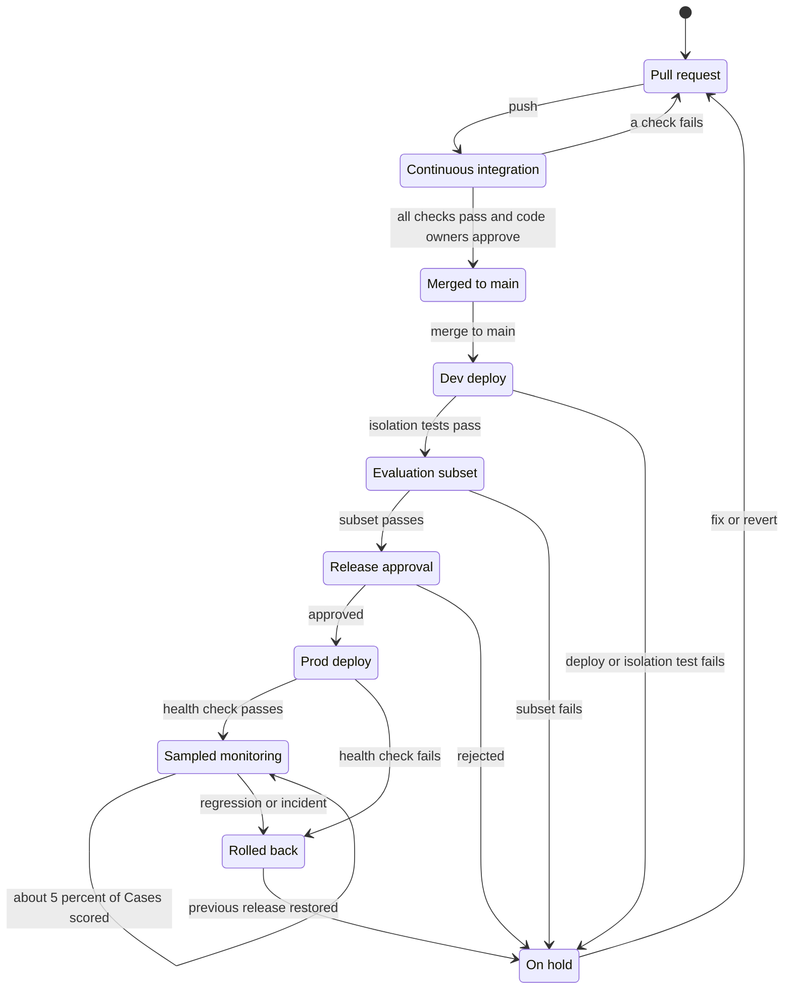

# Delivery and operations

**What this document answers.** How the system is built, deployed, run and recovered: what the repository holds and who owns it; how releases ship and are undone; who does what when something breaks; how data is restored; how an estate is onboarded.

## 1. The repository

One repository defines the system, so a release is one set of pins. Every path has a code owner. The system drafts pull requests; people merge them.

| Path | What it holds | CODEOWNERS group |
|---|---|---|
| `atlas/`, `detectors/` | Claims, Service Cost Profiles, re-check recipes; Detectors and their tests | Atlas reviewers |
| `actions/` | The Action catalogue: Bicep Action templates, schemas, preconditions, predicted effect, rollback, risk class | Security reviewers |
| `prompts/`, `agents/` | Role prompts and output schemas; sources of the five hosted agents | Platform team |
| `contracts/` | Hub contracts per hosted agent and environment; tool pins | Security reviewers |
| `infra/`, `hub/` | Bicep, profiles, Deployment Stacks, runner role definitions, onboarding modules; hub instructions and pinned commit | Platform team |
| `apps/workflows`, `apps/tools` | Durable orchestrations; read tools, price simulator, planner | Platform team |
| `apps/approvals`, `apps/runner` | Approval service and credential evaluator, web page; action runner, verifier | Security reviewers |
| `templates/` | Card, letter and page templates ([experience design](../experience/README.md)), the card manifest, one message catalog per language | Security reviewers; a native speaker for each translation |
| `evaluation/` | Suites, synthetic estates, replays, human-adjudicated gold labels (the sealed test set stays outside Git) | Atlas reviewers |
| `.github/` | Workflows, CODEOWNERS, rulesets | Security reviewers |
| `docs/` | Design, decisions, runbooks | Platform team |

**Templates and message catalogs are code.** A change to one passes, on every commit and merge, the card lint, a renderer check with Microsoft's Adaptive Cards libraries, snapshot tests and, for every template and language, the comprehension check ([08](08-testing-and-evaluation.md#what-runs-for-which-change)).

**Merge rules for `atlas/`, `detectors/` and the other owned paths** are enforced by the rulesets in `.github/`: a code owner's approval from someone other than the last pusher, stale approvals dismissed on a new commit, no App on any bypass list, and the Atlas review check accepted only from its App. Workflows that run on a fork's pull request use the `pull_request` event with no secret and a read-only token, never `pull_request_target`.

## 2. Infrastructure as code

**Bicep with Azure Verified Modules.** [AVM](https://learn.microsoft.com/community/content/azure-verified-modules) resource modules cover the Function apps, Cosmos DB, AI Search, Storage, Key Vault, API Management and the Foundry account; plain Bicep fills gaps. Most are 0.x, where a minor version can break ([AVM rule](https://azure.github.io/Azure-Verified-Modules/spec/SNFR17/)), so each is pinned exactly and upgraded by pull request with a what-if. Hosted-agent versions are data-plane objects, not Azure resources: a pipeline step creates them.

**azd** is the developer loop and CI entry point (`azd provision`, `azd deploy`, `azd ai agent`) ([Learn](https://learn.microsoft.com/azure/foundry/agents/how-to/deploy-hosted-agent-code)). Pin the `azd ai` extensions, which are versioned apart from azd; the Python SDK (`azure-ai-projects` 2.2 or later) is the fallback for the same zip upload.

**Two profiles, one codebase.** The Bicep parameter `profile` (`evaluate` or `operate`) switches private endpoints, the Foundry network setting, the AI Search tier and public access ([02](02-architecture.md)). A pre-release job deploys a short-lived `operate` environment in the dev subscription, runs the isolation, restore and kill-switch checks, and deletes it. That environment keeps audit storage on an unlocked retention policy: a locked one cannot be removed and blocks deleting the account ([Learn](https://learn.microsoft.com/azure/storage/blobs/immutable-storage-overview)). Production locks it after its restore test.

**Code, not clicks.** Contracts deploy with the hub's modules, what-if first; keys go to Key Vault, never into a parameter file.

**Zip deployment, no registry.** Hosted agents deploy from a zip (`code_configuration`) with `bundled` dependencies, so the bytes CI tested are the bytes that run; the service stores the zip's SHA-256 and returns the deployed zip for comparison. Function apps on [Flex Consumption](https://learn.microsoft.com/azure/azure-functions/flex-consumption-plan) run from a zip in a blob container.

**Region is a parameter.** Sweden Central is the default. A pre-flight job checks the [hosted-agent region list](https://learn.microsoft.com/azure/foundry/agents/concepts/hosted-agents#region-availability) (North Europe is absent), `az functionapp list-flexconsumption-locations`, AI Search capacity (create it first: new capacity can be constrained), each model alias's deployment type and the hub's location list. Each Function app takes an always-ready instance count as a parameter; [the cost model](10-cost-and-finops.md) counts the one that [Learn recommends](https://learn.microsoft.com/azure/durable-task/durable-functions/durable-functions-azure-storage-provider#flex-consumption-plan) for the Durable group, and a pilot can set it to 0 and accept cold starts.

## 3. Pipelines and releases

GitHub Actions signs in with [OpenID Connect](https://learn.microsoft.com/azure/developer/github/connect-from-azure-openid-connect): no Azure secret is stored. Each environment has a managed identity whose federated identity credential is bound to a GitHub environment (`dev`, `prod`); pull-request jobs use another identity that can only run what-if. The `prod` environment needs a platform-team reviewer other than whoever started the release. GitHub needs only one environment reviewer ([GitHub](https://docs.github.com/en/actions/how-tos/deploy/configure-and-manage-deployments/manage-environments)), so the second pair of eyes is the CODEOWNERS pull-request review. In a private repository, required reviewers need GitHub Enterprise Cloud ([GitHub](https://docs.github.com/en/actions/reference/workflows-and-actions/deployments-and-environments#required-reviewers)).

A hold freezes production on the last good release until a person decides. Rollback is automatic only right after a deploy; a later regression raises an alert and a person starts it.

CI runs lint, unit and schema checks, the zero-LLM suites ([08](08-testing-and-evaluation.md)), Bicep what-if, a secret scan and the SBOM. After the dev deploy come isolation and negative-path tests, Action-template tests and the evaluation subset ([08](08-testing-and-evaluation.md#8-the-path-of-a-change-and-what-blocks-a-release)).

In the Operate profile the Foundry endpoint is private, so `azd deploy` fails from a public workstation or a standard GitHub-hosted runner ([Learn](https://learn.microsoft.com/azure/foundry/agents/how-to/virtual-networks)). Jobs that touch private data planes run inside the spoke network, on a small self-hosted runner or [GitHub larger runners with Azure private networking](https://docs.github.com/en/organizations/managing-organization-settings/about-azure-private-networking-for-github-hosted-runners-in-your-organization).

**What a release pins.**

| Pin | How it is held |
|---|---|
| Prompts | Hashed into each hosted-agent zip |
| Tools | OpenAPI descriptions; the hub's pin of each tool's name, description and schema hash |
| Model aliases | Model version, protocol, processing location, retirement date, in the contract |
| Atlas | Git tag and index build id |
| Hub contracts | Parameter files and the hub's `release.json` versions |
| Action templates | Catalogue version and template hashes |
| Package cohorts | Hashed lock files: the Agent Framework cohort, Python, the extension bundle |
| MCP servers | Version and digest; the hub rejects `tools/list` drift |

The release record is one JSON file on the Git tag listing every pin and zip hash. Flex Consumption keeps no earlier packages ([Learn](https://learn.microsoft.com/azure/azure-functions/functions-rollback-deployments)), so each built zip is stored as a release asset. **Rollback redeploys the previous record's artefacts; it never rebuilds.** A hosted-agent rollback creates a new immutable version holding the old bytes: an endpoint serves one version and cannot split traffic.

## 4. Deployment Stacks and the runner

Deployment Stacks give the solution's own resources drift control: a deny setting blocks every change except by excluded principals ([Learn](https://learn.microsoft.com/azure/azure-resource-manager/bicep/deployment-stacks)). It would equally block an approved Action, so the two meet by rule.

| Where | Rule |
|---|---|
| The solution's own stacks | Subscription scope, resource groups in the template, `denyWriteAndDelete`. Two excluded groups (deploy identities, platform break-glass): Learn caps exclusions at five and accepts more silently, so CI counts them. The runner has no role here and is not excluded; changes arrive as pull requests on `infra/` |
| A resource in the adopting organisation's stack | The planner lists deny assignments at the target ([Learn](https://learn.microsoft.com/azure/role-based-access-control/deny-assignments)). If one covers the resource and excludes the runner's identity, the Action runs. Otherwise the Engineer drafts a pull request on the stack's source for a human to merge |

**Superseded in part on 2026-11-05:** the runner's identity and roles in this document. A change runs as the approver; see [decision 24](12-decisions.md#24-a-change-runs-as-the-approver-meternaut-holds-no-right-to-change-azure--accepted) and [proposal 05](../proposals/05-run-as-the-approver.md).

Deny settings do not stop deleting a resource group when the stack sits at that scope, moving a resource out of its group, or changing implicitly created resources. Stacks cannot manage Graph resources (a bootstrap step owns Entra objects) and have no what-if, so the pipeline runs it on the template ([Learn](https://learn.microsoft.com/azure/azure-resource-manager/bicep/deployment-stacks-known-issues)).

## 5. Upgrades

| Component | How it is upgraded | How we know, and the way back |
|---|---|---|
| Hub | One pinned commit (the accelerator has no releases or tags). Upgrade only with the Gateway Upgrade module (preview; `main.bicep` is for the first deployment): dev contracts, contract tests, then prod | The hub drift check ([07](07-safeguards-and-drift.md#2-what-drifts-and-how-we-notice)) compares its version with the pin and finds portal edits. Back: re-apply the previous pin |
| Models | A daily check ([07](07-safeguards-and-drift.md#2-what-drifts-and-how-we-notice)) alerts at 180, 90 and 30 days before an alias member retires (parameters). Lifecycles differ: GA models 18 months, Anthropic, DeepSeek, Fireworks and Mistral AI 12 ([Learn](https://learn.microsoft.com/azure/foundry/openai/concepts/model-retirements)) | Evaluation subset on the replacement, then a release |
| Agent Framework | Core 1.x is GA; the Foundry hosting package is prerelease ([Learn](https://learn.microsoft.com/agent-framework/hosting/foundry-hosted-agent)). A cohort is the package versions tested together, in lock files; a nightly job tests the newest on dev, and adoption is a pull request | Deployed zip hash against the release record. Back: the previous zip, or a thin own adapter around the GA core (P2, [roadmap](13-roadmap.md)) |
| Durable backend | Azure Storage provider by default. Data cannot move between providers, so a switch to Durable Task Scheduler is a new `workflows` app: new Cases start there and the old app drains ([Learn](https://learn.microsoft.com/azure/durable-task/common/durable-task-storage-providers)) | Instances by status. Back: keep the old app until empty |
| Orchestration code | Orchestration versioning pins each instance to its starting version; the defaults (`CurrentOrOlder`, `Reject`) keep waiting Cases safe ([Learn](https://learn.microsoft.com/azure/durable-task/common/durable-orchestration-versioning)). Keep the default `Recreate` update strategy; rolling updates (preview) stay off ([Learn](https://learn.microsoft.com/azure/azure-functions/flex-consumption-site-updates)) | Query instances by version before removing an old code path |

## 6. Operating model

| Role (Entra group) | Does |
|---|---|
| Platform team | Builds, releases, is on call; can flip any kill switch |
| FinOps lead | Owns token budgets and the daily cap; reads the digest and report card; finance-side approver for R3 |
| Security reviewers | Run access reviews; lead identity and data incidents |
| Atlas reviewers | Merge Atlas and Detector pull requests; adjudicate gold labels |
| Resource owners | Answer Cases; approve R1 and R2 for their resources; one of two R3 approvers |

**On call.** Business hours, on a rota the adopting organisation sets. The system fails closed, so nothing changes in Azure while nobody is awake. Five alerts page out of hours: the run-rate trip, a purchase alarm, a runner action with no approval record, a flipped kill switch, a leaked secret.

**SLOs.** Targets are parameters; these are the defaults.

| SLO | Measured by | Default target |
|---|---|---|
| Monday digest on time | The workflow's delivery record | By 09:00 local on at least 12 of 13 Mondays |
| Approval page available | A probe through sign-in | 99.5 % of probes a month |
| Case latency | Case opened to Recommendation sent | 90 % within 24 hours |
| Runner success | Runs ending verified, or aborted before any change | 99 % within 30 minutes of approval |

Each playbook below has a runbook with exact commands in `docs/runbooks/`; the failure drills in [07](07-safeguards-and-drift.md) rehearse them.

## 7. Incident playbooks

| Incident | Trigger | First actions | Who | Recovery |
|---|---|---|---|---|
| Leaked hub key | Secret-scanner hit; calls without a matching agent token | Rotate with the hub's three-step flow (the contract also needs the agent's token). On misuse, suspend the contract's [API Management subscription](https://learn.microsoft.com/azure/api-management/api-management-subscriptions); unpublishing the product does not block calls | Security reviewer, platform team | New key in Key Vault and the Foundry connection; usage logs reviewed for the window |
| Compromised runner or approver session | Purchase alarm; runner action with no approval record; sign-in risk alert | Flip the global kill switch (one person). Revoke sessions or disable the family identity. End the purchase identity's time-boxed assignment | Platform team, security reviewer | Compare the audit log with approvals (single-use, plan-bound). Re-enable family by family; the purchase switch needs two people |
| Disowned approval, fake message | "I did not approve this"; "Talk to a person" reports a wrong or fake message; the approval alarm ([06](06-security-and-governance.md#approval-classes)) | At once: that person's approvals paused, the platform team alerted; a report also revokes an approval that has not run, whatever the record shows. Compare the record with its route's events and the message with the delivery record. "Undo" reverses a change that ran; a report does not | Security reviewer, platform team | No event: a forged request, so continue as the compromised session above. Not our message: a lookalike, so repeat the announcement ([onboarding](#9-onboarding-an-estate)). Approvals resume after the review |
| Poisoned Atlas claim | A bill or outcome contradicts it; a re-check fails; an injected instruction is found | Revert the pull request, rebuild the index, list the Cases that cited it (each step records its Atlas version) | Atlas reviewer | Withdraw or redo those Recommendations; tell owners; add the case to the evaluation |
| Runaway spend | Quota alerts (429, 403); the daily run-rate trip; budget or anomaly alert | Confirm the trip. Find the contract and Case in hub logs. Suspend that contract's subscription; cancel its orchestrations | Platform team, FinOps lead | Fix the loop; lower the quota; re-enable. The Conductor (the role that ranks open questions and sets budgets, see [agents and workflows](03-agents-and-workflows.md)) cannot raise the daily cap |
| Wrong action | Effect differs from the prediction; a guard metric breaches; an owner reports it | Switch off the action family. Nothing rolls back by itself; the approver restores with their own rights, if the change can be reversed | Platform team, resource owner, FinOps lead | A Lesson and the regret in the ledger; fix the template or Detector; re-enable after an evaluation |
| Hub outage | `/version` probe or canary call fails | Confirm with the hub owner. Workflows queue; the digest says paused; no fallback to direct model access | Platform team | Resume queued Cases after probe and canary pass; if the hub is ours, redeploy the pinned commit |
| Model retirement | Alert at 180, 90 or 30 days; `410 Gone` | The alias's fallback member answers; run the evaluation subset on the replacement | Platform team, FinOps lead | Release the new alias map; keep the old one until retirement |
| Teams route down | The flow's run history shows failures; the queue's message count grows | The app cannot tell that a card did not arrive; the web page still lists every request; nothing runs without approval | Platform team | Repair the flow: cards still on the queue are posted; let stale requests expire |
| Kill switch page down | The page's availability probe fails | One person runs the runbook's commands for the same switch and level, after a fresh sign-in and under a time-boxed data role on `switches` that is alerted and reviewed the next day; each pull is audited and alerted as it is from the page. A purchase already submitted is not recalled | Platform owner, FinOps lead or security reviewer | Restore the page; check that every pull has its audit entry; resume in stages (purchases need two people) |

**Break-glass.** The adopting organisation's [emergency-access accounts](https://learn.microsoft.com/entra/identity/role-based-access-control/security-emergency-access) cover tenant lockout; this system adds none. Lifting the purchase switch takes two people, so no single break-glass account can re-enable purchases. Deploying outside the pipeline needs a time-boxed role elevation, an alert and a next-day review.

**Access reviews, quarterly.** Check the five role groups, runner assignments, hub app roles, federated identity credentials and GitHub environment reviewers. Without the licence in section 9, a scheduled workflow lists the assignments into a pull request for the security reviewers.

**SBOM.** Each release carries an SPDX bill of materials per zip ([06](06-security-and-governance.md#9-supply-chain)); it shows which releases contain a hostile dependency, but does not stop one.

## 8. Recovery

Targets are parameters. The defaults cover deletion and corruption, not the loss of a region.

| Data | Protected by | Data lost at most (RPO) | Back in service within (RTO) |
|---|---|---|---|
| Atlas, code, prompts, contracts, Action templates, infrastructure | Git and the release records | 0 | Hours: redeploy a release |
| Cosmos DB records | Continuous backup, tier of 7, 30 or 35 days | 15 minutes | One working day |
| Audit log | Immutable blobs, soft delete | 0 for committed entries | Minutes (undelete) |
| Cost lake | Exports can be re-run | Last export | Days |
| Atlas index, workflow state | Rebuilt from Git and the ledger | 0 | Hours |

**Backups.** Cosmos continuous backup copies changes within about 100 seconds ([Learn](https://learn.microsoft.com/azure/cosmos-db/continuous-backup-restore-introduction)). A restore creates a new account without firewall, virtual-network and private-endpoint settings, data-plane roles or role assignments, so the runbook redeploys `infra/` against it and repoints the apps. The audit container has a locked time-based retention policy with protected appends, plus blob and container soft delete: blob soft delete alone does not protect a container or an account ([Learn](https://learn.microsoft.com/azure/storage/blobs/soft-delete-blob-overview)).

**Loss of a region.** Serverless Cosmos DB runs in one region and keeps its backups there ([Learn](https://learn.microsoft.com/azure/reliability/reliability-cosmos-db#resilience-to-region-wide-failures)); Azure Backup's cross-region restore cannot restore into a serverless account ([Learn](https://learn.microsoft.com/azure/backup/backup-azure-cosmos-db-support-matrix)). Code, Atlas, contracts and prompts redeploy elsewhere; Cosmos records are lost unless the adopter sets `geoExport`, a nightly export of the ledger, Lessons, approvals, credentials and preferences to geo-redundant storage (24-hour RPO).

**Restore tests.** Every pre-release run restores Cosmos to a point in time into a new account, checks counts and samples, restores a soft-deleted audit blob and records the time; every quarter production repeats it with the real runbook. The first run proves continuous backup works on the serverless account.

**Version-safe resume.** A waiting Case wakes under the code version it started with; if the Atlas, Estate model or prompts changed since its last step, it refreshes its facts and, if the evidence moved, redrafts the Recommendation and tells the owner before asking again. After a restore, open approvals expire and are asked for again; plan-hash, etag and quote checks already stop a replay.

## 9. Onboarding an estate

What each part needs, as facts:

| Need | Fact |
|---|---|
| Azure subscriptions | The solution: one per environment, dev with no role on production. The estate: the scopes to read |
| A hub | The organisation's own Citadel governance hub (an API Management gateway: see the [architecture](02-architecture.md)), or the accelerator, deployed from upstream at a pinned commit (Owner, or Contributor plus User Access Administrator) |
| Entra permissions | Create app registrations and assign app roles (agent identities, federated identity credentials) |
| Entra ID P1 | Conditional Access with authentication context on the R2 and R3 approval page ([Learn](https://learn.microsoft.com/entra/identity/conditional-access/overview#license-requirements)) |
| Entra ID Governance or P2 | Access reviews ([Learn](https://learn.microsoft.com/entra/id-governance/access-reviews-overview#license-requirements)); PIM for human admin roles (PIM cannot make service principals eligible) |
| Microsoft 365 | Teams cards; an Exchange Online shared mailbox. `Mail.Send` as an application permission sends as any user: grant it only through [Exchange RBAC for Applications](https://learn.microsoft.com/exchange/permissions-exo/application-rbac), scoped to the shared mailbox and with no organisation-wide Entra consent ([data and integrations](05-data-and-integrations.md#6-channels) adds the mail-flow rule). Without it: the web page |
| Cost data | Exports need Owner, Contributor or Cost Management Contributor on the scope, or a billing role at billing scope; a firewalled storage account also needs Owner on it (or a custom role that can assign roles) during creation, and trusted-service access ([Learn](https://learn.microsoft.com/azure/cost-management-billing/costs/tutorial-improved-exports)). With Cost Management Reader alone, the system reads through the Cost Details or Query API ([agreements and access](14-agreements-and-access.md)) |
| Network (Operate) | In the Foundry account's region: a subnet for the Foundry agents, delegated to `Microsoft.App/environments` (/27 minimum; /24 recommended, because a new agent version takes extra addresses while old and new run together; one Foundry account only), a second delegated subnet for the Function apps (a Container Apps environment and a Flex Consumption app cannot share one), a subnet for the private endpoints, private DNS, and a runner inside the network |

The steps, in order:

| # | Step | Who | Done when |
|---|---|---|---|
| 1 | Choose scopes and data boundary. Give the read-only identities Reader, Cost Management Reader and Monitoring Reader (Log Analytics Reader where logs are read) there. The Estate refresh workflow probes each scope and stores its capability profile | Platform team, FinOps lead; estate owner deploys the onboarding module | The scope list and the thresholds for a new estate ([knowledge and learning](04-knowledge-and-learning.md)) are parameters in `infra/`; a read works and a write fails; every scope has a profile |
| 2 | Cost data into the cost lake by the best path the profile shows: exports, else the Cost Details or Query API | Estate owner | The first run lands; the ingestion manifest lists it |
| 3 | Directory mapping: which Entra groups are owners, FinOps and approvers; the billing owner and the partner contact, where purchases are to be requested; which tags are hints, never authority. The readiness check (below) covers the approver groups | Platform team, estate owner | Ten sample resources resolve to candidate owners, each a guess until that person confirms (until then they get only the first-contact message and Questions); the rest become questions; readiness is in the profile |
| 4 | Channels (the sender mailbox; from phase 2 the Power Automate flow that posts the Teams cards, with the Workflows app allowed in the Teams admin center), the announcement (content: [05](05-data-and-integrations.md#6-channels)) and the first Estate model | Platform team, a team lead, Microsoft 365 admin | The announcement is recorded before the system writes to anyone; a test e-mail reaches the FinOps lead (from phase 2, a test card reaches a named owner); counts match Resource Graph |
| 5 | First digest | FinOps lead | On time; agrees with Cost Management |
| 6 | First Case, advice-only: no action role exists | Resource owner (in phase 1a, the FinOps lead through the digest) | Reaches Lesson and ledger with no change in Azure |
| 7 | Opt in one action family: assign its custom role at chosen scopes, test the kill switch, dry-run a plan in non-production, run one approved Action | Estate owner, security reviewer | The Verifier confirms the prediction |

From phase 2, where the app cannot be installed, first contact goes by e-mail and every decision on the approval page.

**Approver readiness.** Step 3 also probes whether the approval page can request step-up (an Entra authentication context), and each holder of an approver role signs in once on the page at the strength their class needs; the page keeps only the object id, the class and the time of a pass. No app or pipeline holds a Graph permission to read registered methods: the report that lists them needs `AuditLog.Read.All`, which also reads sign-in and audit logs ([Learn](https://learn.microsoft.com/graph/api/authenticationmethodsroot-list-userregistrationdetails)), so a person reads that report in the Entra admin center if they want it. Where an approver cannot pass, R3 purchases are refused with an explanation; without authentication contexts only R1 works, and anything above R1 is refused likewise. A pass shows that the method works today: the page checks every sign-in.

Purchases (R3) are a separate opt-in in phase 4. Offboarding reverses steps 7 to 1: remove the assignments, stop the exports.

## 10. Operating costs and budgets

Each of the solution's own subscriptions gets a budget and a [cost anomaly alert](https://learn.microsoft.com/azure/cost-management-billing/understand/analyze-unexpected-charges#create-an-anomaly-alert), as Bicep, with thresholds as parameters. Budgets only alert and arrive late; the hard stops are in [safeguards and drift](07-safeguards-and-drift.md).
