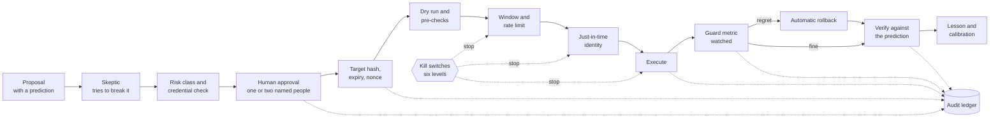

# Design 09 — Safeguards and drift controls

> **What this answers:** *What can silently change under us, in us and around us — and for each of those, what prevents it, what notices it and what puts it right?* And: *which safeguards stand between an AI mistake and an irreversible action?* Platform facts come from the [Foundry](research/foundry-agent-service.md), [governance and Agent Framework](research/foundry-governance-and-framework.md), [Citadel](research/citadel.md) and [security](research/security-and-compliance.md) research, checked on 2026-10-31. Part of the [design](README.md); principle **P9**, "drift is a first-class risk", is made concrete here.

---

## 1. What drift means here

**Drift is any divergence between three states that are supposed to agree:** what is **declared** (the repository and the release manifest), what was **evaluated** (the version the exam and the gates passed) and what is **actual** (what is serving traffic right now).

An AI system drifts on three clocks, and a design that watches only one is blind to the others:

| Clock | Who changes it | Example |
|---|---|---|
| **Ours** | our people and pipelines — or someone bypassing them | a portal edit to a gateway policy; a role assignment that was never removed |
| **The platform's** | Microsoft, under an unchanged label | the model router's pool grows inside version `2025-11-18`; a preview feature changes its schema; a service retires |
| **The world's** | prices, billing data, people, attackers | a new meter; a changed export schema; a poisoned tag; an approver who stops reading |

The model router is the instructive case: its **pool lost five models between July and August 2026 under a version label that did not change**, and Standard deployments auto-upgrade unless told otherwise. "We pinned the version" is therefore not enough; every drift control below checks the *behaviour and the actual state*, not the label.

**Each layer has three controls** — one that **prevents**, one that **detects**, one that **corrects** — and each control says whether the correction is **automatic** (the declared state is authoritative, the correction is reversible and the blast radius is small) or **human-approved**. A layer with no detective control is not controlled; a layer with a detective control and no corrective one is a pager.

## 2. The drift catalogue

### 2.1 Drift in what we own

| # | Layer | What drifts | Prevent | Detect | Correct | Auto? |
|---|---|---|---|---|---|---|
| **DR-1** | **Infrastructure and configuration** | an Azure resource differs from its Bicep | subscription-scope **Deployment Stacks** with deny settings (excluded principals are *groups*: at most five are allowed; the resource group is in the template, because deleting the group bypasses deny assignments); Azure Policy *Deny* and *Modify* | scheduled `what-if` against `main`; Activity Log alert on a write by any principal other than the pipeline (D2, D8); Policy compliance; Resource Graph | redeploy from `main`; Policy `Modify` restores a setting | auto for *safe* classes (tags, diagnostics, public access off); human for the rest |
| **DR-2** | **Identity and access** | role assignments, app roles, federated credentials, sponsors | no standing write; constrained delegation to the broker; Policy audit of assignments | Resource Graph diff against declared roles; the **sweeper**; sign-in and credential-change alerts (D6); sponsor-validity check | the sweeper removes; a disabled sponsor-less identity | auto |
| **DR-3** | **Network and exposure** | public access re-enabled; a new private endpoint or DNS record; a firewall rule; an egress rule | Policy *Deny* on public access; network security perimeters on Storage, Key Vault, AI Search and Foundry; no direct deployments in spokes | daily **canary agent** (B1, B2 of [04 §8](04-landing-zone-and-citadel.md#8-the-gateway-bypass-register)); firewall deny logs (D7); Policy | `Modify` back to *disabled*; redeploy | auto |
| **DR-4** | **Gateway and contracts** | a policy, named value, product, backend or alias edited outside the pipeline | contracts in Git with CODEOWNERS; the hub's resource group under Policy that denies writes except the pipeline identity (a deny stack around the accelerator's own modules is *EVALUATE*) | `GET /version` and `/version/backend-contract` against the pinned values; nightly `what-if` on **every** contract; API Management activity log (D8) | re-run the contract deployment; rotate keys if a credential could have been read | auto for contracts; human for the hub |
| **DR-5** | **Agent runtime** (hosted-agent versions) | the version serving traffic is not the manifest's; an image digest, environment or role differs | versions are **immutable**; only the pipeline identity may register a version or move the selector; Foundry's *block* action is held by operations, not by agents | every 15 minutes, read the control plane and compare with the manifest (D11); Control Plane inventory and compliance | move the selector back to the pinned version | auto |
| **DR-6** | **Prompts, skills, tools** | an instruction or a tool list changes | prompts and skills exist only in the repository; a **hash** is baked in and written to every span and record (`prompt_hash`) | sampled traces whose hash is not in the manifest; the hash of each contract's `tools/list` against the manifest | redeploy; block the contract | auto |
| **DR-7** | **Policy and compliance** | a control loses its evidence; an initiative assignment is removed | initiative assigned as code; the control mapping is tested ([08](08-governance-and-compliance.md)) | Policy compliance (effects take about 15 minutes, compliance data up to 24 hours); the release gate **G8** | `DeployIfNotExists` remediation; a task for the rest | auto for DINE; human otherwise |

### 2.2 Drift under us

| # | Layer | What drifts | Prevent | Detect | Correct | Auto? |
|---|---|---|---|---|---|---|
| **DR-8** | **Models** | a version auto-upgrades; the router's pool changes; a model is retired; behaviour changes under the same label | deployments pinned (`NoAutoUpgrade`); the router used only with a **model subset**; models appear only as aliases in the contract; Azure Policy for approved models (generally available) and the router (preview) | a **behavioural fingerprint** probe each day: a fixed set of prompts whose refusal rate, format adherence, arithmetic accuracy and length distribution are compared with the baseline; the response's `model` field against the expected one; **retirement alerts at 180, 90 and 30 days**; nightly small exam | the alias falls back to the pinned alternative; any re-pin is a **release** that passes the exam | auto for the fallback; human for the re-pin |
| **DR-9** | **Platform features** | a preview feature changes shape; a status label changes; a service retires | the **dependency register** ([§5](#5-the-preview-register-and-the-dependency-register)); pinned API versions and SDKs; protocol-version matrix per hop | the Scholar's **reflexive change radar** over our own dependency list, using the release feed; contract tests against live endpoints every night | a change request on the Agenda; the ADR's review trigger fires | human |
| **DR-10** | **Data and schema** | the cost-export schema or FOCUS version changes; the price API changes; an MCP protocol revision arrives (the 2026-07-28 revision is a breaking, stateless one) | tolerant readers behind schema contracts; keep the previous protocol version until each hop is tested | ingestion validates schema and **fails closed**: numbers are marked *stale* and savings claims stop ([03 §6](03-logical-architecture.md#6-degraded-modes)) | an adapter change drafted by the Engineer, reviewed by a person | human |
| **DR-11** | **Knowledge** | a claim goes stale; a price changes; a lesson is wrong; the Atlas is poisoned | every claim has scope, receipts, an expiry and a **re-check recipe**; pull-request review; knowledge CI | scheduled re-checks; the change radar; contradiction detection by the Cartographer; a rising rate of reverted claims | the claim is demoted to *stale* automatically and the Study workflow is triggered; lessons expire | auto for demotion |

### 2.3 Drift in behaviour and in people

| # | Layer | What drifts | Prevent | Detect | Correct | Auto? |
|---|---|---|---|---|---|---|
| **DR-12** | **Agent behaviour** | quality, restraint or honesty changes; confidence stops matching accuracy | gates G3–G5 before release ([10 §4](10-test-and-evaluation.md#4-release-gates)); shadow mode for every new agent or Move | **continuous evaluation** on a sample of production traces (judge scores with a human sample), refusal and abstention rates, tool-error rate, **calibration error** from the prediction ledger, false-alarm rate on planted decoys; a drift test (population stability) on score distributions | pause the agent or contract; roll back to the previous version | auto for safety signals; human for quality |
| **DR-13** | **Injection resistance** | the same attack starts working after a model or prompt change | the attack suite is a release gate (G2) | the daily canary; **canaries planted in every untrusted data source**; the screening-block rate; scheduled red teaming | tighten the layer that failed; add the attack to the suite | human |
| **DR-14** | **Cost** | tokens per case rise; a loop appears | token limits per contract at the hub; budgets in every envelope; `max_tokens` set | D4 (3× the trailing median); cost-per-case trend; Azure budgets as a *backstop only* | throttle the contract; move a role to a cheaper alias; a case for the Conductor | auto for throttling |
| **DR-15** | **Evaluation itself** | a judge changes; a golden set leaks; thresholds creep | the independent-family rule; sealed answer keys; a leakage audit before each credential exam ([10 §7](10-test-and-evaluation.md#7-testing-the-tests)) | planted failures the judges must catch; human sampling of judge verdicts | re-baseline; the change is itself a release | human |
| **DR-16** | **Autonomy** | a credential outlives the evidence for it | credentials have a **cap and an expiry**; granted by people, per domain | the Auditor scores outcomes against predictions; *regret* is an event | **automatic withdrawal on regret** ([FR-X2](01-requirements-and-principles.md#cross-cutting)) | auto |
| **DR-17** | **Approvers** | decisions become reflexive; one person approves everything | two hats for purchases; hats are enforced by the service | approval-latency distribution (decisions in seconds), approve/decline ratio per person, sampled review of approved cases | a review prompt; rotate the approver; add friction (a re-read step) for the person | human |
| **DR-18** | **This design** | documentation and reality diverge | the requirements trace to controls ([01 §6](01-requirements-and-principles.md#6-where-each-requirement-is-answered)); the lint and link checks | the traceability test in CI; ADR review triggers | an issue opened by the Auditor | human |

## 3. The drift controller

Detectors are **small, deterministic jobs**, not agents. Together they are the *drift controller*: a set of Container Apps jobs that each compare *declared* with *actual* for one layer and emit a **drift finding**.

```yaml
finding: 1
id: df-2026-10-31-0007
layer: DR-5                     # agent runtime
expected: skeptic@sha256:aa… 
actual:   skeptic@sha256:bb…
severity: high
reversible: true
auto_correct: allowed           # declared state is authoritative
```

1. **Findings are typed records** in the Ledger and the audit ledger, never free text.
2. A **correction policy** (deterministic) decides: *auto-correct* only when the declared state is authoritative, the correction is reversible and its blast radius is in the *small* class; otherwise a **case** is opened for a person.
3. The **Auditor** agent reads the stream of findings to find *patterns* (the same layer drifting weekly means a process is wrong), and the **Conductor** puts the patterns on the Agenda.
4. **The controller is not switched off by what it watches.** It has its own identities, runs from the governance plane, and each detector sends a **heartbeat** to a dead-man's-switch alert in Azure Monitor: silence is an alert.
5. The controller measures itself: **mean time to detect**, **mean time to correct**, the share of findings corrected automatically, and findings older than their service level. These are design targets for the first quarter, not promises.

## 4. The safeguards between a mistake and an irreversible action

The drift catalogue keeps the system *as designed*. The safeguards below keep a *wrong proposal* from becoming a *wrong change*. They are layered so that no single failure — a fooled model, a hurried human, a stale number — is enough.



| Failure mode | Safeguard | Where designed |
|---|---|---|
| a **hallucinated number** | arithmetic only from the price engine and cost query; every figure carries a receipt; ranges, not points; the Skeptic recomputes from tools | [05](05-agents-and-orchestration.md), [06](06-data-and-knowledge.md) |
| a **wrong target** | the approval binds a hash of the exact resource ids, parameters and shown saving; the runner recomputes it | [07 §4](07-security-architecture.md#4-approvals-that-cannot-be-forged-or-reused) |
| **stale data** | freshness is checked at proposal *and* at execution; stale cost data stops savings claims; purchases are re-priced at execution within a tolerance | [03](03-logical-architecture.md), [05](05-agents-and-orchestration.md) |
| an **injected instruction** | the nine layers; the capability matrix; no model inside the decision to execute | [07 §5](07-security-architecture.md#5-defence-against-prompt-injection-in-nine-layers) |
| a **runaway loop or spend** | budgets in the envelope, the middleware and the hub; circuit breakers; Lab budgets and expiry | [05](05-agents-and-orchestration.md), [04](04-landing-zone-and-citadel.md) |
| **privilege creep** | no standing write; role assignment per Move; the sweeper; D2 | [07 §3](07-security-architecture.md#3-identity) |
| a **changed model** | pinned deployments; aliases; the fingerprint probe; a model change is a release | DR-8 |
| **approver fatigue** | two hats; step-up authentication; latency and ratio monitoring | DR-17 |
| **double execution** | idempotency keys; a single-use nonce; the runner refuses a second use | [07 §4](07-security-architecture.md#4-approvals-that-cannot-be-forged-or-reused) |
| a **partial failure** | each Move has a tested rollback; the guard metric triggers it; the Verifier records the real outcome | [10](10-test-and-evaluation.md) |
| an **irreversible action** | reversible Moves by default; irreversible ones are rare, visible and doubly approved; purchases need two named people with different hats; **no autonomy credential covers an irreversible action** until the credential exam is passed | [01](01-requirements-and-principles.md) (P11) |
| a **Move run in the wrong window** | maintenance windows and owner calendars are part of the policy check; a rate limit caps changes per estate per day | [05](05-agents-and-orchestration.md) |
| **content that harms** | model guardrails and gateway screening at every untrusted-text route; typed channel for the Diplomat | [07 §5](07-security-architecture.md#5-defence-against-prompt-injection-in-nine-layers) |
| a **compromised component** | kill switches at six levels; the audit ledger is a separate store | [07 §10](07-security-architecture.md#10-detection-response-and-the-kill-switches) |

## 5. The preview register and the dependency register

**The rule (C4):** a preview feature is used only behind a switch, with a named generally available fallback and an exit criterion. The register is data in the repository; a detective job lists any preview feature in the path that is *not* in it.

| Feature | State on 2026-10-31 | Switch | Fallback | Exit criterion |
|---|---|---|---|---|
| Citadel **Publish contract** (MCP, A2A) | preview | `contracts.publish.enabled` | native API Management import of MCP servers (GA) | contract schema stable for two releases |
| Foundry **agent guardrails** and tool-call/tool-response checks | preview | `guardrails.agent.enabled` | gateway screening plus our deterministic gate | GA |
| **Prompt Shields for documents** | GA for models; off by default | `guardrails.docshield` | none needed: turn it on | — |
| **Agent Governance Toolkit** (policy before tool calls) | public preview, MIT, breaking changes between majors | `gate.provider = agt` | in-house deterministic gate with the same contract | GA and a stable policy schema |
| **FIDES** information-flow labels | experimental | `labels.provider = fides` | our own label in the tool-call envelope | stable release |
| **Hosted-agent egress rules** | preview, "not intended for production use" | `egress.rules = audit` | the firewall allow-list | GA, then *enforce* |
| **Protected GenAI content table** in Application Insights | preview | `telemetry.content.protected` | content capture off | GA |
| **Durable Extension** for the Agent Framework | prerelease | `spine.provider = durable` | our checkpoint store ([05 §4](05-agents-and-orchestration.md#4-how-the-spine-runs)) | GA |
| **Azure AI Search Serverless Developer** | preview, no SLA, narrow regions | `search.tier = serverless` | Basic tier | GA with private ingestion |
| **Container Apps Sandboxes** | preview | `sandbox.provider = aca-sandbox` | dynamic sessions (GA) | GA with EU regions |
| **Azure Policy** for the router and for agent tools | preview | `policy.preview.audit` | Policy for approved models (GA); detection DR-8 | GA |
| **AI Red Teaming Agent** (cloud runs) | cloud API preview | `redteam.cloud` | PyRIT and ASSERT in CI | GA |
| **Flex processing** | preview, 429 when short, no SLA | alias `acia-batch` | interactive alias | GA — and only for public and synthetic data |
| **Foundry Insights**, **agent optimizer** | preview; optimizer allow-listed | off | our own evaluation loop | never self-deploys: output goes through the exam and a person |

**The dependency register** lists every external dependency with its **retirement or review date**, and is watched by the Scholar (DR-9). Entries known today:

| Dependency | Date | Consequence |
|---|---|---|
| Foundry visual **workflow agents** | retire **1 Dec 2026** | not used |
| API Management **AI Gateway** older SKU | retiring **15 Jan 2027** | not used |
| Azure **Deployment Environments** | retires **22 Feb 2027** | not used |
| Azure Lab Services | retires **28 Jun 2027** | not used |
| **Sentinel** in the Azure portal | ends **31 Mar 2027** | we feed a SIEM, we do not run one |
| Front Door (classic) | retires **31 Mar 2027** | only the current tiers, if a public front is needed |
| Managed Grafana **Essential** | deprecated by **31 Mar 2027** | Workbooks and Azure Monitor dashboards |
| **Prompt flow** | retires **20 Apr 2027** | not used |
| **Groundedness** safety evaluation | retires **30 Apr 2027** | evaluators and receipt checks instead |
| Azure Cache for Redis | retires **30 Sep 2028** | semantic cache off; Managed Redis if ever |
| Model deployments | GA models retire after about **18 months** (12 for several partners) | alias fallback; alerts at 180, 90 and 30 days |

## 6. Testing the safeguards

A control that is not exercised is a hope. Every control here has a test in a named layer ([10 §2](10-test-and-evaluation.md#2-the-layers)):

- **Deterministic controls** (the target hash, the nonce, the sweeper, the correction policy) have **property tests**: *an approval can never cover a target other than its own* is a property, not an example.
- **Drift detectors** have **planted drift**: a scheduled job introduces a harmless drift in a test spoke (an extra role assignment, a changed alias, a public-access flip) and the detector must find it within its service level.
- **Kill switches** are pulled in the monthly resilience drills.
- **The canary** and the **planted injections** run continuously; a silent success fails the release gate.

## 7. Design targets

Targets for the first quarter, to be validated, not promised: **time to detect** a configuration, identity or gateway drift within 15 minutes; a **behavioural** drift within 24 hours; **100 % of hub and agent changes** arriving through the pipeline (anything else is a finding); **no preview feature in the path that is absent from the register**; and the **share of findings corrected automatically** reported every week.
