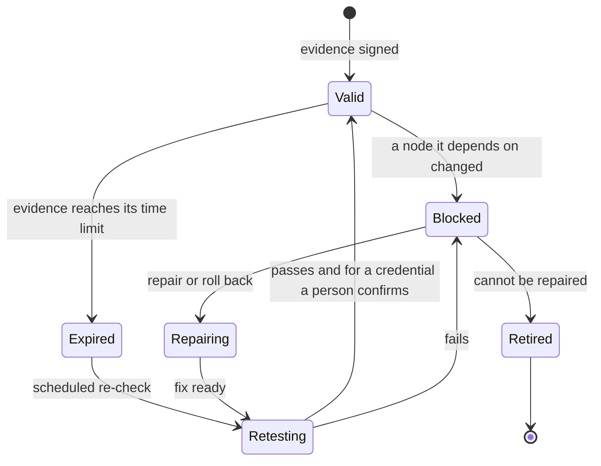
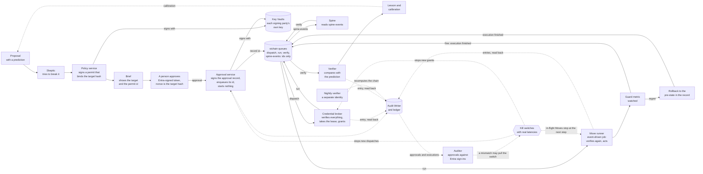

# Design 09 — Safeguards and drift controls

> **What this answers:** *What can silently change under us, in us and around us — and for each of those, what prevents it, what notices it and what puts it right?* And: *which safeguards stand between an AI mistake and an irreversible action?* Platform facts come from the [Foundry](research/foundry-agent-service.md), [governance and Agent Framework](research/foundry-governance-and-framework.md), [Citadel](research/citadel.md) and [security](research/security-and-compliance.md) research, checked on 2026-10-31. Part of the [design](README.md); principle **P9**, "drift is a first-class risk", is made concrete here.

---

## 1. What drift means here

**Drift is any divergence between three states that are supposed to agree:** what is **declared** (the repository and the release manifest), what was **evaluated** (the version the exam and the gates passed) and what is **actual** (what is serving traffic right now).

An AI system drifts on three clocks, and a design that watches only one is blind to the others:

| Clock | Who changes it | Example |
|---|---|---|
| **Ours** | our people and pipelines — or someone bypassing them | a portal edit to a gateway policy; a role assignment that was never removed |
| **The platform's** | Microsoft, under an unchanged label | the model router's pool grows inside version `2025-11-18`; a preview feature changes its schema; a service retires |
| **The world's** | prices, billing data, people, attackers | a new meter; a changed export schema; a poisoned tag; an approver who stops reading |

The model router is the instructive case: its **pool lost five models between July and August 2026 under a version label that did not change**, and Standard deployments auto-upgrade unless told otherwise. "We pinned the version" is therefore not enough; every drift control below checks the *behaviour and the actual state*, not the label.

**Each layer has three controls** — one that **prevents**, one that **detects**, one that **corrects** — and each control says whether the correction is **automatic** (the declared state is authoritative, the correction is reversible and the blast radius is small) or **human-approved**. A layer with no detective control is not controlled; a layer with a detective control and no corrective one is a pager.

Drift also has a *downstream* side. When something that a claim, a Detector, a Move, a piece of evidence or a credential **depends on** changes, everything that relied on it stops relying on it *first* and is re-examined *after*. That is a dependency graph, not a habit ([§3](#3-the-drift-controller)).

## 2. The drift catalogue

### 2.1 Drift in what we own

| # | Layer | What drifts | Prevent | Detect | Correct | Auto? |
|---|---|---|---|---|---|---|
| **DR-1** | **Infrastructure and configuration** | an Azure resource differs from its Bicep; **a managed resource is moved out of its stack's group** | subscription-scope **Deployment Stacks** with deny settings (excluded principals are *groups*: at most five; the resource group is in the template, because deleting the group bypasses deny assignments); Azure Policy *Deny* and *Modify*; **a move removes the stack's protection**, so the **lock procedure** below applies | scheduled `what-if` against `main`; Activity Log alert on a write by any principal other than the pipeline (D2, D8); **D17**, a managed resource moved out of a stack ([07 §10.2](07-security-architecture.md#102-detections-we-ship-as-code)); Policy compliance; Resource Graph | redeploy from `main`; Policy `Modify`; **a moved resource is moved back by a person, because a redeploy would try to recreate it in its old group (to confirm in the planted-drift test)** | auto for *safe* classes (tags, diagnostics, public access off); human for the rest |
| **DR-2** | **Identity and access** | role assignments, app roles, federated credentials, sponsors | no standing write; the broker's delegation is **constrained** (our Move roles, to the execution identities only) and exists only where the owner consented to action onboarding ([11 §6](11-delivery-and-operations.md#6-onboarding-and-offboarding-an-estate)); Policy audit of assignments | Resource Graph diff against declared roles; the **sweeper**; sign-in and credential-change alerts (D6); sponsor-validity check | the sweeper removes; a disabled sponsor-less identity | auto |
| **DR-3** | **Network and exposure** | public access re-enabled; a new private endpoint or DNS record; a firewall rule; an egress rule | Policy *Deny* on public access; network security perimeters on Storage, Key Vault, AI Search and Foundry; no direct deployments in spokes | daily **canary agent** (B1, B2 of [04 §8](04-landing-zone-and-citadel.md#8-the-gateway-bypass-register)); firewall deny logs (D7); Policy | `Modify` back to *disabled*; redeploy | auto |
| **DR-4** | **Gateway and contracts** | a policy, named value, product, backend or alias edited outside the pipeline | contracts in Git with CODEOWNERS; the hub's resource group under Policy that denies writes except the pipeline identity (a deny stack around the accelerator's own modules is *EVALUATE*) | `GET /version` and `/version/backend-contract` against the pinned values; nightly `what-if` on **every** contract, and a nightly assertion of the hardening settings ([04 §3.4](04-landing-zone-and-citadel.md#34-hardening-the-defaults)); API Management activity log (D8) | re-run the contract deployment; rotate keys if a credential could have been read | auto for contracts; human for the hub |
| **DR-5** | **Agent runtime** (hosted-agent versions and the spine) | the version serving traffic is not the manifest's; an image digest, environment or role differs; **the spine's Functions app differs in package digest, task hub name or always-ready count** | versions are **immutable**; only the pipeline identity may register a version or move the selector; Foundry's *block* action is held by operations, not by agents; **the pipeline fixes the task hub name (a changed name orphans in-flight orchestrations)** | every 15 minutes, read the control plane and compare with the manifest (D11), **including the spine app's settings**; Control Plane inventory and compliance | move the selector back to the pinned version; **redeploy the spine app from the manifest** | auto |
| **DR-6** | **Prompts, skills, tools** | an instruction or a tool list changes | prompts and skills exist only in the repository; a **hash** is baked in and written to every span and record (`prompt_hash`) | sampled traces whose hash is not in the manifest; the hash of each contract's `tools/list`; **a nightly tool-behaviour probe (golden calls against recorded fixtures), because a tool can change while its list stays the same** | redeploy; block the contract | auto |
| **DR-7** | **Policy and compliance** | a control loses its evidence; an initiative assignment is removed **or exempted**; a high-risk control is switched off between two releases | initiative assigned as code; the control mapping is tested ([08](08-governance-and-compliance.md)) | Policy compliance (effects take about 15 minutes; the standard compliance cycle runs every 24 hours, so the data can be that old, [Learn](https://learn.microsoft.com/azure/governance/policy/how-to/get-compliance-data#evaluation-triggers)); gate **G8** asserts the controls that gate an action **synchronously** from live properties and tests that the denied action is refused ([10 §4](10-test-and-evaluation.md#4-release-gates)); an `Audit` effect is a signal, never the evidence. **Between releases, for the highest-risk controls only** (the denials of public access on the chain's stores and on Foundry, the approved-models policy, the deny settings and locks of the stacks): an **Activity Log alert on every write or delete of a policy assignment, exemption or definition** (`Microsoft.Authorization/policyAssignments`, `policyExemptions`, `policyDefinitions`, `policySetDefinitions`, [Learn](https://learn.microsoft.com/azure/role-based-access-control/permissions/management-and-governance#microsoftauthorization)) and an **Event Grid subscription on policy state changes** ([Learn](https://learn.microsoft.com/azure/governance/policy/concepts/event-overview)); either one **runs that control's G8 live assertion at once**, so a switched-off or exempted control opens a finding in minutes, not at the next 24-hour cycle or the next release | `DeployIfNotExists` remediation; a task for the rest; **a high-risk control that fails its live assertion blocks the next release and is re-applied from `main`** | auto for DINE; human otherwise |
| **DR-19** | **Execution authority** | the chain differs from its declaration: who may use a signing key **or change its state**, what the broker's delegation allows, **who may write or start a chain job**, the template or image of a chain job, a lease that outlives its Move, an approval with no matching sign-in | key assignments, the delegation condition and the chain jobs' templates are code; **each signing party holds the custom role `acia-signer` (`keys/read` and `keys/sign/action` only) on its own vault**, because the built-in *Key Vault Crypto User* also holds `keys/update/action` and `keys/backup/action`, so a signer could re-enable a key that the kill switch disabled ([Learn](https://learn.microsoft.com/azure/role-based-access-control/built-in-roles/security#key-vault-crypto-user)), and the verifiers read public keys with `acia-key-reader` (`keys/read`, key-scoped); **only the pipeline that deploys the environment (`deploy` for dev and test, `release` for production) holds `Microsoft.App/jobs/write` and `jobs/start/action` on the chain's jobs, and the Approval service holds no `Microsoft.App/jobs/*` action**; exclusive, fenced leases; the Audit Writer is the only ledger writer ([§4](#4-the-safeguards-between-a-mistake-and-an-irreversible-action)) | **D13–D16 and D18–D20** ([07 §10.2](07-security-architecture.md#102-detections-we-ship-as-code)), D16 covering **every chain job** (broker, runner, Verifier): a start by any principal other than its queue trigger, or a template that is not the pinned one; a Resource Graph diff of the keys', the jobs' and the delegation's assignments, **including the check that no signing identity holds `keys/update/action`**; a heartbeat from each party | grants stop, the lease is revoked and the identity **quarantined** until its probe passes; the Governance plane may pull the **execution-plane switch** automatically (D2, D3, D13–D16) and records it; the **approval epoch** and the **key deny list** are pulled by a named person | auto for leases, quarantine and the plane switch; human for any change to the chain, the epoch and the deny list |

#### The lock procedure for stack resource groups

Learn's interim mitigation for the move bypass is a **read-only lock on the resource group**: it blocks moves in and out while stack operations keep working, and is lifted for a stack update and re-applied ([known issues](https://learn.microsoft.com/azure/azure-resource-manager/bicep/deployment-stacks-known-issues)). A read-only lock also blocks every ARM `POST` ([lock guidance](https://learn.microsoft.com/azure/azure-resource-manager/management/lock-resources)), so the procedure is applied **per resource group, by class** (to confirm per resource type):

1. **Groups the runtime does not touch through ARM** (network, registry, contracts, policy, ledger storage) carry the lock. Only the *bootstrap* stage lifts and re-applies it, each event is a ledger entry, and a lock found missing outside a pipeline run is a drift finding that a person approves re-applying.
2. **Groups the runtime starts or scales through ARM** cannot take it without blocking that call. Routine identities there use a Contributor-style custom role **without** `Microsoft.Resources/subscriptions/resourceGroups/moveResources/action`, which a move needs on its source group ([Learn](https://learn.microsoft.com/azure/azure-resource-manager/management/move-resource-group-and-subscription)); D17 raises the alarm.
3. Creating or deleting locks (`Microsoft.Authorization/locks/*`) belongs to the bootstrap identity only.
4. Each month the planted-drift job moves a harmless resource out of a test stack, with the right and the scope that [§6](#6-testing-the-safeguards) states: D17 must fire within its service level and, in a locked group, the move must be refused.

### 2.2 Drift under us

| # | Layer | What drifts | Prevent | Detect | Correct | Auto? |
|---|---|---|---|---|---|---|
| **DR-8** | **Models** | a version auto-upgrades; the router's pool changes; **the router fails over to another member of its set by itself**; a model is retired; behaviour changes under the same label | deployments pinned (`NoAutoUpgrade`); the router used only with a **model subset of at least two members, pinned in the contract**: Learn says failover is built in and that "If you configure a model subset, that subset also serves as your fallback set" ([Learn](https://learn.microsoft.com/azure/foundry/openai/how-to/responses-model-routing#built-in-enterprise-capabilities)), so the subset *is* the failover set; models appear only as aliases in the contract; Azure Policy for approved models (GA; asset ids end with `/`, because the policy matches a prefix, asserted by the exam) and the router (preview); **the resolved deployment, and the router member where the platform reports it, is recorded with every call** | a **statistical alarm**, not an attestation: repeated, stratified daily probes (refusal rate, format adherence, arithmetic accuracy, length) plus a **rotating hidden subset** from a sealed pool, tracked by a **change-point statistic** with a stated false-alarm rate; it sees shifts, not rare failures (the exam's job); the response's `model` field is a hint, not proof, but **an alert fires when the serving member is outside the pinned list or the share of fallbacks leaves its baseline** (the preview `routing_trace` lists failed attempts where the platform returns it, [Learn](https://learn.microsoft.com/azure/foundry/openai/how-to/monitor-model-router)); a change of the member list is a control-plane change (D9); **retirement alerts at 180, 90 and 30 days**; nightly small exam | the alias falls back to the pinned alternative, **but if which model answered, or whether the fallback stays in the EU class, cannot be shown, the agent pauses (fail closed)**; an unexpected change runs the **full exam** first; any re-pin is a **release** that passes the exam | auto for the fallback and the pause; human for the re-pin |
| **DR-9** | **Platform features** | a preview feature changes shape; a status label changes; a service retires | the **dependency register** ([§5](#5-the-preview-register-and-the-dependency-register)), which **fails closed to *preview*** when sources disagree about a status; pinned API versions and SDKs; protocol-version matrix per hop | the Scholar's **reflexive change radar** over our own dependency list, using the release feed; contract tests against live endpoints every night | a change request on the Agenda; the ADR's review trigger fires | human |
| **DR-10** | **Data and schema** | the cost-export schema or FOCUS version changes; the price API changes; an MCP protocol revision arrives (the 2026-07-28 revision is a breaking, stateless one) | tolerant readers behind schema contracts; keep the previous protocol version until each hop is tested | ingestion validates schema and **fails closed**: numbers are marked *stale* and savings claims stop ([03 §6](03-logical-architecture.md#6-degraded-modes)) | an adapter change drafted by the Engineer, reviewed by a person; **everything that used the stale numbers is invalidated through DR-11** | human |
| **DR-11** | **Knowledge, and what depends on it** | a claim goes stale; a price changes; a lesson is wrong; the Atlas is poisoned; **a source, tool, evaluator, data snapshot or credential that a claim, Detector, Move, Brief or credential depends on changes** | every claim has scope, receipts, an expiry and a **re-check recipe**; pull-request review; knowledge CI; **every record names what it depends on when written**, so the dependency graph ([§3](#3-the-drift-controller)) is data, not inference | scheduled re-checks; the change radar; contradiction detection by the Cartographer; a rising rate of reverted claims; **a change in any node** (a source hash, a tool or evaluator version, a price snapshot, a credential) | **every consumer is invalidated first** (Detectors, Moves, Briefs, in-flight cases, credentials), then repaired or rolled back, then re-checked; the claim is demoted to *stale* and the Study workflow starts; lessons expire; a credential whose evidence is invalidated is **withdrawn** (DR-16) | auto for invalidation and withdrawal; human to restore |

### 2.3 Drift in behaviour and in people

| # | Layer | What drifts | Prevent | Detect | Correct | Auto? |
|---|---|---|---|---|---|---|
| **DR-12** | **Agent behaviour** | quality, restraint or honesty changes; confidence stops matching accuracy | gates G3–G5 before release ([10 §4](10-test-and-evaluation.md#4-release-gates)); shadow mode for every new agent or Move | **continuous evaluation** on a sample of production traces (judge scores with a human sample), refusal and abstention rates, tool-error rate, **calibration error** from the prediction ledger, false-alarm rate on planted decoys; a drift test (population stability) on score distributions | pause the agent or contract; roll back to the previous version | auto for safety signals; human for quality |
| **DR-13** | **Injection resistance** | the same attack starts working after a model or prompt change; **a deployed version loses its moderation setting** | the attack suite is a release gate (G2); **the source sanitiser on every tool service that returns free text chunks long text, because Foundry guardrails moderate only the first 1,000 characters** ([Learn](https://learn.microsoft.com/azure/ai-services/content-safety/region-availability#service-limits), [07 §5](07-security-architecture.md#5-defence-against-prompt-injection-in-nine-layers)); an `invocations` agent is not promotable without `invocations_moderation` | the daily canary; **canaries planted in every untrusted data source**; the screening-block rate; scheduled red teaming; **the 15-minute read of each served version (DR-5) also reads its `rai_config`, so an absent moderation setting is a finding, and a known-violating input is sent through the deployed path** | tighten the layer that failed; add the attack to the suite; **block the contract until the setting is back** | human; the block is automatic |
| **DR-14** | **Cost** | tokens per case rise; a loop appears | token limits per contract at the hub; budgets in every envelope; **the spine reserves the worst-case cost before each leaf call, because the hub's limit alone can overshoot when requests are concurrent**; `max_tokens` set | D4 (3× the trailing median); cost-per-case trend; Azure budgets as a *backstop only* | throttle the contract; move a role to a cheaper alias; a case for the Conductor | auto for throttling |
| **DR-15** | **Evaluation itself** | a judge changes; a golden set leaks; thresholds creep; **the Forger and the investigators share a blind spot** | the independent-family rule; **a separate generator, keys and labels per exam** ([10 §3](10-test-and-evaluation.md#3-the-terrarium-as-the-test-harness)); protocols and thresholds **registered before scoring and hashed into the manifest** | planted failures the judges must catch; human sampling of judge verdicts; a leakage audit before each credential exam ([10 §7](10-test-and-evaluation.md#7-testing-the-tests)); **the quarterly independence test of the Forger** | re-baseline; **a possibly-seen item is excluded, not down-weighted**; the change is itself a release | human |
| **DR-16** | **Autonomy** | a credential outlives the evidence for it | credentials are bound to a **manifest, domain, cap and expiry**; granted by people, per domain | the Auditor scores outcomes against predictions; *regret* is an event; **outcome coverage** (the share of actions whose outcome was scored) and the guard metric are watched | **automatic withdrawal** on regret, **invalidating drift** (DR-11), low outcome coverage or a guard failure ([FR-X2](01-requirements-and-principles.md#cross-cutting)); a withdrawal writes the credential to its **own deny list**, which the broker reads at grant ([§3](#evidence-invalidation-and-withdrawal)) | auto |
| **DR-17** | **Approvers, as a role** | decisions become reflexive across the role; one role-holder dominates a Move class | two hats for purchases, enforced by the service; **the same confirmation friction (a re-read step) for every approver of a high-value Move**; rosters are *human-administered groups* | **role-level, aggregate signals only**: the approval-latency distribution of the role per Move class, its approve/decline ratio, sampled review of approved *cases*; a cohort under five is not reported | a review prompt to the role; change the friction for the whole class; the owner rotates the roster | human |
| **DR-18** | **This design** | documentation and reality diverge | the requirements trace to controls ([01 §6](01-requirements-and-principles.md#6-where-each-requirement-is-answered)); the lint and link checks | the traceability test in CI; ADR review triggers | an issue opened by the Auditor | human |

**On people.** DR-17 watches the *role*, not the person: **no individual score**, no per-person latency or ratio, **no inference about a named person's working rhythm**. The aggregate job reads an approval view with no actor column, and a cohort under five is not reported. The only personal data kept about approvers is their **contact preferences** (working hours and language, stated by the person, opt-in), used to choose *when and how to ask* and never to evaluate anyone ([06 §5](06-data-and-knowledge.md#5-estate-knowledge-privacy-by-design), [08 §2.2](08-governance-and-compliance.md#22-what-it-means-for-the-design); whether any remaining use counts as monitoring of workers stays *to confirm with counsel*). The price is stated in [§4](#4-the-safeguards-between-a-mistake-and-an-irreversible-action): one approver's habit shows only through the uniform friction and sampled case review. A **contract test** keeps the line: the build fails if the estate service returns a per-person field other than contact preferences ([10 §2](10-test-and-evaluation.md#2-the-layers), L2).

## 3. The drift controller

Detectors are **small, deterministic jobs**, not agents. Together they are the *drift controller*: a set of Container Apps jobs that each compare *declared* with *actual* for one layer and emit a **drift finding**.

```yaml
finding: 1
id: df-2026-10-31-0007
layer: DR-5                     # agent runtime
expected: skeptic@sha256:aa… 
actual:   skeptic@sha256:bb…
severity: high
reversible: true
auto_correct: allowed           # declared state is authoritative
invalidates: [ev-g4-0412, cred-0012]   # consumers found through the dependency graph (below)
```

1. **Findings are typed records** in the Ledger and the audit ledger, never free text.
2. A **correction policy** (deterministic) decides: *auto-correct* only when the declared state is authoritative, the correction is reversible and its blast radius is in the *small* class; otherwise a **case** is opened for a person.
3. The **Auditor** agent reads the stream of findings to find *patterns* (the same layer drifting weekly means a process is wrong), and the **Conductor** puts the patterns on the Agenda.
4. **The controller is not switched off by what it watches.** It has its own identities, runs from the governance plane, and each detector sends a **heartbeat** to a dead-man's-switch alert in Azure Monitor: silence is an alert.
5. The controller measures itself: **mean time to detect**, **mean time to correct**, the share of findings corrected automatically, and findings older than their service level. These are design targets for the first quarter, not promises.
6. **Every detector, and every automatic correction claimed in §2, is fault-injected** in a test estate ([§6](#6-testing-the-safeguards)); a detector that has never found a planted fault does not count as a control.

#### Evidence, invalidation and withdrawal

Every release gate ([10 §4](10-test-and-evaluation.md#4-release-gates)) emits **signed, time-bounded evidence** keyed to the release manifest. Every record that something else relies on (a claim, a Detector, a Move, an evidence record, a credential) carries `depends_on` edges to what it was built from: source hashes, data snapshots, tool, evaluator and judge versions, the manifest, other claims. The producing service writes them when it creates the record; the graph is their union, kept in the Ledger. When a detector reports a change in a node, the controller **invalidates every consumer at once** (a consumer refuses an invalidated record); only then does the slower work begin: repair or roll back, re-run the exam or re-check and, for a credential, a person confirms.



A **credential** is the last node: bound to a manifest, a domain, a cap and an expiry, it is **withdrawn automatically** when a node its evidence rests on is invalidated, and granted again only by a person after a fresh exam (G9, [10 §4](10-test-and-evaluation.md#4-release-gates)). **A withdrawal has its own deny list.** It writes the credential's id to the **credential deny list** in `controls`, separate from the all-approvals epoch, and the broker checks the credential's **live status** and that list at grant, before it takes the lease: an approval that rests on a withdrawn credential and sits in the `dispatch` queue is refused, and no other approval is touched. The graph is only as good as its edges: the producing service refuses a record without `depends_on`, and every node type has a planted change in the drills ([§6](#6-testing-the-safeguards)).

## 4. The safeguards between a mistake and an irreversible action

The drift catalogue keeps the system *as designed*. The safeguards below keep a *wrong proposal* from becoming a *wrong change*. They are layered so that no single failure — a fooled model, a hurried human, a stale number, a compromised service — is enough, and one rule closes them: **no change without a ledger entry**. The order is that of W4 ([05 §3](05-agents-and-orchestration.md#3-the-workflows)): the **Policy service** signs a permit first; the Brief shows the target and the permit id; a **person** approves; the **Approval service** signs the approval record and enqueues its id; the **broker** verifies everything itself, takes the lease and grants; the **runner**, an event-driven job, verifies again and acts; the **Verifier** compares the result with the prediction. **No single credential completes a change**, and the residual that remains is stated exactly below the table. The signer starts nothing because Learn says that *Jobs - Start* "accepts an optional execution template that can override the main and init container images, commands, and environment variables", and a job can use any managed identity configured for it ([Learn](https://learn.microsoft.com/azure/container-apps/jobs#permissions)): whoever may start a chain job can run any image as that job's identities. That right sits with the pipeline that deploys the environment only (`deploy` for dev and test, `release` for production), and a queue message starts each execution.



#### The authority chain

| Party | Does | Cannot | Independent check on it |
|---|---|---|---|
| **Policy service** (internal ingress from the spine and the Brief service) | decides in code whether a rule or an autonomy credential covers the proposal and **signs a permit** `{permit_id, proposal_id, Move id and version, target_hash, scope, class, caps, nonce, expiry}` with a key of its own, in its own vault; reads nothing about any estate | sign an approval; start a job; grant a role | the broker and the runner verify the permit's signature themselves, so a compromised Approval service cannot forge one; a `sign` with no ledger entry is D18 |
| **A person** | approves on the **web approval page**, the default and the only path for every irreversible Move, every purchase and every credential grant: an Entra sign-in whose OpenID Connect `nonce` is the target hash, the **Entra-signed ID token** stored in the record; a Teams card approves in place only for *reversible Moves of the lowest class* and otherwise opens the page | be impersonated by a service: no service can mint that token | the broker checks the token against Entra's published signing keys: issuer, tenant, audience, nonce, `iat` and `exp` within five minutes, `auth_time` later than the approval's creation, `amr` (the class's method), and the approver's standing read live from the target's role assignments or groups; D13 |
| **Approval service** | assembles and signs the **approval record** (the permit, the person's proof, the approver-set snapshot id, the epoch, a nonce, an expiry) with its own key, writes it to `approval-records` and **enqueues the record id** on `dispatch` | **start a job**: it holds no `Microsoft.App/jobs/*` action of any kind; fabricate a permit or a person's token; grant a role; act on an estate | the broker's and the runner's own verification; the Auditor's cross-check against Entra sign-ins (D13: the sign-in log needs Entra ID P1 or P2 through Microsoft Graph, [Learn](https://learn.microsoft.com/graph/api/resources/signin?view=graph-rest-1.0); without it only the signed record's token claims against the Brief record, which is weaker); D20 |
| **Credential broker** (consumes `dispatch`; no ingress) | **verifies everything itself**: the Approval and permit signatures (public keys read from each producer's vault), the person's token, the epoch and the key and `azp` deny lists, the credential's live status and deny list where the basis is a credential, the nonce marker (a conditional create in `approvals-index`, partitioned by nonce); then **takes the lease** (a conditional create in `leases`) **before** it grants a constrained role to the leased execution identity, writes its ledger entry **and reads the appended block back**, and enqueues the id on `run`; it **stays running until the runner's *done* marker or the lease deadline**, then removes the role and **deletes the lease only after the revocation probe passes**: it alone creates, replaces and deletes lease items | start a job; sign an approval or a permit; assign any role but our Move roles, or to any principal but the execution identities; **limit the target scope**, which its condition cannot | D14, D15, D16; the delete-only sweeper |
| **Move runner** (an event-driven job that takes one message and exits; its own environment and subnet) | its template is **fixed by the pipeline**; it **re-verifies independently** (signatures, token, lease, the live Azure Resource Manager state and etags against the target hash), acts as the leased identity, writes its outcome entries and reads them back, ends the Move by creating its *done* marker in `approvals-index` and enqueues `execution finished` | be started by anyone: **only the pipeline that deploys the environment (`deploy` for dev and test, `release` for production) holds `Microsoft.App/jobs/write` and `jobs/start/action` on the chain's jobs**; create, replace or delete a lease (it only reads it); act on another target; skip a ledger entry | **D16**, which covers every chain job (broker, runner, Verifier): a start by any principal other than its queue trigger, or a template that is not the pinned one; D3; the guard metric |
| **Verifier** (consumes `verify`, enqueued by the spine on `execution finished`) | compares the live result with the prediction and writes the outcome, then reads it back | write to an estate; start a job | D16; the Auditor scores outcomes against predictions |
| **Audit Writer** (internal ingress from every producer) | the only writer of the ledger; verifies each producer's signature and sequences entries | be bypassed, or vouch for itself: the broker, the runner and the Verifier proceed only after they read their own block back and match its hash, and the **nightly verifier is a separate identity and code path** that recomputes the chain, the signatures and the daily digest against the second-region copy | D19 |

**What the chain claims, and what remains.** No **single credential** completes a change. A compromised Approval service cannot start a job, cannot fabricate a Policy permit and cannot fabricate a person's Entra-signed token, so it cannot complete a change that needs a person; it can withhold, delay or replay (a replay is stopped by the nonce marker and the expiry). A compromised Approval service **and** a compromised Policy service can forge an approval whose basis is an **autonomy credential**, for which no person's click is required, within that credential's cap, scope and expiry; D13, D15, D16 and D20 and the cap bound it, and credentials are withdrawn automatically on invalidating drift. A compromised broker can grant only the constrained roles of its delegation to leased execution identities and cannot make the runner act, because the runner verifies for itself.

**The queues.** One dedicated storage account, `stchain`, in each chain environment (ZRS, a private endpoint in `snet-exec`, shared-key and public access off) holds the four queues `dispatch`, `run`, `verify` and `spine-events`; a message carries an **id only**. Each party's role assignment is **scoped to its own queue** (queue-level scope is supported for the built-in queue data roles, [Learn](https://learn.microsoft.com/azure/storage/queues/secure-queues)); a **condition on the queue name** is the generally available alternative but covers only the five message actions ([attributes](https://learn.microsoft.com/azure/storage/queues/queues-auth-abac-attributes)); that the queue trigger and the runner job's scale rule work with a queue-scoped role carrying the least data-plane right the scaler needs is *to confirm* in S-ID-3, and one storage account per queue pair is the fallback. The scale rule authenticates with a managed identity, which Learn documents for Azure Queue Storage scale rules ([Learn](https://learn.microsoft.com/azure/container-apps/managed-identity#use-managed-identity-for-scale-rules)); on an event-driven *job* that is *to confirm*. The spine reads `spine-events` through a queue-triggered function in its own app, so no chain service holds a Durable management key.

**Leases.** An execution identity serves one Move at a time, fenced by a lease token that the **broker creates, replaces and deletes** in the `leases` container: it takes the lease by a conditional create before it grants. The runner only **reads** the lease, before every step, and ends its Move by creating a *done* marker in `approvals-index` and enqueueing `execution finished`; the broker, still running, removes the role and deletes the lease only after the **revocation probe** passes. An **activation probe** runs before the Move, and until the revocation probe passes the identity is **quarantined**. RBAC changes can take up to ten minutes to take effect ([Learn](https://learn.microsoft.com/azure/role-based-access-control/troubleshooting)), so approval and purchase windows allow for it.

**If the Audit Writer is down**, no approval is dispatched and no grant is made, but a person's signed approval is **kept** in `approval-records` and dispatched when its ledger entry commits, and a **rollback to the pre-state named in the signed record is exempt**: it runs from a signed outbox, the gap is flagged D19 and it is reconciled afterwards.

**What stops when** ([07 §10.3](07-security-architecture.md#103-kill-switches)). A suspended contract stops in **seconds**. Disabling an agent identity stops **new tokens only**: an issued token lives until it expires (about an hour, possibly a day for managed identities; to confirm for agent identities), so the fast stop for one agent is its contract or the hub's **deny list on its `azp`**. The execution plane's switch stops **new grants and dispatches at once** and aborts in-flight Moves **cooperatively** (a running step finishes); role removal takes **minutes**. Three switches guard the approvals, all read from `controls` by every chain service with **a cache of at most 60 seconds, and a stale cache fails closed**: raising the **approval epoch** voids every earlier approval (a restore does the same, [06 §7.6](06-data-and-knowledge.md#76-recovery)), the **signing key's deny list** makes verifiers refuse that key's approvals, and the **credential deny list** withdraws one autonomy credential without touching any other approval ([§3](#evidence-invalidation-and-withdrawal)).

| Failure mode | Safeguard | What can still go wrong | Where designed |
|---|---|---|---|
| a **hallucinated number** | arithmetic only from the price engine and cost query; every figure has a receipt, and G5 checks that it **entails** the claim, is unchanged and fresh ([10 §4](10-test-and-evaluation.md#4-release-gates)); ranges, not points; the Skeptic recomputes | a genuine receipt that does not support the claim in its scope (SKU, region, date): entailment, not presence, catches it | [05](05-agents-and-orchestration.md), [06](06-data-and-knowledge.md) |
| a **wrong target** | the approval binds a hash of the Move, the exact resource ids, the parameters, the saving shown, **the live state (ARM etags or configuration hashes)** and the policy decision id; the runner recomputes it **and re-reads the live state** | the seconds between the runner's last check and its write; the guard metric and the rollback cover them | [07 §4](07-security-architecture.md#4-approvals-that-cannot-be-forged-or-reused) |
| **stale data** | freshness is checked at proposal *and* execution; stale cost data stops savings claims; purchases are re-priced at execution | data that is fresh and still wrong: the Skeptic and the owner | [03](03-logical-architecture.md), [05](05-agents-and-orchestration.md) |
| an **injected instruction** | the nine layers: **the source sanitiser** on every free-text tool service (it **chunks long text**, because Foundry guardrails see only the first 1,000 characters), gateway screening of each chunk, the capability matrix, **session taint enforced in the tool service and at the hub, not in the agent process** (a write tool refuses a call whose envelope taint is `untrusted` unless the field is on its allow-list), no model inside the decision to execute | instructions *can* travel in the free-text fields of typed records, so a model can be misled into a wrong **proposal**; it cannot execute one | [07 §5](07-security-architecture.md#5-defence-against-prompt-injection-in-nine-layers) |
| a **runaway loop or spend** | budgets in the envelope, the middleware and the hub; **the spine reserves the worst-case cost atomically before each leaf call**; circuit breakers; Lab budgets and expiry | the hub's limit can overshoot under concurrency and Azure budgets lag by 8 to 24 hours: the **residual overrun is stated per contract** | [05](05-agents-and-orchestration.md), [04](04-landing-zone-and-citadel.md), [12](12-cost-and-finops.md) |
| **privilege creep, lease collision** | no standing write; a role assignment only on a **leased** identity (probes, quarantine); the sweeper; D2, D14, D15 | RBAC lags by up to ten minutes, so a Move can start later than planned (the window allows for it); the delegation cannot limit the *target scope*, so the runner's check and the detections do | [07 §3.3](07-security-architecture.md#33-the-execution-identity-just-in-time-without-pim) |
| a **forged or replayed approval** | a **person's Entra-signed token** that no service can mint (its nonce is the target hash); the Approval signature and the Policy permit's signature, each verified by the broker and again by the runner; expiry, the single-use nonce marker (partitioned by nonce), the epoch and the key, `azp` and credential deny lists; the Auditor cross-checks sign-ins (D13); refusals alert (D20) | a compromised Approval service can withhold, delay or replay (the marker and the expiry stop a replay) but cannot fabricate a permit or a person's token; Approval **and** Policy together can forge an approval **whose basis is an autonomy credential**, within its cap, scope and expiry: D13, D15, D16, D20 and the cap bound it. A coerced person with a legitimate right remains | [07 §4](07-security-architecture.md#4-approvals-that-cannot-be-forged-or-reused) |
| a **compromised broker, or a chain job started the wrong way** | the broker grants only our Move roles to leased execution identities and **cannot make the runner act**, because the runner verifies for itself; the broker, the runner and the Verifier are **event-driven jobs whose templates the pipeline fixes**, and **only the pipeline that deploys the environment (`deploy` for dev and test, `release` for production) holds `jobs/write` and `jobs/start/action` on them**: any other start or template change is D16 | a broker can still grant a legitimate role to a legitimate identity wherever it holds the delegation: target scoping is the signed hash, the runner's checks and detection, **not ABAC** | [07 §3.3](07-security-architecture.md#33-the-execution-identity-just-in-time-without-pim) |
| **double execution** | idempotency keys; a single-use nonce marker; the runner takes one message and exits, and a repeat finds the start and done markers; the lease | a crash between the effect and its ledger entry: on restart the runner reads the live state before retrying | [07 §4](07-security-architecture.md#4-approvals-that-cannot-be-forged-or-reused) |
| a **partial failure** | each Move has a tested rollback **to the pre-state named in the signed record**; the guard metric triggers it; **a rollback is exempt from an Audit Writer outage** (a signed outbox, flagged D19, reconciled); the Verifier records the real outcome | a rollback cannot undo an irreversible effect, so those Moves are rare | [10](10-test-and-evaluation.md) |
| an **irreversible action** | reversible by default; irreversible ones are rare, visible and doubly approved; purchases need two named people with different hats; **no credential covers an irreversible action** until the credential exam is passed | a purchase that was sound when approved and wrong later: bounded by the cap, the re-price and utilisation tracking | [01](01-requirements-and-principles.md) (P11) |
| a **Move run in the wrong window** | maintenance windows and owner calendars are part of the policy check; a per-estate daily rate limit | a calendar that is itself wrong | [05](05-agents-and-orchestration.md) |
| **content that harms** | model guardrails, and gateway screening of responses in windows of **1,000 characters by default** (configurable; the overlap is set and tested, because it defaults to none) and of prompts in windows of 10,000 ([Learn](https://learn.microsoft.com/azure/api-management/llm-content-safety-policy)), at every untrusted-text route; typed channel for the Diplomat | guardrails are probabilistic, English-primary and blind past character 1,000 on their own, and an injection that straddles a window boundary is split unless the overlap holds it: L5 plants one after character 1,000, one after 10,000 and one across a boundary | [07 §5](07-security-architecture.md#5-defence-against-prompt-injection-in-nine-layers), [10 §2](10-test-and-evaluation.md#2-the-layers) |
| a **compromised component** | the kill switches of [07 §10.3](07-security-architecture.md#103-kill-switches), **with their real latencies** (above); the ledger is a separate store | the gap between compromise and switch; a running step finishes | [07 §10](07-security-architecture.md#10-detection-response-and-the-kill-switches) |
| a **changed model** | pinned deployments; aliases; **the statistical alarm and the full exam it triggers**; a model change is a release | rare failures, which only the exam sees | DR-8 |
| **approver fatigue** | two hats; step-up (a code-enforced fresh sign-in where Entra P1 is not licensed); **the same friction for every approver of a high-value Move**; aggregate monitoring | by design nobody is scored: one person's habit shows only through the friction and sampled case review | DR-17 |
| **an unavailable ledger or key** | the execution plane **fails closed**: no Audit Writer, no entry, so no dispatch or grant (D19), but a person's signed approval is **kept** and dispatched when its entry commits and a rollback to the named pre-state runs from the signed outbox; with no approval-signing key, or no key for the Policy service, no approval can be issued | availability: the system degrades to ask-only until the chain is back | [03 §6](03-logical-architecture.md#6-degraded-modes), [11 §7.5](11-delivery-and-operations.md#75-runbooks) |
| **stale evidence** | gate evidence is signed and time-bounded; the dependency graph invalidates every consumer; credentials are withdrawn automatically | the interval between a change and its detection ([§7](#7-design-targets)) | [§3](#3-the-drift-controller) |

## 5. The preview register and the dependency register

**The rule (C4):** a preview feature is used only behind a switch, with a named generally available fallback and an exit criterion. The register is data in the repository; a detective job lists any preview feature in the path that is *not* in it.

| Feature | State on 2026-10-31 | Switch | Fallback | Exit criterion |
|---|---|---|---|---|
| Citadel **Publish contract** (MCP, A2A) | preview | `contracts.publish.enabled` | native API Management import of MCP servers (GA) | contract schema stable for two releases |
| Foundry **agent guardrails** and tool-call/tool-response checks | preview | `guardrails.agent.enabled` | gateway screening plus our deterministic gate; guardrails see only the first 1,000 characters of text, so they are never the only screen | GA |
| **Prompt Shields for documents** | GA for models; off by default | `guardrails.docshield` | none needed: turn it on | — |
| **Agent Governance Toolkit** (policy before tool calls) | public preview, MIT, breaking changes between majors | `gate.provider = agt` | in-house deterministic gate with the same contract | GA and a stable policy schema |
| **FIDES** information-flow labels | experimental | `labels.provider = fides` | our own label in the tool-call envelope | stable release |
| **Hosted-agent egress rules** | preview: preview features "are not intended to be used in production or in a live operating environment" ([Learn](https://learn.microsoft.com/azure/foundry/agents/how-to/add-hosted-agent-guardrails)) | `egress.rules = audit` | the firewall allow-list | GA, then *enforce* |
| **Protected GenAI content table** in Application Insights | preview | `telemetry.content.protected` | content capture off | GA |
| **Durable Extension** for the Agent Framework | prerelease; **not used** (the spine is Durable Functions, GA) | none | none needed | reconsidered at GA ([05 §4](05-agents-and-orchestration.md#4-how-the-spine-runs)) |
| Durable **orchestration versioning** | **preview** per Azure release record 498144 (*In preview*; no GA record found); Learn's page carries no label, so the register treats it as preview | `orchestrator.versioning = native` | a **new orchestrator function name per breaking change**, the old name drained, and `Recreate` only at zero in-flight instances | a GA release record; S-ORCH-1 runs the drain drill and this fallback |
| Foundry **capability settings** (ARM/Bicep API `2026-07-15-preview`) | **preview**; the caller needs *Storage Blob Data Contributor* and *Cosmos DB Operator* on the BYO Storage and Cosmos DB accounts, and AI Search needs no caller role ([Learn](https://learn.microsoft.com/azure/foundry/agents/how-to/virtual-networks#permissions)); whether settings supersede capability hosts for new accounts is unverified | `foundry.capability = host` | the legacy **capability host** through the portal or REST (no in-place update, [04 §7](04-landing-zone-and-citadel.md#7-the-foundry-layout)) | GA and shown in S-NET-3, which also tests the caller-role failure |
| **Microsoft cloud security benchmark v2** (AI security domain) | **preview** ("v2 (preview)", [Learn](https://learn.microsoft.com/security/benchmark/azure/introduction)) | none: a reference, not a dependency of any control | the repository's **control map** (each AI-n to a control and its evidence) stays authoritative, with v1 control ids where v2 changes ([08 §3](08-governance-and-compliance.md#3-security-regulation-and-benchmarks)) | v2 is GA |
| Flex Consumption **rolling site updates** | **preview** on two Learn pages (the hosting-plan and how-to pages); the site-updates page calls it generally available in some regions and still rolling out in others, so the register fails closed ([Learn](https://learn.microsoft.com/azure/azure-functions/flex-consumption-site-updates)) | none: the spine changes by orchestration versioning and a drain (RB-15), never by a rolling update | the default `Recreate` strategy with orchestration versioning | GA in our region, shown on Learn, and a measured benefit in S-ORCH-1 |
| Foundry **Routines** | **preview**: the records conflict (a Foundry devblog and Learn say GA, the Azure release record says preview), so the register fails closed | `clocks.routines.enabled`, off by default | cron jobs and Timer-trigger functions | a first-party GA announcement with an SLA and an envelope-capable invocation |
| `agent-framework-foundry-hosting` (Python) | **prerelease** (Learn), while hosted agents themselves are GA | `hosting.python = maf` | a framework-agnostic container that speaks the Responses and Invocations protocols itself on the GA `azure-ai-agentserver-*` packages, built in CI every night | a stable release of the package |
| `azure-ai-agentserver-*` (the host and protocol packages beneath the hosting integration and our fallback image) | the **Python packages are GA** (Learn: core ≥ 2.0.0; the package index also lists pre-releases); the **.NET packages are beta**; the **long-running (resilient task) APIs are preview** in both ([Learn](https://learn.microsoft.com/azure/foundry/agents/concepts/long-running-agent-reference)) | the manifest pins **GA versions only**; the long-running APIs stay off, because the spine owns long-running work | the spine and the case store | the long-running APIs reach GA |
| **Azure AI Search Serverless Developer** | preview, no SLA, narrow regions | `search.tier = serverless` | Basic tier | GA with private ingestion |
| **Azure Policy** for the router and for agent tools | preview | `policy.preview.audit` | Policy for approved models (GA); detection DR-8 | GA |
| **AI Red Teaming Agent** (cloud runs) | cloud API preview; **EU availability unverified**: the concept page lists France Central and Sweden Central, the evaluation-regions page only East US 2 and North Central US | `redteam.cloud`, optional | PyRIT and ASSERT, self-hosted in CI: the **mandatory** path for G2 ([10 §2](10-test-and-evaluation.md#2-the-layers)) | GA with an EU endpoint, billing and residency shown in a live non-production test |
| Foundry **recurring evaluations**, **custom** and **composite evaluators** | preview (each labelled so on Learn) | `eval.cloud.enabled` | our own harness and sampler job, the mandatory path ([10 §9](10-test-and-evaluation.md#9-platform-mapping)) | GA, with an EU region, billing and residency shown in a non-production test |
| **Flex processing** — a per-request `service_tier` on a **Global Standard** deployment, not a deployment type | preview; only the models in Learn's table (the GPT-5.6 and GPT-6 families), and any other gets HTTP 400, not a fallback; shares quota with Standard; 429 when capacity is short; **no automatic fallback**; no SLA ([Learn](https://learn.microsoft.com/azure/foundry/openai/how-to/flex-processing)) | alias `acia-batch`: the tier is set per alias at the hub and a caller's `x-ms-service-tier` header, which overrides the body, is stripped (to confirm, S-GW-1) | our own retry with backoff; Standard (`default`) only by an explicit spine decision | GA — and only for public and synthetic data |
| **Foundry Insights**, **agent optimizer** | preview; optimizer allow-listed | off | our own evaluation loop | never self-deploys: output goes through the exam and a person |

**The dependency register** lists every external dependency with its **retirement or review date**, and is watched by the Scholar (DR-9). Entries known today:

| Dependency | Date | Consequence |
|---|---|---|
| Foundry visual **workflow agents** | retire **1 Dec 2026** | not used |
| API Management **AI Gateway** older SKU | retiring **15 Jan 2027** | not used |
| Azure **Deployment Environments** | retires **22 Feb 2027** | not used |
| Azure Lab Services | retires **28 Jun 2027** | not used |
| **Sentinel** in the Azure portal | ends **31 Mar 2027** | we feed a SIEM, we do not run one |
| Front Door (classic) | retires **31 Mar 2027** | only the current tiers, if a public front is needed |
| Managed Grafana **Essential** | deprecated by **31 Mar 2027** | Workbooks and Azure Monitor dashboards |
| **Prompt flow** | retires **20 Apr 2027** | not used |
| **Groundedness detection** (Azure AI Content Safety and Azure OpenAI) | retires **30 Apr 2027** ([Learn](https://learn.microsoft.com/azure/ai-services/content-safety/concepts/groundedness)) | not used. The Foundry *Groundedness evaluator* is a different product and stays, tracked separately; whether the retirement touches *Groundedness Pro* (preview) is *to confirm*. Our receipt checks depend on neither |
| Azure Cache for Redis | retires **30 Sep 2028** | semantic cache off; Managed Redis if ever |
| Azure Functions **in-process model** | support ends **10 Nov 2026** ([Learn](https://learn.microsoft.com/azure/azure-functions/migrate-dotnet-to-isolated-model)) | not used: the spine is a C# isolated-worker app |
| **Durable Functions** on Flex Consumption (the spine) | GA; reviewed with each Functions release | orchestration versioning for in-flight work is preview (see the register above), with the named-function fallback (RB-15, [11 §7.5](11-delivery-and-operations.md#75-runbooks)); the Durable Task Scheduler is an upgrade if spike **S-ORCH-1** fails the Azure Storage provider ([14 §3](14-next-phases.md#3-spike-register)); settings in [05 §4](05-agents-and-orchestration.md#4-how-the-spine-runs) |
| Foundry **hosted agents** | GA since **June 2026** | limits to design around: immutable versions, no traffic splitting, 1,000 versions per agent, idle timeout 2 to 240 minutes, not offered in North Europe ([05 §5](05-agents-and-orchestration.md#5-anatomy-of-a-leaf)) |
| **Container Apps Sandboxes** | GA since **September 2026**; EU regions and price *unverified* | no preview switch; the choice against dynamic sessions is made on measurements ([05 §5](05-agents-and-orchestration.md#5-anatomy-of-a-leaf)) |
| **Signing keys** (Key Vault asymmetric keys, one per signing party: the Approval service's, the Policy service's for its permits, each producer's ledger-entry key, the Audit Writer's digest key) | a rotation policy with a near-expiry notification ([Learn](https://learn.microsoft.com/azure/key-vault/keys/how-to-configure-key-rotation)), at least yearly (a starting value), run as **one scheduled workflow** (RB-12); a rotation creates a new version and keeps the previous one ([Learn](https://learn.microsoft.com/azure/key-vault/keys/javascript-developer-guide-create-update-rotate-key)); verifiers accept the previous key id for the longest approval validity | rotation, deny list and replacement are RB-12; losing the Approval service's or the Policy service's key stops all approvals (fail closed, ask-only) |
| Model deployments | GA models retire after about **18 months** (12 for several partners) | alias fallback; alerts at 180, 90 and 30 days |

## 6. Testing the safeguards

A control that is not exercised is a hope. Every control here has a test in a named layer ([10 §2](10-test-and-evaluation.md#2-the-layers)):

- **Deterministic controls** (the target hash, the nonce, the signature checks, the leases, the sweeper, the correction policy, the ledger schema) have **property tests**: *an approval can never cover a target other than its own* is a property, and so is *a lease can never be held twice*. A forged, expired, replayed, re-targeted, pre-epoch or denied-key approval, a permit that the Policy service did not sign, a token with the wrong audience, nonce or `auth_time`, and an approval that rests on a withdrawn credential (the all-approvals epoch unchanged) are each refused by the broker **and** by the runner, tested on its own; every identity but the Approval service fails when it tries to sign with the approval key, and every identity but the Policy service with its key; **the ledger entry schema rejects any name, e-mail, UPN, `oid` or Teams-id field**; a producer that proceeds without reading its block back, and a writer that acknowledges without appending, are caught. **Role-assignment assertions** (L0) check that only the pipeline that deploys the environment (`deploy` for dev and test, `release` for production) holds `jobs/write` and `jobs/start/action` on the chain's jobs, that the Approval service holds no `Microsoft.App/jobs/*` action, that no signing identity holds `keys/update/action` and that only the broker holds a write role on `leases`.
- **Drift detectors** have **planted drift**: a scheduled job introduces a harmless drift in a test spoke and the detector must find it within its service level. The set covers an extra role assignment, a changed alias and a public-access flip, and, added after the first review round: a resource **moved out of a test stack** (D17); an agent version registered **without `invocations_moderation`**; a pinned alias pointed at a **different model**; a **role assignment without a signed approval** (D15) and an **approval without an Entra sign-in** (D13); a lease violation (D14); **a start of a test chain job by another principal, or with an altered template** (D16); **a signing identity granted `keys/update/action`** (DR-19); **an exemption added to a high-risk policy** (DR-7: a finding in minutes, not at the next cycle); a deployment output that carries a key; an `x-policy-id` header on a request; a free-text field longer than the content-safety window with an injection after character 1,000, another after character 10,000 and one **across a 1,000-character response-window boundary** (all must be caught: Foundry guardrails see only the first 1,000 characters, so the sanitiser chunks and the hub screens each window, with its overlap set); and a **change to each node type of the dependency graph** (a source hash, a tool version, an evaluator), which must invalidate every consumer and withdraw a test credential within its service level.
- **Who may move the planted resource.** No routine identity holds the move right (`Microsoft.Resources/subscriptions/resourceGroups/moveResources/action`); the **bootstrap identity** (*Azure Deployment Stack Owner* plus `Microsoft.Authorization/locks/*`) is its only holder. The **planted-drift job** runs in the test spoke only, with a **time-boxed assignment** of the right that ends with the run, and never for a production scope ([07 §3.1](07-security-architecture.md#31-who-has-an-identity)).
- **Every detector and every claimed automatic correction is fault-injected**; one that has not found a planted fault is not counted as a control.
- **The privacy line of DR-17 is a contract test** (L2): the estate service returns contact preferences only, and the aggregate job's approval view has no actor column.
- **Kill switches** are pulled in the monthly resilience drills and **timed**: each drill records the real latency of every level against [07 §10.3](07-security-architecture.md#103-kill-switches), including the **approval epoch** (an approval signed before the raise is refused by broker and runner), the **signing-key deny list** (verifiers refuse that key's approvals), the **credential deny list** (one credential's queued approval is refused) and the hub's **deny list on `azp`**; a switch pulled in `controls` must be honoured within the **60-second cache bound**.
- **The canary** and the **planted injections** run continuously; a silent success fails the release gate.

## 7. Design targets

Targets for the first quarter, to be validated, not promised: **time to detect** a configuration, identity or gateway drift within 15 minutes; a **behavioural** drift within 24 hours; **100 % of hub and agent changes** arriving through the pipeline (anything else is a finding); **no preview feature in the path that is absent from the register**; an **invalidating change** reaching every consumer, and withdrawing any credential built on it, within one detection cycle (15 minutes for configuration nodes); **no forged, replayed or re-targeted approval accepted** in the property tests; **no change without a ledger entry**; **no signing identity holding `keys/update/action`** and no start of a chain job by any principal but its queue trigger; and the **share of findings corrected automatically** reported every week.
