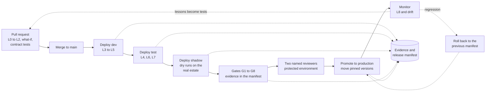

# Design 11 — Delivery and operations

> **What this answers:** *How is the system built, released, run and recovered — by one operator and a few contributors — without anything being touched by hand?* Platform facts come from the [options analysis](research/options-analysis.md), the [Foundry research](research/foundry-governance-and-framework.md) and the [Citadel research](research/citadel.md), checked on 2026-10-31. Part of the [design](README.md); the test layers and gates it runs are in [10](10-test-and-evaluation.md), the controls it keeps in [09](09-safeguards-and-drift-controls.md).

---

## 1. The repository

One repository holds everything that defines the system, so a release is a single, signed set of pins.

```
azure-cost-in-action/
  infra/          Bicep (Azure Verified Modules), one deployment stack per layer
  contracts/      Citadel backend, access and publish contracts, per group and environment
  agents/         one folder per agent: instructions, skills, tests, agent card
  services/       tool services and the execution plane (Python; C# for Z3 and the Teams adapter)
  workflows/      spine workflows (declarative YAML and code)
  moves/          the Move catalogue: recipes, dry runs, rollbacks, tests
  atlas/          claims, profiles, detectors, recipes (the Commons mirror)
  evals/          Terrarium generators, exams, baselines, attack suites
  governance/     control map, policy initiative, DPIA template, system card generator
  tools/          stdlib-only scripts: cost model, price fetcher, documentation lint
  docs/           the north star, the design, the reviews
```

Rules: **the main branch is protected**; every change is a pull request; contracts and `governance/` have CODEOWNERS that name the sponsor; nothing in the repository holds a secret or a customer's data (a scanner enforces both).

## 2. Infrastructure as code

**Bicep with Azure Verified Modules**, deployed as **Deployment Stacks at subscription scope** with deny settings. The modules exist for almost everything we use: Container Apps environments and jobs, Cosmos DB, AI Search, API Management, Key Vault, Log Analytics, the registry, Bot Service, and a Foundry account and project pattern. There is no module yet for Container Apps Sandboxes or for hosted-agent versions; the first is preview and the second is a data-plane object ([§4](#4-deploying-agents)).

| Stack (layer) | Holds | Changes |
|---|---|---|
| `foundation` | resource groups, VNet and peering, DNS links, Log Analytics link, Key Vault, registry, Storage, Cosmos DB, AI Search, **the Foundry account, projects and capability hosts** | rarely; contains the **one-way doors** ([04 §7](04-landing-zone-and-citadel.md#7-the-foundry-layout)) |
| `platform` | Container Apps environments, apps, jobs, Application Insights, the Bot resource, Azure Monitor alerts, workbooks | with every release |
| `contracts` | the Citadel contracts | by pull request; sponsor approves |
| `policy` | the Policy initiative and assignments | rarely; security lead approves |
| `lab` | the Lab management group, the vending module, the reaper | rarely |
| `onboarding` | the estate-side module: reader roles and export configuration | once per estate |

**Stack mechanics that matter** (from the platform's own documentation): deny settings accept at most **five excluded principals**, so exclusions are *groups*; **deleting a resource group bypasses deny assignments**, so the stack is deployed at subscription scope with the resource group *in the template*; a stack cannot manage Microsoft Graph resources and cannot delete Key Vault secrets; there is no `what-if` for stacks, so the pipeline runs `what-if` on the underlying deployment. The hub's own resource group may belong to another team, so there the control is Policy plus detection ([09 DR-4](09-safeguards-and-drift-controls.md#21-drift-in-what-we-own)).

## 3. Pipelines

GitHub Actions, authenticating to Azure by **workload identity federation** (no stored secret). Pipelines that touch private resources run on **self-hosted runners that are Container Apps event jobs** in the spoke.



| Workflow | Trigger | Does |
|---|---|---|
| **pr** | pull request | L0–L2, `what-if`, contract tests, documentation lint, a small L3 smoke |
| **deploy** | merge to main | deploy dev; L3–L5; promote to test when green |
| **release** | a release candidate | test → shadow → gates → protected environment (**two reviewers, neither the author**) → production |
| **nightly** | cron | the small exam, the fingerprint probe, drift detectors that are not continuous |
| **weekly** | cron | the full exam, the AI red-teaming run, the cost report |
| **drift** | continuous | the drift controller ([09 §3](09-safeguards-and-drift-controls.md#3-the-drift-controller)) |
| **atlas** | a pull request in `atlas/` | knowledge CI; a human reviewer merges; a signed Atlas release |

## 4. Deploying agents

Hosted agents are **data-plane objects**, so Bicep and stacks cannot own them. The pipeline:

1. builds one **image per group** from a pinned base, scans it, generates the SBOM and **signs** it, and pushes it to the private registry;
2. **registers an immutable agent version** for each agent through the Foundry SDK (the Python SDK is stable at 2.x; the .NET SDK is still beta), naming the image **digest**;
3. runs the version in **shadow**;
4. on promotion, **moves the version selector** to the new version — an endpoint serves exactly one version, with no traffic splitting, so canarying is done by the shadow environment, not by weighting;
5. **prunes** old versions (the cap is 1,000 per agent and reaching it is a terminal error).

The `azd` agent extension is beta and its command shapes have changed between releases; it is the **developer's inner loop** and the Lab's teardown, never the production path. **`azd down` deletes the resource group and is never run in production.** The agent extension also creates managed identities by default, which the pipeline does not use.

## 5. Releases and versioning

- **A release manifest** names every pin: agent versions and image digests, contract versions, model aliases *and the models they resolved to on the day*, the Atlas release, Move versions, workflow versions, framework and SDK versions, the Citadel commit. The manifest is **signed** and stored with the evidence ([08 §7](08-governance-and-compliance.md#7-the-evidence-pack)).
- **Rollback is redeploying the previous manifest.** Because the pins are immutable (versions, digests, commits), the previous state is exactly reproducible.
- **Cadence.** Weekly release trains; the Agent Framework itself releases about weekly, so a framework bump is its own, gated release rather than a drive-by. **A change of model version, prompt, tool, contract or framework is a release** and passes the gates.
- **Emergency changes** exist: a security fix may skip the train but never the gates G1, G2 and G8; each is recorded with a reason.
- **The Atlas has its own cadence** and its own signed releases; an agent run records the Atlas release it read.
- **Platform version.** Semantic versioning for the system as a whole; a major version means a contract or schema migration.

## 6. Onboarding and offboarding an estate

**Onboarding** is a pull request plus an accepted module, not a project.

1. The owner of the estate (a management group or subscriptions) deploys the **onboarding module** or accepts it by policy: **Reader, Cost Management Reader and Monitoring Reader**, nothing else, plus the export configuration that writes cost data to our lake.
2. The Surveyor builds the first Estate Model; the first questions go to the owners of the largest unexplained blocks ([north star](../01-north-star.md)).
3. The estate runs in **shadow** first: proposals and dry runs, no changes, until the owners see that the proposals are good.
4. **Autonomy credentials** are earned per domain, later, by exam ([10 §4](10-test-and-evaluation.md#4-release-gates), G9).

**Offboarding** removes the roles, stops the exports, deletes the estate's data according to the retention schedule ([08 §4.3](08-governance-and-compliance.md#43-retention)), and leaves only the pseudonymous approval record that the audit obligation requires.

## 7. Operating the platform

### 7.1 What is watched

| View | Built with | Shows |
|---|---|---|
| **Platform health** | Azure Monitor workbooks and Azure Monitor dashboards with Grafana (no extra resource) | hub availability, job success, queue depth, checkpoint-store health, subnet-exhaustion 429s, session counts against the 1,000 or 2,000 limit |
| **Agents** | Application Insights and the Foundry control plane | runs, cost per case, tool errors, judge-score trends, versions serving |
| **Cost of the system** | hub logs and Cost Management | tokens and euros per contract, per agent, per case; the first entries on its own Agenda |
| **Drift** | the drift controller's findings | open findings by layer, time to detect and correct |
| **Safeguards** | detections D1–D12 | alerts, kill-switch state, canary status |

Managed Grafana is *not* deployed (a private endpoint needs the Standard tier and the Essential tier is deprecated). Alerts go to an action group that reaches the operator by Teams and e-mail.

### 7.2 Support model

One operator, business-hours response, **designed so that nobody needs to be awake**: if the hub or the execution plane fails, the system degrades to *ask-only* ([03 §6](03-logical-architecture.md#6-degraded-modes)); no approval survives its expiry; nothing acts without a human. Severity classes: **S1** a kill switch was pulled or a safeguard failed; **S2** a drift finding with no auto-correction, or a failed gate in production; **S3** everything else.

### 7.3 Routine operations

| Task | Cadence | How |
|---|---|---|
| Rebuild images on updated base images | weekly | pipeline; Dependabot; the gates run |
| Rotate contract keys | quarterly, and on suspicion | the hub's three-step flow ([04 §4.3](04-landing-zone-and-citadel.md#43-the-access-contracts)) |
| Access review of sponsors, approvers, administrators | quarterly | an Auditor report; the owner confirms |
| Retirement and review dates | continuous | the dependency register alerts at 180, 90 and 30 days |
| Quota and tier checks | monthly | model quota is pooled per subscription; tier eligibility for the GPT-6 family needs Tier 5 or 6 or a quota request |
| Restore and failover drills | monthly | [10 §2](10-test-and-evaluation.md#2-the-layers) L6 |
| Cost review | weekly | the cost report; budgets are a backstop, caps are at the hub |

### 7.4 Who operates the platform: the system itself

The system applies its own pattern to itself (W9): detectors are deterministic jobs; the **Auditor** and the **Conductor** read their findings and open cases *about ourselves*, including the platform's own cost. **Azure SRE Agent is not adopted by default**: it bills 4 agent units an hour for as long as it exists — about €280–350 a month before tokens in Sweden Central — which contradicts scale to zero, and stopping it does not stop the meter. A 30-day trial in the non-production spoke is allowed. The **Azure Copilot Observability Agent** (consumption-billed, reads Basic and Auxiliary tables) is an optional human aid.

### 7.5 Runbooks

| # | Runbook | Trigger |
|---|---|---|
| RB-01 | Pull a kill switch and prove it took effect | any S1 |
| RB-02 | Hub degraded or down: confirm ask-only, communicate, recover | hub alert |
| RB-03 | A drift finding that cannot be auto-corrected | drift controller |
| RB-04 | Suspected prompt-injection incident: contain, preserve, assess "what could it have done?", recover, add a golden case | screening spike, D5 |
| RB-05 | Credential or key exposure: rotate, review the audit ledger | D6, scanner |
| RB-06 | A retired or changed model: fall back, run the exam, re-pin as a release | DR-8 |
| RB-07 | A failed approval or a stuck workflow: park, inspect, resume or close | watchdog |
| RB-08 | Subnet exhaustion or session quota | 429 `subnet_exhausted`, `session_quota_exceeded` |
| RB-09 | Personal-data request or breach (72-hour clock) | the data protection contact |
| RB-10 | Restore from the ledger digests and the hourly export | restore drill, disaster |
| RB-11 | Quarterly: access review, exception review, key rotation | calendar |

## 8. Resilience and recovery

The Foundry platform has **no automatic cross-region failover**, and global and data-zone deployments share a primary-region outage risk. A second region is outside the cost target in phase 1, so the strategy is **redeploy from code, with data protected by the redundancy of its stores**.

| Component | Availability design | Recovery |
|---|---|---|
| Hub | the hub owner's design; Standard v2 has a 99.95 % SLA and no multi-region; the accelerator's answer is *multiple full deployments* | platform runbook; ours degrades to ask-only |
| Hosted agents and jobs | zone-redundant environments where offered; scale-to-zero means nothing to fail over | redeploy the stack; re-register versions from the manifest |
| Audit ledger | geo-zone-redundant, immutable | no restore needed |
| Operational store | single-region serverless; hourly change-feed export to the immutable lake | replay |
| Cost lake | zone-redundant; raw re-requestable | rebuild derived layers |
| Foundry account | **one-way doors** make a re-creation a deliberate act | a second region's account, quota and subnet are requested and **kept dormant** only if the operator decides the risk justifies it |

| Target | Value | Basis |
|---|---|---|
| **RPO** for approvals, audit trail, Lesson Book | ≤ 1 hour | ledger redundancy; hourly export ([06 §7.6](06-data-and-knowledge.md#76-recovery)) |
| **RTO** for the platform | one working day | redeploy from the manifest |
| **RTO** for a single kill-switch recovery | minutes | feature flags and product re-enable |

## 9. The project as open source

Issues and pull requests are triaged weekly; every release carries notes that list the manifest changes and any migration; **supported versions** are the current and the previous minor; `SECURITY.md` names private reporting and a response time; deprecations are announced one release ahead. The Commons accepts only generalised content ([08 §9](08-governance-and-compliance.md#9-open-source-governance)).
